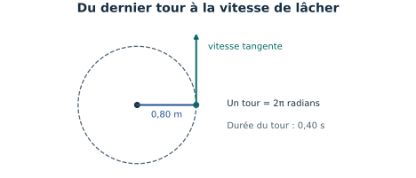
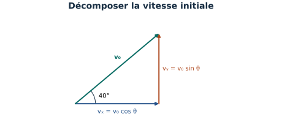
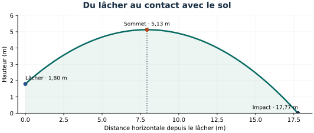
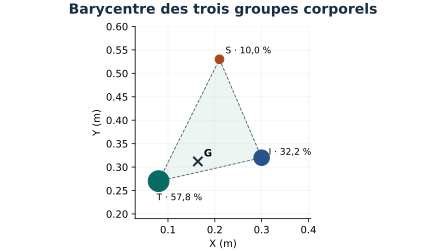

# ENS Rennes 2SEP — Biomécanique 2026 · Corrigé guidé

*Corrigé rédigé par IA, non officiel. Signalez toute erreur.*

**Rédaction** · modèle exact non renseigné (famille GPT-6) · effort non renseigné · vitesse non renseignée

**Révision** · modèle exact non renseigné (famille GPT-6) · effort non renseigné · vitesse non renseignée

**Révision (tour 2)** · GPT-6.2 Astra Ultra · vitesse non renseignée

## Présentation du sujet

Trois modèles répondent à trois questions différentes. Pour le disque, on change de modèle au lâcher, du mouvement circulaire au vol sous l’effet du poids. Pour le moment d’une force, on choisit comme pivot le point d’appui. Pour le plongeur, on calcule séparément les coordonnées horizontale et verticale de son barycentre. Le rapport du jury insiste sur le choix des grandeurs, les unités et la distinction entre temps du dernier tour et temps de vol. [Rapport de jury](https://www.ens-rennes.fr/medias/fichier/rapport-de-jury-2sep-svsaps-1-biome-ca-2026_1791532873688-pdf)

L’épreuve dure deux heures sans calculatrice. On prend $g=9{,}81\ \mathrm{m\,s^{-2}}$ et on arrondit les résultats numériques à la fin.

**Corrigé partiel, six questions sur sept.** Les quatre questions du lancer du disque, le moment de la réaction au point d’appui et le centre de masse du plongeur sont traités.

## Exercice 1 — Lancer du disque

### Question 1 — Du tour à la vitesse linéaire

> [!INDICATION]
> Calculer l’angle parcouru en radians avant de diviser par la durée du tour.

#### Solution

Un tour correspond à $2\pi$ radians. Avec $r=0{,}80\ \mathrm m$ et une période de $0{,}40\ \mathrm s$,
$$
\omega=\frac{2\pi}{0{,}40}=5\pi\simeq15{,}7\ \mathrm{rad\,s^{-1}},\qquad
v_0=r\omega=4\pi\simeq12{,}6\ \mathrm{m\,s^{-1}}.
$$
La vitesse au lâcher est tangente à la trajectoire instantanée.

### Question 2 — Composantes de la vitesse

> [!INDICATION]
> L’angle est mesuré depuis l’horizontale. La composante adjacente fait donc intervenir le cosinus.

#### Solution

On oriente $Ox$ dans le sens du lancer et $Oy$ vers le haut. Pour $\theta=40^\circ$,
$$v_{x0}=4\pi\cos40^\circ\simeq9{,}63\ \mathrm{m\,s^{-1}},\qquad
v_{y0}=4\pi\sin40^\circ\simeq8{,}08\ \mathrm{m\,s^{-1}}.$$
Les deux composantes sont positives. La composante horizontale est la plus grande puisque $40^\circ<45^\circ$.

### Question 3 — Hauteur maximale et durée de vol

> [!INDICATION]
> Prendre le sol comme origine verticale. Au sommet, seule la composante verticale de la vitesse s’annule.

#### Solution

La seule force pendant le vol est le poids du disque. Avec $h_0=1{,}80\ \mathrm m$, on a $v_y(t)=v_{y0}-gt$ et $y(t)=h_0+v_{y0}t-gt^2/2$. Le sommet est atteint à $t_s=v_{y0}/g\simeq0{,}823\ \mathrm s$. L’altitude maximale est
$$h_{\max}=h_0+\frac{v_{y0}^2}{2g}\simeq1{,}80+3{,}33=\boxed{5{,}13\ \mathrm m}.$$
Depuis ce sommet, la vitesse verticale initiale de descente est nulle, d’où $t_d=\sqrt{2h_{\max}/g}\simeq1{,}02\ \mathrm s$. La **durée du vol est $T=t_s+t_d\simeq1{,}85\ \mathrm s$**. On retrouve cette valeur par la racine positive de $y(T)=0$, soit $(v_{y0}+\sqrt{v_{y0}^2+2gh_0})/g$. Le disque descend plus longtemps qu’il ne monte car le sol se situe sous son point de lâcher.

### Question 4 — Distance horizontale

> [!INDICATION]
> Utiliser la durée de vol de la question 3 et la composante de vitesse qui reste constante.

#### Solution

L’accélération horizontale est nulle. La distance entre la verticale du lâcher et le premier contact avec le sol vaut
$$R=v_{x0}T\simeq9{,}626\times1{,}846\simeq\boxed{17{,}8\ \mathrm m}.$$
C’est la performance horizontale dans le modèle du sujet. La masse de $2\ \mathrm{kg}$ s’élimine dans la loi de chute libre.

Un contrôle indépendant consiste à calculer la distance horizontale au sommet, $x_s=v_{x0}v_{y0}/g\simeq7{,}93\,\mathrm m$. Le disque repasse à l’altitude de lâcher en $2t_s$, à $2x_s\simeq15{,}9\,\mathrm m$. Il parcourt encore environ $1{,}9\,\mathrm m$ avant de toucher le sol. Cette distance supplémentaire explique l’écart avec une trajectoire dont départ et arrivée seraient à la même hauteur.

## Exercice 2 — Équilibre autour de l’appui

### Question 1 — Moment de la réaction du sol

> [!INDICATION]
> Représenter la droite d’action de la réaction et mesurer sa distance au pivot.

#### Solution

Le point $O$ du pied droit est à la fois le pivot choisi et le point d’application de la réaction $\mathbf R$. Son bras de levier est nul. Par conséquent **$\mathbf M_O(\mathbf R)=\mathbf 0$**, soit $0\ \mathrm{N\,m}$ pour sa composante normale au plan. La réaction elle-même peut être non nulle.

### Question 2 — Équilibre des moments

Cette question est hors du périmètre du corrigé partiel.

## Exercice 3 — Centre de masse du plongeur

> [!INDICATION]
> Former les deux groupes bilatéraux, vérifier que leurs masses avec celle du tronc totalisent 60 kg, puis calculer les deux moyennes pondérées.

#### Solution

Les coefficients de la main, de l’avant-bras et du bras correspondent chacun à un seul côté. Il en va de même pour la cuisse, la jambe et le pied. Les points $S$, $I$ et $T$ désignent déjà les centres des groupes bilatéraux et du groupe tronc-tête dans le repère du sujet.

| Groupe | Fraction de la masse totale | Masse | Coordonnées $(x,y)$ en m |
|---|---:|---:|---|
| Membres supérieurs $S$ | $2(0{,}006+0{,}028+0{,}016)=0{,}100$ | $6{,}00\ \mathrm{kg}$ | $(0{,}21\,;\,0{,}53)$ |
| Membres inférieurs $I$ | $2(0{,}100+0{,}0465+0{,}0145)=0{,}322$ | $19{,}32\ \mathrm{kg}$ | $(0{,}30\,;\,0{,}32)$ |
| Tronc-tête $T$ | $0{,}578$ | $34{,}68\ \mathrm{kg}$ | $(0{,}08\,;\,0{,}27)$ |

La somme des trois fractions vaut 1. Les coordonnées cherchées sont les barycentres des coordonnées des groupes. En mètres,
$$x_G=0{,}100(0{,}21)+0{,}322(0{,}30)+0{,}578(0{,}08)=0{,}16384,$$
$$y_G=0{,}100(0{,}53)+0{,}322(0{,}32)+0{,}578(0{,}27)=0{,}31210.$$
Le centre corporel est donc **à $16{,}4\ \mathrm{cm}$ suivant $OX$ et à $31{,}2\ \mathrm{cm}$ suivant $OY$** depuis l’origine de la figure. Pour contrôler le barycentre à partir du tronc, on peut écrire $\overrightarrow{TG}=0{,}100\,\overrightarrow{TS}+0{,}322\,\overrightarrow{TI}$. Les deux composantes du déplacement sont $0{,}08384$ et $0{,}04210\,\mathrm m$. En les ajoutant aux coordonnées de $T$, on retrouve la position annoncée.

## Bilan

La hauteur du lâcher allonge la descente. Le choix du pivot élimine la réaction d’appui de l’équation des moments. Le contrôle de la somme des fractions de masse permet de détecter un membre oublié avant d’effectuer le calcul du barycentre.
