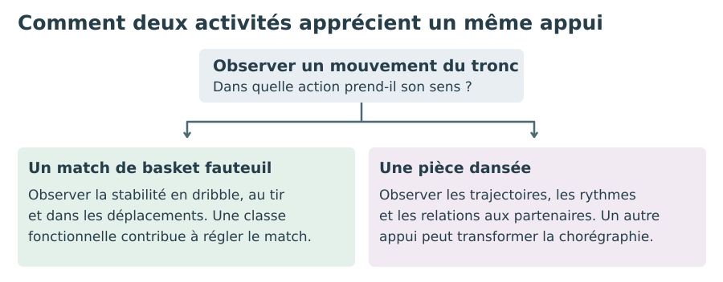
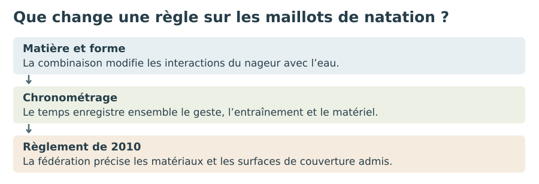

# ENS Rennes 2SEP — Culture générale 2026 · Corrigé brut

*Corrigé rédigé par IA, non officiel. Signalez toute erreur.*

**Rédaction** · modèle exact non renseigné (famille GPT-6) · effort non renseigné · vitesse non renseignée

**Révision** · modèle exact non renseigné (famille GPT-6) · effort non renseigné · vitesse non renseignée

**Lecture du rapport du jury** · GPT-6.2 Astra Ultra · vitesse non renseignée

**Révision** · GPT-6.2 Astra Ultra · vitesse non renseignée

**Révision (tour 3)** · GPT-6.2 Astra Ultra · vitesse non renseignée

**Révision (tour 4)** · GPT-6.2 Astra Ultra · vitesse non renseignée

**Problématique** — Comment tenir ensemble l’objectivité d’une performance et l’histoire des conditions dans lesquelles elle a pu être produite, reconnue puis récompensée ?

**Sujet R 26 – 345, page 2 · 4 heures.** Commentez cet extrait au regard de vos connaissances pluridisciplinaires dans le champ des activités physiques, sportives et artistiques. Le passage de Caroline Bertron et Julien Vitores, « Est-ce bien naturel ? », est reproduit dans le sujet. [Texte du sujet, page 2](https://www.ens-rennes.fr/medias/fichier/sujet-cgaps-2sep-2026_1791303234845-pdf#page=2)

## Introduction

Deux élèves nagent vingt-cinq mètres. Le chronomètre donne raison à celui que l’enseignant trouvait déjà « fait pour l’eau ». Pourtant, cet élève a passé plusieurs étés en club. L’autre a longtemps cherché son équilibre chaque fois qu’il tournait la tête pour respirer. Que mesure l’écart entre les deux temps ? Le premier nageur s’est bien déplacé plus vite. Mais le mot de don attribue d’emblée au nageur une propriété antérieure à toute histoire, alors que le chronomètre vient de mesurer ce qu’il sait faire aujourd’hui. Si l’enseignant forme ensuite des groupes fixes à partir de cette première course, son explication risque de produire une partie des écarts qu’elle prétendait seulement constater.

Dans leur texte de 2019, Caroline Bertron et Julien Vitores interrogent cette opération qui consiste à tenir pour naturelle une différence, puis à invoquer cette nature pour justifier les places distribuées. Ils signalent un enjeu de connaissance, puisqu’on perd de vue les variations entre sociétés, et un enjeu de pouvoir, puisqu’une hiérarchie peut acquérir l’apparence de la nécessité. Leur dernière proposition oblige cependant le lecteur à prendre toute la mesure du corps matériel. Un entraînement transforme réellement des gestes, des capacités et des sensations. Comment tenir ensemble l’objectivité d’une performance et l’histoire des conditions dans lesquelles elle a pu être produite, reconnue puis récompensée ? Il faut d’abord revenir de la mesure du résultat à la formation du pratiquant, puis examiner comment les institutions choisissent les différences qui comptent. On pourra alors comprendre pourquoi la technique pose un problème d’équité auquel l’invocation de la nature ne fournit pas de réponse toute faite.

## I. Comment une histoire collective devient-elle une capacité corporelle ?

La réussite sportive rend particulièrement tentante une explication par le don. Dans une course, tout le monde a vu le même ordre à l’arrivée. Un observateur peut croire que la netteté du classement dispense de chercher de quelle expérience il résulte. L’enquête de Manuel Schotté sur les coureurs marocains de demi-fond prend précisément cette difficulté pour objet. La présence de nombreux champions d’une même origine dans un univers compétitif pourrait devenir le point de départ d’un récit sur les dispositions d’une population entière. Or le chercheur restitue à la fois des apprentissages, des possibilités de professionnalisation et l’évolution des débouchés du circuit européen. Une même origine nationale réunit des parcours profondément différents. Le seul examen des gagnants écarte de l’observation ceux qui ont commencé dans des conditions comparables et dont la carrière s’est interrompue. L’assignation d’un talent à une origine transforme alors la sélection opérée par une série d’institutions en propriété supposée de tous les membres d’un groupe.

À ce raisonnement, on peut adresser une objection forte. Sur la dernière ligne droite, c’est le coureur qui doit encore produire l’effort, et deux sportifs ayant reçu des possibilités de pratique analogues n’obtiennent pas nécessairement le même résultat. La conclusion de Bertron et Vitores permet de répondre. Une explication sociologique doit montrer par quels mécanismes une organisation du temps et des possibilités d’entraînement modifie des corps capables de s’adapter. À l’échelle de plusieurs saisons, répéter des efforts d’endurance, bénéficier d’intervalles de récupération et continuer malgré un premier échec peuvent modifier les capacités de soutenir une allure. À l’échelle d’une séance, apprendre à distribuer son effort change la façon d’utiliser ces capacités. La physiologie renseigne sur les transformations possibles et leurs limites. L’enquête sur une carrière établit qui peut les solliciter, dans quelles conditions et durant combien de temps. Chacune apporte une partie de l’explication d’une seule et même performance.

L’analyse vaut aussi pour les sensations par lesquelles le sujet se connaît. Dans son étude des techniques du corps, Marcel Mauss compare les manières apprises de nager. Au bord d’un bassin, un débutant peut avoir le sentiment que le placement de sa tête répond à un mouvement spontané. Un apprentissage progressif de l’expiration dans l’eau et de la rotation du corps lui permet pourtant de découvrir d’autres appuis. Plus le mouvement devient familier, moins il a besoin d’en distinguer consciemment les étapes. Ce qui paraît le plus « naturel » à l’observateur peut ainsi être le résultat le plus achevé de l’apprentissage. Encourager un élève en lui disant qu’il possède le don de nager paraît anodin, mais prive ses camarades d’une information décisive sur ce qu’il est possible d’apprendre. L’histoire sociale du corps change ici la manière d’enseigner un contenu technique concret.

Le chronomètre rassemble ainsi les effets d’une histoire d’accès au bassin et d’un apprentissage du geste. Le résultat de l’épreuve peut ensuite produire une nouvelle différence : si les élèves les plus rapides accèdent seuls au groupe qui s’entraîne davantage, un premier classement modifie les possibilités d’obtenir le suivant. La mesure participe alors à l’histoire de la capacité qu’elle enregistre.

## II. Qui décide quelles différences feront une catégorie ou un classement ?

Le texte déplace ensuite la question. Avant même d’expliquer la différence de deux résultats, il faut que quelqu’un ait défini l’épreuve dans laquelle ces résultats pourront compter. Le programme olympique en fournit un exemple. Des femmes disputaient déjà des marathons avant que l’épreuve féminine figure pour la première fois aux Jeux de Los Angeles en 1984. L’absence ancienne de championne olympique du marathon disait donc quelque chose de certain sur le programme des Jeux. Elle ne permettait aucune conclusion sur la capacité des femmes à courir cette distance. Et pourtant, faute de parcours reconnus, de financements et de modèles visibles, une restriction institutionnelle peut réduire le nombre de pratiquantes qui atteignent le haut niveau. Le danger politique du raisonnement naturalisant apparaît au moment précis où l’on invoque le faible nombre de résultats disponibles pour prolonger les conditions qui en limitaient la production.

Le sport de compétition doit néanmoins choisir des critères. La règle internationale du basket en fauteuil donne une forme chiffrée au problème. Dans le jeu à cinq, la somme des points de classification des joueurs sur le terrain est plafonnée à 14. Cinq joueurs classés 4,5, 3,5, 3, 2 et 1 atteignent exactement ce total. Remplacer le dernier par un joueur de 1,5 porterait la somme à 14,5. Aucun des six sportifs n’a changé de corps. Pourtant, l’admissibilité de la composition change, parce qu’une règle rapporte les possibilités fonctionnelles de chacun à un équilibre recherché entre équipes. Le score de la rencontre et les points de classification répondent ainsi à deux questions différentes. Sur un terrain de basket en fauteuil, des capacités fonctionnelles différentes peuvent avoir des conséquences sur l’équilibre du tronc, la conduite du fauteuil et la possibilité d’engager les deux bras dans une passe. La règle organise la participation de joueurs de profils différents à une même rencontre. Elle retient pour cette fin certains aspects du fonctionnement corporel. Une étiquette diagnostique ne donne, à elle seule, ni le rôle tactique ni l’adresse au tir. Un choix de classement peut donc protéger une possibilité de jouer. Pour en apprécier la justice, il faut demander à quelle difficulté sportive il répond, quels écarts il prend en considération et comment les sportifs peuvent faire examiner les décisions. Présenter une catégorie comme entièrement dictée par la nature ferait disparaître ces questions.

Le verbe « produisent » va plus loin que l’idée d’une illusion que dissiperait une meilleure information. Imaginons que l’on veuille éprouver, dans un club, l’affirmation selon laquelle les premiers résultats permettraient de repérer des aptitudes stables. Un relevé des seuls membres encore en compétition deux ans plus tard écarterait précisément les élèves que le premier classement a découragés. Il faudrait suivre aussi ceux qui ont changé de groupe ou quitté le club, connaître leur pratique antérieure et relever le temps d’entraînement réellement offert après le classement. Une progression qui varierait avec cet accès fournirait un indice sur la formation des écarts. Elle laisserait encore ouverte la question des autres conditions de la progression. La prudence du texte sur la « dimension matérielle » prend ainsi un sens précis. On peut enquêter sur ce qui a façonné une capacité tout en reconnaissant sa réalité chez celui qui l’exerce.

Le caractère situé des critères saute davantage aux yeux si l’on quitte le classement pour la scène. La compagnie britannique Candoco, fondée en 1991, a réuni des interprètes handicapés et non handicapés. Dans *Set and Reset/Reset*, une pièce de Trisha Brown a été reprise et retravaillée avec des danseurs dont les possibilités de mouvement différaient. Le point de comparaison devient alors la relation entre une trajectoire, un rythme et les autres interprètes. Une variation dans l’appui peut ouvrir une solution chorégraphique là où un examen standardisé enregistrerait seulement une limitation. Le poids, les appuis et la fatigue restent sensibles aux danseurs et au public. Ce qui se transforme, c’est la question adressée à ces corps et la place accordée à leurs réponses. La comparaison du basket en fauteuil et de la danse évite de confondre reconnaissance des différences et usage d’une grille unique dans toutes les activités.

## III. La technique rend discutables les limites du corps que l’on veut comparer

Si les capacités se construisent au contact d’un milieu, l’équipement n’intervient pas seulement après la production d’un effort « pur ». Il prend part à l’action. Un fauteuil de basket permet de tourner, de freiner et de prendre appui pour une passe. Un novice installé dans le fauteuil d’un champion ne saurait pas pour autant se démarquer, se replacer et choisir à qui passer la balle. Faut-il dire que l’engin répare une déficience ou qu’il augmente une capacité ? Cela dépend du terme de comparaison. Se déplacer jusqu’à l’entraînement, pivoter rapidement sous un panier et construire un effet de scène constituent trois tâches différentes. Une technique qui rend possible l’accès à l’activité peut aussi devenir le support d’une expertise nouvelle. La distinguer d’un avantage indu exige donc de préciser l’objet de l’épreuve.

La controverse sur les combinaisons de natation permet de suivre la décision collective. Une combinaison modifie les interactions entre le corps et l’eau. Quand des matériaux et des formes nouvelles apparaissent, une amélioration du temps enregistré peut tenir simultanément à l’entraînement, à la manière de nager avec le vêtement et aux propriétés de l’équipement. À partir du 1er janvier 2010, les règles internationales de la natation en bassin imposent des maillots textiles et en limitent la couverture. Le règlement ne rend pas le nageur indépendant de toute technique. Il fixe ce que la collectivité accepte de mettre en concurrence à une date donnée. Une innovation peut faciliter certaines mobilités et être inadéquate pour l’épreuve dont on cherche à rendre les résultats comparables. Le choix suscite aussi une question de ressources. Si seuls certains clubs ont accès à un équipement déterminant, l’égalité apparente du départ laisse subsister un avantage acquis avant la course.

L’argument des auteurs permet enfin de demander ce que l’on ferait d’une mesure en dehors de la compétition. Dans une classe, deux élèves peuvent obtenir le même temps au bassin alors que l’un sait déjà nager en club et que l’autre vient d’oser expirer dans l’eau. Pour attribuer une place en finale, on peut avoir besoin du temps obtenu. Pour savoir ce qu’il reste à enseigner, la même donnée est insuffisante. Observer la respiration, les appuis et les progrès après plusieurs essais permet de choisir des situations d’apprentissage différentes. Cela suppose de laisser aux élèves dont les acquis paraissent faibles le temps de s’exercer et d’examiner aussi la disponibilité des bassins, les trajets et les horaires. Une explication qui rapporterait toute difficulté à un manque individuel de motivation déplacerait sur la personne la responsabilité de conditions que l’institution peut en partie modifier. C’est une manière pratique de comprendre la critique de la psychologisation proposée au début de l’extrait.

## Conclusion

Bertron et Vitores conduisent à reprendre trois gestes ordinaires du monde sportif, mesurer, classer et autoriser. Un temps de course est un fait dont l’explication demande de reconstituer les conditions de formation du coureur. Une classification peut faciliter la rencontre si l’on justifie les traits qu’elle retient en fonction de l’activité. Une règle sur le matériel exprime une décision collective sur ce que l’on veut comparer. Dans les trois cas, le pratiquant demeure un être de chair, dont la fatigue et les apprentissages ont des effets propres. Prendre son corps au sérieux oblige aussi à demander s’il a eu accès au bassin, qui lui a appris les gestes et ce qu’il pourra faire demain d’une différence mesurée aujourd’hui.
