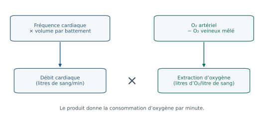
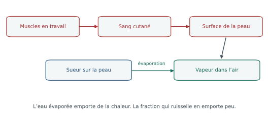
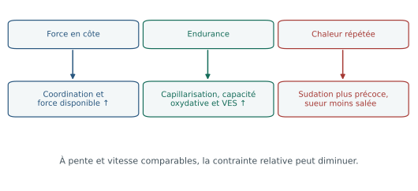

# ENS Rennes 2SEP — Physiologie de l’exercice 2026 · Corrigé brut

*Corrigé rédigé par IA, non officiel. Signalez toute erreur.*

**Rédaction** · Modèle : OpenAI Codex (famille GPT-6) · Effort de raisonnement : non renseigné · Mode de vitesse : non renseigné.

**Révision** · Modèle : OpenAI Codex (famille GPT-6) · Effort de raisonnement : non renseigné · Mode de vitesse : non renseigné.

## Situation étudiée

Lina, 18 ans, prépare un trail de 25 km avec 1 500 m de dénivelé positif. Après dix minutes d’échauffement, son test comporte vingt minutes d’ascension sur une pente moyenne de 10 %. L’épreuve écrite dure deux heures. [Sujet officiel](https://www.ens-rennes.fr/medias/fichier/sujet-svsaps-2-physio-2sep-2026_1791303263430-pdf)

### Question 1 — Fatigue locale des quadriceps

**De la pente à la perte de force.** En côte, Lina élève son centre de masse à chaque foulée. Pendant l’appui, les extenseurs du genou, dont les quadriceps, doivent produire un couple important et souvent un travail concentrique. La force augmente par le recrutement d’unités motrices et la modulation de leur fréquence de décharge. Lorsque les premières unités ne suffisent plus, des unités de seuil plus élevé contribuent davantage. La répétition des contractions réduit progressivement la force ou la puissance que Lina peut encore produire pour une même commande.

**Dans la fibre musculaire.** L’ATP alimente le cycle actine–myosine et les pompes qui rétablissent les gradients ioniques et recaptent le calcium. Lors d’une augmentation brusque de la pente, la phosphocréatine régénère immédiatement de l’ATP ; la glycolyse et la phosphorylation oxydative y contribuent simultanément. Sur vingt minutes, le métabolisme oxydatif assure une grande part de l’approvisionnement, avec un appoint rapide des autres voies dans les passages les plus intenses. L’ATP reste relativement préservé alors que la phosphocréatine diminue et que le phosphate inorganique augmente. Celui-ci peut réduire la force produite par les ponts actine–myosine et perturber la quantité de calcium disponible pour activer les myofibrilles. Des modifications des gradients de potassium et de sodium lors des décharges répétées peuvent aussi diminuer l’excitabilité. Une même stimulation peut alors entraîner une contraction moindre : c’est une fatigue périphérique.

**De la fibre à la commande.** Les afférences musculaires des groupes III et IV signalent l’effort mécanique et les changements du milieu local. Elles contribuent aux réponses circulatoires et ventilatoires et peuvent limiter l’activation motrice volontaire. Une diminution de la commande centrale s’ajoute alors à la perte de force intrinsèque. Le lactate produit lors d’un débit glycolytique élevé peut circuler et être oxydé comme combustible. Sa seule présence n’explique ni toute la fatigue ni une perte soudaine de force. Le ressenti de Lina ne permet pas de mesurer séparément les contributions centrales et périphériques.

### Question 2 — Débit cardiaque et pression artérielle

**Pourquoi augmenter le débit ?** Le débit cardiaque vérifie $Q_c=\mathrm{FC}\times\mathrm{VES}$. Si la fréquence cardiaque et le volume d’éjection systolique augmentent, plus de sang traverse la circulation chaque minute. Les muscles en côte reçoivent davantage d’oxygène et de substrats et éliminent davantage de dioxyde de carbone. Selon le principe de Fick, $\dot V_{O_2}=Q_c(C_{aO_2}-C_{vO_2})$. L’augmentation du débit et l’extraction accrue d’oxygène par le muscle permettent ensemble d’accroître sa consommation. Le sang transporte également de la chaleur vers la peau.

**Comment le cœur augmente son débit.** Dès le départ, la commande motrice centrale active en parallèle les centres cardiovasculaires. La levée du frein parasympathique accélère le nœud sinusal. L’activation sympathique cardiaque et les catécholamines augmentent ensuite la fréquence et la contractilité. Les contractions des jambes compriment les veines, dont les valvules orientent le sang vers le cœur. La pompe respiratoire et la veinoconstriction sympathique soutiennent aussi le retour veineux. Un remplissage plus grand étire les fibres ventriculaires, ce qui augmente la force de contraction et le volume éjecté par le mécanisme de Frank–Starling. La contractilité augmente également la fraction éjectée à remplissage donné.

**Comment maintenir la pression et distribuer le débit.** En première approximation, la pression artérielle moyenne, diminuée de la pression veineuse centrale, est le produit du débit cardiaque par la résistance vasculaire systémique. Les métabolites locaux et les signaux endothéliaux dilatent les artérioles des quadriceps actifs. En parallèle, le sympathique resserre notamment les lits splanchnique et rénal. Les afférences mécaniques et métaboliques des muscles ajustent cette commande et le baroréflexe continue à amortir les variations autour d’un niveau de pression adapté à l’effort. Pendant un effort dynamique, la pression **systolique** s’élève généralement davantage ; la diastolique peut peu varier. Ainsi l’augmentation de pression rapportée et la vasodilatation des muscles actifs sont compatibles si le débit cardiaque augmente suffisamment.

### Question 3 — Ventilation et équilibre acido-basique

**Que représente la mesure ?** La ventilation minute $\dot V_E=V_T f_R$ combine le volume courant et le nombre de cycles respiratoires par minute. Son augmentation mobilise d’abord fortement le volume courant puis, lorsque son accroissement se limite, davantage la fréquence. Une ventilation de $120\ \mathrm{L/min}$ peut par exemple correspondre à $2\ \mathrm L\times60\ \mathrm{min^{-1}}$, sans que ces deux valeurs aient été mesurées chez Lina. Une partie du volume ventilé remplit l’espace mort. La ventilation alvéolaire disponible pour les échanges vaut $\dot V_A=(V_T-V_D)f_R$.

**D’où vient l’augmentation ?** La commande centrale stimule les centres respiratoires dès le départ, avant une modification importante des gaz artériels. Les afférences des muscles et articulations accompagnent cette réponse. À mesure que le débit métabolique augmente, le muscle consomme plus d’oxygène et produit plus de dioxyde de carbone. À intensité modérée, une hausse proportionnée de $\dot V_A$ peut éliminer ce surplus en maintenant une pression artérielle en CO₂ proche de sa valeur de repos. À forte intensité, la charge acide liée au renouvellement rapide de l’ATP mobilise le tampon bicarbonate :
$$\mathrm{H^+ + HCO_3^- \rightleftharpoons H_2CO_3 \rightleftharpoons CO_2 + H_2O}.$$
Le CO₂ supplémentaire doit être expiré. La baisse du pH artériel stimule notamment les chémorécepteurs carotidiens ; la sensibilité centrale au CO₂ passe par le pH du liquide cérébrospinal. La chaleur et les afférences musculaires peuvent encore renforcer la ventilation.

**Quel effet sur l’homéostasie ?** L’ajustement entretient les échanges d’oxygène et surtout l’élimination du CO₂. Lorsque la ventilation alvéolaire augmente plus vite que la production de CO₂, la pression artérielle en CO₂ diminue et la composante respiratoire atténue la baisse de pH. C’est l’hyperventilation au sens physiologique strict. La valeur de $120\ \mathrm{L/min}$ témoigne d’une forte ventilation globale ; il faudrait connaître aussi la production de CO₂ ou sa pression artérielle pour situer Lina par rapport à ce seuil de compensation.

### Question 4 — Chaleur, circulation et conservation de l’eau

**Dissipation de la chaleur.** Une grande partie de l’énergie libérée par les muscles devient chaleur. À $28\ {}^\circ\mathrm C$, la montée peut produire de la chaleur plus vite que les échanges secs (convection et rayonnement) et l’évaporation ne la dissipent. La température centrale atteint $38{,}9\ {}^\circ\mathrm C$. Les thermorécepteurs centraux et cutanés renseignent l’hypothalamus, notamment sa région préoptique. La vasodilatation cutanée transporte davantage de chaleur du noyau vers la surface et l’activation sympathique **cholinergique** des glandes eccrines augmente la sudation. C’est le passage de l’eau liquide en vapeur qui retire de la chaleur. Une sueur qui ruisselle ou reste sur la peau refroidit peu. La peau humide atteste donc que de la sueur y est présente ; l’humidité ambiante et le vent, qui conditionnent son évaporation, ne sont pas précisés.

**Conséquences circulatoires.** Les muscles actifs et la peau sollicitent simultanément le débit cardiaque. Si les pertes sudorales ne sont pas compensées, elles tendent à diminuer le volume plasmatique. Le remplissage cardiaque et le VES peuvent alors baisser à puissance constante. La fréquence cardiaque augmente en compensation : c’est une composante de la dérive cardiovasculaire. L’augmentation initiale du VES décrite en question 2 et cette évolution ultérieure correspondent à des moments différents. L’importance effective d’une déshydratation ne peut être chiffrée avec les seules données de température.

**Réponse endocrine et hydrique.** La sueur est généralement hypotonique par rapport au plasma. Les pertes peuvent donc augmenter l’osmolalité plasmatique et réduire le volume circulant. Les osmorécepteurs hypothalamiques stimulent la soif et la libération d’ADH (vasopressine), qui accroît la réabsorption d’eau dans les tubes collecteurs rénaux. La baisse de perfusion rénale et l’activation sympathique favorisent la libération de rénine, puis la formation d’angiotensine II et la sécrétion d’aldostérone. Celle-ci favorise la réabsorption de sodium au néphron distal et contribue à conserver l’eau. Ces régulations limitent les pertes urinaires et soutiennent le volume et la pression ; elles ne remplacent pas immédiatement l’eau déjà évaporée.

### Question 5 — Adaptations chroniques à l’entraînement

**Muscle, commande et substrats.** Après plusieurs mois, les séances de force et de côte améliorent le recrutement et la coordination des muscles extenseurs. Selon la charge d’entraînement, leur force maximale peut aussi augmenter. À vitesse et pente identiques, chaque foulée mobilise une fraction plus faible de cette force. Les sorties prolongées favorisent une capillarisation accrue et l’augmentation du contenu mitochondrial et de l’activité des enzymes oxydatives des fibres sollicitées. La distance de diffusion de l’oxygène diminue lorsque davantage de capillaires desservent le muscle. L’ATP peut être renouvelé plus efficacement par voie oxydative. Pour une même charge sous-maximale, l’utilisation des lipides peut augmenter, le glycogène être davantage épargné et la resynthèse de phosphocréatine s’accélérer entre les efforts. Les fortes perturbations métaboliques surviennent alors à une vitesse de montée plus élevée.

**Transport de l’oxygène, ventilation et récupération.** L’expansion du volume plasmatique améliore le retour veineux ; les adaptations cardiaques à l’entraînement d’endurance peuvent accroître le VES, y compris au maximum. Associées à une meilleure extraction périphérique d’oxygène, elles peuvent augmenter la consommation maximale d’oxygène. À vitesse et pente fixées, un même débit peut être fourni avec un VES plus élevé et une fréquence moindre. La hausse disproportionnée de ventilation associée à l’exercice intense apparaît à une puissance absolue plus élevée ; l’effort usuel paraît moins essoufflant. Les adaptations concernent notamment l’économie ventilatoire et les muscles respiratoires, sans exiger d’augmentation de la taille des poumons. Après la côte, la réactivation parasympathique participe au retour plus rapide de la fréquence cardiaque vers le repos.

**Chaleur et hormones.** L’endurance aide à maintenir le débit malgré l’afflux cutané. Si Lina s’est aussi entraînée de manière répétée en ambiance chaude, une acclimatation thermique peut s’ajouter : la sudation peut commencer plus tôt, sa capacité augmente et la sueur peut devenir plus pauvre en sodium par réabsorption accrue dans les canaux sudoripares, notamment sous influence de l’aldostérone. À effort sous-maximal comparable, la sollicitation sympathique et la hausse des hormones de stress peuvent être atténuées. L’ampleur de ces adaptations dépend de l’exposition et des pertes hydriques. La seule séance à $28\ {}^\circ\mathrm C$ n’établit pas une acclimatation. En associant la réserve de force, la capacité oxydative et le transport de l’oxygène, on explique à la fois une montée soutenable plus longue et une récupération plus rapide.

