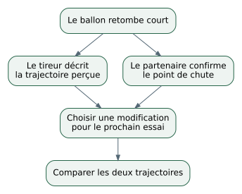
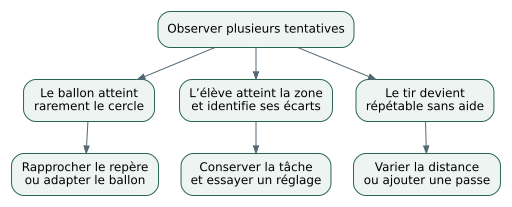
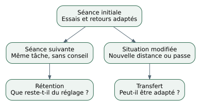

# ENS Rennes 2SEP — Sciences humaines 2026 · Corrigé brut

*Corrigé rédigé par IA, non officiel. Signalez toute erreur.*

**Rédaction** · modèle exact non renseigné (famille GPT-6) · effort non renseigné · vitesse non renseignée

**Révision** · GPT-6.2 Astra Ultra · vitesse non renseignée

**Révision (tour 2)** · GPT-6.2 Astra Ultra · vitesse non renseignée

**Lecture du rapport du jury** · GPT-6.2 Astra Ultra · vitesse non renseignée

**Révision (tour 3)** · GPT-6.2 Astra Ultra · vitesse non renseignée

**Sujet R 26 – 325, page 1 · 2 heures.** « Apprendre, c’est prendre le risque d’échouer ». Explicitez cette affirmation au regard des théories de l’apprentissage et expliquez comment créer les conditions favorables à l’apprentissage moteur. Vous illustrerez vos propos dans l’APSA ou les APSA de votre choix dans le contexte scolaire ou fédéral.

## Introduction

En basket-ball scolaire, une élève fait entrer son premier tir presque par hasard. Elle lance une deuxième fois depuis le même repère et la balle n’atteint pas le cercle. Le premier essai comptait comme un panier et le second comme un échec. Il serait pourtant prématuré de dire qu’elle a appris au premier et désappris au second. La performance est le résultat observable d’une tentative. Apprendre une habileté motrice, c’est acquérir par la pratique une capacité de produire et d’adapter une action qui se maintient au-delà de la séance. Celui qui s’y essaie accepte une incertitude sur le résultat et, devant ses camarades, parfois sur le jugement que ce résultat suscitera. À quelles conditions cette incertitude l’aide-t-elle à construire un tir au lieu de le conduire à renoncer ? Suivons une classe de collège depuis les premiers tirs à l’arrêt jusqu’au choix d’un tir dans un jeu réduit.

## I. Un essai manqué ne devient formateur que si le pratiquant peut en tirer une information

Pour réussir son tir, l’élève doit coordonner la poussée des jambes et l’impulsion donnée au ballon, orienter sa trajectoire et doser son action en fonction de sa position. Si son ballon retombe devant le panier, il peut percevoir la différence entre le résultat visé et le résultat obtenu. Il ne sait pas nécessairement à quoi l’attribuer. Une trajectoire trop basse, une poussée insuffisante ou un geste interrompu peuvent produire des tirs courts. Répéter « raté » lui apprend seulement ce qu’il vient de voir. L’enseignant peut d’abord lui demander où la balle est passée, puis lui donner un seul repère vérifiable au prochain essai, par exemple faire passer la trajectoire plus haut avant qu’elle redescende vers le cercle. L’élève pourra ensuite dire si ce changement a modifié le point d’arrivée.

La théorie des schémas de Schmidt (1975) éclaire ce travail pour une action discrète comme le tir. L’expérience met en relation les conditions initiales, la manière dont le mouvement a été paramétré, les sensations qu’il engendre et son résultat. À distance comparable, l’élève peut confronter la sensation du lâcher d’un tir court et celle d’un tir atteignant le cercle. En changeant légèrement de distance, il apprend ensuite à ajuster la poussée. La variation a un intérêt parce qu’il devient possible d’établir une relation entre ce qui change dans la situation, ce que l’on fait et ce que l’on obtient. Modifier à la fois le ballon, le panier, la distance et la présence d’un défenseur dès le deuxième essai rendrait cette relation difficile à identifier.

Il n’est donc pas nécessaire d’organiser une succession d’échecs. Un essai réussi et reproductible peut aussi renseigner sur une coordination efficace. À l’inverse, l’élève qui lance toujours de trop loin peut accumuler les tirs manqués sans distinguer deux conséquences de ses essais. S’il ne croit plus pouvoir atteindre la cible, il finira peut-être par passer la balle à un camarade avant même de regarder le panier. Le risque d’échouer est une possibilité à rendre supportable. Le nombre de paniers manqués serait un bien mauvais objectif pédagogique.

## II. Régler la difficulté pour que l’élève puisse explorer et recommencer

L’enseignant place trois repères à des distances différentes. Chaque élève commence à celui d’où il peut déjà envoyer le ballon jusqu’au cercle avec une trajectoire contrôlée. Une série courte permet de repérer si les écarts sont surtout en longueur ou en direction. Lorsque les tirs n’atteignent presque jamais la cible, on se rapproche ou l’on adapte la taille du ballon. Si la trajectoire est répétée avec aisance, on propose un deuxième emplacement, puis on fait alterner les distances. Chez un élève expérimenté, le défi utile peut consister à recevoir la balle et à s’orienter avant le tir. Les distances et l’ordre des variantes restent des décisions ajustées à ce qui est observé. Guadagnoli et Lee (2004) appellent l’attention sur cette difficulté fonctionnelle, qui dépend conjointement du niveau du pratiquant et de la tâche. Un défi identique sur la feuille de séance peut être à la fois peu stimulant pour l’un et inaccessible pour l’autre.

Le modèle des contraintes de Newell (1986) donne une autre lecture de cette progression. La coordination émerge de l’interaction entre les caractéristiques du pratiquant, le but et les règles de la tâche, et les propriétés de l’environnement. En rapprochant le tireur et en lui laissant le temps de s’organiser, on lui permet d’explorer une trajectoire qu’il n’arrivait pas à produire à grande distance. En ajoutant ensuite un partenaire qui passe la balle depuis le côté, on transforme l’information disponible pour placer les appuis et s’orienter. Deux élèves peuvent répondre à ces contraintes par des coordinations différentes et néanmoins efficaces. La démonstration d’un tir fournit une possibilité à essayer. Sa reproduction extérieure, sans comparaison des effets sur la balle, renseigne mal sur ce que chacun est en train de construire.

Le risque se joue aussi devant autrui. Un concours d’élimination expose chaque débutant au regard de toute la classe et lui retire précisément les essais dont il a besoin. Un travail en binômes, avec plusieurs ballons et des couloirs de tir espacés, donne davantage de répétitions. L’observateur relève une information convenue, par exemple « court, long ou dans la cible », et la restitue après que le tireur a formulé sa propre estimation. Les rôles tournent. On compare les essais d’une même personne au but qu’elle s’est donné et on ménage un droit de recommencer. Les élèves restent responsables de la circulation des ballons et du respect des zones de tir. Une incertitude sur le résultat du tir reste possible dans un espace où les collisions et les moqueries sont prévenues.

Le choix de tenter le prochain tir dépend également de ce que réussir veut dire pour celui qui joue. Dans l’analyse des buts d’accomplissement de John Nicholls (1989), un élève peut juger sa compétence à son progrès dans une tâche ou à sa position relative parmi ses pairs. Dans un jeu où seul le meilleur pourcentage de réussite est affiché, passer systématiquement à un camarade peut préserver une réputation d’adresse. L’enseignant modifie donc la règle d’observation. Chaque binôme conserve une courte trace des trajectoires et chacun choisit une distance qui lui permet d’éprouver un réglage encore incertain. Un panier manqué après un choix pertinent donne droit à un nouvel essai et à une comparaison. Le premier effet à rechercher est que l’élève ose de nouveau prendre les occasions de tir qui se présentent. Si sa participation augmente, il obtient davantage d’occasions de faire et de vérifier une hypothèse sur son geste. Son engagement et son apprentissage peuvent ainsi se soutenir, mais seul un contrôle ultérieur renseignera sur la stabilité des acquisitions.

## III. Retirer progressivement les aides et vérifier ce qui dure

À chaque lancer, le tireur dispose déjà d’informations intrinsèques, comme la trajectoire visible, ses appuis et la sensation du lâcher. Un retour extérieur peut préciser le résultat ou attirer l’attention sur l’exécution. Dans le premier cas, le partenaire peut situer l’arrivée par rapport au cercle. Dans le second, l’enseignant peut signaler que le tireur s’est tourné avant le lâcher. Une correction simultanée de chaque segment du corps occuperait l’attention qui doit aussi rester disponible pour lire le déplacement du ballon. Après quelques tentatives guidées, on laisse donc l’élève estimer seul la cause d’un écart, puis demander une observation lorsqu’il en a besoin. Les expériences de Winstein et Schmidt (1990) sur des tâches de laboratoire montrent que, dans certaines conditions, espacer les informations sur le résultat pendant la pratique améliore la rétention différée. Elles invitent à tester le retrait de l’aide dans la classe, sans en déduire une fréquence valable pour toute tâche.

Un élève qui marque davantage en fin de séance avec un conseil avant chaque tir a amélioré sa performance dans ces conditions. Pour apprécier un apprentissage, l’enseignant reprend à la séance suivante une situation comparable sans rappel technique, après le même échauffement. Il note le nombre de tirs atteignant la zone visée, les paniers et la dispersion des trajectoires sur plusieurs tentatives. Il demande ensuite de tirer d’un repère voisin ou après une passe latérale. La première comparaison informe sur la rétention, la seconde sur le transfert à une condition nouvelle. L’élève qui ne marque pas encore régulièrement mais ajuste correctement une série de tirs initialement trop courts manifeste un progrès que le seul dernier score aurait masqué.

Supposons qu’une élève réussisse deux lancers sur dix au départ, puis six sur dix quand son partenaire la conseille avant chaque tir. À la séance suivante, depuis la même marque et après le même échauffement, elle en réussit trois sans cette aide. Le gain de quatre paniers coïncide avec la pratique et l’aide du partenaire. Cette comparaison ne permet pas d’isoler l’effet propre de chacun. Le deuxième relevé laisse envisager un progrès plus modeste. Dix essais varient assez pour qu’un lancer réussi de plus appelle une nouvelle observation. L’enseignant peut examiner en parallèle si les tirs courts deviennent moins fréquents et si l’élève sait repérer seule cet écart. C’est alors sa capacité à se corriger qui constitue un autre indice d’apprentissage.

Pour dissocier les causes d’un échec, l’enseignant peut proposer d’abord la même distance sans conseil et, dans un second temps, une nouvelle distance toujours sans conseil. Si l’élève retrouve son geste dans la première situation mais perd sa précision dans la seconde, l’ajustement requis par le changement de distance devient l’objet du travail suivant.

Enfin, dans un deux contre un aménagé, le porteur doit percevoir la place du défenseur. Une passe à un partenaire libre peut être une décision pertinente même si le professeur souhaitait observer des tirs. Pour évaluer le transfert, on distingue donc le choix d’une occasion favorable et l’exécution de la tentative. Un échec en match peut provenir d’un retard de décision ou d’une trajectoire mal dosée. Les confondre ramènerait tous les élèves au même exercice et le tireur à la même énigme qu’au premier essai.

Deux explications du même échange permettent d’affiner le diagnostic. Dans la perspective écologique de Gibson (1979), une possibilité d’action dépend de la relation entre le joueur et la situation. L’espace momentanément libre devant le panier peut offrir à un élève le temps dont il a besoin pour tirer, alors qu’un camarade plus lent à préparer son geste ne disposera déjà plus de cette occasion. Pour les aider à discerner cette ouverture, on fait varier la position initiale du défenseur, en gardant la distance de tir constante. Pour un élève qui choisit déjà le bon moment mais lance régulièrement trop court, alterner des distances à l’arrêt permet de travailler le réglage décrit par Schmidt. Les deux observations orientent vers deux interventions que le seul nombre de points marqués ne permettrait pas de départager.

## Conclusion

Apprendre demande de s’engager dans une action dont l’issue n’est pas encore maîtrisée. Rien ne garantit que la simple expérience du manque de réussite produise une acquisition. Dans la classe suivie ici, un tir court devient instructif lorsque l’élève peut repérer son écart, essayer une modification réalisable et comparer les deux effets. Les contraintes de la tâche, le comportement des partenaires et le choix des retours déterminent s’il aura envie et la possibilité de recommencer. Le signe le plus convaincant apparaît plus tard, lorsque, privé du conseil immédiat, il parvient encore à régler son tir ou à décider qu’il vaut mieux passer.
