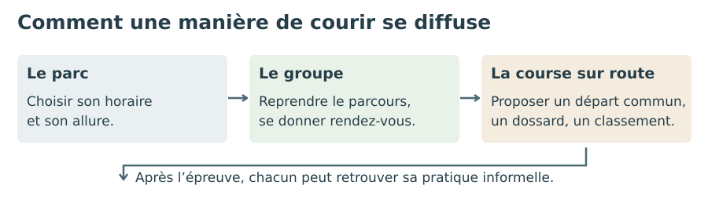
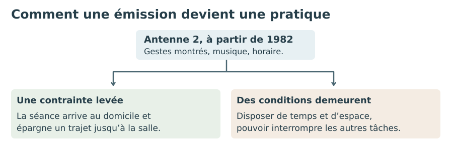
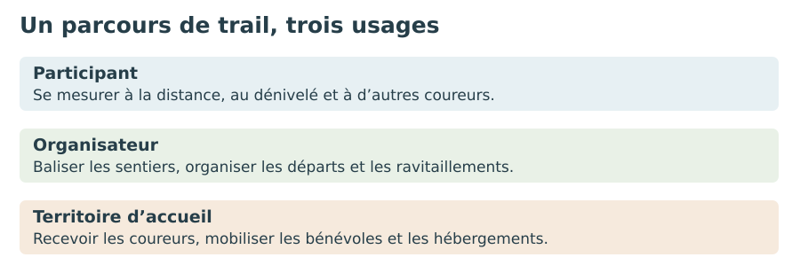

# ENS Rennes 2SEP — Sciences sociales (SHSAPS 2) 2026 · Corrigé brut

*Corrigé rédigé par IA, non officiel. Signalez toute erreur.*

**Rédaction** · modèle exact non renseigné (famille GPT-6) · effort non renseigné · vitesse non renseignée

**Révision** · modèle exact non renseigné (famille GPT-6) · effort non renseigné · vitesse non renseignée

**Lecture du rapport du jury** · GPT-6.2 Astra Ultra · vitesse non renseignée

**Révision** · GPT-6.2 Astra Ultra · vitesse non renseignée

**Révision (tour 3)** · GPT-6.2 Astra Ultra · vitesse non renseignée

**Révision (tour 4)** · GPT-6.2 Astra Ultra · vitesse non renseignée

**Problématique** — Comment des usages d’abord expérimentés par quelques-uns deviennent-ils des manières de faire partagées, et que leur diffusion transforme-t-elle ?

**Sujet R 26 – 328, page 1 · 2 heures.** Le sport, dans ses pratiques comme dans ses usages, est marqué par une série d’innovations. Caractériser et expliquer ce phénomène depuis les années 1970.

## Introduction

Courir dans un parc pour se détendre, prendre le départ de Paris–Versailles et comparer son temps sur une application mettent en jeu un geste ancien. Pourtant, ces trois manières de courir ne réunissent pas nécessairement les mêmes personnes, ne se règlent pas sur les mêmes horaires et ne donnent pas le même sens au résultat. Où se situe alors l’innovation ? Une invention désigne l’apparition d’une idée ou d’un dispositif. Avec Norbert Alter, on peut réserver le terme d’innovation au processus par lequel des acteurs s’en emparent et modifient durablement leurs manières d’agir. Dans le sport, la pratique renvoie aux façons de s’exercer, de se mesurer ou de se retrouver. L’usage désigne ce que les pratiquants et d’autres acteurs en font, qu’il s’agisse d’entretenir leur santé, d’occuper un espace public ou d’attirer des visiteurs.

Les années 1970 constituent un point de départ important en France et, plus largement, dans les sociétés occidentales. Les équipements et les clubs se sont développés. De nouvelles générations, déjà familiarisées avec le sport, cherchent aussi à maîtriser leurs lieux de pratique et leurs horaires. Dans le sillage des critiques adressées aux hiérarchies établies à la fin des années 1960, cette recherche d’autonomie trouve des soutiens sans effacer les différences de milieu, de sexe ou de ressources. Comment des usages d’abord expérimentés par quelques-uns deviennent-ils des manières de faire partagées, et que leur diffusion transforme-t-elle ? La course libre et les sports urbains éclairent le rôle initial des pratiquants. La gymnastique télévisée et les aménagements municipaux montrent ensuite comment se forment des publics. Enfin, la course en montagne et ses prolongements numériques permettent d’interroger la rencontre entre autonomie, commerce et institution.

## I. Les pratiquants réemploient des gestes et des lieux disponibles

L’essor du jogging dans les années 1970, particulièrement visible aux États-Unis puis dans d’autres pays occidentaux, fournit un cas d’innovation sans invention technique fondatrice. Il était déjà possible de courir hors d’un stade. Ce qui se diffuse est la possibilité de donner à cette course une valeur en elle-même, de choisir son allure et de s’arrêter au moment voulu. Un parc et une paire de chaussures permettent de commencer sans rejoindre un entraînement collectif. Des proches s’entraînent ensemble, des revues font connaître des manières de progresser, des organisateurs proposent de nouveaux rendez-vous. Paris–Versailles, dont le palmarès remonte à 1976, témoigne ainsi de la place que gagnent les courses sur route. Une personne peut courir la semaine pour son bien-être, s’inscrire pour la première fois à une épreuve et y chercher surtout le plaisir de terminer. Le dossard réintroduit un temps et un classement sans épuiser le sens de sa participation.

Le skateboard fait apparaître une autre dimension de cette initiative. Une bordure de place ou une succession de marches deviennent pour un groupe un lieu où apprendre une figure, se regarder et transmettre un geste. L’innovation change ici l’usage d’un aménagement qui avait été conçu pour des déplacements piétons. La progression dépend de la présence des pairs, de la répétition et de la reconnaissance d’une réussite par ceux qui connaissent la difficulté de l’obstacle. Le partage d’images permet ensuite de faire circuler des gestes et de donner de la notoriété à certains lieux. La diffusion peut susciter des conflits d’usage avec des riverains ou d’autres usagers. Ce désaccord révèle un enjeu social de l’innovation. Disposer d’un espace public en droit et pouvoir effectivement s’y installer pour s’exercer sont deux conditions différentes.

## II. Des intermédiaires diffusent les pratiques et orientent le recrutement

Les premiers adeptes n’ont pas les mêmes possibilités de faire reconnaître une nouvelle pratique. Les travaux de Christian Pociello invitent à rapporter les préférences sportives aux positions sociales et aux propriétés des activités. Certaines pratiques de pleine nature intéressent particulièrement des jeunes adultes diplômés qui disposent de moyens de transport, de temps de loisir et de réseaux permettant d’apprendre hors du club. En ville, une activité réputée peu coûteuse suppose encore un espace accessible et du temps disponible. Pour certaines femmes, courir seule à telle heure ou rester sur une place occupée par un groupe masculin représente un coût supplémentaire. On comprend ainsi que l’extension du nombre de pratiquants et la démocratisation des possibilités d’innover puissent suivre des rythmes différents. Les catégories populaires et les femmes participent aussi à la production de nouveaux usages, dans des conditions qui varient selon les activités.

La télévision déplace les conditions de cette appropriation. En France, à partir de 1982, *Gym Tonic* propose sur Antenne 2 des exercices accompagnés de musique susceptibles d’être reproduits à domicile. L’émission associe présentation de gestes, rendez-vous collectif à distance et pratique dans un espace privé. Le travail des animatrices, la réalisation télévisée et le fait que les spectatrices et spectateurs reproduisent réellement les exercices transforment un programme en pratique corporelle. Pour une femme éloignée d’une salle, s’exercer chez elle peut lever une contrainte de déplacement. Pour une autre, le cadre domestique signifie que les interruptions familiales et les injonctions esthétiques continuent à structurer le temps qu’elle s’accorde. L’innovation élargit l’offre tout en contribuant à définir quel corps il paraît souhaitable d’entretenir.

Les pouvoirs publics interviennent également dans les formes prises par les innovations. Équiper un skatepark répond à une demande d’espace et réduit certains conflits sur une place. Les collectivités peuvent ainsi reconnaître une activité longtemps perçue comme gênante. Mais dessiner des modules, clôturer un site ou en fixer les horaires sélectionne des parcours et des publics. Les pratiquants peuvent utiliser le nouvel équipement tout en continuant à explorer la rue, dont les obstacles ne sont pas standardisés. La reconnaissance institutionnelle constitue une étape possible du processus décrit par Alter. Elle ne met pas fin aux détournements qui ont contribué à faire naître la pratique.

## III. Les organisations et les marchés renouvellent le sens d’activités déjà diffusées

Dans les années 2000, l’essor du trail pousse à distinguer plusieurs formes de nouveauté. Courir sur des sentiers et disputer des courses de montagne sont des pratiques anciennes. L’Ultra-Trail du Mont-Blanc, organisé dès 2003, les réunit à une autre échelle. Un parcours de longue distance, des ravitaillements, le travail de bénévoles, la promotion d’une destination et la possibilité de comparer des résultats rendent une aventure en montagne accessible sous la forme d’un événement. Un participant peut vouloir éprouver son endurance, un territoire attirer des visiteurs et un équipementier rendre sa marque visible. La même course change donc d’usage suivant l’acteur observé. La valeur accordée à une expérience de nature dépend ici d’une organisation dense. En outre, prix de l’inscription, déplacements et disponibilité pour l’entraînement contribuent à sélectionner ceux qui pourront y prendre le départ.

Un sentier déjà fréquenté pour l’entraînement peut ainsi devenir un parcours balisé, chronométré et inscrit au calendrier d’une épreuve. Le coureur se mesure à un temps, l’organisateur coordonne des départs et des secours, et les acteurs locaux peuvent valoriser un itinéraire. Pour établir la diffusion de cette innovation, on chercherait à dater l’apparition de ces usages et à identifier les groupes qui les reprennent.

En Angleterre, les rendez-vous parkrun proposent chaque semaine cinq kilomètres gratuitement. L’usage associe la régularité d’une rencontre organisée à la possibilité de mesurer son parcours sans s’inscrire dans un championnat. L’étude territoriale de Schneider et de ses collègues, diffusée en 2019, porte sur 455 lieux de pratique. Dans leur analyse, la participation locale est moins forte lorsque le site le plus proche est plus éloigné et lorsque l’indice de défavorisation du quartier est plus élevé, chacun de ces deux facteurs restant associé à la participation lorsque l’autre est pris en compte. La suppression du prix d’entrée laisse donc entière la question des trajets, des horaires et de la façon dont un nouveau venu apprend qu’il peut participer. Ces données de quartier ne révèlent pas le motif individuel d’une absence. Une enquête auprès des habitants, y compris de ceux qui ne viennent jamais, permettrait de départager ces explications. La diffusion géographique d’un format et sa diffusion sociale appellent deux observations distinctes.

Depuis les années 2000 et 2010, les montres GPS et les plateformes de partage transforment aussi la séance ordinaire. Un pratiquant qui choisit librement un tour de parc peut comparer un tronçon à celui d’amis qui ne courent pas au même moment. En enregistrant et en publiant leurs sorties, les utilisateurs produisent eux-mêmes les parcours et les classements qui donnent son intérêt au service. Cela peut favoriser une sociabilité à distance ou remettre la compétition au cœur d’une activité choisie pour échapper aux horaires et aux classements du club. Certains conservent leurs données pour eux ou courent sans dispositif. Une innovation diffusée n’abolit donc pas les façons antérieures de pratiquer.

Une institution peut aussi ouvrir une voie qui ne se prolonge pas. Le ski-ballet, programme chorégraphié sur skis, figure en démonstration aux Jeux d’hiver de Calgary en 1988 puis d’Albertville en 1992. Il n’obtient ensuite aucune épreuve olympique médaillée. À deux reprises, spectateurs et organisateurs ont donc pu identifier cette pratique comme un spectacle distinct. Cette visibilité ne lui a pas assuré une place durable dans le programme. Inversement, le jogging a acquis quantité de pratiquants sans attendre que sa forme ordinaire devienne une épreuve de compétition. Reconnaissance par des instances et appropriation par des usagers peuvent suivre des calendriers très différents.

Le skateboard illustre une autre issue de cette histoire. Son entrée olympique aux Jeux de Tokyo 2020, disputés en 2021, consacre des formats et rend certains pratiquants visibles au-delà de leur milieu. Elle offre des débouchés sportifs et commerciaux qui auraient été moins accessibles sans calendrier, sélection et notation communs. Elle ne donne pas la mesure de toute la pratique dans la rue. Le skateboard olympique et une séance improvisée peuvent se nourrir des mêmes gestes tout en entretenant des rapports très différents à la compétition. Depuis les années 1970, les institutions traditionnelles ont ainsi repris une part des innovations venues de leurs marges, et les pratiquants ont continué à inventer des usages à l’intérieur comme à l’extérieur de ces cadres.

## Conclusion

L’innovation sportive se reconnaît au moment où une possibilité nouvelle trouve des usagers et transforme leurs relations, leurs lieux ou leurs façons de se mesurer. L’histoire du jogging montre l’initiative de groupes qui déplacent la course hors du stade. Celle de la gymnastique à la télévision donne à voir des intermédiaires qui équipent la pratique à domicile. Le trail et le skateboard rappellent enfin qu’une activité diffusée peut être reprise par un territoire, un marché ou une institution compétitive sans que ses premiers usages disparaissent. La question décisive demeure celle des conditions d’appropriation. Les groupes qui peuvent essayer, transmettre puis définir l’usage légitime d’une pratique ne se confondent pas toujours avec ceux auxquels on finira par la proposer.
