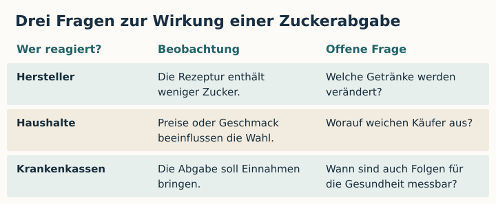

# ENS Rennes D-E — Allemand (oral) 2026 · Corrigé brut

*Corrigé rédigé par IA, non officiel. Signalez toute erreur.*

**Rédaction** · GPT-6.2 Astra Ultra · vitesse non renseignée

**Révision (tour 1)** · GPT-6.2 Astra Ultra · vitesse non renseignée

[Fascicule officiel](https://www.ens-rennes.fr/medias/fichier/sujets-oraux-allemand-d-e-2026_1793377249028-pdf) · [Rapport du jury](https://www.ens-rennes.fr/medias/fichier/rapport-de-jury-lve-allemand-oral-2026_1793640932357-pdf)

## Sujet 1 — Wie weit trägt die Partnerschaft mit Indien?

[Page 1 du fascicule](https://www.ens-rennes.fr/medias/fichier/sujets-oraux-allemand-d-e-2026_1793377249028-pdf#page=1)

### Proposition d’exposé

Was erhofft sich ein deutscher Kanzler von einem Land, das in einer für Berlin zentralen außenpolitischen Frage seinen eigenen Weg geht? Christoph Hasselbach nimmt in seinem Beitrag für die Deutsche Welle vom 11. Januar 2026 eine Indienreise von Friedrich Merz zum Anlass, genau diese Spannung zu untersuchen. Mit dem Kanzler reisen Vertreter der Wirtschaft. Dennoch greift es zu kurz, den Besuch nur an möglichen neuen Aufträgen zu messen.

Zunächst sprechen unterschiedliche wirtschaftliche Entwicklungen für eine engere Zusammenarbeit. Deutschland steckt nach Darstellung des Artikels seit drei Jahren in einer Rezession. Für Indien wird ein Wachstum von über sechs Prozent erwartet, für China eines von gut vier Prozent. Dazu kommen Verbindungen zwischen den Menschen. Viele indische Studierende in Deutschland studieren Natur- oder Ingenieurwissenschaften. Unternehmen, die Fachkräfte suchen, können also an Beziehungen anknüpfen, die lange vor einem Staatsbesuch entstanden sind. Aber der Ausgangspunkt ist bescheiden. 2024 betrug das deutsche Handelsvolumen mit Indien rund 29 Milliarden Euro, mit China etwa 246 Milliarden. Beide Zahlen betreffen den Austausch in beide Richtungen.

Was lässt sich durch eine zusätzliche Partnerschaft gewinnen? Ich möchte zwischen wirtschaftlicher Bewegungsfreiheit und politischer Gefolgschaft unterscheiden. Für einen Betrieb, der bisher von wenigen Abnehmern abhängt, kann ein weiterer Kunde wertvoll sein, selbst wenn er zunächst wenig bestellt. Die Bedeutung dieses Geschäfts geht über den Umsatz des ersten Jahres hinaus. Es schafft eine Beziehung, die bei einem späteren Einbruch in einem anderen Markt trägt. Ähnliches gilt für die Fachkräfte. Studierende sind allerdings keine planbare Reserve eines deutschen Betriebs. Ob sie nach dem Abschluss bleiben möchten, hängt auch von den Möglichkeiten ab, die sie selbst in beiden Ländern sehen.

Politisch fällt die Bilanz anders aus. Indien bezieht russisches Öl und verkauft es weiter. Berlin konnte die Regierung in Neu-Delhi bisher nicht für seinen Sanktionskurs gewinnen. Zugleich hat Frankreich bereits umfangreiche Geschäfte mit Indien abgeschlossen. Der Journalist stellt damit zwei unbequeme Tatsachen nebeneinander. Deutschland ist einer von mehreren möglichen Partnern. Und je mehr Möglichkeiten Indien selbst hat, desto weniger muss es sich den außenpolitischen Erwartungen eines einzelnen Landes anschließen. Für Neu-Delhi liegt darin derselbe Gewinn an Selbständigkeit, den Merz für Deutschland sucht.

Interessant ist dabei das Bild, das der befragte Experte benutzt. Er stellt Indiens Stärke bei Dienstleistungen der chinesischen Industrie gegenüber. Dieses Bild macht verständlich, warum es bei der Reise auch um Wissen, Personal und Hochschulen geht. Es kann aber zu einer allzu bequemen Arbeitsteilung im Kopf führen. Ein Land, aus dem Studierende der Ingenieurwissenschaften kommen, kann selbst industrielle Fähigkeiten entwickeln und eigene Vorstellungen davon haben, wo neue Arbeitsplätze entstehen sollen. Wenn eine deutsche Delegation diese Interessen übersieht, überschätzt sie womöglich die Anziehungskraft ihres Angebots. Eine gute Partnerschaft müsste deshalb auf beiden Seiten erklären können, welche Tätigkeiten sie vor Ort stärkt.

Deshalb würde ich den Erfolg der Reise an konkreten, längerfristigen Verbindungen prüfen, etwa daran, ob aus Kontakten zwischen Hochschulen und Firmen tragfähige Projekte entstehen. Die kurze Reise kann Türen öffnen. Dass zwei Regierungen ihre Handelsbeziehungen ausbauen, beantwortet noch nicht die Frage, wie sie sich im nächsten außenpolitischen Konflikt entscheiden.

### Relances d’entraînement

**Könnte Indien bald China als Handelspartner ersetzen?** Bei 29 gegenüber 246 Milliarden Euro wäre das eine sehr weitreichende Prognose. Schon ein zweites Standbein kann die Lage einer Firma verbessern, ohne dass die bisherige Rangfolge kippt.

**Woran erkennt man indische Verhandlungsmacht?** Neu-Delhi kann etwa bei großen Aufträgen zwischen Anbietern wählen. Zugleich führt es seine Beziehungen zu Russland fort, obwohl Berlin dagegen Einwände hat.

## Sujet 2 — Was soll eine Zuckerabgabe erreichen?

[Page 2 du fascicule](https://www.ens-rennes.fr/medias/fichier/sujets-oraux-allemand-d-e-2026_1793377249028-pdf#page=2)

### Proposition d’exposé

Wenn ein Getränkehersteller seine Rezeptur verbessert und deshalb weniger Abgaben zahlt, ist das für den Staat ein Erfolg oder ein Einnahmeausfall? Diese Frage steckt im Streitgespräch von Ralf Geißler und Malte Pieper, das MDR Aktuell am 30. April 2026 veröffentlicht hat. Die Bundesregierung plant eine Abgabe auf gesüßte Getränke. Sie erwartet ab 2028 rund 450 Millionen Euro jährlich, die die gesetzlichen Krankenkassen entlasten sollen.

Geißler stellt die gemeinsam getragenen Gesundheitskosten in den Mittelpunkt. Zucker begegnet uns auch in Produkten, bei denen wir ihn kaum erwarten, beispielsweise im Müsli oder im Frischkäse. Für Kinder ist die süße Zwischenmahlzeit alltäglich geworden. Geißler würde deshalb mehr Produkte erfassen als die Regierung. Er verweist auf Großbritannien, wo Hersteller den Zuckergehalt ihrer Getränke als Reaktion auf die Abgabe verringert haben. Pieper fragt seinerseits, wie weit staatliche Fürsorge reichen darf. Er erinnert an frühere Steuern, die mit einem einleuchtenden Zweck gerechtfertigt wurden. Er führt auch eine Auswertung der TU Dresden an. Höhere Preise können den Konsum senken. Welche gesundheitlichen Verbesserungen daraus tatsächlich folgen, ist schwerer nachzuweisen.

Um zwischen beiden Positionen zu urteilen, würde ich zunächst drei Wirkungen auseinanderhalten. Der Staat kann Einnahmen verbuchen, Verbraucher können andere Getränke kaufen, und Erkrankungen können seltener werden. Der erste Effekt lässt sich am Jahresende ablesen. Für den zweiten müsste man verfolgen, ob Haushalte auf Wasser, auf weniger süße Getränke oder auf andere süße Produkte ausweichen. Für den dritten braucht man Zeit und muss weitere Einflüsse berücksichtigen. Piepers Einwand betrifft vor allem diesen letzten Schritt. Er räumt ausdrücklich ein, dass sich das Kaufverhalten ändern kann.

Geißlers britisches Beispiel zeigt darüber hinaus, dass die persönliche Entscheidung an der Kasse nur einen Teil der Geschichte ausmacht. Wenn ein Hersteller mit einer weniger süßen Rezeptur seinen Preis halten kann, verändert er das Angebot für alle Kunden. Wer weiterhin seine gewohnte Marke kauft, nimmt dann vielleicht weniger Zucker zu sich. Für eine Familie mit knappem Budget wäre es allerdings ein Unterschied, ob dieses Getränk verfügbar ist oder ob nur der Preis steigt. Das ist eine soziale Frage, die sich mit dem Hinweis auf die Krankenkassen allein nicht beantworten lässt.

Auch die Form des Streitgesprächs spielt eine Rolle. Beide Autoren beginnen mit einem Zugeständnis. Geißler gibt zu, dass er neuen Steuern gewöhnlich skeptisch gegenübersteht. Pieper bestreitet die Schäden eines extremen Konsums nicht. Dadurch wird die eigentliche Streitfrage enger. Wie viel lässt sich mit dieser einen Maßnahme erreichen, und was rechtfertigt einen Eingriff in den Alltag? Piepers letzte Frage nach einer Abgabe für Skifahrer ist rhetorisch wirkungsvoll. Für eine politische Abwägung müsste er aber genauer zeigen, nach welchen Kriterien man Lebensmittel und Freizeitaktivitäten vergleichen kann. Auf der anderen Seite müsste Geißler erklären, wie weit die Abgabe bei Produkten mit sehr unterschiedlichem Zuckeranteil reichen soll.

Ich würde deshalb bei der Einführung öffentlich festlegen, woran die Maßnahme gemessen wird. Ein sinkendes Aufkommen kann mit einer verbesserten Rezeptur zusammenhängen und damit einen Teil des politischen Ziels erfüllen. Ob die Kassen langfristig entlastet werden, bleibt eine eigene Frage. So lässt sich die Freiheit der Verbraucher ernst nehmen und zugleich überprüfen, ob der Eingriff überhaupt das bewirkt, wofür er beschlossen wurde.

### Relances d’entraînement

**Ist das britische Beispiel ein Beweis, dass weniger Menschen erkranken?** Es belegt zunächst eine Reaktion der Hersteller. Um die gesundheitlichen Folgen zu beurteilen, müsste man zusätzlich beobachten, wie sich die Ernährung und später die Erkrankungen entwickeln.

**Warum vergleicht Pieper Cola mit Sport?** Beim Skifahren können ebenfalls Behandlungskosten entstehen. Er fragt damit nach einer Grenze staatlicher Eingriffe. Dass die Tätigkeiten gesundheitlich in jeder Hinsicht vergleichbar seien, folgt daraus nicht.

## Sujet 3 — Was verrät der Beifall auf einem Gewerkschaftskongress?

[Page 3 du fascicule](https://www.ens-rennes.fr/medias/fichier/sujets-oraux-allemand-d-e-2026_1793377249028-pdf#page=3)

### Proposition d’exposé

Politische Reden bestehen auch aus den Pausen nach einem Satz. In ihrem Bericht vom 12. Mai 2026 beobachten Cem-Odos Güler und Anna Lehmann für die taz, an welchen Stellen die Delegierten des Deutschen Gewerkschaftsbunds pfeifen, applaudieren oder schweigen. Daraus ergibt sich ein Bild der Spannungen zwischen den beiden Regierungsparteien und einem Publikum, dessen Interessen die geplanten Sozialreformen unmittelbar berühren.

Friedrich Merz erwartet von den Delegierten Bereitschaft zur Veränderung. Er kündigt an, dass in einer Krise alle etwas beitragen müssten. Die Autoren bemerken jedoch, dass er vor allem Einsparungen nennt, die Arbeitnehmer und Arbeitslose betreffen. Seine Rede wird von Pfiffen begleitet. Arbeitsministerin Bärbel Bas steht vor einer anderen Schwierigkeit. Als Sozialdemokratin spricht sie vor Menschen, mit deren Bewegung die Geschichte ihrer Partei eng verbunden ist. Als Ministerin soll sie einen Gesetzentwurf vorlegen, der den Acht-Stunden-Tag lockert. Als sie ihre persönliche Ablehnung erkennen lässt, erhält sie Beifall. Der anschließende Verweis auf den Koalitionsvertrag löst wieder Schweigen aus. Ihr Parteikollege Lars Klingbeil bekommt für Vorschläge zur Entlastung mittlerer Einkommen und für seinen Hinweis auf die Erbschaftsteuer Zustimmung.

Wie können Gewerkschaften politischen Einfluss ausüben, wenn die Regierung ihren Vertrag bereits ausgehandelt hat? Zuerst möchte ich auf ihre Rolle als Öffentlichkeit eingehen. Die Delegierten stimmen bei diesem Kongress über keinen Regierungsentwurf ab. Ihr Verhalten macht aber eine Unterscheidung sichtbar, die in einer Presseerklärung leicht verloren ginge. Sie glauben Bas offenbar, dass sie persönlich andere Vorstellungen hat. Sie lehnen die Konsequenz ab, die sie als Ministerin daraus zieht. Der Wechsel innerhalb weniger Sätze ist genauer als die pauschale Aussage, die Gewerkschaften hätten sich von der SPD abgewandt.

Zweitens geht es um die Verteilung einer Last. Wenn der Kanzler die Bürger auf Verzicht vorbereitet, möchte sein Publikum wissen, wer in welchem Umfang betroffen wäre. Klingbeils Beispiel nennt eine Einkommensgruppe und bringt eine andere Steuerquelle ins Spiel. Man kann über seinen Vorschlag streiten, aber die Adressaten können daran prüfen, in welche Richtung eine Veränderung gehen soll. Merz nimmt dagegen eine frühere Zusage von Olaf Scholz zum Umgang mit den gestiegenen Lebenshaltungskosten zurück. Das verstärkt im Saal den Eindruck, die Last werde weitergereicht.

Mir fällt dabei auf, wie verschieden die Sprecher die Zeit behandeln. Der Kanzler beschreibt eine gegenwärtige Krise, aus der ein sofortiger Anpassungsbedarf folge. Für die Delegierten steht eine über Generationen erkämpfte Grenze zur Debatte. Die Ministerin blickt wiederum auf den Zeitpunkt zurück, zu dem die Koalitionspartner ihren Vertrag geschlossen haben. Alle sprechen über dieselbe bevorstehende Reform, aber jede Seite erklärt sie mit einer anderen Geschichte. Darum wäre eine ernsthafte Antwort an das Publikum mehr als die Wiederholung des Vertrags. Die Regierung müsste begründen, warum eine konkrete Bestimmung unter heutigen Bedingungen verändert werden soll und wie die Schutzfunktion der alten Regel weiter erfüllt werden kann.

Der Artikel beobachtet einen einzigen Kongress und wählt die Bilder einer Unterrichtsstunde und einer frostigen Stimmung. Darin liegt auch ein journalistisches Urteil über den Ton der Regierung. Aus den Pfiffen lässt sich kein Abstimmungsergebnis für das ganze Land ableiten. Sie zeigen aber, welche Begründung die Regierung noch schuldet, wenn sie eine Reform als gemeinsames Opfer bezeichnet.

### Relances d’entraînement

**Bricht der DGB damit mit der SPD?** Das lässt sich aus der Szene nicht schließen. Derselbe Saal applaudiert einer persönlichen Aussage von Bas und einzelnen Vorschlägen Klingbeils. Die Delegierten unterscheiden zwischen Positionen ihrer Gesprächspartner.

**Warum spielt der Acht-Stunden-Tag für dieses Publikum eine besondere Rolle?** Er gilt als historische Errungenschaft der Gewerkschaften und schützt den einzelnen Arbeitstag. Wer ihn lockern will, muss hier sowohl eine praktische als auch eine historische Einwendung beantworten.

## Sujet 4 — Wer verfügt über die gewonnene Flexibilität?

[Page 4 du fascicule](https://www.ens-rennes.fr/medias/fichier/sujets-oraux-allemand-d-e-2026_1793377249028-pdf#page=4)

### Proposition d’exposé

Für einen Beschäftigten kann eine flexible Arbeitswoche bedeuten, dass er am Freitag sein Kind abholen kann. Für eine Kollegin im selben Betrieb kann sie bedeuten, dass sie am Donnerstag länger bleiben muss. Dieser Unterschied hilft, den Bericht von Kai Hartwig vom 13. Mai 2026 auf merkur.de zu verstehen. Er behandelt eine angekündigte Reform des deutschen Arbeitszeitgesetzes und legt besonderes Gewicht auf die Einwände der Gewerkschaften.

Nach der im Artikel zitierten Regelung gilt werktäglich grundsätzlich eine Grenze von acht Stunden. Bis zu zehn Stunden sind zulässig, wenn im Ausgleichszeitraum von sechs Kalendermonaten oder 24 Wochen durchschnittlich acht Stunden werktäglich eingehalten werden. Daneben nennt der Artikel eine wöchentliche Höchstgrenze von 48 Stunden. Arbeitsministerin Bärbel Bas will einen Entwurf für mehr Flexibilität vorlegen. Sie möchte zugleich die elektronische Erfassung der Arbeitszeit regeln. Der Europäische Gerichtshof hatte 2019 von den Mitgliedstaaten verlangt, die Arbeitgeber zur Einrichtung eines Systems zur Messung der täglichen Arbeitszeit zu verpflichten.

Die Debatte dreht sich damit um zwei verschiedene Entscheidungen. Die eine betrifft die Sichtbarkeit von Arbeit. Wenn ein Beschäftigter länger bleibt, kann ein verlässliches System diese Zeit festhalten. Das hilft ihm, einen Anspruch zu belegen. Die andere Entscheidung betrifft die Zulässigkeit eines konkreten Dienstplans. Ein korrekt gemessener sehr langer Arbeitstag kann weiterhin so anstrengend sein, dass Fehler häufiger werden oder die Erholung zu kurz kommt. Eine Zahl auf dem Bildschirm beantwortet noch nicht die Frage, ob der Betrieb diesen Dienst anordnen darf.

Zwei Juristen des gewerkschaftsnahen Hugo-Sinzheimer-Instituts rechnen vor, was bei Wegfall der heutigen Tagesgrenzen denkbar wäre. Von 24 Stunden ziehen sie elf Stunden Ruhezeit und 45 Minuten Pause ab. Es bleiben zwölf Stunden und fünfzehn Minuten mögliche Arbeit. Das ist ein Szenario unter bestimmten Voraussetzungen, keine neue allgemeine Sollzeit. Für die Gewerkschaften zählt schon die Möglichkeit, weil ein Einzelner in einem knapp besetzten Betrieb einem kurzfristigen Einsatz schwer widersprechen kann. Der Artikel nennt etwa Bäckereien und Gaststätten. Dort hängt die Arbeitszeit einer Person unmittelbar von der Schichteinteilung der anderen ab.

Man könnte das an zwei Dienstplänen mit derselben Stundenzahl prüfen. Im ersten weiß die Belegschaft Wochen im Voraus, welche Tage länger ausfallen, und kann diese Tage ablehnen oder tauschen. Im zweiten erfahren die Beschäftigten erst kurz vorher, wer die fehlende Schicht übernehmen soll. Für die Lohnabrechnung könnte das Ergebnis gleich aussehen. Für jemanden, der nach der Arbeit einen Angehörigen pflegt, macht die Vorhersehbarkeit den entscheidenden Unterschied. Gerade deshalb lohnt es sich, in dem Artikel auf die Herkunft der Einwände zu achten. Die konkreten Branchenbeispiele stammen von Gewerkschaftern. Sie schildern Risiken aus der Arbeitswelt, während die Ministerin das Ziel ihres noch ausstehenden Entwurfs erklärt.

Ich würde eine Reform deshalb daran messen, ob Beschäftigte selbst Einfluss auf die Verteilung behalten. Ein verlässlich vereinbarter freier Nachmittag kann ihnen viel wert sein. Ein Wochenplan, der sich kurzfristig nach dem Personalbedarf richtet, bietet dem Arbeitgeber denselben rechnerischen Spielraum, dem Arbeitnehmer aber kaum Planungssicherheit. Wer nur die Wochensumme vergleicht, sieht diesen Unterschied nicht. Die im Mai angekündigte Vorlage wäre also auch nach ihren Regeln für Ankündigung, Mitwirkung und Erholung zu beurteilen.

### Relances d’entraînement

**Verlangt der EuGH die Abschaffung der Tagesgrenze?** Im Text geht es beim Urteil um die Messung der täglichen Arbeitszeit. Die geplante Lockerung ist eine politische Entscheidung der deutschen Koalition.

**Warum genügt ein freier Tag später in der Woche womöglich nicht?** Er gleicht die Stundenzahl aus. Ein Sicherheitsrisiko am Ende einer außergewöhnlich langen Schicht oder eine kurzfristig ausgefallene Betreuung lässt sich damit im Nachhinein kaum beseitigen.

## Sujet 5 — Wessen Zukunft kommt zur Sprache?

[Page 5 du fascicule](https://www.ens-rennes.fr/medias/fichier/sujets-oraux-allemand-d-e-2026_1793377249028-pdf#page=5)

### Proposition d’exposé

Ein Achtzehnjähriger geht in den Landtag, um mit Älteren über den Klimawandel zu reden. Am Ende hat er seine Frage gar nicht gestellt. Christoph Cyrulies erzählt diese kleine Geschichte in seinem NDR-Beitrag vom 15. Oktober 2025. Der Generationendialog in Mecklenburg-Vorpommern soll Menschen miteinander ins Gespräch bringen, die außerhalb der eigenen Familie wenig Kontakt haben. Gerade deshalb ist aufschlussreich, welches Thema das Treffen beherrscht.

Für Maximilian Schröter ist schon der Austausch eine Bereicherung. Als es um die politische Zukunft geht, zieht jedoch die Rente die Aufmerksamkeit auf sich. In den sechziger Jahren kamen laut Beitrag sechs Beitragszahler auf einen Rentner, heute sind es zwei. Einige Jugendliche schlagen vor, das Eintrittsalter an die steigende Lebenserwartung zu koppeln. Eine schrittweise Anhebung auf siebzig Jahre war auch aus der Union ins Gespräch gebracht worden. Die anwesenden Senioren begegnen diesem Vorschlag zurückhaltend, zeigen aber Verständnis für die Sorgen der Jüngeren. Ein Vertreter der Stiftung für die Rechte zukünftiger Generationen weist auf die große Zahl von Wählern aus geburtenstarken Jahrgängen hin. Die Länder können bei manchen Bundesentscheidungen über den Bundesrat mitwirken.

Wie könnte ein solcher Dialog Entscheidungen gerechter machen? Ich würde zuerst unterscheiden, wer anwesend ist und wer die Tagesordnung prägt. Maximilian hat eine Stimme im Raum und kann den Älteren zuhören. Sein Klimathema bleibt trotzdem außen vor. Das muss niemand absichtlich verhindert haben. Die Frage, wer die nächste Rente finanziert, lässt sich sofort an konkreten Personen und Zahlen erläutern. Die Menschen, die in einigen Jahrzehnten unter heutigen Entscheidungen leiden, können ihre Interessen heute nur teilweise selbst vertreten. Eine einfache Möglichkeit wäre, für jedes eingebrachte Thema eine kurze erste Runde vorzusehen.

Dann stellt sich die Frage, was eine faire Lösung in der Sache bedeutet. Zwei Beitragszahler pro Rentner machen eine Finanzierung schwieriger. Das Verhältnis allein sagt jedoch wenig über Löhne, Beitragshöhen oder die Belastung verschiedener Berufe. Die durchschnittliche Lebenserwartung eines Jahrgangs kann steigen, während einzelne Menschen körperlich kaum bis siebzig arbeiten können. Der Vorschlag der Jugendlichen gewinnt, wenn man ihn mit solchen Erfahrungen der Älteren konfrontiert. Umgekehrt können die Älteren fragen, welche Aussicht auf Absicherung sie jemandem bieten, der gerade sein Berufsleben beginnt.

Der Titel nennt außer Rente und Klima auch die Schulden. Diese Verbindung eröffnet eine weitere Frage. Wenn eine Kommune heute Geld für ein Gebäude aufnehmen müsste, das jahrzehntelang von jungen und alten Menschen genutzt wird, erbten die Jüngeren sowohl eine Verpflichtung als auch eine Einrichtung. Bei einer unterlassenen Reparatur bliebe womöglich weniger sichtbare Verschuldung, aber ein unbrauchbares Gebäude zurück. Das Beispiel stammt nicht aus der Sitzung in Schwerin. Es verdeutlicht, weshalb eine faire Bilanz auch die Folgen eines unterlassenen Beschlusses erfassen müsste. Auf diese Weise könnten die Teilnehmer über unterschiedliche Interessen sprechen, ohne die Generationen von vornherein zu zwei geschlossenen Lagern zu erklären.

Für mich besteht der Wert dieses Treffens darin, solche Rückfragen möglich zu machen. Ein Gespräch im Landtag kann keine bundesweite Rentenregel festlegen. Ob es politisch etwas bewegt, hängt auch davon ab, ob die Abgeordneten anschließend offenlegen, welche Vorschläge sie weiterverfolgen. Für Maximilian wäre bereits bedeutsam, wenn sein zunächst übergangenes Klimathema beim nächsten Schritt tatsächlich zur Sprache käme.

### Relances d’entraînement

**Waren die Senioren beim Treffen gegen jede Reform?** Sie äußerten Vorbehalte gegen die vorgeschlagene Altersgrenze. Der Bericht beschreibt sie zugleich als grundsätzlich reformbereit und aufmerksam für die Lage der Jüngeren.

**Warum ist Maximilians nicht gestellte Frage politisch interessant?** Sie zeigt, dass Anwesenheit allein keinen Einfluss auf die Themenauswahl garantiert. Das gilt besonders für Fragen, deren Folgen erst lange nach der nächsten Wahl spürbar werden.

## Sujet 6 — Wie verlässlich ist eine europäische Partnerschaft?

[Page 6 du fascicule](https://www.ens-rennes.fr/medias/fichier/sujets-oraux-allemand-d-e-2026_1793377249028-pdf#page=6)

### Proposition d’exposé

Ein französischer Präsident besucht ein Stahlwerk. Ein deutscher Kanzler fährt nach Rom. Aus solchen Bildern entsteht schnell eine Erzählung über Freundschaft und Eifersucht. Jean-Marie Magro benutzt sie am 11. Februar 2026, um die Beziehungen zwischen Emmanuel Macron, Friedrich Merz und Giorgia Meloni zu untersuchen. Hinter den Gesten stehen allerdings konkrete europäische Entscheidungen über Industrie, Handel und Finanzierung.

Macron erinnert daran, dass frühere Gewissheiten über amerikanische Sicherheit, russische Energie und den chinesischen Absatzmarkt nicht mehr tragen. Er nennt Deutschland nicht ausdrücklich. Der Artikel deutet seine Worte als Antwort auf die jüngste Zusammenarbeit Berlins mit Rom. Die beiden Regierungen haben unter anderem ein Papier für ein Treffen der europäischen Staats- und Regierungschefs vorgelegt und ihre Bedeutung als Industrieländer hervorgehoben. In Paris hatte man nach dem Amtsantritt von Merz zunächst auf eine Wiederbelebung der Zusammenarbeit gehofft. Tatsächlich konnten Berlin und Paris ihren Streit über die Einordnung französischer Kernkraftwerke als Übergangstechnologie beilegen.

Was macht eine Partnerschaft in einer Union mit 27 Regierungen verlässlich? Ich würde am Beispiel des Handels und am Beispiel der Ukrainefinanzierung unterscheiden, ob Partner dasselbe Ziel teilen und ob sie das Vorgehen miteinander abstimmen. Beim Abkommen mit den Mercosur-Staaten glaubte Merz, mit französischer Zustimmung rechnen zu können. Er irrte sich. Dass beide Länder eine starke europäische Industrie wollen, sagt noch nichts darüber aus, wer in einer einzelnen Branche von einer Marktöffnung profitieren und wer unter Druck geraten würde. Eine vertraute Beziehung zwischen den Regierungschefs ersetzt die Kenntnis dieser innenpolitischen Interessen kaum.

Bei der Ukrainefinanzierung erscheint das Verhältnis fast umgekehrt. Merz wollte in Belgien eingefrorene russische Vermögen heranziehen. Wichtige Partner waren vorher nicht einbezogen worden. Paris äußerte sich öffentlich zurückhaltend positiv, während Macron mit Viktor Orbán über die Möglichkeit gemeinsamer Schulden sprach. Die beiden Regierungen konnten also eine Finanzierung für notwendig halten und dennoch verschiedene Wege vorbereiten. Wer allein auf die öffentliche Zustimmung achtete, konnte leicht eine Einigung über die Mittel vermuten, die es so noch nicht gab.

Aufschlussreich ist außerdem die Wahl des Ortes für Macrons Auftritt. In einem Stahlwerk lässt sich ein europäisches Argument mit den Sorgen um ganz bestimmte industrielle Arbeitsplätze verbinden. Für die Menschen dort zählt, ob die Anlagen weiter produzieren. Auf einem Gipfeltreffen steht zusätzlich zur Debatte, in welchen Ländern staatliche Unterstützung finanziell überhaupt möglich ist. Wenn ein großes Land einen Industriezweig fördert, können kleinere Partner nach den Folgen für ihre eigenen Unternehmen fragen. Diese Überlegung erklärt, weshalb aus der allgemeinen Forderung nach europäischer Souveränität noch kein gemeinsamer Förderplan folgt. Dazu braucht es Entscheidungen über Umfang, Dauer und Zugang zu einer Förderung, also genau die Fragen, bei denen der Artikel Unterschiede feststellt.

Schließlich kommt die Industriepolitik selbst zur Sprache. Macron befürwortet eine breitere staatliche Förderung, Berlin sieht sie eher befristet und in strategischen Branchen. Die deutsch-italienische Initiative erhält in diesem Zusammenhang ein anderes Gewicht. Ein neuer Partner kann eine festgefahrene Diskussion öffnen. Er kann aber auch Misstrauen auslösen, wenn eine dritte Regierung den Eindruck hat, sie solle einem fertigen Vorschlag nur noch zustimmen. Die überzeugendste Probe europäischer Zusammenarbeit wäre deshalb für mich, ob die Beteiligten ihre Bedingungen vor einem Gipfel deutlich machen und anderen Regierungen Raum geben, den Vorschlag tatsächlich zu verändern.

### Relances d’entraînement

**War die deutsch-französische Zusammenarbeit unter Merz von Anfang an erfolglos?** Der Artikel nennt mit der Taxonomie eine konkrete Verständigung aus der Anfangszeit. Erst die neueren Missverständnisse haben die Erwartungen gedämpft.

**Muss jede Initiative von Berlin und Paris ausgehen?** In einer Union von 27 Staaten können auch Berlin und Rom Vorschläge erarbeiten. Entscheidend ist für die anderen Mitglieder, ob sie rechtzeitig beteiligt werden und ihre Einwände in den Entwurf einbringen können.
