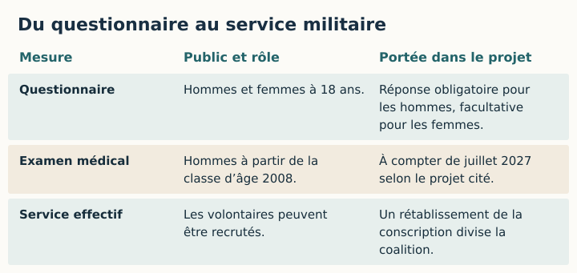

# ENS Rennes D-E — Allemand 2026 · Corrigé brut

*Corrigé rédigé par IA, non officiel. Signalez toute erreur.*

**Rédaction** · GPT-6.2 Astra Ultra · vitesse non renseignée

**Révision (tour 1)** · GPT-6.2 Astra Ultra · vitesse non renseignée

## I. Version française

*Chiara Swenson, MDR, 19 septembre 2025.*

Étienne est en dixième année dans un établissement secondaire polyvalent de Halle. Il a déjà reçu deux fois du courrier de la Bundeswehr. Dans sa famille, on lui a raconté des histoires qui remontent au temps où le service militaire était encore obligatoire. Pour lui, il est hors de question de servir sous les armes. « Ce n’est pas pour ça que je donnerais ma vie », insiste-t-il.

Denis, lui non plus, ne s’imagine pas s’engager volontairement dans l’armée. Il a déjà fait un stage dans le secteur des soins et aimerait suivre une formation professionnelle dans le domaine médical au cours des prochaines années. « Si le service devient obligatoire, explique Denis, j’aimerais au moins avoir mon mot à dire sur mon affectation, au front ou dans un service de santé. »

Bien des jeunes partagent le sentiment d’Étienne et de Denis. Les enquêtes montrent qu’ils portent sur le service militaire obligatoire un regard différent de celui de leurs aînés. Dans une étude, la majorité des jeunes de 12 à 18 ans interrogés ont déclaré vouloir choisir eux-mêmes la manière de servir la collectivité. Près de la moitié estiment que ce service ne doit pas nécessairement s’accomplir au sein de la Bundeswehr.

Cosmin, 17 ans, apprécie les avantages d’une formation militaire, comme la possibilité d’y passer le permis de conduire. Il aborde le service militaire d’un point de vue pratique. « À mon avis, mieux vaut le faire maintenant et être déjà formé que de ne l’être que plus tard et de devoir alors, peut-être, partir à la guerre avec assez peu d’expérience et d’entraînement. »

## II. Thème en allemand

*Le Monde, 9 mai 2025.*

Margot Friedländer, Überlebende der Shoah und eine der bedeutendsten Zeitzeuginnen der Gräuel des Nationalsozialismus in Deutschland, ist am Freitag, dem 9. Mai, im Alter von 103 Jahren in ihrer Heimatstadt Berlin gestorben. Das teilte ihre Stiftung mit. „Mit ihrem Tod verliert Deutschland eine wichtige Stimme der Zeitgeschichte“, erklärte die Stiftung.

„Seit ihrer Rückkehr in ihre Geburtsstadt nach sechs Jahrzehnten im New Yorker Exil hatte sich die Berliner Ehrenbürgerin unermüdlich für Versöhnung und Gedenken eingesetzt“, fügte die Stiftung hinzu. Margot Friedländer sollte an diesem Freitag aus den Händen von Bundespräsident Frank-Walter Steinmeier eine der höchsten deutschen Auszeichnungen entgegennehmen. Die Zeremonie war jedoch in letzter Minute aus gesundheitlichen Gründen abgesagt worden.

„Die Nachricht vom Tod Margot Friedländers erfüllt mich mit tiefer Trauer“, erklärte Steinmeier. „Sie hat unserem Land die Hand zur Versöhnung gereicht, trotz allem, was Deutsche ihr in ihrer Jugend angetan haben.“

Sie hatte ihr Leben der Begegnung mit jungen Menschen gewidmet, denen sie ihre Geschichte erzählte und denen sie Mitgefühl als Gegenmittel gegen Hass ans Herz legte. „Schaut nicht auf das, was euch trennt. Schaut auf das, was euch verbindet. Seid Menschen“, hatte sie noch im vergangenen Jahr wiederholt.

## III.1 — Les raisons invoquées pour rétablir le service militaire

*Johanna Hausmann et Daniel Sprenger, NDR, 16 octobre 2025.*

Den Ausgangspunkt der Debatte bildet für das Verteidigungsministerium die Bedrohung durch Russland. Für eine glaubwürdige Verteidigung brauche die Bundeswehr mehr Personal. Minister Pistorius will die Zahl der Soldatinnen und Soldaten von rund 183.000 auf 260.000 im Jahr 2035 erhöhen. Die Wehrpflicht ist aus Sicht der Union eine Möglichkeit, dieses Ziel zu erreichen, falls sich zu wenige Freiwillige melden. Die SPD lehnt eine Rückkehr zur Pflicht ab. An dieser Stelle ist die Unterscheidung zwischen Fragebogen, Musterung und tatsächlichem Dienst entscheidend. Die geplante Pflicht junger Männer, Auskunft zu geben, bedeutet noch keine Einberufung.

Unter den Befragten spielt die Sorge um die Freiheit eine wichtige Rolle. Laurent möchte sich selbst nicht freiwillig melden, versteht jedoch, warum sein Land die Frage aufwirft. Sein Vater erinnert daran, dass der jahrzehntelange Frieden keine Garantie für die Zukunft bietet. Demokratie braucht seiner Ansicht nach Menschen, die Verantwortung übernehmen, auch im Ehrenamt. Thees fürchtet zwar den Krieg, würde eine erneute Pflicht aber akzeptieren, wenn Deutschlands Verteidigung sie erforderlich machte. Seine Mutter hält sie politisch für wirksam, obwohl ihr der Gedanke an eine Gefährdung ihres Sohnes schwerfällt.

Wie weit die Zustimmung trägt, hängt auch davon ab, wer die Last übernehmen müsste. In der Umfrage vom Juni befürworten insgesamt 59 Prozent die Wiedereinführung, unter den 18- bis 29-Jährigen sind es nur 29 Prozent. Carl möchte zunächst freiwillig dienen und die Pflicht erst erwägen, wenn dieses Angebot nicht ausreicht. Damit verbindet er seine Bereitschaft, etwas für die Gemeinschaft zu tun, mit dem Schutz der persönlichen Entscheidungsfreiheit.

*245 mots.*

## III.2 — Dans quelle mesure accepter de servir ?

Ich wäre bereit, für begrenzte Zeit einen freiwilligen Dienst zu leisten. Für mich hinge die Entscheidung davon ab, welche Aufgabe ich übernehmen könnte und wem ich damit helfen würde. Besonders sinnvoll fände ich eine Tätigkeit im Sanitätsdienst. Wer Verletzte versorgt, übernimmt Verantwortung für andere und trägt zugleich zur Verteidigung eines demokratischen Gemeinwesens bei. Diese Form des Engagements könnte ich mit meinem Gewissen vereinbaren.

Laurents Bemerkung überzeugt mich, weil wir die Voraussetzungen unseres Alltags leicht übersehen. Eine freie Wahl, eine offene Zeitung oder ein öffentlicher Protest erscheinen selbstverständlich, solange niemand sie bedroht. Daraus folgt für mich eine Pflicht, mich für ihren Fortbestand einzusetzen. Ob der Staat dafür einen bestimmten Dienst verlangen darf, ist eine weitere Frage. Eine Regierung müsste erklären, warum freiwillige Angebote und zivile Dienste den Bedarf nicht decken, wie lange eine Verpflichtung dauern soll und wie das Parlament ihre Notwendigkeit überprüft.

Auch die Verteilung der Last wäre für meine Zustimmung wichtig. Wer Angehörige pflegt, hat bereits eine Verpflichtung übernommen, die andere womöglich gar nicht sehen. Wer aus Gewissensgründen keinen Dienst an der Waffe leisten kann, sollte eine gleichwertige zivile Aufgabe wählen können. Ein Dienst darf auch finanziell nicht denen vorbehalten bleiben, deren Familien ein halbes Jahr ohne Einkommen überbrücken können.

Ich könnte mir also vorstellen, in der Bundeswehr zu dienen. Eine uneingeschränkte Zusage für jede Aufgabe würde ich heute nicht geben. Gerade in einer Demokratie verdient die Frage, wozu jemand persönlich bereit ist, eine ehrliche und begründete Antwort.

*239 mots.*

[Fascicule officiel, pages imprimées 1 à 3](https://www.ens-rennes.fr/medias/fichier/sujet-lve-d-e-2026_1790867583165-pdf#page=2) · [Rapport écrit d’allemand](https://www.ens-rennes.fr/medias/fichier/rapport-de-jury-lve-allemand-e-crit-2026_1793640863622-pdf)
