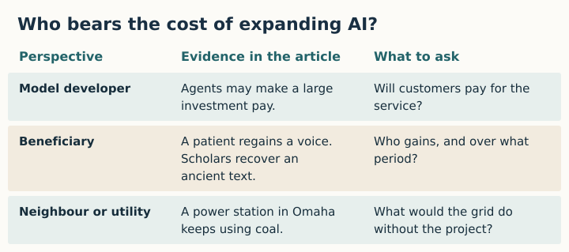

# ENS Rennes D-E — Anglais (oral) 2026 · Corrigé brut

*Corrigé rédigé par IA, non officiel. Signalez toute erreur.*

**Rédaction** · GPT-6.2 Astra Ultra · vitesse non renseignée

**Révision (tour 1)** · GPT-6.2 Astra Ultra · vitesse non renseignée

[Fascicule officiel](https://www.ens-rennes.fr/medias/fichier/sujets-oraux-anglais-d-e-2026_1793377266315-pdf) · [Rapport du jury](https://www.ens-rennes.fr/medias/fichier/rapport-de-jury-lve-anglais-oral-2026_1793640944998-pdf)

## Sujet 1 — The different prices of an AI breakthrough

[Page 1 du fascicule](https://www.ens-rennes.fr/medias/fichier/sujets-oraux-anglais-d-e-2026_1793377266315-pdf#page=1)

### Proposition d’exposé

What would count as a return on a trillion-dollar investment? In January 2025, Economist Impact put that question to the companies building AI models. Its abridged article also asks who else might gain, and who will pay for the electricity. Those three questions can produce very different answers.

The investment story has cooled. Firms have yet to find many profitable uses for generative AI, and reports suggest that progress on the underlying models might be slowing. Model developers hope that agents capable of taking on tasks will make the investment pay. Yet a patient with ALS has already recovered a voice with the help of AI. Researchers have been able to piece together fragments of the epic of Gilgamesh. Neither achievement needs a future generation of machines to be valuable. The writer then turns to the political and physical conditions of further expansion. A new Trump administration might ease regulation in the name of innovation and competition with China. Meanwhile American utilities are revising power plans, while European disclosure requirements could make energy and water use easier to assess.

I want to ask whose measure of progress ought to guide a decision to expand. Consider first how a useful application gets counted. The company selling an agent can track the hours a customer saves and charge a share of that saving. Who would pay, on comparable terms, for a passage of an ancient poem people can read again? The gain reaches future readers whom a publisher cannot bill today. A disappointing quarterly return tells us rather little about the value of that discovery. Equally, a recovered voice is a powerful reason to support one application. It cannot tell us whether the next data centre is worth building.

The energy examples give that last question a place and a timescale. Microsoft plans to buy the entire output of a revived nuclear plant at Three Mile Island. In Omaha, a plant serving Google and Meta has dropped plans to phase out coal. These decisions carry consequences for neighbours and for other customers on the same grid. Announcing a large new source of power says little about the emissions from a station kept open in the meantime. The figure of up to thirty per cent describes grid capacity in particular parts of the US. Using it as a national average would conceal precisely the local pressure that matters.

I would therefore judge an expansion by asking what a specific user gains, what would otherwise happen at the power plant and who can check the figures. Disclosure can open that debate to people outside the industry. Deciding how much local water or grid capacity to devote to a project still requires a public decision.

### Relances d’entraînement

**Can transparency cut emissions on its own?** It gives regulators and residents a common starting point. A utility might still choose to keep a coal unit running. To attribute an emissions cut to disclosure, I would want to see what decision changed afterwards.

**Why mention an ancient poem in an article about investment?** It gives me a beneficiary I would otherwise overlook. Future readers can gain from the same discovery, although they did not commission the computation.

## Sujet 2 — What should a city optimise?

[Page 3 du fascicule](https://www.ens-rennes.fr/medias/fichier/sujets-oraux-anglais-d-e-2026_1793377266315-pdf#page=3)

### Proposition d’exposé

When the school run takes forty minutes, the appeal of a system that promises to clear a traffic jam is easy to understand. In a May 2025 article for Economist Impact, Paul Wilson asks what follows if traffic speed becomes the measure of a successful city. His experience with public-sector digital projects helps explain both his interest in the tools and his caution about the promises made for them.

The article opens with practical applications. Signals can adjust to traffic, street lights can draw less electricity and waste trucks can follow shorter routes. Wilson then widens the picture. Residents also need safe places to meet, while living ecosystems depend on water, clean air and biodiversity. Running the software makes demands of its own. The International Energy Agency projects that data centres worldwide will consume 945 terawatt-hours of electricity a year by 2030. AI is the main driver of that increase. The scale is already visible in Ireland, where data centres use as much power as all urban housing combined. With a million more people living in cities each week, the author proposes using technology to help cities renew the resources they depend on.

Who gets to choose the problem a city asks its machines to solve? I would approach this first through the street, then through the electricity network. Imagine two proposals for one crowded road. One promises to move more cars per hour. The other gives more time to pedestrians at the crossing so that children can reach a park safely. Measurements might help planners predict how each proposal would work. They cannot establish which outcome residents value more. Even within a single neighbourhood, a delivery driver and a parent walking a child may answer differently. Wilson's reference to doctors prescribing time in nature gives the slower crossing a public-health dimension. A transport dashboard could easily miss it.

The same question arises beyond the street. Electricity savings from smarter lighting look attractive on a municipal balance sheet. The computing behind them may draw power and cooling water elsewhere. Ireland provides a comparison of scale, although it gives us no figure for the electricity consumed by a particular traffic scheme. A council could ask a supplier for that project's expected resource use and then compare it with the savings and other ways of delivering the service. It could also ask residents whose water supplies are already under pressure what an acceptable trade-off would look like.

Wilson's most persuasive suggestion is that a city might use AI to improve water recycling or forecast severe weather. In each case the city can name the benefit, identify people who might gain and check what happened afterwards. That is how a technical purchase can be held to a civic purpose.

### Relances d’entraînement

**Would a traffic model have anything to offer pedestrians?** Certainly. It could estimate waiting times for a child crossing a wide road. The council would first need to make safe access an explicit objective and check the estimate against people's experience.

**Does the Irish comparison prove that a smart lighting project wastes energy?** It tells us how large data-centre demand already is in one country. For the lighting project I would compare the electricity saved on the street with the electricity needed to run the service over the same period.

## Sujet 3 — The cost of getting a choice in New York schools

[Page 5 du fascicule](https://www.ens-rennes.fr/medias/fichier/sujets-oraux-anglais-d-e-2026_1793377266315-pdf#page=5)

### Proposition d’exposé

New York has the largest education system in the United States. For one mother in Troy Closson's March 2026 New York Times article, that apparent abundance translated into a waiting list. Claudia O'Brien felt the public schools near her did too little for her son. More sought-after public options could not immediately offer him a place, and private tuition seemed beyond her reach.

The reporter uses her story to connect school admissions with the city's cost of living. Tuition at some prestigious private schools is set to exceed seventy thousand dollars the following year. The average city household earns about seventy-seven thousand dollars a year. Even at schools that charge no tuition, rent can leave families with little to spend on tutoring or summer programmes. New York has excellent public schools, yet a growing number of schools educate pupils almost all of whose families live in poverty. Interviews with parents, educators and experts suggest that the uneven distribution of opportunity matters both for children and for families deciding whether to stay in the city.

My question is how a system can offer families a genuine choice when its doors are formally open. I would distinguish being able to apply from being able to make use of an offer. Take a parent who works changing shifts. Finding out which programmes exist, comparing course offerings and meeting an application deadline take hours. A neighbour who has already applied can share that knowledge. These advantages matter before anyone sits a test or pays a fee. A waiting list then exposes a different shortage. Even a perfectly informed household cannot create another seat. Clearer information might change who applies without changing how many children gain access to demanding coursework.

Money also works differently at different points in the story. Families earning a quarter of a million dollars or more are among those applying for financial aid at well-known private schools. Their concern about the cost is real. Yet a family unable to pay for tutoring after rent faces a different set of choices. The juxtaposition keeps the reader from treating private-school anxiety as a measure of hardship across the city. It also helps explain why admissions advice would be only part of a public response.

O'Brien's judgement about her neighbourhood schools is her experience. The article gives no basis for grading every school in New York by that judgement. It does offer a more demanding test for the city. Would a child who misses out on a coveted place still have access to excellent teachers, challenging classes and support within reasonable distance of home? For a family deciding whether to remain in New York, the answer may matter more than the number of schools in a directory.

### Relances d’entraînement

**Would publishing clearer admissions information solve the problem?** It could help a parent without a well-informed neighbour find a programme before its deadline. If thirty suitable applicants compete for ten places, it does not produce the other twenty places. Course provision elsewhere matters too.

**Why does the reporter discuss people who may leave New York?** The ability to raise children in the city affects who stays. Education and housing enter the same family decision, which gives school policy consequences well beyond an individual admission.
