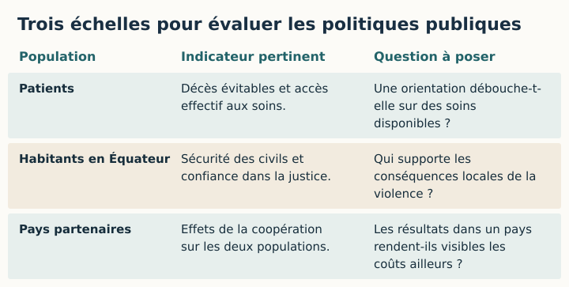

# ENS Rennes D-E — Anglais 2026 · Corrigé brut

*Corrigé rédigé par IA, non officiel. Signalez toute erreur.*

**Rédaction** · GPT-6.2 Astra Ultra · vitesse non renseignée

**Révision (tour 1)** · GPT-6.2 Astra Ultra · vitesse non renseignée

## I. Version française

*Helen Livingstone, BBC, 3 décembre 2025.*

À partir du 10 décembre, les moins de 16 ans ne pourront plus utiliser les principaux réseaux sociaux en Australie. Il leur sera impossible d’ouvrir de nouveaux comptes et les profils existants devront être désactivés. Cette interdiction, la première de ce type, est suivie de près à l’étranger.

Selon le gouvernement, elle atténuera les effets néfastes des « fonctionnalités qui incitent les jeunes à passer davantage de temps devant les écrans tout en leur proposant des contenus susceptibles de nuire à leur santé et à leur bien-être ». Une étude commandée par le gouvernement un peu plus tôt en 2025 a révélé que 96 % des enfants de 10 à 15 ans utilisaient les réseaux sociaux et que sept sur dix d’entre eux avaient été exposés à des contenus préjudiciables.

Ni les enfants ni les parents ne seront sanctionnés en cas d’infraction à cette interdiction. Ce sont les entreprises de réseaux sociaux qui encourent des amendes pouvant atteindre 49,5 millions de dollars australiens (32 millions de dollars américains, 25 millions de livres sterling) pour des manquements graves ou répétés. Le gouvernement indique que les entreprises doivent prendre des « mesures raisonnables » pour empêcher les enfants d’accéder à leurs plateformes et qu’elles devraient employer plusieurs technologies de vérification de l’âge. Elles pourraient notamment s’appuyer sur des pièces d’identité officielles, sur la reconnaissance faciale ou vocale, ou encore sur une méthode dite « d’estimation de l’âge », qui consiste à analyser les comportements et les interactions en ligne pour évaluer l’âge d’une personne.

L’annonce de l’interdiction, en novembre 2024, a consterné les entreprises du secteur. Elles ont fait valoir que la mesure serait difficile à appliquer, facile à contourner, qu’elle ferait perdre du temps aux utilisateurs et présenterait des risques pour leur vie privée. Selon ces entreprises, elle risquait aussi de pousser les enfants vers les recoins obscurs d’internet et de priver les jeunes de contacts sociaux.

## II. Thème en anglais

*Caroline Leclert, Forbes, 20 septembre 2025.*

Faced with industrial dynamism in the United States and China, Europe excels at coming up with innovations but struggles to bring them into large-scale production. From 2028, a new European framework programme, FP10, will be put in place to improve funding for innovation in Europe and give it a boost. Yet action is urgently needed now. Europe must give sovereignty greater weight, simplify the administrative procedures for securing support and strengthen its funding ecosystem.

Of the world’s 2,000 largest investors in research and development, only 322 companies are based in Europe, compared with 681 in the United States and 524 in China. These figures illustrate how persistently Europe lags behind in funding innovation. Overall, the continent remains dependent on the rest of the world for innovative technologies.

Europe suffers from a fragmented internal market made up of 27 countries with disparate national rules. Its start-up ecosystem is fragile, too. It produces only a small share of the world’s tech unicorns, and these companies often find themselves on shaky ground before they can reach critical mass. They receive too little backing from European venture capital, which accounts for barely 5% of the global total, compared with 52% for the United States.

China’s strategy is much clearer. Through its Made in China 2025 programme, Beijing targeted key sectors including electric vehicles, quantum technology, semiconductors and drones. To do so, it mobilised substantial public resources to build national champions.

## III.1 — Le contexte de l’expansion du trafic en Amérique latine

*Maria Abi-Habib, The New York Times, 5 décembre 2025.*

The return of the cocaine trade has coincided with a change in US priorities. During Donald Trump’s first term and under Joe Biden, officials directed scarce resources towards fentanyl because opioid overdoses were killing so many Americans. In Washington, cocaine consequently appeared less urgent. The effects of that judgement looked very different in Latin America, where civilians were being killed in the struggle for control of the trade.

Ecuador illustrates how several developments reinforced each other. Once relatively stable, the country does not produce cocaine, yet it has become the world’s largest exporter. Its security relationship with Washington had already weakened after a US military base closed in 2009. Meanwhile, Mexican cartels built alliances with Colombian armed groups, local gangs and European criminal organisations. Their reach extended across borders, as did demand for cocaine, particularly in the United States and Europe. By 2022 and 2023 the alliance posed a threat to the Ecuadorian state itself.

The government has faced this pressure with weaker resources than its opponents. Poverty makes young people vulnerable to recruitment, and corruption undermines public institutions. Increased Ecuadorian security spending and subsequent US military assistance have not restored the security people once enjoyed. The report also questions the likely impact of recent American military action. Its account therefore connects a domestic calculation about mortality in the United States with the growth of criminal power abroad. Local vulnerabilities and international partnerships help explain why the consequences were especially severe in Ecuador.

*243 mots.*

## III.2 — Les critères d’efficacité d’une politique des drogues

A drug policy should first be judged by whether fewer people die and more people can obtain treatment. On that test, giving public health priority makes sense. Someone who fears prosecution may hesitate to seek help for an overdose or to discuss dependence with a doctor. Confidential care and reliable access to treatment give that person a reason to approach a public institution before a crisis becomes fatal.

Portugal offers a distinction worth making. Its decision in 2001 to decriminalise possession of small quantities for personal use allowed authorities to respond to users outside the criminal courts. Trafficking remained an offence. The merits of such a policy depend in part on what happens after a referral. A person offered treatment in principle gains little if the nearest service has a six-month waiting list. Funding and continuity of care matter as much as a change in the law.

Ecuador illustrates a different limit. An American priority based on domestic overdose deaths gave little weight to violence borne by families abroad. A clinic can help an individual patient, but communities facing intimidation also need trustworthy courts, protection for witnesses and cooperation across borders. Arrest figures alone tell us little about those outcomes.

I would therefore put care first when dealing with people who use drugs and reserve enforcement resources for organised violence and corruption. Evaluation should track deaths, access to care and civilian safety on both sides of a border. Otherwise a policy may look successful precisely where its most serious costs are invisible.

*252 mots.*

[Fascicule officiel, pages imprimées 4 à 6](https://www.ens-rennes.fr/medias/fichier/sujet-lve-d-e-2026_1790867583165-pdf#page=5) · [Rapport écrit d’anglais](https://www.ens-rennes.fr/medias/fichier/rapport-de-jury-lve-anglais-e-crit-2026_1793640873886-pdf)
