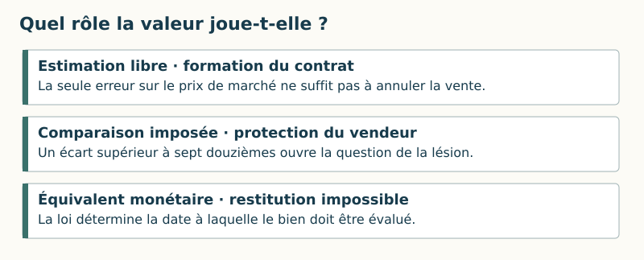

# ENS Rennes · D-E — Droit civil 2026 · Corrigé guidé

*Corrigé rédigé par IA, non officiel. Signalez toute erreur.*

**Lecture du rapport du jury** · GPT-6.2 Astra Ultra · vitesse non renseignée

**Rédaction** · GPT-6.2 Astra Ultra · vitesse non renseignée

**Autocontrôle** · GPT-6.2 Astra Ultra · vitesse non renseignée

**Révision (tour 1)** · GPT-6.2 Astra Ultra · vitesse non renseignée

**Révision (tour 2)** · GPT-6.2 Astra Ultra · vitesse non renseignée

## Préparer une dissertation avec le Code civil

Le sujet autorise un Code civil non annoté et non indexé par le candidat. Le sujet tient en cinq mots. Construire néanmoins le devoir en posant trois questions à chaque article mobilisé. Qui demande quoi ? Quel écart économique doit-il démontrer ? À quelle date la chose est-elle évaluée ?

Posez V pour la valeur de l’immeuble et P pour le prix reçu. La condition chiffrée s’écrit $(V-P)/V>7/12$, soit $P<5V/12$. Pour V égal à 240 000 euros, l’inégalité stricte exclut le prix de 100 000 euros. Cette vérification précède l’examen du délai et des autres conditions de l’action.

**Faire travailler deux nombres.** Devant un immeuble valant 240 000 €, placer les prix de 90 000 € et de 100 000 € de part et d’autre de la condition stricte de l’article 1674. Dans un autre paragraphe, faire évoluer la valeur de l’objet entre la vente annulée et la restitution. Le premier exemple évalue une lésion à la vente, le second chiffre l’équivalent dû à un autre moment.

**Reprendre le rapport de 2026.** Le jury accepte un traitement contractuel ou une approche plus large incluant les biens et les personnes. Il relève les introductions qui envahissent la copie et les développements réduits à la seule erreur sur la valeur. Ici, le raisonnement relie une appréciation économique à une conséquence juridique précise dans chaque sous-partie.

## Proposition de dissertation

Le propriétaire qui vend un tableau pour 1 000 euros peut découvrir que des collectionneurs en auraient offert dix fois plus. Ainsi rapprochés, les deux nombres désignent des réalités différentes. Le prix est la somme convenue dans la vente. La valeur exprime une estimation de ce que vaut la prestation, au regard du marché, de son usage ou d’une situation que la loi commande de prendre en considération. Elle peut être discutée et varier dans le temps. La question porte sur ses effets juridiques. Le droit civil soumet-il la volonté exprimée en prix à une mesure indépendante de la valeur ? Il laisse en principe chacun apprécier l’intérêt de l’échange, mais donne à l’évaluation une portée contraignante lorsque le consentement, un patrimoine protégé ou la restitution d’un bien le requièrent.

### I. Une mesure de l’échange en principe laissée aux parties

**A. Le prix convenu peut s’écarter de la valeur estimée.** Dans la vente, l’article 1591 du Code civil confie aux parties la détermination du prix. La déterminabilité objective et le recours à un tiers estimateur, prévu par l’article 1592, permettent de rendre la somme certaine sans que le juge fixe généralement le « bon » prix du bien vendu. L’article 1168 pose plus largement que le défaut d’équivalence des prestations dans un contrat synallagmatique n’est pas, en principe, une cause de nullité. Les parties n’utilisent d’ailleurs pas nécessairement la même échelle. Un acheteur peut valoriser la convenance d’un emplacement ou un souvenir familial. La stabilité des opérations serait compromise si une réévaluation du bien suffisait à les remettre en cause.

L’article 1136 traduit ce choix dans le droit du consentement. Celui qui connaît les qualités essentielles de la prestation mais se trompe sur ce qu’elle vaut ne peut obtenir la nullité pour cette seule appréciation économique. L’article 1112-1 soustrait à l’obligation précontractuelle d’information l’estimation de la valeur de la prestation. L’article 1137 précise également que conserver pour soi sa propre estimation ne constitue pas, par soi-même, un dol. L’acquéreur mieux renseigné sur le marché n’est donc pas tenu d’enseigner au vendeur son propre pronostic sur le prix de revente.

**B. La nature de la méprise et la réalité de la contrepartie déplacent la limite.** Il faut distinguer deux vendeurs déçus. Le premier sait que le tableau est authentique mais sous-estime la demande. Le second vend comme copie une œuvre dont l’authenticité constituait une qualité essentielle convenue, sans avoir accepté d’aléa sur ce point. Pour le second, l’erreur déterminante peut relever des articles 1132 et 1133, sous réserve notamment de son caractère excusable. C’est la représentation d’une qualité qui affecte le consentement. Si une partie a sciemment falsifié un certificat afin de provoquer la vente, la distinction change encore. Par l’article 1139, l’erreur provoquée par dol peut justifier la nullité même si elle porte sur la valeur. La simple réserve sur sa propre estimation et la tromperie active obéissent ainsi à des régimes différents.

Le droit s’intéresse également à l’existence d’une véritable contrepartie. L’article 1169 prévoit la nullité du contrat à titre onéreux lorsque, au moment de sa formation, la contrepartie convenue au profit de celui qui s’engage est illusoire ou dérisoire. Une prestation inférieure au prix espéré demeure une prestation. Une contrepartie purement apparente peut au contraire ôter sa justification à l’engagement. Il faut examiner toutes les obligations assumées, car un prix nominal peut accompagner la reprise de charges importantes. Le passage à la nullité repose sur les conditions légales et le contenu réel de l’opération.

### II. Une référence imposée pour protéger ou reconstituer le patrimoine

**A. L’écart à une valeur de référence peut ouvrir un recours.** La vente immobilière donne un exemple précis de l’exception réservée par l’article 1168. L’article 1674 protège le vendeur lésé de plus de sept douzièmes dans le prix de l’immeuble. L’article 1675 renvoie à l’état du bien et à sa valeur au moment de la vente. Pour un immeuble valant alors 240 000 €, sept douzièmes représentent 140 000 €. Un prix de 100 000 € se trouve exactement au seuil et ne le franchit pas. Un prix de 90 000 € laisse un écart de 150 000 € et satisfait à la condition chiffrée. C’est le vendeur qui agit, dans le délai de deux ans prévu par l’article 1676. L’acquéreur dispose, si l’action est admise, du choix organisé par l’article 1681 entre restituer l’immeuble contre remboursement du prix et le conserver en acquittant le supplément légal. Le régime ne donne donc pas à tout acheteur déçu un droit général de rééquilibrage. Si l’action aboutit et que l’acquéreur conserve l’immeuble, l’article 1681 prévoit une déduction du dixième du prix total. Supposons que la valeur soit restée à 240 000 euros jusqu’au règlement. Après la déduction de 24 000 euros et imputation des 90 000 euros déjà payés, le supplément s’élève à 126 000 euros. Le seuil qui ouvre le recours et le montant dû pour conserver le bien répondent à deux calculs différents.

La valeur devient également un instrument de protection de la personne. En principe, le majeur sous sauvegarde de justice conserve l’exercice de ses droits. Néanmoins, l’article 435 permet dans les conditions qu’il fixe la rescision pour simple lésion ou la réduction en cas d’excès des actes passés pendant la mesure. Le juge doit notamment considérer l’utilité de l’opération pour la personne, la consistance de son patrimoine et la bonne ou mauvaise foi de son cocontractant. Un achat dispendieux s’apprécie ici relativement aux moyens et aux besoins de l’intéressé. Transposer le seuil de sept douzièmes de la vente immobilière méconnaîtrait le but propre de la protection.

**B. L’évaluation peut remplacer une restitution en nature.** Après anéantissement d’un contrat, effacer le prix contractuel des comptes ne suffit pas à reconstituer les patrimoines. Selon l’article 1352, un bien autre qu’une somme d’argent doit d’abord être restitué en nature. En cas d’impossibilité, il est restitué en valeur estimée au jour de la restitution. L’objet peut s’être apprécié ou déprécié après la vente. Le juge ne reprend donc pas mécaniquement l’ancien prix. Lorsque le bénéficiaire a revendu le bien, l’article 1352-2 distingue le prix de revente dû par celui qui était de bonne foi et la valeur au jour de la restitution due par celui qui était de mauvaise foi lorsqu’elle est supérieure à ce prix. La date et la bonne foi déterminent la répartition du risque de variation.

Le même souci de proportion se lit dans l’article 1352-5. Les dépenses nécessaires à la conservation de la chose entrent en compte. Les dépenses qui en ont augmenté la valeur sont retenues à concurrence de la plus-value estimée au jour de la restitution. Une amélioration ayant coûté 20 000 € et procurant encore 12 000 € de plus-value ne se confond donc pas avec un remboursement automatique des 20 000 € sur ce second fondement. L’article 1352-4 tient par ailleurs compte, au bénéfice du mineur non émancipé ou du majeur protégé, du profit effectivement retiré de l’acte annulé. L’évaluation rétablit un équilibre patrimonial défini par la loi, avec des protections attachées à la situation des personnes.

La valeur ne fournit pas au juge un pouvoir général de réviser le prix. Son effet dépend de la raison pour laquelle le droit sollicite une mesure de l’équivalent. Tantôt la liberté d’évaluer fait partie du risque de l’échange. Tantôt une règle de protection ou de restitution désigne ce qu’il faut estimer, à quelle date et au profit de qui.

[Énoncé officiel](https://www.ens-rennes.fr/medias/fichier/sujet-droit-civil-d-e-2026_1790867563170-pdf) · [Rapport du jury](https://www.ens-rennes.fr/medias/fichier/rapport-de-jury-droit-civil-d-e-2026_1793640809565-pdf)

[Code civil, art. 1681](https://www.legifrance.gouv.fr/codes/article_lc/LEGIARTI000006442372/2026-04-14)
