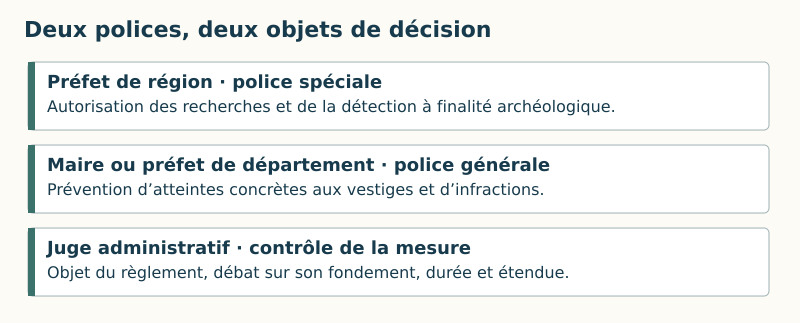

# ENS Rennes · D-E — Droit public 2026 · Corrigé guidé

*Corrigé rédigé par IA, non officiel. Signalez toute erreur.*

**Rédaction** · GPT-6.2 Astra Ultra · vitesse non renseignée

**Autocontrôle** · GPT-6.2 Astra Ultra · vitesse non renseignée

**Révision (tour 1)** · GPT-6.2 Astra Ultra · vitesse non renseignée

**Révision (tour 2)** · GPT-6.2 Astra Ultra · vitesse non renseignée

## Lire les sept points de la décision

Le premier point contient les faits et la procédure. Le deuxième qualifie l’acte. Le troisième explique pourquoi la cour a pu retenir un fondement débattu en appel. Les quatrième et cinquième énoncent puis articulent les textes de police. Le sixième contrôle la proportionnalité concrète. Le septième tire les conséquences du rejet. Cette lecture évite de reconstruire l’affaire comme un refus individuel d’autorisation de fouilles.

Faites varier la demande. Une personne qui veut prospecter un site à des fins archéologiques sollicite l’autorité de police spéciale. Un événement dont le parcours demeure inconnu soulève une autre question, celle de la prévention du risque par l’autorité territorialement compétente. Une réponse correcte identifie pour chaque décision son objet et son fondement.

**Deux emplois du mot général.** « Acte réglementaire » répond à la question des destinataires de la norme. « Interdiction générale et absolue » caractériserait une restriction trop large dans son objet ou ses effets. Un acte peut avoir des destinataires impersonnels et toutefois ne viser qu’un usage, pendant deux jours, à l’occasion d’un seul événement.

**Deux moments du contradictoire.** L’administration n’avait pas à recueillir les observations des organisateurs sur le fondement invoqué pour une décision individuelle. Devant la cour, en revanche, le mémoire qui défendait le fondement de police générale a été communiqué. Ces deux motifs se lisent dans deux points successifs de la décision officielle.

## Commentaire rédigé

La police de l’archéologie autorise ou refuse des recherches. Un rassemblement de loisir peut pourtant présenter un risque pour des vestiges que ses organisateurs n’avaient pas pour objet de rechercher. Par sa décision du 30 septembre 2025, Société La Boutique du Fouilleur et autre, le Conseil d’État précise l’autorité qui peut prévenir ce risque et les conditions de son intervention.

La société et le syndicat Détexpert souhaitaient organiser les 21 et 22 septembre 2019 un rallye de détection sur des terrains susceptibles de se trouver dans le Loiret ou dans deux départements voisins. Le lieu exact n’était pas connu du préfet du Loiret. Par arrêté du 20 septembre, celui-ci a interdit, dans son département et durant les deux jours du rallye, l’utilisation des détecteurs à l’occasion de cette manifestation. Le tribunal administratif d’Orléans a rejeté le recours pour excès de pouvoir le 15 octobre 2021. La cour administrative d’appel de Versailles a rejeté l’appel le 28 novembre 2023. Les organisateurs demandent la cassation, un règlement au fond en leur faveur et le remboursement de frais de procédure.

La police spéciale confiée au préfet de région prive-t-elle le préfet de département de la possibilité d’édicter une telle règle préventive ? Le Conseil d’État rejette le pourvoi. Il distingue les deux polices et admet leur concours pour prévenir certaines atteintes et infractions (I). Il valide une restriction réglementaire dont la portée est délimitée par les circonstances, sous le contrôle du juge (II).

### I. Deux compétences de police dont l’objet ne se recouvre pas entièrement

**A. L’autorisation de recherches archéologiques relève d’une police spéciale.** Les articles L. 531-1 et L. 542-1 du Code du patrimoine soumettent à autorisation, dans les conditions qu’ils définissent, des fouilles ou sondages et l’utilisation de détecteurs lorsqu’ils tendent à rechercher des objets ou monuments intéressant notamment l’histoire ou l’archéologie. La finalité de recherche compte. Le recours à un détecteur ne suffit pas, isolément, à caractériser cette finalité. La réglementation confie ces autorisations au préfet de région. Les manquements aux obligations résultant du régime sont susceptibles de sanctions pénales.

En l’espèce, l’événement annoncé consistait à retrouver notamment des objets enfouis pour les besoins du jeu. Déduire de cette seule description que tous les participants réalisaient des recherches archéologiques aurait éludé le problème. Le risque venait aussi de la possibilité d’atteindre d’autres objets en terrain riche en vestiges. L’arrêté départemental n’accorde ni ne refuse une autorisation scientifique et ne modifie pas les critères applicables aux demandes adressées au préfet de région.

**B. La police générale conserve une fonction préventive territoriale.** L’article L. 2215-1 du Code général des collectivités territoriales organise notamment la compétence du préfet de département pour les mesures dont le champ excède une commune. Le Conseil d’État indique que le maire ou le préfet de département, selon le cas, peut prévenir des excavations menaçant le patrimoine en raison de leur localisation et éviter la commission d’infractions relatives aux fouilles. Prévenir de tels faits relève ici de la police administrative. L’arrêt n’attribue pas au préfet de département la sanction d’infractions déjà commises.

L’existence d’une police spéciale ne détermine donc pas, à elle seule, une exclusivité en tous points. Il faut identifier le domaine que le législateur a organisé et ce que fait concrètement l’autorité de police générale. Le juge rattache la prévention des atteintes au patrimoine dans ces circonstances à la mission de sûreté. Il serait excessif d’en tirer que le préfet peut substituer son appréciation à celle du préfet de région lorsqu’une véritable demande d’autorisation lui est soumise.

### II. Une interdiction réglementaire dont le juge vérifie le fondement et la mesure

**A. L’objet de l’arrêté détermine sa procédure et son fondement contentieux.** Les organisateurs étaient connus et le rallye nommé. Cela ne suffit pas à qualifier la décision d’individuelle. Au point 2, le Conseil d’État observe que l’arrêté n’interdit pas l’événement à ses organisateurs. Il pose une règle applicable, pendant celui-ci, à toute personne qui utiliserait un détecteur dans le département. Le groupe des destinataires est déterminé par une conduite. La règle conserve donc un caractère réglementaire malgré sa courte durée et son lien avec une manifestation déterminée. Les organisateurs ne pouvaient exiger d’être mis à même de présenter des observations au titre de la procédure préalable invoquée contre une décision individuelle.

L’article L. 121-1 du Code des relations entre le public et l’administration soumet notamment au contradictoire préalable les décisions individuelles devant être motivées au titre de l’article L. 211-2 et celles qui sont prises en considération de la personne, hors le cas où il est statué sur une demande. L’arrêté applicable aux participants en raison de leur activité relève d’une catégorie différente. Ce contradictoire administratif se distingue de la discussion contentieuse du fondement de la mesure. Même à supposer que l’auteur de l’arrêté ait entendu se placer sur le terrain de la police spéciale, la ministre de la culture a soutenu devant les juges d’appel que l’acte relevait de la police générale. Le mémoire a été communiqué aux parties. Le Conseil d’État approuve la cour d’avoir apprécié la légalité à la lumière des dispositions du Code général des collectivités territoriales. Il statue sur une argumentation soumise au débat. Il ne reconnaît ni une compétence générale à la ministre pour prendre l’arrêté ni une faculté illimitée de modifier après coup un fondement juridique.

**B. La portée géographique de la restriction est rapportée au risque concret.** L’étendue départementale pourrait sembler excessive pour une manifestation qui ne devait utiliser que certains terrains. Deux données sont décisives au point 6. Le Loiret compte de nombreux sites présentant un intérêt archéologique et le préfet ignorait les lieux exacts retenus. Délimiter plus finement l’interdiction en amont était donc difficile. En sens inverse, l’arrêté ne s’applique que pendant deux journées et seulement à l’usage de détecteurs dans le cadre du rallye. Il ne frappe pas toute activité au cours de la manifestation ni toute détection pendant une durée indéfinie.

La décision est réglementaire par ses destinataires sans constituer pour autant une interdiction générale et absolue. Le Conseil d’État vérifie que la cour d’appel n’a pas inexactement qualifié les faits lorsqu’elle a admis la proportionnalité. L’intérêt patrimonial ne soustrait donc pas la restriction au contrôle du juge. Un lieu connu, un risque circonscrit ou une mesure permanente changeraient les termes de la comparaison. Le rejet du pourvoi entraîne celui de la demande de frais au titre de l’article L. 761-1 du Code de justice administrative. La portée de l’arrêt réside dans ce concours limité des polices et dans la justification circonstanciée qu’il exige.

[Énoncé officiel](https://www.ens-rennes.fr/medias/fichier/sujet-e-preuves-a-options-d-e-2026_1790867571556-pdf#page=3)

[Code des relations entre le public et l’administration, art. L. 121-1](https://www.legifrance.gouv.fr/codes/article_lc/LEGIARTI000031367424/2026-04-15)
