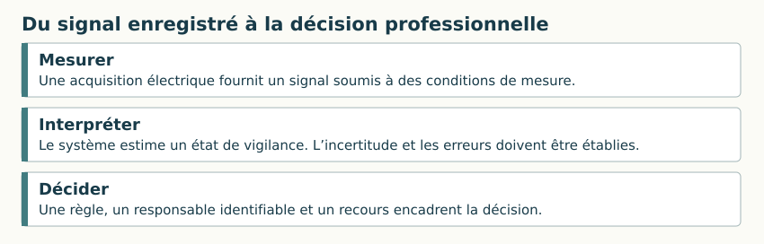

# ENS Rennes D–E — Oral d’entretien 2026 · Corrigé brut

*Corrigé rédigé par IA, non officiel. Signalez toute erreur.*

**Rédaction** · GPT-6.2 Astra Ultra · vitesse non renseignée

**Autocontrôle** · GPT-6.2 Astra Ultra · vitesse non renseignée

**Révision (tour 1)** · GPT-6.2 Astra Ultra · vitesse non renseignée

**Révision (tour 2)** · GPT-6.2 Astra Ultra · vitesse non renseignée

Le fascicule officiel compte 69 pages. Il comprend vingt-trois dossiers de longueurs différentes, numérotés de 1 à 22, puis 25. Le candidat dispose de dix minutes au maximum pour construire une réflexion personnelle et critique à partir du texte attribué. Chaque numéro propose ici un argument défendable, une application et une limite à discuter.

Chaque document est un extrait que le jury signale comme tronqué. Situer la position qu’il permet de défendre, proposer un exemple extérieur et examiner une objection. Le rapport de 2026 distingue ensuite le dialogue consacré au projet professionnel, traité en fin de corrigé. Les exemples personnels restent à choisir par chaque candidat.

## 1. Enquêter sur les carrières des hauts fonctionnaires

*Document étudié.* Marion Demonteil, travaux sur les carrières dans la haute fonction publique (2025).

**Qui faut-il interroger pour comprendre une promotion ?** Une liste de directeurs révèle qui a atteint le sommet. Elle laisse dans l’ombre les agents qui auraient pu y parvenir. L’enquête présentée par Marion Demonteil a recueilli entre 2019 et 2021 les récits de 65 cadres du ministère de la Culture occupant au moins des fonctions équivalentes à celles de chef de bureau. En incluant des carrières arrêtées à ce niveau, les chercheurs peuvent comparer le moment où deux trajectoires se séparent. Un supérieur sollicite personnellement une candidature, un autre attend qu’elle se manifeste. Les mêmes règles de recrutement produisent alors des occasions différentes de se présenter.

J’examinerais les trois décisions successives de se porter candidat, d’être présélectionné et d’accepter la mobilité proposée. Comparer femmes et hommes au dernier stade seulement efface les deux premières sélections. Les entretiens rendent intelligible un renoncement qu’un fichier enregistrerait comme une absence. Leur mise en récit rétrospective et leur ancrage dans un ministère limitent cependant leur portée. Pour vérifier le mécanisme, je confronterais les postes annoncés, les dossiers reçus et les profils retenus à des trajectoires de même ancienneté. L’égalité d’accès devient alors une propriété de la procédure tout entière.

Une enquête par entretiens restitue le sens que les agents donnent à un moment charnière de leur carrière. Elle rencontre une difficulté classique de la sociologie des organisations : ceux qui ont quitté le milieu étudié sont moins visibles. Un départ après une candidature découragée peut donc disparaître des archives du ministère. Chercher les sortants dans les annuaires successifs, puis les inviter à parler, permettrait de mettre l’hypothèse à l’épreuve. Une interprétation serait affaiblie si les carrières divergeaient déjà avant l’entrée dans les emplois considérés.

[Billet officiel 1, p. 1–3](https://www.ens-rennes.fr/medias/fichier/sujets-entretien-d-e-2026_1790958443479-pdf#page=1)

## 2. Mesurer les inégalités professionnelles

*Document étudié.* Marion Demonteil, travaux sur les carrières dans la haute fonction publique (2025).

**Une politique peut atteindre son quota et laisser subsister un écart considérable.** La loi Sauvadet de 2012 porte ici sur les premières nominations. Le bilan des personnes en poste reflète plusieurs années d’entrées et de sorties. Supposons 20 directions, dont 4 occupées par des femmes. Deux hommes partent et une femme et un homme les remplacent. La moitié du recrutement est féminine, mais la proportion en poste passe seulement de 20 à 25 %. Il faudrait aussi observer qui quitte ces emplois et au bout de combien de temps.

Une seconde année de recrutement paritaire ne suffit pas à prévoir l’effectif final. Si une femme et un homme quittent leurs fonctions et sont remplacés par une femme et un homme, la proportion demeure cinq sur vingt. La politique des nominations et les conditions de maintien dans les postes peuvent donc faire l’objet de deux enquêtes complémentaires.

Marion Demonteil rappelle que les femmes représentent 64 % des agents publics et que l’écart de rémunération brute en équivalent temps plein atteignait 12 % dans la fonction publique de l’État en 2021. Le premier chiffre porte sur l’ensemble de la fonction publique, le second sur un de ses versants. Une rémunération en équivalent temps plein neutralise la durée rémunérée au moment de la mesure, mais une carrière antérieure à temps partiel peut avoir pesé sur les promotions. Je publierais des séries sur les candidatures et les durées dans chaque grade, accompagnées d’entretiens sur les choix de mobilité. Le quota rend l’organisation comptable de ses nominations. Il devient trompeur si sa réussite dispense d’examiner le reste.

La mesure devient aussi une incitation. Si l’institution est évaluée sur ses premières nominations, elle peut améliorer cet indicateur tout en affectant durablement les femmes à des emplois moins dotés. Je suivrais séparément le nombre d’entrées, la durée d’occupation et le poids budgétaire des postes. Si les trois se rapprochent, le diagnostic de simple conformité apparente doit être révisé. Cet exemple rattache le texte à une controverse générale sur l’évaluation des politiques publiques par des objectifs chiffrés.

[Billet officiel 2, p. 4–6](https://www.ens-rennes.fr/medias/fichier/sujets-entretien-d-e-2026_1790958443479-pdf#page=4)

## 3. Le lieu du travail et le lieu de la promotion

*Document étudié.* Marion Demonteil, travaux sur les carrières dans la haute fonction publique (2025).

**Qui peut raconter le travail d’un agent quand la promotion se décide ?** Le chef de bureau interrogé rue de Valois souligne un avantage précis. Son chef connaît son travail et participe à la commission qui examine les carrières du corps. Des collègues en établissement ou en service déconcentré ont moins de chances de bénéficier de ce témoignage direct. Une procédure formellement commune peut ainsi privilégier une proximité géographique et hiérarchique.

Il est possible que les services centraux recrutent des agents déjà destinés aux plus hauts postes, ou qu’ils donnent une expérience différente. Le récit ne permet pas de départager ces mécanismes. Je comparerais des agents du même corps et du même grade, avant puis après une mobilité, en relevant le contenu de leur travail autant que leur lieu d’exercice. Rendre les candidatures plus lisibles pour les postes éloignés, recueillir plusieurs avis et motiver les décisions donnerait à l’autorité de nomination un éventail d’informations plus large. L’enjeu est de faire connaître une compétence qui s’exerce loin du lieu où elle sera jugée.

Un concours formellement ouvert ne supprime pas le coût d’une mobilité géographique. On peut être très visible au sein de son service et inconnu de ceux qui nomment au niveau national. Pour départager ce mécanisme d’un effet de spécialité, comparer des postes de même métier dans l’administration centrale et en services déconcentrés, puis examiner qui siège aux commissions. Je changerais d’interprétation si la différence de promotion disparaissait une fois les qualifications, les candidatures et les vacances de postes comparées.

[Billet officiel 3, p. 7–9](https://www.ens-rennes.fr/medias/fichier/sujets-entretien-d-e-2026_1790958443479-pdf#page=7)

## 4. Les qualités du dirigeant

*Document étudié.* Marion Demonteil, travaux sur les carrières dans la haute fonction publique (2025).

**À quoi reconnaît-on quelqu’un qui sait diriger ?** Dans les entretiens étudiés par Marion Demonteil, savoir décider seul, se battre et se rendre disponible paraissent parfois aller de soi. Ces attentes associent la compétence à une manière historiquement masculine de la manifester. Une administration largement féminisée peut continuer à sélectionner ses dirigeants sur ce modèle. Une agente qui impose une décision risque alors de paraître autoritaire, celle qui consulte de sembler manquer d’assurance. Le problème se situe dans la variation du jugement porté sur le même comportement.

Je proposerais deux descriptions d’une même conduite de réunion avec des prénoms différents pour repérer ce biais, puis je chercherais comment il agit sur des décisions réelles. Une excellente direction peut se signaler par la qualité du service pendant l’absence du chef. Ce critère valorise la délégation et la préparation collective. Certaines fonctions exigent une disponibilité particulière. Il convient d’en préciser les circonstances, la fréquence et la répartition dans l’équipe, afin de distinguer une contrainte du poste d’une épreuve de loyauté permanente. Les critères deviennent ainsi justifiables devant les candidats.

Il existe un enjeu pratique derrière la discussion du « naturel ». Un poste peut réellement exiger d’arbitrer rapidement sans pour autant exiger un style autoritaire. Pour une même décision urgente, on pourrait évaluer séparément le délai, la justification et la qualité de l’information recueillie. Cela permet de juger la tâche et d’examiner si l’étiquette de « leadership » ajoute quelque chose, ou si elle réintroduit une préférence sociale dans la sélection.

[Billet officiel 4, p. 10–12](https://www.ens-rennes.fr/medias/fichier/sujets-entretien-d-e-2026_1790958443479-pdf#page=10)

## 5. Sobriété numérique et éducation

*Document étudié.* Sarah Descamps, Karim Boumazguida, Gaëtan Temperman et Bruno De Lièvre, enquête sur la sobriété numérique en éducation (2023).

**Un enseignant peut connaître les bons gestes et dépendre d’achats décidés ailleurs.** L’extrait de Descamps et de ses collègues rapproche le sentiment de compétence des professionnels de l’éducation et les usages numériques qu’ils déclarent. Dire que l’on sait diminuer un impact, déclarer que l’on agit et obtenir une diminution matérielle sont trois observations distinctes. Une même personne peut très bien connaître le coût de fabrication d’un ordinateur sans pouvoir faire prolonger le contrat de maintenance de son établissement.

La règle des cinq R citée dans le document commence par refuser et réduire et place le recyclage en dernier. Dans une école, je comparerais le remplacement uniforme d’un parc à l’entretien d’appareils qui répondent encore aux besoins. Il faut prendre en compte les réparations, la consommation, la durée de service et l’accessibilité des logiciels, y compris pour un élève qui dépend d’une aide numérique. Une formation peut donner aux enseignants les moyens de discuter les usages. Un budget de réparation et des règles d’achat rendent leur action possible. Pour évaluer l’effet, on observerait à la fois la durée de vie des appareils et le service pédagogique effectivement rendu.

Un bilan de cycle de vie conduit à distinguer fabrication, usage et fin de vie. Remplacer des appareils pour réduire leur consommation à l’usage n’est avantageux que si cette économie compense aussi les ressources de fabrication. Une réponse pédagogique doit en outre compter les besoins d’accessibilité et les inégalités d’équipement entre élèves. J’évaluerais deux scénarios à service pédagogique comparable, puis je demanderais quel acteur a réellement le pouvoir de changer chacun des postes.

[Billet officiel 5, p. 13–15](https://www.ens-rennes.fr/medias/fichier/sujets-entretien-d-e-2026_1790958443479-pdf#page=13)

## 6. Cités, communautés et lien social

*Document étudié.* Sylvain Aquatias, réflexion socio-anthropologique sur les jeunes de banlieue et le lien social (1997).

**Affirmer que le lien social se défait suppose que l’on ait dit de quel lien il s’agit.** Sylvain Aquatias part de discours publics sur les jeunes des cités et de la difficulté à expliquer pourquoi une transgression survient ici et à ce moment. Le gain matériel, la reconnaissance par les pairs et la rupture d’une règle publique n’ont pas le même sens. Un comportement qui éloigne d’une institution peut resserrer une relation au sein d’un groupe. De là on ne peut conclure ni à l’unité des habitants ni à leur isolement général.

Je suivrais la journée de plusieurs habitants d’un même quartier, en observant les aides échangées, les obligations qu’elles créent et les situations où intervient une règle impersonnelle. La solidarité d’une voisine, le règlement de l’école et les ressources d’un service public peuvent se compléter ou entrer en conflit. Les catégories classiques de communauté et de société donnent des questions à poser à ces relations. En faire deux territoires opposés ferait disparaître précisément la coexistence que l’on cherche à comprendre. Une enquête située peut aussi faire entendre les personnes dont la vie ordinaire est absente des récits publics.

La distinction de Tönnies entre communauté et société fournit un outil pour lire l’extrait. Elle permet de demander dans quelles situations une connaissance personnelle crée des obligations, et quand une règle impersonnelle les remplace. Transformer ces deux formes en portrait figé des quartiers serait une erreur de méthode. Une même personne peut se prévaloir d’une règle générale pour contester un passe-droit tout en s’appuyant quotidiennement sur l’entraide du voisinage.

[Billet officiel 6, p. 16–19](https://www.ens-rennes.fr/medias/fichier/sujets-entretien-d-e-2026_1790958443479-pdf#page=16)

## 7. La place de l’intelligence juridique

*Document étudié.* Simon Brenot, article professionnel sur l’intelligence juridique (2020).

**À quel moment le juriste peut-il encore transformer un projet ?** Dans l’article de Simon Brenot, l’intelligence juridique rapproche veille, compréhension de l’environnement et participation à la décision. Si une collectivité ou une entreprise prépare un service utilisant des données personnelles, consulter le juriste après avoir choisi tous les prestataires réduit les options possibles. Associer l’équipe juridique dès la conception permet d’examiner quelles données sont nécessaires, qui devra y accéder et quelles obligations chaque choix entraîne. La connaissance du droit modifie la solution envisagée.

L’extrait, publié dans un média professionnel, plaide aussi pour de nouveaux rôles et un gain de temps. Il faudrait établir ce gain sur la vie du projet et y inclure les délais évités comme le coût de la veille. Je défendrais une participation du juriste à la stratégie assortie de l’indépendance nécessaire pour expliquer qu’un projet doit être modifié. Un outil automatique de classement peut l’aider à retrouver des documents. C’est au professionnel de vérifier leur autorité, leur date et la pertinence du raisonnement qu’il présente au décideur.

La fonction de conformité illustre une tension. Une veille peut éviter une infraction, mais une entreprise dispose aussi de moyens pour intervenir dans la définition de la règle en cours de préparation. La valeur stratégique du droit s’accompagne donc d’une question de représentation des intérêts. Qui a accès à la consultation publique ? Les petites entreprises ou les usagers disposent-ils d’une voix comparable ? L’avantage organisationnel défendu par l’article appelle ainsi un second jugement, sur les conditions de production de la norme.

[Billet officiel 7, p. 20–22](https://www.ens-rennes.fr/medias/fichier/sujets-entretien-d-e-2026_1790958443479-pdf#page=20)

## 8. La personnalité juridique des fleuves

*Document étudié.* Podcast anonyme, « Les fleuves sont-ils des personnes ? » (2021).

**Qui peut demander réparation pour une atteinte dont souffre durablement un fleuve ?** Le podcast prend l’exemple du Whanganui, reconnu comme entité juridique en Nouvelle-Zélande en 2017. Cette reconnaissance répond aussi à une relation historique et spirituelle avec les Māori concernés. La personnalité donne au cours d’eau une représentation propre. Comme dans le cas d’une personne morale, des êtres humains formulent la demande. L’intérêt invoqué peut néanmoins différer de la somme des pertes subies par des riverains.

L’objection de l’auteur est concrète. La concession hydroélectrique qu’il mentionne continue à produire ses effets après la reconnaissance du fleuve. Le statut accroît la possibilité de faire entendre une prétention, tandis que l’issue dépend des droits déjà constitués, des pouvoirs du représentant et des remèdes judiciaires. Je jugerais le dispositif à partir d’un conflit de prélèvement d’eau. Qui peut saisir l’autorité, quels éléments établissent la dégradation et une décision peut-elle être suivie sur plusieurs années ? La réponse ne peut être transposée en France sans tenir compte du droit applicable et de l’histoire du bassin.

Deux États peuvent protéger des milieux sans leur attribuer le même statut. En France, la réparation du préjudice écologique donne déjà une portée juridique à certaines atteintes aux éléments ou aux fonctions des écosystèmes. La comparaison pertinente porte sur les personnes qui peuvent agir, les intérêts qu’elles représentent et les mesures que le juge peut ordonner. Elle explique pourquoi une personnalité juridique nouvelle peut avoir un effet important dans un pays et une portée plus limitée dans un autre.

[Billet officiel 8, p. 23–25](https://www.ens-rennes.fr/medias/fichier/sujets-entretien-d-e-2026_1790958443479-pdf#page=23)

## 9. L’argent et la liberté de choisir

*Document étudié.* Damien de Blic et Jeanne Lazarus, présentation de leur ouvrage *Sociologie de l’argent* (2e édition, 2021).

**Payer peut donner de la liberté tout en créant une dépendance nouvelle.** Damien de Blic et Jeanne Lazarus rappellent avec Weber que les usages légitimes de l’argent ont une histoire. Épargner pour acquérir un bien, prêter à intérêt et accumuler pour accroître un capital peuvent recevoir des jugements moraux différents. Avec Simmel, la question se déplace vers l’expérience de l’échange. Celui qui dispose de la somme demandée peut choisir entre fournisseurs sans devoir à chacun une faveur personnelle. Cette indépendance suppose une monnaie acceptée, des prix et un accès au revenu.

Prenons un service que des proches se rendent gratuitement, puis qu’une personne achète pour pouvoir s’organiser seule. Elle gagne en latitude sur les horaires et peut changer de prestataire. Sa liberté varie toutefois avec ses ressources, l’offre disponible et les conditions de travail de celui qui vend ce service. L’impersonnalité de la transaction a donc des effets différents selon le côté du contrat où l’on se trouve. La sociologie de l’argent peut étudier à la fois les contraintes générales d’une économie monétaire et les significations particulières qu’un ménage attribue à un salaire, un don ou un héritage.

La sociologie du marquage de l’argent, associée à Viviana Zelizer, précise une limite de la fongibilité. Dix euros d’argent de poche et dix euros confiés pour acheter le pain sont comptablement interchangeables. Leur emploi n’est pas socialement interchangeable pour la famille. Si l’on veut savoir ce que l’argent « libère », il faut donc observer aussi qui peut décider de sa destination et à qui cette personne doit rendre compte.

[Billet officiel 9, p. 26–28](https://www.ens-rennes.fr/medias/fichier/sujets-entretien-d-e-2026_1790958443479-pdf#page=26)

## 10. Science, psychanalyse et récits d’origine

*Document étudié.* François Ansermet, « Science et psychanalyse » (2013).

**Le fait de connaître une origine biologique règle-t-il la question de l’origine pour une personne ?** François Ansermet distingue l’ambition généralisante de la science et l’attention psychanalytique portée à l’histoire singulière. Les exemples de procréation avec tiers donneur montrent que la contribution à la conception, la gestation, la filiation établie en droit et la relation éducative peuvent désigner des personnes différentes. Une réponse exacte à la question biologique peut ainsi laisser entière une question sur le récit familial.

Cette distinction permet d’écouter la façon dont une personne comprend sa propre histoire. Elle ne suffit pas à opposer deux blocs de savoir. La médecine soigne aussi une personne particulière et les interprétations cliniques appellent une discussion sur leurs preuves. Je défendrais la possibilité de demander des informations fiables et de choisir la place qu’on leur donne dans sa vie, sans imposer un modèle unique de ce que chacun devrait ressentir. Deux personnes placées devant une histoire biologique comparable peuvent attribuer à cette connaissance des significations différentes. Leur témoignage permet d’établir cette diversité, sans prédire ce que vivra chaque enfant.

La possibilité d’accéder à ses origines dans une procréation avec tiers donneur donne un prolongement juridique au texte. Obtenir une information sur la conception n’établit pas par cette seule révélation une nouvelle filiation. Sur le plan de la recherche, deux personnes ayant reçu des informations comparables peuvent leur donner des sens très différents. On peut recueillir cette diversité sans transformer une interprétation clinique particulière en explication scientifique de toutes les trajectoires.

[Billet officiel 10, p. 29–31](https://www.ens-rennes.fr/medias/fichier/sujets-entretien-d-e-2026_1790958443479-pdf#page=29)

## 11. Les trois types de domination légitime

*Document étudié.* Max Weber, « Les trois types purs de la domination légitime », traduction d’Élisabeth Kauffmann publiée en 2014.

**Pourquoi obéit-on à un ordre que l’on désapprouve ?** Weber distingue les raisons pour lesquelles le pouvoir peut être tenu pour légitime. Dans la domination légale, on reconnaît la compétence attachée à une fonction et exercée selon des règles. Dans la domination traditionnelle, l’autorité tire sa force de la continuité d’un ordre tenu pour valable. Dans la domination charismatique, les fidèles attribuent des qualités extraordinaires à la personne qui les conduit. Un même acte observable, exécuter une instruction, ne révèle donc pas à lui seul le type d’autorité.

Lorsqu’un responsable quitte son poste, la réaction à son successeur permet d’éprouver la distinction. La personne qui continue d’obéir au titulaire régulièrement nommé reconnaît l’office. Celle qui entend suivre l’ancien chef témoigne peut-être d’un attachement personnel. La distinction est analytique. Un dirigeant élu peut mobiliser à la fois le mandat légal, les usages de son institution et son ascendant personnel. J’examinerais également les refus, car une obéissance obtenue sous la menace ne prouve pas que l’ordre est jugé légitime. Expliquer cette croyance laisse ouverte la question de savoir si l’ordre est juste.

Dans une mairie, on suit l’arrêté du maire à raison de sa compétence juridique. Une même personne peut aussi être obéie en raison d’une coutume locale ou parce que son action pendant une crise a suscité un attachement personnel. La classification wébérienne porte sur les motifs de reconnaissance de l’autorité. Elle permet ainsi d’analyser le moment où le prestige d’un dirigeant cesse de lui survivre et où une organisation cherche à transmettre l’autorité à son successeur.

[Billet officiel 11, p. 32–34](https://www.ens-rennes.fr/medias/fichier/sujets-entretien-d-e-2026_1790958443479-pdf#page=32)

## 12. Origines sociales et parcours scolaires

*Document étudié.* Gaëlle Dabet, Dominique Epiphane et Elsa Personnaz, étude du Céreq sur origine sociale, diplôme et insertion (2024).

**L’ouverture du lycée a-t-elle donné les mêmes possibilités de poursuivre ses études ?** L’extrait distingue la diffusion du baccalauréat et la distribution des élèves entre filières. Sur 100 jeunes issus de ménages à dominante ouvrière, 59 rejoignent la voie professionnelle à l’issue de la troisième, contre 16 sur 100 parmi les enfants de deux cadres. L’écart de 43 points porte sur l’orientation dans deux populations d’origine différente. Il ne signifie pas que 59 % des élèves de la voie professionnelle proviennent de ces ménages.

Cette orientation change l’éventail des poursuites d’études probables. Elle peut résulter des apprentissages antérieurs, de l’offre locale, des conseils reçus, des dépenses à anticiper et du jugement que l’élève porte sur ses chances. Je comparerais choix exprimés et orientation obtenue, puis réussite dans la voie demandée. Valoriser les formations professionnelles implique de permettre un choix informé et des passerelles réelles. Une amélioration du niveau moyen peut coexister avec de fortes inégalités dans les parcours qui conduisent aux formations les plus sélectives.

Dans l’extrait, 7 % des enfants de cadres et 17 % de ceux de familles à dominante ouvrière suivent une trajectoire de maintien aux marges de l’emploi. Parmi les diplômés du supérieur court, la proportion est de 7 % dans les deux groupes. Ce rapprochement suggère un rôle du diplôme, mais l’accès à ce diplôme est lui-même socialement distribué. Conditionner la comparaison au diplôme change donc la question : on compare alors des jeunes déjà sélectionnés aux étapes antérieures.

[Billet officiel 12, p. 35–37](https://www.ens-rennes.fr/medias/fichier/sujets-entretien-d-e-2026_1790958443479-pdf#page=35)

## 13. Les places offertes aux polytechniciens

*Document étudié.* Adrien Delespierre, François-Xavier Dudouet et Hervé Joly, enquête sur les polytechniciens et l’État (2022).

**L’État recrute-t-il moins d’ingénieurs ou les recrute-t-il autrement ?** Delespierre, Dudouet et Joly indiquent que la part d’une promotion de Polytechnique intégrant un corps de l’État est passée d’environ la moitié à la fin des années 1970 à moins d’un cinquième au début des années 2010. La taille des promotions a augmenté. Cependant, en 2018, les 69 places offertes pour 400 élèves donnent un maximum de 17,25 % dans ces corps par cette voie. Une préférence supposée de tous les élèves pour le privé n’explique pas à elle seule la contraction de l’offre publique.

Je comparerais trois séries. La première porte sur les places offertes aux élèves de l’X, la deuxième sur tous les entrants dans les corps, la troisième sur les fonctions réellement exercées à cinq ou dix ans. Ouvrir un corps à des recrutements universitaires peut faire baisser la première série sans contracter la deuxième. Confier des missions à un opérateur peut déplacer, dans la troisième, le lieu de l’expertise publique. Les conflits de tutelle récents pourraient accélérer une évolution vieille de quatre décennies. Leur seule existence en fin de période renseigne peu sur son origine.

Regarder seulement le choix individuel des élèves suppose que l’offre soit stable. Or l’État peut offrir moins de postes dans certains corps et diversifier ses recrutements. Pour savoir si les préférences ont changé, il faudrait comparer, année par année, les places proposées, les rangs auxquels elles ont été choisies et les autres sorties accessibles. Une baisse du nombre d’entrants peut alors résulter de décisions prises par plusieurs institutions.

[Billet officiel 13, p. 38–40](https://www.ens-rennes.fr/medias/fichier/sujets-entretien-d-e-2026_1790958443479-pdf#page=38)

## 14. Ce que deviennent les membres des grands corps

*Document étudié.* Adrien Delespierre, François-Xavier Dudouet et Hervé Joly, enquête sur les polytechniciens et l’État (2022).

**L’entrée dans un grand corps et la durée du service rendu à l’État racontent deux histoires différentes.** L’étude de la promotion X 1901 évoquée dans l’extrait montre que nombre de polytechniciens quittaient tôt les corps qu’ils avaient intégrés. Le passage initial pouvait donner un titre, une formation et un réseau valorisés au-dehors. Mesurer la fidélité à l’État par le seul classement de sortie risque donc d’inventer un âge d’or de carrières publiques intégrales.

L’argument touche aussi au point de vue de l’administration. Avec des recrutements plus divers et des promotions internes, une direction peut conserver sa compétence technique tout en changeant la provenance de ses cadres. J’étudierais le parcours à plusieurs dates, le contenu des fonctions et la circulation de l’expertise entre administrations et entreprises. Cette circulation peut être féconde, mais la collectivité supporte une perte lorsque des savoirs essentiels ne peuvent plus être transmis en interne. Pour en juger, il faut identifier les missions qui continuent d’être maîtrisées par les équipes. Le prestige du diplôme et la capacité de l’État à agir correspondent à deux objets mesurables différents.

L’auteur invite à rapprocher le récit de la vocation de longues séries de trajectoires. Un directeur peut quitter une administration tout en continuant d’y faire circuler connaissances ou réseaux professionnels. Un poste dans une entreprise ne renseigne donc pas, à lui seul, sur le contenu de la carrière précédente ni sur les usages ultérieurs du titre. Une enquête demanderait qui a recruté cet agent, pour quelles fonctions et à quel moment de sa carrière.

[Billet officiel 14, p. 41–42](https://www.ens-rennes.fr/medias/fichier/sujets-entretien-d-e-2026_1790958443479-pdf#page=41)

## 15. La Commission européenne et l’enseignement supérieur

*Document étudié.* Pauline Ravinet, étude de l’action de la Commission européenne dans l’enseignement supérieur (2014).

**Comment une institution agit-elle dans un domaine où son mandat est initialement étroit ?** Pauline Ravinet suit l’action de la Commission européenne dans l’enseignement supérieur. La formation professionnelle lui offre une prise juridique. La mobilité étudiante, avec Erasmus, offre une réalisation visible qui réunit des partenaires aux attentes différentes. Certains acteurs peuvent se servir du langage du marché pour faire avancer un projet européen, tandis que d’autres attendent de l’intégration européenne une ouverture accrue des marchés. Leur accord sur un programme laisse subsister cette divergence.

Le vocabulaire ne constitue donc pas à lui seul la preuve d’un projet unique. Je comparerais les justifications présentées par les services concernés, les critères d’allocation des crédits et les effets sur les établissements et les étudiants. Un programme de mobilité peut à la fois accroître des possibilités d’études et privilégier ceux qui disposent déjà des moyens de partir. Une enquête auprès des étudiants empêchés de partir permettrait de discuter ce dernier effet. La capacité d’un dispositif à devenir familier peut donner du pouvoir à l’institution qui l’administre sans déterminer à elle seule le sens politique de tous ses usages.

L’arrêt Gravier de la Cour de justice, en 1985, rapproche l’accès à la formation professionnelle du principe de non-discrimination en raison de la nationalité. Il fournit un exemple précis de la façon dont un cadre juridique existant peut ouvrir la voie à une action éducative européenne. Pour discuter l’explication par le marché, je comparerais ensuite les justifications de la mobilité dans les documents juridiques, les brochures publiques et les discours des universités partenaires.

[Billet officiel 15, p. 43–45](https://www.ens-rennes.fr/medias/fichier/sujets-entretien-d-e-2026_1790958443479-pdf#page=43)

## 16. Le tribunal d’opinion et la qualification d’écocide

*Document étudié.* Camille Montavon et Marie Desaules, article sur les qualifications de l’écocide et le rôle de la société civile (2022).

**Que peut produire un tribunal qui n’a pas le pouvoir de condamner ?** Montavon et Desaules décrivent le tribunal d’opinion Monsanto. Des témoins y prennent la parole, des experts soumettent des éléments et des juristes les organisent selon une procédure inspirée de la justice. Le dispositif rend visibles des dommages dispersés et formule des questions de qualification. L’adhésion militante perceptible dans la salle invite à examiner qui a choisi les faits, comment une affirmation est discutée et quelle réponse les personnes mises en cause peuvent apporter.

Je distinguerais l’établissement documenté d’un dommage, son rattachement à un comportement et les conditions d’une infraction opposable devant une juridiction compétente. Le mot écocide attire l’attention sur l’ampleur d’un dommage écologique. Pour une qualification pénale, il faut aussi définir à l’avance les comportements visés, les seuils, l’élément moral et les règles de preuve. Le tribunal d’opinion peut faire travailler ces questions et susciter un débat législatif. Son autorité persuasive dépend de la qualité de ses sources et de leur discussion publique. Son avis ne possède pas la force exécutoire d’un jugement.

Lorsqu’un tribunal d’opinion formule un avis sur l’écocide, il agit sur la circulation d’une catégorie et sur la visibilité des témoignages. Une condamnation pénale exige, elle, une juridiction compétente, un texte applicable et des éléments constitutifs démontrés. On peut tester l’effet du tribunal en recherchant quelles pièces ou quels raisonnements sont repris plus tard par des décideurs publics. Cette enquête peut constater une influence réelle même en l’absence de pouvoir de sanction.

[Billet officiel 16, p. 46–48](https://www.ens-rennes.fr/medias/fichier/sujets-entretien-d-e-2026_1790958443479-pdf#page=46)

## 17. Pauvreté, paupérisme et précarité

*Document étudié.* Régis Pierret, « Qu’est-ce que la précarité ? » (2013).

**Deux ménages disposant aujourd’hui du même revenu peuvent-ils vivre deux situations très différentes ?** Un revenu modeste assuré pour plusieurs années et des rentrées irrégulières de même montant annuel ouvrent des possibilités différentes de se loger et de s’engager. Pierret propose de distinguer la pauvreté, présente dans des sociétés diverses, et la précarité, qu’il inscrit dans une histoire de l’insécurité sociale. Sa lecture de Tocqueville replace le paupérisme dans la transformation industrielle, à la fois créatrice de richesses, de besoins nouveaux et de dépendances à l’emploi.

Cette lecture ne signifie pas que les sociétés antérieures ignoraient tout risque ni que leurs solidarités étaient choisies. Elle conduit à rechercher quelle institution garantit la continuité des ressources lorsqu’une relation économique disparaît. Je comparerais stabilité du logement, droits sociaux, soutien relationnel et marge de décision après un même choc de revenu. La combinaison de ces dimensions aide à expliquer pourquoi une baisse temporaire peut devenir durable pour certains ménages. Les jugements moraux portés historiquement sur les pauvres sont eux-mêmes des documents à interpréter, plutôt que des explications du comportement observé.

Un seuil statistique de pauvreté rapporte un revenu au niveau de vie dans une société. Une analyse de la précarité demanderait en plus comment sont garanties les ressources du mois suivant. Un engagement durable peut être inaccessible à une personne au-dessus du seuil dont les revenus sont très irréguliers. On pourrait comparer un indicateur monétaire annuel et un journal mensuel des ressources pour mesurer ce décalage sans opposer artificiellement les deux notions.

[Billet officiel 17, p. 49–51](https://www.ens-rennes.fr/medias/fichier/sujets-entretien-d-e-2026_1790958443479-pdf#page=49)

## 18. Trois expériences de la précarité

*Document étudié.* Régis Pierret, « Qu’est-ce que la précarité ? » (2013).

**Un toit change profondément les conditions de vie. Change-t-il à lui seul le rapport à l’avenir ?** Pierret appelle haute précarité la lutte pour la survie, illustrée par la vie à la rue. Il décrit une moyenne précarité où un abri est acquis, mais où le temps peut paraître vide en l’absence de rôle reconnu. La basse précarité désigne la crainte de basculer, par exemple chez un travailleur social salarié qui voit fermer des structures semblables à la sienne. Ces catégories distinguent des expériences du temps et de la protection.

Je discuterais la généralisation de l’expérience du vide. Une personne nouvellement logée peut justement reprendre des liens et des projets, à un rythme qu’elle doit pouvoir définir. Il faudrait suivre les trajectoires au lieu d’assigner une expérience à chaque logement ou statut d’emploi. De même, le fait que des catégories variées craignent une chute ne leur donne pas la même probabilité de la subir, ni les mêmes ressources pour en sortir. Un patrimoine, des qualifications reconnues ou des proches disponibles redistribuent ces chances. L’aléa décrit par l’auteur peut donc coexister avec la reproduction d’inégalités fortes.

Une typologie gagne à être testée là où un cas résiste. Une personne peut conserver un travail précaire mais retrouver une capacité de se projeter grâce à une garde d’enfants stable. Une autre peut disposer d’un logement et rester exposée à des déménagements répétés. Je demanderais le calendrier des changements et leur signification pour la personne. C’est ce qui permet de distinguer une catégorie d’analyse d’une étiquette assignée une fois pour toutes.

[Billet officiel 18, p. 52–54](https://www.ens-rennes.fr/medias/fichier/sujets-entretien-d-e-2026_1790958443479-pdf#page=52)

## 19. Les décisions publiques assistées par des algorithmes

*Document étudié.* Olessia Kirtchik et Francesca Musiani, analyse des transformations de l’action publique par les algorithmes (2025).

**Quand un système informatique signale une anomalie, qui décide qu’il y a réellement matière à intervenir ?** Kirtchik et Musiani montrent comment l’IA transforme des tâches et des professions au sein des administrations. Le dispositif Foncier innovant signale notamment de possibles piscines non déclarées. Une forme reconnue sur une image ne règle ni la qualification fiscale ni l’existence d’une déclaration déjà enregistrée. L’agent chargé d’instruire l’alerte et l’administré capable de la contester sont des acteurs centraux du processus.

Je demanderais un bilan des erreurs aussi bien que des détections utiles. Parmi 100 signalements dont 25 sont vérifiés comme erronés, la part d’erreurs parmi les signalements est de 25 %. Cette proportion ne donne pas le nombre des situations manquées dans les propriétés jamais signalées. Un contrôle sur échantillon indépendant aiderait à le mesurer. Une procédure de correction, des motifs intelligibles et un suivi du temps de vérification humaine rendent le gain administratif discutable en public. Plus une décision affecte directement un droit, par exemple l’accès à une prestation, plus le coût d’une erreur mérite de compter dans cette évaluation.

Le droit de solliciter l’explication d’une décision administrative individuelle prise à l’aide d’un traitement algorithmique offre un prolongement concret. Une contestation efficace suppose que la personne puisse faire corriger la donnée ou l’interprétation erronée. Pour apprécier un dispositif, comparer le résultat avant et après examen humain et vérifier si cet examen peut réellement modifier l’issue. Compter simplement les dossiers relus donnerait une vision incomplète du contrôle.

[Billet officiel 19, p. 55–57](https://www.ens-rennes.fr/medias/fichier/sujets-entretien-d-e-2026_1790958443479-pdf#page=55)

## 20. L’université entrepreneuriale

*Document étudié.* Carlos Benedito Martins, critique du modèle d’université entrepreneuriale.

**De quelles libertés une université a-t-elle besoin pour coopérer avec des entreprises ?** Dans son essai, Carlos Benedito Martins examine un modèle qui fait de l’interaction économique une troisième mission de l’université. Des partenaires peuvent financer des équipements ou faire apparaître un problème auquel un laboratoire donne une réponse durable. Mais un indicateur fondé sur les brevets et les contrats rémunère vite certaines recherches et laisse en retrait les savoirs difficiles à approprier ou dont les effets apparaissent très tard.

Prenons une recherche sur la qualité d’un réseau d’eau menée avec son exploitant. Elle peut servir la collectivité si l’équipe garde le droit de publier des résultats défavorables et de conserver ses méthodes accessibles. Si l’exploitant définit seul la question et peut différer indéfiniment la publication, les conditions de production du savoir changent. Martins étend la critique à la formation de personnes invitées à se concevoir comme seules responsables de leurs succès et échecs. J’opposerais à ce diagnostic un test concret. Le partenariat ouvre-t-il des collaborations et des emplois à des publics divers, et qui porte le risque financier ou professionnel lorsqu’un projet échoue ?

Dans la tradition de l’autonomie universitaire, le choix des questions et le droit de publier ont une valeur propre. Un contrat peut conserver ces deux garanties ou les rendre illusoires si la publication des résultats défavorables est indéfiniment retardée. Au lieu de classer tout partenariat comme émancipateur ou menaçant, on peut lire les clauses de publication et comparer ce qui est publié avec ce qui a été annoncé. Ce test fournit un critère d’indépendance observable.

[Billet officiel 20, p. 58–60](https://www.ens-rennes.fr/medias/fichier/sujets-entretien-d-e-2026_1790958443479-pdf#page=58)

## 21. Les données mentales et la liberté

*Document étudié.* Roberto Andorno, étude des libertés fondamentales face aux neurotechnologies (2026).

**Peut-on protéger un salarié contre un accident en recueillant des informations auxquelles il souhaiterait que l’employeur n’accède pas ?** Roberto Andorno cite les casques à électrodes utilisés pour estimer la vigilance dans certaines activités. Le signal enregistré est une mesure, l’état mental présumé une inférence, et la décision de retirer quelqu’un de son poste un acte institutionnel. L’incertitude s’accroît quand on passe de l’un à l’autre. Le rapport de subordination rend aussi délicate la portée d’un consentement donné au travail.

Je défendrais d’abord la recherche de moyens moins intrusifs, comme des horaires ou des pauses adaptés. Si l’usage d’une mesure est ensuite discuté, il faut préciser sa fiabilité, la finalité, les personnes pouvant voir le résultat, sa durée de conservation et le recours en cas d’erreur. Dans le domaine judiciaire, une corrélation de groupe ne démontre pas le comportement futur d’un individu. COMPAS, que l’extrait rapproche de l’imagerie, est un outil actuariel fondé sur des données de dossier et de questionnaire. Il ne lit pas le cerveau. La précision importe, car un risque statistique ne livre ni une intention individuelle ni la preuve d’une infraction.

La protection juridique doit porter aussi sur le passage d’une mesure à une décision. Une erreur peut provenir de la qualité du signal, du modèle qui attribue une probabilité ou du seuil fixé par l’employeur. Elle n’appelle pas la même correction à ces trois étapes. Une politique de prévention devrait aussi vérifier qu’une mesure liée au travail ne soit pas réutilisée pour classer durablement les salariés selon une aptitude supposée.

[Billet officiel 21, p. 61–63](https://www.ens-rennes.fr/medias/fichier/sujets-entretien-d-e-2026_1790958443479-pdf#page=61)

## 22. Le cerveau comme preuve

*Document étudié.* Laura Pignatel, étude de l’évolution du neurodroit (2026).

**Une image peut éclairer une expertise tout en prenant une place excessive dans le procès.** Laura Pignatel prend l’exemple de séquelles cognitives après un traumatisme crânien. Des observations médicales peuvent conforter l’existence d’une lésion. Relier cette lésion aux limitations quotidiennes de la personne, puis à un fait dommageable, exige d’autres éléments. En matière pénale, l’article 122-1 du code pénal conduit à examiner l’abolition ou l’altération du discernement au moment des faits. Une image prise ultérieurement ne tranche pas, seule, cette question.

Je demanderais que les parties puissent discuter la méthode, ses limites et les hypothèses concurrentes. Une image en couleurs particulièrement convaincante à l’œil reste une représentation produite selon un protocole. La seconde partie de l’extrait déplace la réflexion vers la protection des données et l’orientation des conduites. Un aménagement visible destiné à faciliter le tri des déchets et une utilisation dissimulée de données sensibles ne posent pas les mêmes problèmes de consentement et de contrôle. L’enjeu commun est de déterminer qui peut tirer quelle conclusion ou déclencher quelle action à partir d’un savoir sur le fonctionnement cognitif.

Une difficulté de méthode est l’inférence inverse. Si certaines personnes présentant un état donné montrent fréquemment une activité cérébrale particulière, la présence de cette activité chez une personne ne prouve pas à elle seule l’état recherché. Plusieurs causes peuvent conduire à la même observation. Dans une discussion de preuve, il faut donc expliciter les explications concurrentes et montrer ce que l’image apporte aux observations cliniques et aux autres pièces du dossier.

[Billet officiel 22, p. 64–66](https://www.ens-rennes.fr/medias/fichier/sujets-entretien-d-e-2026_1790958443479-pdf#page=64)

## 25. Les conflits d’intérêts dans la recherche

*Document étudié.* Boris Hauray, analyse sociologique des conflits d’intérêts dans la recherche (2023).

**Déclarer qui finance une recherche apprend quelque chose au lecteur. Qu’apprend-il sur la recherche elle-même ?** Boris Hauray observe que la notion de conflit d’intérêts est moins installée en sciences sociales qu’en sciences biomédicales. Une déclaration rend visibles des relations, mais cette cartographie ne décrit pas leur action. Un financement peut peser en amont, lorsque certains objets reçoivent durablement davantage de moyens, même si aucun financeur ne modifie une ligne du résultat. Inversement, l’existence d’un lien ne prouve ni fraude ni résultat faux.

Je prendrais l’exemple d’une enquête sur les conditions de travail financée par l’employeur qui autorise l’accès au terrain. La déclaration éclaire le lecteur. Pour apprécier la qualité de l’enquête, il doit aussi savoir qui a recruté les participants, si les témoignages ont pu rester confidentiels et si l’auteur conservait sa liberté de publication. Diversifier les terrains et financer des questions peu susceptibles de trouver un commanditaire introduisent une garantie collective. En retour, la critique d’un article doit encore discuter sa méthode et ses résultats. Une déclaration éclaire cette discussion sans en tenir lieu.

On peut distinguer déclaration, prévention et examen contradictoire. Une déclaration informe le lecteur. Le déport d’un évaluateur qui entretient un lien pertinent évite une intervention particulière. L’accès aux méthodes et la possibilité de contester un résultat portent sur la solidité de la démonstration. Ce sont des garanties complémentaires. Une enquête sur les thèmes laissés sans financement compléterait l’examen des seuls articles parus et déclarés.

[Billet officiel 25, p. 67–69](https://www.ens-rennes.fr/medias/fichier/sujets-entretien-d-e-2026_1790958443479-pdf#page=67)

## Seconde partie de l’entretien. Discuter un projet professionnel

Le rapport de 2026 distingue l’exposé sur document et un dialogue où le candidat présente son projet professionnel. Il relève que des présentations standardisées font mal apparaître les choix et les centres d’intérêt. Le plafond de dix minutes est imprimé sur les billets pour **l’exposé sur document**. Le rapport ne lui attribue pas la valeur d’une durée distincte de présentation du projet. Les questions ci-dessous sont des relances d’entraînement.

### Partir d’une question réellement travaillée

« Qu’aimeriez-vous comprendre assez précisément pour y consacrer une enquête ? » Choisir un problème que l’on peut décrire dans ses propres mots. Dire à partir de quel texte, cours, exercice ou constat **effectivement rencontré** il est né. Préciser un objet observable, une comparaison et la limite de cette comparaison. Un intérêt récent et sincère peut parfaitement être défendu comme tel. Il est possible d’expliquer une démarche à venir sans prétendre l’avoir déjà accomplie.

Par exemple, le billet 3 suggère un problème de recherche collectif : les possibilités de promotion diffèrent-elles selon le lieu d’exercice à grade comparable ? Un protocole possible comparerait des candidatures en administration centrale et déconcentrée, puis confronterait les écarts observés aux entretiens. Ce raisonnement illustre comment circonscrire une question. Seul le candidat peut dire si elle correspond à son intérêt et comment il l’a découvert.

### Expliquer le choix d’une orientation

« Pourquoi cette voie, et quelle autre voie avez-vous envisagée ? » Distinguer une activité que l’on souhaite exercer, ce que l’on sait déjà de ses conditions et ce qu’il reste à vérifier. Choisir une seconde option crédible et comparer un critère concret, par exemple la part donnée à l’enquête empirique ou à l’analyse des institutions. Si un projet est encore ouvert, énoncer la démarche qui permettrait de trancher permet au jury d’en discuter la cohérence.

### Répondre à une objection du jury

« Votre exemple suffit-il à étayer cette préférence ? » On peut répondre en trois temps : préciser le fait sur lequel on s’appuie, reconnaître ce qu’il ne démontre pas et expliquer ce qui ferait évoluer le choix. À la question sur l’intérêt pour la recherche, décrire comment on chercherait une réponse vérifiable, une source accessible et un contre-exemple. Si un stage, une lecture ou une responsabilité n’a pas été effectué, situer honnêtement l’étape envisagée dans l’avenir. Le dialogue peut alors porter sur une décision réelle.

[Rapport officiel du jury d’entretien, session 2026, p. 1](https://www.ens-rennes.fr/medias/fichier/rapport-de-jury-entretien-d-e-2026_1793640904419-pdf)
