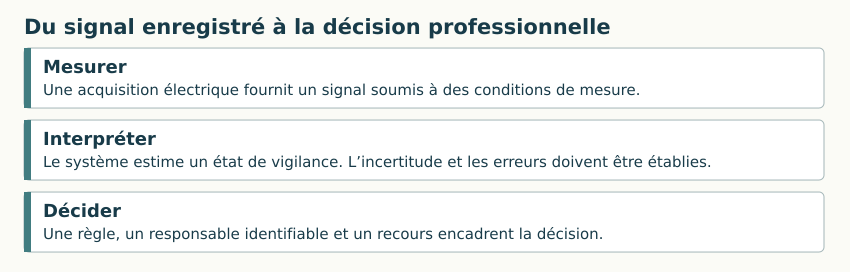

# ENS Rennes D–E — Oral d’entretien 2026 · Corrigé guidé

*Corrigé rédigé par IA, non officiel. Signalez toute erreur.*

**Rédaction** · GPT-6.2 Astra Ultra · vitesse non renseignée

**Autocontrôle** · GPT-6.2 Astra Ultra · vitesse non renseignée

Le fascicule officiel compte 69 pages. Il comprend vingt-trois textes de trois pages, numérotés de 1 à 22, puis 25. Le candidat dispose de dix minutes au maximum pour construire une réflexion personnelle et critique à partir du texte attribué. Chaque numéro propose ici un argument défendable, une application et une limite à discuter.

Pour préparer un passage, situer en une minute la question de l’auteur. Consacrer environ trois minutes à l’argument du texte, trois à l’exemple choisi et deux à une objection suivie de la réponse que l’on souhaite défendre. Conclure brièvement et garder une marge pour les transitions. Les encadrés proposent des relances pour éprouver le raisonnement. Les numéros renvoient directement aux pages du fascicule.

## 1. Enquêter sur les carrières des hauts fonctionnaires

**Qui faut-il interroger pour comprendre une promotion ?** Une liste de directeurs révèle qui a atteint le sommet. Elle laisse dans l’ombre les agents qui auraient pu y parvenir. L’enquête présentée par Marion Demonteil a recueilli entre 2019 et 2021 les récits de 65 cadres du ministère de la Culture occupant au moins des fonctions équivalentes à celles de chef de bureau. En incluant des carrières arrêtées à ce niveau, les chercheurs peuvent comparer le moment où deux trajectoires se séparent. Un supérieur sollicite personnellement une candidature, un autre attend qu’elle se manifeste. Les mêmes règles de recrutement produisent alors des occasions différentes de se présenter.

J’examinerais les trois décisions successives de se porter candidat, d’être présélectionné et d’accepter la mobilité proposée. Comparer femmes et hommes au dernier stade seulement efface les deux premières sélections. Les entretiens rendent intelligible un renoncement qu’un fichier enregistrerait comme une absence. Leur mise en récit rétrospective et leur ancrage dans un ministère limitent cependant leur portée. Pour vérifier le mécanisme, je confronterais les postes annoncés, les dossiers reçus et les profils retenus à des trajectoires de même ancienneté. L’égalité d’accès devient alors une propriété de la procédure tout entière.

> [!INDICATION]
> Pourquoi conserver le témoignage d’une personne qui juge sa carrière réussie malgré une absence de promotion  ?

Sa définition de la réussite renseigne sur ce qu’elle valorise. Elle permet aussi de savoir à quels postes et à quelles conditions elle aurait envisagé une candidature. L’enquêteur doit laisser ouverte la différence entre préférence et adaptation aux occasions disponibles.

[Texte du concours, p. 1–3](https://www.ens-rennes.fr/medias/fichier/sujets-entretien-d-e-2026_1790958443479-pdf#page=1)

## 2. Mesurer les inégalités professionnelles

**Une politique peut atteindre son quota et laisser subsister un écart considérable.** La loi Sauvadet de 2012 porte ici sur les premières nominations. Le bilan des personnes en poste reflète plusieurs années d’entrées et de sorties. Supposons 20 directions, dont 4 occupées par des femmes. Deux hommes partent et une femme et un homme les remplacent. La moitié du recrutement est féminine, mais la proportion en poste passe seulement de 20 à 25 %. Il faudrait aussi observer qui quitte ces emplois et au bout de combien de temps.

Marion Demonteil rappelle que les femmes représentent 64 % des agents publics et que l’écart de rémunération brute en équivalent temps plein atteignait 12 % dans la fonction publique de l’État en 2021. Le premier chiffre porte sur l’ensemble de la fonction publique, le second sur un de ses versants. Une rémunération en équivalent temps plein neutralise la durée rémunérée au moment de la mesure, mais une carrière antérieure à temps partiel peut avoir pesé sur les promotions. Je publierais des séries sur les candidatures et les durées dans chaque grade, accompagnées d’entretiens sur les choix de mobilité. Le quota rend l’organisation comptable de ses nominations. Il devient trompeur si sa réussite dispense d’examiner le reste.

> [!INDICATION]
> Une hausse de la part des femmes à la direction prouve-t-elle un effet de la loi  ?

Il faut reconstituer la tendance antérieure ainsi que les renouvellements et la composition du vivier. Une comparaison avec des emplois proches soumis à un calendrier différent renforcerait l’argument, sous réserve d’évolutions comparables.

[Texte du concours, p. 4–6](https://www.ens-rennes.fr/medias/fichier/sujets-entretien-d-e-2026_1790958443479-pdf#page=4)

## 3. Le lieu du travail et le lieu de la promotion

**Qui peut raconter le travail d’un agent quand la promotion se décide ?** Le chef de bureau interrogé rue de Valois souligne un avantage précis. Son chef connaît son travail et participe à la commission qui examine les carrières du corps. Des collègues en établissement ou en service déconcentré ont moins de chances de bénéficier de ce témoignage direct. Une procédure formellement commune peut ainsi privilégier une proximité géographique et hiérarchique.

Il est possible que les services centraux recrutent des agents déjà destinés aux plus hauts postes, ou qu’ils donnent une expérience différente. Le récit ne permet pas de départager ces mécanismes. Je comparerais des agents du même corps et du même grade, avant puis après une mobilité, en relevant le contenu de leur travail autant que leur lieu d’exercice. Rendre les candidatures plus lisibles pour les postes éloignés, recueillir plusieurs avis et motiver les décisions donnerait à l’autorité de nomination un éventail d’informations plus large. L’enjeu est de faire connaître une compétence qui s’exerce loin du lieu où elle sera jugée.

> [!INDICATION]
> L’anonymisation complète d’un dossier résoudrait-elle la difficulté  ?

Un parcours rare reste identifiable et certains éléments de contexte sont nécessaires pour apprécier la responsabilité exercée. Une grille commune et des exemples de travail comparables peuvent réduire l’avantage de la proximité tout en conservant ces informations.

[Texte du concours, p. 7–9](https://www.ens-rennes.fr/medias/fichier/sujets-entretien-d-e-2026_1790958443479-pdf#page=7)

## 4. Les qualités du dirigeant

**À quoi reconnaît-on quelqu’un qui sait diriger ?** Dans les entretiens étudiés par Marion Demonteil, savoir décider seul, se battre et se rendre disponible paraissent parfois aller de soi. Ces attentes associent la compétence à une manière historiquement masculine de la manifester. Une administration largement féminisée peut continuer à sélectionner ses dirigeants sur ce modèle. Une agente qui impose une décision risque alors de paraître autoritaire, celle qui consulte de sembler manquer d’assurance. Le problème se situe dans la variation du jugement porté sur le même comportement.

Je proposerais deux descriptions d’une même conduite de réunion avec des prénoms différents pour repérer ce biais, puis je chercherais comment il agit sur des décisions réelles. Une excellente direction peut se signaler par la qualité du service pendant l’absence du chef. Ce critère valorise la délégation et la préparation collective. Certaines fonctions exigent une disponibilité particulière. Il convient d’en préciser les circonstances, la fréquence et la répartition dans l’équipe, afin de distinguer une contrainte du poste d’une épreuve de loyauté permanente. Les critères deviennent ainsi justifiables devant les candidats.

> [!INDICATION]
> Peut-on remplacer un modèle unique par une liste de qualités dites féminines  ?

Cela reconduirait l’attribution de qualités par sexe. On peut évaluer chez tous les candidats la capacité à trancher une urgence, à reconnaître une erreur ou à faire circuler l’information, à partir de situations professionnelles précises.

[Texte du concours, p. 10–12](https://www.ens-rennes.fr/medias/fichier/sujets-entretien-d-e-2026_1790958443479-pdf#page=10)

## 5. Sobriété numérique et éducation

**Un enseignant peut connaître les bons gestes et dépendre d’achats décidés ailleurs.** L’extrait de Descamps et de ses collègues rapproche le sentiment de compétence des professionnels de l’éducation et les usages numériques qu’ils déclarent. Dire que l’on sait diminuer un impact, déclarer que l’on agit et obtenir une diminution matérielle sont trois observations distinctes. Une même personne peut très bien connaître le coût de fabrication d’un ordinateur sans pouvoir faire prolonger le contrat de maintenance de son établissement.

La règle des cinq R citée dans le document commence par refuser et réduire et place le recyclage en dernier. Dans une école, je comparerais le remplacement uniforme d’un parc à l’entretien d’appareils qui répondent encore aux besoins. Il faut prendre en compte les réparations, la consommation, la durée de service et l’accessibilité des logiciels, y compris pour un élève qui dépend d’une aide numérique. Une formation peut donner aux enseignants les moyens de discuter les usages. Un budget de réparation et des règles d’achat rendent leur action possible. Pour évaluer l’effet, on observerait à la fois la durée de vie des appareils et le service pédagogique effectivement rendu.

> [!INDICATION]
> Pourquoi conserver une enquête déclarative si elle ne mesure pas les émissions  ?

Elle révèle où les personnes se sentent capables d’agir, les obstacles qu’elles perçoivent et les habitudes qu’elles croient suivre. Un inventaire des équipements et des achats compléterait ces informations en mesurant d’autres dimensions.

[Texte du concours, p. 13–15](https://www.ens-rennes.fr/medias/fichier/sujets-entretien-d-e-2026_1790958443479-pdf#page=13)

## 6. Cités, communautés et lien social

**Affirmer que le lien social se défait suppose que l’on ait dit de quel lien il s’agit.** Sylvain Aquatias part de discours publics sur les jeunes des cités et de la difficulté à expliquer pourquoi une transgression survient ici et à ce moment. Le gain matériel, la reconnaissance par les pairs et la rupture d’une règle publique n’ont pas le même sens. Un comportement qui éloigne d’une institution peut resserrer une relation au sein d’un groupe. De là on ne peut conclure ni à l’unité des habitants ni à leur isolement général.

Je suivrais la journée de plusieurs habitants d’un même quartier, en observant les aides échangées, les obligations qu’elles créent et les situations où intervient une règle impersonnelle. La solidarité d’une voisine, le règlement de l’école et les ressources d’un service public peuvent se compléter ou entrer en conflit. Les catégories classiques de communauté et de société donnent des questions à poser à ces relations. En faire deux territoires opposés ferait disparaître précisément la coexistence que l’on cherche à comprendre. Une enquête située peut aussi faire entendre les personnes dont la vie ordinaire est absente des récits publics.

> [!INDICATION]
> Comment distinguer un effet du quartier d’un effet de l’âge ou de la situation économique  ?

On peut comparer des jeunes de conditions proches habitant des quartiers différents et, dans chaque quartier, des générations ou des trajectoires distinctes. Les entretiens permettent ensuite de comprendre comment le lieu intervient concrètement.

[Texte du concours, p. 16–18](https://www.ens-rennes.fr/medias/fichier/sujets-entretien-d-e-2026_1790958443479-pdf#page=16)

## 7. La place de l’intelligence juridique

**À quel moment le juriste peut-il encore transformer un projet ?** Dans l’article de Simon Brenot, l’intelligence juridique rapproche veille, compréhension de l’environnement et participation à la décision. Si une collectivité ou une entreprise prépare un service utilisant des données personnelles, consulter le juriste après avoir choisi tous les prestataires réduit les options possibles. Associer l’équipe juridique dès la conception permet d’examiner quelles données sont nécessaires, qui devra y accéder et quelles obligations chaque choix entraîne. La connaissance du droit modifie la solution envisagée.

L’extrait, publié dans un média professionnel, plaide aussi pour de nouveaux rôles et un gain de temps. Il faudrait établir ce gain sur la vie du projet et y inclure les délais évités comme le coût de la veille. Je défendrais une participation du juriste à la stratégie assortie de l’indépendance nécessaire pour expliquer qu’un projet doit être modifié. Un outil automatique de classement peut l’aider à retrouver des documents. C’est au professionnel de vérifier leur autorité, leur date et la pertinence du raisonnement qu’il présente au décideur.

> [!INDICATION]
> Une décision risquée est-elle forcément illégale  ?

Un texte applicable, son interprétation encore discutée et les conséquences pratiques d’un contentieux posent des questions différentes. Le juriste peut les présenter séparément pour que le décideur voie où subsiste une marge de choix licite.

[Texte du concours, p. 19–21](https://www.ens-rennes.fr/medias/fichier/sujets-entretien-d-e-2026_1790958443479-pdf#page=19)

## 8. La personnalité juridique des fleuves

**Qui peut demander réparation pour une atteinte dont souffre durablement un fleuve ?** Le podcast prend l’exemple du Whanganui, reconnu comme entité juridique en Nouvelle-Zélande en 2017. Cette reconnaissance répond aussi à une relation historique et spirituelle avec les Māori concernés. La personnalité donne au cours d’eau une représentation propre. Comme dans le cas d’une personne morale, des êtres humains formulent la demande. L’intérêt invoqué peut néanmoins différer de la somme des pertes subies par des riverains.

L’objection de l’auteur est concrète. La concession hydroélectrique qu’il mentionne continue à produire ses effets après la reconnaissance du fleuve. Le statut accroît la possibilité de faire entendre une prétention, tandis que l’issue dépend des droits déjà constitués, des pouvoirs du représentant et des remèdes judiciaires. Je jugerais le dispositif à partir d’un conflit de prélèvement d’eau. Qui peut saisir l’autorité, quels éléments établissent la dégradation et une décision peut-elle être suivie sur plusieurs années ? La réponse ne peut être transposée en France sans tenir compte du droit applicable et de l’histoire du bassin.

> [!INDICATION]
> Une association peut déjà défendre une rivière. Que change la personnalité  ?

L’association agit au titre d’intérêts et selon des conditions fixées par son droit national. La personnalité peut instituer la continuité d’un représentant et un intérêt propre au cours d’eau. L’écart pratique dépend des pouvoirs effectivement accordés dans chaque régime.

[Texte du concours, p. 22–24](https://www.ens-rennes.fr/medias/fichier/sujets-entretien-d-e-2026_1790958443479-pdf#page=22)

## 9. L’argent et la liberté de choisir

**Payer peut donner de la liberté tout en créant une dépendance nouvelle.** Damien de Blic et Jeanne Lazarus rappellent avec Weber que les usages légitimes de l’argent ont une histoire. Épargner pour acquérir un bien, prêter à intérêt et accumuler pour accroître un capital peuvent recevoir des jugements moraux différents. Avec Simmel, la question se déplace vers l’expérience de l’échange. Celui qui dispose de la somme demandée peut choisir entre fournisseurs sans devoir à chacun une faveur personnelle. Cette indépendance suppose une monnaie acceptée, des prix et un accès au revenu.

Prenons un service que des proches se rendent gratuitement, puis qu’une personne achète pour pouvoir s’organiser seule. Elle gagne en latitude sur les horaires et peut changer de prestataire. Sa liberté varie toutefois avec ses ressources, l’offre disponible et les conditions de travail de celui qui vend ce service. L’impersonnalité de la transaction a donc des effets différents selon le côté du contrat où l’on se trouve. La sociologie de l’argent peut étudier à la fois les contraintes générales d’une économie monétaire et les significations particulières qu’un ménage attribue à un salaire, un don ou un héritage.

> [!INDICATION]
> Deux billets de même valeur sont-ils toujours substituables  ?

Comme moyens de paiement, leur pouvoir d’achat peut être identique. Dans un ménage, l’argent donné pour les études d’un enfant peut être réservé à cet usage. Cette affectation sociale infléchit la décision même en l’absence d’une obligation juridique.

[Texte du concours, p. 25–27](https://www.ens-rennes.fr/medias/fichier/sujets-entretien-d-e-2026_1790958443479-pdf#page=25)

## 10. Science, psychanalyse et récits d’origine

**Le fait de connaître une origine biologique règle-t-il la question de l’origine pour une personne ?** François Ansermet distingue l’ambition généralisante de la science et l’attention psychanalytique portée à l’histoire singulière. Les exemples de procréation avec tiers donneur montrent que la contribution à la conception, la gestation, la filiation établie en droit et la relation éducative peuvent désigner des personnes différentes. Une réponse exacte à la question biologique peut ainsi laisser entière une question sur le récit familial.

Cette distinction permet d’écouter la façon dont une personne comprend sa propre histoire. Elle ne suffit pas à opposer deux blocs de savoir. La médecine soigne aussi une personne particulière et les interprétations cliniques appellent une discussion sur leurs preuves. Je défendrais la possibilité de demander des informations fiables et de choisir la place qu’on leur donne dans sa vie, sans imposer un modèle unique de ce que chacun devrait ressentir. Deux personnes placées devant une histoire biologique comparable peuvent attribuer à cette connaissance des significations différentes. Leur témoignage permet d’établir cette diversité, sans prédire ce que vivra chaque enfant.

> [!INDICATION]
> Une possibilité technique fonde-t-elle un droit à son utilisation  ?

La faisabilité répond à une question empirique. L’accès, le consentement, les responsabilités et la protection des personnes concernées relèvent de décisions juridiques et éthiques qui exigent des raisons supplémentaires.

[Texte du concours, p. 28–30](https://www.ens-rennes.fr/medias/fichier/sujets-entretien-d-e-2026_1790958443479-pdf#page=28)

## 11. Les trois types de domination légitime

**Pourquoi obéit-on à un ordre que l’on désapprouve ?** Weber distingue les raisons pour lesquelles le pouvoir peut être tenu pour légitime. Dans la domination légale, on reconnaît la compétence attachée à une fonction et exercée selon des règles. Dans la domination traditionnelle, l’autorité tire sa force de la continuité d’un ordre tenu pour valable. Dans la domination charismatique, les fidèles attribuent des qualités extraordinaires à la personne qui les conduit. Un même acte observable, exécuter une instruction, ne révèle donc pas à lui seul le type d’autorité.

Lorsqu’un responsable quitte son poste, la réaction à son successeur permet d’éprouver la distinction. La personne qui continue d’obéir au titulaire régulièrement nommé reconnaît l’office. Celle qui entend suivre l’ancien chef témoigne peut-être d’un attachement personnel. La distinction est analytique. Un dirigeant élu peut mobiliser à la fois le mandat légal, les usages de son institution et son ascendant personnel. J’examinerais également les refus, car une obéissance obtenue sous la menace ne prouve pas que l’ordre est jugé légitime. Expliquer cette croyance laisse ouverte la question de savoir si l’ordre est juste.

> [!INDICATION]
> Que devient un mouvement charismatique lorsque son chef disparaît  ?

S’il veut durer, il doit organiser une succession, fixer des procédures ou sacraliser une filiation. Cet effort de continuité peut transformer les motifs d’obéissance des membres.

[Texte du concours, p. 31–33](https://www.ens-rennes.fr/medias/fichier/sujets-entretien-d-e-2026_1790958443479-pdf#page=31)

## 12. Origines sociales et parcours scolaires

**L’ouverture du lycée a-t-elle donné les mêmes possibilités de poursuivre ses études ?** L’extrait distingue la diffusion du baccalauréat et la distribution des élèves entre filières. Sur 100 jeunes issus de ménages à dominante ouvrière, 59 rejoignent la voie professionnelle à l’issue de la troisième, contre 16 sur 100 parmi les enfants de deux cadres. L’écart de 43 points porte sur l’orientation dans deux populations d’origine différente. Il ne signifie pas que 59 % des élèves de la voie professionnelle proviennent de ces ménages.

Cette orientation change l’éventail des poursuites d’études probables. Elle peut résulter des apprentissages antérieurs, de l’offre locale, des conseils reçus, des dépenses à anticiper et du jugement que l’élève porte sur ses chances. Je comparerais choix exprimés et orientation obtenue, puis réussite dans la voie demandée. Valoriser les formations professionnelles implique de permettre un choix informé et des passerelles réelles. Une amélioration du niveau moyen peut coexister avec de fortes inégalités dans les parcours qui conduisent aux formations les plus sélectives.

> [!INDICATION]
> Les 54 % d’enfants de cadres parmi les élèves de CPGE donnent-ils la chance d’entrer en prépa pour un enfant de cadre  ?

C’est la composition des classes préparatoires. Pour connaître la chance d’accès, il faudrait rapporter le nombre d’entrants enfants de cadres à l’ensemble des jeunes du groupe d’origine choisi, par exemple aux bacheliers de même cohorte.

[Texte du concours, p. 34–36](https://www.ens-rennes.fr/medias/fichier/sujets-entretien-d-e-2026_1790958443479-pdf#page=34)

## 13. Les places offertes aux polytechniciens

**L’État recrute-t-il moins d’ingénieurs ou les recrute-t-il autrement ?** Delespierre, Dudouet et Joly indiquent que la part d’une promotion de Polytechnique intégrant un corps de l’État est passée d’environ la moitié à la fin des années 1970 à moins d’un cinquième au début des années 2010. La taille des promotions a augmenté. Cependant, en 2018, les 69 places offertes pour 400 élèves donnent un maximum de 17,25 % dans ces corps par cette voie. Une préférence supposée de tous les élèves pour le privé n’explique pas à elle seule la contraction de l’offre publique.

Je comparerais trois séries. La première porte sur les places offertes aux élèves de l’X, la deuxième sur tous les entrants dans les corps, la troisième sur les fonctions réellement exercées à cinq ou dix ans. Ouvrir un corps à des recrutements universitaires peut faire baisser la première série sans contracter la deuxième. Confier des missions à un opérateur peut déplacer, dans la troisième, le lieu de l’expertise publique. Les conflits de tutelle récents pourraient accélérer une évolution vieille de quatre décennies. Leur seule existence en fin de période renseigne peu sur son origine.

> [!INDICATION]
> Le rapport de 69 à 400 mesure-t-il le nombre d’élèves ayant voulu servir l’État  ?

C’est un ratio de places offertes par rapport à l’effectif. Pour mesurer des préférences, il faudrait connaître les candidatures, les vœux de classement et éventuellement les débouchés publics situés hors des corps considérés.

[Texte du concours, p. 37–39](https://www.ens-rennes.fr/medias/fichier/sujets-entretien-d-e-2026_1790958443479-pdf#page=37)

## 14. Ce que deviennent les membres des grands corps

**L’entrée dans un grand corps et la durée du service rendu à l’État racontent deux histoires différentes.** L’étude de la promotion X 1901 évoquée dans l’extrait montre que nombre de polytechniciens quittaient tôt les corps qu’ils avaient intégrés. Le passage initial pouvait donner un titre, une formation et un réseau valorisés au-dehors. Mesurer la fidélité à l’État par le seul classement de sortie risque donc d’inventer un âge d’or de carrières publiques intégrales.

L’argument touche aussi au point de vue de l’administration. Avec des recrutements plus divers et des promotions internes, une direction peut conserver sa compétence technique tout en changeant la provenance de ses cadres. J’étudierais le parcours à plusieurs dates, le contenu des fonctions et la circulation de l’expertise entre administrations et entreprises. Cette circulation peut être féconde, mais la collectivité supporte une perte lorsque des savoirs essentiels ne peuvent plus être transmis en interne. Pour en juger, il faut identifier les missions qui continuent d’être maîtrisées par les équipes. Le prestige du diplôme et la capacité de l’État à agir correspondent à deux objets mesurables différents.

> [!INDICATION]
> Peut-on déduire du passage d’un ingénieur dans le privé qu’il a abandonné toute mission d’intérêt collectif  ?

Le secteur d’emploi ne suffit pas à qualifier le service produit. Il faut examiner le commanditaire, les responsabilités, les obligations de rendre compte et l’éventuelle dépendance de l’administration à l’égard du prestataire.

[Texte du concours, p. 40–42](https://www.ens-rennes.fr/medias/fichier/sujets-entretien-d-e-2026_1790958443479-pdf#page=40)

## 15. La Commission européenne et l’enseignement supérieur

**Comment une institution agit-elle dans un domaine où son mandat est initialement étroit ?** Pauline Ravinet suit l’action de la Commission européenne dans l’enseignement supérieur. La formation professionnelle lui offre une prise juridique. La mobilité étudiante, avec Erasmus, offre une réalisation visible qui réunit des partenaires aux attentes différentes. Certains acteurs peuvent se servir du langage du marché pour faire avancer un projet européen, tandis que d’autres attendent de l’intégration européenne une ouverture accrue des marchés. Leur accord sur un programme laisse subsister cette divergence.

Le vocabulaire ne constitue donc pas à lui seul la preuve d’un projet unique. Je comparerais les justifications présentées par les services concernés, les critères d’allocation des crédits et les effets sur les établissements et les étudiants. Un programme de mobilité peut à la fois accroître des possibilités d’études et privilégier ceux qui disposent déjà des moyens de partir. Une enquête auprès des étudiants empêchés de partir permettrait de discuter ce dernier effet. La capacité d’un dispositif à devenir familier peut donner du pouvoir à l’institution qui l’administre sans déterminer à elle seule le sens politique de tous ses usages.

> [!INDICATION]
> La chronologie juridique citée demande-t-elle une précision  ?

L’arrêt Gravier de la Cour de justice, affaire 293/83, a été rendu le 13 février 1985. L’extrait donne 1984. Il portait sur les conditions d’accès à la formation professionnelle et la discrimination en raison de la nationalité. C’est cette qualification qui intéresse la démonstration.

[Texte du concours, p. 43–45](https://www.ens-rennes.fr/medias/fichier/sujets-entretien-d-e-2026_1790958443479-pdf#page=43) · [Décision Gravier, 293/83](https://eur-lex.europa.eu/legal-content/FR/TXT/?uri=CELEX:61983CJ0293)

## 16. Le tribunal d’opinion et la qualification d’écocide

**Que peut produire un tribunal qui n’a pas le pouvoir de condamner ?** Montavon et Desaules décrivent le tribunal d’opinion Monsanto. Des témoins y prennent la parole, des experts soumettent des éléments et des juristes les organisent selon une procédure inspirée de la justice. Le dispositif rend visibles des dommages dispersés et formule des questions de qualification. L’adhésion militante perceptible dans la salle invite à examiner qui a choisi les faits, comment une affirmation est discutée et quelle réponse les personnes mises en cause peuvent apporter.

Je distinguerais l’établissement documenté d’un dommage, son rattachement à un comportement et les conditions d’une infraction opposable devant une juridiction compétente. Le mot écocide attire l’attention sur l’ampleur d’un dommage écologique. Pour une qualification pénale, il faut aussi définir à l’avance les comportements visés, les seuils, l’élément moral et les règles de preuve. Le tribunal d’opinion peut faire travailler ces questions et susciter un débat législatif. Son autorité persuasive dépend de la qualité de ses sources et de leur discussion publique. Son avis ne possède pas la force exécutoire d’un jugement.

> [!INDICATION]
> La mise en scène judiciaire est-elle seulement un décor  ?

Elle donne un ordre à la parole, rend les témoignages comparables et confère du poids aux conclusions. Elle risque aussi d’entretenir une confusion sur leur portée. Publier les règles de la procédure et le statut de l’avis permet au lecteur d’en apprécier la valeur.

[Texte du concours, p. 46–48](https://www.ens-rennes.fr/medias/fichier/sujets-entretien-d-e-2026_1790958443479-pdf#page=46)

## 17. Pauvreté, paupérisme et précarité

**Deux ménages disposant aujourd’hui du même revenu peuvent-ils vivre deux situations très différentes ?** Un revenu modeste assuré pour plusieurs années et des rentrées irrégulières de même montant annuel ouvrent des possibilités différentes de se loger et de s’engager. Pierret propose de distinguer la pauvreté, présente dans des sociétés diverses, et la précarité, qu’il inscrit dans une histoire de l’insécurité sociale. Sa lecture de Tocqueville replace le paupérisme dans la transformation industrielle, à la fois créatrice de richesses, de besoins nouveaux et de dépendances à l’emploi.

Cette lecture ne signifie pas que les sociétés antérieures ignoraient tout risque ni que leurs solidarités étaient choisies. Elle conduit à rechercher quelle institution garantit la continuité des ressources lorsqu’une relation économique disparaît. Je comparerais stabilité du logement, droits sociaux, soutien relationnel et marge de décision après un même choc de revenu. La combinaison de ces dimensions aide à expliquer pourquoi une baisse temporaire peut devenir durable pour certains ménages. Les jugements moraux portés historiquement sur les pauvres sont eux-mêmes des documents à interpréter, plutôt que des explications du comportement observé.

> [!INDICATION]
> La pauvreté monétaire reste-t-elle mesurable si elle dépend de la société considérée  ?

Un seuil relatif fixé par rapport à la distribution des niveaux de vie permet des comparaisons explicites. Il faut préciser l’année, la population et les conventions retenues, puis le compléter si l’on veut mesurer aussi les privations ou l’incertitude.

[Texte du concours, p. 49–51](https://www.ens-rennes.fr/medias/fichier/sujets-entretien-d-e-2026_1790958443479-pdf#page=49)

## 18. Trois expériences de la précarité

**Un toit change profondément les conditions de vie. Change-t-il à lui seul le rapport à l’avenir ?** Pierret appelle haute précarité la lutte pour la survie, illustrée par la vie à la rue. Il décrit une moyenne précarité où un abri est acquis, mais où le temps peut paraître vide en l’absence de rôle reconnu. La basse précarité désigne la crainte de basculer, par exemple chez un travailleur social salarié qui voit fermer des structures semblables à la sienne. Ces catégories distinguent des expériences du temps et de la protection.

Je discuterais la généralisation de l’expérience du vide. Une personne nouvellement logée peut justement reprendre des liens et des projets, à un rythme qu’elle doit pouvoir définir. Il faudrait suivre les trajectoires au lieu d’assigner une expérience à chaque logement ou statut d’emploi. De même, le fait que des catégories variées craignent une chute ne leur donne pas la même probabilité de la subir, ni les mêmes ressources pour en sortir. Un patrimoine, des qualifications reconnues ou des proches disponibles redistribuent ces chances. L’aléa décrit par l’auteur peut donc coexister avec la reproduction d’inégalités fortes.

> [!INDICATION]
> Comment tester l’idée d’une fin de la reproduction  ?

Il faudrait suivre plusieurs cohortes, comparer les positions des parents et des enfants, puis les risques de chute et de retour selon l’origine. La présence de trajectoires imprévisibles au niveau individuel reste compatible avec de fortes régularités collectives.

[Texte du concours, p. 52–54](https://www.ens-rennes.fr/medias/fichier/sujets-entretien-d-e-2026_1790958443479-pdf#page=52)

## 19. Les décisions publiques assistées par des algorithmes

**Quand un système informatique signale une anomalie, qui décide qu’il y a réellement matière à intervenir ?** Kirtchik et Musiani montrent comment l’IA transforme des tâches et des professions au sein des administrations. Le dispositif Foncier innovant signale notamment de possibles piscines non déclarées. Une forme reconnue sur une image ne règle ni la qualification fiscale ni l’existence d’une déclaration déjà enregistrée. L’agent chargé d’instruire l’alerte et l’administré capable de la contester sont des acteurs centraux du processus.

Je demanderais un bilan des erreurs aussi bien que des détections utiles. Parmi 100 signalements dont 25 sont vérifiés comme erronés, la part d’erreurs parmi les signalements est de 25 %. Cette proportion ne donne pas le nombre des situations manquées dans les propriétés jamais signalées. Un contrôle sur échantillon indépendant aiderait à le mesurer. Une procédure de correction, des motifs intelligibles et un suivi du temps de vérification humaine rendent le gain administratif discutable en public. Plus une décision affecte directement un droit, par exemple l’accès à une prestation, plus le coût d’une erreur mérite de compter dans cette évaluation.

> [!INDICATION]
> Faut-il juger un système seulement sur le nombre d’heures qu’il fait gagner  ?

Il faut aussi compter le travail supplémentaire des agents et des usagers pour corriger les erreurs, leur répartition ainsi que la qualité du service rendu. Un gain moyen peut cacher une charge reportée sur les personnes les moins équipées.

[Texte du concours, p. 55–57](https://www.ens-rennes.fr/medias/fichier/sujets-entretien-d-e-2026_1790958443479-pdf#page=55)

## 20. L’université entrepreneuriale

**De quelles libertés une université a-t-elle besoin pour coopérer avec des entreprises ?** Dans son essai, Carlos Benedito Martins examine un modèle qui fait de l’interaction économique une troisième mission de l’université. Des partenaires peuvent financer des équipements ou faire apparaître un problème auquel un laboratoire donne une réponse durable. Mais un indicateur fondé sur les brevets et les contrats rémunère vite certaines recherches et laisse en retrait les savoirs difficiles à approprier ou dont les effets apparaissent très tard.

Prenons une recherche sur la qualité d’un réseau d’eau menée avec son exploitant. Elle peut servir la collectivité si l’équipe garde le droit de publier des résultats défavorables et de conserver ses méthodes accessibles. Si l’exploitant définit seul la question et peut différer indéfiniment la publication, les conditions de production du savoir changent. Martins étend la critique à la formation de personnes invitées à se concevoir comme seules responsables de leurs succès et échecs. J’opposerais à ce diagnostic un test concret. Le partenariat ouvre-t-il des collaborations et des emplois à des publics divers, et qui porte le risque financier ou professionnel lorsqu’un projet échoue ?

> [!INDICATION]
> Comment évaluer une recherche fondamentale dont l’application est incertaine  ?

On peut examiner l’originalité de la question, la rigueur des résultats, les données rendues disponibles et la formation de chercheurs. L’appréciation par des pairs indépendants et la durée de l’évaluation comptent davantage que l’obtention immédiate d’un contrat.

[Texte du concours, p. 58–60](https://www.ens-rennes.fr/medias/fichier/sujets-entretien-d-e-2026_1790958443479-pdf#page=58)

## 21. Les données mentales et la liberté

**Peut-on protéger un salarié contre un accident en recueillant des informations auxquelles il souhaiterait que l’employeur n’accède pas ?** Roberto Andorno cite les casques à électrodes utilisés pour estimer la vigilance dans certaines activités. Le signal enregistré est une mesure, l’état mental présumé une inférence, et la décision de retirer quelqu’un de son poste un acte institutionnel. L’incertitude s’accroît quand on passe de l’un à l’autre. Le rapport de subordination rend aussi délicate la portée d’un consentement donné au travail.

Je défendrais d’abord la recherche de moyens moins intrusifs, comme des horaires ou des pauses adaptés. Si l’usage d’une mesure est ensuite discuté, il faut préciser sa fiabilité, la finalité, les personnes pouvant voir le résultat, sa durée de conservation et le recours en cas d’erreur. Dans le domaine judiciaire, une corrélation de groupe ne démontre pas le comportement futur d’un individu. COMPAS, que l’extrait rapproche de l’imagerie, est un outil actuariel fondé sur des données de dossier et de questionnaire. Il ne lit pas le cerveau. La précision importe, car un risque statistique ne livre ni une intention individuelle ni la preuve d’une infraction.

> [!INDICATION]
> Le droit doit-il attendre qu’une machine puisse lire des pensées exactes  ?

Une inférence inexacte sur l’attention peut déjà priver quelqu’un d’une possibilité d’emploi. On peut donc encadrer les décisions fondées sur cette inférence ainsi que la collecte du signal, quel que soit le degré de sophistication de l’outil.

[Texte du concours, p. 61–63](https://www.ens-rennes.fr/medias/fichier/sujets-entretien-d-e-2026_1790958443479-pdf#page=61) · [Enquête sur les données et le calcul de COMPAS](https://www.propublica.org/article/how-we-analyzed-the-compas-recidivism-algorithm)

## 22. Le cerveau comme preuve

**Une image peut éclairer une expertise tout en prenant une place excessive dans le procès.** Laura Pignatel prend l’exemple de séquelles cognitives après un traumatisme crânien. Des observations médicales peuvent conforter l’existence d’une lésion. Relier cette lésion aux limitations quotidiennes de la personne, puis à un fait dommageable, exige d’autres éléments. En matière pénale, l’article 122-1 du code pénal conduit à examiner l’abolition ou l’altération du discernement au moment des faits. Une image prise ultérieurement ne tranche pas, seule, cette question.

Je demanderais que les parties puissent discuter la méthode, ses limites et les hypothèses concurrentes. Une image en couleurs particulièrement convaincante à l’œil reste une représentation produite selon un protocole. La seconde partie de l’extrait déplace la réflexion vers la protection des données et l’orientation des conduites. Un aménagement visible destiné à faciliter le tri des déchets et une utilisation dissimulée de données sensibles ne posent pas les mêmes problèmes de consentement et de contrôle. L’enjeu commun est de déterminer qui peut tirer quelle conclusion ou déclencher quelle action à partir d’un savoir sur le fonctionnement cognitif.

> [!INDICATION]
> L’atteinte à la liberté dépend-elle seulement de la conservation d’un fichier cérébral  ?

L’enregistrement expose à des réutilisations, mais une décision immédiate fondée sur un résultat peut déjà porter atteinte à un droit. La collecte, l’usage, la communication et la décision doivent donc être examinés séparément.

[Texte du concours, p. 64–66](https://www.ens-rennes.fr/medias/fichier/sujets-entretien-d-e-2026_1790958443479-pdf#page=64)

## 25. Les conflits d’intérêts dans la recherche

**Déclarer qui finance une recherche apprend quelque chose au lecteur. Qu’apprend-il sur la recherche elle-même ?** Boris Hauray observe que la notion de conflit d’intérêts est moins installée en sciences sociales qu’en sciences biomédicales. Une déclaration rend visibles des relations, mais cette cartographie ne décrit pas leur action. Un financement peut peser en amont, lorsque certains objets reçoivent durablement davantage de moyens, même si aucun financeur ne modifie une ligne du résultat. Inversement, l’existence d’un lien ne prouve ni fraude ni résultat faux.

Je prendrais l’exemple d’une enquête sur les conditions de travail financée par l’employeur qui autorise l’accès au terrain. La déclaration éclaire le lecteur. Pour apprécier la qualité de l’enquête, il doit aussi savoir qui a recruté les participants, si les témoignages ont pu rester confidentiels et si l’auteur conservait sa liberté de publication. Diversifier les terrains et financer des questions peu susceptibles de trouver un commanditaire introduisent une garantie collective. En retour, la critique d’un article doit encore discuter sa méthode et ses résultats. Une déclaration éclaire cette discussion sans en tenir lieu.

> [!INDICATION]
> Le choix assumé d’un objet de recherche est-il déjà un conflit d’intérêts  ?

Les choix scientifiques ont des présupposés qu’un chercheur peut expliciter. Un conflit d’intérêts désigne plus précisément une situation où un intérêt secondaire risque d’infléchir l’accomplissement d’une responsabilité. Décrire les deux aide à déterminer la garantie appropriée.

[Texte du concours, p. 67–69](https://www.ens-rennes.fr/medias/fichier/sujets-entretien-d-e-2026_1790958443479-pdf#page=67)

[Sujets officiels de l’oral](https://www.ens-rennes.fr/medias/fichier/sujets-entretien-d-e-2026_1790958443479-pdf)
