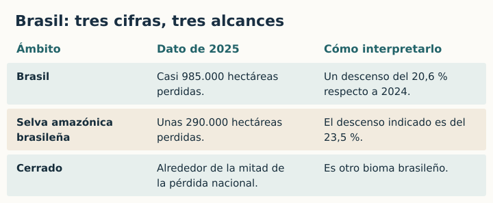

# ENS Rennes D-E — Espagnol (oral) 2026 · Corrigé guidé

*Corrigé rédigé par IA, non officiel. Signalez toute erreur.*

**Rédaction** · GPT-6.2 Astra Ultra · vitesse non renseignée

**Révision (tour 1)** · GPT-6.2 Astra Ultra · vitesse non renseignée

[Fascicule officiel](https://www.ens-rennes.fr/medias/fichier/sujets-oraux-espagnol-d-e-2026_1793377280812-pdf)

## Préparer le passage

Le fascicule contient huit sujets de presse, chacun demandant une analyse à présenter au jury. La couverture occupe la première page. Pour préparer un sujet, relever la source et la date, attribuer les déclarations, distinguer ce qui a eu lieu de ce qui est annoncé, puis choisir une difficulté que deux détails de l'article permettent de discuter. Les questions d'entretien qui suivent chaque exposé sont proposées pour l'entraînement. Aucun rapport d'oral espagnol n'est référencé dans la rubrique officielle de cette session.

**Repère du fascicule.** Les textes 2 et 3 traitent tous deux des relations entre le Mexique et l’Union européenne. L’article économique de Machorro tire des conséquences pour les entreprises et la négociation commerciale. La dépêche signée Rosales rapporte la manière dont la présidente mexicaine justifie l’accord. Nommer ces deux situations de parole évite de présenter les billets comme interchangeables.

## Sujet 1 — Cuba, entre el anuncio de sanciones y la vida durante los apagones

[Page 2 du fascicule](https://www.ens-rennes.fr/medias/fichier/sujets-oraux-espagnol-d-e-2026_1793377280812-pdf#page=2)

### Du brouillon à la prise de parole

Construire une chronologie du 18 et du 19 mai. La cargaison de 1 672 tonnes correspond au bateau commun, les 6 000 tonnes au total déjà attribué au Mexique par son ambassadeur. Employer *según*, *se espera que* et *el texto atribuye a* pour marquer les différents degrés de certitude.

### Proposition d’exposé

¿Qué significa aumentar la presión sobre un gobierno para quienes dependen a diario de la red eléctrica? La información de Eumar Esaá, fechada el 19 de mayo de 2026 y atribuida a EFE, AP y Reuters, permite abordar esta pregunta en dos escalas. Empieza por una decisión del Tesoro de Estados Unidos y acaba en el puerto de La Habana, ante un cargamento de productos de primera necesidad.

El Tesoro ha anunciado sanciones contra funcionarios cubanos, entre ellos responsables de Comunicaciones y Energía y el presidente de la Asamblea Nacional. Se añaden a un bloqueo naval que, según la crónica, impide la llegada de petroleros y agrava la crisis energética. También se espera una imputación de Raúl Castro en Estados Unidos por un episodio de 1996. El artículo atribuye a otro medio una información sobre compras militares, que Díaz-Canel ni confirma ni desmiente. En ese contexto, México y Uruguay envían alimentos y artículos de higiene. El barco llega con 1.672 toneladas. El embajador mexicano distingue esa ayuda de un suministro de petróleo, posibilidad que descarta.

Me interesa el distinto alcance de esas medidas. Cuando Washington publica una lista, el lector puede identificar a los destinatarios políticos de la decisión. Resulta mucho más difícil delimitar el efecto de la falta de combustible. El texto lo hace visible con un servicio poco espectacular, la recogida de basura. Quien vive en una calle donde se acumulan los residuos sufre las consecuencias aunque carezca de influencia sobre la estrategia de su gobierno. Confundir la lista con el bloqueo borraría la diferencia entre los dos mecanismos y dificultaría atribuir cada efecto.

La llegada del barco permite formular otra pregunta. ¿Hasta dónde llega la solidaridad de un país vecino? Los alimentos pueden aliviar una necesidad inmediata. Su distribución también plantea decisiones sobre quién debe recibirlos primero. El ministro cubano menciona a niños y personas mayores, pero el artículo solo recoge su compromiso. Para evaluar el resultado haría falta saber qué hogares fueron atendidos. Y mientras el petróleo siga faltando, otro cargamento de alimentos difícilmente restablecerá por sí solo servicios esenciales.

Por eso conviene leer la pieza atendiendo a sus verbos. El Tesoro anunció una medida y el barco llegó. La imputación se esperaba y una adquisición fue atribuida a fuentes periodísticas. Mantener estas diferencias permite discutir con más precisión tanto el coste civil de la presión como la responsabilidad política de quienes deciden ejercerla.

### Relances d’entraînement

**¿Por qué el relato termina con alimentos y artículos de aseo?** Permite ver qué necesidades puede atender inmediatamente un envío y por qué persisten otras mientras falte combustible. Cambia el punto de observación de los gobiernos a los residentes.

**¿El artículo anuncia una condena judicial?** Habla de una imputación que se esperaba en el momento de publicarse. Una eventual acusación y una condena serían etapas distintas.

## Sujet 2 — El acuerdo México–UE y el poder de tener otra opción

[Page 3 du fascicule](https://www.ens-rennes.fr/medias/fichier/sujets-oraux-espagnol-d-e-2026_1793377280812-pdf#page=3)

### Du brouillon à la prise de parole

Les données se rapportent à 2025 et à une décennie de croissance antérieure à la signature. Indiquer dans quel sens circulent les 53 et les 33 milliards. La portée politique de l'accord global et la proximité du réexamen nord-américain donnent deux raisons distinctes au mot *hito*.

### Proposition d’exposé

Dos economías que ya comercian intensamente pueden tener buenas razones para volver a negociar las reglas. En El Financiero del 19 de mayo de 2026, Juan Carlos Machorro presenta la próxima firma entre México y la Unión Europea como un hito. Para entender su entusiasmo conviene preguntarse qué cambiaría para un exportador concreto y qué cambiaría para el país en una negociación con otros socios.

El acuerdo de partida data de 2000. México fue el primer país latinoamericano en contar con un acuerdo de libre comercio con la Unión Europea. Los instrumentos que se preparan son un Acuerdo Global Modernizado y un Acuerdo Interino de Comercio. El primero se inscribe en una relación que comprende también diálogo político y cooperación. Los intercambios se estimaron en más de 86.000 millones de euros en 2025. Aproximadamente 53.000 millones correspondieron a exportaciones europeas a México y 33.000 millones al sentido inverso. El artículo señala un aumento del 75 % en una década y destaca tanto la reducción de aranceles como la eliminación de obstáculos no arancelarios.

En la práctica, una rebaja arancelaria y una simplificación administrativa resuelven problemas diferentes. Pensemos en un fabricante que ya tiene un cliente al otro lado del Atlántico. Un arancel menor puede traducirse en un precio final más competitivo. Si cada envío exige trámites difíciles de prever, el cliente puede seguir temiendo que una pieza llegue tarde. Una regla más clara hace más creíble la oferta del fabricante. Sin embargo, ni la rebaja ni la regla le proporcionan por sí solas un distribuidor o la financiación del primer pedido. El texto describe nuevas condiciones de acceso. Las ventas que se materialicen deberán medirse más adelante.

Hay además una dimensión negociadora. México mantiene una relación económica muy estrecha con Estados Unidos y Canadá, y el acuerdo norteamericano se acerca a una revisión. Disponer de compradores en otras regiones puede ampliar las opciones de las empresas y del Gobierno, aunque el peso del mercado vecino siga siendo considerable. El propio dato de 2025 invita a la prudencia. El comercio bilateral ya era importante antes de la firma. Atribuir su crecimiento pasado al acuerdo modernizado invertiría la cronología.

Machorro escribe desde un periódico económico y dedica mucho espacio a las oportunidades. Quedaría por oír a los pequeños exportadores mexicanos que intentarían aprovecharlas. Sus primeros pedidos, el tiempo que tardasen en cumplir los requisitos y el coste del transporte ofrecerían una prueba concreta del alcance de ese «hito».

### Relances d’entraînement

**¿Los 86.000 millones son exportaciones mexicanas?** Es el intercambio en ambos sentidos. Las ventas de México a la UE se estiman en unos 33.000 millones y las europeas a México en unos 53.000 millones.

**¿Cómo ayudaría un acuerdo europeo en otra negociación?** Una empresa que puede vender en varios mercados tiene alternativas ante una restricción. El efecto dependerá de que pueda usar esas alternativas a tiempo y a un coste razonable.

## Sujet 3 — Cómo defiende Sheinbaum la diversificación comercial

[Page 4 du fascicule](https://www.ens-rennes.fr/medias/fichier/sujets-oraux-espagnol-d-e-2026_1793377280812-pdf#page=4)

### Du brouillon à la prise de parole

Comparer la mise en scène de la conférence de presse et l'analyse commerciale du sujet précédent. Le 22 mai est à venir. S&P a changé la **perspective** de notation. L'inflation à 4,45 % correspond à la fin de mars d'après les chiffres cités par la présidente.

### Proposition d’exposé

El 14 de mayo de 2026, la presidenta mexicana anticipa una objeción. Si México se acerca a Europa, ¿qué ocurrirá con su relación económica con Estados Unidos y Canadá? Daniel Rosales recoge para EFE la respuesta de Claudia Sheinbaum en su conferencia de prensa. La firma con la Unión Europea está prevista para el 22 de mayo. En esa fecha de publicación se trata aún de una previsión.

Sheinbaum recuerda que el tratado con Europa existe desde el año 2000. Describe la actualización como una oportunidad para empresas de distintos tamaños y menciona productos reconocibles, el cacao de Tabasco y el café de Chiapas. Al mismo tiempo sitúa el Plan México en el centro de su política interna. El Gobierno quiere fortalecer la producción nacional y recurrir a las importaciones para complementar lo que el país produce. Con respecto al T-MEC, aspira a que bajen los aranceles vigentes y evita comprometerse con un plazo corto de revisión. La pieza termina con su respuesta al cambio de perspectiva de S&P, que pasó de estable a negativa para la calificación soberana y la de dos empresas públicas.

Me parece que la intervención se dirige a varios públicos a la vez. Para el socio norteamericano, la fecha de 2000 da continuidad a la decisión. Actualizar un tratado que lleva décadas en vigor resulta políticamente más fácil de presentar que anunciar un cambio de orientación en plena revisión del T-MEC. Para los productores mexicanos, el cacao y el café convierten una negociación lejana en una posibilidad de venta concreta. Sus ejemplos desempeñan esa función incluso si el presidente de una cooperativa todavía no sabe cuánto le costará encontrar compradores europeos.

Hay una tensión interesante entre fortalecer la producción propia y abrir el mercado. Las dos cosas pueden ser compatibles cuando una empresa importa un componente que le falta y vende un producto elaborado en México. En cambio, un productor nacional que se enfrente a importaciones más baratas preguntará cómo se aplicará en su sector la protección que anuncia la presidenta. El criterio de complementariedad exige saber qué se produce, quién compite y quién obtiene el ahorro. Por sí solo, el ejemplo del café no resuelve esas preguntas para el resto de la economía.

También aquí conviene atribuir las valoraciones. Sheinbaum invoca la evolución de los tipos, la inflación y el peso para defender su gestión frente a S&P. El periodista informa de ese argumento. Para juzgar su política comercial me fijaría después en si pequeños productores consiguen contratos duraderos y si la diversificación amplía realmente su capacidad de elegir un mercado.

### Relances d’entraînement

**¿Por qué insiste la presidenta en la fecha de 2000?** Le permite presentar la negociación como continuidad ante interlocutores que podrían interpretar la apertura europea como una señal de ruptura en Norteamérica.

**¿Un productor de cacao se beneficiaría automáticamente?** El texto identifica una posibilidad. Habría que comprobar las condiciones de compra, los costes de acceso y qué parte del precio llega al productor.

## Sujet 4 — Cómo se mide una alianza entre Costa Rica y la Unión Europea

[Page 5 du fascicule](https://www.ens-rennes.fr/medias/fichier/sujets-oraux-espagnol-d-e-2026_1793377280812-pdf#page=5)

### Du brouillon à la prise de parole

Ne pas additionner euros et dollars. Les 250 millions pour le train constituent une partie des quelque 800 millions de financement mobilisé. Pour la sécurité, *hasta* fixe un plafond d'accès aux programmes et ne désigne pas un versement réalisé.

### Proposition d’exposé

Un acto diplomático invita a hablar de confianza. Una obra de transporte obliga a preguntarse cuánto dinero llega, quién lo aporta y qué cambia para los viajeros. La revista SUMMA reúne ambas perspectivas en su artículo del 15 de mayo de 2026 sobre la celebración del Día de Europa en Costa Rica. Su fuente principal es el embajador europeo Pierre-Louis Lempereur, interesado en presentar a la Unión como un socio fiable.

El balance expuesto abarca comercio, inversión y cooperación. Desde la entrada en vigor del acuerdo de asociación con Centroamérica, el comercio bilateral con Costa Rica habría crecido más del 230 %. La inversión europea supera los 6.000 millones de euros. El artículo cita el proyecto de tren eléctrico de pasajeros para la Gran Área Metropolitana. El Banco Europeo de Inversiones respalda la iniciativa con una financiación de 250 millones de dólares, dentro de una movilización total cercana a 800 millones con otros organismos. La cooperación incluye además programas educativos y climáticos. En seguridad, Costa Rica tiene acceso a programas europeos por un máximo de 120 millones de euros, con atención al crimen organizado, la gestión fronteriza y la prevención.

¿De qué manera se puede pasar del lenguaje de la asociación a un resultado que un ciudadano reconozca? El tren ayuda a distinguir tres etapas. Primero hay un compromiso financiero de varios socios. Después se necesitan decisiones locales para convertirlo en una infraestructura y un servicio. Finalmente, alguien debe poder llegar a su empleo o a su centro educativo de manera más fiable. El artículo documenta sobre todo la primera etapa. Para evaluar la tercera preguntaría por los barrios atendidos, los horarios y el precio de un trayecto cotidiano. Esa información permitiría escuchar a viajeros que no hablan en el acto diplomático.

Un segundo criterio es la capacidad costarricense para definir prioridades. Educación, movilidad y seguridad no se reducen a una misma cifra. Un euro disponible para un programa de seguridad no financia automáticamente una beca o una estación de ferrocarril. El énfasis en la prevención merece atención precisamente porque abre la posibilidad de discutir qué clase de intervención necesita cada comunidad. Los acuerdos regionales, por su parte, permiten abordar asuntos como la energía que desbordan las fronteras de Costa Rica.

Así leído, el discurso del embajador contiene compromisos que pueden someterse a prueba. Las instituciones financieras pueden explicar los desembolsos y los responsables locales pueden rendir cuentas sobre el servicio. Solo con esas dos perspectivas se entenderá qué significa la estabilidad que la ceremonia promete.

### Relances d’entraînement

**¿Quién financia el tren?** El Banco Europeo de Inversiones aporta una parte, junto con el BCIE y el Fondo Verde del Clima. El artículo no atribuye los cerca de 800 millones exclusivamente a la UE.

**¿Qué añadiría una entrevista con una vecina del área metropolitana?** Podría mostrar qué problema de movilidad se plantea en su barrio y si el proyecto alcanza a quienes más dependen del transporte público.

## Sujet 5 — UE–Mercosur, de la aplicación provisional a la aceptación pública

[Page 6 du fascicule](https://www.ens-rennes.fr/medias/fichier/sujets-oraux-espagnol-d-e-2026_1793377280812-pdf#page=6)

### Du brouillon à la prise de parole

Conserver le degré de mise en œuvre, *aplicación provisional*, et le caractère progressif de la baisse des droits. Les 91 % concernent les marchandises européennes exportées vers le Mercosur dans le texte. Distinguer accès aux marchés publics, indications géographiques et protection par quotas.

### Proposition d’exposé

Tras veinticinco años de espera, iniciar la aplicación de un acuerdo parece un desenlace. En la información de La Nación del 30 de abril de 2026 es también el comienzo de otro debate. ¿Quién gana acceso a un mercado, qué derechos obtiene y cómo se atenderán las objeciones de quienes temen perder con la apertura?

El texto anuncia la aplicación provisional del pacto entre la Unión Europea y cuatro países del Mercosur, Argentina, Brasil, Uruguay y Paraguay. La pieza habla de unos 700 millones de consumidores y de la eliminación gradual de aranceles sobre más del 91 % de las mercancías europeas exportadas al Mercosur. También menciona la contratación pública, reglas sobre etiquetado y conformidad y la protección de 344 indicaciones geográficas europeas. La Comisión insiste en las salvaguardias y las cuotas. Una eurodiputada verde, Cristina Guarda, teme que el nuevo mercado premie la deforestación y prácticas sociales o sanitarias desleales. El artículo señala asimismo el escepticismo francés.

Lo que se llama apertura incluye reglas de distinta naturaleza. Una empresa que presenta una oferta a una administración necesita conocer el procedimiento y saber que podrá competir en condiciones comparables. Un productor de vino de Burdeos se interesa por quién puede utilizar un nombre que los compradores asocian con un lugar. Para él, el acceso incluye el derecho de impedir que otro se apropie de esa reputación. Estas dos situaciones muestran por qué firmar un acuerdo requiere mucho más que pactar un arancel.

Queda la cuestión de la confianza. Un agricultor preocupado por la competencia puede preguntar qué volumen entrará, cómo se controla y qué ocurrirá si se incumple una condición. Un grupo ambientalista puede temer que la expansión de un cultivo incentive la pérdida de vegetación en un lugar alejado del consumidor. La existencia de una cuota responde a la primera pregunta solo en parte. Para la segunda hacen falta información que permita seguir la procedencia de los productos y autoridades capaces de actuar. La acusación de Guarda expresa un riesgo que habría que contrastar. La confianza de la Comisión constituye igualmente una posición que convendrá evaluar.

La perspectiva internacional explica la prisa de los dirigentes europeos. Buscan socios y margen de autonomía. Sin embargo, la palabra «provisional» obliga a distinguir el comienzo de la aplicación y la consolidación política del pacto. Un balance convincente deberá incluir la experiencia de los productores sudamericanos, la de las regiones europeas más expuestas y las consecuencias ambientales observables tras la apertura.

### Relances d’entraînement

**¿Por qué una indicación geográfica interesa a un exportador?** Ayuda a proteger el nombre que vincula un producto con su origen. Si terceros lo usan indebidamente, pueden aprovechar una reputación que no han construido.

**¿Quién expresa el temor a la deforestación?** El artículo cita a la eurodiputada verde Cristina Guarda. Para evaluar ese riesgo habría que contrastar su previsión con datos de producción y de uso de la tierra.

## Sujet 6 — Qué significa hablar de un giro latinoamericano a la derecha

[Page 7 du fascicule](https://www.ens-rennes.fr/medias/fichier/sujets-oraux-espagnol-d-e-2026_1793377280812-pdf#page=7)

### Du brouillon à la prise de parole

Le 2 février est le présent d'énonciation. Les résultats déjà cités et les élections encore à venir ont deux statuts distincts. Le texte emploie *poco heterogénea* avant d'énumérer des profils différents. Les exemples et la conclusion permettent d'analyser cette tension sans corriger silencieusement la source.

### Proposition d’exposé

Michael Reid parte de una reacción que, a su juicio, habría sido distinta en otra época. Una intervención estadounidense en Venezuela no provocó la oleada continental de indignación que él habría esperado años atrás. En el artículo publicado el 2 de febrero de 2026 por The New York Times, lee esa reacción en el contexto de los éxitos electorales de la derecha en América Latina. Es un argumento de autor, y debemos preguntar hasta dónde llega la comparación regional.

Reid sitúa un punto de partida en 2023 con las victorias de Javier Milei en Argentina y Daniel Noboa en Ecuador. Desde entonces, calcula que la derecha ha ganado cerca de dos tercios de las contiendas. Destaca la preocupación por la seguridad y por el coste de la vida. Bukele ha obtenido un amplio respaldo en El Salvador tras una caída drástica de los homicidios y el encarcelamiento de más del uno y medio por ciento de la población adulta. Milei promete reactivar la economía argentina mediante la reducción del déficit y una mayor libertad empresarial. El chileno José Antonio Kast presenta al argentino como una inspiración. En Perú, Colombia y Brasil el autor habla de perspectivas electorales todavía abiertas en la fecha del artículo.

¿Qué reúne bajo una misma etiqueta a estos dirigentes? Una primera respuesta se refiere a la demanda. Un comerciante que teme por su seguridad y una familia cuyo salario pierde poder adquisitivo pueden rechazar al gobierno de turno por razones distintas. La coincidencia en el voto dice algo sobre el malestar, pero no demuestra un acuerdo regional sobre cuál debe ser el tamaño del Estado. De hecho, las políticas que simbolizan a Bukele y a Milei recurren al poder público de modos muy diferentes. Compararlas exige distinguir el problema al que se dirigen y el coste que imponen.

Una segunda respuesta se refiere a su lenguaje político. Reid encuentra afinidades culturales, posiciones hostiles a ciertos derechos y un interés por mantener buenas relaciones con Trump. También enumera diferencias entre el libertario argentino, el dirigente salvadoreño y el conservador católico chileno. La pieza contiene incluso una formulación extraña sobre la heterogeneidad que conviene leer junto con esos retratos concretos. Una afinidad retórica puede ayudar a un candidato a ser reconocido fuera de su país. Predecir cómo gobernará obliga a conocer sus instituciones, su economía y los límites que encontrará.

La prueba que propone Reid al final es más cotidiana que ideológica. Importarán la seguridad, la pobreza, la educación y los servicios públicos. Yo añadiría una cuestión al balance de seguridad. Para juzgar una política que obtiene respaldo popular hay que examinar también cómo trata los derechos de las personas sometidas a ella.

### Relances d’entraînement

**¿Basta la victoria de candidatos de derecha para identificar un programa común?** No. Hay que examinar qué problema priorizan, qué instrumentos emplean y cómo justifican sus decisiones en países distintos.

**¿Qué limitación tiene usar solo la popularidad para evaluar la seguridad?** Informa sobre el respaldo ciudadano. No mide por sí sola el respeto de las garantías judiciales ni la duración de los resultados.

## Sujet 7 — Por qué cambia el cálculo de Exxon en Venezuela

[Page 8 du fascicule](https://www.ens-rennes.fr/medias/fichier/sujets-oraux-espagnol-d-e-2026_1793377280812-pdf#page=8)

### Du brouillon à la prise de parole

Replacer 2007, janvier et mai 2026 dans le bon ordre. Les quelque mille millions de dollars correspondent à une dette au titre des dommages, pas à l'investissement proposé. *Hasta seis* est une limite supérieure. Le conditionnel est indispensable pour les contrats.

### Proposition d’exposé

En enero, Exxon consideraba que Venezuela no ofrecía condiciones adecuadas para invertir. En mayo, según Anatoly Kurmanaev en The New York Times, la empresa negocia derechos de producción en el país. La distancia entre ambas posiciones plantea una pregunta económica y política. ¿Qué cambia cuando siguen existiendo motivos para desconfiar, pero empieza a resultar más caro quedarse fuera?

La información, publicada el 21 de mayo de 2026, habla de posibles contratos sobre hasta seis yacimientos. El pasado pesa en la negociación. Exxon había empezado a operar en Venezuela en los años cuarenta. En 2007, bajo Hugo Chávez, sus proyectos fueron nacionalizados. La empresa se retiró e inició una disputa internacional. Según el artículo, Venezuela aún le debe unos mil millones de dólares en indemnizaciones. Entretanto, Exxon ha invertido en la vecina Guyana, en una zona marítima reclamada por Venezuela. Su regreso sería un éxito político para Trump y una señal que el gobierno de Rodríguez espera enviar a otros inversores.

Veamos primero la decisión desde la empresa. Una subida internacional de los precios del petróleo y el gas, relacionada en el artículo con la guerra en Irán, puede volver atractivos proyectos que antes ofrecían una rentabilidad insuficiente. La incertidumbre en Oriente Medio aumenta además el interés por disponer de varias fuentes de producción. Finalmente, Chevron ha anunciado una ampliación importante en Venezuela. Si Exxon espera a que todo riesgo desaparezca, un competidor puede ocupar antes una posición valiosa. Son tres razones diferentes para abrir una negociación. Ninguna borra la deuda anterior ni garantiza la ejecución de los contratos.

Desde Caracas, la dimensión simbólica es enorme. Precisamente porque Exxon se marchó tras una confrontación, su eventual vuelta podría comunicar que las condiciones han cambiado. El periodista recoge de una fuente que el gobierno ha dado tanta prioridad a la operación que otras gestiones, entre ellas el desarrollo de la legislación sobre inversiones petroleras, han quedado relegadas. Ahí aparece una tensión. Cerrar un acuerdo con una gran compañía puede ofrecer una señal inmediata. Un marco jurídico claro daría una referencia más duradera a empresas que carecen de acceso directo al poder.

Por tanto, el titular en condicional es decisivo. La noticia consiste en conversaciones y en los motivos que las vuelven plausibles. Para pasar de la expectativa a un balance habría que conocer las condiciones firmadas, las obligaciones de las partes y las inversiones efectivamente realizadas. El valor político del anuncio puede preceder en mucho tiempo al primer resultado económico.

### Relances d’entraînement

**¿Por qué importa la expansión de Chevron?** Modifica el coste de esperar. Si un rival afianza su posición, algunas oportunidades pueden disminuir para Exxon aunque los riesgos políticos sigan presentes.

**¿La vuelta de una gran empresa garantiza reglas más estables?** Sería una señal para otros actores. Su significado dependería también de si las reglas se conocen, se aplican con continuidad y alcanzan a empresas que no participan en esa negociación.

## Sujet 8 — Qué mide la caída de la deforestación brasileña

[Page 9 du fascicule](https://www.ens-rennes.fr/medias/fichier/sujets-oraux-espagnol-d-e-2026_1793377280812-pdf#page=9)

### Du brouillon à la prise de parole

Construire deux cases pour le Brésil et la forêt amazonienne brésilienne, puis replacer le Cerrado dans la ventilation nationale. *Caer un 23,5 %* exprime la variation annuelle indiquée pour la forêt amazonienne. L'objectif pour 2030 concerne la déforestation illégale. La série qui commence en 2019 ne permet pas de comparer toutes les décennies antérieures.

### Proposition d’exposé

El título habla del Amazonas, pero el primer millón de hectáreas que aparece en el artículo se refiere a todo Brasil. Es una distinción central para leer la crónica de Jesús Delgado Barroso del 30 de mayo de 2026 en Huffington Post. El autor recoge datos de MapBiomas y examina su importancia para el presidente Lula, que se ha comprometido a erradicar la deforestación ilegal en 2030.

En 2025 se deforestaron casi 985.000 hectáreas en el conjunto del país, un 20,6 % menos que el año anterior. Es la cifra más baja de la serie que MapBiomas inició en 2019. Para la selva amazónica brasileña, el artículo sitúa la superficie perdida en unas 290.000 hectáreas e indica una reducción del 23,5 % respecto de 2024. La sabana del Cerrado concentra alrededor de la mitad de la pérdida nacional. Marcos Rosa, coordinador técnico de la red, relaciona el descenso con una mayor actividad de control y sanción. La noticia añade que organizaciones ambientales critican el apoyo de Lula a un proyecto petrolero frente al Amazonas en los meses previos a las elecciones.

¿Qué debería exigir el público a un balance ambiental? Primero, una comparación entre magnitudes que realmente se correspondan. Perder menos superficie en un año es una mejora frente al ritmo anterior. La pérdida sigue siendo positiva, de modo que el dato nacional no indica que el bosque ocupe ahora más terreno. Tampoco permite afirmar que se haya alcanzado el objetivo de 2030. Este se refiere a la deforestación ilegal y la cifra presentada es una superficie total. Para evaluar esa promesa habría que distinguir los casos conforme a su situación jurídica.

Segundo, interesa saber dónde se producen los cambios. Si el debate internacional se concentra en la imagen de la selva amazónica, la sabana del Cerrado puede quedar en segundo plano a pesar de soportar una gran parte de la pérdida. La prioridad de control podría variar según la región y el tipo de presión que afronta. El artículo atribuye a una fuente técnica una relación entre mayor control y menor deforestación. Para precisar cuánto explica esa política ayudaría comparar regiones y periodos, además de examinar qué ocurre después de una alerta.

El contexto electoral da a Lula motivos para destacar el resultado. También da a sus críticos motivos para escrutar la coherencia entre conservación y política energética. Ambas discusiones pueden sostenerse con pruebas distintas. El descenso medido merece registrarse en su escala exacta. La sostenibilidad de ese descenso y la protección de los distintos biomas siguen siendo cuestiones abiertas.

### Relances d’entraînement

**¿Se puede hablar de recuperación del bosque solo con esta cifra?** Ha disminuido la pérdida anual. Para comprobar una recuperación neta habría que medir también la regeneración y los cambios de cobertura a largo plazo.

**¿Por qué resulta importante mencionar el Cerrado?** El Cerrado concentra cerca de la mitad de la pérdida nacional. Vigilar solo la Amazonía dejaría desatendida gran parte del problema.
