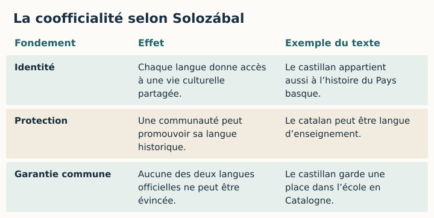

# ENS Rennes D-E — Espagnol 2026 · Corrigé guidé

*Corrigé rédigé par IA, non officiel. Signalez toute erreur.*

**Rédaction** · GPT-6.2 Astra Ultra · vitesse non renseignée

**Révision (tour 1)** · GPT-6.2 Astra Ultra · vitesse non renseignée

## Présentation du sujet

Les pages imprimées 7 à 9 réunissent deux traductions et une expression écrite sur un troisième texte. Chaque réponse d’expression doit compter de 225 à 275 mots. Le nombre indiqué après chaque réponse exclut son titre.

[Fascicule officiel, pages imprimées 7 à 9](https://www.ens-rennes.fr/medias/fichier/sujet-lve-d-e-2026_1790867583165-pdf#page=8) · [Rapport écrit d’espagnol](https://www.ens-rennes.fr/medias/fichier/rapport-de-jury-lve-espagnol-e-crit-2026_1793640885461-pdf)

**Repère du fascicule.** Dans l’article de Solozábal, distinguer le niveau où se déploie la coofficialité, celui de la communauté autonome, de l’attitude respectueuse que les autorités centrales peuvent adopter envers ses langues. Cette distinction commande le dernier paragraphe de l’auteur.

## I. Version française

*Daniel Domínguez, El País, 16 juillet 2025.*

Le texte tutoierait facilement son lecteur en français, mais *piense* et *usted* instaurent une distance que conserve « vous ». *Galeno* reprend le médecin et *tirón de orejas* annonce une réprimande. Le déménagement à Jabugo vise à rapprocher l’entreprise des producteurs. Garder ce lien entre lieu et finalité.

Imaginez la situation. Vous avez envie d’acheter de la mayonnaise pour relever vos plats, mais votre médecin vous a dit de ne pas abuser du sucre. Au supermarché, vous voyez plusieurs marques qui essaient de vous séduire par de jolis emballages et de belles couleurs, et vous hésitez. Vous consultez les étiquettes nutritionnelles, mais vous avez du mal à comprendre ces informations et ne parvenez pas à déterminer quel produit vous aidera le mieux à maîtriser votre glycémie. Le même scénario se reproduit chaque fois qu’il faut choisir un produit. Vous finissez donc par acheter la même chose que d’habitude, quitte à vous faire de nouveau tirer les oreilles par votre médecin. Vous n’avez pas conscience de la quantité de sucres que contiennent ces aliments lorsqu’ils sont fabriqués industriellement.

L’entrepreneur sévillan Fernando Vázquez, qui avait fait toute sa carrière dans la restauration et l’hôtellerie, a pris conscience en 2015 de l’urgence de promouvoir « une consommation éclairée ». « Nous avons de moins en moins de temps à consacrer aux courses, alors que nous devons prendre des décisions de plus en plus importantes », estime-t-il. C’est en réfléchissant à ce constat qu’il a eu l’idée de créer un outil donnant directement et rapidement accès aux informations sur chaque produit. C’est ainsi qu’est née la jeune pousse Naturcode.

L’entreprise, qui a déménagé à Jabugo, dans la province de Huelva, pour se rapprocher des producteurs, a mis au point un système d’étiquetage intelligent qui permet d’y voir plus clair sur les produits que l’on souhaite acheter au supermarché.

## II. Thème en espagnol

*Charlotte Moge, Le Monde, 22 novembre 2025.*

Deux voix se succèdent. Le chapeau présente la signataire et résume son propos. Le corps de la tribune s’exprime au présent et inclut le lecteur. Le frère qui refuse le silence est Amine. *Faire miroiter* désigne ici une promesse de mobilité sociale. Distinguer à la fin les causes du phénomène de ses conséquences sanitaires et économiques.

En una tribuna publicada en *Le Monde*, Charlotte Moge, especialista en las mafias italianas y en la lucha contra ellas, subraya la necesidad de hacer de la lucha contra el narcotráfico una causa colectiva y anima a la sociedad francesa a inspirarse en el compromiso de los ciudadanos italianos con los movimientos antimafia.

El asesinato del joven Mehdi Kessaci es espantoso y la determinación de su hermano Amine de no quedarse callado merece admiración. La sociedad en su conjunto tiene el deber de tomar conciencia de la gravedad del problema y de estar a su lado. La violencia del narcotráfico es solo la punta del iceberg y por eso nos concierne a todas y a todos. Los traficantes se aprovechan de la miseria social de los barrios abandonados y del desconcierto de unos jóvenes que se sienten marginados y a los que prometen un ascenso social que jamás habrían soñado. Medran gracias a la dependencia de los consumidores, entre los que hay mucho más que «burgueses de los centros urbanos», como dio a entender el presidente Emmanuel Macron, y a la incomprensión de buena parte de la clase política. La constante escalada de medidas puramente represivas es síntoma de la incapacidad para afrontar las múltiples causas, sobre todo sociales, de este problema sistémico, así como sus consecuencias sanitarias y económicas.

## III.1 — La place des langues dans l’argument de Solozábal

*Juan José Solozábal, El País, 3 octobre 2025.*

Reconstituer le raisonnement avant de citer les exemples. Les controverses institutionnelles ouvrent le texte. La remarque de Mitxelena nourrit l’argument identitaire. La jurisprudence précise ensuite les deux effets de la garantie de coofficialité, protection d’une langue longtemps marginalisée et maintien des deux langues dans les institutions.

Juan José Solozábal presenta la cuestión lingüística como una prueba del funcionamiento del Estado autonómico. Parte de dos controversias concretas. Una reforma permite a los diputados intervenir en el Congreso en sus respectivas lenguas propias. Por otra parte, el presidente catalán anunció que recurriría una resolución judicial relativa al uso del castellano en la escuela. Ambas noticias explican por qué algunos ven en los conflictos lingüísticos un argumento para superar el modelo autonómico. El autor, en cambio, se propone defender sus posibilidades.

La primera razón es cultural. Una lengua permite expresarse y reconocerse como miembro de una comunidad. Esa capacidad corresponde tanto al castellano como a las demás lenguas. Al recordar las palabras de Koldo Mitxelena, Solozábal señala que el castellano también pertenece a la experiencia histórica de los vascos. La identidad de un territorio puede, por tanto, expresarse en más de un idioma.

La segunda razón es jurídica. En las comunidades con lengua propia, la cooficialidad constituye, según el autor, una garantía institucional. Justifica políticas que reparen la marginación histórica de una lengua y le aseguren un lugar central en la enseñanza y la administración. Sin embargo, también impide relegar el castellano hasta hacerlo desaparecer del funcionamiento ordinario de las instituciones. La jurisprudencia sobre Cataluña y determinados municipios vascos ilustra ambos aspectos. En definitiva, el artículo sitúa la cuestión en dos escalas. El Estado puede mostrar consideración por las demás lenguas, mientras que el bilingüismo institucional se desarrolla propiamente en las comunidades correspondientes.

*244 mots.*

## III.2 — Les conditions politiques de la coofficialité

Choisir deux usagers dont les besoins diffèrent et examiner ce qu’il faudrait pour leur donner un droit effectif. Passer de la mairie à l’école permet de distinguer service immédiat et apprentissage sur plusieurs années. La dernière étape change d’échelle en introduisant la représentation au Congrès.

A mi juicio, la cooficialidad representa un desafío político cuando se trata de convertir una declaración de igualdad en una libertad que las personas puedan ejercer. Una vecina que se expresa mejor en gallego debería poder explicar un problema en su ayuntamiento sin buscar intérprete. Otra que acaba de instalarse en la misma localidad debería poder informarse en castellano. Para atender a ambas hacen falta personal formado, documentos accesibles y tiempo. La respuesta a una discusión aparentemente simbólica depende así de decisiones presupuestarias bastante concretas.

La escuela plantea una dificultad adicional. Allí donde la lengua propia tiene poca presencia fuera del aula, ofrecerla como una opción marginal puede privar a muchos niños de la oportunidad de aprenderla bien. Una política de promoción activa tiene entonces una justificación democrática. A la vez, los padres deben poder saber qué objetivos se persiguen en cada lengua y qué apoyo recibirá un alumno recién llegado. Publicar resultados de aprendizaje y explicar los criterios pedagógicos permitiría discutir medidas concretas sin atribuir a cada familia una identidad política.

Finalmente, el debate cambia de significado según el lugar donde se produzca. El uso de varias lenguas en el Congreso puede expresar reconocimiento hacia los ciudadanos representados. La administración autonómica, en cambio, presta servicios cotidianos y responde de su accesibilidad. Confundir ambas escalas favorece la confrontación. Creo que el desafío es gobernable si los poderes públicos escuchan a los hablantes, justifican sus decisiones y revisan sus efectos sobre quienes disponen de menos alternativas.

*245 mots.*
