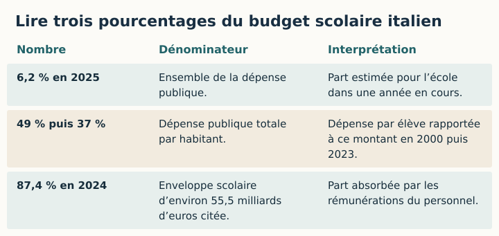

# ENS Rennes D-E — Italien 2026 · Corrigé guidé

*Corrigé rédigé par IA, non officiel. Signalez toute erreur.*

**Rédaction** · GPT-6.2 Astra Ultra · vitesse non renseignée

**Révision (tour 1)** · GPT-6.2 Astra Ultra · vitesse non renseignée

## Présentation du sujet

Les pages imprimées 10 à 12 réunissent deux traductions et une expression écrite sur un troisième texte. Chaque réponse d’expression doit compter de 225 à 275 mots. Le nombre indiqué après chaque réponse exclut son titre.

[Fascicule officiel, pages imprimées 10 à 12](https://www.ens-rennes.fr/medias/fichier/sujet-lve-d-e-2026_1790867583165-pdf#page=11)

**Repère du fascicule.** Les deux consignes de traduction comprennent le titre. Dans le premier, le superlatif relatif compare les Italiens aux autres Européens. Dans le second, « enfin » présente le repeuplement comme une évolution attendue. Conserver ces deux prises de position dès les titres.

## I. Version française

*Valentina Melis et Serena Uccello, Il Sole 24 Ore, 8 décembre 2025.*

Traduire le titre et garder, dans le second paragraphe, le passage à la première personne du pluriel. L’emprunt lexical est décrit depuis l’italien. Une traduction qui écrirait simplement que le mot français vient du français effacerait le point de vue. Les opinions concernent des jeunes interrogés dans cinq pays.

**Les Italiens sont les Européens les moins enclins à avoir des enfants**

Le mot italien *denatalità* vient du français. Et pourtant, contrairement à l’Italie, la France conserve une confiance solide dans l’avenir, qu’elle manifeste par le choix le plus emblématique qui soit, celui de devenir parent. C’est ce qu’indique une enquête réalisée pour *Il Sole 24 Ore* auprès de jeunes Italiens, Français, Allemands, Anglais et Espagnols âgés de 18 à 35 ans, interrogés sur leur besoin ou leur désir d’avoir des enfants.

La comparaison fait apparaître des attitudes diverses, mais un constat se dégage nettement. C’est surtout nous, les Italiens, qui manquons de confiance et ne voyons plus de perspective de croissance.

La question est loin d’être nouvelle. Il suffit de rappeler ce qu’écrivait Massimo Livi Bacci dans un essai de 2021, *L’avenir des Italiens. Déclin ou transition démographique ?* « La baisse de la natalité touche l’Italie depuis plusieurs décennies et représente l’un des principaux défis pour l’avenir du pays. Le manque d’enfants est un problème à la fois économique et lié à notre identité et à notre avenir. »

Ce qui rend toutefois la situation italienne plus préoccupante aujourd’hui, c’est que, face à une inquiétude commune, les jeunes Italiens, à la différence des autres Européens, ne voient aucune solution et qu’il n’en faut pas davantage pour les faire reculer devant la perspective d’avoir des enfants.

Il en va autrement des Anglais, des Espagnols et surtout des Français, qui sont certes inquiets, mais pas au point de ne voir aucune issue.

Chez ceux qui renoncent à devenir parents, c’est avant tout l’insécurité économique qui pèse dans la décision de ne pas avoir d’enfants.

## II. Thème en italien

*Beniamino Morante, Courrier international, 24 juin 2025.*

Traduire aussi le titre du thème. L’augmentation de cent mille habitants porte sur l’ensemble des communes classées dans la catégorie. La fin du texte introduit une différence géographique décisive, puis nomme deux destinations distinctes des migrations depuis l’intérieur du Mezzogiorno.

**In Italia i comuni di montagna cominciano finalmente a ripopolarsi**

«Sono sempre di più gli italiani che lasciano le grandi città per riscoprire la vita in montagna», osserva il quotidiano romano *Il Messaggero*. Tra il 2019 e il 2023 il numero dei residenti nei comuni italiani classificati come «montani» è aumentato di centomila unità.

La classificazione può applicarsi ai comuni situati a partire dai 400 metri di altitudine e con meno di ventimila abitanti.

L’Italia, cinta a nord dalle Alpi e percorsa da un capo all’altro dagli Appennini, è un paese estremamente montuoso. Sono dunque migliaia i comuni che rientrano in questa categoria. Come si spiega il loro ritorno in auge?

Da un lato, *Il Messaggero* sottolinea «il costo troppo elevato della vita nelle grandi città». Dall’altro, dà risalto ai comuni montani «diventati più attraenti grazie agli investimenti del piano di ripresa europeo e ai progetti di sviluppo sostenibile» finanziati in Italia.

Questa tendenza, tuttavia, non si osserva ovunque nel paese. Nel Sud le zone montane e collinari dell’entroterra perdono abitanti.

Sono migranti interni che si dirigono verso i vicini grandi agglomerati urbani, ma anche, molto spesso, verso le più prospere metropoli del Nord.

## III.1 — Le financement de l’enseignement et ses conséquences

*Carlo Tecce, L’Espresso, 3 septembre 2025.*

Identifier le dénominateur de chaque nombre. Le pourcentage annuel du budget public, la dépense par élève rapportée à la dépense publique par personne, et la proportion du budget consacrée aux salaires décrivent trois choses différentes. Rattacher ensuite ces chiffres au temps d’apprentissage et aux arbitrages des familles.

Secondo l’inchiesta di Carlo Tecce, il finanziamento della scuola italiana ristagna. Gli importi complessivi oscillano di anno in anno, ma la quota della spesa pubblica destinata alla scuola dovrebbe scendere al 6,2 per cento nel 2025. Un altro indicatore misura l’impegno per singolo studente rispetto alla spesa pubblica pro capite. Tra il 2000 e il 2023 questo rapporto è passato dal 49 al 37 per cento. Il calo delle nascite, da solo, non spiega dunque la posizione dell’Italia in Europa.

La distribuzione delle risorse aiuta a capire che cosa accade nelle aule. Nel 2024 gli stipendi assorbivano l’87,4 per cento della somma considerata per il personale e le altre voci scolastiche. Restava poco margine per nuovi interventi, mentre aumentavano i fondi destinati alle scuole non statali. I sindacati segnalano una riduzione dei posti per docenti e personale amministrativo o ausiliario. Le assunzioni previste per stabilizzare i precari non evitano che alcune classi inizino l’anno con orari ridotti e perdano occasioni di apprendimento. All’università, intanto, gli stanziamenti ristagnano anche se crescono gli iscritti.

Le conseguenze raggiungono le famiglie prima ancora dell’ingresso a scuola. Solo un bambino su tre può accedere a un nido pubblico. Gli altri genitori devono spesso ricorrere ai nonni, intaccare i risparmi o rinunciare a opportunità professionali. Presentare la diminuzione degli alunni soltanto come un motivo per risparmiare trascura quindi il rapporto inverso. La disponibilità di servizi educativi può incidere sulla possibilità stessa di avere figli e sulla fiducia delle famiglie nel futuro.

*245 mots.*

## III.2 — Pourquoi et comment investir dans le secteur public ?

Partir d’un besoin perceptible dans la vie d’un élève ou d’un étudiant. Proposer une dépense qui agit sur ce besoin puis un indicateur qui permettrait d’en apprécier les effets. Le transport scolaire, la continuité des cours et le logement universitaire donnent des exemples à des échelles différentes.

Investirei anzitutto nei servizi che consentono agli studenti di frequentare davvero la scuola o l’università. Un ragazzo che vive lontano dall’istituto può avere ottimi insegnanti sulla carta e perdere comunque l’ultima ora di lezione per prendere l’unico autobus disponibile. In un territorio del genere, coordinare i trasporti con gli orari scolastici può produrre un beneficio maggiore che distribuire la stessa somma in parti uguali fra tutti gli edifici.

La seconda ragione per aumentare i fondi è la continuità didattica. Se una classe cambia insegnante più volte durante l’anno, ogni passaggio richiede tempo per capire che cosa gli allievi hanno già imparato. Risorse pluriennali permetterebbero di programmare le assunzioni, sostenere gli insegnanti all’inizio della carriera e offrire un aiuto tempestivo agli studenti in difficoltà. Valuterei i risultati osservando le ore di lezione effettivamente svolte e i progressi degli allievi, con particolare attenzione alle zone dove gli abbandoni sono più frequenti.

Infine, nelle università pubbliche una borsa pagata in ritardo o un alloggio introvabile possono indurre uno studente capace a rinunciare agli studi. Aumentare il numero di borse e di posti letto sarebbe una scelta di equità e permetterebbe al paese di valorizzare competenze che altrimenti andrebbero perdute.

Il calo demografico impone di verificare dove servano ancora edifici e classi. Offre però anche l’occasione di seguire meglio ciascun giovane. Per questo legherei l’aumento della spesa a obiettivi pubblici, finanziati per più anni e verificati insieme a chi studia e insegna.

*238 mots.*
