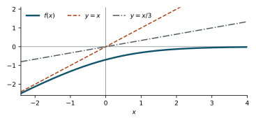
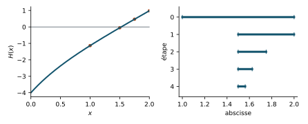
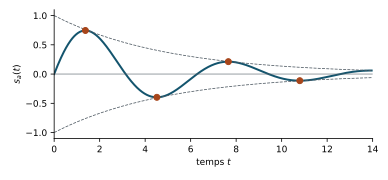
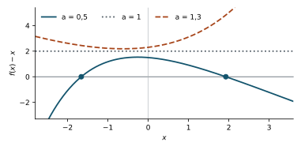

# ENS Rennes D-E — Mathématiques appliquées aux sciences économiques et sociales 2026 · Corrigé guidé

*Corrigé rédigé par IA, non officiel. Signalez toute erreur.*

**Rédaction** · GPT-6.2 Astra Ultra · vitesse non renseignée

Cette correction suit les pages 8 à 10 du fascicule officiel des épreuves à options. Le rapport intitulé « Option Mathématiques » publié sur la même page traite de régression, de séries et de probabilités. Les numéros renvoient ici au sujet sur les équations et la dynamique des prix.

Les trois exercices sont indépendants. Dans le premier, la position relative de deux graphes décide de l’existence d’une solution. Dans le deuxième, l’équation caractéristique distingue les régimes d’ajustement. Dans le dernier, un prix stationnaire est un point fixe de la fonction de récurrence.

## Exercice 1 — Deux équations

### Question 1a

> [!INDICATION]
> Comparer séparément la fonction à zéro et à la droite de pente un.

#### Solution

Pour $x\ge0$, écrivons $f(x)=-\ln(1+e^{-x})$. Cette valeur est strictement négative, alors que $x/n\ge0$ pour tout entier $n\ge1$. La droite et la courbe n’ont aucun point commun. Au point $x=0$, on a bien $f(0)=-\ln2<0$. Le prolongement de l’expression à tout réel donnerait la même réponse. En effet, pour $x<0$, $f(x)=x-\ln(1+e^x)<x\le x/n$.

Sur le graphique, la courbe croît car $f'(x)=1/(1+e^x)>0$, et $f(x)\to0$ lorsque $x\to+\infty$. Toutes les droites passent par l’origine.



### Question 2a

> [!INDICATION]
> Multiplier la différence par un facteur positif permet de comparer une fonction affine et une exponentielle décroissante.

#### Solution

L’équation s’écrit $g(x)=e^x(x-1)-\cosh x=0$. Le facteur $2e^{-x}$ est strictement positif, et
$$H(x)=2e^{-x}g(x)=2x-3-e^{-2x}.$$
La dérivée $H'(x)=2+2e^{-2x}$ est strictement positive. Les valeurs $H(1)=-1-e^{-2}<0$ et $H(2)=1-e^{-4}>0$ donnent, par continuité et stricte monotonie, une unique solution réelle $c$, avec $1<c<2$. L’unicité vaut en particulier sur $\mathbb R_+$. On trouve $c\simeq1{,}524$.

### Question 2b

> [!INDICATION]
> Conserver un intervalle dont les extrémités donnent des signes opposés.

#### Solution

On peut garder la fonction $H$ ci-dessus. Si l’on conserve $g$, alors $g'(x)=xe^x-\sinh x$, donc $2e^{-x}g'(x)=2x-1+e^{-2x}$. Cette dernière expression est nulle en zéro et sa dérivée $2(1-e^{-2x})$ est positive pour $x>0$. Ainsi $g$ croît strictement sur $\mathbb R_+$.

Voici un algorithme pour une tolérance $\varepsilon>0$. Le milieu $m$ sert de valeur approchée lorsque la longueur de l’intervalle descend sous $2\varepsilon$.

```python
from math import exp

def racine(epsilon):
    if epsilon <= 0:
        raise ValueError("La tolérance doit être positive")
    gauche, droite = 1.0, 2.0
    while droite - gauche > 2 * epsilon:
        milieu = (gauche + droite) / 2
        if milieu == gauche or milieu == droite:
            raise ArithmeticError("Précision numérique atteinte")
        valeur = 2 * milieu - 3 - exp(-2 * milieu)
        if valeur == 0:
            return milieu
        if valeur < 0:
            gauche = milieu
        else:
            droite = milieu
    return (gauche + droite) / 2
```

### Question 2c

> [!INDICATION]
> Sur le dessin, le nouveau signe décide de l’extrémité à déplacer.

#### Solution

Au départ, $H(1)<0<H(2)$. Le milieu $1{,}5$ donne $H(1{,}5)=-e^{-3}<0$. On garde donc $[1{,}5,2]$. Le milieu suivant $1{,}75$ donne $0{,}5-e^{-3{,}5}>0$, ce qui laisse $[1{,}5,1{,}75]$. Le même raisonnement conserve toujours la racine. Après $k$ divisions, l’intervalle a longueur $2^{-k}$ et son milieu est à distance au plus $2^{-k-1}$ de $c$.



## Exercice 2 — Ajustement de l’offre et de la demande

### Question 1a

> [!INDICATION]
> Chercher d’abord une solution constante, puis résoudre l’équation homogène.

#### Solution

L’égalité des quantités conduit à
$$p''+\alpha p'+\beta p=\beta^2-1.$$
Dans le régime $\alpha<2\sqrt\beta$, on a nécessairement $\beta>0$. La solution constante est $C=(\beta^2-1)/\beta$. Le discriminant de l’équation caractéristique $z^2+\alpha z+\beta=0$ vaut $\alpha^2-4\beta<0$. Ses racines sont $-\mu\pm i\nu$, où $\mu=\alpha/2$ et $\nu=\sqrt{4\beta-\alpha^2}/2>0$. Toutes les solutions réelles sont
$$p(t)=C+e^{-\mu t}\big(A\cos(\nu t)+B\sin(\nu t)\big).$$

### Question 1b

> [!INDICATION]
> Utiliser les périodes de la tangente et la monotonie de l’arctangente.

#### Solution

Pour $a>0$, posons $\phi=\arctan(1/a)\in]0,\pi/2[$. La tangente est injective sur cet intervalle et de période $\pi$. Les solutions positives de $\tan\theta=1/a$ sont exactement $\theta=\phi+k\pi$ avec $k\in\mathbb N$.

Quand $a$ croît de zéro à l’infini, $\phi$ décroît strictement de $\pi/2$ à zéro. Plus précisément $d\phi/da=-1/(1+a^2)<0$. Son image est tout l’intervalle ouvert $]0,\pi/2[$.

### Question 1c

> [!INDICATION]
> Écarter les points où le cosinus est nul avant de diviser.

#### Solution

Si $\cos\theta=0$, alors $\sin\theta=\pm1$ et $\cos\theta-a\sin\theta\ne0$. Ailleurs, l’annulation équivaut à $\tan\theta=1/a$. Ainsi les racines positives sont $\phi+k\pi$, $k\in\mathbb N$. On peut aussi écrire $\phi=\pi/2-\arctan a$.

### Question 1d

> [!INDICATION]
> La dérivée est le produit d’une exponentielle positive et de l’expression étudiée en 1c.

#### Solution

Sur $\mathbb R_+$, $s_a'(t)=e^{-at}(\cos t-a\sin t)$. La dérivée est positive au départ et change de signe à chaque $t_k=\phi+k\pi$. La fonction croît de $0$ à $t_0$, décroît de $t_0$ à $t_1$, puis alterne les sens de variation. Les indices pairs sont des maxima locaux et les impairs des minima locaux. Comme $\sin\phi=1/\sqrt{1+a^2}$,
$$s_a(t_k)=\frac{(-1)^k}{\sqrt{1+a^2}}\,e^{-a(\phi+k\pi)}.$$
Ces valeurs tendent vers zéro en amplitude. Le premier sommet est le maximum global et le premier creux le minimum global. Enfin $s_a(0)=0$ et $s_a(t)\to0$ à l’infini.



### Question 1e

> [!INDICATION]
> Évaluer la solution et sa dérivée en zéro.

#### Solution

L’égalité $p(0)=1$ donne $A=1-C$. Puis $p'(0)=\nu B-\mu A=0$ impose
$$A=1-\beta+1/\beta,\qquad B=\frac{\mu}{\nu}(1-\beta+1/\beta).$$
On obtient donc $p(t)=C+(1-C)e^{-\mu t}(\cos(\nu t)+(\mu/\nu)\sin(\nu t))$.

### Question 1f

> [!INDICATION]
> L’oscillation est centrée sur la solution constante. Sa persistance dépend de la partie réelle des racines.

#### Solution

Quand $\alpha>0$, l’amplitude autour de $C$ décroît exponentiellement. Le prix s’ajuste en oscillant vers $C=\beta-1/\beta$. Si le prix initial est déjà $C$, il reste constant. Quand $\alpha=0$, $\mu=0$ et les oscillations persistent sauf au point d’équilibre. Le modèle ne pose pas de contrainte explicite de positivité. Le prix stationnaire est négatif si $0<\beta<1$ et les formules donnent à ce prix $q_s=q_d=-1$. Il s’agit d’une limite mathématique du modèle économique proposé.

### Question 1g

> [!INDICATION]
> Dériver les deux facteurs de la partie oscillante. La solution constante fournit un contrôle immédiat.

#### Solution

Écrivons $G=A\cos(\nu t)+B\sin(\nu t)$ et $J=B\cos(\nu t)-A\sin(\nu t)$. Alors $G'=\nu J$ et $J'=-\nu G$. On trouve
$$p'=e^{-\mu t}(-\mu G+\nu J),\qquad p''=e^{-\mu t}\big((\mu^2-\nu^2)G-2\mu\nu J\big).$$
Avec $2\mu=\alpha$ et $\mu^2+\nu^2=\beta$, la relation correcte est
$$p''=-\alpha p'-\beta e^{-\mu t}G=(\beta^2-1)-\alpha p'-\beta p.$$
L’identité imprimée en 1g donnerait $p''=\beta^2-1$ pour $A=B=0$, alors que $p$ est constante. Par exemple $\alpha=1$, $\beta=2$ satisfait le régime étudié et donne $0=3$ dans cette identité. La dérivation retrouve bien l’équation initiale.

### Question 2

> [!INDICATION]
> Distinguer les racines réelles distinctes, la racine double et le cas où le coefficient de p s’annule.

#### Solution

Pour $\beta>0$ et $\alpha>2\sqrt\beta$, les racines $r_\pm=(-\alpha\pm\sqrt{\alpha^2-4\beta})/2$ sont strictement négatives. Les solutions sont $C+A e^{r_+t}+B e^{r_-t}$. Pour $\alpha=2\sqrt\beta$, elles sont $C+(A+Bt)e^{-\alpha t/2}$. Dans les deux cas, le prix converge vers $C$ sans oscillations entretenues.

La frontière $\beta=0$ demande un calcul distinct. L’équation devient $p''+\alpha p'=-1$. Si $\alpha>0$, $p(t)=A+B e^{-\alpha t}-t/\alpha$. Si $\alpha=0$, $p(t)=A+Bt-t^2/2$. Il n’existe alors aucun prix stationnaire.

### Question 3

> [!INDICATION]
> Comparer les deux équations différentielles terme à terme.

#### Solution

Avec $\alpha=0$ et $\beta^2=1$, la condition $\beta\ge0$ impose $\beta=1$. Il reste $p''+p=0$. Pour une masse soumise à la force de rappel $F(t)=-kp(t)$, la deuxième loi de Newton donne $mp''=-kp$, soit $p''+(k/m)p=0$. On retrouve l’équation du prix pour $k/m=1$ dans les unités choisies. L’absence de terme en $p'$ correspond à un oscillateur non amorti.

## Exercice 3 — Prix d’équilibre en temps discret

### Question 1

> [!INDICATION]
> La première condition demande seulement un seuil suffisant. Pour la seconde, regarder la valeur minimale de l’exponentielle.

#### Solution

Pour $0<a<1$, $0<a(1-a)\le1/4$. Ainsi $\ln(a(1-a))+1\le1-\ln4<0$. Le quotient de cette quantité par $a-1<0$ est positif, et $1/a-1>0$. La première inégalité du sujet est donc vraie sur tout $]0,1[$. Par exemple $a_1=1/2$ est un seuil suffisant.

Pour $a>1$, on a $1/(a-1)>0$ et $e^{ax}-1\ge0$ pour tout $x\ge0$. Leur somme est strictement positive. On peut choisir $a_2=1$, qui est supérieur à $a_1$. Le libellé demande l’existence, donc les seuils ne sont pas uniques.

### Question 2

> [!INDICATION]
> Pour un point fixe, comparer une exponentielle et une fraction rationnelle. Tenir compte du domaine choisi pour le prix.

#### Solution

Un équilibre vérifie $x-1=(x+a)e^{(a-1)x}$. Pour $a>0$, ni $x=-a$ ni $x=1$ ne convient. Les deux facteurs $x-1$ et $x+a$ doivent avoir le même signe. Il reste les deux intervalles $x<-a$ et $x>1$. Sur chacun, l’équation devient
$$e^{(a-1)x}=R(x),\qquad R(x)=\frac{x-1}{x+a}=1-\frac{a+1}{x+a}.$$
La dérivée $R'(x)=(a+1)/(x+a)^2$ est positive.

Lorsque $0<a<1$, l’exponentielle décroît strictement. Sur $]1,+\infty[$ elle part d’une valeur positive et tend vers zéro, tandis que $R$ croît de zéro à un. Il existe exactement un équilibre positif. Sur $]-\infty,-a[$, l’exponentielle décroît de $+\infty$ vers une valeur finie, tandis que $R$ croît de un vers $+\infty$. Il y a exactement un second équilibre, négatif.

Avec les seuils choisis en 1, l’intervalle $a_1<a<a_2$ est inclus dans ce cas. Pour tout $a>1=a_2$, sur $x>1$ l’exponentielle est supérieure à un et $R(x)<1$. Sur $x<-a$, l’exponentielle est inférieure à un et $R(x)>1$. Il n’y a aucun équilibre. À la frontière $a=1$, $f(x)=x+2$ n’a aucun point fixe. La classification pour tout $a>0$ vaut également si l’on choisit d’autres seuils suffisants. En termes de prix non négatifs, le bilan est un équilibre si $0<a<1$ et aucun si $a\ge1$.



## Bilan

Une équation différentielle à second membre constant admet souvent une solution particulière constante. La soustraire ramène l’étude au signe des racines caractéristiques. Dans le modèle discret, la recherche de points fixes demande de respecter les domaines avant d’appliquer un argument de monotonie.
