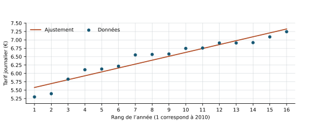
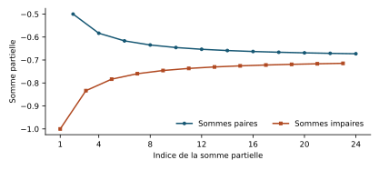
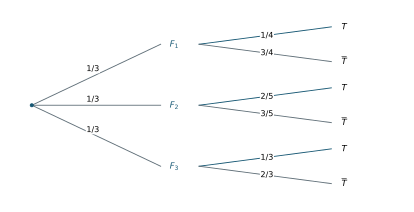

# ENS Rennes D-E — Mathématiques appliquées et statistiques 2026 · Corrigé guidé

*Corrigé rédigé par IA, non officiel. Signalez toute erreur.*

**Rédaction** · GPT-6.2 Astra Ultra · vitesse non renseignée

**Révision** · GPT-6.2 Astra Ultra · vitesse non renseignée

Les consignes de mathématiques figurent à la page physique 5 du fascicule. Les exercices occupent les pages 6 à 9 et la table normale la page 10. [Sujet officiel](https://www.ens-rennes.fr/medias/fichier/sujet-e-preuves-a-options-d-e-2026_1790867571556-pdf#page=5) · [Rapport du jury](https://www.ens-rennes.fr/medias/fichier/rapport-de-jury-option-mathe-matiques-d-e-2026_1793640842009-pdf)

Le premier exercice demande de choisir les bonnes pondérations. Dans le deuxième, la comparaison des termes pairs et impairs ramène la série alternée au théorème des suites adjacentes. Le troisième demande de préciser le conditionnement et le support avant chaque calcul de probabilité.

## Exercice 1 — Statistiques

### Question 1.1.a

> [!INDICATION]
> Identifier la seule grandeur représentée par la lettre x, puis ses valeurs possibles.

#### Solution

Les neuf observations $x_i$ décrivent chacune un effectif journalier. La série $(x_i)$ est donc **simple**, à caractère **quantitatif discret**, puisque le nombre de passages est entier. Les pourcentages constituent une autre colonne du tableau.

### Question 1.1.b

> [!INDICATION]
> Retrouver un nombre de passages par la file virtuelle pour chaque attraction, puis regrouper les effectifs.

#### Solution

Si $p_i$ est la proportion d’utilisateurs de la file virtuelle à l’attraction $i$, leur nombre est $x_i p_i$. Dans l’ordre du tableau, on obtient $8\,000$, $250$, $23\,400$, $1\,025$, $9\,424$, $3\,000$, $1\,500$, $3\,000$ et $500$ passages. Les neuf attractions représentent $154\,310$ passages, dont $50\,099$ par la file virtuelle. La proportion demandée est
$$\frac{\sum_{i=1}^9 x_ip_i}{\sum_{i=1}^9 x_i}=\frac{50\,099}{154\,310}\simeq0{,}325,$$
soit $32{,}466\,\%$ au millième de point de pourcentage. Les observations portent sur les passages aux attractions. Un visiteur qui effectue plusieurs attractions contribue à plusieurs effectifs.

Par exemple, les 65 % de l’attraction 3 s’appliquent à 36 000 passages et contribuent pour 23 400 au numérateur. Une moyenne simple des neuf taux traiterait la petite attraction de 5 000 passages avec le même poids que celle de 36 000. Le quotient des effectifs reproduit le tirage d’un passage au hasard.

### Question 1.2.a

> [!INDICATION]
> Le rang un est associé à 2010. Utiliser une origine verticale décalée pour lire les écarts de tarif.

#### Solution

On porte en abscisse $x_i=i$ et en ordonnée le tarif $y_i$ en euros. Sur papier, un rang occupe 1 cm et un euro 2 cm. Par exemple, le premier point a pour coordonnées $(1\,;5{,}2983)$, les points de rangs 12 et 13 ont la même ordonnée $6{,}9077$ et le dernier point vaut $(16\,;7{,}2442)$. Le graphique rassemble le nuage demandé ici et la droite calculée en 2d.

### Question 1.2.b

> [!INDICATION]
> Utiliser la variance descriptive avec division par le nombre d’observations.

#### Solution

Avec $n=16$, les sommes des tarifs et de leurs carrés valent respectivement $103{,}2406$ et $671{,}16466114$. Ainsi
$$\bar y=\frac1n\sum_{i=1}^ny_i=6{,}4525375\simeq6{,}453\ \text{€},\qquad V_y=\frac1n\sum_{i=1}^ny_i^2-\bar y^2=0{,}3125511323\ldots\simeq0{,}313\ \text{€}^2.$$

### Question 1.2.c

> [!INDICATION]
> Évaluer séparément la covariance, la variance du rang et celle du tarif.

#### Solution

On obtient $\bar x=8{,}5$, $V_x=n^{-1}\sum_i x_i^2-\bar x^2=21{,}25$ et $\sum_i x_i y_i=917{,}1194$. La covariance vaut $C_{xy}=n^{-1}\sum_i x_i y_i-\bar x\bar y=2{,}47339375$. Le coefficient de corrélation linéaire est
$$r=\frac{C_{xy}}{\sqrt{V_xV_y}}\simeq0{,}960.$$
Sa valeur positive, proche de 1, et l’allure croissante du nuage justifient un ajustement affine comme première approximation sur la période observée.

### Question 1.2.d

> [!INDICATION]
> La droite des moindres carrés passe par le point moyen. Utiliser la covariance pour calculer sa pente.

#### Solution

La droite qui minimise $\sum_i(y_i-ax_i-b)^2$ a pour coefficients
$$a=\frac{C_{xy}}{V_x}=0{,}116395,\qquad b=\bar y-a\bar x=5{,}46318.$$
Ainsi $\widehat y(x)=0{,}116395x+5{,}46318$. Sur le graphique de 2a, les ordonnées de la droite aux rangs 1 et 16 valent environ $5{,}580$ et $7{,}326$. Les calculs de prévision utilisent les coefficients avant arrondi.

### Question 1.2.e

> [!INDICATION]
> Convertir l’année en son rang avant de l’insérer dans la droite.

#### Solution

L’année 2030 a pour rang $2030-2010+1=21$. Le modèle prévoit $0{,}116395\times21+5{,}46318=7{,}907475$ euros, soit **7,907 € par jour** au millième. Il s’agit d’une extrapolation de cinq années au-delà des observations.

## Exercice 2, partie 1 — Suites adjacentes

### Question 2.I.1

> [!INDICATION]
> Traduire la croissance par une inégalité valable pour chaque indice.

#### Solution

La suite est croissante si et seulement si, pour tout $n\in\mathbb N^*$, $u_n\le u_{n+1}$. L’égalité entre deux termes consécutifs est possible.

### Question 2.I.2

> [!INDICATION]
> Décomposer la variation de la différence en deux termes de signe connu.

#### Solution

Pour tout $n\ge1$, $z_{n+1}-z_n=(v_{n+1}-v_n)-(u_{n+1}-u_n)\le0$, car $v$ décroît et $u$ croît. Ainsi $z$ décroît.

### Question 2.I.3

> [!INDICATION]
> Fixer un indice et comparer son terme à tous les termes suivants avant de passer à la limite.

#### Solution

Fixons $n\ge1$. Pour tout $m\ge n$, $z_n\ge z_m$ par décroissance. Le membre de droite tend vers 0 quand $m\to\infty$. On a donc $z_n\ge0$. La décroissance intervient dans cette comparaison.

### Question 2.I.4

> [!INDICATION]
> Revenir à la définition de la différence.

#### Solution

Pour tout $n\ge1$, $v_n-u_n=z_n\ge0$, soit $u_n\le v_n$.

### Question 2.I.5

> [!INDICATION]
> Chercher un nombre fixe, indépendant de n, en utilisant la première valeur de la suite décroissante.

#### Solution

Pour tout $n\ge1$, $u_n\le v_n\le v_1$. Le réel $v_1$ est un majorant de toute la suite $(u_n)$.

### Question 2.I.6

> [!INDICATION]
> Réunir monotonie et borne supérieure.

#### Solution

La suite réelle $(u_n)$ est croissante et majorée par $v_1$. Le théorème de convergence monotone lui donne une limite finie $\ell$.

### Question 2.I.7

> [!INDICATION]
> Trouver cette fois un minorant fixe.

#### Solution

Pour tout $n\ge1$, $v_n\ge u_n\ge u_1$. La suite réelle $(v_n)$ est décroissante et minorée par $u_1$, donc converge vers une limite finie $\ell'$.

### Question 2.I.8

> [!INDICATION]
> Calculer la limite de la différence de deux suites à limites finies.

#### Solution

La différence $z_n=v_n-u_n$ tend vers $\ell'-\ell$. L’hypothèse lui assigne aussi la limite 0. L’unicité de la limite donne $\ell'=\ell$.

## Exercice 2, partie 2 — Série harmonique alternée

### Question 2.II.1

> [!INDICATION]
> Séparer les deux derniers termes de la somme paire la plus longue.

#### Solution

On a $S_N=\sum_{k=1}^N(-1)^k/k$. Pour tout $N\ge1$,
$$S_{2N+2}-S_{2N}=\frac{(-1)^{2N+1}}{2N+1}+\frac{(-1)^{2N+2}}{2N+2}=\frac1{2N+2}-\frac1{2N+1}.$$

### Question 2.II.2

> [!INDICATION]
> Comparer les inverses des deux entiers positifs.

#### Solution

Comme $2N+2>2N+1$, la différence précédente est strictement négative. La suite $(S_{2N})_{N\ge1}$ décroît.

### Question 2.II.3

> [!INDICATION]
> Comparer deux sommes impaires successives, dont les indices diffèrent de deux.

#### Solution

Pour tout $N\ge1$, $S_{2N+3}-S_{2N+1}=1/(2N+2)-1/(2N+3)>0$. La suite $(S_{2N+1})_{N\ge1}$ croît.

### Question 2.II.4

> [!INDICATION]
> Calculer l’écart entre la somme paire et la somme impaire qui la suit.

#### Solution

On a $S_{2N}-S_{2N+1}=1/(2N+1)\to0$. Les sommes impaires croissent et les sommes paires décroissent. En prenant les sommes impaires pour $u_N$ et les sommes paires pour $v_N$, le théorème démontré en partie 1 donne une limite commune $L$.

Pour tout $N\ge1$, $S_{2N+1}\le L\le S_{2N}$. Par exemple $S_4=-7/12$ et $S_5=-47/60$, donc $-47/60\le L\le-7/12$. L’intervalle a ici pour largeur $1/5$, comme prévoit la formule $1/(2N+1)$.

### Question 2.II.5

> [!INDICATION]
> Un entier suffisamment grand appartient à l’une des deux parités déjà contrôlées.

#### Solution

Fixons $\varepsilon>0$. Il existe $N_0$ tel que, pour $N\ge N_0$, on ait simultanément $|S_{2N}-L|<\varepsilon$ et $|S_{2N+1}-L|<\varepsilon$. Tout $n\ge2N_0$ a l’une des formes $2N$ ou $2N+1$ avec $N\ge N_0$. Par conséquent $S_n\to L$.

### Question 2.II.6

> [!INDICATION]
> Utiliser la définition de la convergence d’une série.

#### Solution

Les sommes partielles de $\sum_{n\ge1}(-1)^n/n$ sont précisément les $S_N$. Leur convergence vers le réel $L$ établit que la série harmonique alternée converge.

## Exercice 2, partie 3 — Série harmonique

### Question 2.III.1

> [!INDICATION]
> Étudier la différence entre x et le logarithme sur son domaine.

#### Solution

La fonction $h(x)=x-\ln(1+x)$ est définie et dérivable sur $]-1,+\infty[$. Pour $x\ge0$, $h'(x)=x/(1+x)\ge0$. Ainsi $h(x)\ge h(0)=0$, soit $\ln(1+x)\le x$.

### Question 2.III.2

> [!INDICATION]
> Appliquer la première inégalité aux inverses des entiers puis additionner les logarithmes.

#### Solution

Pour tout $k\ge1$, $\ln(k+1)-\ln k=\ln(1+1/k)\le1/k$. En sommant de 1 à $n$, les différences de logarithmes se télescopent. On obtient $\ln(n+1)\le\sum_{k=1}^n 1/k$.

### Question 2.III.3

> [!INDICATION]
> Faire tendre n vers l’infini dans la borne inférieure des sommes partielles.

#### Solution

La borne $\ln(n+1)$ tend vers $+\infty$. Les sommes partielles $\sum_{k=1}^n 1/k$ tendent donc aussi vers $+\infty$. La série harmonique diverge.

### Question 2.III.4

> [!INDICATION]
> Réunir les résultats obtenus pour les termes signés et leurs valeurs absolues.

#### Solution

La série de terme général $(-1)^n/n$ converge par la partie 2. La série des valeurs absolues est $\sum_{n\ge1}1/n$, divergente d’après la question 3. La série initiale est donc semi-convergente.

## Exercice 3, partie 1 — Trois files d’attente

### Question 3.I.1

> [!INDICATION]
> Le choix initial est uniforme sur les trois files.

#### Solution

Les événements $F_1,F_2,F_3$ sont équiprobables et forment une partition. Ainsi $\mathbb P(F_2)=1/3$.

### Question 3.I.2

> [!INDICATION]
> La seconde file est déjà choisie. Lire sa probabilité conditionnelle.

#### Solution

D’après l’énoncé, $\mathbb P(T\mid F_2)=2/5$.

### Question 3.I.3

> [!INDICATION]
> La formule du produit s’applique puisque la seconde file a une probabilité positive.

#### Solution

Comme $\mathbb P(F_2)=1/3>0$, la définition de la probabilité conditionnelle donne $\mathbb P(F_2\cap T)=\mathbb P(F_2)\mathbb P(T\mid F_2)=(1/3)(2/5)=2/15$.

### Question 3.I.4

> [!INDICATION]
> Additionner les trois chemins qui aboutissent à T. Préciser le rôle du seuil dans la probabilité complémentaire.

#### Solution

Les événements $F_1,F_2,F_3$ forment un système complet et ont une probabilité strictement positive. La formule des probabilités totales donne
$$\mathbb P(T)=\sum_{j=1}^3\mathbb P(F_j)\mathbb P(T\mid F_j)=\frac13\left(\frac14+\frac25+\frac13\right)=\frac{59}{180}.$$
Son complément, attendre **au moins** quinze minutes, a pour probabilité $121/180$. Pour l’attente **strictement supérieure** à quinze minutes demandée ensuite, cette même réponse suppose qu’une attente d’exactement quinze minutes est de probabilité nulle. En toute généralité, il faut retrancher de $121/180$ la probabilité de cette égalité, que les données ne précisent pas.

### Question 3.I.5

> [!INDICATION]
> Diviser la probabilité de l’intersection par celle de l’événement connu.

#### Solution

Comme $\mathbb P(T)=59/180>0$, on a $\mathbb P(F_2\mid T)=\mathbb P(F_2\cap T)/\mathbb P(T)=(2/15)/(59/180)=24/59$.

## Exercice 3, partie 2 — Répartition de visiteurs entre deux files

### Question 3.II.1

> [!INDICATION]
> Rappeler quels effectifs une variable de Poisson peut prendre, y compris une journée sans visiteur.

#### Solution

Avec $\lambda>0$, $\mathbb P(N=k)=e^{-\lambda}\lambda^k/k!>0$ pour tout entier $k\ge0$. Le support de $N$ est $\mathbb N=\{0,1,2,\ldots\}$.

### Question 3.II.2

> [!INDICATION]
> Pour produire un effectif i en file A, envisager une journée avec exactement i visiteurs.

#### Solution

Le comptage $X$ est entier et positif ou nul. Pour chaque entier $i\ge0$, l’événement où $N=i$ et où tous ces visiteurs choisissent A a probabilité $\mathbb P(N=i)p^i>0$ et donne $X=i$. Pour $i=0$, il suffit que personne ne vienne. Le support de $X$ est donc $\mathbb N$.

### Question 3.II.3

> [!INDICATION]
> Fixer le nombre total de visiteurs avant de compter ceux qui choisissent A.

#### Solution

Conditionnellement à $N=k$, on compte les succès de $k$ choix indépendants de probabilité $p$. Ainsi $X\mid(N=k)$ suit la loi binomiale $\mathcal B(k,p)$, y compris pour $k=0$ où $X=0$ presque sûrement.

### Question 3.II.4

> [!INDICATION]
> Préciser les effectifs possibles avant d’utiliser les factorielles.

#### Solution

Posons $q=1-p$. Pour $0\le i\le k$, la formule du produit donne
$$\mathbb P(X=i,N=k)=\mathbb P(N=k)\binom{k}{i}p^i q^{k-i}=e^{-\lambda}\frac{(\lambda p)^i}{i!}\frac{(\lambda q)^{k-i}}{(k-i)!}.$$
Pour $i>k$, cette probabilité vaut 0 puisque $X\le N$.

### Question 3.II.5

> [!INDICATION]
> Sommer sur le total des visiteurs et reconnaître une série exponentielle.

#### Solution

Pour chaque $i\ge0$, les événements $(N=k)$, $k\in\mathbb N$, forment un système complet. Par la formule des probabilités totales et le changement d’indice $j=k-i$,
$$\mathbb P(X=i)=\sum_{k=i}^{\infty}\mathbb P(X=i,N=k)=e^{-\lambda}\frac{(\lambda p)^i}{i!}\sum_{j=0}^{\infty}\frac{(\lambda q)^j}{j!}=e^{-\lambda p}\frac{(\lambda p)^i}{i!}.$$
On reconnaît la loi de Poisson de paramètre $\lambda p$.

### Question 3.II.6

> [!INDICATION]
> Utiliser la loi marginale trouvée à la question précédente.

#### Solution

Une variable de Poisson de paramètre $\lambda p$ admet une espérance finie égale à son paramètre. Ainsi $\mathbb E(X)=\lambda p$.

### Question 3.II.7

> [!INDICATION]
> Échanger le nom des files et leurs probabilités de choix.

#### Solution

Chaque visiteur choisit B avec probabilité $q=1-p$. Le raisonnement de la question 5, appliqué à B, donne $Y\sim\mathcal P(\lambda q)$.

### Question 3.II.8

> [!INDICATION]
> Passer de la paire des comptages au couple formé du premier comptage et du total. Vérifier ensuite le produit des probabilités marginales pour chaque paire d’entiers, y compris zéro.

#### Solution

Tous les visiteurs rejoignent exactement une file, donc $N=X+Y$. Pour tous entiers $i,j\ge0$, les événements $\{X=i,Y=j\}$ et $\{X=i,N=i+j\}$ coïncident. Par la question 4,
$$\mathbb P(X=i,Y=j)=e^{-\lambda}\frac{(\lambda p)^i}{i!}\frac{(\lambda q)^j}{j!}=\mathbb P(X=i)\mathbb P(Y=j),$$
car $e^{-\lambda}=e^{-\lambda p}e^{-\lambda q}$. La factorisation pour tout couple d’atomes caractérise l’indépendance des variables discrètes $X$ et $Y$.

Si l’on fixe au contraire le nombre total de visiteurs à $k\ge1$, alors $Y=k-X$. La covariance conditionnelle vaut $-\operatorname{Var}(X\mid N=k)=-kp(1-p)<0$. L’indépendance précédemment démontrée porte sur une journée où le total $N$ suit sa loi de Poisson.

## Exercice 3, partie 3 — Âge des participants

### Question 3.III.1

> [!INDICATION]
> Identifier la variable réelle, la moyenne et l’écart-type dans l’exposant.

#### Solution

Pour $m\in\mathbb R$ et $\sigma>0$, une densité de $\mathcal N(m,\sigma^2)$ est définie sur $D_f=\mathbb R$ par
$$f(x)=\frac1{\sigma\sqrt{2\pi}}\exp\!\left(-\frac{(x-m)^2}{2\sigma^2}\right).$$

### Question 3.III.2

> [!INDICATION]
> Soustraire la moyenne, puis diviser par l’écart-type.

#### Solution

Dans cette partie, l’âge $N$ suit $\mathcal N(25,4^2)$. La variable $N^*=(N-25)/4$ suit la loi normale centrée réduite, et $N=25+4N^*$.

### Question 3.III.3

> [!INDICATION]
> Transformer 26 en score centré réduit puis repérer dixièmes et centièmes dans la table.

#### Solution

La loi est continue, donc $\mathbb P(N<26)=\mathbb P(N^*\le0{,}25)=\Phi(0{,}25)$. À l’intersection de la ligne $0{,}2$ et de la colonne $0{,}05$ de la table, on lit **0,5987**.

### Question 3.III.4

> [!INDICATION]
> Les deux bornes sont symétriques autour de la moyenne.

#### Solution

Les bornes centrées réduites valent $-0{,}25$ et $0{,}25$. Comme $\Phi(-x)=1-\Phi(x)$,
$$\mathbb P(24\le N\le26)=\Phi(0{,}25)-\Phi(-0{,}25)=2\Phi(0{,}25)-1\simeq2\times0{,}5987-1=0{,}1974.$$
La valeur de $\Phi(0{,}25)$ se lit ligne $0{,}2$, colonne $0{,}05$.

## Exercice 3, partie 4 — Variable à densité

### Question 3.IV.1

> [!INDICATION]
> Énoncer les conditions sur le signe, la régularité et l’intégrale sur la droite réelle.

#### Solution

Dans le cadre du programme, il suffit que $g$ soit positive ou nulle, continue par morceaux sur $\mathbb R$, et que son intégrale impropre sur $\mathbb R$ converge et vaille 1. Plus généralement, la mesurabilité et la positivité presque partout, avec une intégrale de Lebesgue égale à 1, caractérisent une densité.

### Question 3.IV.2

> [!INDICATION]
> Calculer l’intégrale sur un segment avant de passer à l’infini.

#### Solution

La fonction donnée est nulle pour $x<1$ et vaut $\alpha xe^{-x}$ pour $x\ge1$. Elle est continue sur $]-\infty,1[$ et sur $]1,+\infty[$, avec limites finies au seuil. Sa positivité demande $\alpha\ge0$. Pour $R>1$, une intégration par parties, avec $u(x)=x$ et $v(x)=-e^{-x}$ de classe $C^1$ sur $[1,R]$, donne
$$\int_1^R xe^{-x}\,dx=\big[-(x+1)e^{-x}\big]_1^R=2/e-(R+1)e^{-R}.$$
Le dernier terme tend vers zéro. Ainsi l’intégrale de $g$ vaut $2\alpha/e$, et sa normalisation impose l’unique valeur $\alpha=e/2$.

### Question 3.IV.3.a

> [!INDICATION]
> Distinguer les bornes situées avant ou après le début du support.

#### Solution

Avec $\alpha=e/2$, la fonction de répartition $G(x)=\int_{-\infty}^xg(t)\,dt$ vaut
$$G(x)=\begin{cases}0,&x<1,\\ 1-\dfrac{x+1}{2}e^{1-x},&x\ge1.\end{cases}$$
La seconde expression suit de la primitive $-(t+1)e^{-t}$. Elle donne bien $G(1)=0$ et tend vers 1 lorsque $x\to+\infty$.

### Question 3.IV.3.b

> [!INDICATION]
> La vérification d’intégrabilité absolue se ramène ici au même calcul que le premier moment.

#### Solution

Le support est contenu dans $[1,+\infty[$, donc $|x|g(x)=xg(x)$. Pour $R>1$, par intégration par parties avec $u(x)=x^2$ et $v(x)=-e^{-x}$ de classe $C^1$ sur $[1,R]$,
$$\int_1^R x^2e^{-x}\,dx=\big[-(x^2+2x+2)e^{-x}\big]_1^R\longrightarrow5/e.$$
Ainsi $\int_{\mathbb R}|x|g(x)\,dx=(e/2)(5/e)<\infty$. L’espérance existe et vaut $\mathbb E(X)=5/2$.

Un contrôle utilise la fonction de survie trouvée en 3.IV.3.a. Pour une variable positive, $\mathbb E X=\int_0^{\infty}(1-G(t))\,dt$. Le morceau de 0 à 1 vaut 1. Au-delà, l’intégrale de $(t+1)e^{1-t}/2$ vaut $3/2$, d’où à nouveau $5/2$.
