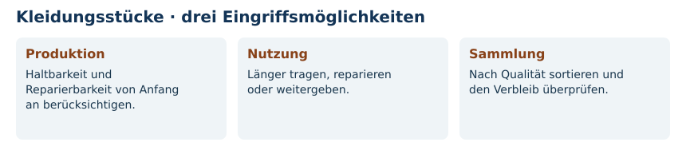

# ENS BCPST — Allemand 2026 · Corrigé brut

*Corrigé rédigé par IA, non officiel.*

**Rédaction** · modèle exact non renseigné (famille GPT-6) · effort non renseigné · vitesse non renseignée

**Révision** · GPT-6.2 Astra Ultra · vitesse non renseignée

**Révision** · GPT-6.2 Astra Ultra · vitesse non renseignée

**Révision (tour 3)** · GPT-6.2 Astra Ultra · vitesse non renseignée

**Fast Fashion**

## I · Synthèse des trois documents

Vor einem Berliner Modepublikum bekommt ein ausrangiertes Kleidungsstück eine andere Bedeutung als in einer europäischen Sammelstelle. Greenpeace ließ in Ghana eingesammelte Textilien nach Europa zurückbringen. So machte die Organisation sichtbar, dass eine Spende das Abfallproblem verlagern kann, wenn die Ware am Zielort nicht mehr tragbar ist. Greenpeace fordert, dass Modemarken für Schäden entlang der Lieferkette einstehen und sie verhindern (doc. 1).

Die Verbraucher verfügen bereits über mehrere Wege, Kleidung weiterzugeben. In der Umfrage nennen insgesamt 77 Prozent der Befragten das Spenden oder Verschenken. Bei den über Sechzigjährigen sind es 87 Prozent. 34 Prozent der 18- bis 29-Jährigen verkaufen Kleidung online, gegenüber zehn Prozent der über Sechzigjährigen. Diese Angaben aus dem Jahr 2022 zählen Personen, die solche Wege nutzen (doc. 3). Wer spendet, kann andere Stücke wegwerfen. Auch über die Menge gespendeter Kleidung und deren spätere Verwendung sagen die Antworten wenig aus. Das erklärt, weshalb verbreitete Spenden und die Abfallberge in Ghana nebeneinander bestehen können.

Für tragbare und beschädigte Textilien sind unterschiedliche Lösungen nötig. Seit Januar 2025 müssen die Mitgliedstaaten Alttextilien getrennt sammeln. Während Greenpeace 2024 die damals verhandelten Entwürfe kritisierte, beschloss das Parlament im September 2025 neue Regeln zur Finanzierung von Sammlung, Sortierung und Recycling durch die Hersteller. Das gilt auch für online verkaufte Ware. Anforderungen an Haltbarkeit und Reparierbarkeit setzen noch früher an, nämlich beim Entwurf der Kleidung (doc. 2). Sie könnten dazu beitragen, dass ein Weiterverkauf oder eine Spende tatsächlich eine zweite Nutzung ermöglicht. Wer weniger und haltbarere Stücke anbietet, wer sie pflegt und wer sie nach ihrer Qualität sortiert, beeinflusst jeweils eine andere Etappe desselben Weges.

## II · Expression personnelle

Europäische Regeln gegen Fast Fashion können nach meiner Ansicht wirksam sein, wenn sie die Entscheidungen verändern, die vor dem Kauf eines Kleidungsstücks fallen. Eine Käuferin sieht im Geschäft leicht, ob ihr eine Jacke gefällt. Ob der Reißverschluss nach einer Saison ersetzt werden kann, erkennt sie selten. Ein verbindlicher Maßstab für Reparierbarkeit kann daher mehr bewirken als die bloße Aufforderung, verantwortungsvoll einzukaufen. Er verpflichtet auch den Anbieter, dessen niedriger Preis bislang gerade auf einer kurzen Nutzungsdauer beruhte.

Die Finanzierung der Abfallbehandlung durch die Hersteller bietet eine zweite Möglichkeit. Eine pauschale Gebühr könnte ein Unternehmen lediglich auf den Verkaufspreis aufschlagen. Wird der Beitrag jedoch so gestaltet, dass ein haltbares und leicht zu reparierendes Stück weniger kostet als ein schwer verwertbares, verändert sich die Rechnung schon beim Entwurf. Die Wirksamkeit hängt dann davon ab, ob Behörden die Eigenschaften der Produkte tatsächlich vergleichen und die Anforderungen bei importierter Ware ebenso durchsetzen können.

Am schwierigsten bleibt die Menge. Selbst ein gut verarbeitetes Kleid verliert seinen ökologischen Vorteil, wenn es nach wenigen Wochen durch zwei neue ersetzt wird. Ich würde den Erfolg deshalb nicht daran messen, wie viele Tonnen Alttextilien gesammelt werden. Eine steigende Sammelmenge könnte ebenso gut auf wachsenden Verbrauch hinweisen. Aussagekräftiger wäre, ob Kleidungsstücke länger getragen werden, Reparaturen bezahlbar werden und weniger unverkäufliche Ware anfällt. Dafür brauchen auch Haushalte mit wenig Geld Zugang zu guten Reparaturangeboten. Die Regeln können den Markt verändern. Ob daraus eine dauerhaft andere Praxis entsteht, entscheidet sich an solchen alltäglichen Möglichkeiten.

## III · Traduction française

Cet amas se compose de vêtements usagés qui, sans l’intervention des militants de Greenpeace à l’origine de cette opération, auraient fini dans des décharges au Ghana. Les militants les ont ramassés sur la plage et au marché de Kantamanto, le plus grand marché de vêtements d’occasion d’Afrique de l’Ouest.
