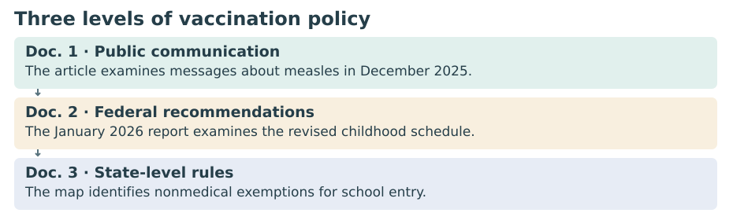
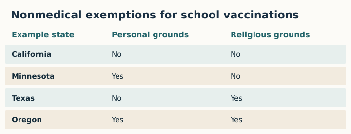

# ENS BCPST — Anglais 2026 · Corrigé guidé

*Corrigé rédigé par IA, non officiel.*

**Rédaction** · modèle exact non renseigné (famille GPT-6) · effort non renseigné · vitesse non renseignée

**Révision** · modèle exact non renseigné (famille GPT-6) · effort non renseigné · vitesse non renseignée

**Révision** · GPT-6.2 Astra Ultra · vitesse non renseignée

**Révision** · GPT-6.2 Astra Ultra · vitesse non renseignée

**Révision (tour 4)** · GPT-6.2 Astra Ultra · vitesse non renseignée

[Sujet officiel](https://www.ens.psl.eu/sites/default/files/261243_bcpst_lve_2026.pdf#page=6)

L’épreuve d’anglais dure trois heures. La synthèse de trois documents et l’expression personnelle valent chacune 8 points ; la version en vaut 4. Les deux productions anglaises demandent de 225 à 275 mots.

## Document synthesis

> [!INDICATION]
> Le texte 1 traite d’une flambée de rougeole et de la parole publique en décembre 2025 ; le texte 2 explique en janvier 2026 le passage de 17 à 11 maladies dans les recommandations universelles. La carte du texte 3 porte sur les dérogations scolaires non médicales. En lisant la carte de janvier, associez pointillés et Oregon, hachures croisées et Minnesota, traits verticaux et Texas, gris uni et Californie. Les exceptions indiquées sont non médicales. Un État classé dans la catégorie « aucune » sur cette carte peut donc conserver des exceptions médicales. Pour le doc. 1, relevez deux comparaisons distinctes. La première compte 10 publications contre 45,8 en moyenne sur la période correspondante avant 2025. La seconde compare le contenu des messages sur la vaccination de routine ou de rattrapage. Ni l’une ni l’autre ne mesure directement le nombre d’enfants vaccinés.

Federal guidance, public communication and state school rules shape access to childhood vaccination in different ways.

In January 2026, federal officials reduced the number of diseases covered by universal childhood recommendations from seventeen to eleven. A memorandum responding to a presidential request drew on international comparisons, bypassing the usual expert panel review of the evidence for each vaccine (doc. 2). Specialists point to gaps in American primary care and insurance. Reaching selected patients requires knowing who needs protection and being able to contact them. Continued coverage was promised, but the article questions whether access will remain dependable.

Public messages were already contested. A December 2025 report described an organisation formerly led by the health secretary spreading misleading claims about measles during a South Carolina outbreak in which most patients were unvaccinated children (doc. 1). The secretary both supported vaccination and questioned its testing. Researchers counted ten CDC posts about measles across three platforms from January to August 2025. None emphasised routine vaccination, whereas 82% of posts in the earlier comparison promoted routine or catch-up vaccination. This change in messaging preceded the January decision, which concerned other diseases.

States also differ over school entry requirements. In NBC’s January map, California allows neither personal nor religious exemptions, Oregon allows both, Minnesota allows personal exemptions and Texas religious ones (doc. 3). The map describes legal exceptions to school requirements. It measures neither vaccine uptake nor disease incidence. Taken together, the sources suggest that uncertain access, contradictory messages and different exemption policies may leave children unevenly protected.

*253 words.*

## Personal essay

> [!INDICATION]
> Confronter le rôle des preuves à celui des arbitrages publics. L’exemple d’une permanence de vaccination en soirée est imaginaire. Il permet d’expliquer quelles décisions exigent des données cliniques et quelles décisions exigent que les habitants puissent se faire entendre.

A public health authority must decide both what the evidence shows and what it owes people affected by its decision. Those questions call for different kinds of scrutiny. Politicians should explain whose interests a policy serves, while independent specialists should assess whether the proposed measure can achieve its stated purpose.

Imagine that a school district wants more families to attend an existing vaccination clinic. Medical advisers can explain the expected benefits, the risks being monitored and the limits of the available evidence. They cannot discover from clinical results alone whether local parents can leave work on a Tuesday afternoon. A decision to fund an evening clinic involves priorities about time, money and equal access. Parents and elected representatives have something important to contribute there.

Participation also brings obligations. A representative who claims that a vaccine causes serious harm should make the underlying evidence available for independent examination. A packed meeting or a popular video can reveal genuine anxiety without establishing its medical cause. Equally, specialists who dismiss every objection as ignorance may overlook practical barriers and lose the confidence required to address them.

I would ask decision makers to publish their reasons, identify disagreements among advisers and name the observations that could prompt a revision. Families could then contest an unfair arrangement without having to dispute a scientific finding, and experts could revise an estimate without being accused of changing political sides. Democratic judgement belongs in the choice of goals and in the distribution of burdens. Evidence must remain open to challenge by methods capable of testing it.

*258 words.*

## Traduction en français

> [!INDICATION]
> La seconde phrase énumère les raisons avancées par les spécialistes pour le Danemark et le Japon. Rendre le lien porté par « mean » et garder leur point de vue. Rattacher la relative « that often lacks » à la population. Le mot « other » reprend un argument antérieur. Conserver la comparaison entre les situations sanitaires et la conséquence présentée dans le passage.

Selon les spécialistes, les décisions fondées sur une comparaison avec d’autres pays à revenu élevé présentent une autre difficulté : les États-Unis ont une population beaucoup plus nombreuse, en moins bonne santé et qui, souvent, n’a pas accès aux soins de premier recours. Au Danemark et au Japon, le meilleur état de santé de la population, la solidité accrue des systèmes de soins, de la surveillance sanitaire et du dépistage, ainsi que le soutien social, expliquent que l’on y dépende moins de la vaccination.
