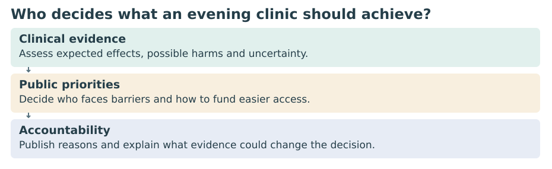

# ENS BCPST — Anglais 2026 · Corrigé guidé

*Corrigé rédigé par IA, non officiel.*

**Rédaction** · Modèle : OpenAI Codex (famille GPT-6) · Effort de raisonnement : non renseigné · Mode de vitesse : non renseigné.

**Révision** · Modèle : OpenAI Codex (famille GPT-6) · Effort de raisonnement : non renseigné · Mode de vitesse : non renseigné.

[Sujet officiel](https://www.ens.psl.eu/sites/default/files/261243_bcpst_lve_2026.pdf#page=6)

L’épreuve d’anglais dure trois heures. La synthèse de trois documents et l’expression personnelle valent chacune 8 points ; la version en vaut 4. Les deux productions anglaises demandent de 225 à 275 mots.

## Document synthesis

> [!INDICATION]
> Le texte 1 traite d’une flambée de rougeole et de la parole publique en décembre 2025 ; le texte 2 explique en janvier 2026 le passage de 17 à 11 maladies dans les recommandations universelles. La carte du texte 3 porte sur les dérogations scolaires non médicales. Relier leurs enjeux tout en respectant les échelles, les dates et les objets.

The American childhood vaccination debate combines three issues: the scope of federal recommendations, their public credibility and the rules families encounter when children start school. The documents show why changing guidance can have different consequences across communities.

In January 2026, federal officials narrowed routine recommendations from seventeen diseases to eleven after a presidential request to compare American practice with that of other wealthy countries (doc. 2). Specialists question whether this comparison allows for gaps in primary care and insurance. Reaching selected patients requires knowing who needs protection and being able to contact them. Continued coverage was promised, but the article questions whether access will remain dependable.

Public messages were already contested. A December 2025 report described an organisation formerly led by the health secretary spreading misleading claims about measles during outbreaks that predominantly affected unvaccinated children in South Carolina (doc. 1). The secretary both supported vaccination and questioned its testing. Meanwhile, researchers found far fewer official social media messages about measles than in earlier comparable periods. This episode illustrates problems of confidence preceding the January decision, which concerned other diseases.

States also differ over school entry requirements. California allows neither of the two nonmedical grounds for exemption mapped by NBC, whereas Oregon allows both personal and religious exemptions (doc. 3). The map describes rules, without measuring uptake or case numbers. Taken together, the sources suggest that uncertain access, contradictory messages and different exemption policies may leave children unevenly protected.

*239 words.*

## Personal essay

> [!INDICATION]
> Confronter le rôle des preuves à celui des arbitrages publics. L’exemple d’une permanence de vaccination en soirée est imaginaire. Il permet d’expliquer quelles décisions exigent des données cliniques et quelles décisions exigent que les habitants puissent se faire entendre.

A public health authority must decide both what the evidence shows and what it owes people affected by its decision. Those questions call for different kinds of scrutiny. Politicians should explain whose interests a policy serves, while independent specialists should assess whether the proposed measure can achieve its stated purpose.

Imagine that a school district wants more families to attend an existing vaccination clinic. Medical advisers can explain the expected benefits, the risks being monitored and the limits of the available evidence. They cannot discover from clinical results alone whether local parents can leave work on a Tuesday afternoon. A decision to fund an evening clinic involves priorities about time, money and equal access. Parents and elected representatives have something important to contribute there.

Participation also brings obligations. A representative who claims that a vaccine causes serious harm should make the underlying evidence available for independent examination. A packed meeting or a popular video can reveal genuine anxiety without establishing its medical cause. Equally, specialists who dismiss every objection as ignorance may overlook practical barriers and lose the confidence required to address them.

I would ask decision makers to publish their reasons, identify disagreements among advisers and name the observations that could prompt a revision. Families could then contest an unfair arrangement without having to dispute a scientific finding, and experts could revise an estimate without being accused of changing political sides. Democratic judgement belongs in the choice of goals and in the distribution of burdens. Evidence must remain open to challenge by methods capable of testing it.

*258 words.*

## Traduction en français

> [!INDICATION]
> Rattacher la relative « that often lacks » à la population. Le mot « other » reprend un argument antérieur. Conserver la comparaison entre les situations sanitaires et la conséquence présentée dans le passage.

Selon les spécialistes, les décisions fondées sur une comparaison avec d’autres pays à revenu élevé présentent une autre difficulté : les États-Unis ont une population beaucoup plus nombreuse, en moins bonne santé et qui, souvent, n’a pas accès aux soins de premier recours. Au Danemark et au Japon, la population est en meilleure santé, les systèmes de soins, les dispositifs de surveillance et de dépistage ainsi que le soutien social sont plus solides. Ces pays sont donc moins tributaires de la vaccination.
