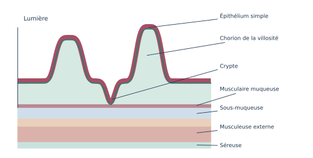
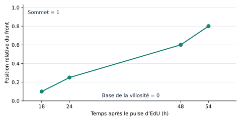
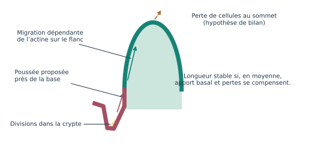
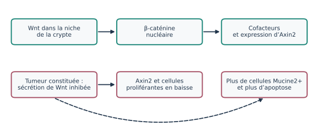
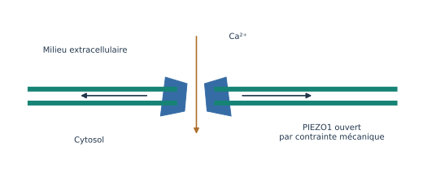
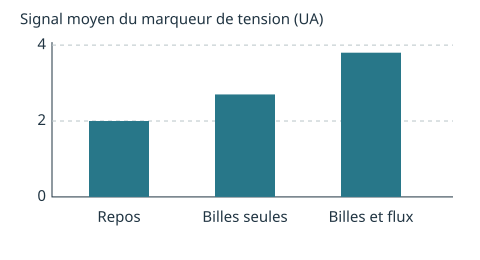
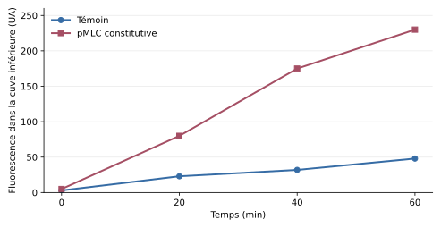
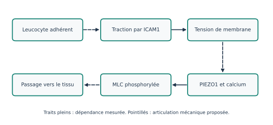

# ENS BCPST — Biologie 2026 · Corrigé guidé

*Corrigé rédigé par IA, non officiel.*

**Rédaction** · modèle exact non renseigné (famille GPT-6) · effort non renseigné · vitesse non renseignée

L’épreuve dure six heures. Les durées conseillées sont de deux heures pour la synthèse, deux heures et quart pour l’intestin et une heure trois quarts pour l’extravasation. Pour chaque document, repérer d’abord la population observée, le témoin et la grandeur portée en ordonnée.

## Partie A · Synthèse sur les tissus épithéliaux des Métazoaires

### A · Une surface cellulaire qui règle les relations entre compartiments

> [!INDICATION]
> Partir de deux contraintes physiques opposées, protéger une surface exposée et échanger vite à travers une paroi mince. Rattacher chaque exemple à une structure, un mécanisme et une conséquence pour l’animal.

**Introduction.** Dans une alvéole pulmonaire, quelques dixièmes de micromètre séparent le gaz du sang. À la surface de la peau, les cellules empilées opposent au contraire une forte résistance aux pertes d’eau. Dans les deux cas, des cellules jointives forment un épithélium. Elles délimitent un compartiment et présentent des domaines apical, latéral et basal distincts. Les endothéliums, inclus ici, tapissent la lumière des vaisseaux. Comment un tel feuillet peut-il simultanément protéger les compartiments, organiser des échanges orientés et adapter leur intensité aux besoins de l’organisme ?

**I. Une frontière cohérente, dont l’architecture dépend des contraintes.** Sur une coupe d’intestin, l’apex des cellules regarde la lumière, leurs faces latérales se touchent, leur face basale adhère à une lame basale. Cette matrice sécrétée, riche notamment en laminines et en collagène IV, solidarise l’épithélium et le tissu sous-jacent. La polarité distribue différemment transporteurs et jonctions. Chez les Vertébrés, les jonctions serrées limitent et sélectionnent le passage entre cellules. Les jonctions adhérentes transmettent les tensions au réseau d’actine, les desmosomes relient des réseaux de filaments intermédiaires. Un feuillet peut ainsi plier sans que ses cellules se dissocient. Chez les Insectes, les jonctions septées participent à l’étanchéité des épithéliums.

L’épiderme des Mammifères reçoit des contraintes mécaniques répétées. Ses kératinocytes basaux prolifèrent, leurs descendants se différencient vers la surface et la couche cornée, associée aux lipides extracellulaires, limite abrasion et dessiccation. La stratification est adaptée à ces fonctions. L’épiderme des Insectes sécrète une cuticule extracellulaire qui intervient aussi dans le soutien et doit être renouvelée à la mue. Une barrière efficace peut donc résulter de l’empilement des cellules ou des produits qu’elles déposent.

**II. Une interface qui sélectionne, amplifie et dirige les échanges.** Selon la loi de Fick, à différence de concentration donnée, le flux diffusif augmente avec l’aire d’échange et diminue avec l’épaisseur traversée. L’épithélium pavimenteux des alvéoles présente une grande surface et de très minces prolongements de pneumocytes de type I. Le gaz traverse aussi les lames basales et l’endothélium capillaire. Ventilation et perfusion entretiennent les gradients. Chez un poisson, les lamelles branchiales rapprochent eau et sang ; leurs circulations en sens opposés entretiennent le gradient d’oxygène le long de l’échangeur.

L’intestin assure un transport orienté. Les villosités sont des replis tissulaires vascularisés ; les microvillosités sont des prolongements apicaux de chaque entérocyte. Toutes deux augmentent la surface disponible. Le cotransport apical sodium-glucose exploite le gradient de sodium entretenu par la pompe sodium-potassium basolatérale. Le glucose sort par diffusion facilitée du côté basal, puis gagne les capillaires. Dans le néphron, la réabsorption depuis le filtrat mobilise aussi des épithéliums polarisés. L’hormone antidiurétique augmente la perméabilité à l’eau du canal collecteur en favorisant l’insertion d’aquaporines apicales. Une même organisation autorise un réglage fin du bilan hydrique.

**III. Des interfaces actives, entretenues et coordonnées.** Les cellules caliciformes libèrent du mucus dans la lumière des voies aériennes. Les battements coordonnés des cils déplacent le mucus et les particules vers le pharynx. Une glande exocrine conserve ainsi une voie de sécrétion vers une surface ou une lumière ; les cellules endocrines libèrent leurs produits du côté interstitiel, d’où ils gagnent la circulation. Dans l’alvéole, le surfactant des pneumocytes de type II réduit la tension superficielle. Dans la cochlée, un épithélium sensoriel transforme la déflexion de faisceaux de stéréocils en signal électrique. L’épithélium peut même contribuer directement au mouvement : chez l’hydre, les prolongements contractiles de cellules épithélio-musculaires agissent sur la forme du corps.

L’intégrité d’une interface se maintient malgré le remplacement de ses cellules. Dans l’intestin grêle, les divisions ont lieu principalement dans les cryptes ; des descendants se différencient, progressent sur les villosités et sont éliminés près de leur sommet. L’endothélium vasculaire illustre une autre plasticité : dans un territoire inflammatoire, des contacts d’adhérence avec les leucocytes et un remaniement local du cytosquelette permettent leur passage vers le tissu. En parallèle, les jonctions assurent la cohésion du reste du vaisseau.

**Conclusion.** L’épaisseur et la surface règlent le coût physique du franchissement ; les jonctions, la polarité et la spécialisation des cellules en règlent la voie et le sens. Du renouvellement d’une crypte à la réponse d’un capillaire, l’épithélium adapte localement ses propriétés tout en préservant l’organisation de l’animal en compartiments.

## Partie B · Renouvellement de l’épithélium intestinal

### B1 · Lire une coupe de la paroi intestinale

> [!INDICATION]
> Retracer au crayon le bord au contact de la lumière. Un repli qui fait saillie contient un axe conjonctif, une glande épithéliale descend sous l’ouverture de ce repli.

De la lumière vers l’extérieur, la muqueuse se soulève en villosités et s’invagine en cryptes. Chaque villosité présente un épithélium simple de cellules hautes autour d’un axe conjonctif de chorion, reconnaissable à sa teinte bleutée au trichrome. Les cryptes s’ouvrent entre les villosités. En profondeur viennent la musculaire muqueuse qui limite la muqueuse, la sous-muqueuse conjonctive, la musculeuse externe et le revêtement externe. Dans la musculeuse du grêle, les couches de muscle lisse sont en règle générale circulaire interne et longitudinale externe. Le schéma situe la lame basale à l’interface épithélium–chorion ; son épaisseur et les microvillosités individuelles échappent à la résolution de la planche. Les différents grossissements montrent les mêmes niveaux d’organisation.

### B2 · Localiser les cellules qui répliquent leur ADN

> [!INDICATION]
> Attribuer une information à chaque canal. Quelle molécule comporte normalement la thymidine ? La fenêtre de disponibilité de son analogue est courte.

**a.** Préserver la morphologie par fixation, réaliser une coupe, rendre les épitopes intracellulaires accessibles si nécessaire, puis limiter l’adsorption non spécifique. Incuber avec l’anticorps spécifique, rincer et détecter le fluorophore. Ici l’anticorps anti-E-cadhérine est directement fluorescent. En marquage indirect, un anticorps secondaire fluorescent reconnaît le primaire. Contre-colorer les noyaux au DAPI et observer chaque canal puis leur superposition. Une coupe témoin sans anticorps spécifique et des réglages identiques renseignent sur le bruit de fond.

**b.** L’EdU, analogue d’un nucléoside de l’ADN, est incorporé dans l’ADN en cours de synthèse pendant sa courte disponibilité. En tissu prolifératif, il identifie surtout les cellules en phase S lors du pulse. Le marquage persiste dans l’ADN des descendants et peut se diluer après plusieurs divisions.

**c.** Le DAPI montre les noyaux ; l’E-cadhérine dessine les contacts latéraux. À deux heures, certains noyaux de l’épithélium des cryptes C contiennent de l’EdU ; d’autres sont négatifs. Les villosités V ne présentent pas de signal détectable. Des cellules de la crypte se trouvaient donc en phase S au moment de l’injection. Une cellule négative a pu se trouver dans une autre phase du cycle.

**d.** Les cellules de la crypte fournissent-elles les cellules des villosités ? Quelle trajectoire suivent leurs descendantes, à quelle vitesse et sous l’action de quelles forces ? Que deviennent les cellules au sommet si la villosité conserve sa taille ?

### B3 · Suivre une cohorte de cellules marquées

> [!INDICATION]
> Comparer des fractions de hauteur sur des villosités entières ; garder la même définition du front pour tous les temps. La couleur marque une cohorte, y compris après division.

**a.** L’EdU libre disparaît bien avant 18 h. Suivre la position de l’ADN marqué après ce pulse renseigne sur le devenir de la cohorte initiale et de sa descendance.

**b.** Pour chaque villosité entière, prendre pour origine la limite jaune crypte–villosité, pour extrémité le sommet vert, et suivre le grand axe. Diviser la distance de l’origine au front des noyaux magenta par la longueur correspondante de la villosité. Le rapport vaut 0 à la base, 1 au sommet. En définissant le front par la limite de la bande de cellules marquées et en écartant les coupes tronquées, une lecture arrondie de la figure 3 donne environ 0,1 à 18 h, 0,25 à 24 h, 0,6 à 48 h et 0,8 à 54 h. La délimitation d’un front irrégulier et l’orientation des coupes expliquent une partie des écarts de lecture. Représenter ces estimations en fonction du temps. La figure 4C présente séparément des moyennes obtenues sur plusieurs souris.

**c.** Au cours des 36 heures séparant les première et dernière images, le front passe du voisinage du pied à la partie supérieure de la villosité. L’épithélium villositaire reçoit donc des cellules issues du compartiment prolifératif des cryptes. Cette série de coupes mesure la progression d’une population marquée ; des manipulations complémentaires sont nécessaires pour identifier la force motrice.

### B4 · Perturber la prolifération après le marquage

> [!INDICATION]
> Distinguer l’injection simultanée, qui teste l’effet du traitement sur la réplication, de l’injection différée, qui teste le déplacement d’une cohorte déjà marquée.

**a.** Avec l’EdU seul, des noyaux de la crypte sont marqués et on compte environ cinq à six cellules en mitose par crypte sur la figure 4B. Lors de la coadministration d’hydroxyurée, le signal EdU et le nombre de mitoses deviennent pratiquement nuls. Le blocage de la réplication empêche l’incorporation et, au cours des six heures suivantes, réduit fortement l’entrée en mitose. Les contacts épithéliaux et les noyaux restent visibles.

**b.** L’administration tardive d’hydroxyurée après le pulse conserve le marquage préalable. Entre 18 et 24 h, le front passe d’environ 0,15 à 0,25 en condition témoin et reste proche du niveau initial sous hydroxyurée (environ 0,18). Entre 48 et 54 h, il passe d’environ 0,5 à 0,65–0,70 dans les deux conditions.

**c.** Les divisions dans la crypte contribuent au déplacement précoce, par exemple en poussant les cellules nouvellement produites vers la sortie. À mi-hauteur, la progression continue pendant le blocage : un autre mécanisme, telle une migration active, peut alors prendre le relais. L’expérience ne mesure aucune force et n’établit pas que le mécanisme soit exclusivement passif en bas.

### B5 · Tester la contribution de l’actine

> [!INDICATION]
> Repérer la face qui touche la lame basale. À quel moment l’effet de l’inhibiteur diverge-t-il de celui du témoin ?

**a.** En haut de la villosité, l’actine est abondante du côté apical. Le zoom basal montre des prolongements riches en actine au contact de la lame basale repérée par le nidogène-1. Leur position est compatible avec une prise d’appui sur la matrice.

**b.** Dans la fenêtre 18–24 h, les fronts atteignent des niveaux voisins avec ou sans inhibition de la polymérisation de l’actine, autour de 0,23–0,25. Dans la fenêtre 48–54 h, le témoin monte d’environ 0,5 à 0,67 ; le front traité reste près de 0,5.

**c.** Les cellules peuvent émettre des protrusions basales, former des adhérences transitoires à la matrice et transmettre une traction par le cytosquelette. Le déplacement collectif est compatible avec le maintien des jonctions latérales. La sensibilité tardive à l’inhibiteur appuie un rôle de la dynamique d’actine ; une image fixe ne permet pas de voir le cycle de traction.

### B6 · Conserver la longueur malgré le renouvellement

> [!INDICATION]
> Écrire un bilan du nombre de cellules pour une structure stable. Une densité par unité de longueur est-elle suffisante pour identifier une élimination ?

**a.** Les villosités mesurent en moyenne environ 250 à 260 micromètres à 4 comme à 21 mois, avec une dispersion qui se recouvre. Une dimension moyenne presque constante, malgré la production continue, suppose un bilan durablement proche de zéro entre entrées et pertes.

**b.** La densité linéaire est élevée près de la base (environ 0,26 cellule par micromètre), descend vers 0,12 autour des deux tiers de la hauteur, puis remonte vers 0,20 au sommet. Les contours d’E-cadhérine et l’espacement des noyaux varient dans le même sens. Densité linéaire, forme cellulaire et courbure de la coupe doivent être distinguées.

**c.** Le resserrement vers le sommet pourrait favoriser l’extrusion de cellules vers la lumière, compensant l’apport basal. La densité seule n’établit ni l’extrusion ni le moment éventuel de l’apoptose.

**d.** Suivre en imagerie temporelle les contours membranaires et les noyaux le long de villosités. Compter les sorties vers la lumière par unité de longueur et de temps, comparer base, milieu et sommet sur plusieurs villosités et animaux. Un marqueur de l’apoptose renseignerait sur la chronologie par rapport à la sortie. Une extrusion préférentielle au sommet, associée à l’encombrement local et à un bilan de flux proche de zéro, appuierait l’hypothèse.

### B7 · Relier production, déplacement et perte

> [!INDICATION]
> Ordonner les preuves sur un axe crypte–sommet. Utiliser une flèche différente pour un déplacement mesuré et un mécanisme encore proposé.

Tracer la crypte et prolonger l’épithélium jusqu’au sommet de la villosité. Placer la phase S et les divisions dans la crypte, la progression des descendants le long de la lame basale et une perte proposée au sommet. Distinguer deux fenêtres expérimentales : l’hydroxyurée réduit le déplacement près de la crypte, tandis que l’inhibition de l’actine bloque la progression tardive sur la villosité. La compensation des entrées et sorties explique la longueur moyenne stable.

### B8 · Distinguer les deux fonctions de la β-caténine

> [!INDICATION]
> Lire le tableau colonne par colonne à J2 puis à J4. Une cellule morte et une cellule vivante sans expression détectable correspondent à deux observations différentes.

**a.** Détecter des ARN messagers par hybridation in situ pour localiser les cellules exprimant le gène, ou les quantifier par RT-qPCR rapportée à un témoin de référence. Un anticorps spécifique documente la présence de la protéine correspondante. Ces mesures portent sur des étapes différentes de l’expression.

**b.** À J2, le témoin prolifère, exprime Axin2 et présente peu ou pas de marqueurs sécrétoires. La délétion C-terminale supprime prolifération et Axin2, tandis que LyzC et Mucine2 apparaissent. La mutation D164A, qui perturbe le recrutement N-terminal, donne au contraire une prolifération et un signal Axin2 forts, sans marqueurs sécrétoires. Le recrutement C-terminal soutient précocement l’état prolifératif ; le recrutement N-terminal en modère l’intensité dans ces conditions.

**c.** À J4, la culture témoin conserve des cellules proliférantes et exprimant Axin2 tout en produisant des cellules sécrétrices. Les cellules ΔC sont mortes ; les marqueurs de J4 ne sont donc pas mesurables. Chez D164A, prolifération et Axin2 disparaissent et les marqueurs sécrétoires deviennent forts. La réponse élevée à J2 ne suffit pas à maintenir durablement la population souche. Les résultats portent sur l’équilibre de la culture, sans prouver que chaque cellule témoin exprime simultanément tous les marqueurs.

### B9 · Évaluer l’effet de l’environnement intestinal

> [!INDICATION]
> Lire ce que comptent exactement les axes. Vérifier quelles mesures font défaut chez les souris axéniques avant de comparer les trois conditions.

**a.** L’antibiothérapie perturbe un microbiote déjà présent ; les souris axéniques se sont développées sans microbiote. Ces situations interrogent respectivement l’effet d’une perturbation actuelle et celui d’une absence prolongée.

**b.** Après antibiothérapie, le nombre moyen de cellules à β-caténine nucléaire par zone C passe d’environ 1,3 à 0,6. Cette mesure manque chez les souris axéniques. Le nombre de cellules exprimant Axin2 par zone C vaut environ 30, 20 et 15 à 16 dans l’ordre témoin, antibiotiques, axéniques ; pour LyzC on compte environ 1, 0,6 et 0,5 à 0,55 cellule positive par zone C. Le microbiote est associé à une activité plus élevée de la voie et au maintien de l’expression du marqueur sécrétoire. Des moyennes d’un tissu hétérogène ne suffisent pas à imposer une relation de cause à effet directe entre les deux gènes.

**c.** Comparer des souris de même âge, alimentation et fond génétique ; mesurer la β-caténine nucléaire dans le groupe axénique. Une recolonisation par le microbiote témoin testerait la réversibilité. Traiter en parallèle un groupe axénique par les antibiotiques permettrait d’évaluer un effet direct du traitement sur l’hôte.

### B10 · Interpréter une inhibition de Wnt dans une tumeur

> [!INDICATION]
> Confronter une observation sur coupe à une perturbation ciblée. Décrire les trois variations en points de pourcentage avant de proposer une interprétation.

**a.** Au même réglage, le signal Wnt est abondant dans la coupe tumorale et faible ou indétectable dans le côlon sain. La fluorescence localise une accumulation de protéine ; elle n’identifie pas à elle seule les cellules qui la produisent.

**b.** L’inhibition spécifique de la sécrétion épithéliale de Wnt teste si cette source entretient la prolifération et la survie de la tumeur au détriment de la différenciation sécrétrice.

**c.** Quand cette sécrétion est inhibée, l’apoptose passe de moins de 1 % à environ 4 %, la proportion de cellules Mucine2 positives d’environ 4 % à 24 %, et la prolifération d’environ 13 % à 1 %. Axin2 diminue. Dans cette tumeur constituée, le Wnt épithélial favorise donc le maintien d’un compartiment proliférant et limite la différenciation sécrétrice. Ces données ne datent pas l’événement à l’origine de la tumeur.

### B11 · Articuler niche, prolifération et différenciation

> [!INDICATION]
> Tracer deux contextes, crypte normale et tumeur. Distinguer la source du signal, le relais nucléaire et les caractères cellulaires mesurés.

Dans une crypte, la réception de Wnt stabilise la β-caténine, permet son accumulation nucléaire et le recrutement de cofacteurs qui règlent l’expression de gènes cibles, dont Axin2. Les interactions C-terminales soutiennent l’état prolifératif, les N-terminales participent à son équilibre dans le temps. Le microbiote contribue à cet équilibre, par une voie intermédiaire non résolue. En contexte tumoral, le Wnt épithélial local soutient la survie et la prolifération ; sa suppression expérimentale augmente la différenciation sécrétrice et l’apoptose. Distinguer les observations en culture de la perturbation effectuée dans la tumeur du côlon.

## Partie C · Extravasation des cellules immunitaires

### C1 · Interpréter le crible endothélial

> [!INDICATION]
> Traduire les deux seuils logarithmiques. Dans quelle population le gène est-il inhibé, et quel type de cellule est ensuite compté sous la monocouche ?

**a.** Le dispositif reproduit le passage de leucocytes depuis le compartiment sanguin à travers un endothélium activé par un signal inflammatoire. Le nombre retrouvé en bas intègre adhésion et franchissement. La cuve statique ne reproduit ni l’écoulement sanguin ni toute la structure d’une veinule.

**b.** L’axe de la figure 2B donne un rapport au témoin sans siARN ; la légende décrit comme contrôle un siARN ne ciblant aucun gène. Le siARN témoin n° 20 donne bien un rapport voisin de 1. L’axe est logarithmique ; les seuils donnés valent environ 0,032 et 32. Sous le seuil bas, les siARN 1 à 4 ciblent Esam, Alcam, Icam1 et Piezo1. Leur inhibition réduit le passage et désigne des acteurs normalement facilitateurs. Au-dessus du seuil haut, les siARN 36 à 38 ciblent Ptprb, Tek et Cdh5 ; leur inhibition augmente le passage, ce qui suggère un rôle de frein. Le point 35, voisin de la limite supérieure, ne permet pas de conclure à un dépassement franc. Un rapport situé entre les limites ne suffit pas à désigner un candidat selon la règle du sujet.

**c.** La présence d’ICAM1 à l’interface avec les leucocytes concorde avec l’effet de son inhibition. ESAM et ALCAM peuvent contribuer au passage au niveau des jonctions. Une jonction stabilisée notamment par la cadhérine 5 peut à l’inverse limiter ce passage. Les protéines des jonctions peuvent donc avoir des effets de sens différent. PIEZO1 ressort du crible alors qu’il n’apparaissait pas sur le schéma de départ ; le crible seul ne situe pas son action dans une phase précise.

### C2 · Distinguer transmigration et perméabilité basale

> [!INDICATION]
> À chaque panneau correspond un contrôle différent : charge protéique, localisation, phase du passage ou perméabilité en l’absence de leucocytes.

**a.** La bande PIEZO1 est intense dans les deux témoins et très faible ou indétectable après siPiezo1 et dans l’endothélium Piezo1-KO. La bande GAPDH d’intensité comparable sert de contrôle de charge. Les deux interventions réduisent la quantité de protéine détectable.

**b.** Après inflammation locale, des cellules immunitaires cyan se trouvent à distance du contour vasculaire magenta chez le témoin. Chez le mutant, beaucoup restent regroupées au voisinage immédiat ou à l’intérieur des profils vasculaires. Une sortie déficiente l’expliquerait. Une coupe fixe ne suffit pas à distinguer un défaut de recrutement d’un défaut de franchissement.

**c.** Les proportions normalisées de roulement et d’arrêt restent voisines de 1 après siPiezo1. La transmigration tombe à environ 0,33 du témoin. La protéine endothéliale contribue donc principalement à la troisième étape dans cet essai.

**d.** Le dextran extracellulaire teste la perméabilité de la monocouche sans leucocytes et l’hypothèse d’un changement général de son étanchéité. À 1 h, la cuve inférieure atteint environ 80 unités de fluorescence (UF) sans cellules et 30–35 UF avec l’une ou l’autre monocouche. À 2 h, les valeurs correspondantes sont voisines de 100 et de 35–40. Les deux monocouches font barrière et leurs dispersions se recouvrent. Le défaut de passage des leucocytes peut ainsi porter sur une ouverture régulée, sans variation basale nette dans ce test.

### C3 · Établir la nature du signal porté par PIEZO1

> [!INDICATION]
> Comparer liposome reconstitué et cellules intactes. Quel résultat établit un courant ionique ? Lequel le relie à la déformation membranaire ?

**a.** Une partie du marquage PIEZO1 se superpose au marqueur de membrane en périphérie de la cellule ; une partie du signal est interne. Un canal membranaire est compatible avec cette superposition partielle. Une projection de fluorescence ne distingue pas, à elle seule, des membranes très proches.

**b.** Réaliser des coupes optiques et une reconstruction orthogonale, avec des marqueurs de membrane plasmique et de compartiments internes. Mesurer la coïncidence sur des profils traversant la périphérie et comparer au témoin sans anticorps spécifique. Une localisation par immunomarquage à l’or en microscopie électronique préciserait de quel côté de la périphérie se situent les particules d’or.

**c.** Dans un liposome contenant PIEZO1, le saut de tension est suivi de transitions discontinues entre niveaux de courant, de l’ordre de la dizaine de picoampères : elles traduisent des ouvertures et fermetures de canal. À concentrations externes comparables, l’excès de courant sur le liposome témoin est d’environ 10 pA pour le calcium, 5–6 pour sodium et potassium, 2–3 pour magnésium et proche de zéro pour chlorure. PIEZO1 isolée assure donc une conduction cationique, avec la plus grande réponse pour le calcium dans ces conditions. Une série d’amplitudes mesurées à un potentiel ne fournit pas tous les rapports de perméabilité.

**d.** L’histamine provoque un courant transitoire comparable chez siCtrl et siPiezo1. Le courant induit par l’indentation augmente en amplitude avec la déformation chez le témoin, atteint plusieurs nanoampères puis s’atténue malgré le maintien de la pression. Il est presque supprimé sous siPiezo1. Le courant mécanosensible dépend de PIEZO1 dans ces cellules ; la réponse testée à l’histamine subsiste par une autre voie.

### C4 · Schématiser le canal et la réponse mécanique

> [!INDICATION]
> Indiquer les deux faces de la membrane, puis distinguer la grandeur mécanique imposée du courant effectivement enregistré.

Dessiner une membrane avec un extérieur et un cytosol identifiés. Relier la déformation de la membrane à l’ouverture de PIEZO1 et à un flux cationique selon le gradient électrochimique, qui peut faire entrer du calcium aux conditions physiologiques. Faire apparaître séparément la réponse à l’histamine, conservée sous siPiezo1. Les enregistrements en liposome établissent l’activité de canal ; l’indentation et le siARN établissent la dépendance du courant mécanique dans la cellule.

### C5 · Séparer les effets du flux et du contact

> [!INDICATION]
> Organiser les facteurs en trois conditions, flux seul, leucocytes seuls et combinaison. Comparer ensuite le siARN ciblé à son témoin.

**a.** La pompe reproduit un écoulement le long de la face luminale d’un endothélium. Elle permet d’appliquer le cisaillement du liquide, d’apporter des leucocytes, puis de modifier indépendamment ces deux paramètres.

**b.** Dans la figure 5B, le flux seul et les leucocytes seuls maintiennent le calcium proche de sa ligne de base, vers 100 unités arbitraires. Ensemble, ils provoquent des pics transitoires, variables d’une expérience à l’autre, jusqu’à environ 150–160. Avec flux et cellules, les témoins siCtrl de 5C présentent aussi des pics nets, alors que les cellules siPiezo1 restent proches de la valeur de départ. Une cellule adhérente soumise au flux pourrait transmettre une traction à la membrane endothéliale, ouvrir PIEZO1 et provoquer une entrée de calcium. La fluorescence reflète le calcium cytosolique total et ne distingue pas à elle seule une entrée directe d’une libération secondaire des réserves.

### C6 · Identifier la liaison qui transmet la contrainte

> [!INDICATION]
> Les billes engagent une molécule précise de l’endothélium. Juxtaposer les effets sur le calcium et ceux sur la tension pour proposer un enchaînement.

**a.** Sous flux, les billes anti-ICAM1 déclenchent un premier pic calcique vers 120 unités puis des oscillations plus petites en siCtrl, contre une ligne de base voisine de 100. Le signal disparaît presque en siIcam1 ou siPiezo1. Dans ce système, engager ICAM1 par une bille mime une partie du contact leucocytaire ; ICAM1 et PIEZO1 endothéliales sont nécessaires à la réponse mesurée.

**b.** Le flux seul modifie peu le signal de tension. Les billes seules l’augmentent modérément et la combinaison flux et billes l’augmente davantage. Le maximum local atteint environ 4,2 unités dans l’image combinée ; la moyenne sur 30 cellules passe d’environ 2 au repos à 2,7 avec billes et 3,8 avec flux et billes. Avec cytochalasine D, ces moyennes restent proches de 2. La polymérisation d’actine contribue à l’augmentation de tension.

**c.** Sous flux, une bille liée à ICAM1 exerce une traction sur un point d’ancrage. Une liaison fonctionnelle d’ICAM1 au cortex d’actine transmettrait et concentrerait cette contrainte. L’étirement local pourrait ouvrir PIEZO1, puis élever le calcium. La dépendance aux deux protéines et à l’actine est mesurée ; leur association physique directe et l’ordre exact de tous les intermédiaires restent des hypothèses.

### C7 · Relier la signalisation à la contraction de la monocouche

> [!INDICATION]
> Comparer pMLC à MLC totale, puis suivre la pente de la fluorescence. Les conséquences d’une phosphorylation constitutive portent sur le passage de dextran.

**a.** Les bandes de MLC totale et de GAPDH sont comparables. Chez siCtrl, pMLC augmente avec les billes et davantage avec billes et flux. Ce signal devient faible sous siIcam1, siPiezo1 ou, dans la condition combinée, avec un chélateur de calcium. La variation reflète une modification de l’état de phosphorylation de la chaîne légère, dépendante du calcium disponible.

**b.** Lire les conditions sur les barres du panneau 7B : noir témoin, rouge cytochalasine D, bleu blebbistatine. Leur légende graphique et le texte expérimental concordent ; la légende rédigée du panneau mentionne par erreur la condition constitutive présentée en C. Le rapport pMLC/GAPDH du témoin passe d’environ 1 au repos à 3 avec billes puis à plus de 6 avec billes et flux. Les deux inhibitions ramènent le rapport près de 1. Dans les conditions et selon l’interprétation de l’énoncé, l’actine polymérisée et l’activité de l’appareil contractile participent à la réponse ; le résultat ne démontre pas un contact entre actine et kinase.

**c.** À 20, 40 et 60 min, le dextran traverse plus vite la monocouche à pMLC constitutive ; à 60 min on lit environ 230 unités contre 50 chez le témoin. Maintenir cet état suffit à augmenter la perméabilité de la monocouche en l’absence de leucocytes. Une tension actomyosine accrue pourrait écarter localement les jonctions. La traversée d’un polymère et la transmigration d’une cellule restent deux mesures distinctes.

### C8 · Expliquer le passage du leucocyte

> [!INDICATION]
> Pour chaque flèche du schéma, retrouver la figure qui documente sa dépendance. Repérer les liens dont les auteurs n’ont pas directement filmé la dynamique.

Le leucocyte roule puis s’arrête par adhésion à l’endothélium activé. Le couple CD11a/b leucocytaire–ICAM1 endothéliale transmettrait sous flux une traction au cortex d’actine. L’augmentation de tension membranaire (fig. 6B–C) et le rôle de PIEZO1 dans le courant mécanosensible (fig. 4D) rendent compte du pic calcique, perdu sous siPiezo1 (fig. 5C et 6A). Le calcium favorise alors, directement ou par une kinase intermédiaire, la phosphorylation de MLC (fig. 7A). La myosine ainsi activée peut exercer avec l’actine une tension sur les jonctions. L’augmentation de perméabilité sous pMLC constitutive (fig. 7C) soutient le modèle d’une ouverture locale qui autorise la diapédèse. La dépendance fonctionnelle de la troisième étape envers PIEZO1 est étayée par la figure 3C, tandis que la figure 3D montre une perméabilité basale au dextran comparable. La transmission mécanique exacte et le mouvement des jonctions restent à observer directement. La fermeture après le passage rétablirait la continuité du vaisseau.

