# ENS BCPST — Chimie 2026 · Corrigé partiel guidé

*Corrigé rédigé par IA, non officiel.*

**Rédaction** · modèle exact non renseigné (famille GPT-6) · effort non renseigné · vitesse non renseignée

**Révision (tour 1)** · GPT-6.2 Astra Ultra · vitesse non renseignée

**Révision (tour 2)** · GPT-6.2 Astra Ultra · vitesse non renseignée

## Présentation du sujet

L’épreuve de quatre heures part d’une molécule de corail pour étudier la stéréochimie d’un cycle à neuf chaînons. Sa seconde moitié examine les indicateurs de pollution d’une eau et la cinétique de dégradation de nanoparticules d’argent.

**Couverture.** 44 questions intégralement traitées, 0 partiellement et 9 hors couverture. Le dossier sur l’eau (Q19–53) est complet. Les Q1, 2, 5–8, 10, 13 et 16 sont également traitées. La Q13 explique la formation indépendante du 1,3-dithiane à partir d’un carbonyle et d’un dithiol ; les étapes de construction et d’assemblage du produit naturel restent hors couverture.

La numérotation des molécules, des atomes et des figures citées dans les solutions suit l’énoncé. Les lettres DCO et DBO₅ désignent les demandes chimique et biologique en dioxygène, exprimées en masse de dioxygène par litre d’eau initiale.

## I — Stéréochimie de la waixenicine A

La molécule possède deux cycles accolés. Repérer les deux hydrogènes de la jonction et les doubles liaisons dont la géométrie peut varier.

### Question 1

> [!INDICATION]
> Distinguer un carbone tétraédrique à quatre substituants différents, une double liaison à géométrie variable et une géométrie imposée par un petit cycle.

#### Solution

La figure 1 porte **quatre carbones asymétriques**. Ce sont les deux carbones de jonction des cycles, le carbone acétal portant OAc dans le cycle oxygéné et le carbone porteur de OAc de la chaîne latérale. On relève aussi **deux doubles liaisons à géométrie variable** : celle de la chaîne latérale et celle du cycle à neuf chaînons. Le méthylène exocyclique $\mathrm{=CH_2}$ porte deux hydrogènes identiques. La double liaison du cycle oxygéné à six chaînons a une géométrie contrainte. On compte ainsi **six éléments configuratifs** dans ce décompte usuel. La possibilité d’orientations conformationnelles distinctes du cyclononène trans est examinée à la question 16.

### Question 2

> [!INDICATION]
> Comparer les listes des voisins des trois carbones directement liés au carbone étoilé. Le H en coin plein est orienté vers le lecteur.

> [!INDICATION]
> Les substituants de la deuxième couche de chaque ligand s’ordonnent par numéros atomiques décroissants.

#### Solution

Les priorités de Cahn–Ingold–Prelog se départagent dès la deuxième couche. Le carbone acétal supérieur est lié à $(\mathrm O,\mathrm O,\mathrm H)$ et vient en premier. Le carbone vinylique de gauche fournit $(\mathrm C,\mathrm C,\mathrm C)$ en comptant deux fois le partenaire de la liaison $\mathrm{C=CH_2}$. L’autre carbone de jonction, à droite, fournit $(\mathrm C,\mathrm C,\mathrm H)$. Le quatrième groupe est H. L’ordre 1, 2, 3 est antihoraire sur la planche et H pointe vers le lecteur. En inversant la lecture, on obtient **$R$**.

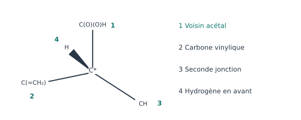

## I.1 — Chromatographie, spectroscopie et structure des molécules

### Question 5

> [!INDICATION]
> La phase stationnaire de la colonne contient elle-même des centres stéréogènes.

#### Solution

Le polysaccharide fonctionnalisé est **chiral**. Les associations réversibles de 5-R et de 5-S avec les sites de cette phase sont diastéréoisomères. Des interactions différentes avec la phase stationnaire donnent des énergies de rétention et des temps de sortie différents, même en utilisant une phase mobile achirale.

### Question 6

> [!INDICATION]
> Comparer les aires normalisées des deux pics, puis préciser l’hypothèse de bilan nécessaire pour en déduire une conversion.

> [!INDICATION]
> Normaliser les aires dans chaque injection. Une conversion chimique requiert ensuite un bilan de matière distinct.

#### Solution

Dans le mélange enrichi, le premier pic (95,42 % de l’aire) correspond à **5-R**, avec $t_R=16{,}150\,\mathrm{min}$ (16,25 min sur l’injection racémique). Son excès énantiomérique est $95{,}42-4{,}58=90{,}84\,\%$. Si la « conversion de 5-S en 5-R » de la question est interprétée comme une interconversion conservant la quantité totale de 5, la fraction initiale S est 50,911 % et la fraction finale S 4,579 %. Le rendement de conversion ainsi **calculé sous cette hypothèse** est $(50{,}911-4{,}579)/50{,}911\simeq91\,\%$.

Chaque chromatogramme fournit des fractions d’aire dont la somme vaut 100 %. Une différence de quantité injectée change l’aire totale. Sans étalon interne ni mise à l’échelle des injections, les fractions seules établissent l’enrichissement, sans prouver cette interconversion. Pour un dédoublement cinétique par lipase où R est conservé et S quitte le mélange des deux acétates, c’est le rapport $S/R$ qu’il faut comparer. La fraction de S disparue vaut alors $1-(4{,}579/95{,}421)/(50{,}911/49{,}089)\simeq95{,}4\,\%$. Les aires relatives ne donnent pas à elles seules le rendement isolé en 5-R.

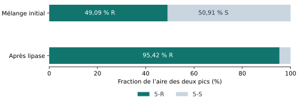

### Question 7

> [!INDICATION]
> Commencer par les signaux couplés à 10,3 et 3,4 Hz, puis attribuer le groupe para-méthoxybenzyle.

#### Solution

Les numéros sont ceux du tableau 1 du sujet.

| Signal | $\delta$ (ppm) | Intégration, multiplicité | Position | Justification |
|---|---:|---|---|---|
| A | 6,9 à 7,30 | 4 H, m | H6, H7, H8, H9 | Quatre protons aromatiques du noyau para-disubstitué. |
| B | 6,87 | 1 H, dd | H2 | Proton vinylique couplé à H1 ($10{,}4$ Hz) et à H3 ($3{,}4$ Hz). |
| C | 6,14 | 1 H, d | H1 | Proton vinylique en α du carbonyle, couplé à H2. |
| D | 5,27 | 1 H, d | H3 | Proton du carbone acétal lié à deux oxygènes et couplé à H2. |
| E | 4,69 | 2 H, s | H5, attribution proposée | Méthylène benzylique lié à O. |
| F | 4,30 | 2 H, s | H4, attribution proposée | Méthylène du cycle entre O et le carbone du carbonyle, sans H vicinal. |
| G | 3,82 | 3 H, s | H10 | Méthoxy du noyau aromatique. |

Les deux singulets E et F ont même intégration et leur ordre se fonde sur les environnements chimiques. Une corrélation, par exemple entre le méthylène du cycle et le carbonyle, permettrait de vérifier leur attribution.

### Question 8

> [!INDICATION]
> Comparer les électronégativités du carbone, du magnésium et du lithium.

#### Solution

Les valeurs de Pauling sont $\chi(\mathrm C)=2{,}55$, $\chi(\mathrm{Mg})=1{,}31$, $\chi(\mathrm{Li})=0{,}98$. Les liaisons C–Mg et C–Li sont toutes deux polarisées $\mathrm{C^{\delta-}{-}M^{\delta+}}$. Le carbone a un caractère carbanionique, ce qui explique les propriétés nucléophiles et fortement basiques des deux familles. La différence d’électronégativité est plus grande avec le lithium.

### Question 10

> [!INDICATION]
> Écrire la forme polarisée d’une énone conjuguée et la forme limite portant la charge positive en β.

#### Solution

La partie $\mathrm{O{=}C{-}C_\alpha{=}C_\beta}$ du cycle fournit deux sites principaux. Le **carbone du carbonyle** est électrophile par polarisation de C=O. Le **carbone β** (C2 dans la numérotation RMN) l’est aussi, comme le montre la forme limite $\mathrm{^-O{-}C{=}C_\alpha{-}C_\beta^+}$. Une attaque en 1,2 ou une attaque conjuguée en 1,4 sont a priori envisageables. Le carbone du carbonyle et le carbone β peuvent ainsi porter un déficit de densité électronique dans deux représentations limites du même système conjugué.

### Question 13 · formation d’un thioacétal cyclique

> [!INDICATION]
> Examiner le nombre d’hétéroatomes directement liés au même carbone dans le cycle.

Le 1,3-dithiane est un thioacétal cyclique. Le carbone situé entre les deux atomes de soufre porte deux liaisons C–S, analogues aux deux liaisons C–O du carbone acétal d’un 1,3-dioxane. Pour obtenir le **1,3-dithiane non substitué**, le carbonyle correspondant est le méthanal HCHO, et le partenaire bifonctionnel est le propane-1,3-dithiol HS–(CH₂)₃–SH. En catalyse acide, l’addition d’un premier thiol sur le carbonyle donne un hémithioacétal. La perte d’eau après activation du OH, suivie de la capture intramoléculaire par le second soufre, ferme le cycle à six. La déprotonation régénère le catalyseur. Le bilan est HCHO + HS–(CH₂)₃–SH ⇌ 1,3-dithiane + H₂O. Une élimination de l’eau favorise le thioacétal.

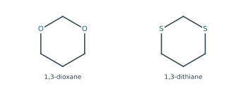

### Question 16

> [!INDICATION]
> Un alcène peut conserver sa configuration E tout en changeant d’orientation relative par rapport aux ponts d’un cycle moyen.

> [!INDICATION]
> Une double liaison trans appartenant à un cycle moyen peut conserver sa géométrie locale pendant que change l’orientation de ce segment du cycle.

#### Solution

La double liaison trans du nouveau cycle à neuf chaînons est contrainte. Deux orientations spatiales de cette unité alcène par rapport aux deux hydrogènes de jonction peuvent correspondre à des conformères dont l’interconversion est assez lente pour que leurs signaux se distinguent. Comme la molécule contient déjà des centres chiraux, ces **atropisomères** peuvent avoir des spectres RMN voisins mais distincts. Cette interprétation concilie configuration identique du carbone étoilé et absence de changement $E/Z$. Deux orientations deviennent alors diastéréoisomères dans l’environnement déjà chiral. Une RMN à température variable pourrait révéler un échange entre elles si celui-ci devenait suffisamment rapide sur l’échelle de temps de la mesure.

## II.1 — Le dioxygène dans l’eau

Comparer la description électronique du dioxygène en termes de doublets et d’orbitales moléculaires, puis relier la solubilité à la température.

### Question 19

> [!INDICATION]
> Compter les électrons de valence des deux oxygènes puis invoquer la symétrie de la molécule.

#### Solution

Chaque oxygène apporte six électrons de valence. Dans la structure de Lewis $\mathrm{O=O}$, chaque atome porte **deux doublets non liants**. Les deux doublets de liaison et les quatre doublets libres totalisent les douze électrons de valence et assurent les deux octets. Les atomes sont identiques et le milieu de la liaison est un centre de symétrie. Le moment dipolaire permanent est nul. La molécule est **apolaire**.

### Question 20

> [!INDICATION]
> Distinguer un plan nodal contenant l’axe internucléaire d’un nœud situé à mi-distance des deux noyaux.

#### Solution

L’axe internucléaire est $Oz$. Les orbitales de type $\sigma$ ont une symétrie de révolution autour de cet axe. Une orbitale de type $\pi$ possède un plan nodal qui contient cet axe. Pour chaque paire dégénérée, les deux orientations se déduisent l’une de l’autre par rotation de $90^\circ$ autour de $Oz$.

| Orbitales de la figure 10 | Type | Caractère | Électrons au total |
|---|---|---|---|
| $\varphi_1$ | $\sigma(2s)$ | liante | 2 |
| $\varphi_2$ | $\sigma^*(2s)$ | antiliante | 2 |
| $\varphi_3$ | $\sigma(2p_z)$ | liante | 2 |
| $\varphi_4,\varphi_5$ | $\pi(2p)$ | liantes | 4 |
| $\varphi_6,\varphi_7$ | $\pi^*(2p)$ | antiliantes | 2, un sur chaque orbitale |
| $\varphi_8$ | $\sigma^*(2p_z)$ | antiliante | 0 |

Le plan médiateur $Oxy$ est un plan nodal supplémentaire pour les orbitales antiliantes. Une orbitale $\pi$ liante possède donc un plan nodal contenant $Oz$ et garde de la densité en dehors de cet axe dans le plan médiateur.

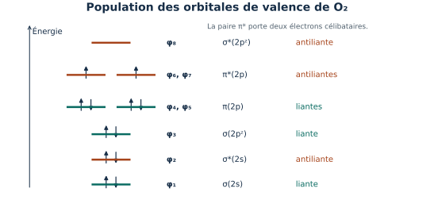

### Question 21

> [!INDICATION]
> Additionner les populations des orbitales liantes et des orbitales antiliantes.

> [!INDICATION]
> Une paire dans une orbitale antiliante annule une paire de même symétrie dans une orbitale liante.

#### Solution

Les orbitales occupées $\varphi_1,\varphi_3,\varphi_4,\varphi_5$ apportent $N_l=2+2+2+2=8$ électrons liants. Les orbitales $\varphi_2,\varphi_6,\varphi_7$ apportent $N_{al}=2+1+1=4$ électrons antiliants. L’indice vaut donc **$I=(8-4)/2=2$**.

### Question 22

> [!INDICATION]
> Calculer séparément les contributions des orbitales de symétrie $\sigma$ et de symétrie $\pi$, puis examiner les spins.

#### Solution

Les deux modèles donnent une **liaison double**. En orbitales moléculaires, le système $\sigma$ fournit un ordre net $(4-2)/2=1$, et le système $\pi$ fournit $(4-2)/2=1$. Cela correspond globalement à une composante $\sigma$ et une composante $\pi$ de la double liaison de Lewis. La contribution $\pi$ se répartit sur deux directions perpendiculaires. Le modèle quantique place en outre deux électrons célibataires de spins parallèles dans $\pi_x^*$ et $\pi_y^*$ (règle de Hund). Il rend ainsi compte de l’état fondamental triplet et du **paramagnétisme** de $\mathrm{O_2}$, que la formule de Lewis à doublets appariés ne représente pas.

### Question 23

> [!INDICATION]
> À pression de gaz fixée, suivre le sens de variation de la concentration à saturation.

#### Solution

À $1\ \mathrm{bar}$, la figure 11 donne environ $1{,}25\ \mathrm{mmol\,L^{-1}}$ vers $300\ \mathrm K$, puis $0{,}9\ \mathrm{mmol\,L^{-1}}$ vers $330\ \mathrm K$. Chauffer déplace donc l’équilibre $\mathrm{O_2(g)\rightleftharpoons O_2(aq)}$ vers le gaz. Pour la dissolution écrite de gauche à droite, $K$ diminue lorsque $T$ augmente. La relation de Van ’t Hoff $\mathrm d\ln K/\mathrm dT=\Delta_{\mathrm{diss}}H^\circ/(RT^2)$ donne **$\Delta_{\mathrm{diss}}H^\circ<0$**. La dissolution est exothermique sur l’intervalle étudié. Avec un gaz assimilé à un gaz parfait et une solution diluée, $K^\circ=(C_{\rm sat}/c^\circ)/(p_{\rm O_2}/p^\circ)$. À pression partielle constante, la baisse de solubilité se traduit directement par une baisse de $K^\circ$.

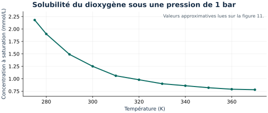

### Question 24

> [!INDICATION]
> Comparer la stabilisation par les molécules d’eau et l’agitation thermique qui permet au dioxygène de quitter le liquide.

#### Solution

Dans l’eau, $\mathrm{O_2}$ apolaire est stabilisé par des interactions intermoléculaires faibles, notamment de dispersion et de dipôle induit avec l’eau. Quand $T$ augmente, l’énergie thermique devient plus grande devant cette stabilisation. À l’interface, les molécules dissoutes peuvent plus facilement s’échapper. À pression partielle de dioxygène fixée, l’équilibre entre les échanges avec le gaz s’établit à une concentration dissoute plus faible.

## II.2 — Demande chimique en oxygène

Le dichromate oxyde les espèces réductrices présentes dans l’eau. Le fer(II) titre ensuite le dichromate restant et permet de comparer le prélèvement à un blanc.

### Question 25

> [!INDICATION]
> Tenir compte de l’exception au remplissage simple des sous-couches $4s$ et $3d$.

#### Solution

Le chrome neutre a $Z=24$. Après les 18 électrons du cœur $[\mathrm{Ar}]$, les six électrons de valence se répartissent en **$3d^5\,4s^1$**. La proximité en énergie de $3d$ et $4s$ et la stabilisation de la sous-couche $3d$ demi-remplie expliquent l’écart à la répartition $3d^4\,4s^2$ d’un remplissage mécanique.

### Question 26

> [!INDICATION]
> Imposer que la somme des nombres d’oxydation égale la charge de l’espèce.

#### Solution

Dans ces espèces, O vaut $-\mathrm{II}$ et H vaut $+\mathrm I$. Le chrome métallique $\mathrm{Cr(s)}$ est au degré **0**, $\mathrm{Cr^{2+}}$ à **$+\mathrm{II}$**, $\mathrm{Cr^{3+}}$ et $\mathrm{Cr_2O_3}$ à **$+\mathrm{III}$**. Dans $\mathrm{H_2CrO_4}$, $2+x-8=0$ donne $x=+6$. Dans $\mathrm{Cr_2O_7^{2-}}$, $2x-14=-2$ donne le même résultat pour chacun des deux chromes. Dans $\mathrm{CrO_4^{2-}}$, $x-8=-2$ donne encore **$+\mathrm{VI}$**.

### Question 27

> [!INDICATION]
> Associer le degré maximal au nombre d’électrons de valence et repérer le métal en milieu réducteur.

#### Solution

Le chrome possède six électrons de valence. Le degré maximal attendu est **$+\mathrm{VI}$**, obtenu en attribuant formellement ces six électrons aux ligands plus électronégatifs. À l’extrémité réductrice du système aqueux étudié se trouve le métal élémentaire, au degré **0**. Ces deux limites sont présentes dans la figure 12, avec $\mathrm{Cr(s)}$ d’une part et les trois formes oxygénées de Cr(VI) d’autre part. La borne inférieure concerne les espèces du système chrome–eau décrit ici.

### Question 28

> [!INDICATION]
> En montant sur le diagramme, rechercher les degrés d’oxydation croissants. À degré fixé, comparer les espèces acides et basiques.

> [!INDICATION]
> Deux espèces au même degré d’oxydation peuvent être séparées par une frontière verticale de pH.

#### Solution

Les domaines de la figure 12 s’attribuent comme suit.

| Zone | Espèce | Argument |
|---|---|---|
| 1 | $\mathrm{Cr(s)}$ | Le métal est stable aux potentiels les plus réducteurs. |
| 2 | $\mathrm{Cr^{2+}(aq)}$ | Entre le métal et le chrome(III), au faible pH. |
| 3 | $\mathrm{Cr^{3+}(aq)}$ | Forme dissoute de Cr(III) en milieu acide. |
| 4 | $\mathrm{Cr_2O_3(s)}$ | Oxyde de même degré que la zone 3, favorisé quand le pH augmente. |
| 5 | $\mathrm{H_2CrO_4(aq)}$ | Forme la plus protonée de Cr(VI), en milieu très acide. |
| 6 | $\mathrm{Cr_2O_7^{2-}(aq)}$ | Dichromate prédominant entre les frontières acido-basiques indiquées. |
| 7 | $\mathrm{CrO_4^{2-}(aq)}$ | Chromate favorisé aux pH plus élevés. |

Les frontières verticales des espèces de Cr(VI) sont à $\mathrm{pH}=0{,}91$ et $6{,}29$ pour la concentration totale du sujet. L’équilibre $\mathrm{Cr_2O_7^{2-}+H_2O\rightleftharpoons 2CrO_4^{2-}+2H^+}$ explique le passage de 6 à 7 quand le pH augmente. Les pointillés des couples de l’eau sont des repères et ne séparent pas deux espèces du chrome.

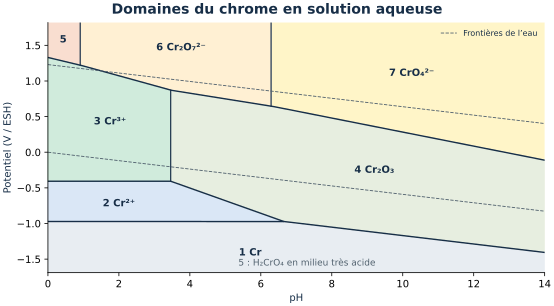

### Question 29

> [!INDICATION]
> Équilibrer le dichromate à l’aide de $\mathrm{H^+}$ et de $\mathrm{H_2O}$, puis compenser les électrons avec Fe(II).

#### Solution

En milieu sulfurique, la réduction est $\mathrm{Cr_2O_7^{2-}+14H^++6e^-\rightarrow 2Cr^{3+}+7H_2O}$. L’oxydation est $\mathrm{Fe^{2+}\rightarrow Fe^{3+}+e^-}$. Leur combinaison donne
$$
\mathrm{Cr_2O_7^{2-}+14H^+ +6Fe^{2+}\longrightarrow 2Cr^{3+}+7H_2O+6Fe^{3+}}.
$$
Le potentiel standard du couple du dichromate ($1{,}33\ \mathrm V$) est supérieur à celui du couple libre du fer ($0{,}77\ \mathrm V$). Le dichromate est l’oxydant, les ions fer(II) constituent le titrant réducteur.

### Question 30

> [!INDICATION]
> À l’équivalence, traduire le coefficient stœchiométrique de six ions fer(II) par dichromate.

#### Solution

La prise d’essai contient $C_{S1}V_{S1}$ moles de dichromate. À l’équivalence, $C_{\mathrm{Fe^{2+}}}V_{S3}=6C_{S1}V_{S1}$. Comme $6\times0{,}04167=0{,}25002$ en $\mathrm{mol\,L^{-1}}$, on obtient **$C_{\mathrm{Fe^{2+}}}\simeq 0{,}25\,V_{S1}/V_{S3}$** en $\mathrm{mol\,L^{-1}}$, l’expression (2). Les deux volumes doivent être exprimés dans la même unité. L’ajout d’eau et d’acide modifie le volume dans l’erlenmeyer, mais conserve la quantité initiale de dichromate.

### Question 31

> [!INDICATION]
> Compter les atomes donneurs entourant Fe sur la figure 14 et distinguer le nombre de ligands du nombre de sites occupés.

#### Solution

La ferroïne est $\mathrm{[Fe(phen)_3]^{2+}}$, où phen désigne la 1,10-phénanthroline. Chacun des trois ligands est **bidentate** et coordonne le métal par ses deux azotes. L’indice de coordination vaut donc **6**, avec un environnement approximativement octaédrique. La formation de trois chélates favorise la stabilité du complexe. Chaque ligand est rigide et préorganisé, et la coordination de ses deux sites empêche sa dissociation complète dès la rupture d’une seule liaison Fe–N.

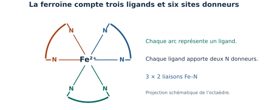

### Question 32

> [!INDICATION]
> Écrire les constantes globales de formation des deux complexes et substituer les concentrations libres dans la relation de Nernst.

#### Solution

Notons $L=\mathrm{phen}$ et $\beta_i=a(\mathrm{Fe^iL_3})/[a(\mathrm{Fe^i})a(L)^3]$, avec $i=\mathrm{II}$ ou $\mathrm{III}$ pour l’état d’oxydation. Le couple libre suit $E=E^\circ_{\mathrm{libre}}+(RT/F)\ln[a(\mathrm{Fe^{3+}})/a(\mathrm{Fe^{2+}})]$. En substituant les expressions des activités du métal libre, on trouve
$$
E^\circ_{\mathrm{complexe}}-E^\circ_{\mathrm{libre}}
=\frac{RT}{F}\ln\!\left(\frac{\beta_{\mathrm{II}}}{\beta_{\mathrm{III}}}\right).
$$
Les données donnent $1{,}06-0{,}77=0{,}29\ \mathrm V>0$, donc **$\beta_{\mathrm{II}}>\beta_{\mathrm{III}}$**. À $298\ \mathrm K$, leur rapport est $10^{0{,}29/0{,}0591}\simeq 8\times10^4$. Le ligand stabilise davantage la forme réduite Fe(II).

### Question 33

> [!INDICATION]
> Relier une mole de dioxygène à quatre moles d’électrons.

#### Solution

En milieu acide, **$\mathrm{O_2+4H^++4e^-\rightarrow 2H_2O}$**. Si l’oxydation libère la quantité $n_e$ d’électrons, l’équivalent en dioxygène est $n(\mathrm{O_2})=n_e/4$. Pour $M(\mathrm{O_2})=32{,}0\ \mathrm{g\,mol^{-1}}$, on a $m(\mathrm{O_2})=(32{,}0/4)n_e=8{,}00\,n_e$ en grammes pour $n_e$ en moles. Une mole d’électrons équivaut donc à **$8{,}00\times 10^3\ \mathrm{mg}$ de dioxygène**.

### Question 34

> [!INDICATION]
> Comparer les deux dosages en retour en équivalents électroniques avant de convertir en masse de dioxygène par litre d’échantillon.

> [!INDICATION]
> Une mole de fer(II) cède un électron. Une mole de dioxygène représente quatre équivalents d’électrons.

#### Solution

Les deux essais reçoivent la même quantité de dichromate en excès. Après le chauffage, le titrage par Fe(II) mesure le dichromate qui reste. Comme une mole de Fe(II) fournit un électron, la capacité oxydante restante, en moles d’électrons, vaut $C_{\mathrm{Fe^{2+}}}V_{\mathrm{blanc}}$ pour l’eau distillée et $C_{\mathrm{Fe^{2+}}}V_{\mathrm{ana}}$ pour l’échantillon, avec les volumes en litres. L’échantillon a consommé davantage de dichromate et requiert moins de Fe(II) au retour. Sa consommation propre correspond à $n_e=C_{\mathrm{Fe^{2+}}}(V_{\mathrm{blanc}}-V_{\mathrm{ana}})$.

Par la question 33, on multiplie cette différence par $8000\ \mathrm{mg\,mol^{-1}}$ d’électrons pour obtenir la masse équivalente de $\mathrm{O_2}$. On divise par le volume initial $V_{\mathrm{sol}}$ de l’échantillon analysé. Il vient
$$
\boxed{\mathrm{DCO}\ (\mathrm{mg\ O_2\,L^{-1}})=
8000\,C_{\mathrm{Fe^{2+}}}\,
\frac{V_{\mathrm{blanc}}-V_{\mathrm{ana}}}{V_{\mathrm{sol}}}}.
$$
Le rapport des volumes étant sans dimension, les trois volumes peuvent tous être exprimés en mL. Le blanc, soumis aux mêmes ajouts, au même chauffage et au même titrage, corrige la consommation de fond des réactifs et du mode opératoire. La différence de volume isole ainsi la matière oxydable apportée par l’échantillon.

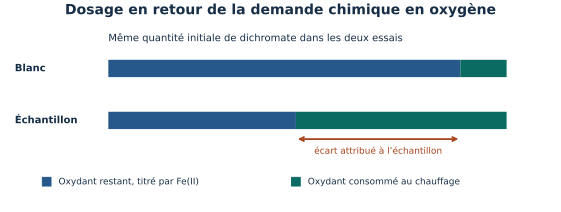

## II.3 — Demande biologique en oxygène

La baisse du dioxygène sur cinq jours s’interprète à condition de tenir compte du facteur de dilution, de l’incertitude de lecture et de la quantité de dioxygène restante.

### Question 35

> [!INDICATION]
> Relier la masse d’oxygène disparue dans la fiole à la quantité d’eau initiale qu’elle représente.

#### Solution

La masse de dioxygène consommée est $(C_0-C_5)V_{\rm tot}$ si les concentrations sont en $\mathrm{mg\,L^{-1}}$ et les volumes en litres. Elle correspond au prélèvement $V_1$ d’eau à analyser. Dans le modèle du sujet, la demande biologique à cinq jours de l’échantillon initial vaut donc $\mathrm{DBO}_5=(C_0-C_5)V_{\rm tot}/V_1$, en $\mathrm{mg\,L^{-1}}$. Le rapport de volumes peut être formé en mL.

### Question 36

> [!INDICATION]
> Une dilution excessive et un épuisement du dioxygène peuvent tous deux rendre le résultat inexploitable.

#### Solution

Pour $V_1=1\,\mathrm{mL}$, l’écart de $0{,}1\,\mathrm{mg\,L^{-1}}$ est du même ordre que l’incertitude-type sur chaque lecture. Si les erreurs sont indépendantes, l’incertitude-type sur leur différence est $0{,}14\,\mathrm{mg\,L^{-1}}$, avant même la multiplication par 300. À $V_1=300\,\mathrm{mL}$, $C_5=0{,}1\,\mathrm{mg\,L^{-1}}$ est pratiquement nul. Le dioxygène disponible peut avoir limité l’oxydation avant le cinquième jour. La première mesure est imprécise et la seconde risque de sous-estimer la demande. Avec 1 mL prélevé, le facteur de dilution 300 amplifierait l’incertitude absolue à environ $42\ \mathrm{mg\,L^{-1}}$, supérieure à la demande estimée par les dilutions intermédiaires.

### Question 37

> [!INDICATION]
> Calculer pour chaque prélèvement le facteur de dilution et la chute mesurée avant de multiplier.

#### Solution

Pour $30\,\mathrm{mL}$, la dilution est d’un facteur 10 et la chute vaut $8{,}2-7{,}2=1{,}0\,\mathrm{mg\,L^{-1}}$, d’où $\mathrm{DBO}_5=10\,\mathrm{mg\,L^{-1}}$. Pour $150\,\mathrm{mL}$, on trouve $2(8{,}2-3{,}2)=10\,\mathrm{mg\,L^{-1}}$ également. Les deux dilutions concordent. Si l’incertitude de concentration domine et si les lectures sont indépendantes, les incertitudes-types propagées sont respectivement $1{,}4$ et $0{,}28\,\mathrm{mg\,L^{-1}}$. Le prélèvement de 150 mL est ici le plus précis. Une moyenne pondérée supposerait en outre de connaître les éventuelles corrélations introduites par l’oxymètre et par la valeur initiale commune.

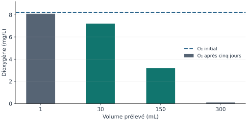

### Question 38

> [!INDICATION]
> Comparer le temps et le type d’oxydation que chaque demande représente.

#### Solution

La valeur $\mathrm{DBO}_5=10\,\mathrm{mg\,L^{-1}}$ représente environ $10/33\simeq30\,\%$ de la DCO, qui vaut $33\,\mathrm{mg\,L^{-1}}$. En cinq jours, les organismes n’oxydent qu’une partie des espèces que le dichromate peut oxyder dans le test chimique. Certaines substances sont lentes à biodégrader et des espèces réductrices peuvent contribuer à la DCO sans être utilisées biologiquement sur ce délai. Le rapport de 30 % porte sur des équivalents de dioxygène, et ne constitue pas directement une fraction massique des polluants.

## II.4 — Électrode de Clark

La géométrie de la cathode et le partage du dioxygène entre le liquide et la membrane déterminent la réponse électrochimique du capteur.

### Question 39

> [!INDICATION]
> Choisir le sens de $z$ et exprimer le transport vers les basses concentrations.

#### Solution

Prenons $z=0$ au platine et $z=\delta$ à la membrane. La première loi de Fick donne $\mathbf j=-D\boldsymbol\nabla C$, soit $j_z(0)=-D(dC/dz)_{0^+}$ en $\mathrm{mol\,m^{-2}\,s^{-1}}$. $D$ est le coefficient de diffusion du dioxygène dans le milieu situé entre membrane et cathode. Un flux vers le platine est orienté suivant $-\mathbf e_z$.

### Question 40

> [!INDICATION]
> Combiner le bilan stationnaire, une diffusion à coefficient constant et l’absorption instantanée au platine.

#### Solution

En régime stationnaire, sans réaction dans l’espace entre platine et membrane, $dj_z/dz=0$ et $d^2C/dz^2=0$ si $D$ est constant. La réduction instantanée impose $C(0)=0$. En notant $C_\delta$ la concentration dans le liquide au contact de la membrane, on obtient $C(z)=C_\delta z/\delta$ et $j_z=-DC_\delta/\delta$. L’affinité du dioxygène pour la membrane peut donner une concentration différente à l’intérieur de celle-ci.

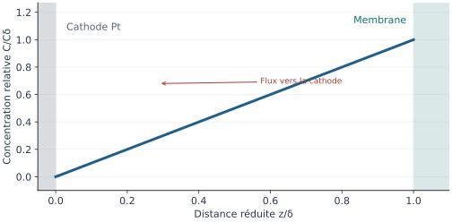

### Question 41

> [!INDICATION]
> Écrire une loi de solution diluée pour chaque phase en distinguant ses potentiels chimiques standards.

#### Solution

Pour $i=m$ (membrane) ou $s$ (solution), le dioxygène est un soluté dilué de potentiel $\mu_i=\mu_i^\circ(T,P)+RT\ln a_i\simeq\mu_i^\circ+RT\ln(C_i/c^\circ)$. Dans chaque phase, l’état standard est le soluté dissous dans cette phase, rapporté à $c^\circ=1\,\mathrm{mol\,L^{-1}}$ par extrapolation du comportement à dilution infinie, à la température considérée et à la pression de référence. Les deux $\mu_i^\circ$ diffèrent car les interactions avec le milieu diffèrent.

### Question 42

> [!INDICATION]
> À l’interface à l’équilibre local, identifier la grandeur intensive qui est commune aux deux phases.

#### Solution

Égaliser $\mu_m$ et $\mu_s$ donne $RT\ln(C_m/C_s)=\mu_s^\circ-\mu_m^\circ$. Pour le transfert solution $\to$ membrane, $\Delta_rG^\circ=\mu_m^\circ-\mu_s^\circ$ et $K^\circ=C_m/C_s=\exp[-\Delta_rG^\circ/(RT)]$. La constante est sans dimension. Si $K^\circ>1$, la membrane enrichit localement le dioxygène par rapport à la solution.

### Question 43

> [!INDICATION]
> Au même $C_s$, le modèle plan prédit un courant proportionnel à l’aire. Examiner la courbe où cette dépendance apparaît sous forme d’un plateau.

> [!INDICATION]
> L’aire d’une cathode circulaire varie comme le carré du diamètre.

#### Solution

Pour un disque, $A=\pi d^2/4$. L’équation (4) donne $I/d^2$ constant à concentration, membrane et température fixées. Sur le graphique inférieur de la figure 16, ce rapport diminue d’abord fortement puis approche un plateau pour les diamètres de quelques centaines de micromètres. Un seuil pratique est **environ $400\,\mathrm{\mu m}$** (transition vers $250$–$400\,\mathrm{\mu m}$). On travaille **au-dessus** de cet ordre de grandeur pour limiter les contributions diffusives au bord et employer le modèle plan. Les données ne fixent pas une coupure exacte.

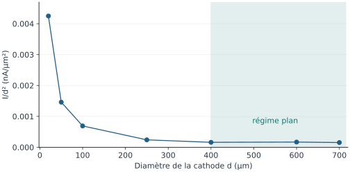

### Question 44

> [!INDICATION]
> La sensibilité mesurée contient à la fois le coefficient de diffusion et le coefficient de partage.

#### Solution

Pour une géométrie fixe, $\tau=(4FA/b)D_mK^\circ$. Avec $D_m=D_0\exp[-E_a/(RT)]$ et la loi de Van ’t Hoff $d\ln K^\circ/d(1/T)=-\Delta_rH^\circ/R$, on obtient, sur l’intervalle où $\Delta_rH^\circ$ est sensiblement constant,

$$\frac{d\ln\tau}{d(1/T)}=-\frac{E_a+\Delta_rH^\circ}{R}.$$

La figure 17 donne cette pente dès qu’on prend le logarithme du rapport de deux sensibilités. L’énergie d’activation de la diffusion étant connue, on peut isoler l’enthalpie standard du transfert solution $\to$ membrane.

### Question 45

> [!INDICATION]
> L’abscisse de droite est $10^4/T$ et son ordonnée est graduée en valeurs de la sensibilité sur une échelle logarithmique.

> [!INDICATION]
> Une différence de deux unités sur l’axe de la figure représente une différence de 0,0002 K⁻¹ sur 1/T.

#### Solution

On peut lire environ $\tau_1=1{,}5$ à $10^4/T_1=33$ et $\tau_2=0{,}49$ à $10^4/T_2=35$ (sensibilités dans la même unité). Cela donne une pente $\ln(0{,}49/1{,}5)/(2\times10^{-4})\simeq-5{,}6\times10^3\,\mathrm K$. On obtient $E_a+\Delta_rH^\circ\simeq47\,\mathrm{kJ\,mol^{-1}}$. En retranchant $E_a=23\,\mathrm{kJ\,mol^{-1}}$, il vient **$\Delta_rH^\circ\simeq+24\,\mathrm{kJ\,mol^{-1}}$** à quelques $\mathrm{kJ\,mol^{-1}}$ près. Le transfert vers la membrane est endothermique selon ces mesures. La sensibilité combine deux effets. Assimiler directement les $47\ \mathrm{kJ\,mol^{-1}}$ à une enthalpie de partage compterait aussi l’énergie d’activation de la diffusion.

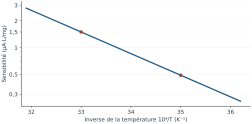

## II.5 — Oxydation des nanoparticules d’argent

Les mesures d’absorbance donnent accès à un ordre apparent. La comparaison de plusieurs concentrations et l’étude du pH distinguent les deux voies de réaction.

### Question 46

> [!INDICATION]
> Choisir une chaîne carbonée portant le plus grand nombre possible de fonctions alcool prioritaires.

#### Solution

Le Tris est $\mathrm{(HOCH_2)_3C{-}NH_2}$. Une chaîne propane comporte deux alcools terminaux, avec amino et hydroxyméthyl sur le carbone central. Un nom systématique est **2-amino-2-(hydroxyméthyl)propane-1,3-diol**. Le nom usuel développé est tris(hydroxyméthyl)aminométhane.

### Question 47

> [!INDICATION]
> À une longueur d’onde fixée, l’absorbance suit la quantité d’argent particulaire. Identifier laquelle des linéarisations de la figure 19 fonctionne.

#### Solution

Le peroxyde est en très grand excès sur l’argent dans l’expérience, donc sa concentration varie négligeablement pendant un suivi. L’absorbance $A$ est proportionnelle à $[\mathrm{Ag}^0]$ sous l’hypothèse de suivi donnée. C’est $\ln A$ qui dépend linéairement du temps, avec $R^2=0{,}995$ sur la figure 19c. Les régressions de $A$ et de $1/A$ sont moins bonnes. Le tracé implique $A=A_0e^{-k_{\rm app}t}$, soit un **ordre partiel $n_1=1$ en argent particulaire**.

### Question 48

> [!INDICATION]
> Pendant un suivi temporel, quel facteur de la loi de vitesse peut être inclus dans une constante apparente ?

#### Solution

En notant $H_T$ la concentration analytique en peroxyde, en excès, $v=k_{\rm obs}H_T^{n_2}[\mathrm{Ag}^0]^{n_1}$. La constante de la loi pseudo-élémentaire ainsi écrite est $k_{\rm app}=k_{\rm obs}H_T^{n_2}$, indépendante de la concentration initiale en argent. Avec $n_1=1$ et en définissant la vitesse comme la disparition de l’argent suivi, $-d\ln A/dt=k_{\rm app}$. Si $v$ désigne rigoureusement la vitesse d’avancement de l’équation (5), qui oxyde deux atomes Ag par événement, la constante expérimentale de disparition est $2k_{\rm obs}H_T^{n_2}$ avec cette autre convention. Le facteur stœchiométrique fixe la normalisation, sans modifier les ordres.

### Question 49

> [!INDICATION]
> Comparer des expériences conduites à la même concentration en argent et à des concentrations en peroxyde différentes.

#### Solution

Dans les expériences 5, 6 et 7, $[\mathrm{Ag}^0]_0=0{,}05\,\mathrm{mmol\,L^{-1}}$. Lorsque $H_T$ est successivement divisé par dix, $k_{\rm app}$ passe de $0{,}133$ à $0{,}0126$ puis $0{,}00119$, soit une division par environ $10{,}6$ à chaque fois. Le calcul sur les extrêmes donne $n_2=\ln(0{,}133/0{,}00119)/\ln(10/0{,}1)\simeq1{,}02$. L’ordre partiel en peroxyde est **un** dans la précision des données. L’ordre global vaut donc deux dans cette gamme de mesure. Les deux rapports adjacents donnent respectivement $\ln(0{,}133/0{,}0126)/\ln 10\simeq 1{,}02$ et $\ln(0{,}0126/0{,}00119)/\ln 10\simeq 1{,}02$. L’accord des deux estimations vérifie la cohérence des trois essais.

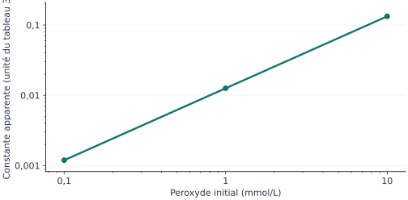

### Question 50

> [!INDICATION]
> Les expériences restantes varient l’argent tout en conservant la concentration en oxydant.

#### Solution

Les essais 1 à 5 testent l’effet de la quantité initiale d’argent, à $10\,\mathrm{mmol\,L^{-1}}$ de peroxyde. Malgré un facteur 50 en argent, $k_{\rm app}$ reste entre $0{,}122$ et $0{,}133$. La constante apparente d’un suivi d’ordre un est donc indépendante de $[\mathrm{Ag}^0]_0$, tandis que la **vitesse initiale** est, elle, proportionnelle à cette concentration. Pour un solide réactif, cette proportionnalité à la quantité totale peut surprendre car l’oxydation débute à la surface. Des particules de tailles et formes comparables, dont on fait varier le nombre par dilution, ont une surface totale accessible proportionnelle à la quantité d’argent introduite. C’est une explication compatible avec les mesures. Un même échantillon de particules dilué conserve une distribution de tailles comparable. Changer leur diamètre moyen à quantité totale d’argent constante permettrait de tester séparément l’hypothèse de surface accessible.

### Question 51

> [!INDICATION]
> Comparer la vitesse d’un transfert de proton à celle de la consommation chimique du peroxyde, puis écrire le quotient des deux vitesses élémentaires.

#### Solution

Un transfert de proton en solution est généralement bien plus rapide que la dégradation de l’argent, observée sur des dizaines à centaines de secondes. L’étape (8) peut alors se rééquilibrer à mesure que les deux formes du peroxyde sont consommées. À l’équilibre $k_1[\mathrm{H_2O_2}]=k_{-1}[\mathrm{HO_2^-}][\mathrm{H^+}]$. En solution diluée, $K_a=[\mathrm{HO_2^-}][\mathrm{H^+}]/(c^\circ[\mathrm{H_2O_2}])=10^{-pK_a}$, d’où $k_1/k_{-1}=K_a c^\circ$. En concentrations numériques en $\mathrm{mol\,L^{-1}}$, ce rapport vaut numériquement $10^{-pK_a}$.

### Question 52

> [!INDICATION]
> Additionner les contributions des deux voies parallèles en comptant le nombre d’ions argent formés à chaque événement.

> [!INDICATION]
> Comparer le nombre d’atomes d’argent présents à gauche et à droite de chaque étape telle qu’elle est imprimée.

#### Solution

Notons $S=[\mathrm{Ag}^0]$, $H=[\mathrm{H_2O_2}]_{\rm libre}$ et $B=[\mathrm{HO_2^-}]$. L’étape (9) a pour vitesse $v_2=k_2SH$, l’étape (10) $v_3=k_3SB[\mathrm{H_2O}]$. Chacune libère deux ions argent, rapidement complexés par deux Tris **par argent**. Il vient

$$\frac{d[\mathrm{Ag(Tris)_2^+}]}{dt}=2(v_2+v_3)=2S\big(k_2H+k_3B[\mathrm{H_2O}]\big).$$

La ligne (11) du sujet met un coefficient 2 devant le complexe tout en écrivant un seul $\mathrm{Ag^+}$ à gauche. La complexation équilibrée est $\mathrm{Ag^++2Tris\to[Ag(Tris)_2]^+}$, comme l’impose le bilan global (5).

### Question 53

> [!INDICATION]
> Éliminer les deux espèces du peroxyde grâce à leur somme et au pré-équilibre acide-base.

#### Solution

Posons $h=[\mathrm{H^+}]$, $K=K_ac^\circ=k_1/k_{-1}$ et $H_T=H+B$. Comme $B/H=K/h$, on a $H=H_T h/(h+K)$ et $B=H_TK/(h+K)$. Pour la vitesse d’avancement du bilan (5), $v=v_2+v_3$ donne

$$v=SH_T\frac{k_2h+k_3[\mathrm{H_2O}]K}{h+K}.$$

Le mécanisme explique les deux ordres partiels unité et la loi de pH avec $\alpha=k_2$, $\beta=k_3[\mathrm{H_2O}]K$ et $\gamma=K$. Si on appelle vitesse la formation du complexe ou la disparition des atomes d’argent, $\alpha$ et $\beta$ sont tous deux multipliés par deux, selon la convention de Q48–52. À forte acidité, la voie du peroxyde neutre domine. À faible acidité, c’est celle de l’anion hydroperoxyde.

## Bilan

Les deux chromatogrammes distinguent l’enrichissement d’un mélange et le rendement de récupération d’une espèce. En analyse de l’eau, les deux dilutions exploitables donnent la même demande biologique de 10 mg/L. Le partage du dioxygène et sa diffusion contribuent ensemble à la sensibilité du capteur. Pour l’argent, le suivi cinétique sépare les effets de la concentration du peroxyde et de la taille des particules.
