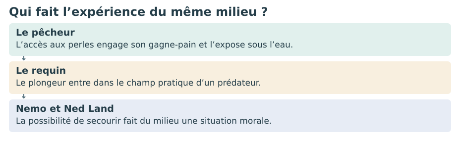

# ENS BCPST — Français 2026 · Corrigé brut

*Corrigé rédigé par IA, non officiel.*

**Rédaction** · modèle exact non renseigné (famille GPT-6) · effort non renseigné · vitesse non renseignée

**Révision** · modèle exact non renseigné (famille GPT-6) · effort non renseigné · vitesse non renseignée

**Révision** · GPT-6.2 Astra Ultra · vitesse non renseignée

**Révision (tour 3)** · GPT-6.2 Astra Ultra · vitesse non renseignée

**Question directrice** — Comment l’activité du vivant introduit-elle des préférences dans une nature indifférente, et jusqu’où ces préférences peuvent-elles justifier nos actes ?

## Introduction

À Ceylan, un pêcheur de perles plonge en retenant son souffle pendant qu’Aronnax, équipé d’un scaphandre, observe les fonds marins. Lorsque surgit un requin, le même milieu paraît soudain bien différent à l’homme qui risque sa vie, à l’animal qui poursuit sa proie et aux témoins qui peuvent lui porter secours. À laquelle de ces perspectives faudrait-il se conformer pour vivre selon la nature ? Dans le premier chapitre de *Par-delà le bien et le mal* (§ 9), Nietzsche interroge la prétention des stoïciens à prendre la nature pour règle. Elle produit et détruit sans avoir à rendre raison de ses actes ; elle ne réserve aucune priorité à l’être qu’il faudrait sauver. Vivre, à l’inverse, ce serait déjà préférer, distinguer ce qui importe et se donner une direction. Mais où le vivant pourrait-il trouver les moyens de vouloir « être autre chose » que cette nature, s’il en fait partie jusque dans son aptitude à choisir ? *Vingt mille lieues sous les mers* de Jules Verne, *Le Mur invisible* de Marlen Haushofer et les textes de *La Connaissance de la vie* de Georges Canguilhem permettent de mettre la question à l’épreuve. Nous rencontrons d’abord une nature qui ne garantit rien à ce qui vit. Nous verrons ensuite pourquoi la différence avec son indifférence se forme au sein même de la vie. Il restera à déterminer comment répondre à d’autres vivants dont les préférences contredisent les nôtres.

Une même étendue d’eau vaut pour le pêcheur comme lieu de travail et de danger. L’intervention de Nemo y introduit une relation supplémentaire, la possibilité de secourir un inconnu. Cette variation montre comment des préférences se forment dans un milieu qui, pris comme totalité, ne désigne de lui-même aucun bénéficiaire.

## I. L’expérience d’une nature sans égards commence là où nos attentes se brisent

Le Nautilus paraît capable de transformer l’océan tout entier en demeure. Une coque protège ses occupants, des instruments mesurent les profondeurs et l’air respirable est renouvelé quand le sous-marin remonte. Pris sous les glaces antarctiques, il doit pourtant compter avec une propriété très simple de son milieu. L’équipage a besoin d’une communication avec la surface, la glace peut se refermer indépendamment de ce besoin. Ce qui était pour le naturaliste une remarquable expédition devient un calcul portant sur le temps pendant lequel chacun pourra encore respirer. Dire que la nature est « sans intentions » précise ici la forme d’un malheur : personne n’a voulu les enfermer. Ce savoir n’ouvre aucun passage. L’eau et la glace ont leurs effets jusque dans les situations où ces effets défont un projet humain.

Le mur de Haushofer impose à la narratrice une expérience à certains égards inverse. Sa surface est invisible et sa présence certaine : on s’y heurte. Les êtres aperçus de l’autre côté paraissent figés, sans qu’aucun message explique ce qui a eu lieu ni comment y répondre. Supposer au mur une leçon à délivrer serait faire passer le besoin humain de sens pour un renseignement sur la catastrophe. La narratrice doit pourtant traire Bella, assurer l’eau et prévoir du fourrage. La prairie continue de pousser et les saisons se succèdent, alors que la société dont cette femme tenait ses repères semble avoir disparu. La prodigalité de la croissance et la désolation de la perte peuvent ainsi appartenir au même paysage. Leur coexistence n’est ni une récompense ni un châtiment.

L’expérience scientifique elle-même ne rencontre pas spontanément une nature qui répondrait dans la langue des questions posées. Dans « L’expérimentation en biologie animale », Canguilhem examine ce qu’engage la décision d’isoler une fonction pour l’étudier. Une intervention qui facilite la mesure change parfois les conditions de vie de l’organisme et les relations entre ses fonctions. Le dispositif produit une situation réelle dont il faut encore déterminer la portée. Une régularité observée dans certains organismes, à un âge ou dans un milieu donnés, ne répond pas immédiatement pour tous les autres. Le chercheur partage avec le navigateur l’expérience d’une résistance à l’anticipation. Mais dire que la nature n’a pas nos intentions laisse ouverte une difficulté : comment nos propres attentes ont-elles pu apparaître dans une nature où il n’y aurait partout que de l’indifférence ?

## II. La vie introduit des différences de valeur à même la nature

Canguilhem fournit une manière de préciser les termes du paradoxe dans « Le vivant et son milieu ». Un milieu décrit par un observateur peut être un ensemble de grandeurs physiques. Pour un animal, certains éléments seulement deviennent des signaux décisifs. La tique étudiée par Uexküll, exemple que reprend Canguilhem, réagit à quelques traits qui lui permettent de rencontrer son hôte. Une multitude d’autres phénomènes dont le savant pourrait dresser la liste ne gouvernent pas sa conduite. Cette sélectivité précède toute délibération et tout jugement moral. Elle éclaire le « vouloir » du sujet : vivre, c’est déjà entretenir des rapports privilégiés avec certaines réalités. Une nature envisagée dans la totalité de ses processus n’a pas à choisir entre le mammifère et la tique. Chacun de ces vivants naturels, en revanche, a des conditions propres sous lesquelles il prospère ou dépérit.

L’alternative que formule Nietzsche change ainsi d’échelle en cours de phrase. La nature dite indifférente désigne l’ensemble des événements, qui ne se règlent sur le besoin d’aucun être en particulier. Vivre désigne au contraire une activité pour laquelle certaines différences comptent immédiatement. Appeler la chaleur favorable à tel vivant ne revient donc ni à attribuer une intention au monde ni à expulser le vivant hors de la nature.

Cette remarque transforme la scène de la pêche aux perles. Pour Aronnax, la plongée peut être une rencontre avec des êtres à décrire ; pour le pêcheur, l’accès à une ressource est aussi une nécessité économique. Le requin, lui, trouve là une occasion de se nourrir. Aucune liste de ces perspectives ne confère au requin une obligation de ménager le plongeur. Pourtant Nemo s’interpose et Ned Land intervient dans le combat. Les effets de l’animal sur sa proie donnaient à voir la vulnérabilité des vivants. Le secours ajoute un autre type de préférence. Nemo choisit de protéger un inconnu au risque de sa propre vie, puis lui remet des perles. La nature indifférente ne lui prescrivait rien de tel. Les organes d’un être capable d’agir, l’équipement conçu pour la plongée et la solidarité entre compagnons rendent néanmoins ce choix matériellement possible.

Dans la vallée de Haushofer, il serait également trompeur de prêter à la seule volonté souveraine de la narratrice sa capacité de survivre. La présence d’une vache en lactation lui est précieuse, mais elle lui impose aussi des horaires et un travail de prévoyance. La femme qui prépare le foin apprend à organiser son temps à partir des besoins d’une autre espèce. Dans « Le normal et le pathologique », Canguilhem caractérise la santé par une latitude devant les variations du milieu, par la possibilité d’instituer de nouvelles normes de vie. Le travail dans la vallée donne à cette idée une épreuve concrète sans en être une simple illustration. Si la narratrice peut transformer sa manière de vivre, c’est en se rendant attentive aux limites qu’elle rencontre. Son pouvoir d’invention grandit à travers une dépendance qu’elle a appris à reconnaître. Cette activité normative suffit-elle toutefois à justifier toutes les préférences que des êtres vivants font valoir ?

## III. Répondre d’une décision, c’est reconnaître les effets de sa préférence sur d’autres vies

La décision de sauver le pêcheur donne à Nemo un visage que la suite du roman complique. Quand il enfonce un navire de guerre avec le Nautilus, Aronnax regarde les hommes disparaître dans les eaux. La mer reçoit les naufragés avec la même indifférence que celle qui entourait le pêcheur. Cette fois, cependant, la cause immédiate du désastre inclut la décision du capitaine. La scène interdit de placer sous le même mot de nature une noyade sans auteur et l’usage délibéré d’une puissance technique. Nemo peut revendiquer la justice de sa cause, le lecteur doit encore considérer ce que subissent ceux qu’a pris pour cible la machine. Vouloir être autre chose qu’une nature sans justice ne garantit nullement qu’on se conduise avec justice. Il faut pouvoir discuter les raisons d’une préférence et regarder au-delà de celui qui les énonce.

Le dénouement du *Mur invisible* rend cette responsabilité plus douloureuse encore. Après avoir découvert l’inconnu qui a abattu le taureau, la narratrice voit mourir son chien Lynx et tire sur l’homme. Un événement auquel elle ne parvient pas à donner de sens s’achève par un geste dont elle est l’autrice. La perte des animaux ne se réduit pas à une diminution de ses ressources. Des êtres singuliers avec lesquels s’était formée la vie de la vallée ne seront pas remplacés par d’autres représentants de leur espèce. Le récit rédigé ensuite conserve la trace de ces attachements et de l’impasse où ils l’ont conduite. Comme Aronnax devant le naufrage, le lecteur doit soutenir plusieurs questions à la fois : quel acte visait à protéger une vie, quelles autres vies a-t-il atteintes, et que reste-t-il impossible de réparer ?

L’« Introduction : La pensée et le vivant » de Canguilhem aide à comprendre ce que cette dernière expérience ajoute à la distinction initiale. La pensée prend ses problèmes dans les difficultés que rencontre la vie, et la connaissance peut élargir nos possibilités de les résoudre. Pour porter connaissance et jugement, il faut aussi pouvoir différer une réaction, examiner une relation dont nous sommes partie prenante, reconnaître une autre perspective. L’indifférence prêtée à la nature a donc une utilité critique. Elle empêche Nemo de présenter la mer comme juge de sa vengeance, la narratrice de faire de son malheur une sentence et le biologiste de confondre ses conditions de mesure avec la norme valable pour tout organisme. Elle laisse à chacun la charge d’exposer ce qu’il fait au nom de ce qu’il estime précieux.

## Conclusion

La question de Nietzsche éclaire trois expériences distinctes. L’absence d’un ordre du monde soucieux de nous apparaît dans la résistance de la glace, dans l’opacité du mur et dans les difficultés de la preuve expérimentale. Mais l’expérience d’un milieu est toujours déjà celle d’un vivant pour lequel il y va de quelque chose. L’écart avec l’indifférence naît au sein de la nature elle-même. Dans le secours porté au pêcheur ou les soins donnés à Bella, cet écart devient enfin une responsabilité envers autrui. Les trois œuvres conduisent ainsi à prendre au sérieux la volonté d’« être autre chose », et à lui demander des comptes : l’être qui préfère ne s’affranchit ni des conditions naturelles de ses actes ni du regard que d’autres vivants nous obligent à porter sur eux.
