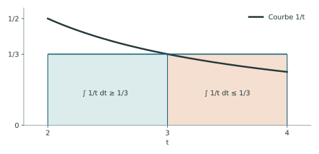
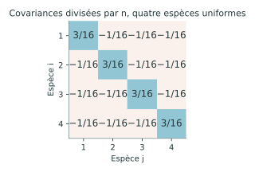
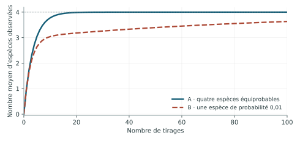
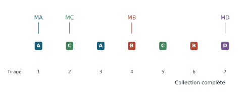
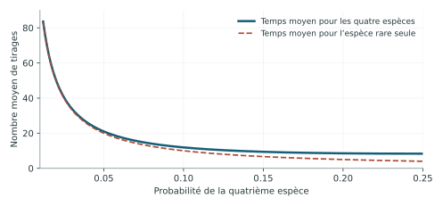
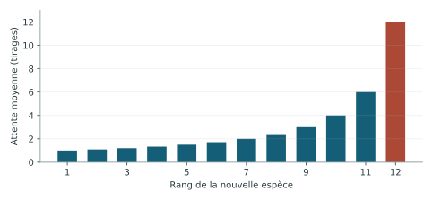
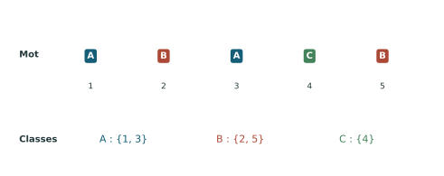

# ENS BCPST — Mathématiques 2026 · Corrigé brut

*Corrigé rédigé par IA, non officiel.*

**Rédaction** · modèle exact non renseigné (famille GPT-6) · effort non renseigné · vitesse non renseignée

**Révision (tour 1)** · modèle exact non renseigné (famille GPT-6) · effort non renseigné · vitesse non renseignée

**Révision (tour 2)** · GPT-6.2 Astra Ultra · vitesse non renseignée

Les tirages $(X_r)$ sont indépendants et de même loi $p=(p_1,\ldots,p_N)^{\mathsf T}$. Le compteur $S_{n,i}$ donne le nombre d'observations de l'espèce $i$ en $n$ tirages, $Y_n$ le nombre d'espèces distinctes observées et $T_k$ le premier instant où ce nombre vaut $k$. On pose naturellement $Y_0=0$. Le domaine $\{p_i\in(0,1),\,\sum_i p_i=1\}$ suppose $N\geq2$. Les résultats pour la loi uniforme s'étendent à $N=1$ en prenant $p_1=1$.

## Partie I — Questions préliminaires

### Question I.1

La fonction $t\mapsto t^{-a}$ est décroissante sur $]0,+\infty[$. Sur $[k,k+1]$ elle est majorée par $k^{-a}$, et sur $[k-1,k]$ elle est minorée par $k^{-a}$. Les intervalles sont de longueur un et $k\geq 2$. Ainsi

$$\int_k^{k+1}\frac{dt}{t^a}\leq\frac1{k^a}\leq\int_{k-1}^{k}\frac{dt}{t^a}.$$

### Question I.2

**(a)** En intégrant $1/(n+1)\leq1/t\leq1/n$ sur $[n,n+1]$, on trouve $1/(n+1)\leq\ln((n+1)/n)\leq1/n$.

**(b)** Notons $H_n=\sum_{k=1}^n1/k$ et $u_n=H_n-\ln n$. D'après (a), $u_{n+1}-u_n=1/(n+1)-\ln((n+1)/n)\leq0$. En sommant la borne supérieure de (a) pour $j=1,\ldots,n-1$, on obtient $\ln n\leq H_{n-1}$ pour $n\geq2$. Ainsi $0\leq u_n\leq u_1=1$ à tout rang. La suite décroissante minorée admet une limite $\gamma\in[0,1]$.

**(c)** Comme $H_n=\ln n+u_n$ et $u_n$ est borné, $\boxed{H_n\sim\ln n}$.

### Question I.3

Pour $a>1$ et $n\geq1$, I.1 donne

$$\sum_{k=1}^n k^{-a}\leq1+\int_1^n t^{-a}\,dt\leq1+\frac1{a-1}=\frac a{a-1}.$$

Pour $a=2$, la suite croissante $C_n=\sum_{k=1}^n1/k^2$ est majorée, donc convergente. La série $\sum_{k\geq1}(-1)^k/k^2$ converge absolument par le même résultat, donc ses sommes partielles $W_n$ convergent aussi.

### Question I.4

Notons $C=\lim C_n$, $W=\lim W_n$ et $C_0=0$. Seuls les indices pairs contribuent à $C_n+W_n$, d'où $C_n+W_n=\sum_{2j\leq n}2/(2j)^2=C_{\lfloor n/2\rfloor}/2$. À la limite $C+W=C/2$, soit $\boxed{W=-C/2}$.

### Question I.5

**(a)** Pour $\lambda>0$, une intégration par parties donne

$$\int_0^\pi f(t)\sin(\lambda t)\,dt=\left[-\frac{f(t)\cos(\lambda t)}{\lambda}\right]_0^\pi+\frac1\lambda\int_0^\pi f'(t)\cos(\lambda t)\,dt.$$

La valeur absolue est au plus $(|f(0)|+|f(\pi)|+\pi\max_{[0,\pi]}|f'|)/\lambda$, qui tend vers zéro.

**(b)** Par les formules d'addition, $\sin(\alpha+\beta)-\sin(\alpha-\beta)=2\cos\alpha\sin\beta$.

**(c)** Avec la formule d'Euler, $2D_n(t)=\sum_{k=-n}^n e^{ikt}$. Pour $0<t\leq\pi$, la somme géométrique vaut $e^{-int}(e^{i(2n+1)t}-1)/(e^{it}-1)$. En utilisant $e^{iu}-1=2ie^{iu/2}\sin(u/2)$ au numérateur et au dénominateur, les exponentielles se simplifient. On trouve $D_n(t)=\sin((2n+1)t/2)/(2\sin(t/2))$.

**(d)** Pour $k\geq1$ entier, une primitive de $t\cos(kt)$ est $t\sin(kt)/k+\cos(kt)/k^2$. L'intégrale de $0$ à $\pi$ vaut $(({-1})^k-1)/k^2$.

**(e)** L'intégrale du terme $t/2$ vaut $\pi^2/4$. En y ajoutant les intégrales de (d), on obtient $\int_0^\pi tD_n(t)\,dt=\pi^2/4-C_n+W_n$.

**(f)** Pour $t>0$, introduisons $f(t)=t/(2\sin(t/2))$. Elle se prolonge en $f(0)=1$. En effet $2\sin(t/2)=t-t^3/24+O(t^5)$, donc $f(t)=1+t^2/24+O(t^4)$ et $f'(0)=0$. Pour $t>0$, $f'(t)=(2\sin(t/2)-t\cos(t/2))/(4\sin^2(t/2))$, dont le numérateur est $O(t^3)$ et le dénominateur équivalent à $t^2$. Ainsi $f'$ est continue en zéro. D'après (a) et (c), $\int_0^\pi tD_n(t)\,dt\to0$ en prenant $\lambda=n+1/2$. Or (e) et I.4 en donnent la limite $\pi^2/4-3C/2$. Par conséquent $\boxed{C=\pi^2/6}$.

## Partie II — Effectifs et nombre d'espèces observées

### Question II.1

Pour chaque tirage, $\mathbf 1_{\{X_r=i\}}$ est une variable de Bernoulli de paramètre $p_i$. Ces variables sont indépendantes pour $r$ distincts. Leur somme $S_{n,i}$ suit donc $\mathcal B(n,p_i)$, d'espérance $np_i$ et de variance $np_i(1-p_i)$.

### Question II.2

Dans le produit des deux sommes d'indicatrices, les termes de même tirage sont nuls lorsque $i\ne j$. Pour les $n(n-1)$ couples de tirages distincts, l'indépendance donne une espérance $p_ip_j$. Ainsi $\mathbb E[S_{n,i}S_{n,j}]=n(n-1)p_ip_j$ et

$$\operatorname{Cov}(S_{n,i},S_{n,j})=-np_ip_j.$$

Cette covariance est strictement négative. Les deux compteurs ne sont donc pas indépendants.

### Question II.3

**(a)** Avec $D_p=\operatorname{diag}(p_1,\ldots,p_N)$ et $\mathbf 1=(1,\ldots,1)^{\mathsf T}$, les résultats précédents donnent $\Sigma_n=n(D_p-pp^{\mathsf T})$. Comme $p^{\mathsf T}\mathbf 1=1$ et $D_p\mathbf 1=p$, on a $\Sigma_n\mathbf 1=0$. La somme des compteurs est le total fixe $n$, ce qui explique que chacun a une covariance nulle avec cette somme.

**(b)** Pour deux tirages distincts, la probabilité d'observer deux fois la même espèce vaut $\sum_i p_i^2=p^{\mathsf T}p$ par indépendance. Ainsi $\mathrm{GS}(p)=1-\sum_i p_i^2$. Cauchy-Schwarz donne $1=(\sum_i p_i)^2\leq N\sum_i p_i^2$. Le maximum de l'indice vaut $1-1/N$, atteint exactement lorsque $p$ est proportionnel à $\mathbf1$, donc uniforme.

**(c)** La trace est la somme des variances individuelles, ou encore $\mathbb E[\|S_n-\mathbb E S_n\|^2]$ pour le vecteur des compteurs. Elle vaut $n\sum_i(p_i-p_i^2)=n\,\mathrm{GS}(p)$. À taille fixée, cette dispersion totale est maximale lorsque les probabilités sont égales.

**(d)(i)** Pour la loi uniforme, $D_p=I_N/N$ et $pp^{\mathsf T}=J_N/N^2$ avec $J_N=\mathbf1\mathbf1^{\mathsf T}$. Il vient $\Sigma_n=(n/N)M_N$, où $M_N=I_N-J_N/N$.

**(ii)** Pour toute colonne $v$, $J_Nv=(\sum_i v_i)\mathbf1$. Sur la droite de $\mathbf1$, $J_N$ a pour valeur propre $N$. Sur l'hyperplan $H=\{v:\sum_i v_i=0\}$, il a pour valeur propre $0$. Les deux sous-espaces sont supplémentaires. Sur la droite puis sur l'hyperplan, les valeurs propres correspondantes sont $0$ et $1$ pour $M_N$, puis $0$ et $n/N$ pour $\Sigma_n$.

**(iii)** Une base de vecteurs propres est donnée par $\mathbf1$ puis $e_i-e_N$ pour $1\leq i<N$. Ces différences constituent une base de $H$, car les $N-1$ premières coordonnées paramètrent tout vecteur de $H$. Cela prouve la diagonalisabilité et donne les multiplicités $1$ et $N-1$ pour $\Sigma_n$. Si $N=1$, seul subsiste l'espace de $\mathbf1$ et $\Sigma_n=0$.

### Question II.4

**(a)** L'espèce $i$ est absente avec probabilité $(1-p_i)^n$. L'espérance de l'indicatrice de sa présence est donc $1-(1-p_i)^n$. Par linéarité,

$$\mathbb E Y_n=\sum_{i=1}^N \big[1-(1-p_i)^n\big].$$

**(b)(i)** Pour $h(x)=-(1-x)^n$, $h''(x)=-n(n-1)(1-x)^{n-2}\leq0$ sur $]0,1[$, avec dérivée seconde nulle lorsque $n=1$. Le théorème 1 donne la concavité.

**(ii)** Par Jensen avec les poids $1/N$, $\sum_i h(p_i)\leq Nh(1/N)$. En ajoutant $N$ aux deux membres, on trouve

$$\mathbb E Y_n\leq N\big[1-(1-1/N)^n\big].$$

La loi uniforme réalise cette borne. Lorsque $n=1$, toutes les lois donnent $\mathbb E Y_1=1$.

### Question II.5

Dans la forêt A, les quatre probabilités valent $1/4$. L'indice $\mathrm{GS}$ vaut $0{,}75$ et la richesse moyenne vaut $4(1-0{,}75^n)$. Dans B, les probabilités sont $0{,}33$, $0{,}33$, $0{,}33$, $0{,}01$. On obtient $\mathrm{GS}=0{,}6732$ et $\mathbb E Y_n=4-3(0{,}67)^n-(0{,}99)^n$. Les deux moyennes valent un au premier tirage, puis A domine par II.4. Sa courbe atteint rapidement le voisinage de quatre. Dans B, les trois espèces communes sont vite représentées, mais l'absence de l'espèce rare reste probable, à hauteur de $0{,}99^n$. Les deux limites valent quatre. La trace vaut respectivement $0{,}75n$ et $0{,}6732n$, conformément à la plus grande diversité des tirages dans A.

### Question II.6

On peut estimer $N$ par le nombre observé $Y_n\leq N$. Le déficit moyen vaut exactement $\sum_i(1-p_i)^n$. Il est minimal pour la loi uniforme par II.4 et vaut alors exactement $N(1-1/N)^n$. Pour mesurer aussi le risque de sous-estimation, notons $p_{\min}=\min_i p_i$. Si l’espèce la plus rare manque, le recensement est incomplet. Réciproquement, pour qu’il soit incomplet, au moins une des $N$ espèces doit manquer. Par sous-additivité des probabilités,
$$
(1-p_{\min})^n\leq \mathbb P(Y_n<N)\leq\sum_{i=1}^N(1-p_i)^n.
$$
Dans la forêt B, le risque de sous-estimer $N$ reste donc au moins égal à $0{,}99^n$, contre un majorant $4(3/4)^n$ dans A. À $N$ et $p$ fixés, chaque $p_i>0$. La probabilité qu'une espèce donnée ne soit jamais observée est $\lim_n(1-p_i)^n=0$. En réunissant ces $N$ événements négligeables, on voit que $Y_n=N$ à partir d'un rang aléatoire fini presque sûrement.

## Partie III — Temps nécessaire pour observer toutes les espèces

### Question III.1

**(a)** Notons $M_i$ le rang de la première observation de $i$. Tous les $M_i$ sont finis presque sûrement par II.6. Toutes les espèces sont présentes dès que la dernière première apparition a eu lieu. Ainsi $T_N=\max_{1\leq i\leq N}M_i$ presque sûrement.

**(b)** Pour $J\ne\varnothing$, posons $p_J=\sum_{j\in J}p_j$. L'événement $\{\min_{j\in J}M_j>r\}$ signifie qu'aucun des $r$ premiers tirages ne tombe dans $J$. Sa probabilité vaut $(1-p_J)^r$ pour $r\geq1$, et vaut un pour $r=0$. La différence des probabilités de queue aux rangs $r-1$ et $r$ donne la loi géométrique de paramètre $p_J$ sur $\{1,2,\ldots\}$. Si $p_J=1$, l'attente vaut un.

**(c)** Pour $0\leq x_i\leq1$ et $U$ uniforme sur $[0,1]$, prenons les événements $\{U\le x_i\}$. Leur union a probabilité $\max_i x_i$ et l'intersection sur un ensemble non vide $J$ a probabilité $\min_{j\in J}x_j$. Le crible donne $\max_i x_i=\sum_{\varnothing\ne J}(-1)^{|J|+1}\min_{j\in J}x_j$. Pour des $x_i\geq0$ quelconques, si leur maximum $m$ est positif, appliquer cette identité aux $x_i/m$ puis multiplier par $m$. Si $m=0$, les deux membres sont nuls.

**(d)** Appliquons (c) aux temps d'apparition pour chaque issue où ils sont finis. Par (b) les minima sont intégrables et leur espérance vaut $1/p_J$. La somme étant finie, (a) et la linéarité donnent

$$\boxed{\mathbb E T_N=\sum_{\varnothing\ne J\subset\{1,\ldots,N\}}(-1)^{|J|+1}\frac1{p_J}.}$$

**(e)** Développons $\prod_{i=1}^n(1-e^{-q_it})$. Choisir le deuxième terme du facteur exactement aux indices d'un sous-ensemble $J$ produit $(-1)^{|J|}\exp(-t\sum_{j\in J}q_j)$. Le terme d'ensemble vide vaut un. La soustraction à un donne précisément la somme sur les $J$ non vides avec signe $(-1)^{|J|+1}$.

**(f)** Pour $p_J>0$, $\int_0^\infty e^{-p_Jt}\,dt=1/p_J$. En intégrant terme à terme la somme finie de (e) avec $q_i=p_i$ et en appliquant (d), on trouve

$$\mathbb E T_N=\int_0^\infty\left[1-\prod_{i=1}^N(1-e^{-p_it})\right]dt.$$

### Question III.2

**(a)** Pour $t=0$, $f(p,0)=1$ pour toute loi. Pour $t>0$, les facteurs sont strictement positifs. Minimiser $1-\prod_i(1-e^{-p_it})$ revient à maximiser le produit puis, par croissance du logarithme, $\sum_i\ln(1-e^{-p_it})$ pour chaque $t>0$.

**(b)** Pour $g(x)=\ln(1-e^{-xt})$, on a $g'(x)=t/(e^{xt}-1)$ et $g''(x)=-t^2e^{xt}/(e^{xt}-1)^2<0$ lorsque $t,x>0$. Le théorème 1 assure la concavité de $g$.

**(c)** Par Jensen, $\sum_i g(p_i)\leq Ng(1/N)$ car $\sum_i p_i=1$. La loi uniforme maximise donc la somme de (a) pour tout $t>0$ et minimise $f(p,t)$ point par point. L'intégration de III.1(f) prouve qu'elle **minimise $\mathbb E T_N$**.

### Question III.3

$T_N\geq M_i$ implique $\mathbb E T_N\geq1/p_i$ pour chaque $i$. En choisissant une espèce de probabilité minimale, on obtient $\boxed{\mathbb E T_N\geq1/\min_i p_i}$. Quand cette probabilité tend vers zéro, le temps moyen nécessaire diverge.

### Question III.4

Pour A, la loi uniforme maximise les découvertes à nombre de tirages fixé et minimise l'attente d'une collection complète. L'attente moyenne y vaut environ $8{,}33$ tirages. Pour B, l'attente de l'espèce de probabilité $0{,}01$ vaut à elle seule $100$ tirages en moyenne. L'énoncé indique $100{,}22$ tirages. Avec les probabilités affichées, en groupant dans III.1(d) les sous-ensembles selon leur taille et la présence de l'espèce rare, on obtient exactement $3/0{,}33+100-3/0{,}66-3/0{,}34+1/0{,}99+3/0{,}67-1=1\,027\,249/10\,251$, soit environ $100{,}21$ tirages. L'écart avec la borne $100$ reste très faible. Le palier voisin de trois espèces en II.5 et cette longue attente décrivent le même phénomène.

## Partie IV — Loi uniforme et comportement pour un grand nombre d'espèces

### Question IV.1

**(a)** Comme $G_\ell=T_\ell-T_{\ell-1}$ et $T_0=0$, le télescopage donne $T_k=\sum_{\ell=1}^kG_\ell$.

**(b)(i)** Après $\ell-1$ découvertes, il reste $N-\ell+1$ étiquettes nouvelles. Jusqu'à la prochaine découverte, chaque tirage indépendant a probabilité $q_\ell=(N-\ell+1)/N$ d'en fournir une. Même en fixant toute l'histoire antérieure, cette probabilité dépend seulement de $\ell$. L'attente suit donc la loi géométrique de paramètre $q_\ell$. La linéarité donne $\mathbb E T_k=\sum_{\ell=1}^k N/(N-\ell+1)$.

**(ii)** Pour $k$ fixé, chacun des $k$ termes tend vers un lorsque $N\to\infty$. Ainsi $\mathbb E T_k\sim k$.

**(iii)** Pour $k=N$, le changement d'indice $j=N-\ell+1$ donne $\mathbb E T_N=NH_N\sim N\ln N$ par I.2(c).

**(iv)** Au début, les répétitions sont rares lorsque $N$ est grand, d'où environ un tirage par découverte pour un nombre fixé de découvertes. À l'approche de la collection complète, il y a beaucoup de répétitions. La dernière découverte exige déjà $N$ tirages en moyenne.

**(c)** Pour $V_N=T_N/N-\ln N$, la formule précédente donne $\mathbb E V_N=H_N-\ln N\to\gamma$.

**(d)** Par l'indépendance admise, les variances des attentes s'ajoutent. Or $\operatorname{Var}(G_\ell)=(1-q_\ell)/q_\ell^2$. Le même changement d'indice qu'en (b) donne

$$\operatorname{Var}(T_N)=\sum_{j=1}^N\left(\frac{N^2}{j^2}-\frac Nj\right)=N^2 C_N-NH_N.$$

Il vient $\operatorname{Var}(V_N)=C_N-H_N/N\to\pi^2/6$, car $H_N\sim\ln N$.

### Question IV.2

L'inégalité de Bienaymé-Tchebychev appliquée avec le seuil $\varepsilon N$ donne

$$\mathbb P(|T_N-NH_N|\geq\varepsilon N)\leq\frac{\operatorname{Var}(T_N)}{\varepsilon^2 N^2}\leq\frac{\pi^2}{6\varepsilon^2},$$

puisque $C_N-H_N/N\leq C_N\leq\pi^2/6$.

### Question IV.3

Écrivons $V_N=(T_N/N-H_N)+u_N$. D'après I.2(b), $0\leq u_N\leq1$. Si $|V_N|\geq c>1$, l'inégalité triangulaire impose $|T_N/N-H_N|\geq c-1$. L'inclusion d'événements donne la première inégalité demandée.

Pour justifier le seuil de $90\,\%$ avec la constante exacte, affinons légèrement la borne. Si $N\geq2$, $u_N\leq u_2=3/2-\ln2\leq5/6$. En effet, sur $[1,2]$, $1/t\geq 4/3-4t/9$ car la différence vaut $(2t-3)^2/(9t)$, et l'intégrale du membre de droite vaut $2/3$. Si $|V_N|\geq5$, il faut donc $|T_N/N-H_N|\geq25/6$. Par IV.2,

$$\mathbb P(|V_N|\geq5)\leq \frac{\pi^2/6}{(25/6)^2}<\frac1{10}.$$

Pour cette dernière comparaison sans arrondi, I.1 donne $\pi^2/6\leq 1+1/4+1/9+\int_3^\infty t^{-2}\,dt=61/36$ et $61/625<1/10$. Pour $N=1$ dans le modèle dégénéré, $V_1=1$. Par complément, dans tous les cas **$\mathbb P(\ln N-5<T_N/N<\ln N+5)\geq0{,}9$**.

### Question IV.4

Dans le scénario C uniforme, l'effort moyen de recensement complet est de l'ordre de $N\ln N$, contre environ $k$ tirages pour les $k$ premières espèces lorsque $k$ est fixé. L'écart-type de $T_N$ est équivalent à $\pi N/\sqrt6$, donc petit par rapport à la moyenne, mais de l'ordre de $N$. Avec une probabilité au moins égale à $0{,}9$, $T_N$ se situe à moins de $5N$ de $N\ln N$. À $N$ fixé, l'hétérogénéité diminue la richesse moyenne observée et augmente le temps moyen de couverture par rapport à cette référence uniforme. Les bornes de cette partie reposent sur l'uniformité.

## Partie V — Lois exactes des découvertes et des temps d'attente

### Question V.1

Après $n$ tirages la collection est incomplète si et seulement si une espèce au moins est absente. Ainsi $\{T_N>n\}=\bigcup_{i=1}^N\{S_{n,i}=0\}$. Pour un ensemble de $\ell$ espèces, l'intersection des événements d'absence a probabilité $(1-\ell/N)^n$. Il y a $\binom N\ell$ tels ensembles. Le crible donne

$$\mathbb P(T_N>n)=\sum_{\ell=1}^N(-1)^{\ell+1}\binom N\ell(1-\ell/N)^n.$$

### Question V.2

**(a)** $A_J^{(n)}$ signifie que tous les tirages se trouvent dans $J$, et $B_J^{(n)}$ que chaque élément de $J$ est apparu au moins une fois. L'intersection signifie que l'ensemble exact des espèces observées est $J$. L'événement $\{Y_n=k\}$ est donc la réunion disjointe de ces intersections sur les $J$ de cardinal $k$.

**(b)** Par indépendance, $\mathbb P(A_J^{(n)})=(k/N)^n$. Conditionnellement à cet événement, chacun des $k^n$ mots de longueur $n$ sur $J$ a probabilité $1/k^n$, puisque chacun avait probabilité $1/N^n$ avant conditionnement. On a donc $n$ tirages indépendants uniformes sur $k$ espèces. En prenant le complément de V.1 sur cet alphabet, on trouve

$$\mathbb P(B_J^{(n)}\mid A_J^{(n)})=1-\sum_{\ell=1}^k(-1)^{\ell+1}\binom k\ell(1-\ell/k)^n.$$

**(c)** La loi uniforme est invariante par permutation des étiquettes. Les $\binom Nk$ événements disjoints où l’ensemble observé est un ensemble $J$ fixé de cardinal $k$ ont donc la même probabilité. En multipliant les probabilités de (b) et en sommant sur $J$, on obtient, après le changement $r=k-\ell$,

$$\mathbb P(Y_n=k)=\frac{\binom Nk}{N^n}\sum_{r=0}^k(-1)^{k-r}\binom kr r^n=\boxed{\frac{N!}{N^n(N-k)!}S(n,k)}.$$

En effet $S(n,k)$ compte les partitions des $n$ positions en $k$ classes non vides, et il y a $k!$ façons d'attribuer à ces classes les $k$ espèces de $J$. Pour $k>n$, on obtient zéro.

**(d)** La $k$-ième découverte arrive en $n$ lorsque les $n-1$ premières positions contiennent exactement $k-1$ espèces et que le dernier tirage fournit une espèce nouvelle. Quel que soit l'ensemble déjà vu dans ce cas, la probabilité du second événement est $(N-k+1)/N$. Ainsi

$$\mathbb P(T_k=n)=\mathbb P(Y_{n-1}=k-1)\frac{N-k+1}N=\boxed{\frac{N!}{N^n(N-k)!}S(n-1,k-1)}.$$

En effet, on partitionne les $n-1$ premières positions en $k-1$ classes, on affecte $k-1$ étiquettes distinctes à ces classes, puis on choisit une étiquette restante pour la dernière position. Toutes les suites de $n$ tirages ont probabilité $N^{-n}$. Avec $S(0,0)=1$ et $S(m,0)=0$ pour $m>0$, on retrouve notamment $T_1=1$.

### Question V.3

Les parties précédentes fournissaient espérances, dispersions et bornes. Ici on connaît, sous la loi uniforme, la probabilité de chaque nombre d'espèces découvertes après une durée donnée et la probabilité de chaque rang d'une découverte. On peut par exemple déterminer le plus petit $n$ qui donne une probabilité de couverture complète d'au moins $95\,\%$, en comparant la queue exacte de V.1 à $0{,}05$.
