# ENS BCPST — Physique 2026 · Corrigé brut

*Corrigé rédigé par IA, non officiel.*

Le sujet étudie les interfaces de l’eau liquide, la saturation de la vapeur et le mouvement de l’eau solide dans l’atmosphère. On note $\rho$ la masse volumique de l’eau liquide, $\rho_a$ celle de l’air, $\gamma$ la tension superficielle eau-air et $g$ l’intensité de la pesanteur.

## I.A — La tension de surface

### Question 1

La norme de la force sur la barre de longueur $\ell$ vaut $2\gamma\ell$, les deux interfaces contribuant également. Ainsi $[\gamma]=\mathrm{N\,m^{-1}}=\mathrm{J\,m^{-2}}$. Créer une aire interfaciale exige une énergie proportionnelle à cette aire.

### Question 2

Orientons $x$ vers l’intérieur du film et comptons $\mathrm dx>0$ lorsque la barre se rapproche du bord fixe. Chaque face tire sur un élément $\mathrm d\ell$ avec la force $\gamma\,\mathrm d\ell\,\vec e_x$. Le travail élémentaire des deux faces sur cet élément vaut $\delta^2 W=\mathrm d\vec f\cdot\mathrm d\vec x=2\gamma\,\mathrm d\ell\,\mathrm dx$. L’intégration le long de la barre donne $\delta W=2\gamma\ell\,\mathrm dx=2\gamma\,\mathrm dS$, où $\mathrm dS=\ell\,\mathrm dx$ est l’aire balayée, comptée positivement lors d’une rétraction. La variation d’aire totale du film est alors $-2\,\mathrm dS$. Le travail de la membrane devient négatif si on l’étire.

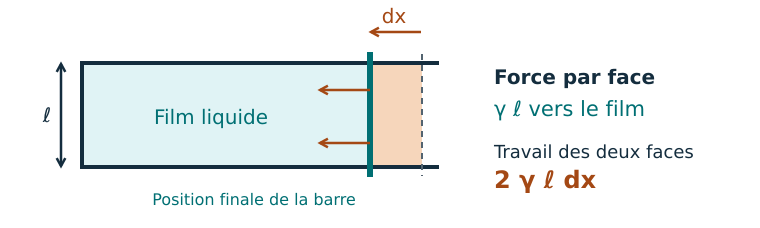

### Question 3

Une molécule occupe une aire de l’ordre de $a^2$. En attribuant à chacune une énergie d’ordre $k_{\rm B}T$ (la valeur de référence vaut $3k_{\rm B}T/2$), on trouve $\gamma\sim k_{\rm B}T/a^2$. Avec $a=3\times10^{-10}\,\mathrm m$, le quotient vaut environ $4\times10^{-2}\,\mathrm{J\,m^{-2}}$, à comparer à $7{,}2\times10^{-2}\,\mathrm{J\,m^{-2}}$. Les deux valeurs diffèrent de moins d’un facteur deux. L’échelle moléculaire donne le bon ordre de grandeur sans décrire en détail la cohésion de l’eau.

### Question 4

On a $[\rho g]=\mathrm{N\,m^{-3}}$ et $[\gamma]=\mathrm{N\,m^{-1}}$. Le quotient $\gamma/(\rho g)$ a donc la dimension d’une longueur au carré. Avec la convention usuelle, $\ell_c=\sqrt{\gamma/(\rho g)}$. Pour l’eau, $\ell_c=\sqrt{0{,}072/(10^3\times9{,}8)}\,\mathrm m\simeq 2{,}7\,\mathrm{mm}$. L’analyse dimensionnelle ne fixe pas un éventuel facteur numérique.

## I.B — L’ascension capillaire

### Question 5

Soit $S_0$ l’aire libre du cristallisoir. Alimenter une colonne de hauteur $h$ demande un volume de l’ordre de $\pi r^2 h$. Hors déplacement négligeable dû à la paroi mince, la baisse du réservoir est donc $|\Delta z_0|\simeq \pi r^2 h/S_0\ll h$, car $S_0\gg\pi r^2$. Le niveau extérieur fournit une référence fixe à cette précision.

### Question 6

À la hauteur $z$, la colonne de section $\pi r^2$ contient la masse $m=\rho\pi r^2z$. Son centre de gravité est à $z/2$ au-dessus de la surface de référence. À la constante d’origine choisie près, $E_{\rm pp}=mgz/2=\rho g\pi r^2 z^2/2$.

### Question 7

Sur la longueur émergée $\ell$, la hauteur mouillée vaut $z$ et la hauteur sèche vaut $\ell-z$. En négligeant l’extension verticale du ménisque comme demandé, les aires sont $A_{\rm SL}=2\pi rz$ et $A_{\rm SV}=2\pi r(\ell-z)$. Leur somme est l’aire intérieure fixe $2\pi r\ell$.

### Question 8

Les contributions intérieures sont $\gamma_{\rm SL}A_{\rm SL}+\gamma_{\rm SV}A_{\rm SV}$. L’interface extérieure et le ménisque translaté sans déformation donnent des termes indépendants de $z$. Ainsi $E_{\rm ps}=2\pi rz(\gamma_{\rm SL}-\gamma_{\rm SV})+K$, où $K$ contient notamment $2\pi r\ell\gamma_{\rm SV}$, à la référence d’énergie près. Avec Q6,

$$E_p(z)=\frac{\rho g\pi r^2}{2}z^2+2\pi r(\gamma_{\rm SL}-\gamma_{\rm SV})z+K.$$

### Question 9

À un équilibre intérieur $h$, la force généralisée s’annule, donc $E_p'(h)=0$. Un minimum strict correspond à un équilibre stable. Ici $E_p''(z)=\rho g\pi r^2>0$, de sorte que toute solution intérieure est stable.

### Question 10

L’équation $\rho g\pi r^2h+2\pi r(\gamma_{\rm SL}-\gamma_{\rm SV})=0$ donne $h=2(\gamma_{\rm SV}-\gamma_{\rm SL})/(\rho gr)$. Une ascension correspond à $\gamma_{\rm SV}>\gamma_{\rm SL}$, si le tube est suffisamment long pour contenir la colonne.

### Question 11

La relation de Young-Dupré du sujet donne $\gamma_{\rm SV}-\gamma_{\rm SL}=\gamma\cos\theta$, d’où la loi de Jurin

$$\boxed{h=\frac{2\gamma\cos\theta}{\rho gr}=\frac{2\ell_c^2\cos\theta}{r}.}$$

Le produit $hr$ est donc fixé par les matériaux et la température. L’eau monte pour un verre mouillant ($\theta<90^\circ$). Un angle obtus donnerait une dépression du niveau.

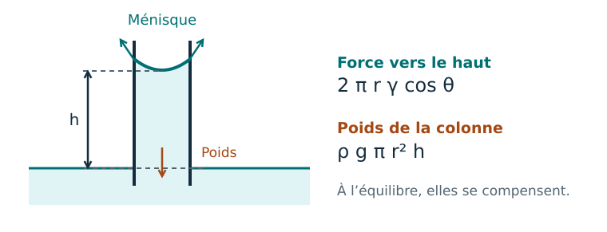

### Question 12

Pour une ascension, la condition $r\ll h$ équivaut à $r^2\ll2\ell_c^2\cos\theta$, soit $r\ll\ell_c\sqrt{2\cos\theta}$. Puisque $\cos\theta\leq1$, elle impose un tube fin à l’échelle capillaire, $r\ll\ell_c$ à un facteur d’ordre un près. Si $\cos\theta$ est d’ordre un, un rayon de quelques dixièmes de millimètre convient pour l’eau. Près de $90^\circ$, la condition sur $r$ devient plus exigeante.

## I.C — La forme et la vitesse des gouttes de pluie

### Question 13

Le flou de mouvement vaut $v_\infty t_{\rm pose}$. Pour une goutte millimétrique à $10\,\mathrm{m\,s^{-1}}$, parcourir $1\,\mathrm{mm}$ prend $10^{-4}\,\mathrm s$. En limitant le flou à $0{,}1\,\mathrm{mm}$, on choisirait par exemple $t_{\rm pose}\sim10^{-5}\,\mathrm s$. Cela reste très inférieur à l’intervalle de $10^{-3}\,\mathrm s$ entre images. La valeur exacte dépend du détail à résoudre.

### Question 14

La traversée de $0{,}30\,\mathrm m$ à $10\,\mathrm{m\,s^{-1}}$ dure $0{,}030\,\mathrm s$. À $10^3$ images par seconde, on observe donc environ $30$ positions. L’écart vertical entre deux images successives est de l’ordre du centimètre.

### Question 15

Le nombre de Reynolds $\mathrm{Re}=\rho_a v_\infty D/\eta_a$ compare les effets inertiels aux effets visqueux dans l’air. Avec $D$ de quelques millimètres, par exemple $2\times10^{-3}\,\mathrm m$, il vaut $1{,}2\times10\times0{,}002/(1{,}8\times10^{-5})\sim10^3$. L’inertie domine à l’échelle de la goutte, ce qui motive la traînée quadratique du sujet. La traînée reste essentielle au bilan des forces, même si les effets visqueux sont relativement faibles à cette échelle.

### Question 16

La goutte subit son poids, vertical vers le bas, de norme $P=mg=(4\pi/3)\rho R^3g$. La traînée s’oppose au mouvement et la poussée d’Archimède est négligée dans le modèle proposé.

### Question 17

En régime permanent, $(4\pi/3)\rho R^3g=\rho_a\pi R^2v_\infty^2/4$. Après simplification et en choisissant la racine positive,

$$v_\infty=\sqrt{\frac{16\rho gR}{3\rho_a}}.$$

À géométrie sphérique, la vitesse limite croît comme $\sqrt R$.

### Question 18

À vitesse constante, $\rho Vg=\rho_a C S v_\infty^2/2$. Or $V/S=(\pi D^2h/6)/(\pi D^2/4)=2h/3$, donc

$$\boxed{v_\infty=\sqrt{\frac{4\rho gh}{3\rho_a C}}.}$$

À $C$ fixé, le diamètre équatorial n’intervient que si la hauteur dépend elle-même du diamètre. Une famille de gouttes dont la hauteur plafonne présente également un plateau de vitesse.

### Question 19

Aux petits diamètres, les disques pleins suivent approximativement la droite $h=D$ de la figure 8. Avec la symétrie de révolution, ceci correspond à des gouttes quasi sphériques. Quand $D$ augmente, $h$ reste de quelques millimètres tandis que $D$ continue de croître. Les points des grandes gouttes stationnaires se dispersent grossièrement entre $5$ et $9\,\mathrm{mm}$. On peut retenir une hauteur caractéristique de $5$ à $6\,\mathrm{mm}$, comme le suggère aussi l’épaisseur de la goutte (c) rapportée à la barre de $10\,\mathrm{mm}$ de la figure 7. L’estimation ne définit pas une hauteur unique.

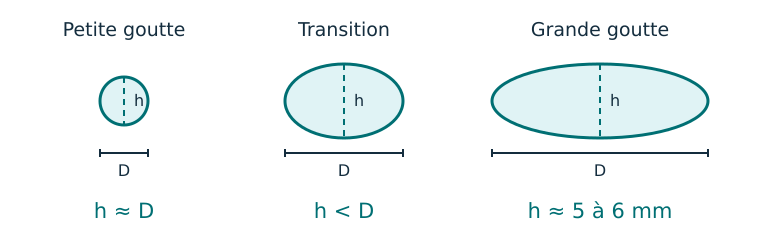

### Question 20

Avec $h\simeq 5\times10^{-3}\,\mathrm m$, $C=0{,}8$, $\rho=10^3\,\mathrm{kg\,m^{-3}}$ et $\rho_a=1{,}2\,\mathrm{kg\,m^{-3}}$, la formule de Q18 donne $v_\infty\simeq \sqrt{4\times9{,}8\times5/(3\times0{,}8\times1{,}2)}\,\mathrm{m\,s^{-1}}\simeq 8{,}2\,\mathrm{m\,s^{-1}}$. Pour une hauteur lue à $6\,\mathrm{mm}$, on obtient environ $9{,}0\,\mathrm{m\,s^{-1}}$.

### Question 21

Aux petits diamètres, la vitesse augmente rapidement, conformément à la loi en $\sqrt D$ des gouttes quasi sphériques. La croissance ralentit ensuite à mesure que les gouttes s’aplatissent. À partir d’environ $7$ à $8\,\mathrm{mm}$, les points se groupent autour d’un plateau proche de $9\,\mathrm{m\,s^{-1}}$ jusqu’aux plus grands diamètres mesurés. La hauteur pratiquement constante de l’ellipsoïde explique ce plateau. L’écart entre $8{,}2$ et $9\,\mathrm{m\,s^{-1}}$ est compatible avec la dispersion des hauteurs et l’approximation de $C$ constant.

## II.A — La courbe de saturation

### Question 22

Dans le plan $(T,P)$, le domaine solide est à gauche de la frontière de fusion, au-dessus de la courbe de sublimation. Le liquide occupe la région entre les courbes de fusion et de vaporisation, du côté des hautes pressions. La vapeur est du côté des basses pressions, sous les courbes de sublimation et de vaporisation. Le point triple, à $0{,}01\,^{\circ}\mathrm C$ et $0{,}00611\,\mathrm{bar}$, réunit les trois phases. Le point critique, à environ $374\,^{\circ}\mathrm C$ et $221\,\mathrm{bar}$, termine la courbe liquide-vapeur. Pour $T>T_c$ et $P>P_c$, l’eau est un fluide supercritique. La courbe de fusion de l’eau a ici une pente négative.

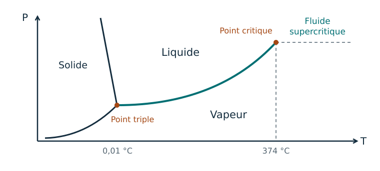

### Question 23

Une vapeur saturante est une vapeur en équilibre avec sa phase condensée, ici l’eau liquide entre le point triple et le point critique. À température fixée, sa pression partielle est $P_{\rm sat}(T)$. Sur le diagramme du corps pur, la courbe de coexistence liquide-vapeur qui joint ces deux points est précisément l’ensemble des couples $(T,P_{\rm sat}(T))$.

### Question 24

Avec les données, $v_{\rm liq}/v_{\rm vap}=10^{-3}/1{,}694\simeq6\times10^{-4}$. Dans ces conditions, $v_{\rm vap}-v_{\rm liq}\simeq v_{\rm vap}$ et $\mathrm dP_{\rm sat}/\mathrm dT\simeq\Delta_{\rm vap}h/(T v_{\rm vap})$. L’approximation se dégrade près du point critique où les deux volumes massiques se rejoignent.

### Question 25

Pour la vapeur à saturation, $P_{\rm sat} v_{\rm vap}=RT/M_{\rm H_2O}$. En substituant $v_{\rm vap}$ dans Q24 et en utilisant $M_{\rm H_2O}\Delta_{\rm vap}h=\Delta_{\rm vap}H_m$, on trouve

$$\frac{\mathrm dP_{\rm sat}}{\mathrm dT}=\frac{P_{\rm sat}\,\Delta_{\rm vap}H_m}{RT^2}.$$

### Question 26

À enthalpie molaire constante, $\mathrm d\ln P_{\rm sat}=(\Delta_{\rm vap}H_m/R)\mathrm dT/T^2$. À $T_{\rm eb}$, on a $P_{\rm sat}=P^\circ$. En intégrant entre cet état et $T$,

$$\ln\frac{P_{\rm sat}(T)}{P^\circ}=\frac{\Delta_{\rm vap}H_m}{R}\left(\frac1{T_{\rm eb}}-\frac1T\right)=A-\frac BT.$$

Ainsi $B=\Delta_{\rm vap}H_m/R$ (en kelvins) et $A=B/T_{\rm eb}$ (sans dimension). La pression calculée augmente avec la température.

### Question 27

Avec $T_{\rm eb}=373\,\mathrm K$, $T_0=288\,\mathrm K$ et $\Delta_{\rm vap}H_m=42{,}5\,\mathrm{kJ\,mol^{-1}}$, l’aide numérique donne $P_{\rm sat}(T_0)/P^\circ\simeq1{,}7\times10^{-2}$. Pour $P^\circ\simeq1\,\mathrm{bar}$, on trouve $P_{\rm sat}\simeq0{,}017\,\mathrm{bar}=17\,\mathrm{mbar}$. Le diagramme à $15\,^{\circ}\mathrm C$ indique précisément environ $0{,}017\,\mathrm{bar}$. L’approximation convient à cette température et à cette précision.

## II.B — L’humidité et sa mesure

### Question 28

Dans le mélange idéal, $P_{\rm H_2O}V=n_{\rm vap}RT$. La masse de vapeur est donc $m_{\rm vap}=M_{\rm H_2O}P_{\rm H_2O}V/(RT)$. Pour obtenir des kilogrammes en SI, on utilise $M_{\rm H_2O}$ en $\mathrm{kg\,mol^{-1}}$.

### Question 29

Pour une vapeur saturante à l’équilibre, $P_{\rm H_2O}=P_{\rm sat}(T)$. L’humidité relative est ainsi $\varphi=1$, soit $100\,\%$.

### Question 30

Initialement $P_{\rm H_2O}=0{,}60\times32=19{,}2\,\mathrm{mbar}$. À volume fixé, si toute la vapeur restait gazeuse dans l’air fermé, sa pression finale vaudrait $19{,}2\times287/298\simeq18{,}5\,\mathrm{mbar}$. Le rapport à la pression de saturation de $16\,\mathrm{mbar}$ serait donc d’environ $1{,}16$, au-dessus de un. De l’eau se condense jusqu’à $P_{\rm H_2O}'=16\,\mathrm{mbar}$, si bien que $\boxed{\varphi'=100\,\%}$. On peut observer de la rosée sur une surface froide ou des gouttelettes de brouillard en suspension.

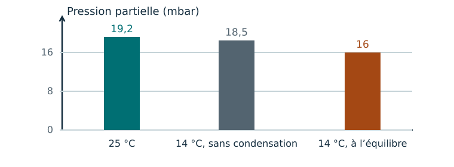

### Question 31

Lorsque l’humidité augmente, la kératine fixe davantage de molécules d’eau. Leurs liaisons hydrogène avec les groupes polaires de la protéine peuvent remplacer ou réorganiser certaines liaisons entre segments de kératine qui stabilisaient les hélices. Des conformations plus étendues deviennent accessibles aux chaînes, ce qui se traduit par une augmentation de longueur de la fibre.

### Question 32

La figure 11 donne environ $L/L_0=1{,}023$ à $90\,\%$ et ne présente pas de point à $100\,\%$. Un prolongement de la tendance donne environ $1{,}025$ à saturation. Pour $L_0=3\,\mathrm m$, on obtient $\Delta L=L_0(L/L_0-1)\simeq 0{,}075\,\mathrm m$, soit environ $7$ à $8\,\mathrm{cm}$. La précision est celle de l’extrapolation graphique.

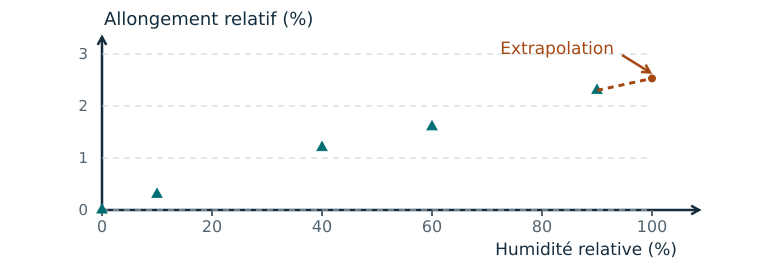

### Question 33

Un système stable du premier ordre soumis à un échelon vérifie $y(t)-y_\infty=(y(0)-y_\infty)e^{-t/\tau}$. En un temps $\tau$, il réalise environ $63\,\%$ de sa variation totale. L’écart résiduel passe sous $5\,\%$ après $3\tau$ et sous $1\,\%$ après environ $5\tau$. Avec $\tau\simeq10\,\mathrm s$, une mesure météorologique se stabilise en une trentaine à une cinquantaine de secondes, compatibles avec les variations ordinaires de l’humidité sur plusieurs minutes. Des variations rapides seraient atténuées et retardées.

### Question 34

On lit, par exemple, $C\simeq164\,\mathrm{pF}$ à $\varphi=0{,}10$ et $C\simeq214\,\mathrm{pF}$ à $\varphi=0{,}90$. La pente est donc $aC_0\simeq(214-164)/0{,}80\simeq62\,\mathrm{pF}$. L’ordonnée à l’origine est environ $158\,\mathrm{pF}$, soit $C_0\simeq1{,}6\times10^2\,\mathrm{pF}$, et $a\simeq62/158\simeq0{,}4$. Le coefficient $a$ correspond à une humidité relative comprise entre zéro et un.

### Question 35

Le générateur alimente en série la résistance et le condensateur. On oriente $i$ vers la borne positive de $C$ et l’on prend $u_R$ et $u_C$ en convention récepteur (voir le schéma). La loi des mailles donne $E=u_R+u_C$. Avec $u_R=Ri$ et $i=C\,\mathrm du_C/\mathrm dt$, on obtient $RC\,\mathrm du_C/\mathrm dt+u_C=E$. Une solution constante est $E$ et la solution homogène s’écrit $K e^{-t/(RC)}$. La continuité de la tension du condensateur impose $u_C(0^+)=u_C(0^-)=0$, donc $K=-E$ et

$$\boxed{u_C(t)=E\big(1-e^{-t/\tau_{\rm RC}}\big),\qquad \tau_{\rm RC}=RC,\quad t\geq0.}$$

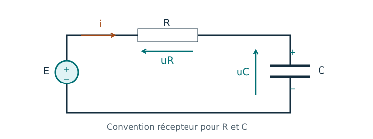

### Question 36

Pour $R=3\,\mathrm{M\Omega}$ et $C=200\,\mathrm{pF}$, $RC=3\times10^6\times200\times10^{-12}\,\mathrm s=0{,}60\,\mathrm{ms}$. Après $5RC\simeq3\,\mathrm{ms}$, la tension dépasse $99\,\%$ de $E$. La charge mathématique est asymptotique. Cette durée pratique, de l’ordre de quelques millisecondes, est brève à l’échelle des variations météorologiques. Elle porte sur la lecture électrique du capteur.

### Question 37

On relève $u_k=u_C(kT_e)$ et on retient le premier entier $k$ tel que $u_k\geq0{,}63E$. L’instant de franchissement se trouve entre $(k-1)T_e$ et $kT_e$. Au seuil exact $(1-e^{-1})E$, il vaut $RC$, donc $C\simeq kT_e/R$, à la précision du seuil et de l’échantillonnage près. Pour environ cent intervalles en $0{,}60\,\mathrm{ms}$, il faut $T_e\simeq6\,\mathrm{\mu s}$ et $f_e=1/T_e\simeq1{,}7\times10^5\,\mathrm{Hz}$, soit environ $170\,\mathrm{kHz}$.

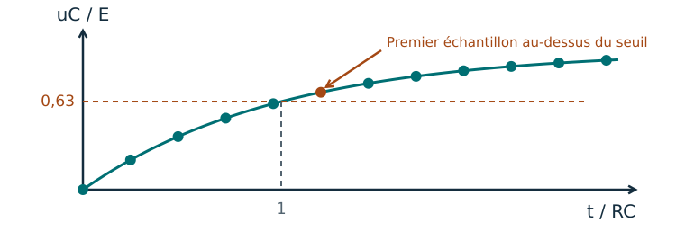

### Question 38

Avec un créneau de rapport cyclique moitié, on demande par exemple $T/2\gtrsim5RC$ pour charger puis décharger presque complètement le condensateur. Il en résulte $f\lesssim1/(10RC)\simeq1{,}7\times10^2\,\mathrm{Hz}$ pour $C=200\,\mathrm{pF}$. Un ordre de grandeur raisonnable est donc $10^2\,\mathrm{Hz}$. Pour fixer une fréquence unique sur toute la gamme, on emploie la plus grande capacité attendue (environ $220\,\mathrm{pF}$), ce qui donne ici une limite voisine de $150\,\mathrm{Hz}$. La limite retenue dépend de la tolérance sur la charge résiduelle.

### Question 39

À chaque front descendant, remettre le chronomètre à zéro et détecter aussi le premier échantillon pour lequel $u_C\leq E/e\simeq0{,}37E$. Pendant la décharge depuis $E$, $u_C(t)=Ee^{-t/(RC)}$, de sorte que ce second délai estime encore $RC$. On obtient une mesure de $C$ et de l’humidité à chaque demi-période, à condition que chaque plateau soit assez long et que l’humidité varie peu pendant la mesure.

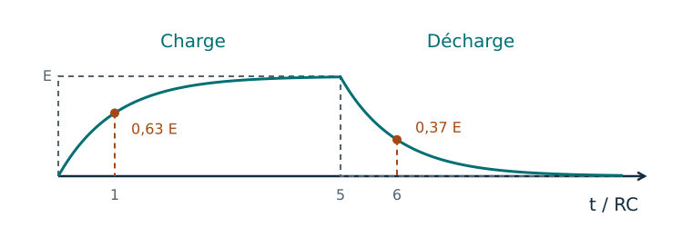

## III.A — La chute libre d’un grêlon

### Question 40

Un corps en chute libre n’est soumis qu’à son poids. Dans le champ de pesanteur uniforme de cette étude, l’accélération est constante et verticale. Si la vitesse initiale est verticale ou nulle, la trajectoire est une droite verticale. Une composante horizontale non nulle donne une parabole dans le plan engendré par la vitesse initiale et la pesanteur.

### Question 41

Dans le référentiel terrestre supposé galiléen, on prend $g$ uniforme, un départ au repos et on néglige toute action de l’air. La perte d’énergie potentielle sur la hauteur $H=10^4\,\mathrm m$ vaut $mgH$. Elle est égale au gain d’énergie cinétique $mv^2/2$. Ainsi $v=\sqrt{2gH}\simeq4{,}4\times10^2\,\mathrm{m\,s^{-1}}$. Cette vitesse dépasserait la célérité du son dans l’air, environ $340\,\mathrm{m\,s^{-1}}$ près du sol. Elle dépasse aussi largement les quelque $50\,\mathrm{m\,s^{-1}}$ mesurés pour de très gros grêlons. L’action de l’air doit intervenir dans le modèle.

## III.B — La traînée et la vitesse limite

### Question 42

La force $\vec F_f=-\kappa v\vec v$ a pour norme $\kappa v^2$. On a donc $[\kappa]=\mathrm{N\,s^2\,m^{-2}}=\mathrm{kg\,m^{-1}}$, soit la dimension d’une masse par unité de longueur.

### Question 43

Dans le référentiel terrestre supposé galiléen, le poids et la résistance de l’air donnent

$$m\frac{\mathrm d\vec v}{\mathrm dt}=m\vec g-\kappa\|\vec v\|\vec v.$$

Pour une masse constante, on peut diviser par $m$. Le signe de la traînée traduit son opposition au vecteur vitesse.

### Question 44

En régime permanent, $\kappa v_\infty\vec v_\infty=m\vec g$. La vitesse limite est verticale et dirigée vers le bas. En notant $\vec e_z=\vec g/g$,

$$\vec v_\infty=\sqrt{\frac{mg}{\kappa}}\,\vec e_z.$$

Si $\kappa$ reste fixé, la norme croît comme $m^{1/2}$. Un grêlon plus lourd doit chuter plus vite pour que la traînée équilibre son poids.

### Question 45

On a $m=(4\pi/3)\rho_{\rm glace}R^3$, d’où $R=(3m/(4\pi\rho_{\rm glace}))^{1/3}$. Comme $\kappa\propto R^2$, il vient $\kappa\propto m^{2/3}$. L’exposant demandé est $\alpha=2/3$.

### Question 46

Avec $\kappa\propto m^{2/3}$, Q44 donne $v_\infty\propto(m/m^{2/3})^{1/2}=m^{1/6}$. Ainsi $\beta=1/6$. La masse augmente encore la vitesse limite, mais plus lentement que dans le modèle à $\kappa$ fixé. Par exemple, multiplier la masse par $64$ multiplie la vitesse limite par $2$ dans ce modèle et par $8$ dans le premier.

## III.B.a — Le départ au repos

### Question 47

Le grêlon part du repos dans une atmosphère immobile. Le mouvement reste vertical et l’axe $z$ est orienté vers le bas. Après le départ, $v_z\geq0$ donc $v=|v_z|=v_z$. L’équation de Q43 projetée selon $\vec e_z$ devient $\mathrm dv_z/\mathrm dt+ (\kappa/m)v_z^2=g$, avec $v_z(0)=0$.

### Question 48

Posons $v_\infty=\sqrt{mg/\kappa}$, $u=v_z/v_\infty$ et $\tau=v_\infty/g=\sqrt{m/(\kappa g)}$. L’équation devient $\mathrm du/(1-u^2)=\mathrm dt/\tau$. En intégrant depuis $u(0)=0$ et en utilisant $\operatorname{argth}(0)=0$, on trouve $\operatorname{argth}(u)=t/\tau$. Ainsi, tant que dure la chute,

$$\boxed{v_z(t)=g\tau\tanh(t/\tau).}$$

La solution vérifie bien $0\leq u<1$ pour tout temps fini positif, ce qui justifie la séparation des variables sur cet intervalle.

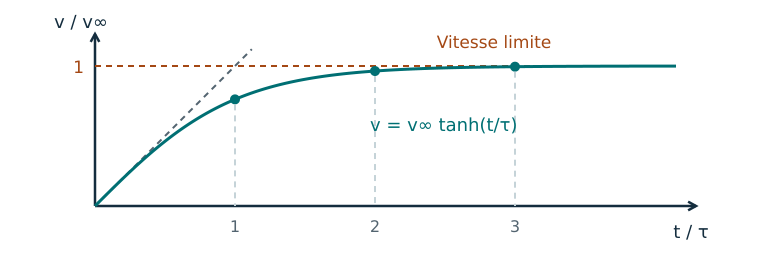

### Question 49

Pour $t\gg\tau$, $\tanh(t/\tau)\to1$ et $v_z\to g\tau=\sqrt{mg/\kappa}$. C’est bien la vitesse de Q44, si le trajet laisse assez de temps pour s’en approcher avant le sol. Au départ, $v_z\simeq gt$, conformément à l’absence de traînée à vitesse nulle.

## III.B.b — Une vitesse initiale oblique

### Question 50

Dans le plan vertical, $v=\sqrt{v_x^2+v_z^2}$. En prenant $z$ descendant, les projections donnent

$$\frac{\mathrm dv_x}{\mathrm dt}=-\frac{\kappa}{m}\sqrt{v_x^2+v_z^2}\,v_x,\qquad \frac{\mathrm dv_z}{\mathrm dt}=g-\frac{\kappa}{m}\sqrt{v_x^2+v_z^2}\,v_z.$$

Les conditions initiales sont $v_x(0)=v_{x,0}$ et $v_z(0)=v_{z,0}$. Les deux équations sont couplées par la norme $v$. Pour $v_{x,0}=0$, la solution verticale précédente constitue un cas particulier.

### Question 51

Euler explicite remplace la dérivée sur tout le pas par sa valeur au début, $f(t_i,y_i)$. Autrement dit, il prolonge la tangente sur $\Delta t$ et pose $y_{i+1}=y_i+\Delta t\,f(t_i,y_i)$. Pour une solution suffisamment régulière, le développement de Taylor contient ensuite un terme d’ordre $(\Delta t)^2$ que l’on néglige sur un pas. À durée totale fixée, l’erreur globale est généralement d’ordre $\Delta t$.

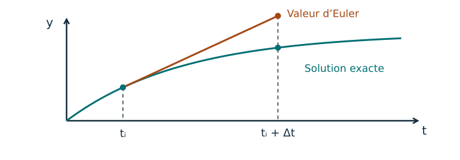

### Question 52

Dans la mise à l’échelle du code, le coefficient de traînée dans l’accélération vaut un. La ligne 7 est donc

```python
acc_x = -norme_v * vx
```

La pesanteur apparaît uniquement dans la composante verticale.

### Question 53

Les deux composantes de l’accélération ont déjà été calculées au rang `i`. Les lignes 28 et 29 s’écrivent

```python
tab_vx[i + 1] = tab_vx[i] + dt * acc_x
tab_vz[i + 1] = tab_vz[i] + dt * acc_z
```

### Question 54

Le programme imprimé emploie des tableaux de longueur `N`. Pour reproduire ses résultats, il faut calculer jusqu’à l’indice `N - 1`, avec `i` allant de `0` à `N - 2`. À l’intérieur de la fonction, on remplace le bloc des lignes 26 à 32 par

```python
i = 0
while i < N - 1:
    acc_x, acc_z = acc(tab_vx[i], tab_vz[i])
    tab_vx[i + 1] = tab_vx[i] + dt * acc_x
    tab_vz[i + 1] = tab_vz[i] + dt * acc_z
    tab_x[i + 1] = tab_x[i] + dt * tab_vx[i]
    tab_z[i + 1] = tab_z[i] + dt * tab_vz[i]
    i += 1
return tab_t, tab_vx, tab_vz, tab_x, tab_z
```

Le commentaire de l’énoncé annonce $N+1$ éléments alors que le code initialise $N$ éléments. De plus, les $N$ dates de `linspace` incluent les deux bornes et sont espacées de $(t_{\max}-t_{\min})/(N-1)$, tandis que le pas utilisé dans les mises à jour est $(t_{\max}-t_{\min})/N$. La substitution ci-dessus préserve la boucle demandée. Pour implémenter effectivement $N$ **pas** sur l’intervalle entier, il faudrait allouer `N + 1` éléments pour chaque tableau, demander `N + 1` dates et boucler `while i < N` avec le `dt` imprimé.

### Question 55

Si $\Delta t$ est trop grand, l’accélération peut beaucoup varier pendant un seul pas. L’approximation par la tangente accumule alors de fortes erreurs sur les vitesses, puis sur les positions. Le sommet et la descente peuvent être mal placés. On peut même obtenir des oscillations ou une inversion artificielle de $v_x$, qui garde son signe dans l’équation continue. Une vérification pratique consiste à diviser le pas par deux à durée totale égale et à comparer les courbes obtenues.

### Question 56

Sans frottements et avec $v_{x,0}\ne0$, $x=v_{x,0}t$, $z=z_0+v_{z,0}t+gt^2/2$. La trajectoire est une parabole, symétrique de part et d’autre de son sommet. La figure 13 porte un axe $z$ positif vers le bas. Le sommet géométrique est donc le minimum numérique de $z$. Sur la branche montante, le grêlon part obliquement vers le haut, sa vitesse horizontale décroît et sa vitesse verticale ascendante s’annule au sommet. Pendant la montée, la composante verticale de la traînée est dirigée vers le bas, avec le poids. Elle s’annule exactement au sommet. Sur la branche descendante, la traînée verticale s’oppose au poids, tandis que la composante horizontale continue de décroître. La descente devient plus raide que la montée, presque verticale sur la figure, et la vitesse tend vers la vitesse limite si la chute se prolonge.

### Question 57

Les courants d’air, notamment les ascendances et le vent horizontal, modifient la vitesse **relative** du grêlon par rapport à l’air, et donc sa traînée. La fonte pendant la traversée d’une couche plus chaude change sa masse et sa section, donc sa vitesse limite au cours de la chute. Ces deux phénomènes peuvent modifier la trajectoire observée.
