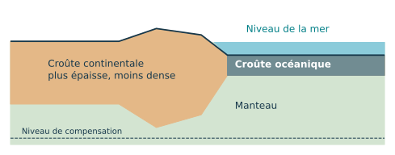
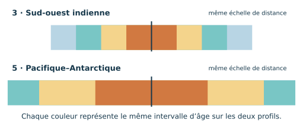
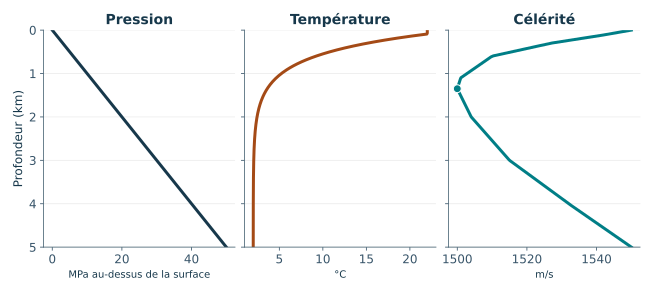
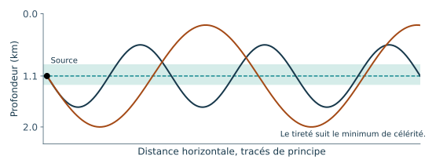
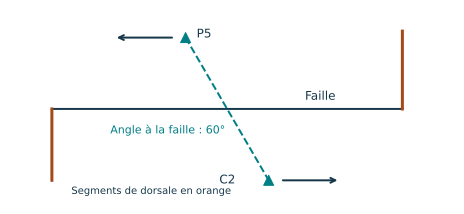
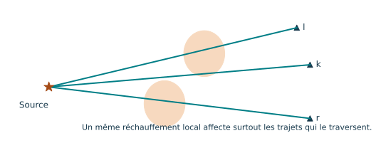
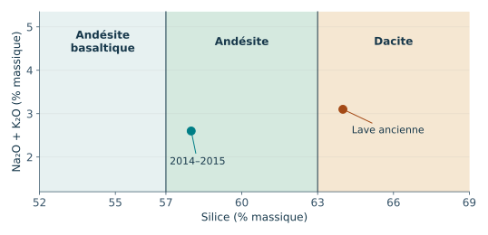
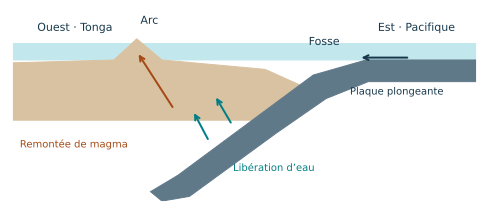

# ENS BCPST — Sciences de la Terre 2026 · Corrigé brut

*Corrigé rédigé par IA, non officiel.*

**Rédaction** · modèle exact non renseigné (famille GPT-6) · effort non renseigné · vitesse non renseignée

**Révision (tour 1)** · GPT-6.2 Astra Ultra · vitesse non renseignée

## Partie 1 · Physiographie et géodynamique de l’océan global

### 1.1 · Deux domaines d’altitude

La profondeur moyenne des océans est d’environ **3,7 km** sous le niveau marin. Le profil d’une course privilégie certaines latitudes et certains reliefs. Il donne un ordre de grandeur, tandis que la moyenne globale se calcule en pondérant chaque profondeur par la surface représentée.

À l’équilibre isostatique, les colonnes lithosphériques exercent des pressions comparables à une même profondeur de compensation. La croûte continentale, épaisse d’environ 30 à 40 km en domaine ordinaire et de masse volumique proche de 2,7 g/cm³, porte des reliefs émergés et possède une racine. La croûte océanique basaltique et gabbroïque, proche de 2,9 g/cm³, ne mesure qu’environ 6 à 7 km. Son plancher se situe plus bas. Le refroidissement du manteau lithosphérique océanique accroît sa densité et entraîne une subsidence à mesure que la plaque s’éloigne de la dorsale.

### 1.2 · Dater le plancher océanique

Un magnétomètre tracté en mer détecte des anomalies du champ magnétique disposées en bandes de part et d’autre des dorsales. En refroidissant, les minéraux magnétiques des laves enregistrent la polarité du champ terrestre. L’accrétion et les inversions successives produisent des séquences homologues sur les deux flancs. On fait correspondre ces séquences à l’échelle des inversions géomagnétiques, calibrée par datation absolue. Les forages apportent des contrôles indépendants, par datation des basaltes ou par l’âge des premiers sédiments qui les recouvrent. Le toit du basalte précède le dépôt de ces sédiments. La carte résulte de la corrélation puis de l’interpolation entre profils, avec un plancher actuel aux axes et des âges généralement croissants vers les flancs.

### 1.3 · Identifier les reliefs numérotés

Suivre le trajet sur la carte de bathymétrie, en conservant l’Antarctique comme point de repère sur la carte d’âges. Les quatre remontées du plancher coïncident avec les bandes d’âge nul des axes d’accrétion.

| Point | Relief associé | Indice géographique |
|---|---|---|
| 2 | Dorsale médio-atlantique, MAR | Tronçon atlantique sud, avant l’entrée dans l’océan Indien. |
| 3 | Dorsale sud-ouest indienne, SWIR | Entre le sud de l’Afrique et l’Antarctique, à l’ouest de la jonction des dorsales indiennes. |
| 4 | Dorsale sud-est indienne, SEIR | Tronçon suivant vers l’Australie, à l’est de cette jonction. |
| 5 | Dorsale Pacifique–Antarctique, PAR | Dans le Pacifique austral, sur le retour vers l’Amérique du Sud. |

Le relief positif de grande longueur d’onde s’explique par une lithosphère jeune, chaude et plus légère à proximité des axes.

### 1.4 · Former du magma sous une dorsale

L’écartement des plaques s’accompagne d’une remontée de l’asthénosphère. Pendant la remontée, la pression diminue rapidement et la température ne diminue que légèrement. La trajectoire de la péridotite recoupe son solidus. Une fraction de la roche fond et produit des liquides basaltiques. Ils migrent, alimentent les réservoirs puis cristallisent en profondeur ou se mettent en place en surface.

### 1.5 · Lire les petites oscillations

L’abscisse est la distance parcourue par le bateau. Les fluctuations rapides traduisent des **reliefs spatiaux** traversés sur un fond dont la profondeur moyenne varie plus lentement. Les collines abyssales, escarpements de failles et édifices volcaniques créés à la dorsale et transportés par l’expansion en fournissent des exemples. Des sommets sous-marins isolés peuvent produire des pics plus marqués. Une seule coupe ne donne ni l’orientation ni l’origine précise de chaque accident.

### 1.6 · Comparer les dorsales 3 et 5

Près de 3, le profil montre un relief accidenté et un sommet vers 1 km de profondeur. Près de 5, la remontée est plus arrondie et culmine vers 2,5 km. Ces profondeurs concernent les points de passage du bateau. Sur la carte des âges, des bandes couvrant le même intervalle de temps sont plus serrées de part et d’autre de la SWIR (3) que de la PAR (5). En comparant les largeurs **perpendiculairement aux axes**, on en déduit que l’accrétion est plus rapide en 5. À épaisseur de croûte comparable, davantage de matériau doit être produit par unité de longueur d’axe et de temps. On attend donc en moyenne une alimentation magmatique plus soutenue en 5. La hauteur du sommet sur la coupe ne mesure pas ce débit. Pour quantifier une vitesse à partir de cette projection, il faudrait convertir les largeurs cartographiques en distances réelles.

## Partie 2 · Le son dans l’océan

### 2.1 · Profils verticaux de pression et de température

En prenant la profondeur $z$ positive vers le bas, l’équilibre hydrostatique donne $dP/dz=\rho g$. La densité de l’eau variant peu à cette échelle, $P(z)\simeq P_{\rm atm}+\rho gz$. La pression augmente d’environ **10 MPa par kilomètre**. Dans un océan de latitude tempérée ou tropicale, une couche superficielle mélangée présente une température relativement élevée et assez uniforme. Elle surmonte une thermocline où la température décroît rapidement. En profondeur, l’eau est froide, sa température varie beaucoup plus lentement. Les valeurs de surface dépendent de la latitude et de la saison.

### 2.2 · Un minimum de célérité

La figure 4 montre une célérité d’environ 1 550 m/s près de la surface, un minimum voisin de 1 500 m/s vers 1 à 1,3 km, puis une remontée vers 1 550 m/s à 5 km. À salinité constante, la figure 3 indique qu’une hausse de température ou de pression augmente la célérité. Dans la thermocline, le refroidissement vers le bas domine l’augmentation de pression. Plus bas, la température change peu et l’effet de la pression devient prépondérant. Le minimum correspond au changement de signe du gradient total.

### 2.3 · Courbure des rais

Dans un milieu stratifié horizontalement, la composante horizontale de la lenteur est conservée. Pour un angle $\theta$ avec l’horizontale, $\cos\theta/c$ reste constant. En s’écartant de la zone du minimum, le rayon pénètre dans une eau plus rapide. Son angle avec l’horizontale diminue. Pour un départ à la célérité $c_0$ sous l’angle $\theta_0$, le point de retournement est atteint là où le rai devient horizontal, à $c=c_0/\cos\theta_0$. Les rais initialement les plus inclinés peuvent donc atteindre des couches plus rapides, plus éloignées de l’axe. Il se recourbe vers les vitesses plus faibles et peut franchir plusieurs fois l’axe du canal. Les différentes inclinaisons à l’émission donnent des profondeurs extrêmes et des distances de retour différentes. Le tracé ne nécessite pas une succession de réflexions sur le fond.

### 2.4 · Placer un hydrophone

Le voisinage du minimum de célérité constitue l’axe du canal acoustique profond, dit SOFAR. Une part de l’énergie émise ou couplée dans ce canal y reste guidée par réfraction. Des signaux, surtout de basse fréquence car ils sont moins absorbés, peuvent donc revenir vers un hydrophone placé à cette profondeur après un long trajet, avec moins de pertes par interaction avec les limites de l’océan.

### 2.5 · Deux sources distinctes

Un **séisme sous-marin** peut faire rayonner une onde acoustique dans l’eau par couplage entre la croûte et l’océan, notamment sous forme d’onde T. Les **vocalisations d’un grand cétacé** constituent un exemple biologique de signal directement émis dans l’eau, détectable à distance dans une bande de fréquences appropriée.

## Partie 3 · Géodésie de la faille de Discovery

### 3.1 · Distance initiale entre les transpondeurs

Le texte appelle les transpondeurs P2 et C5. Les panneaux de la figure 5 les nomment **P5 et C2**. On utilise l’unique paire représentée. Le temps initial d’aller-retour est voisin de $963\,470\ \mu\mathrm{s}=0{,}96347\ \mathrm{s}$. À 2 500 m et vers 1,7 °C, la figure 3 donne une célérité proche de $1{,}50\times10^3\ \mathrm{m\,s^{-1}}$. Pour une propagation réciproque, la distance vaut $d\simeq ct_{\rm AR}/2\simeq 7{,}2\times10^2\ \mathrm m$, soit **environ 720 m**.

### 3.2 · Temps brut et géométrie de la faille

Entre 2008,0 et 2008,5, le temps diminue globalement de quelque 200 à 230 µs, malgré des oscillations. À célérité constante, cela indiquerait un raccourcissement. Or sur le schéma la station au nord-ouest se déplace vers la gauche relativement à celle du sud-est, qui se déplace vers la droite. Leur séparation doit **augmenter** si la faille coulisse dans le sens indiqué. À elle seule, la variation du temps brut a donc le signe opposé à l’effet cinématique attendu.

### 3.3 · Effet de la température

Les deux stations enregistrent une hausse globale d’environ 1,66 à 1,73 °C au premier semestre. À profondeur et salinité pratiquement constantes, cette hausse augmente la célérité. Une même distance est alors parcourue en moins de temps. Cet effet est cohérent avec la baisse du temps de trajet en **5c**. La figure 5b citée dans la question donne la géométrie et le sens du mouvement des plaques. Un réchauffement d’environ $0{,}07$ °C, avec une sensibilité de 4 à 5 m/s par degré lue sur la figure 3, donne $\Delta c\simeq0{,}3\ \mathrm{m/s}$. À distance fixe, $\Delta t_{\rm AR}\simeq-t_{\rm AR}\Delta c/c\simeq-0{,}0002\ \mathrm{s}$, soit une baisse d’environ 200 µs. L’effet thermique a donc le signe et l’ordre de grandeur de la baisse mesurée et peut masquer l’allongement tectonique.

### 3.4 · Moyenne sur le trajet

Sur le trajet de longueur $d$, le temps simple est $t=\int_0^d ds/c(s)$, donc $1/V=(1/d)\int_0^d ds/c(s)$. Remplacer cette intégrale par $\tfrac12(1/V_{P2}+1/V_{C5})$ revient à supposer que la moyenne des **lenteurs aux extrémités** représente la lenteur moyenne sur le trajet. L’hypothèse est exacte pour deux moitiés de trajet chacune à la célérité de son extrémité ou pour une lenteur variant linéairement le long de la ligne. Elle néglige les anomalies intérieures non échantillonnées, la modification sensible du trajet et, pour l’aller-retour, les différences de propagation entre les deux sens.

### 3.5 · Projection de la vitesse d’ouverture

Le mouvement relatif des plaques est parallèle à la faille, de norme $u=14\ \mathrm{cm\,an^{-1}}$. Le taux donné est déjà le taux total. Pendant $\delta t$, les points gagnent une séparation relative $u\delta t$ dans cette direction. Pour une longueur initiale $L$ et l’angle $\alpha=60^\circ$, la géométrie donne

$$
L(t+\delta t)^2=L^2+2Lu\delta t\cos\alpha+(u\delta t)^2.
$$

Au premier ordre, $dL/dt=u\cos\alpha$. Le signe est positif d’après la figure 5b. Le glissement continu attendu produirait donc **7 cm/an d’allongement de la ligne**, soit **3,5 cm en six mois**.

### 3.6 · Glissement déduit de la distance corrigée

La distance corrigée augmente de 1,5 cm en six mois, soit une vitesse moyenne **sur la ligne** de 3 cm/an. Dans la même géométrie et en attribuant toute la déformation à un déplacement parallèle à la faille, le glissement relatif équivalent vaut $3/\cos60^\circ=\mathbf{6}\ \mathrm{cm/an}$. Ce taux moyen sur six mois représente environ 43 % des 14 cm/an attendus. Une mesure entre deux stations ne détermine pas à elle seule la répartition spatiale du glissement sur la faille.

### 3.7 · Interpréter le déficit

Si le mouvement des plaques se poursuit tandis que la zone instrumentée ne l’accommode qu’en partie, les blocs voisins se déforment élastiquement. Le déficit projeté sur la ligne atteint environ $3{,}5-1{,}5=2$ cm en six mois. Il correspond dans le modèle à 4 cm le long de la faille pendant cette durée. Ce déficit est compatible avec un **verrouillage au moins partiel** et une augmentation de la contrainte de cisaillement. L’observation précède les séismes, sans permettre d’en prévoir seule la date ou la magnitude.

## Partie 4 · Thermométrie acoustique dans le Pacifique

### 4.1 · Déplacement nécessaire à célérité constante

Le trajet Kauai–k est un **trajet simple**. Une variation $\Delta t\simeq-0{,}30$ s à $V\simeq1\,500$ m/s donnerait $\Delta d=V\Delta t\simeq-450$ m en dix ans. Cela exigerait un rapprochement d’environ 45 m/an. Les vitesses tectoniques océaniques sont typiquement de quelques centimètres par an, parfois une dizaine. De plus, Kauai et la zone du récepteur k se trouvent sur la plaque Pacifique. L’explication par le rapprochement des points est géologiquement invraisemblable.

### 4.2 · Relier temps et vitesse

À distance $d$ constante, le temps simple vaut $t=d/V$. La différence exacte est $\Delta t=d/(V+\Delta V)-d/V=-d\Delta V/[V(V+\Delta V)]$. Au premier ordre pour $|\Delta V|\ll V$, on obtient

$$
\frac{\Delta t}{d}\simeq-\frac{\Delta V}{V^2}.
$$

Sous forme différentielle, $dt/d=-dV/V^2$. Un raccourcissement du temps correspond à une hausse de la célérité moyenne.

### 4.3 · Amplitude de l’échauffement

Avec $d=3{,}5\times10^6$ m, $V\simeq1{,}5\times10^3$ m/s et $\Delta t=-0{,}30$ s, on trouve

$$
\Delta V\simeq-\frac{V^2\Delta t}{d}
=\frac{(1{,}5\times10^3)^2\times0{,}30}{3{,}5\times10^6}
\simeq+0{,}19\ \mathrm{m\,s^{-1}}.
$$

Pour convertir en température, il faut suivre une ligne de la figure 3 **à profondeur constante**. Dans la gamme des eaux froides, une hausse de 10 °C correspond, à la précision du graphique, à environ 40 à 50 m/s. La sensibilité est de l’ordre de 4 à 5 m/s par degré. On déduit $\Delta T\simeq0{,}19/(4\text{ à }5)$, soit **environ +0,04 à +0,05 °C en dix ans**. L’ordre de grandeur de quelques centièmes de degré est plausible pour un réchauffement moyen intégré sur un long trajet dans l’océan. L’océan peut stocker une partie de l’excédent de chaleur climatique, redistribué par la circulation. Le temps observé dépend aussi des masses d’eau, des courants et de la salinité. Une ligne ne suffit pas à attribuer entièrement la tendance au climat.

### 4.4 · Comparer différents hydrophones

Un réchauffement cohérent à l’échelle du bassin tendrait à raccourcir les temps le long de plusieurs trajets. Chaque ligne traverse cependant des masses d’eau et des courants différents et sa longueur diffère. Même si la seule cause est thermique, le signe local, l’amplitude et les fluctuations peuvent différer. Pour comparer les amplitudes, rapporter la variation du temps à la longueur du trajet ou inverser les observations avec leurs sensibilités propres.

### 4.5 · Tomographier l’océan

La tomographie sismique compare les temps observés sur de nombreux trajets aux temps prédits par un modèle de référence. Un retard signale, toutes choses égales par ailleurs, un excès intégré de lenteur. L’inversion de trajets qui se recoupent permet de localiser les anomalies avec une résolution qui dépend de la couverture. Ici, la figure 6 montre deux éventails de trajets, depuis Kauai et depuis Pioneer. Les croisements permettent à plusieurs temps de parcours de contraindre une même zone. Un trajet isolé, tel Kauai–k, fournit une moyenne intégrée et laisse indéterminée la position de la zone réchauffée. Les rais de la figure 4 oscillent autour du **canal profond voisin de 1 000 m**. Les profondeurs intermédiaires qu’ils parcourent sont donc particulièrement échantillonnées. Des rais inclinés explorent aussi des eaux plus superficielles ou plus profondes. Le résultat est une moyenne le long des rais, de résolution verticale limitée.

## Partie 5 · Le Hunga Tonga–Hunga Ha’apai

### 5.1 · Placer les échantillons sur le TAS

Le diagramme demande en abscisse la teneur en $\mathrm{SiO_2}$ et en ordonnée la somme des oxydes $\mathrm{Na_2O}+\mathrm{K_2O}$, en pourcentages massiques. Il faut sommer les deux alcalins avant de lire le domaine.

| Échantillon | Silice | Alcalins totaux | Domaine |
|---|---:|---:|---|
| Dépôt de 2014–2015 | 58,0 % | $2{,}1+0{,}5=2{,}6$ % | **Andésite** |
| Lave ancienne | 64,0 % | $2{,}4+0{,}7=3{,}1$ % | **Dacite** |

### 5.2 · Contexte tectonique

Sur la figure 7a, la plaque Pacifique converge depuis l’est vers la fosse des Tonga. Un chapelet de volcans est aligné à l’ouest de cette fosse, parallèlement à elle. Le Hunga appartient à cet **arc insulaire de subduction océanique**. La lithosphère pacifique plonge vers l’ouest sous la plaque supérieure de l’arc des Tonga, du côté australien au sens large. Les compositions andésitique et dacitique sont compatibles avec ce contexte, que la géométrie fosse–arc et les vecteurs de mouvement établissent plus directement.

### 5.3 · Genèse des magmas d’arc

En profondeur, les minéraux hydratés de la plaque plongeante subissent des réactions métamorphiques et libèrent de l’eau. Celle-ci gagne le coin de manteau sus-jacent et abaisse le solidus de ses péridotites. Leur fusion partielle produit des magmas primaires généralement basaltiques. Ces liquides remontent et peuvent évoluer pendant leur stockage dans la croûte de l’arc. Les laves observées en surface peuvent ainsi être plus riches en silice.

### 5.4 · Différenciation des liquides

La lave ancienne contient davantage de silice et d’alcalins, moins de MgO et de CaO. Une **cristallisation fractionnée** est compatible avec cette évolution. La séparation de minéraux précoces magnésiens et calciques, notamment des pyroxènes et du plagioclase calcique, appauvrit le liquide restant en ces éléments et l’enrichit relativement en silice et en alcalins. La dacite correspondrait à un liquide plus évolué que l’andésite. Son âge plus ancien exclut qu’elle dérive directement du liquide émis en 2014–2015. Les deux analyses peuvent enregistrer des degrés différents de différenciation au cours de plusieurs épisodes, et deux analyses seules n’imposent pas un lien de filiation.

### 5.5 · Pourquoi le signal hydroacoustique a-t-il pu être faible ?

Une hypothèse est un **faible couplage avec le canal acoustique profond**. La carte montre un édifice culminant près du niveau marin, avec des îlots émergés. Une explosion très superficielle peut transférer une fraction importante de son énergie à l’atmosphère. Une partie de l’énergie émise dans l’eau peut en outre être réfléchie, diffusée ou masquée par la topographie de l’arc avant d’atteindre un trajet guidé. Un signal atmosphérique détecté jusqu’en Alaska et un signal hydroacoustique relativement faible à grande distance sont alors compatibles. L’énoncé appelle une hypothèse. La carte antérieure à 2022 et l’intensité de l’explosion ne donnent pas la fraction d’énergie effectivement injectée dans chaque milieu.

## Sources

Les cartes, les courbes et le tableau de compositions sont ceux de l’épreuve commune de l’ENS Paris-Saclay, de l’ENS de Lyon, de l’ENS de Paris et de l’École nationale des ponts et chaussées. La banque publie les sujets et rapports par discipline. [Sujet officiel de 2026](https://banques-ecoles.fr/cms/wp-content/uploads/2026/07/261242_BCPST_SCIENCES_DE_LA_TERRE_2026_corr.pdf) · [Index de la banque BCPST](https://banques-ecoles.fr/cms/filiere-bcpst/les-annales-et-rapports-des-jurys/)
