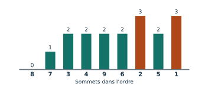
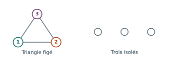
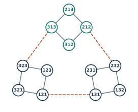
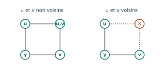
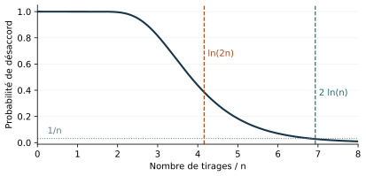
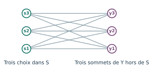
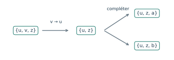
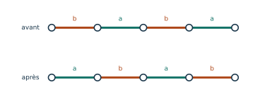
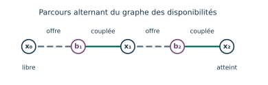
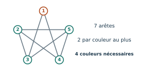

# ENS MP-MPI — Informatique fondamentale 2026 · Corrigé guidé

*Corrigé rédigé par IA, non officiel.*

**Rédaction** · modèle exact non renseigné (famille GPT-6) · effort non renseigné · vitesse non renseignée

**Révision (tour 1)** · modèle exact non renseigné (famille GPT-6) · effort non renseigné · vitesse non renseignée

**Révision (tour 2)** · GPT-6.2 Astra Ultra · vitesse non renseignée · 24 novembre 2026

**Révision (tour 3)** · GPT-6.2 Astra Ultra · vitesse non renseignée · 26 novembre 2026

## Présentation du sujet

Une coloration peut être facile à construire et impossible à modifier sommet par sommet. Le sujet examine ce phénomène avec trois regards différents. La partie I construit des chemins de recoloration, la partie II reconstruit le graphe d’origine à partir de ses colorations et la partie III étudie les pas d’une marche aléatoire. La partie IV remplace les colorations par des ensembles dominants. En partie V, on colore les arêtes et une permutation de deux couleurs débloque la situation.

L’écrit commun de quatre heures a eu lieu le 17 avril 2026, sans calculatrice. Le sommaire de l’ENS répertorie l’épreuve pour Ulm, Lyon, Paris-Saclay et Rennes. [Sujet officiel](https://www.ens.psl.eu/sites/default/files/vpubliee_mp_mpi_info_fond_ulsr_26.pdf) · [Sommaire ENS](https://www.ens.psl.eu/rapports-et-sujets-2026-mpi)

Pour aborder l’épreuve, les exemples I.1–4 et le dessin II.1 fixent les objets. Les questions III.1–6 et V.1–5 s’appuient ensuite sur le cours de probabilités et la parité. La recherche d’un invariant en IV.5 et l’augmentation d’un couplage en V.7 demandent des arguments plus longs. Deux énoncés imprimés, I.12 et III.11, admettent des contre-exemples. Pour chacun le corrigé donne aussi une version démontrable.

Les graphes sont simples, finis, non orientés, avec $n$ sommets et $m$ arêtes. On écrit $\Delta$ pour le degré maximum, $N(v)$ pour le voisinage de $v$ et $N[v]=N(v)\cup\{v\}$. Une $k$-coloration attribue à chaque sommet une couleur parmi $1,\ldots,k$, différente de celles de ses voisins. Le nombre chromatique $\chi(G)$ est le minimum de ces $k$. Dans les trois premières parties, un mouvement change la couleur d'un seul sommet en conservant une coloration valide.

## Partie I — Dégénérescence et chemins de recoloration

Pour prouver une borne sur la dégénérescence, un ordre explicite donne la borne supérieure. Pour prouver que le degré moyen contrôle la reconfiguration, il faudra aussi lier les degrés de tous les sous-graphes restant après suppression.

### Question I.1

> [!INDICATION]
> Lire les sommets dans l’ordre des numéros et ne compter que les arêtes qui retournent vers un numéro déjà lu.

#### Solution

Dans l'ordre **$1,2,3,4,5$**, les voisinages antérieurs sont respectivement $\varnothing,\{1\},\{1,2\},\{1,3\},\{1,4\}$. Aucun ne dépasse deux éléments. C'est un ordre de $2$-dégénérescence.

### Question I.2

> [!INDICATION]
> Pour la borne inférieure, quel que soit l’ordre, regardez son dernier sommet. Pour la borne supérieure, effacez successivement un sommet de petit degré et inversez la liste.

#### Solution

Les degrés des sommets numérotés de 1 à 9 sont $3,4,4,6,3,3,4,4,3$. Chaque sommet du graphe a donc au moins trois voisins. Le dernier sommet de tout ordre en a donc au moins trois avant lui. Réciproquement, dans l'ordre $8,7,3,4,9,6,2,5,1$, les nombres de voisins antérieurs valent $0,1,2,2,2,2,3,2,3$. La dégénérescence est **$3$**.

### Question I.3

> [!INDICATION]
> Repérer le membre de la clique qui apparaît en dernier.

#### Solution

Dans un ordre de dégénérescence, le dernier sommet de la clique a les $\omega-1$ autres pour voisins antérieurs. Ainsi $d\geq\omega-1$.

### Question I.4

> [!INDICATION]
> Conserver les positions relatives de tous les sommets qui subsistent.

#### Solution

Restreindre l'ordre aux sommets de $H$ préserve leurs positions relatives. Effacer des sommets ou des arêtes peut seulement retirer des voisins antérieurs. Le même majorant $d$ convient.

### Question I.5

> [!INDICATION]
> Utiliser une palette de taille d + 1. Au moment de traiter un sommet, quelles couleurs ont déjà été interdites ?

#### Solution

Parcourir les sommets dans l'ordre donné. Pour $v_i$, marquer dans un tableau les couleurs de ses voisins déjà traités, puis lui donner la première couleur libre dans $\{1,\ldots,d+1\}$. Au plus $d$ couleurs sont interdites. Toute arête reçoit des couleurs distinctes lorsque sa dernière extrémité est traitée.

Lire les listes coûte $O(n+m)$ au total et initialiser ou parcourir les palettes coûte $O((d+1)n)$. On obtient $O(dn+m)$ pour $d\geq1$. Pour $d=0$, écrire explicitement les $n$ couleurs prend $O(n)$.

On peut même éviter de réinitialiser la palette pour chaque sommet. Un tableau de marques, initialisé une seule fois sur $\min(d+1,n)$ couleurs, enregistre l’indice $i$ pour chaque couleur rencontrée chez un voisin antérieur de $v_i$. Si $r_i$ est le nombre de ces voisins, une couleur disponible apparaît parmi les $r_i+1$ premières. La recherche prend donc $O(r_i+1)$. Comme $\sum_i r_i=m$, cette variante coûte $O(n+m)$, écriture de la réponse comprise.

### Question I.6

> [!INDICATION]
> Chercher le dernier sommet de l’ordre avant de chercher le premier. Mettre à jour uniquement les degrés des voisins du sommet effacé.

#### Solution

Tout sous-graphe induit non vide possède un sommet de degré au plus $d$, par I.4 et en prenant son dernier sommet. Maintenir les degrés du graphe restant et une file des sommets de degré au plus $d$. Extraire un sommet, l'effacer, puis décrémenter le degré des voisins encore présents. Enfiler un voisin lorsque son degré passe de $d+1$ à $d$. Chaque sommet entre une fois dans la file et chaque arête est consultée au plus deux fois.

Inverser l'ordre des suppressions donne l'ordre recherché, car les voisins encore présents à la suppression deviennent les voisins antérieurs. L'ordre coûte $O(n+m)$ et I.5 donne la coloration en $O((d+1)n+m)$. On peut remplacer $d$ par $\min(d,n-1)$ pour limiter la taille des tableaux.

> [!METHODE]
> La file fournit un ordre de suppression. Pour l’utiliser en coloration gloutonne, lire les retraits en sens inverse.

### Question I.7

> [!INDICATION]
> Compter les arêtes de chaque sous-graphe en les rattachant à leur dernière extrémité dans l’ordre.

#### Solution

Dans tout sous-graphe non vide $H$, compter chaque arête à son extrémité la plus tardive dans l'ordre restreint. On trouve $|E(H)|\leq d|V(H)|$, donc **$\operatorname{dmm}(G)\leq2d$**. Pour $d>0$, la première contribution est nulle, ce qui rend l'inégalité stricte sur tout graphe fini.

### Question I.8

> [!INDICATION]
> Enlever le dernier sommet et rejouer une transformation sur le graphe restant. Quand faut-il déplacer provisoirement la couleur du sommet retiré ?

> [!INDICATION]
> Pour borner les recolorations du dernier sommet, facturer chacune à un mouvement de l’un de ses voisins, sauf éventuellement la toute dernière.

#### Solution

Procédons par récurrence sur le nombre de sommets. Le graphe vide convient. Pour $G-v_n$, prendre la transformation fournie par l'hypothèse et la rejouer dans $G$. Si le prochain mouvement veut donner à un voisin de $v_n$ la couleur actuelle de $v_n$, recolorer d'abord $v_n$ en évitant les couleurs de ses au plus $d$ voisins et la couleur entrante. Une des $d+2$ couleurs convient. À la fin, donner si nécessaire sa couleur cible à $v_n$, licite puisque ses voisins ont atteint la leur.

Chaque $v_j$, $j<n$, garde son nombre de mouvements. Le nombre pour $v_n$ est au plus
$$1+\sum_{j<n:\,v_jv_n\in E}(d+1)^j
 \leq1+d(d+1)^{n-1}\leq(d+1)^n.$$
Cela inclut $d=0$.

> [!PIEGE]
> Pour une recoloration de secours, écarter aussi la couleur qui sera donnée au voisin au pas suivant. Le mouvement en attente détermine cette interdiction supplémentaire.

### Question I.9

> [!INDICATION]
> Si L sommets ont un petit degré, minorer la somme des degrés grâce aux n − L autres.

#### Solution

Soit $L$ le nombre de sommets de degré au plus $d-1$. Les autres ont degré au moins $d$, donc $(d-\varepsilon)n=\sum_v\deg(v)\geq d(n-L)$. Ainsi **$L\geq\varepsilon n/d$**.

### Question I.10

> [!INDICATION]
> Un sommet de petit degré choisi fait perdre au plus d candidats, lui compris.

#### Solution

Parmi ces $L$ sommets, sélectionner un sommet puis retirer de la liste ce sommet et ses voisins, jusqu'à épuisement. Chaque sélection élimine au plus $d$ candidats. On obtient un ensemble indépendant de taille au moins $L/d\geq\varepsilon n/d^2$, dont les sommets ont bien degré au plus $d-1$ dans $G$.

### Question I.11

> [!INDICATION]
> Appliquer I.10 plusieurs fois et majorer la taille du reste après h retraits. Pourquoi l’hypothèse de degré moyen maximum permet-elle de recommencer ?

#### Solution

Posons $\alpha=\varepsilon/d^2\in(0,1)$. Dans chaque sous-graphe restant, le degré moyen est au plus $d-\varepsilon$, par la définition du degré moyen maximum. Les calculs I.9–10 fournissent donc un ensemble indépendant d'au moins la fraction $\alpha$ de ses sommets, tous de degré au plus $d-1$ dans ce sous-graphe. Retirer cet ensemble comme prochaine couche $S_i$. Le reste avant son retrait est précisément $G[\bigcup_{j\geq i} S_j]$.

Après $h$ retraits, il reste au plus $n(1-\alpha)^h$ sommets. Dès que ce nombre est strictement inférieur à $1$, le processus est terminé. Ainsi $r\leq1+\ln n/[-\ln(1-\alpha)]$. L'hypothèse $\operatorname{dmm}(G)=d-\varepsilon>0$ impose $n\geq2$, donc on peut prendre $c_{d,\varepsilon}=1/\ln 2+1/[-\ln(1-\alpha)]$.

> [!METHODE]
> Pour borner un nombre de couches, passer de la fraction éliminée à la taille du reste. Une fois ce reste strictement inférieur à un, son intégralité impose qu’il soit vide.

### Question I.12

> [!INDICATION]
> Comparer exactement les hypothèses de I.11 et I.12. Que se passe-t-il si on ajoute des sommets isolés à un triangle qui utilise les trois couleurs ?

#### Solution

**L'hypothèse de degré moyen imprimée est insuffisante.** Prendre un triangle et trois sommets isolés. Son degré moyen vaut $1=2-1$. Avec $d+1=3$ couleurs, chaque sommet du triangle voit les deux autres couleurs et ne peut jamais changer. Deux colorations qui permutent deux couleurs du triangle sont donc inaccessibles l'une depuis l'autre.

Avec l'hypothèse de I.11, $\operatorname{dmm}(G)\leq d-\varepsilon$, on obtient la conclusion attendue. Construire la transformation sur les couches en ordre inverse. Pour ajouter $S_i$, rejouer la transformation déjà construite sur les couches suivantes. Avant un mouvement qui créerait un conflit, recolorer chacun des voisins menacés dans $S_i$. Chacun a au plus $d-1$ voisins actuellement présents. On peut éviter leurs couleurs et la couleur entrante avec $d+1$ couleurs. L'indépendance de $S_i$ permet ces mouvements l'un après l'autre. Terminer en donnant à ses sommets leurs couleurs cibles.

Si chaque sommet des couches suivantes bouge au plus $M$ fois, un sommet de $S_i$ bouge au plus $1+(d-1)M$ fois. Une borne par sommet après $r$ couches est $(d+1)^r$, d'où au plus $n(d+1)^r$ mouvements. Comme $r=O_{d,\varepsilon}(\ln n)$, ce nombre est majoré par un polynôme en $n$ à $d,\varepsilon$ fixés. Le cas $n=1$ se traite directement.

## Partie II — Reconstruire le graphe à partir de ses colorations

Un sommet de ce nouveau graphe représente une coloration entière. Ses voisins décrivent les mouvements immédiatement autorisés. Les petits carrés de ce graphe permettront de lire si deux mouvements peuvent être réalisés indépendamment.

On note $C_k(G)$ le graphe des $k$-colorations de $G$, deux colorations étant adjacentes si elles diffèrent en un unique sommet.

### Question II.1

> [!INDICATION]
> Fixer la couleur centrale puis faire varier indépendamment les couleurs aux deux extrémités du chemin. Quels états permettent de changer le centre ?

#### Solution

Écrivons une coloration $xyz$ dans l'ordre du chemin, avec $y$ au centre. Pour $y$ fixé, $x$ et $z$ ont indépendamment deux choix, d'où un carré. Un changement du centre est possible exactement quand $x=z$. Les trois arêtes entre carrés sont $121$–$131$, $212$–$232$ et $313$–$323$. Le dessin représente les douze états et leurs quinze arêtes.

### Question II.2

> [!INDICATION]
> Une fois k − 1 sommets fixés dans une clique, combien de possibilités reste-t-il pour le dernier ?

#### Solution

Une coloration de $K_k$ utilise chaque couleur exactement une fois. Chacun des $k!$ états est isolé parce que changer une couleur créerait un conflit. Ainsi $C_k(K_k)$ est un graphe sans arêtes sur $k!$ sommets.

### Question II.3

> [!INDICATION]
> Chercher comment ajouter un sommet dont la couleur serait imposée par celles de ses voisins.

#### Solution

Prendre $G=K_k$ et obtenir $H$ en dédoublant un sommet en deux sommets non adjacents qui ont les mêmes voisins. $H$ contient $K_k$ et une coloration de $G$ s'y prolonge en donnant la même couleur aux deux copies. Dans toute $k$-coloration de $H$, les $k-1$ voisins communs épuisent $k-1$ couleurs et imposent cette égalité. Les $k!$ colorations sont gelées dans les deux graphes. Ainsi les graphes de colorations sont isomorphes, tandis que $G$ et $H$ ont des tailles différentes. L'exemple couvre aussi $k=1$.

> [!PIEGE]
> Les noms des couleurs comptent. Deux permutations d’une palette utilisées sur une clique sont deux sommets différents de son graphe de colorations.

### Question II.4

> [!INDICATION]
> Étiqueter chaque voisin de la coloration par le sommet où il diffère de celle-ci.

#### Solution

Classer les voisins de $\gamma$ par le sommet $u$ dont la couleur change. Deux changements différents au même $u$ donnent deux états adjacents. Des changements à des sommets distincts donnent des états qui diffèrent à deux endroits. Les classes non vides sont donc exactement les composantes de $N(\gamma)$, toutes des cliques, au nombre d'au plus $n$.

### Question II.5

> [!INDICATION]
> Exploiter la couleur laissée inutilisée par la coloration minimale.

#### Solution

Puisque $k>\chi(G)$ et que $\gamma$ n'emploie que $\chi(G)$ couleurs, une couleur inutilisée peut être donnée à n'importe quel sommet. Les $n$ classes sont toutes non vides.

### Question II.6

> [!INDICATION]
> Pour deux sommets non voisins, essayer les deux ordres possibles des mêmes changements de couleur et comparer les résultats.

#### Solution

Par définition, deux cliques de $N(\gamma)$ sont adjacentes dans $G_\gamma$ s'il existe une coloration dans chacune dont l'unique voisin commun est $\gamma$. Associer à chaque clique son sommet modifié donne une injection $f$. Pour $u,v$ non adjacents dans $G$, choisir arbitrairement des recolorations individuelles licites de $u,v$. On peut faire les deux simultanément, puisque ni l'une ni l'autre ne modifie le voisinage de l'autre. Cette double modification et $\gamma$ sont deux voisins communs distincts des états intermédiaires. Les cliques correspondantes ne sont donc pas adjacentes dans $G_\gamma$.

### Question II.7

> [!INDICATION]
> Choisir une même couleur de réserve pour deux sommets voisins et examiner les deux seuls candidats comme voisins communs.

#### Solution

Par II.5, $f$ est bijective. Pour $uv\in E(G)$, choisir une couleur inutilisée $c$ et construire les deux états obtenus en donnant $c$ à $u$ ou à $v$. Deux états différents en exactement deux coordonnées n'ont que deux candidats comme voisins communs. Il faut prendre sur ces coordonnées l'une des deux combinaisons intermédiaires et conserver toutes les autres. L'un des candidats est $\gamma$, l'autre donne $c$ à $u$ et à $v$, donc est illicite. Cela donne l'arête voulue. II.6 traite les non-arêtes, donc **$G_\gamma\simeq G$**.

> [!METHODE]
> Les deux états témoins diffèrent en deux coordonnées. Écrire les quatre combinaisons de ces coordonnées laisse exactement deux états intermédiaires à tester.

### Question II.8

> [!INDICATION]
> Construire chaque graphe local, puis comparer leurs nombres de sommets et d’arêtes. Les cliques locales ne portent aucune étiquette du graphe d’origine.

> [!INDICATION]
> Chaque graphe construit s’injecte dans l’original et l’un atteint exactement l’original. Dans quel ordre comparer ses deux effectifs ?

#### Solution

Pour chaque sommet $\gamma$ du graphe d'entrée $H$, calculer les composantes de $H[N(\gamma)]$. Pour chaque paire de composantes, tester toutes les paires de représentants et relier les composantes si une paire a $\gamma$ comme seul voisin commun. Conserver le graphe obtenu dont le couple (nombre de sommets, nombre d'arêtes) est lexicographiquement maximal.

Par II.6, chaque candidat s'injecte dans $G$ en préservant les arêtes. Par II.7 l'un des candidats est isomorphe à $G$. Le maximum atteint donc les deux effectifs de $G$, et l'injection du candidat conservé devient une bijection préservant exactement les arêtes. L'algorithme restitue $G$ à isomorphisme près.

Pour chiffrer cette première recherche, écrivons $h=|V(H)|$. Construire la matrice d’adjacence de $H$ coûte $O(h^2)$. Pour un centre donné, on examine au plus $h^2$ paires de voisins. Avec cette matrice, balayer les $h$ sommets dénombre leurs voisins communs en $O(h)$ par paire. En répétant pour les $h$ centres, on obtient $O(h^4)$ opérations. Cette borne peut être exponentielle en $|V(G)|$, d’où l’intérêt de la question suivante.

### Question II.9

> [!INDICATION]
> Pour deux sommets voisins, dénombrer les couleurs sur la réunion de leurs voisinages. Quelle portion du graphe des colorations suffit-il alors de lire ?

#### Solution

Choisir maintenant **un seul état arbitraire** $\gamma$. Pour $\Delta\geq1$, les hypothèses donnent au moins $\Delta+2$ couleurs (pour $\Delta=1$, utiliser aussi $k>\chi(G)=2$). Chaque sommet peut donc changer de couleur. Pour $uv\in E(G)$, les voisins de $u$ ou de $v$ utilisent ensemble au plus $2\Delta$ couleurs, y compris les couleurs actuelles de $u,v$. Une autre couleur commune disponible reproduit le témoin de II.7. Si $\Delta=0$, $k>\chi(G)$ assure directement la recoloration de chaque sommet et il n'y a aucune arête à retrouver. Ainsi ce seul $G_\gamma$ convient.

Dans la représentation par tableau de listes d'adjacence, un sommet a au plus $L=n(k-1)$ voisins. Seules les listes de $\gamma$ et de ses voisins sont nécessaires. Comparer naïvement deux listes prend $O(L^2)$, pour $O(L^2)$ paires d'états voisins de $\gamma$. La décomposition en composantes et les autres opérations locales tiennent dans $O((1+nk)^4)$. Cette borne suppose l'accès indicé aux listes donné par l'énoncé, ce qui évite un parcours de tout $H$.

> [!PIEGE]
> Le nombre de colorations peut être exponentiel en la taille du graphe d’origine. Une complexité polynomiale ici repose sur l’accès direct aux listes locales.

## Partie III — Marche aléatoire et temps de couplage

Le choix du même couple sommet–couleur dans les deux trajectoires rend l’égalité définitive une fois atteinte. Suivre le nombre de désaccords permet de majorer le temps qui précède cette rencontre.

À chaque pas, on propose indépendamment un sommet uniforme et une couleur uniforme. On accepte si ses voisins ne portent pas cette couleur. $P$ est la matrice de transition. Dans le couplage, les deux trajectoires utilisent la même proposition à chaque pas et $X_t$ compte leurs sommets de désaccord.

### Question III.1

> [!INDICATION]
> Reprendre la preuve d’existence d’un chemin, puis demander une suite précise de tirages.

#### Solution

Un ordre quelconque est un ordre de $\Delta$-dégénérescence. La construction de I.8 s'applique avec toute palette de taille $k\geq\Delta+2$ car elle demande seulement d'éviter au plus $\Delta+1$ couleurs. Elle fournit une suite de $\ell$ mouvements entre les deux colorations données. Proposer successivement les $\ell$ couples prescrits a probabilité $(nk)^{-\ell}>0$.

### Question III.2

> [!INDICATION]
> Calculer la probabilité de transition entre deux états distincts avant de traiter les sommes.

#### Solution

Hors diagonale, $p_{\gamma,\eta}=1/(nk)$ si les deux états sont adjacents, et $0$ sinon. La relation est symétrique. Chaque ligne somme à $1$ en comptant aussi les propositions laissant l'état inchangé. La symétrie donne la même propriété aux colonnes.

### Question III.3

> [!INDICATION]
> Calculer la masse qui arrive en un état après un pas, puis reconnaître une somme de colonne.

#### Solution

Si $M=|V(C_k(G))|$, la masse de $\eta$ après un pas uniforme vaut $M^{-1}\sum_\gamma p_{\gamma,\eta}=M^{-1}$. La loi uniforme est stationnaire.

### Question III.4

> [!INDICATION]
> Quand la moyenne pondérée de nombres tous inférieurs ou égaux à un maximum peut-elle l’atteindre ?

#### Solution

L'équation $Pv=v$ donne $v_\gamma=\sum_\eta p_{\gamma,\eta}v_\eta$. C'est une moyenne de valeurs au plus égales à $v_\gamma$. Si l'une d'elles était strictement plus petite avec poids positif, la moyenne le serait aussi. Ainsi $v_\eta=v_\gamma$ pour chaque transition de probabilité positive.

### Question III.5

> [!INDICATION]
> Propager l’égalité de III.4. Vérifier l’hypothèse qui permet d’atteindre tous les états.

#### Solution

Sous l'hypothèse $k\geq\Delta+2$ de III.1, l'égalité de III.4 se propage de proche en proche à tous les états. Les seuls vecteurs de $\ker(P-I)$ sont les constantes, qui en forment une droite. Par symétrie, une loi stationnaire vue comme colonne vérifie $P\pi=\pi$. Sa normalisation impose la loi uniforme. Cette connexité est nécessaire à l'argument. Par exemple, les deux $2$-colorations de $K_2$ sont gelées et portent deux lois stationnaires distinctes.

### Question III.6

> [!INDICATION]
> Décomposer le temps en périodes séparées par la première proposition à un nouveau sommet. Les couleurs proposées interviennent-elles ?

#### Solution

Après avoir tenté $j$ sommets distincts, la probabilité de découvrir un nouveau sommet au prochain essai vaut $(n-j)/n$. Le temps d'attente géométrique a espérance $n/(n-j)$. Par linéarité,
$$\mathbb E T=\sum_{j=0}^{n-1}\frac{n}{n-j}=n\sum_{s=1}^n\frac1s
=n\ln n+O(n)=n\ln n+o(n\ln n).$$

> [!METHODE]
> Le nombre de sommets déjà proposés suffit pour calculer le temps moyen jusqu’à la prochaine découverte. La linéarité de l’espérance dispense de démontrer l’indépendance des temps d’attente.

### Question III.7

> [!INDICATION]
> Si les deux réponses à une proposition divergent, chercher un voisin susceptible de faire accepter la couleur dans une seule trajectoire.

#### Solution

Fixer les deux états à l'instant $t$, avec $i$ désaccords. Pour créer un désaccord, la proposition doit être acceptée dans un état et refusée dans l'autre. Le sommet choisi doit être un sommet d’accord. Dans la coloration où la proposition est refusée, un de ses voisins porte la couleur proposée. Dans l’autre coloration, aucun voisin ne la porte. Ce voisin est donc un sommet en désaccord. Pour chacun des $i$ désaccords, il y a au plus $\Delta$ voisins à sélectionner et deux couleurs à proposer. Cela représente au plus $2i\Delta$ couples parmi $nk$. Le même majorant $2i\Delta/(nk)$ subsiste en moyennant conditionnellement à $X_t=i$.

### Question III.8

> [!INDICATION]
> Compter les propositions qui résolvent sûrement un désaccord. Combiner avec la probabilité de hausse de III.7.

#### Solution

À chacun des $i$ sommets en désaccord, au moins $k-2\Delta$ couleurs sont absentes de tous ses voisins dans les deux états. Une telle proposition est acceptée des deux côtés et supprime le désaccord. La probabilité de baisse est donc au moins $i(k-2\Delta)/(nk)$. Une étape change $X_t$ d'au plus $1$. Par III.7,
$$\mathbb E[X_{t+1}\mid X_t=i]\leq i+\frac{2i\Delta}{nk}
-\frac{i(k-2\Delta)}{nk}=i\left(1-\frac{k-4\Delta}{nk}\right).$$
Les conditionnements ici et ci-dessous s'entendent pour les valeurs $i$ de probabilité positive.

> [!PIEGE]
> Une seule proposition est partagée par les trajectoires. Compter les couleurs acceptables simultanément en prenant la réunion des couleurs des deux voisinages.

### Question III.9

> [!INDICATION]
> Écrire la variable comme fonction de la valeur observée de X et développer la formule des probabilités totales.

#### Solution

Poser $m(i)=\mathbb E[X_{t+1}\mid X_t=i]$ et $\Psi_t=m(X_t)$. Si plusieurs $i$ donnent la même valeur de $m$, il faut additionner leurs masses dans la loi de $\Psi_t$ imprimée. Par partition selon $X_t$,
$$\mathbb E\Psi_t=\sum_i\mathbb P(X_t=i)\sum_j j\,\mathbb P(X_{t+1}=j\mid X_t=i)
=\sum_j j\,\mathbb P(X_{t+1}=j)=\mathbb E X_{t+1}.$$

### Question III.10

> [!INDICATION]
> Inclure le cas des deux trajectoires déjà confondues et itérer l’inégalité après avoir pris l’espérance.

#### Solution

Posons $a=(k-4\Delta)/(kn)>0$. Deux états égaux restent égaux, donc la borne de III.8 vaut aussi en zéro. III.9 donne $\mathbb E X_{t+1}\leq(1-a)\mathbb E X_t$. Par récurrence et $X_0\leq n$, **$\mathbb E X_t\leq n(1-a)^t$**.

### Question III.11

> [!INDICATION]
> Insérer le seuil imprimé dans la majoration exponentielle. Puis considérer un graphe sans arêtes, où chaque sommet tiré est couplé aussitôt.

> [!INDICATION]
> Pour une minoration, écrire le nombre de sommets jamais proposés comme somme d’indicatrices et calculer ses deux premiers moments.

#### Solution

**Le seuil imprimé ne donne pas les deux conclusions demandées.** Pour le temps de couplage $T$, le couplage est définitif après la rencontre, donc
$$\mathbb P(T>t)=\mathbb P(X_t\geq1)\leq\mathbb E X_t\leq n e^{-at}.$$
À $t\geq a^{-1}\ln(2n)$, cela donne $1/2$. Le seuil corrigé $t\geq a^{-1}\ln(n^2)$ donne $1/n$. En particulier, pour $t_n=\lceil a^{-1}\ln(n^2)\rceil$, on a $\mathbb P(T\leq t_n)\to1$.

Pour un contre-exemple, prendre $n$ sommets isolés, $k=2$, et les deux colorations initiales constantes différentes. Le couplage a lieu au premier instant où tous les sommets ont été tirés. Pour $n=4$, le premier entier au-dessus du seuil est $9$. Par inclusion-exclusion sur les quatre événements « ce sommet n’a jamais été tiré »,
$$\mathbb P(T>9)=4(3/4)^9-6(2/4)^9+4(1/4)^9
=\frac{4729}{16384}>\frac14.$$
Cela contredit la première borne dès quatre sommets.

Pour la conclusion asymptotique, à $t=\lceil n\ln(2n)\rceil$, le nombre $Z$ de sommets encore inconnus vérifie
$$\mathbb E Z=n(1-1/n)^t\longrightarrow\tfrac12,\qquad
\mathbb E Z^2=\mathbb E Z+n(n-1)(1-2/n)^t\longrightarrow\tfrac34.$$
En effet, les indicatrices de deux sommets distincts valent toutes deux $1$ lorsque les $t$ tirages ont évité ces deux sommets. Les limites résultent de $\ln(1-x)=-x+O(x^2)$. Cauchy–Schwarz appliqué à $Z\mathbf1_{\{Z>0\}}$ donne $\mathbb P(T>t)=\mathbb P(Z>0)\geq(\mathbb E Z)^2/\mathbb E Z^2$, de limite inférieure au moins $1/3$. La probabilité d'échec ne tend donc pas vers zéro au temps annoncé.

Dans cet exemple, on peut même calculer la limite exacte. Pour $t_n=\lceil n\ln(2n)\rceil$, la formule d’inclusion-exclusion donne
$$\mathbb P(T\le t_n)=\sum_{j=0}^n(-1)^j\binom nj(1-j/n)^{t_n}.$$
Pour $j$ fixé, le terme en valeur absolue tend vers $2^{-j}/j!$. En effet, $\binom nj\sim n^j/j!$ et $t_n\ln(1-j/n)=-j\ln(2n)+o(1)$. Il est aussi majoré par $n^j e^{-jt_n/n}/j!\le 2^{-j}/j!$ pour tout $j\le n$. Le majorant étant sommable, la probabilité de couplage tend vers $e^{-1/2}$. Celle de désaccord tend donc vers $1-e^{-1/2}\simeq0{,}393$.

> [!METHODE]
> Pour réfuter une borne probabiliste, une majoration médiocre ne suffit pas. Une borne inférieure sur un exemple permet de conclure.

## Partie IV — Reconfiguration des ensembles dominants

La taille du cœur doit être bornée en fonction de k et t. Toute la difficulté est de retirer les redondances sans créer de nouvelles transformations ni perdre un chemin entre les deux ensembles prescrits.

Un ensemble $D$ domine $X$ lorsque $X\subseteq\bigcup_{v\in D}N[v]$, et le quasi-domine si l'union manque au plus un élément de $X$. Un cœur de $k$-domination est un ensemble $X$ tel que tout ensemble de taille $k$ qui domine $X$ domine $G$. Ici $k\geq2$.

### Question IV.1

> [!INDICATION]
> Majorer la taille de l’union en additionnant les tailles de k voisinages fermés.

#### Solution

Chaque sommet couvre au plus $\lfloor|X|/k\rfloor-1$ éléments de $X$. Pour tout ensemble de taille au plus $k$, l'union en couvre au plus $k(\lfloor|X|/k\rfloor-1)\leq |X|-k$. Au moins deux éléments échappent à l'union. Cela exclut la quasi-domination et, a fortiori, la domination. Ce raisonnement porte sur un graphe non vide, où l’hypothèse impose $\lfloor|X|/k\rfloor\geq1$. Si le graphe vide est admis, l’hypothèse universelle est vraie par vacuité et $D=X=\varnothing$ est dominant. Il faut alors exclure ce cas de l’énoncé de IV.1.

### Question IV.2

> [!INDICATION]
> Suivre simultanément le nombre d’éléments de Y et son inclusion dans chacun des voisinages déjà choisis. Réserver t sommets de Y hors de S.

#### Solution

Après $j$ itérations, $|S|=j$, $Y\subseteq\bigcap_{s\in S}N[s]$ et $|Y|\geq\lfloor|X|/k^j\rfloor$. Cette dernière inégalité s'itère car $\lfloor\lfloor a\rfloor/k\rfloor=\lfloor a/k\rfloor$. Après $t$ itérations, $|Y|\geq2t$. On pourrait alors choisir $t$ sommets dans $Y\setminus S$. Ils seraient tous adjacents aux $t$ sommets de $S$, d'où un $K_{t,t}$, interdit. L'algorithme s'arrête après au plus $t-1$ itérations.

### Question IV.3

> [!INDICATION]
> Supposer le quasi-dominant disjoint de S et appliquer le comptage à la fin de la boucle.

#### Solution

À l'arrêt, chaque sommet hors de $S$ couvre strictement moins de $\lfloor |Y|/k\rfloor$ éléments de $Y$. Le comptage de IV.1 appliqué aux seuls sommets hors de $S$ montre qu'aucun ensemble d'au plus $k$ d'entre eux ne quasi-domine $Y$. Tout quasi-dominant de cette taille rencontre donc $S$.

### Question IV.4

> [!INDICATION]
> Un dominant après suppression de y domine déjà presque tout Y. Comment couvrir y grâce à S ?

#### Solution

Si $D$ de taille $k$ domine $G-y$, il domine tous les éléments de $Y$ sauf peut-être $y$. Par IV.3, il contient $s\in S$. Or $Y\subseteq N[s]$, donc $D$ domine aussi $y$ et par suite tout $G$.

### Question IV.5

> [!INDICATION]
> Conserver le graphe pour les calculs et réduire la liste des sommets à dominer. Montrer que dominer la nouvelle liste implique de dominer l’ancienne.

#### Solution

Initialiser $X=V(G)$. Tant que $|X|>B=2tk^t$, exécuter l'algorithme de l'énoncé dans le graphe initial avec le $X$ courant, prendre $y\in Y$ puis retirer $y$ de $X$. L'invariant est que $X$ est un cœur. En effet, si un ensemble de taille $k$ domine $X\setminus\{y\}$, il quasi-domine $Y\subseteq X$. Par IV.3 il contient $s\in S$ et domine donc $y$. Il domine ainsi l'ancien $X$, puis $G$ par l'invariant. L'initialisation et la taille finale sont immédiates.

On effectue au plus $n$ retraits. Pour chacun, une itération intérieure se réalise en $O(n+m)$ par marquage de $Y$ et lecture des listes, et $|S|$ augmente à chaque tour jusqu'à au plus $n$. Le coût est $O(n(n+1)(n+m))$. Le calcul du seuil peut être plafonné à $n+1$.

> [!PIEGE]
> Le sommet retiré du cœur reste disponible pour former un dominant. Une suppression dans le graphe changerait les candidats qu’il faut comparer.

### Question IV.6

> [!INDICATION]
> Remplacer v par u dans chaque état. Si les deux y figuraient déjà, étudier tous les moyens de compléter l’ensemble obtenu à k sommets.

> [!INDICATION]
> Entre deux images successives, examiner leur union. Elle a soit une extension commune de taille k, soit déjà deux ensembles de taille k directement adjacents.

#### Solution

Soient $u,v$ hors de $X\cup D\cup D'$, avec $N(u)\cap X=N(v)\cap X$. Une chaîne dans $G-v$ reste valide dans $G$, car ses ensembles dominent tous $X$ et $X$ est un cœur. Pour la réciproque, à chaque ensemble intermédiaire $A$ d'une chaîne dans $G$ associer $R(A)$ en remplaçant toute occurrence de $v$ par $u$. Cet ensemble domine toujours $X$. Il a taille $k$, ou $k-1$ si $A$ contenait à la fois $u$ et $v$.

Considérer la famille de tous les $k$-ensembles de $V\setminus\{v\}$ qui contiennent $R(A)$. Elle est non vide car $D\subseteq V\setminus\{v\}$ est de taille $k$. Tous ses membres dominent $X$, donc $G$ et $G-v$. Si $|R(A)|=k$, la famille est un singleton. Sinon elle forme une clique, car deux extensions ne peuvent différer que par le sommet ajouté.

Pour $A,A'$ successifs, les différences de $R(A)$ et $R(A')$ dans les deux sens ont chacune taille au plus $1$. Si leur union a taille au plus $k$, elle a une $k$-extension commune. Sinon ces deux images ont chacune taille $k$ et diffèrent d'un sommet, ce qui donne un pas direct. Les familles successives peuvent donc être reliées, et les familles extrêmes sont $\{D\}$ et $\{D'\}$. Cela construit la chaîne dans $G-v$.

> [!METHODE]
> Une image de taille k − 1 peut être représentée par toutes ses extensions de taille k. La connexité de cette famille permet de choisir des extensions compatibles avec les pas voisins.

### Question IV.7

> [!INDICATION]
> Dénombrer les profils possibles par les sous-ensembles du cœur. Comment retrouver une chaîne effective à partir du graphe réduit ?

#### Solution

Calculer un cœur $X$ de taille au plus $B$. Garder $X,D,D'$ puis un représentant de chaque profil $N(v)\cap X$ parmi les sommets restants, et supprimer les autres. Chaque suppression est licite par IV.6. Après chaque suppression, $X$ reste un cœur du graphe induit, car un $k$-ensemble restant qui domine $X$ le domine aussi dans le graphe initial, donc domine tous les sommets restants. Les profils sur $X$ restent identiques.

Le graphe réduit a au plus $q=B+2k+2^B$ sommets. Énumérer ses ensembles dominants de taille $k$, relier ceux dont les différences ont taille $1$ et lancer un parcours en largeur depuis $D$ en mémorisant les prédécesseurs. Une chaîne simple atteignant $D'$ contient au plus **$f(k,t)=\binom qk$** états. Chaque état produit domine aussi $X$ dans le graphe initial, donc c'est une chaîne pour le problème de départ.

Les profils se comparent par tableaux de $|X|$ bits, même naïvement en temps polynomial en $n$. Après réduction, énumérer jusqu'à $2^q$ sous-ensembles et comparer leurs paires coûte par exemple $O(4^q q^2)$. Avec IV.5, on obtient bien $g(k,t)P(n)$ où le degré de $P$ est indépendant des paramètres.

## Partie V — Coloration des arêtes et chaînes de Kempe

La notation de couleur change dans cette partie. On colorie des arêtes et les couleurs disponibles en un sommet sont celles qu’aucune arête incidente ne porte. Une chaîne bicolore permet de changer cette disponibilité aux extrémités.

Deux arêtes incidentes doivent porter des couleurs distinctes. Pour une coloration partielle $\gamma$, la notation $\gamma(v)$ désigne ici l'ensemble des couleurs absentes des arêtes incidentes à $v$. Un échange de Kempe permute deux couleurs sur une composante du sous-graphe formé par ces deux couleurs.

### Question V.1

> [!INDICATION]
> Pour une arête uv, compter les autres arêtes incidentes à u ou à v.

#### Solution

Traiter les arêtes dans un ordre quelconque. Une arête $uv$ a au plus $(\deg u-1)+(\deg v-1)\leq2\Delta-2$ arêtes voisines déjà colorées. Parmi $2\Delta-1$ couleurs il en reste une. Cette borne vaut pour $\Delta\geq1$. Le graphe sans arêtes se colore avec la palette vide.

### Question V.2

> [!INDICATION]
> Regarder toutes les arêtes en un même sommet de degré maximal.

#### Solution

Les $\Delta$ arêtes incidentes à un sommet de degré maximum doivent porter des couleurs deux à deux distinctes. Toute arête-coloration requiert donc au moins $\Delta$ couleurs.

### Question V.3

> [!INDICATION]
> Réunir seulement les arêtes de deux couleurs. Quels degrés et quelles successions de couleurs sont possibles ?

#### Solution

Le sous-graphe des arêtes de couleurs $a,b$ a degré au plus deux, avec au plus une arête de chaque couleur par sommet. Toute composante contenant une arête est donc un chemin ou un cycle. Les couleurs alternent. Dans un cycle, la dernière couleur doit différer de la première, ce qui impose une longueur paire. Un chemin peut avoir l'une ou l'autre parité.

> [!PIEGE]
> Une chaîne réduite à une arête est déjà un chemin de longueur impaire. La contrainte de parité porte sur les cycles.

### Question V.4

> [!INDICATION]
> Si une chaîne reliait u et v, de quelle couleur seraient sa première et sa dernière arête ? Comparer sa parité à celle des chemins dans un graphe biparti.

#### Solution

Les couleurs de la chaîne sont distinctes. Si $u$ et $v$ appartenaient à une même chaîne, ils en seraient extrémités car il manque $a$ en $u$ et $b$ en $v$. Le chemin de $u$ à $v$ commencerait par $b$ et finirait par $a$, d'où une longueur paire. Deux sommets adjacents d'un graphe biparti sont dans des classes opposées et tout chemin entre eux a longueur impaire. Contradiction. Si $u$ est isolé dans le sous-graphe bicolore, il ne peut de toute façon atteindre $v$.

### Question V.5

> [!INDICATION]
> Retirer une arête et tenter de la remettre. Si les couleurs libres aux deux extrémités diffèrent, faire un échange bicolore du bon côté.

#### Solution

Fixer la palette de $\Delta$ couleurs et colorer par induction sur les arêtes. Après avoir coloré $G-uv$, une couleur $a$ manque en $u$ et une couleur $b$ manque en $v$, car chacun a au plus $\Delta-1$ arêtes colorées. Si $a=b$, l'utiliser pour $uv$. Sinon échanger $a$ et $b$ sur la composante contenant $u$ (rien à faire si elle est isolée). Par V.4, cette composante évite $v$. La couleur $b$ manque maintenant aux deux bouts et convient à $uv$. L'initialisation sans arêtes est immédiate.

### Question V.6

> [!INDICATION]
> Partir du sommet v. Les couleurs doivent changer de disponibilité seulement aux extrémités de la chaîne choisie.

#### Solution

Si $a$ manque déjà en $v$, conserver $\gamma$. Sinon une arête $a$ part de $v$, tandis que $b$ y manque. Échanger $a,b$ sur la chaîne issue de $v$. C'est un chemin. Le sommet $u$ y est absent car les deux couleurs y manquent. À chaque sommet intérieur, les deux couleurs restent présentes. La couleur $a$ manque désormais en $v$. À l'autre extrémité, l'ensemble de couleurs disponibles change exactement par échange de $a$ et $b$. Les mêmes arêtes sont colorées.

### Question V.7

> [!INDICATION]
> Interpréter un choix de couleurs distinctes comme un couplage entre voisins et couleurs libres en u. Depuis un voisin non couvert, chercher un chemin alternant. En cas de blocage, compter combien de voisins atteints offrent une même couleur, puis examiner leurs chaînes bicolores.

> [!INDICATION]
> Si une couleur b est offerte par au moins trois voisins atteints, une même chaîne de b et d’une couleur libre c ne peut contenir les trois. Protéger le partenaire de b pour conserver le couplage.

#### Solution

Notons $U=\gamma(u)$ et formons un graphe biparti. À gauche figurent les $v_i$ des arêtes non colorées, à droite les couleurs de $U$. Une arête $v_i c$ signifie que $c$ manque en $v_i$. Un couplage qui couvre la gauche permet de colorer tous les $uv_i$ avec des couleurs disponibles distinctes.

Autorisons d'abord tout échange de Kempe entre **deux couleurs de $U$**. Le sommet $u$ est isolé pour ces deux couleurs, donc son ensemble $U$ est conservé. Un échange préserve le nombre de couleurs de $U$ manquant à chaque sommet, y compris aux extrémités du chemin. Les hypothèses de l'énoncé restent donc vraies. Parmi les colorations ainsi accessibles et leurs couplages, choisir un couplage $M$ de cardinal maximal. Supposons qu'il laisse un sommet de gauche libre.

Depuis tous les sommets libres de gauche, suivre les arêtes d'offre de gauche à droite, et de chaque couleur atteinte revenir à son partenaire dans $M$ s'il existe. Noter $S$ les sommets de gauche atteints et $B$ les couleurs atteintes. Une couleur libre atteinte fournirait un chemin augmentant (un plus court chemin alterne et on inverse ses arêtes). Toutes les couleurs de $B$ sont donc appariées. Leurs partenaires sont dans $S$, qui contient aussi un sommet libre, donc $|B|\leq |S|-1$. Les offres issues de $S$ totalisent au moins $2|S|-1$, car seul $v_1$ peut n'en avoir qu'une. Comme $2|S|-1>2|B|$, une couleur $b\in B$ est offerte par au moins trois sommets de $S$.

Noter $w$ le partenaire de $b$. Puisque $|U|\geq r$ et que $M$ ne couvre pas la gauche, il existe une couleur libre $c$. Elle n'est offerte par aucun sommet de $S$, sinon elle serait atteinte. Chacun des trois sommets offrant $b$ porte donc une arête $c$ et aucune arête $b$. Il est extrémité d'une chaîne $(b,c)$, et une chaîne en contient au plus deux.

Choisir un plus court chemin alternant des sommets libres jusqu'à $b$, et appeler $x$ le sommet juste avant $b$. Le préfixe jusqu'à $x$ n'utilise ni $b$ ni $c$, et $x\ne w$ (atteindre le partenaire $w$ nécessite de passer par $b$). Deux cas suffisent.

- Si la chaîne issue de $x$ évite $w$, échanger ses couleurs. $M$ reste valide puisque $c$ est libre et que la seule affectation utilisant $b$ est en $w$. Le préfixe jusqu'à $x$ reste valide et $x$ offre maintenant $c$. On peut augmenter $M$.
- Si la chaîne issue de $x$ contient $w$, choisir parmi les offreurs de $b$ dans $S$ un sommet $y$ sur une autre chaîne. Il en existe un puisque la première chaîne a au plus deux extrémités. Échanger sur la chaîne de $y$. Le couplage reste valide. Le préfixe jusqu'à $x$, l'offre $xb$ et l'affectation $bw$ sont intactes, donc $w$ reste atteint. Prendre un ancien chemin simple jusqu'à $y$. S'il empruntait $b$, poursuivre depuis $w$ par son suffixe, sinon garder le chemin entier. Aucun de ces tronçons n'utilise $b$ ou $c$, donc $y$ reste atteint. Il offre désormais la couleur libre $c$, ce qui augmente encore $M$.

Dans les deux cas, le choix maximal est contredit. Un couplage couvrant la gauche existe après échanges, et son affectation achève la $k$-arête-coloration.

> [!METHODE]
> Il faut maximiser sur les colorations accessibles et sur les couplages. Cette double maximisation autorise un échange avant de produire une augmentation.

### Question V.8

> [!INDICATION]
> Retirer un sommet entier, le réintroduire avec toutes ses arêtes non colorées, puis compter les couleurs disponibles chez ses voisins.

#### Solution

Procéder par récurrence sur le nombre de sommets, le graphe vide étant immédiat. Colorer $G-u$ avec la palette $\{1,\ldots,\Delta+1\}$, possible par récurrence puisque son degré maximum est au plus $\Delta$. Au retour de $u$, ses $r=\deg(u)$ arêtes sont les seules non colorées. Les $\Delta+1$ couleurs manquent en $u$, et chaque voisin $v_i$ a au plus $\Delta-1$ arêtes colorées, donc au moins deux couleurs manquantes. Si $r>0$, V.7 s'applique et complète la coloration. Si $r=0$, elle est déjà complète.

### Question V.9

> [!INDICATION]
> Sur un nombre impair de sommets, une couleur manque au moins un sommet. Chercher un graphe de degré maximum donné dont trop d’arêtes restent à couvrir.

#### Solution

Sur $n$ sommets impairs, chaque couleur forme un couplage et couvre au plus $(n-1)/2$ arêtes. Il suffit donc de dépasser $\Delta(n-1)/2$ arêtes avec degré maximum $\Delta$.

Pour $\Delta$ pair, prendre $K_{\Delta+1}$, qui a $n=\Delta+1$ impair et $n\Delta/2$ arêtes. Pour $\Delta$ impair, $\Delta\geq3$, prendre $K_{\Delta+2}$, avec $n=\Delta+2$ impair. Retirer un couplage couvrant $n-1$ sommets, puis une arête reliant le sommet non couvert à l'un des sommets couverts. Tous les degrés deviennent $\Delta$, sauf celui de cette dernière extrémité couverte, qui devient $\Delta-1$. On a $(n\Delta-1)/2>\Delta(n-1)/2$ arêtes puisque $\Delta>1$. Dans les deux cas $\Delta$ couleurs sont insuffisantes.

> [!METHODE]
> Le degré maximum donne une obstruction locale au nombre de couleurs. Compter la taille maximale d’une classe de couleur donne une obstruction globale plus forte sur ces graphes impairs.

## Bilan

Trois témoins concrets permettent de vérifier les preuves. Dans la partie II, le quatrième état d’un carré atteste que deux mouvements peuvent coexister. Dans la partie III, un sommet qui n’a encore jamais été tiré peut empêcher le couplage même sur un graphe sans arêtes. Dans la partie V, un chemin alternant jusqu’à une couleur libre permet de colorer une arête supplémentaire. Ces témoins portent sur des objets différents et fixent le sens des arguments d’existence.
