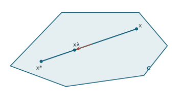
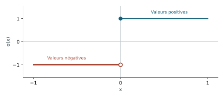
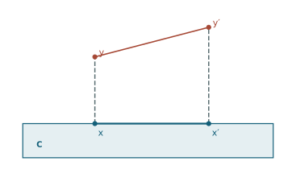
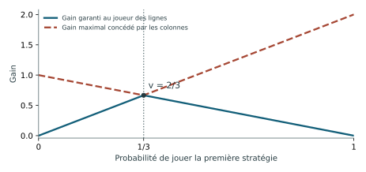
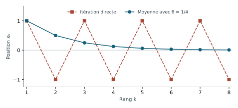
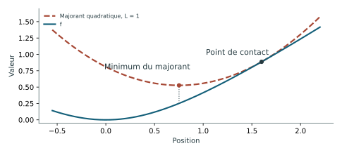
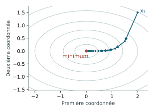

# ENS MP-MPI — Mathématiques C 2026 · Corrigé guidé

*Corrigé rédigé par IA, non officiel.*

**Rédaction** · Modèle : OpenAI Codex (famille GPT-6) · Effort de raisonnement : non renseigné · Mode de vitesse : non renseigné.

**Révision** · Modèle : OpenAI Codex (famille GPT-6) · Effort de raisonnement : non renseigné · Mode de vitesse : non renseigné.

## Présentation du sujet

Un jeu matriciel et une méthode de descente numérique mènent ici à deux questions d’existence : trouver un point où aucun joueur ne gagne à changer seul de stratégie et trouver un minimiseur en répétant un pas de gradient. Le sujet donne deux chemins de preuve. Les parties I et II utilisent la projection sur un convexe, les parties III et IV utilisent les points fixes des applications qui ne dilatent pas les distances.

Sur les quatre heures, on peut traiter 1 à 5 puis aborder 11 à 16 avant de revenir à la moyenne projetée des questions 7 à 9. Les contre-exemples de dimension un demandent peu de calculs. La question 8 exige un contrôle uniforme du point test, et la question 19(c) demande de choisir une fonction auxiliaire. Pour vérifier une démonstration, identifier à chaque fois si l’on utilise la compacité de C, la continuité de G ou la présence d’un point fixe.

On travaille dans l'espace euclidien $\mathbb R^n$. Pour un fermé convexe non vide $C$, $\Pi_C$ désigne la projection sur $C$. On note $I$ l'application identité. Un point $s\in C$ est solution forte si $\langle G(s),x-s\rangle\geq0$ pour tout $x\in C$, et solution faible si $\langle G(x),x-s\rangle\geq0$ pour tout $x\in C$. La monotonie de $G$ signifie que $\langle G(v)-G(u),v-u\rangle\geq0$ pour tous $u,v$.

## Partie I — Inégalités variationnelles et projection sur un convexe fermé

La difficulté initiale tient à la place de G dans l’inégalité. Le point test change en question 2 et la continuité permet de retrouver le champ évalué au point candidat.

### A — Inégalités variationnelles

### Question 1

> [!INDICATION]
> Écrire les deux définitions avec le même point test. Quel terme ajoute-t-on pour passer du produit de l’une au produit de l’autre ?

#### Solution

Soit $x_\ast$ une solution forte. Pour tout $x\in C$, la monotonie donne

$$\langle G(x),x-x_\ast\rangle\geq\langle G(x_\ast),x-x_\ast\rangle\geq0.$$

Comme $x_\ast\in C$, c'est une **solution faible**.

> [!METHODE]
> Les quantificateurs sont identiques dans les deux notions de solution. Le seul changement à contrôler est le point auquel on évalue G.

### Question 2

> [!INDICATION]
> Quelles directions peut-on suivre depuis un point de C tout en restant dans C ?

> [!INDICATION]
> Après avoir divisé par $\lambda>0$, identifier précisément le facteur qui passe à la limite.

#### Solution

**a)** Pour $0<\lambda\leq1$, le point $x_\lambda=x_\ast+\lambda(x-x_\ast)$ appartient à $C$ par convexité. L'inégalité faible en ce point s'écrit $0\leq\langle G(x_\lambda),x_\lambda-x_\ast\rangle=\lambda\langle G(x_\lambda),x-x_\ast\rangle$. On divise par $\lambda$.

**b)** Lorsque $\lambda\to0^+$, la continuité donne $G(x_\lambda)\to G(x_\ast)$. L'inégalité de a) devient $\langle G(x_\ast),x-x_\ast\rangle\geq0$ pour tout $x\in C$. Ainsi $x_\ast$ est une **solution forte**.

### Question 3

> [!INDICATION]
> Sur un segment, une extrémité peut résoudre l’inégalité forte même si le champ ne s’y annule pas.

> [!INDICATION]
> Pour l’exemple demandé en b), imposer des contraintes contradictoires en testant les deux extrémités avec un champ décroissant.

#### Solution

**a)** Un convexe compact non vide de $\mathbb R$ est un segment $[a,b]$. Si $G(a)\geq0$, le point $a$ est solution forte car $G(a)(x-a)\geq0$ sur ce segment. De même, si $G(b)\leq0$, $b$ convient. Dans le cas restant, $G(a)<0<G(b)$ et la continuité fournit une racine de $G$ dans le segment. En cette racine, le produit de l'inégalité forte est identiquement nul. Le cas $a=b$ est inclus dans les deux premiers cas.

**b)** Prenons $C=[-1,1]$ et $G(x)=-x$. Pour qu'un point $s\in C$ soit solution faible, le test $x=-1$ impose $1(-1-s)\geq0$, donc $s\leq-1$. Le test $x=1$ impose $-(1-s)\geq0$, donc $s\geq1$. Ces exigences sont incompatibles.

> [!PIEGE]
> La continuité seule suffit pour la solution forte dans le segment. Le second exemple montre pourquoi la monotonie de la question 1 était essentielle pour conclure à la solution faible.

### Question 4

> [!INDICATION]
> Pour une solution faible, le signe requis porte sur le champ évalué au point test. Choisir la frontière entre les abscisses où il est négatif et les autres.

> [!INDICATION]
> Pour perdre l’existence d’une solution forte, essayer une fonction croissante qui change de signe sans passer par zéro. Comment la placer en dimension quelconque ?

#### Solution

**a)** En dimension un, la monotonie signifie que $G$ est croissante au sens large. Écrivons $C=[a,b]$. Si $G$ ne prend aucune valeur négative sur $C$, le point $a$ vérifie $G(x)(x-a)\geq0$ pour tout $x\in C$. Sinon, posons $s=\sup\{u\in C:G(u)<0\}\in C$. Pour $x<s$, un point $u>x$ à valeur $G(u)<0$ existe, donc $G(x)\leq G(u)<0$. Pour $x>s$, on a $G(x)\geq0$ par définition de la borne supérieure. Au point $s$, le facteur $x-s$ s'annule. Dans tous les cas $G(x)(x-s)\geq0$, donc $s$ est solution faible.

**b)** Pour tout $n\geq1$, prenons le segment $C=\{te_1:-1\leq t\leq1\}$ et $G(x)=\sigma(x_1)e_1$, où $\sigma(t)=-1$ pour $t<0$ et $\sigma(t)=1$ pour $t\geq0$. Le produit de monotonie vaut $(\sigma(t)-\sigma(u))(t-u)\geq0$. Pour un candidat $se_1$ avec $s<0$, le test $x=e_1$ donne un produit strictement négatif. Si $s\geq0$, le test $x=-e_1$ fait de même. Il n'existe donc **aucune solution forte**.

### B — Projection sur un convexe fermé

### Question 5

> [!INDICATION]
> Un point quelconque du convexe donne une distance témoin. Quelle partie bornée de C suffit-il alors de considérer ?

#### Solution

Fixons $c\in C$ et $R=\|y-c\|$. Le sous-ensemble $K=C\cap\overline B(y,R)$ est non vide, fermé et borné. Il est compact en dimension finie. La fonction continue $x\mapsto\|y-x\|$ y atteint son minimum. Hors de $K$ sa valeur est strictement supérieure à $R$, qui est une valeur atteinte en $c$. Le minimum sur $K$ réalise donc l'infimum sur $C$.

### Question 6

> [!INDICATION]
> Développer une première fois autour du point projeté primé, puis une seconde fois autour du point non primé.

> [!INDICATION]
> Pour la majoration, faire apparaître $2\langle a,d\rangle-\|d\|^2$ et compléter le carré.

#### Solution

Posons $x=\Pi_C(y)$, $x'=\Pi_C(y')$, $d=x-x'$ et $E=\|x\|^2-\|x'\|^2-2\langle y',d\rangle$. En utilisant l'inégalité de projection au point $x'$ avec test $x$, on a $\langle x'-y',d\rangle\geq0$. Ainsi $E=\|d\|^2+2\langle x'-y',d\rangle\geq0$.

Au point $x$ avec test $x'$, on obtient $\langle x-y,d\rangle\leq0$. Or $E=2\langle x-y',d\rangle-\|d\|^2$. Par suite

$$E\leq2\langle y-y',d\rangle-\|d\|^2=\|y-y'\|^2-\|(y-y')-d\|^2\leq\|y-y'\|^2.$$

> [!METHODE]
> L’inégalité de projection peut être utilisée deux fois avec des normales différentes. Écrire explicitement le point projeté qui porte chaque normale évite d’inverser les signes.

## Partie II — Un cas d'existence de solution et théorème du minimax de von Neumann

Les itérations projetées servent à construire une solution approchée par moyenne. Leur somme télescopique contrôle tous les points tests à la fois.

### Question 7

> [!INDICATION]
> Quelle égalité relie deux termes successifs de la suite auxiliaire y ?

> [!INDICATION]
> Dans la somme des trois expressions, regrouper les normes avant de simplifier les produits scalaires.

#### Solution

On a $y_{j+1}=y_j-\eta G(x_j)$ et $x_j=\Pi_C(y_j)$. La monotonie de $G$ donne $\langle G(x),x_j-x\rangle\leq\langle G(x_j),x_j-x\rangle$. Pour l'égalité, reprenons les expressions du sujet, avec $D_j(x)=\|x\|^2-\|x_j\|^2-2\langle y_j,x-x_j\rangle$ et $B_j=\|x_j\|^2-\|x_{j+1}\|^2-2\langle y_{j+1},x_j-x_{j+1}\rangle$. En développant $D_j(x)-D_{j+1}(x)+B_j$, les termes de normes se simplifient, laissant

$$2\langle y_{j+1}-y_j,x-x_j\rangle=2\eta\langle G(x_j),x_j-x\rangle.$$

### Question 8

> [!INDICATION]
> Interpréter $D_j(x)$ comme une différence de distances au carré. Appliquer la question 6 aux deux projections qui figurent dans $B_j$.

> [!INDICATION]
> Sommer la question 7 avant de choisir le pas : il reste un terme en $1/(N\eta)$ et un autre en $\eta$.

#### Solution

Puisque $C$ est compact et $G$ continue, $R=\max_{x\in C}\|x\|$ et $M=\max_{x\in C}\|G(x)\|$ sont finis. La question 6 appliquée à $y_j,y_{j+1}$ donne $B_j\leq\|y_j-y_{j+1}\|^2\leq\eta^2M^2$. De plus $D_j(x)=\|x-y_j\|^2-\|x_j-y_j\|^2\geq0$ par minimalité du projeté. Comme $y_1=0$, $D_1(x)\leq R^2$.

Pour $\bar x_N=N^{-1}\sum_{j=1}^Nx_j\in C$ par convexité, sommons 7. La somme des différences de $D_j$ se télescope. Il vient pour tout $x\in C$

$$\langle G(x),\bar x_N-x\rangle\leq\frac{R^2+N\eta^2M^2}{2N\eta}.$$

Choisissons $\eta=N^{-1/2}$ dans la construction de la suite. Le membre de droite vaut $(R^2+M^2)/(2\sqrt N)$, indépendamment de $x$. Pour $N$ assez grand, $\widetilde x_\varepsilon=\bar x_N$ convient.

> [!PIEGE]
> Les constantes majorantes doivent convenir à tous les points tests. La compacité permet de les choisir avant le point x.

### Question 9

> [!INDICATION]
> Faire décroître la tolérance jusqu’à zéro. Choisir d’abord une sous-suite convergente des solutions approchées, puis un point test.

#### Solution

Appliquons 8 avec $\varepsilon=1/k$. La suite obtenue dans $C$ possède une sous-suite convergente vers un point $s\in C$ par compacité. Fixons $x\in C$ et passons à la limite le long de cette sous-suite dans $\langle G(x),\widetilde x_{1/k}-x\rangle\leq1/k$. On trouve $\langle G(x),x-s\rangle\geq0$. La sous-suite ayant été choisie avant $x$, cette inégalité vaut pour tout $x\in C$. Ainsi $s$ est faible et, par la question 2, **solution forte**.

> [!METHODE]
> La même sous-suite de solutions approchées sert pour tous les tests. Une extraction qui dépendrait du test ne produirait pas forcément une solution commune.

### Question 10

> [!INDICATION]
> Le produit scalaire entre un vecteur et son image provient de deux blocs matriciels. Quel est le lien entre les deux produits ?

> [!INDICATION]
> Pour obtenir les deux côtés de l’égalité, garder tour à tour une seule coordonnée de la solution forte dans le point test.

#### Solution

**a)** $G(a,b)=(-Ab,A^{\mathsf T}a)$ est linéaire en dimension finie, donc continue. Pour $u=a'-a$, $v=b'-b$, le produit de monotonie vaut $-\langle Av,u\rangle+\langle A^{\mathsf T}u,v\rangle=0$. L'opérateur est donc monotone.

**b)** Le produit des simplexes $\Delta_m\times\Delta_n$ est non vide, convexe, fermé et borné, donc compact. La question 9 fournit une solution forte $(a_\ast,b_\ast)$. Notons $P(a,b)=\langle a,Ab\rangle$. L'inégalité forte donne $P(a,b_\ast)\leq P(a_\ast,b)$ pour tout $(a,b)$. En fixant successivement $b=b_\ast$ et $a=a_\ast$, on obtient

$$P(a,b_\ast)\leq v=P(a_\ast,b_\ast)\leq P(a_\ast,b).$$

Ainsi $\inf_b P(a_\ast,b)=v$ et, pour tout $a$, $\inf_b P(a,b)\leq P(a,b_\ast)\leq v$. Par suite $\sup_a\inf_b P(a,b)=v$. De même $\sup_a P(a,b_\ast)=v$ et, pour tout $b$, $\sup_a P(a,b)\geq P(a_\ast,b)\geq v$. Donc **$\sup_a\inf_b P(a,b)=\inf_b\sup_a P(a,b)=v$**.

## Partie III — Itérations de Krasnoselskii–Mann

Une application qui ne dilate pas les distances peut déplacer ou faire osciller les points. On étudie ce qui change en moyennant le point courant et son image.

### Question 11

> [!INDICATION]
> Une isométrie du plan ou de la droite peut déplacer tous les points dans le même sens.

#### Solution

En dimension un, la translation $F(x)=x+1$ préserve les distances, donc est $1$-lipschitzienne, et l'équation $x+1=x$ n'a pas de solution.

### Question 12

> [!INDICATION]
> Chercher une isométrie de la droite qui fixe l’origine mais permute deux points distincts.

#### Solution

En dimension un, $F(x)=-x$ préserve les distances et fixe $x_\ast=0$. L'itération directe partant de $x_1=1$ donne $x_k=(-1)^{k-1}$, qui possède les deux valeurs d'adhérence distinctes $1$ et $-1$.

### Question 13

> [!INDICATION]
> L’itéré est un point intermédiaire du segment de $x_k$ à son image. Comparer les deux extrémités à un même point fixe.

#### Solution

Puisque $F(x_\ast)=x_\ast$, on a $\|F(x_k)-x_\ast\|\leq\|x_k-x_\ast\|$. La relation $x_{k+1}=(1-\theta)x_k+\theta F(x_k)$, où $0<\theta<1$, et l'inégalité triangulaire donnent

$$\|x_{k+1}-x_\ast\|\leq(1-\theta)\|x_k-x_\ast\|+\theta\|F(x_k)-x_\ast\|\leq\|x_k-x_\ast\|.$$

### Question 14

> [!INDICATION]
> Développer le carré de la norme d’une combinaison convexe avant d’insérer les vecteurs de l’exercice.

#### Solution

Pour deux vecteurs $u,v$, le développement des carrés scalaires donne

$$\|(1-\theta)u+\theta v\|^2=(1-\theta)\|u\|^2+\theta\|v\|^2-\theta(1-\theta)\|u-v\|^2.$$

En prenant $u=x_k-x_\ast$ et $v=F(x_k)-x_\ast$, le membre de gauche vaut $\|x_{k+1}-x_\ast\|^2$ et $u-v=x_k-F(x_k)$. C'est l'égalité demandée.

### Question 15

> [!INDICATION]
> Dans la question 14, majorer la distance de l’image au point fixe. Que devient le membre de droite après une somme sur les itérations ?

#### Solution

La borne $\|F(x_k)-x_\ast\|\leq\|x_k-x_\ast\|$ et 14 donnent, après sommation,

$$\theta(1-\theta)\sum_{k=1}^N\|F(x_k)-x_k\|^2\leq\|x_1-x_\ast\|^2-\|x_{N+1}-x_\ast\|^2\leq\|x_1-x_\ast\|^2.$$

La série à termes positifs converge car $\theta(1-\theta)>0$. Son terme général tend donc vers zéro et $\|x_{k+1}-x_k\|=\theta\|F(x_k)-x_k\|\to0$.

> [!PIEGE]
> La petitesse de deux déplacements successifs ne suffit pas en général à garantir la convergence des itérés. La question suivante utilise aussi la géométrie des points fixes.

### Question 16

> [!INDICATION]
> Pourquoi la suite possède-t-elle une sous-suite convergente ? Que devient le résidu le long de celle-ci ?

> [!INDICATION]
> La propriété de décroissance vaut pour tout point fixe. L’appliquer une nouvelle fois en choisissant le point limite de la sous-suite.

#### Solution

Par 13, la suite est bornée, donc possède une sous-suite $x_{k_j}\to z$ en dimension finie. Par 15, le résidu $F(x_{k_j})-x_{k_j}$ tend vers zéro. La continuité de $F$ montre que $F(z)=z$. En appliquant 13 à ce point fixe $z$, la suite des distances $\|x_k-z\|$ est décroissante et positive ou nulle. Une de ses sous-suites converge vers zéro, donc sa limite est zéro. Ainsi **toute la suite converge vers le point fixe $z$**.

## Partie IV — Théorème de Baillon–Haddad et descente de gradient

L’inégalité quadratique de la question 19 remplace la hessienne quand on ne suppose que la continuité du gradient. Elle fournit ensuite l’application non dilatante à réutiliser en partie III.

### Question 17

> [!INDICATION]
> Utiliser l’inégalité de convexité sur un segment et faire tendre son paramètre vers zéro pour obtenir une dérivée directionnelle.

#### Solution

Pour $u,x\in\mathbb R^n$ et $0<t\leq1$, la convexité donne $(f(u+t(x-u))-f(u))/t\leq f(x)-f(u)$. Lorsque $t\to0^+$, on obtient $\langle\nabla f(u),x-u\rangle\leq f(x)-f(u)$. Avec $u=x_\ast$ et $\nabla f(x_\ast)=0$, il vient $f(x_\ast)\leq f(x)$ pour tout $x$. Le minimum est global.

### Question 18

> [!INDICATION]
> La symétrie utilise les dérivées croisées. Pour le signe, comparer la forme quadratique de la hessienne à la dérivée seconde d’une restriction à une droite.

#### Solution

Pour $f$ de classe $C^2$, la hessienne est symétrique par le théorème de Schwarz. Pour $x,v$ fixés, la restriction $t\mapsto f(x+tv)$ est convexe et de classe $C^2$. Sa dérivée seconde en zéro est positive ou nulle, donc $v^{\mathsf T}\nabla^2 f(x)v\geq0$ pour tout $v$. La hessienne est symétrique positive.

### Question 19

> [!INDICATION]
> Pour a), intégrer le gradient le long d’un segment. Pour b), choisir $x^{\prime}$ de façon à minimiser le majorant quadratique en $x^{\prime}$.

> [!INDICATION]
> Pour c), soustraire à la fonction un terme linéaire choisi pour annuler son gradient en x. Pour d), additionner les deux orientations de c).

#### Solution

**a)** Posons $d=x'-x$. Le théorème fondamental du calcul donne

$$f(x')-f(x)-\langle\nabla f(x),d\rangle=\int_0^1\langle\nabla f(x+td)-\nabla f(x),d\rangle\,dt.$$

Si $\nabla f$ est $L$-lipschitzienne, l'intégrande est majoré par $Lt\|d\|^2$ par Cauchy-Schwarz. L'intégration donne la propriété (P), c'est-à-dire une majoration par $L\|d\|^2/2$.

**b)** Appliquons (P) en prenant $x'=x-\nabla f(x)/L$. La substitution donne $f(x')\leq f(x)-\|\nabla f(x)\|^2/(2L)$. Comme $f(x_\ast)\leq f(x')$, on obtient $\|\nabla f(x)\|^2\leq2L(f(x)-f(x_\ast))$.

**c)** Fixons $x$ et considérons $g(u)=f(u)-\langle\nabla f(x),u\rangle$. Elle est convexe, de classe $C^1$, et $\nabla g(x)=0$. Son minimum est réalisé en $x$ par 17. L'ajout d'une fonction linéaire ne change pas le reste $g(v)-g(u)-\langle\nabla g(u),v-u\rangle$, donc $g$ vérifie (P). Appliquons b) à $g$ au point $x'$ et à son minimum $x$. On trouve

$$f(x')\geq f(x)+\langle\nabla f(x),x'-x\rangle+\frac1{2L}\|\nabla f(x')-\nabla f(x)\|^2.$$

**d)** En additionnant c) et l'inégalité obtenue par échange de $x$ et $x'$, on trouve, avec $w=\nabla f(x')-\nabla f(x)$ et $d=x'-x$,

$$\|w\|^2\leq L\langle w,d\rangle\leq L\|w\|\,\|d\|.$$

Si $w\ne0$, on divise par sa norme. Si $w=0$, la borne cherchée est immédiate. Cela prouve que (P) implique la propriété $L$-lipschitzienne du gradient. L'implication réciproque est a).

> [!METHODE]
> Soustraire une fonction affine conserve la convexité et le reste après approximation affine. On peut ainsi déplacer le point où le gradient s’annule sans recalculer le majorant.

### Question 20

> [!INDICATION]
> À partir de la propriété lipschitzienne, dériver dans une direction arbitraire avant de se placer dans une base orthonormée propre.

> [!INDICATION]
> Pour remonter de la hessienne au gradient, intégrer le long du segment qui relie les deux points.

#### Solution

Notons $H(x)=\nabla^2 f(x)$. Si (i) est vraie, pour tout vecteur $v$ et tout $t>0$, le quotient $(\nabla f(x+tv)-\nabla f(x))/t$ est de norme au plus $L\|v\|$. Par dérivation, $\|H(x)v\|\leq L\|v\|$. D'après 18, $H(x)$ est symétrique positive. En appliquant la borne à un vecteur propre non nul, on obtient (iii).

Par le théorème spectral, $H(x)$ admet une base orthonormée propre. Dans cette base, $LI_n-H(x)$ est diagonale avec coefficients $L-\lambda_i$. Elle est positive exactement lorsque $\lambda_i\leq L$ pour tout $i$. La positivité de $H(x)$ donne déjà $\lambda_i\geq0$, donc (ii) et (iii) sont équivalentes.

Enfin, sous (iii), développer $v$ dans la base propre donne $\|H(x)v\|^2=\sum_i\lambda_i^2v_i^2\leq L^2\|v\|^2$. Pour $d=x'-x$, le théorème fondamental appliqué composante par composante donne $\nabla f(x')-\nabla f(x)=\int_0^1H(x+td)d\,dt$. La norme est au plus $L\|d\|$. On retrouve (i).

### Question 21

> [!INDICATION]
> Développer le carré de la distance des images. Quel produit scalaire intervient dans le terme croisé ?

#### Solution

La question 19(d) donne $\|w\|^2\leq L\langle w,d\rangle$ avec les mêmes notations. Pour $F=I-(2/L)\nabla f$, il vient

$$\|F(x')-F(x)\|^2=\|d\|^2-\frac4L\langle w,d\rangle+\frac4{L^2}\|w\|^2\leq\|d\|^2.$$

Ainsi **$I-(2/L)\nabla f$ est $1$-lipschitzienne** sous les seules hypothèses $C^1$, convexité et gradient $L$-lipschitzien.

> [!METHODE]
> Le carré du gradient apparaît avec un signe positif après développement. Il est compensé par le produit scalaire entre la variation du gradient et le déplacement.

### Question 22

> [!INDICATION]
> Écrire le pas de descente comme une moyenne de l’identité et de l’application de la question 21. Que signifie être un point fixe de cette application ?

#### Solution

Le point $x_\ast$ annule le gradient, donc est fixe pour $F=I-(2/L)\nabla f$. Avec $\theta=1/2$, on a $x_k+\theta(F(x_k)-x_k)=x_k-\nabla f(x_k)/L$. La suite de descente est exactement l'itération de la partie III. Par 16 et 21, elle converge vers un point fixe $z$ de $F$. La relation $F(z)=z$ signifie $\nabla f(z)=0$, donc, par 17, $z$ minimise $f$. La continuité donne finalement

$$\boxed{x_k\to z,\qquad f(x_k)\to f(z)=\inf_{\mathbb R^n}f.}$$

> [!PIEGE]
> La limite est un minimiseur, mais elle peut dépendre du point initial lorsque plusieurs minimiseurs existent.

## Bilan

Dans la preuve du minimax, une somme d'inégalités produit une solution approchée. La compacité fournit ensuite une limite et les deux coordonnées de la solution forte donnent le point selle. Dans l'algorithme moyenné, la décroissance des distances aux points fixes donne à la fois la bornitude initiale et la convergence vers une valeur d'adhérence précise.

L'hypothèse de convexité conserve son rôle dans la dernière partie : elle identifie les points critiques aux minimiseurs et permet d'appliquer l'estimation du gradient à la fonction décalée de la question 19(c). Cette estimation explique le choix du pas de descente et son lien avec l'itération de point fixe.
