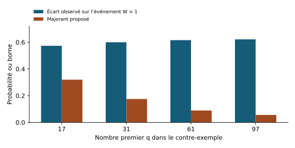
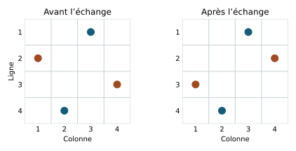
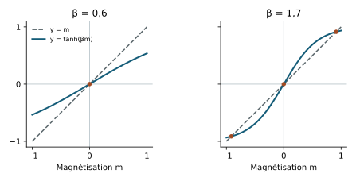

# ENS MP — Mathématiques D 2026 · Corrigé brut

*Corrigé rédigé par IA, non officiel. Signalez toute erreur.*

Épreuve du 16 avril 2026, six heures sans calculatrice. Les questions 11 et 12 comportent une difficulté d’énoncé. On donne les contre-exemples puis la démonstration sous l’hypothèse d’indépendance suffisante.

## Partie préliminaire — Lois de Poisson et inégalités

### Question 1

Pour $\lambda>0$, écrivons $p_k=e^{-\lambda}\lambda^k/k!$ pour $k\ge0$. La série exponentielle converge absolument pour tout $z\in\mathbb C$. La fonction génératrice est
$$
\boxed{\mathbb E[z^{Z_\lambda}]=\sum_{k=0}^{\infty}p_k z^k=e^{\lambda(z-1)}.}
$$
En particulier $\mathbb E[e^{uZ_\lambda}]=e^{\lambda(e^u-1)}$ pour tout réel $u$.

### Question 2

**(2a)** Pour $u,r>0$, $\{Z_\lambda\ge r\}=\{e^{uZ_\lambda}\ge e^{ur}\}$. L'exponentielle est positive et son espérance est finie par (1). L'inégalité de Markov donne $\mathbb P(Z_\lambda\ge r)\le e^{-ur}\mathbb E[e^{uZ_\lambda}]$.

**(2b)** L'exposant de cette majoration est $H(u)=\lambda(e^u-1)-ur$. Si $r>\lambda$, il atteint son minimum au point $u=\ln(r/\lambda)>0$, car $H'(u)=\lambda e^u-r$ et $H''(u)>0$. On obtient
$$
\boxed{\mathbb P(Z_\lambda\ge r)\le\exp\!\bigl(-r\ln(r/\lambda)+r-\lambda\bigr).}
$$
Pour $r=\lambda$, le majorant vaut $1$.

**(2c)** Pour $0<r<\lambda$, prendre $u=\ln(r/\lambda)<0$. Sur $\{Z_\lambda\le r\}$, on a cette fois $e^{uZ_\lambda}\ge e^{ur}$. La même application de Markov fournit $\boxed{\mathbb P(Z_\lambda\le r)\le e^{-r\ln(r/\lambda)+r-\lambda}}$. Au point $r=\lambda$, c'est encore la majoration par $1$.

### Question 3

La croissance du logarithme donne $\ln j\le\int_j^{j+1}\ln x\,dx$ pour $1\le j<k$. En ajoutant le dernier terme,
$$
\ln(k!)\le\ln k+\int_1^k\ln x\,dx=\boxed{(k+1)\ln k-k+1}.
$$
Cette écriture vaut aussi pour $k=1$.

## 1. Opérateur de Chen–Stein et approximation poissonienne

## 1.1. Opérateur de Chen–Stein

### Question 4

Notons $\mathcal F$ l'espace des fonctions bornées sur $\mathbb N$ et $\mathcal G_\lambda$ celui des $f$ telles que $f(Z_\lambda)$ soit intégrable. On pose $\mathcal L_\lambda f(k)=\lambda f(k+1)-kf(k)$.

**(4a)** La quantité $\|f\|_{(\lambda)}=\sum_k p_k|f(k)|$ est finie sur $\mathcal G_\lambda$, positive ou nulle, absolument homogène et sous-additive par les mêmes propriétés de la valeur absolue. Si elle est nulle, chaque terme positif ou nul s'annule. Comme $p_k>0$ pour tout $k$, $f$ est identiquement nulle. C'est donc une norme.

**(4b)** L'opérateur est linéaire, et pour $f\in\mathcal F$,
$$
|\mathcal L_\lambda f(k)|\le(\lambda+k)\|f\|_\infty.
$$
L'espérance d'une Poisson de paramètre $\lambda$ est $\lambda$ (par (1) ou en décalant la somme). Donc $\|\mathcal L_\lambda f\|_{(\lambda)}\le2\lambda\|f\|_\infty$. Cela donne simultanément l'appartenance à $\mathcal G_\lambda$ et la continuité.

**(4c)** Pour $X$ à valeurs entières positives ou nulles et intégrable, la même inégalité donne $\mathbb E|\mathcal L_\lambda f(X)|\le(\lambda+\mathbb E X)\|f\|_\infty<\infty$.

### Question 5

**(5a)** Si $X$ a la loi de $Z_\lambda$, l'identité $kp_k=\lambda p_{k-1}$ pour $k\ge1$ entraîne
$$
\mathbb E[Xf(X)]=\sum_{k\ge1}kp_kf(k)=\lambda\sum_{j\ge0}p_j f(j+1).
$$
Toutes ces séries convergent absolument. Ainsi $\mathbb E[\mathcal L_\lambda f(X)]=0$. Réciproquement, posons $q_k=\mathbb P(X=k)$ et testons l'identité annoncée sur $f=\mathbf1_{\{k\}}$, pour chaque $k\ge1$. Il vient $kq_k=\lambda q_{k-1}$. Donc $q_k=q_0\lambda^k/k!$. La somme des $q_k$ vaut $1$, d'où $q_0=e^{-\lambda}$. On retrouve la loi de Poisson.

**(5b)** Si $g=\mathcal L_\lambda f$ pour $f$ bornée, le sens direct de (5a) donne $\mathbb E[g(Z_\lambda)]=0$. Une espérance non nulle exclut donc une telle solution bornée.

### Question 6

Pour $h_g(0)=0$, l'équation fournit par récurrence
$$
h_g(k+1)=\frac{g(k)+k h_g(k)}{\lambda}.
$$
Ainsi il existe une et une seule solution sur $\mathbb N$. En multipliant par $p_k$, on a pour $k\ge1$
$$
\lambda p_kh_g(k+1)-\lambda p_{k-1}h_g(k)=p_kg(k).
$$
Au rang zéro, $\lambda p_0 h_g(1)=p_0g(0)$. En sommant de zéro à $k$, les termes intermédiaires s'annulent et l'on obtient
$$
\boxed{h_g(k+1)=\frac{\sum_{j=0}^kp_jg(j)}{\lambda p_k}.}
$$

### Question 7

Si $\sum_{j\ge0}p_j g(j)=0$, le numérateur de (6) est aussi $-\sum_{j>k}p_jg(j)$. On peut donc utiliser la plus commode des deux queues.

Si $k\ge\lambda$, pour $m\ge1$ on a $p_{k+m}/p_k\le(\lambda/(k+1))^m$. La raison est strictement inférieure à $1$, d'où
$$
\frac{\sum_{j>k}p_j}{\lambda p_k}\le\frac{1}{k+1-\lambda}\le1.
$$
Si $k<\lambda$ et $\lambda\ge1$, la suite $p_0,\ldots,p_k$ est croissante, si bien que $\sum_{j=0}^k p_j/(\lambda p_k)\le(k+1)/\lambda\le2$.

Il reste $0<\lambda<1$ et $k<\lambda$, donc $k=0$. Par la série exponentielle,
$$
\frac{\sum_{j>0}p_j}{\lambda p_0}
=\frac{e^\lambda-1}{\lambda}
=\sum_{j\ge1}\frac{\lambda^{j-1}}{j!}\le e-1<2.
$$
Avec $h_g(0)=0$, ces cas donnent même $\boxed{\|h_g\|_\infty\le2\|g\|_\infty\le e\|g\|_\infty}$.

### Question 8

Pour $A\subset\mathbb N$, posons $g_A(k)=\mathbf1_A(k)-\mathbb P(Z_\lambda\in A)$. Alors $g_A$ est centrée sous la loi de Poisson et $\|g_A\|_\infty\le1$. Posons $f_A=h_{g_A}/e$. Par (7), $\|f_A\|_\infty\le1$, et $\mathcal L_\lambda f_A=g_A/e$ est bornée. Ainsi
$$
|\mathbb P(X\in A)-\mathbb P(Z_\lambda\in A)|
=e\max_{\varepsilon=\pm1}\mathbb E[\mathcal L_\lambda(\varepsilon f_A)(X)].
$$
Le supremum sur les tests de norme au plus $1$, puis sur $A$, donne **l'inégalité voulue**. Pour $X$ intégrable, toutes les espérances du membre droit existent par (4c). Pour $X$ arbitraire comme l'autorise le libellé, il faut y prendre les tests dont l'espérance est définie, par exemple les tests dont $\mathcal L_\lambda f(X)$ est intégrable. Les deux tests construits ci-dessus sont toujours admissibles. En effet, un $X$ non intégrable peut rendre $\mathbb E[\mathcal L_\lambda f(X)]$ indéfinie pour certains autres tests bornés.

## 1.2. Sommes de variables aléatoires et approximation poissonienne

## 1.2.1. Variables aléatoires indépendantes

### Question 9

Les $X_i$ sont ici des Bernoulli indépendantes de paramètres $p_i$. On écrit $W=\sum_iX_i$, $W_i=W-X_i$, $\lambda=\sum_i p_i$ et $B_1=\sum_i p_i^2$. Dans cette partie les $p_i$ désignent les paramètres des Bernoulli.

**(9a)** Comme $X_i$ vaut zéro ou un, $X_if(W)=X_if(W_i+1)$. L'indépendance de $X_i$ et de $W_i$ donne $\mathbb E[X_if(W)]=p_i\mathbb E[f(W_i+1)]$. En sommant et en utilisant la valeur de $\lambda$,
$$
\boxed{\mathbb E[\mathcal L_\lambda f(W)]=\sum_i p_i\mathbb E[f(W+1)-f(W_i+1)].}
$$

**(9b)** Le terme entre crochets s'annule si $X_i=0$ et sa valeur absolue est au plus $2\|f\|_\infty$ sinon. Ainsi $|\mathbb E[\mathcal L_\lambda f(W)]|\le2\|f\|_\infty\sum_i p_i^2$. Par (8),
$$
\boxed{\sup_A|\mathbb P(W\in A)-\mathbb P(Z_\lambda\in A)|\le2eB_1.}
$$

### Question 10

Pour les entiers $n\ge1$ tels que $\lambda/n\le1$, écrivons $Y_n$ comme somme de $n$ Bernoulli indépendantes de paramètre $\lambda/n$. Le calcul de (9) reste valable pour $n=1$ et pour le paramètre $1$, qui donne une variable constante. On a $B_1=n(\lambda/n)^2=\lambda^2/n$. En prenant $A=\{k\}$,
$$
\boxed{\left|\mathbb P(Y_n=k)-e^{-\lambda}\frac{\lambda^k}{k!}\right|\le\frac{2e\lambda^2}{n}.}
$$
Si $n<\lambda$, la loi binomiale annoncée n'existe pas. La condition $n\ge\lambda$ est donc nécessaire pour interpréter la question.

## 1.2.2. Variables aléatoires dépendantes

### Question 11

Avec la définition imprimée de $D_i$, **l'identité est fausse en général**. Sur quatre points équiprobables, prenons pour $(X_1,X_2,X_3)$ les valeurs $000,011,101,110$. Chaque paire est indépendante, donc $D_i$ est vide, $T_i=0$ et $S_i=W-X_i$. Pour $f=\mathbf1_{\{1\}}$, le membre gauche vaut
$$
\lambda\mathbb P(W=0)-\mathbb P(W=1)=\tfrac32\cdot\tfrac14-0=\tfrac38.
$$
À droite, $\mathbb P(W=0)=1/4$ et $\mathbb P(S_i=0)=1/4$ pour chaque $i$ (les deux autres bits sont indépendants). Les termes contenant $T_i$ s'annulent. Le membre droit vaut donc $0$.

**Hypothèse suffisante et calcul attendu.** Demander que $X_i$ soit indépendante de $S_i$ pour chaque $i$ suffit. C'est le cas si $X_i$ est indépendante de toute la famille hors de son voisinage et de l'indice $i$. On a alors $\mathbb E[X_if(S_i+1)]=p_i\mathbb E[f(S_i+1)]$. Or $X_if(W)=X_if(S_i+T_i+1)$. En insérant et retranchant le terme précédent,
$$
\mathbb E[\mathcal L_\lambda f(W)]
=\sum_i\Bigl\{p_i\mathbb E[f(W+1)-f(S_i+1)]
-\mathbb E[X_i(f(S_i+T_i+1)-f(S_i+1))]\Bigr\}.
$$
Le contre-exemple montre précisément pourquoi l'indépendance deux à deux utilisée pour définir les voisins ne garantit pas la factorisation.

### Question 12

**Contre-exemple à la borne imprimée.** Prenons $U,V$ indépendantes uniformes modulo $17$. Pour chaque résidu $a$, soit $X_a=\mathbf1_{\{U+aV=0\pmod{17}\}}$. Alors $p_a=1/17$. Pour $a\ne b$, les deux équations $U+aV=U+bV=0$ imposent $V=U=0$, de probabilité $1/17^2$. Les indicatrices sont donc indépendantes deux à deux. Ainsi $\lambda=1$, $B_1=1/17$ et $B_2=B_3=0$.

Lorsque $V\ne0$, une unique valeur de $a$ résout l'équation, donc $W=1$. Lorsque $V=0$, on a $W=0$ ou $17$. Par suite $\mathbb P(W=1)=16/17$ et $\mathbb P(Z_1=1)=e^{-1}$. Or, comme $2<e<3$,
$$
\frac{16}{17}-e^{-1}>\frac{16}{17}-\frac12>\frac6{17}>\frac{2e}{17}.
$$
L'événement $\{1\}$ contredit donc à lui seul la conclusion.

**Sous l'hypothèse suffisante de (11).** Dans le premier terme de la somme, la différence s'annule si $X_i+T_i=0$. Dans le second, elle s'annule si $T_i=0$. Pour une variable entière positive ou nulle $H$, $\mathbf1_{\{H>0\}}\le H$. Chaque différence est bornée en valeur absolue par $2\|f\|_\infty$. Il vient
$$
|\mathbb E[\mathcal L_\lambda f(W)]|
\le2\|f\|_\infty\sum_i\bigl(p_i\mathbb E[X_i+T_i]+\mathbb E[X_iT_i]\bigr).
$$
Les trois sommes valent respectivement $B_1$, $B_2=\sum_i\sum_{j\in D_i}p_ip_j$ et $B_3=\sum_i\sum_{j\in D_i}\mathbb E[X_iX_j]$. En appliquant (8), on obtient bien $2e(B_1+B_2+B_3)$ pour cette version de la question.

## 2. Inégalités de concentration

## 2.1. Espérance conditionnelle

### Question 13

Pour $p_y=\mathbb P(Y=y)>0$, notons $E_y(H)=\sum_hh\,\mathbb P(H=h,Y=y)/p_y$. Cette notation désigne une moyenne ordinaire dans la loi conditionnelle. Les valeurs pour $p_y=0$ ne changent aucune identité presque sûre. Les variables considérées dans cette partie sont bornées chaque fois qu'on en prend l'espérance.

**(13a)** Si $X\ge0$ presque sûrement, toutes les probabilités conditionnelles associées à une valeur $x<0$ sont nulles pour $p_y>0$. Ainsi $E_y(X)\ge0$ et $\boxed{\mathbb E[X\mid Y]\ge0}$ presque sûrement.

**(13b)** Si $|X|\le K$, alors $|E_y(X)|\le K$ pour $p_y>0$. L'espérance conditionnelle est donc intégrable. Les séries sont absolument convergentes, avec $\sum_{x,y}|x|\mathbb P(X=x,Y=y)\le K$. Par sommation,
$$
\mathbb E[\mathbb E[X\mid Y]]=\sum_{p_y>0}p_yE_y(X)=\sum_xx\mathbb P(X=x)=\boxed{\mathbb E[X]}.
$$

**(13c)** Sur chaque atome $\{X=x\}$ de probabilité positive, $g(X)$ est constante et vaut $g(x)$. Sa moyenne conditionnelle y a cette même valeur. Donc $\boxed{\mathbb E[g(X)\mid X]=g(X)}$ presque sûrement.

**(13d)** Sur $\{Y=y\}$ le coefficient $h(Y)$ est constant, égal à $h(y)$. On peut le sortir de la somme qui définit $E_y(h(Y)X)$. D'où $\boxed{\mathbb E[h(Y)X\mid Y]=h(Y)\mathbb E[X\mid Y]}$ presque sûrement.

### Question 14

**(14a)** Si $X$ et $Y$ sont indépendantes, pour chaque $y$ de probabilité positive on a $\mathbb P(X=x\mid Y=y)=\mathbb P(X=x)$. Par sommation, $\boxed{\mathbb E[X\mid Y]=\mathbb E X}$ presque sûrement.

**(14b)** Si $Z$ est indépendante du couple $(X,Y)$, alors $\mathbb P(X=x,Z=z,Y=y)=\mathbb P(Z=z)\mathbb P(X=x,Y=y)$. Sur $p_y>0$, multiplier par $xz/p_y$ et sommer. Les sommes convergent absolument par bornitude, d'où
$$
E_y(XZ)=\left(\sum_z z\mathbb P(Z=z)\right)E_y(X),\qquad
\boxed{\mathbb E[XZ\mid Y]=\mathbb E[Z]\mathbb E[X\mid Y]}.
$$

**(14c)** Dans la loi conditionnelle conjointe de $(X,Z)$ sur $\{Y=y\}$, la somme de $(x+\lambda z)\mathbb P(X=x,Z=z\mid Y=y)$ se décompose en deux sommes absolument convergentes. En prenant les marginales conditionnelles, il vient $E_y(X+\lambda Z)=E_y(X)+\lambda E_y(Z)$. Cela donne l'égalité demandée presque sûrement, sans hypothèse d'indépendance.

## 2.2. Un énoncé abstrait

### Question 15

Le couple $(W,W')$ est échangeable, $F$ est bornée et antisymétrique, et $\varphi(W)=\mathbb E[F(W,W')\mid W]$. Pour $h$ bornée, (13b,d) donnent $\mathbb E[h(W)\varphi(W)]=\mathbb E[h(W)F(W,W')]$. L'échangeabilité puis l'antisymétrie donnent
$$
\mathbb E[h(W')F(W,W')]=\mathbb E[h(W)F(W',W)]=-\mathbb E[h(W)F(W,W')].
$$
En soustrayant et en divisant par deux,
$$
\boxed{\mathbb E[h(W)\varphi(W)]
=\tfrac12\mathbb E[(h(W)-h(W'))F(W,W')].}
$$
Pour $h=1$, la différence est nulle, donc $\mathbb E[\varphi(W)]=0$.

### Question 16

Écrivons $U=\varphi(W)$, $U'=\varphi(W')$ et
$\Delta(W)=\frac12\mathbb E[|(U-U')F(W,W')|\mid W]$. On a $\Delta(W)\le BU+C$ presque sûrement.

**(16a)** Comme $|U|\le\|F\|_\infty$ presque sûrement, $m(\theta)=\mathbb E[e^{\theta U}]$ est finie et strictement positive pour tout $\theta\in\mathbb R$. Sur tout intervalle borné en $\theta$, la dérivée $Ue^{\theta U}$ est uniformément majorée en valeur absolue par une constante. La dérivation sous l'espérance est donc licite. En appliquant (15) avec $h(w)=e^{\theta\varphi(w)}$ (prendre une version bornée de $\varphi$ partout),
$$
\boxed{m'(\theta)=\mathbb E[Ue^{\theta U}]=\tfrac12\mathbb E[(e^{\theta U}-e^{\theta U'})F(W,W')].}
$$

**(16b)** La convexité de l'exponentielle donne pour tous $a,b$,
$$
|e^a-e^b|=|a-b|\int_0^1 e^{sa+(1-s)b}\,ds
\le\tfrac{|a-b|}{2}(e^a+e^b).
$$
Appliquer cette inégalité à $a=\theta U$, $b=\theta U'$. Les deux termes obtenus avec $e^{\theta U}$ et $e^{\theta U'}$ ont même espérance par échangeabilité, puisque $|(U-U')F(W,W')|$ est symétrique. Par conditionnement sur $W$,
$$
|m'(\theta)|\le|\theta|\mathbb E[e^{\theta U}\Delta(W)]
\le|\theta|\bigl(Bm'(\theta)+Cm(\theta)\bigr).
$$
Pour $\theta\ge0$, cela implique la première inégalité demandée. Pour $0\le s\le\theta<1/B$, il vient $(\ln m)'(s)\le Cs/(1-Bs)\le Cs/(1-B\theta)$. L'intégration depuis zéro, avec $m(0)=1$, donne
$$
\boxed{\ln m(\theta)\le\frac{C\theta^2}{2(1-B\theta)}.}
$$
Pour $B=0$, le calcul vaut pour tout $\theta\ge0$.

### Question 17

Supposons d'abord $C>0$ et $t>0$. Markov et (16b) donnent pour $\theta=t/(C+Bt)>0$, qui vérifie $B\theta<1$,
$$
\mathbb P(U\ge t)\le e^{-\theta t}m(\theta)
\le\exp\!\left(-\frac{t^2}{2(C+Bt)}\right).
$$
Pour l'autre queue, utiliser l'inégalité en **valeur absolue** de (16b). Pour $s<0$, elle donne $(1-Bs)m'(s)\ge Cs\,m(s)$. Donc $(\ln m)'(s)\ge Cs/(1-Bs)\ge Cs$. Intégrer de $s$ à zéro donne $\ln m(s)\le Cs^2/2$. Ainsi, avec $s=-t/C$, $\mathbb P(U\le-t)\le e^{st}m(s)\le e^{-t^2/(2C)}$. La somme des deux majorants fournit
$$
\boxed{\mathbb P(|U|\ge t)\le2\exp\!\left(-\frac{t^2}{2C+2Bt}\right).}
$$
Pour $t=0$, prendre le majorant trivial $2$. Si $C=0$, $\mathbb E[\Delta(W)]\le B\mathbb E[U]=0$ entraîne $\Delta(W)=0$ presque sûrement. Avec $h=\varphi$ dans (15), on a $\mathbb E[U^2]\le\mathbb E[\Delta(W)]=0$. La variable $U$ est donc nulle. La borne vaut alors pour tout $t>0$, avec la convention $e^{-\infty}=0$ si le dénominateur est nul.

## 3. Applications

## 3.1. Sommes de variables indépendantes

### Question 18

Notons $S_N=\sum_iX_i$ et $S_N'=S_N-X_I+X'_I$, où $I$ est uniforme sur $\{1,\ldots,N\}$ et indépendant de tous les tirages.

**(18a)** Conditionnellement à $I=i$, posons $R_i=\sum_{j\ne i}X_j$. Les variables $X_i$ et $X'_i$ sont indépendantes, de même loi, et le couple est indépendant de $R_i$ par les hypothèses du sujet. Ainsi $(R_i+X_i,R_i+X'_i)$ a même loi que sa permutation. Le mélange de ces lois avec les poids $1/N$ donne l'échangeabilité de $(S_N,S_N')$. Aucune indépendance mutuelle des $X'_i$ n'est nécessaire.

**(18b)** Pour chaque valeur $s$ de $S_N$ de probabilité positive, les probabilités $\mathbb P(I=i\mid S_N=s)$ valent $1/N$ et $I$ est indépendant du vecteur initial. Ainsi
$$
\mathbb E[X_I\mid S_N=s]=\frac1N\sum_i\mathbb E[X_i\mid S_N=s]
=\boxed{s/N}.
$$

### Question 19

Avec $F(x,y)=N(x-y)$, l'échangeabilité est assurée par (18a). La fonction est bornée sur les valeurs possibles de $S_N$ et antisymétrique. Écrivons $\mu=\sum_i\mu_i$. Par (18b) et indépendance du vecteur de remplacement, $\mathbb E[X'_I\mid S_N]=\mu/N$. Donc $\varphi(S_N)=S_N-\mu$. Il suit
$$
\Delta(S_N)=\frac N2\mathbb E[(S_N-S_N')^2\mid S_N]
=\frac12\sum_i\mathbb E[(X_i-\mu_i)^2+\sigma_i^2\mid S_N].
$$
En effet, conditionnellement au vecteur initial et à $I=i$, $X'_i$ garde sa loi, d'espérance $\mu_i$ et de variance $\sigma_i^2$. La dernière somme est au plus $\frac12\sum_i(c_i^2+\sigma_i^2)$. Avec $B=0$ et cette constante pour $C$, (17) donne
$$
\boxed{\mathbb P(|S_N-\mu|\ge t)\le2\exp\!\left(-\frac{t^2}{\sum_i(c_i^2+\sigma_i^2)}\right).}
$$

### Question 20

Si $0\le X_i\le1$, on a aussi $0\le X'_i\le1$ presque sûrement. Pour $a,b\in[0,1]$, $(a-b)^2\le a^2+b^2\le a+b$. Dans le même couplage qu'en (19),
$$
\Delta(S_N)\le\tfrac N2\mathbb E[X_I+X'_I\mid S_N]
=\tfrac12(S_N+\mu)=\tfrac12\varphi(S_N)+\mu.
$$
Ainsi $B=1/2$ et $C=\mu$. Par (17),
$$
\boxed{\mathbb P(|S_N-\mu|\ge t)\le2\exp\!\left(-\frac{t^2}{2\mu+t}\right).}
$$
Si $\mu=0$, toutes les variables positives ou nulles sont nulles presque sûrement et la conclusion est immédiate.

## 3.2. Permutations aléatoires

### Question 21

Soit $\tau=(I,J)$ la transposition tirée (identité si $I=J$). Pour $\tau$ fixée, l'application $\pi\mapsto\pi\circ\tau$ est une bijection involutive de $\mathfrak S_N$. Par indépendance, $\pi_N$ est encore uniforme conditionnellement à $\tau$. Chaque paire $(\pi,\pi\circ\tau)$ a donc la même probabilité que $(\pi\circ\tau,\pi)$. En mélangeant suivant la loi de $\tau$, on prouve que **$(\pi_N,\pi_N')$ est échangeable**.

### Question 22

**(22a)** Avec $u=a_{i,\pi(i)}+a_{j,\pi(j)}$ et $v=a_{i,\pi(j)}+a_{j,\pi(i)}$, on a $0\le u,v\le2$. Donc $(u-v)^2\le u^2+v^2\le2(u+v)$. Sommer sur tous les couples ordonnés $(i,j)$ donne l'inégalité annoncée.

**(22b)** Posons $s(\pi)=\sum_i a_{i,\pi(i)}$, $\mu=\mathbb E[S_N]=N^{-1}\sum_{i,j}a_{ij}$ (chaque $\pi_N(i)$ est uniforme). Sous la transposition $(i,j)$, la perte $d_{ij}=s(\pi)-s(\pi\circ(i,j))$ vaut $u-v$ avec les notations de (22a), y compris si $i=j$. En sommant sur les indices on trouve
$$
\sum_{i,j}d_{ij}=2Ns(\pi)-2\sum_{i,j}a_{ij}=2N(s(\pi)-\mu).
$$
Ainsi $F(\pi,\pi')=\tfrac N2(s(\pi)-s(\pi'))$ vérifie $\varphi(\pi)=s(\pi)-\mu$. Pour cette paire échangeable,
$$
\Delta(\pi)=\frac{1}{4N}\sum_{i,j}d_{ij}^2
\le\frac{2}{4N}\left(2Ns(\pi)+2\sum_{i,j}a_{ij}\right)
=s(\pi)+\mu=\varphi(\pi)+2\mu.
$$
La conclusion de (17) avec $B=1$ et $C=2\mu$ est
$$
\boxed{\mathbb P(|S_N-\mu|\ge t)\le2\exp\!\left(-\frac{t^2}{4\mu+2t}\right).}
$$

### Question 23

Prendre $a_{ij}=\mathbf1_{\{i=j\}}$. Alors $S_N$ est le nombre de points fixes et $\mu=1$. Pour $2\le k\le N$, (22b) avec $t=k-1$ majore $\mathbb P(S_N\ge k)$ par $2e^{-(k-1)^2/(2k+2)}$. Or $6(k-1)^2-k(k+1)=(k-2)(5k-3)\ge0$, d'où $(k-1)^2/(2k+2)\ge k/12$. Ainsi
$$
\boxed{\mathbb P(S_N\ge k)\le2e^{-k/12}.}
$$

## 3.3. Magnétisation dans le modèle de Curie–Weiss

### Question 24

Sous la loi de Curie–Weiss du sujet, fixons les spins autres que celui du site $i$. Les termes de l'exposant qui dépendent de la valeur $s=\pm1$ en ce site valent $sa_i$, où $a_i=\beta m_i(X)+\beta h$ et $m_i(X)=N^{-1}\sum_{j\ne i}X_j$. Les autres termes sont identiques pour les deux valeurs et disparaissent dans le quotient des poids. La moyenne conditionnelle vaut donc
$$
\boxed{\mathbb E[X_i\mid(X_j)_{j\ne i}]
=\frac{e^{a_i}-e^{-a_i}}{e^{a_i}+e^{-a_i}}=\tanh(a_i).}
$$

### Question 25

**(25a)** Au site choisi $i$, les deux poids conditionnels sont $e^{a_i}$ et $e^{-a_i}$. Leur somme fournit $\boxed{C=2\cosh(a_i)}$, où $a_i$ se calcule à partir des autres spins fixés.

**(25b)** Conditionnons par $I=i$ et par les spins hors de $i$. Le spin ancien $X_i$ a la loi décrite en (24). La règle du sujet attribue cette même loi au nouveau $X'_i$, quelle que soit la valeur ancienne de $X_i$. Conditionnellement aux autres spins et au site, ces deux tirages sont donc indépendants et de même loi. Les autres coordonnées étant communes, échanger l'ancienne et la nouvelle configuration préserve la loi conditionnelle, puis la loi sans condition. **Le couple $(X,X')$ est échangeable.**

### Question 26

Seul le site $I$ peut changer, donc $F(X,X')=\sum_i(X_i-X'_i)=X_I-X'_I$. Sachant $X$ et $I=i$, l'espérance de $X'_i$ vaut $\tanh(\beta m_i(X)+\beta h)$. La moyenne uniforme sur $i$ donne
$$
\boxed{\varphi(X)=m(X)-\frac1N\sum_{i=1}^N\tanh\!\bigl(\beta m_i(X)+\beta h\bigr),\qquad m(X)=\frac1N\sum_iX_i.}
$$

### Question 27

La dérivée de $\tanh$ est comprise entre $0$ et $1$. Par les accroissements finis, cette fonction est $1$-lipschitzienne. Puisque $|m_i(X)-m(X)|=1/N$, chaque écart entre $\tanh(\beta m_i(X)+\beta h)$ et $\tanh(\beta m(X)+\beta h)$ est au plus $\beta/N$. La valeur absolue de l'écart moyen vérifie donc la première borne demandée.

Si un seul spin change, $|m(X)-m(X')|\le2/N$ et $|m_i(X)-m_i(X')|\le2/N$ pour tout $i$. La formule de (26) et le même caractère lipschitzien donnent $|\varphi(X)-\varphi(X')|\le2(1+\beta)/N$. Comme $|F(X,X')|\le2$, il s'ensuit que $\Delta(X)\le2(1+\beta)/N$. En (17), prendre $B=0$, $C=2(1+\beta)/N$ et un seuil $t/\sqrt N$.

Enfin $|m(X)-\tanh(\beta m(X)+\beta h)|\le|\varphi(X)|+\beta/N$. Si le membre gauche atteint $\beta/N+t/\sqrt N$, alors $|\varphi(X)|\ge t/\sqrt N$. On obtient bien
$$
\boxed{\mathbb P\!\left(|m(X)-\tanh(\beta m(X)+\beta h)|\ge\frac\beta N+\frac{t}{\sqrt N}\right)
\le2\exp\!\left(-\frac{t^2}{4(1+\beta)}\right).}
$$

