# ENS PC — Chimie B 2026 · Corrigé partiel brut

*Corrigé rédigé par IA, non officiel.*

**Rédaction** · modèle exact non renseigné (famille GPT-6) · effort non renseigné · vitesse non renseignée

**Révision (tour 1)** · GPT-6.2 Astra Ultra · vitesse non renseignée

**Périmètre du corrigé.** Les questions 1 à 70 et 72 à 78 sont intégralement traitées. La question 71 précise le gaz dégagé et la structure de l’ester 18. Son mécanisme est hors périmètre.

Les concentrations entre crochets sont celles des espèces libres sauf indication contraire. La concentration standard est $c^\circ=1\,\mathrm{mol\,L^{-1}}$. Dans la partie organique, la numérotation des composés et des protons est celle des planches du sujet.

## I.1 — Dosage du sulfate et paires d’ions

### Question 1

Deux électrodes plongent dans la solution. Une petite tension alternative limite la polarisation et l’électrolyse. Dans le domaine ohmique, la composante de courant en phase donne $G=I/U$ en siemens. Pour deux faces planes d’aire $S$ et de distance $\ell$, $G=\sigma S/\ell$. En pratique on étalonne la constante de cellule $K_{\rm cell}$ et on écrit $\sigma=K_{\rm cell}G$ en $\mathrm{S\,m^{-1}}$.

### Question 2

La réaction est $\mathrm{Ba^{2+}_{(aq)}+SO_4^{2-}{}_{(aq)}\longrightarrow BaSO_{4(s)}}$. Le chlorure reste en solution. La stœchiométrie entre baryum ajouté et sulfate précipité est $1:1$.

### Question 3

Notons $V_0=100\,\mathrm{mL}$, $V$ le volume ajouté et $C_B=0{,}100\,\mathrm{mol\,L^{-1}}$. À l’équivalence $V_E=V_0 C_S/C_B\simeq12{,}4\,\mathrm{mL}$ avec $C_S=1{,}187/96=0{,}01236\,\mathrm{mol\,L^{-1}}$. La grandeur additive est $Y=(V_0+V)\sigma=\sum_i\lambda_i n_i$, avec les volumes en $\mathrm{m^3}$. Avant $V_E$, chaque mole de baryum retire une mole de sulfate et apporte deux moles de chlorure. Après $V_E$, le baryum reste également en solution. Les pentes de $Y$ en fonction de la quantité de titrant sont donc

$$m_< =2\lambda_{\mathrm{Cl^-}}-\lambda_{\mathrm{SO_4^{2-}}}=0,\qquad m_> =2\lambda_{\mathrm{Cl^-}}+\lambda_{\mathrm{Ba^{2+}}}=28\ \mathrm{mS\,m^2\,mol^{-1}}.$$

Pour les axes $Y$ en $\mathrm{mS\,m^2}$ et $V$ en mL, les pentes valent $0$ et $2{,}8\times10^{-3}\,\mathrm{mS\,m^2\,mL^{-1}}$. Le bilan prévoit un plateau puis une droite montante pour la conductivité corrigée de la dilution $Y/V_0$. La figure 1 porte la conductivité brute en ordonnée. Sa prédiction exacte est $\sigma(V)=[V_0\sigma(0)+C_Bm_>(V-V_E)_+]/(V_0+V)$ en unités cohérentes. La dilution incline légèrement vers le bas la première branche. L’unité $\mathrm{mS\,m^2}$ donnée seule dans la question est celle de $Y$, une pente requiert l’unité de son abscisse.

### Question 4

La loi de Kohlrausch donne $\sigma_0=\lambda_{\rm Ca}C_{\rm Ca}+\lambda_{\rm Mg}C_{\rm Mg}+\lambda_{\rm S}C_{\rm S}+\lambda_{\rm H}C_{\rm H}$, avec S pour sulfate et H pour hydrogénocarbonate. Les concentrations de l’étiquette valent respectivement $12{,}15$, $3{,}50$, $12{,}36$ et $6{,}61\,\mathrm{mol\,m^{-3}}$. On obtient $\sigma_0=(12\times12{,}15+11\times3{,}50+16\times12{,}36+5\times6{,}61)10^{-3}=0{,}415\,\mathrm{S\,m^{-1}}$, soit $4{,}15\,\mathrm{mS\,cm^{-1}}$ si tous les ions sont libres.

### Question 5

La figure 1 démarre vers $2{,}35\,\mathrm{mS\,cm^{-1}}$. Avant la rupture vers $11$ à $12\,\mathrm{mL}$, elle monte doucement, alors que le modèle idéal donnait un plateau après correction de dilution, voire une petite décroissance en conductivité brute. Après la rupture, la montée devient forte, comme prévu lors de l’accumulation du baryum. L’écart le plus révélateur porte sur les ions déjà présents avant l’équivalence.

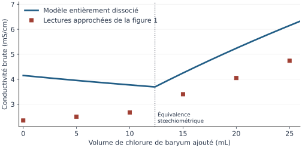

### Question 6

Pour le sens de précipitation de Q2, $K_{\rm préc}=1/(a_{\rm Ba}a_{\rm S})=(c^\circ)^2/(\gamma_{\rm Ba}\gamma_{\rm S}[\mathrm{Ba^{2+}}][\mathrm{SO_4^{2-}}])$ à l’équilibre en présence de solide. C’est $1/K_s\simeq9{,}1\times10^9$. Les concentrations sont celles des ions libres.

### Question 7

À partir des quatre teneurs de Q4, la force ionique analytique $I=\tfrac12\sum z_i^2 c_i$ vaut $0{,}0593\ \mathrm{mol\,L^{-1}}$, en première estimation avant de tenir compte des paires. Les deux ions ont $z^2=4$. Ainsi $\log_{10}\gamma=-0{,}509\times4\times0{,}24=-0{,}49$, d’où $\gamma_{\rm Ba}=\gamma_{\rm S}\simeq0{,}32$. À saturation, $[\mathrm{Ba^{2+}}][\mathrm{SO_4^{2-}}]\simeq1{,}0\times10^{-9}\,\mathrm{mol^2\,L^{-2}}$. Avec $10^{-2}\,\mathrm{mol\,L^{-1}}$ de sulfate libre, il reste environ $10^{-7}\,\mathrm{mol\,L^{-1}}$ de baryum. La précipitation reste quantitative loin de l’équivalence. Cette correction thermodynamique ne rend compte ni de la hausse initiale ni, à elle seule, du déficit de conductivité. Les activités interviennent dans l’équilibre, les concentrations et mobilités dans le transport du courant.

### Question 8

La paire $\mathrm{CaSO_4}_{(aq)}$ est neutre. Dans l’eau initiale, une fraction du calcium et du sulfate ne conduit donc plus le courant sous forme de deux ions libres. À l’ajout du baryum, le sulfate précipite et l’équilibre de dissociation des paires se déplace. Du calcium redevient libre et conducteur, ce qui produit une hausse avant l’équivalence. On peut estimer la concentration de paires avec la conductivité initiale : chaque paire retire au transport une contribution $\lambda_{\rm Ca}+\lambda_{\rm S}$. En attribuant tout le déficit à cette seule association, on obtient $(0{,}415-0{,}235)/0{,}028\simeq6{,}4\ \mathrm{mol\,m^{-3}}$, soit environ la moitié du calcium analytique.

### Question 9

Soient $A$ et $S$ les concentrations analytiques initiales en calcium et sulfate et $x=[\mathrm{CaSO_4}]$. Les bilans donnent $[\mathrm{Ca^{2+}}]=A-x$ et $[\mathrm{SO_4^{2-}}]=S-x$. Pour la dissociation $K_{r2}=\gamma_{\rm Ca}\gamma_{\rm S}(A-x)(S-x)/(\gamma_{\rm p}c^\circ x)$ avec $\gamma_{\rm p}\simeq1$ pour la paire neutre. Posons $D=K_{r2}\gamma_{\rm p}c^\circ/(\gamma_{\rm Ca}\gamma_{\rm S})$. La racine physique, comprise entre zéro et $\min(A,S)$, est

$$x=\frac{A+S+D-\sqrt{(A+S+D)^2-4AS}}2.$$

Dans le modèle idéal des espèces libres, prendre les coefficients d’activité égaux à un.

### Question 10

Pour $V=0$, on lit environ $2{,}3$ à $2{,}4\,\mathrm{mS\,cm^{-1}}$, soit $0{,}23$ à $0{,}24\,\mathrm{S\,m^{-1}}$. La prévision avec paires, $0{,}228\,\mathrm{S\,m^{-1}}$, rend compte de cette valeur à quelques pour cent, tandis que le modèle entièrement dissocié donnait $0{,}415\,\mathrm{S\,m^{-1}}$. Au milieu de la plage de lecture, le modèle avec paires sous-estime la conductivité d’environ $3\,\%$ et celui des ions libres la surestime d’environ $77\,\%$. Ces écarts sont rapportés à la mesure. La comparaison favorise la présence de paires, sous l’hypothèse que les mobilités tabulées décrivent la solution.

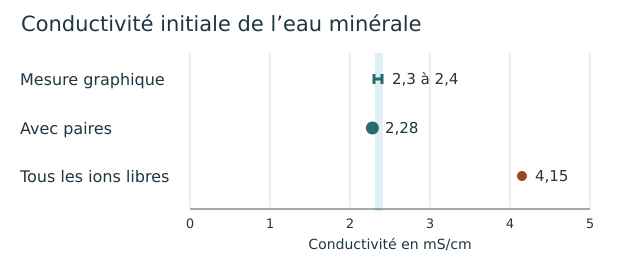

## I.2 — Association de Bjerrum et équilibres rédox

### Question 11

Dans la convention de l’énoncé, $A=-z_iz_je^2/(\epsilon_0\epsilon_r k_BT)>0$. À $dr$ fixé, on minimise $p(r)\propto r^2e^{A/r}$. Or $p'(r)/p(r)=(2r-A)/r^2$. La dérivée passe de négative à positive à $d=A/2=-z_iz_je^2/(2\epsilon_0\epsilon_r k_BT)$. Le facteur de volume domine aux grandes distances et l’attraction aux petites distances.

### Question 12

Avec la définition et les unités choisies dans le sujet, et pour $a<d$,

$$K_A=\frac{4\pi N_Ac_i}{1000}\int_a^d r^2\exp\!\left(\frac{2d}{r}\right)\,dr.$$

La borne $a$ représente la plus petite distance accessible et $d$ la séparation seuil issue de Q11. Cette grandeur, définie ici comme une probabilité intégrée, contient la concentration $c_i$. Le facteur $N_Ac_i/1000$ est une densité en nombre par centimètre cube si $c_i$ est en moles par litre. Il faut alors exprimer le volume radial $4\pi r^2dr$ en centimètres cubes. En Q21, la même notation désigne une constante thermodynamique définie à partir des activités.

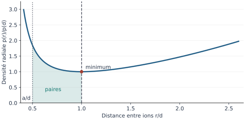

### Question 13

Avec $x=2d/r$, on a $r^2dr=-8d^3dx/x^4$. À $r=a$ correspond $x=2d/a$, et à $r=d$ correspond $x=2$. En renversant les bornes,

$$K_A=\frac{4\pi N_Ac_i}{1000}\,8d^3\int_2^{2d/a}\frac{e^x}{x^4}\,dx=\frac{4\pi N_Ac_i}{1000}\,8d^3Q(2d/a).$$

### Question 14

Pour $\mathrm O+e^-\rightleftharpoons \mathrm R^{\bullet-}$, $E=E^\circ+(RT/F)\ln(a_{\rm O}/a_{\rm R})=E^\circ+(RT/F)\ln([\mathrm O]/(\gamma_{-}[\mathrm R^{\bullet-}]))$. Les $c^\circ$ se simplifient, et l’oxydant neutre a pour coefficient un.

### Question 15

En utilisant le même paramètre de taille $a$ comme dans l’énoncé, $\log_{10}\gamma_\pm=\tfrac12(\log_{10}\gamma_++\log_{10}\gamma_-)=-A[(z_+)^2+(z_-)^2]\sqrt I/[2(1+aB\sqrt I)]$. D’où $\gamma_\pm=10^{-A[(z_+)^2+(z_-)^2]\sqrt I/[2(1+aB\sqrt I)]}$.

### Question 16

La formation s’écrit $\mathrm{Na^++R^{\bullet-}\rightleftharpoons R^{\bullet-}Na^+}$. L’équilibre inverse a pour constante $K_d=a_{\rm Na}a_{\rm R}/a_{\rm paire}=\gamma_\pm^2[\mathrm{Na^+}][\mathrm R^{\bullet-}]/(c^\circ[\mathrm R^{\bullet-}\mathrm{Na^+}])$.

### Question 17

Notons $h=\gamma_\pm^2[\mathrm{Na^+}]/(K_dc^\circ)$. D’après Q16, $[\mathrm{paire}]=h[\mathrm R^{\bullet-}]$, donc $c_{\rm redox}-[\mathrm O]=(1+h)[\mathrm R^{\bullet-}]$. Ainsi $[\mathrm O]/[\mathrm R^{\bullet-}]=(1+h)/(c_{\rm redox}/[\mathrm O]-1)$.

### Question 18

Comme $[\mathrm R^{\bullet-}]+[\mathrm{paire}]=(1+h)[\mathrm R^{\bullet-}]$, la formule de Q14 devient

$$E=E^{\circ\prime}+\frac{RT}{F}\ln\!\frac{[\mathrm O]}{[\mathrm R^{\bullet-}]+[\mathrm{paire}]},\qquad E^{\circ\prime}=E^\circ+\frac{RT}{F}\ln\!\left[\frac{1+\gamma_\pm^2[\mathrm{Na^+}]/(K_dc^\circ)}{\gamma_\pm}\right].$$

À électrolyte fixé, le décalage du potentiel dépend de l’affinité de chaque radical pour le sodium.

### Question 19

À température et solvant fixés, $\kappa q$ est proportionnel à $\sqrt{[\mathrm{ions\ libres}]}$. En dilution suffisante, $\kappa q\ll1$ et $\ln\gamma_\pm=-\kappa q+O((\kappa q)^2)$, donc $\gamma_\pm=1-\kappa q+O((\kappa q)^2)\simeq1$. La condition quantitative est $\kappa q\ll1$. Le degré de dilution nécessaire dépend notamment de la permittivité du solvant.

### Question 20

Dans le sens écrit, $\Delta_rG^\circ=-F(E^\circ_{\rm BzPh}-E^\circ_{\rm Per})$. Sans électrolyte, la différence vaut $-2{,}55-(-2{,}38)=-0{,}17\,\mathrm V$ et l’équilibre standard favorise le sens inverse. Avec $\mathrm{NaBPh_4}$, les potentiels apparents donnent $-2{,}01-(-2{,}17)=+0{,}16\,\mathrm V$ et favorisent le sens direct. L’association stabilise davantage le radical de la benzophénone, ce qui inverse l’ordre des deux couples. À 298 K, ces deux différences correspondent, pour un électron, à $\Delta_rG^\circ\simeq+16{,}4\ \mathrm{kJ\,mol^{-1}}$ et $\Delta_rG^{\circ\prime}\simeq-15{,}4\ \mathrm{kJ\,mol^{-1}}$, respectivement. La constante conditionnelle en présence de sel est donc de l’ordre de $5\times10^2$, contre $1{,}3\times10^{-3}$ sans sel. Hors conditions standards le sens spontané se détermine avec le quotient réactionnel initial.

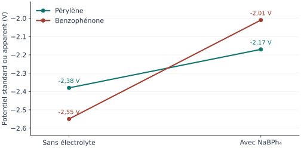

## I.3 — Les états de solvatation

### Question 21

En notant $L=[\mathrm{C}^{c+}][\mathrm{A}^{a-}]/c^\circ$ avec la convention en concentrations de l’énoncé et en prenant l’activité de l’eau égale à un, on a $[\mathrm{SSIP}]=K_1L$, $[\mathrm{SIP}]=K_1K_2L$, $[\mathrm{CIP}]=K_1K_2K_3L$. La définition explicite avec $[\mathrm{IP}]=[\mathrm{SSIP}]+[\mathrm{SIP}]+[\mathrm{CIP}]$ donne donc $K_A=K_1[1+K_2(1+K_3)]$. Pour la seule paire de contact, la constante de formation serait $K_1K_2K_3$. Cette distinction est nécessaire pour exploiter Q48.

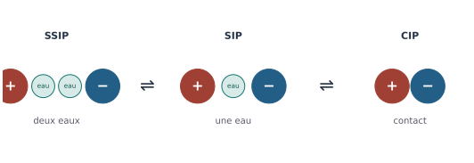

### Question 22

Pour $Z=21$, la règle de Klechkowski remplit les sous-couches par $n+\ell$ croissants, puis par $n$ croissant en cas d’égalité. Pauli autorise deux électrons de spins opposés par orbitale. Hund favorise d’abord les occupations simples à spins parallèles dans des orbitales dégénérées. On obtient $1s^22s^22p^63s^23p^64s^23d^1$, soit $[\mathrm{Ar}]\,3d^14s^2$.

### Question 23

Dans $\mathrm{ScSO_4^+}$, le sulfate porte $-2$ et le scandium est au degré $+\mathrm{III}$. La perte des deux électrons $4s$ puis de l’électron $3d$ laisse la configuration fermée $[\mathrm{Ar}]$, de type $d^0$. Le degré $+\mathrm{III}$ est le degré usuel de Sc en solution aqueuse. La formation de la paire conserve les degrés d’oxydation.

## I.3 — Absorption ultrasonore par un équilibre chimique

### Question 24

En injectant $s=\chi_{\rm tot}P$, $s_0=\chi_0P$, $s_\infty=\chi_\infty P$ dans la loi de relaxation et en simplifiant par $P$, on obtient $i\omega\tau(\chi_{\rm tot}-\chi_\infty)=\chi_0-\chi_{\rm tot}$. Ainsi

$$\chi_{\rm tot}=\chi_\infty+\frac{\chi_r}{1+i\omega\tau},\qquad \chi_r=\chi_0-\chi_\infty.$$

À basse fréquence l’équilibre chimique a le temps de se déplacer. À haute fréquence la contribution supplémentaire tend vers zéro.

### Question 25

Comme $\chi_{\rm tot}=\chi_\infty+\chi'$, la compressibilité de relaxation complexe vaut $\chi'=\chi_r/(1+i\omega\tau)=\chi_r(1-i\omega\tau)/(1+\omega^2\tau^2)$. Sa partie en phase est $\chi_r/(1+\omega^2\tau^2)$ et sa partie imaginaire vaut $-\chi_r\omega\tau/(1+\omega^2\tau^2)$ avec la convention $e^{i\omega t}$.

### Question 26

De $v^{-2}=\rho\chi_{\rm tot}$ et de Q25 on tire, pour $u=\omega\tau$,

$$\frac{1}{v^2}=\rho\!\left[\frac{\chi_0+u^2\chi_\infty}{1+u^2}-i\frac{(\chi_0-\chi_\infty)u}{1+u^2}\right].$$

La composante en quadrature traduit le retard de la réponse du milieu sur la pression. Le nombre d’onde $\omega/v$ devient complexe, ce qui produit une décroissance spatiale de l’amplitude. La célérité de phase mesurée est la vitesse réelle $c$ de Q27.

### Question 27

L’identité $-i\omega/v=-Q-i\omega/c$ donne $1/v=1/c-iQ/\omega$, puis

$$\frac{1}{v^2}=\frac{1}{c^2}-\frac{Q^2}{\omega^2}-i\frac{2Q}{c\omega}.$$

Avec $Q>0$, l’onde qui avance vers les $x$ positifs est atténuée.

### Question 28

Par Q26–27, $2Q/(c\omega)=\rho\chi_r u/(1+u^2)$. On multiplie par $\lambda=2\pi c/\omega$ et on utilise la célérité $c^2=1/(\rho\chi_0)$ demandée dans le sujet, ce qui donne

$$Q\lambda=\pi\frac{\chi_r}{\chi_0}\frac{\omega\tau}{1+(\omega\tau)^2}.$$

$Q\lambda$ est le décrément d’amplitude logarithmique sur une longueur d’onde, donc sans dimension.

### Question 29

La dérivée par rapport à $u$ vaut $(1-u^2)/(1+u^2)^2$. La courbe croît à partir de zéro, atteint $(Q\lambda)_{\max}=\pi\chi_r/(2\chi_0)$ pour $\omega_{\max}=1/\tau$, puis décroît comme $1/(\omega\tau)$. En fréquence ordinaire, $f_{\max}=1/(2\pi\tau)$. Sur un axe logarithmique, le pic est symétrique car $u/(1+u^2)$ est invariant par $u\mapsto1/u$.

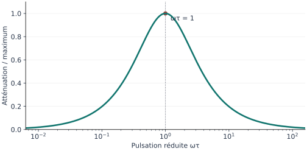

## I.3 — Volume de réaction et compressibilité

### Question 30

De $dG=VdP-SdT+\sum_i\mu_i^\star dn_i$, on extrait $V=(\partial_PG)_{T,\mathbf n}$ et $\mu_i^\star=(\partial_{n_i}G)_{T,P,n_{j\ne i}}$. La commutation des dérivées mixtes donne $(\partial_P\mu_i^\star)_{T,\mathbf n}=(\partial_{n_i}V)_{T,P,n_{j\ne i}}=\bar V_i$. À $T,P$ fixés, $dn_i=\nu_i d\xi$ et $dV=\sum_i\bar V_i\,dn_i$, donc $\Delta_rV=(\partial_\xi V)_{T,P}=\sum_i\nu_i\bar V_i$.

### Question 31

Les quantités de réactifs initiales valent toutes deux $n_0=C_0V_{\rm initial}$ et $\xi=n_0\delta$. La part de variation de volume associée à la réaction donne $(\partial V/\partial\delta)_{T,P}=n_0\Delta_rV\simeq VC_0\Delta_rV^\circ$. Dans la petite perturbation on emploie le volume de référence $V$. La compression ordinaire à avancement fixé intervient séparément dans $\chi_\infty$.

### Question 32

Chaque ion libre a la concentration $C_0(1-\delta)$ et la paire $C_0\delta$. Par conséquent

$$K=\frac{a_{\rm CIP}}{a_{\rm Sc}a_{\rm S}}=\frac{\gamma_{\rm CIP}}{\gamma_\pm^2}\frac{c^\circ}{C_0}\frac{\delta}{(1-\delta)^2}.$$

### Question 33

À coefficients d’activité et concentration analytique de référence fixés, $\ln K=\mathrm{constante}+\ln\delta-2\ln(1-\delta)$, d’où $d\ln K/d\delta=\Gamma(\delta)=1/\delta+2/(1-\delta)=(1+\delta)/(\delta(1-\delta))$. La règle de la chaîne donne $(\partial_PK)_T=K\Gamma(\delta)(\partial_P\delta)_T$.

### Question 34

À l’équilibre $\Delta_rG=\Delta_rG^\circ+RT\ln K=0$, donc $\Delta_rG^\circ=-RT\ln K$. Or $(\partial_P\Delta_rG^\circ)_T=\Delta_rV^\circ$ par Q30 appliquée aux états de référence. Ainsi $(\partial_PK)_T=-K\Delta_rV^\circ/(RT)$. Une augmentation de pression favorise le côté de plus petit volume.

### Question 35

Les questions 33 et 34 donnent $(\partial_P\delta)_T=-\Delta_rV^\circ/(RT\Gamma)$. En multipliant par la dérivée de Q31, la part chimique de $-(\partial_P V)_T/V$ est

$$\chi_r=\frac{C_0(\Delta_rV^\circ)^2}{RT\Gamma(\delta)}.$$

À $C_0$ et $\Delta_rV^\circ$ fixés, la dépendance en composition est $1/\Gamma=\delta(1-\delta)/(1+\delta)$. Son maximum vérifie $1-2\delta-\delta^2=0$, soit $\delta=\sqrt2-1\simeq0{,}414$. Aux deux extrémités il reste trop peu de l’une des formes pour que l’équilibre se déplace sensiblement. L’expression est positive même si $\Delta_rV^\circ<0$. Avec $C_0$ en $\mathrm{mol\,m^{-3}}$ et $\Delta_rV^\circ$ en $\mathrm{m^3\,mol^{-1}}$, elle s’exprime en $\mathrm{Pa^{-1}}$.

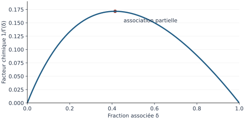

## I.3 — Deux équilibres couplés

### Question 36

Si $v=k[A]^p[B]^q$ et que $[B]$ reste pratiquement constante, on pose $k_{\rm obs}=k[B]^q$. La vitesse observée $v=k_{\rm obs}[A]^p$ est d’ordre apparent $p$ et le paramètre ajusté dépend de la concentration fixée. L’eau, solvant, peut ainsi être absorbée dans les constantes de vitesse. La linéarisation en Q39 repose pour sa part sur la petitesse des écarts à l’équilibre.

### Question 37

Notons $L=C_\pm$ la concentration de chacun des deux ions libres introduits en quantités égales, $S=C_{\rm SIP}$ et $D=C_{\rm CIP}$. En absorbant l’activité de l’eau dans les constantes, $v_{12}=k_{12}L^2-k_{21}S$ et $v_{23}=k_{23}S-k_{32}D$. Les trois équations sont $\dot L=-v_{12}$, $\dot S=v_{12}-v_{23}$ et $\dot D=v_{23}$. On vérifie que $L+S+D$ est constant.

### Question 38

Les conditions $\dot L=\dot D=0$ imposent séparément $k_{12}\bar L^2=k_{21}\bar S$ et $k_{23}\bar S=k_{32}\bar D$. L’équation du milieu est alors satisfaite. Les deux rapports de constantes donnent les rapports de concentrations à l’équilibre, avec une concentration de référence à introduire pour la première constante thermodynamique.

### Question 39

Écrivons $L=\bar L+x_\pm$, $S=\bar S+x_S$, $D=\bar D+x_D$. À l’ordre un, $L^2=\bar L^2+2\bar Lx_\pm+O(x_\pm^2)$. Les termes constants se compensent et $k'_{12}=2k_{12}\bar L$. Les perturbations suivent

$$\dot x_\pm=-k'_{12}x_\pm+k_{21}x_S,\quad \dot x_S=k'_{12}x_\pm-(k_{21}+k_{23})x_S+k_{32}x_D,\quad \dot x_D=k_{23}x_S-k_{32}x_D.$$

Si les concentrations libres diffèrent, les écarts stœchiométriques restent égaux et le coefficient devient $k_{12}(\bar C_++\bar C_-)$. Il a la dimension d’une fréquence.

### Question 40

Avec $a=k'_{12}$, $b=k_{21}$, $c=k_{23}$ et $d=k_{32}$,

$$A=\begin{pmatrix}-a&b&0\\a&-(b+c)&d\\0&c&-d\end{pmatrix}.$$

Une solution $\mathbf x=\mathbf x_0e^{\lambda t}$ impose $A\mathbf x_0=\lambda\mathbf x_0$. Une valeur propre négative donne un mode de relaxation de durée $\tau=-1/\lambda$. La somme des lignes, comme vecteurs-lignes, est nulle, ce qui traduit le bilan de matière.

### Question 41

En posant $S=a+b+c+d$ et $P=ac+ad+bd$, on trouve $\det(\lambda I-A)=\lambda(\lambda^2+S\lambda+P)$. Les deux modes décroissants ont pour fréquences

$$\frac{1}{\tau_2}=\frac{S+\sqrt{S^2-4P}}2,\qquad \frac{1}{\tau_3}=\frac{S-\sqrt{S^2-4P}}2.$$

Le discriminant $(a+b-c-d)^2+4bc$ est positif. Pour calculer le mode lent lorsque les deux temps sont très différents, la forme équivalente $1/\tau_3=2P/(S+\sqrt{S^2-4P})$ évite la soustraction de deux nombres voisins. La troisième valeur propre est zéro, soit formellement $\tau_1=\infty$. Elle correspond à un changement du bilan total. Une perturbation à quantité de matière constante ne crée que les deux modes de relaxation finis.

### Question 42

Si $a+b\gg c+d$, $4P/S^2\ll1$ et $\sqrt{S^2-4P}=S-2P/S+O(P^2/S^3)$. Ainsi $1/\tau_2\simeq S\simeq a+b$ et $1/\tau_3\simeq P/S$, soit

$$\tau_2\simeq\frac{1}{a+b},\qquad \tau_3\simeq\frac{a+b}{a(c+d)+bd}.$$

Le mode rapide rééquilibre surtout les ions libres et SIP. Pour le mode lent, $1/\tau_3\simeq d+c\,a/(a+b)$ contient la fraction prééquilibrée en SIP. Le second mode est dominé par la formation de CIP, mais sa durée dépend aussi du premier équilibre.

## I.3 — Lecture des spectres du sulfate de scandium

### Question 43

Une dilution raréfie les paires. À faible association $[\mathrm{paire}]$ varie comme le produit des concentrations ioniques, et l’amplitude de l’absorption chimique peut tomber sous le bruit de fond. Autre possibilité expérimentale, un maximum de relaxation peut être trop éloigné de la fenêtre $0{,}23\,\mathrm{MHz}$ à $1{,}3\,\mathrm{GHz}$ pour donner un pic distinct. Le tableau confirme surtout une perte de sensibilité pour le mode rapide aux faibles concentrations. L’absence d’atténuation détectable ne prouve pas la disparition des échanges ioniques.

### Question 44

En milieu acide $\mathrm{SO_4^{2-}+H_3O^+\rightleftharpoons HSO_4^-+H_2O}$. L’annexe donne $pK_{a2}=1{,}9$. Lorsque le pH devient inférieur à cette valeur, l’hydrogénosulfate domine et il reste trop peu de sulfate libre pour interpréter l’absorption selon le seul mécanisme scandium–sulfate. L’équilibre de protonation peut en outre contribuer à la réponse acoustique.

### Question 45

Le pouvoir tampon $\ln(10)[\mathrm{AH}][\mathrm{A^-}]/([\mathrm{AH}]+[\mathrm{A^-}])$ est maximal, à total fixé, pour deux concentrations égales, donc près de $pK_a$. Le couple pyridinium/pyridine de l’annexe a $pK_a=5{,}2$, le plus proche de $5{,}5$. La relation de Henderson–Hasselbalch donne $[\mathrm{Py}]/[\mathrm{PyH^+}]=10^{5,5-5,2}\simeq2$. Mélanger deux volumes de pyridine à un volume d’un sel de pyridinium de même concentration, puis ajuster au volume final et contrôler le pH. Pour un tampon de concentration totale $C_T$, les concentrations finales visées sont $2C_T/3$ et $C_T/3$.

### Question 46

La composante b présente son maximum vers $0{,}75\,\mathrm{MHz}$, la composante c vers $5\,\mathrm{MHz}$ et la composante d autour de $3\times10^2\,\mathrm{MHz}$. Comme $\tau=1/(2\pi f_{\max})$, la lecture donne respectivement environ $2{,}1\times10^{-7}\,\mathrm s$, $3{,}2\times10^{-8}\,\mathrm s$ et $5$ à $6\times10^{-10}\,\mathrm s$. Par ordre du tableau, $\tau'_1\simeq5{,}5\times10^{-10}\,\mathrm s$, $\tau'_2\simeq3{,}2\times10^{-8}\,\mathrm s$, $\tau'_3\simeq2{,}1\times10^{-7}\,\mathrm s$. Les extrema de la somme a sont déplacés par le recouvrement des trois composantes.

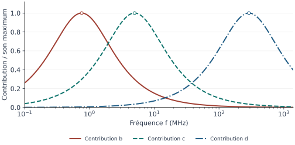

### Question 47

Sur les points où elle est résolue, $\tau'_1$ reste voisine de $5{,}6\times10^{-10}\,\mathrm s$. Si le terme d’association dépendant des ions libres est négligeable dans la précision des mesures, $1/\tau'_1\simeq k_{-1}$. Une valeur presque constante sur trois points ne permet pas de le démontrer isolément. De même, $\tau'_2$ varie seulement de $3{,}1$ à $3{,}3\times10^{-8}\,\mathrm s$. En posant $S_0=k_{-3}+k_3+k_{-2}$ et en négligeant devant lui $k_2R(c_0)$, il vient, pour $c_0\ge0{,}01\,\mathrm{mol\,L^{-1}}$,

$$\tau'_2\simeq S_0^{-1},\qquad \tau'_3\simeq\frac{S_0}{k_{-3}k_{-2}[1+K_2(1+K_3)c_0/c^\circ]}.$$

Les tirets du tableau pour $\tau_1^{\prime}$ signalent une composante non résolue. Ils ne fixent ni sa durée ni la concentration des paires correspondantes. La durée lente diminue lorsque $c_0$ croît, conformément au tableau.

### Question 48

Prendre les quatre concentrations $c_0\ge0{,}01\,\mathrm{mol\,L^{-1}}$. Porter $Y=1/(\tau'_2\tau'_3)$ en fonction de $X=c_0/c^\circ$. Les deux formules données dans l’énoncé impliquent, en posant $R(c_0)\simeq X$,

$$Y=k_{-3}k_{-2}\,[1+K_2(1+K_3)X].$$

Un ajustement affine $Y=b+mX$ donne $m/b=K_2(1+K_3)$. On en déduit $K_A=K_1(1+m/b)$, avec $K_1=200$. On peut aussi ajuster $1/\tau'_3$ seul si l’on accepte l’approximation de $\tau'_2$ constant de Q47.

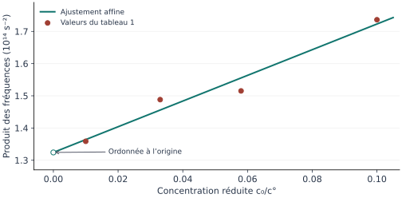

## II.1 — Structure et rétrosynthèse de la quartromicine

### Question 49

Les règles de Cahn, Ingold et Prelog classent les atomes par numéro atomique décroissant, couche par couche. Une liaison double introduit un duplicata de l’atome opposé. Les quatre voisins de $C^*$ sont des carbones. Le carbone spiro porte la liste $(\mathrm O,\mathrm C,\mathrm C)$ et vient en premier. Chacun des deux carbones vinyliques donne $(\mathrm C,\mathrm C,\mathrm H)$, tandis que le méthyle donne $(\mathrm H,\mathrm H,\mathrm H)$ et vient en dernier. Au rang suivant, le deuxième carbone vinylique du cycle porte deux prolongements carbonés, celui de la chaîne latérale en porte un et un hydrogène. L’ordre est donc **spiro, branche vinylique du cycle, branche vinylique extérieure, méthyle**. Sur la figure 4, les trois premières branches se succèdent dans le sens horaire. Le méthyle, en coin plein, est tourné vers le lecteur. On inverse le sens de lecture et on obtient **$S$**.

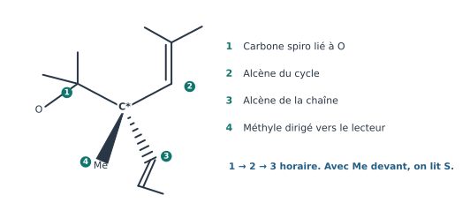

### Question 50

Les deux synthons portent les deux fonctions nécessaires. Le **carbone du chlorure d’acyle** en bout de chaîne est électrophile. Le **carbone vinylique portant H du tétronate**, situé entre le carbonyle lactonique et le carbone portant OH, est nucléophile sous forme énolique ou énolate. La délocalisation du doublet de l’oxygène de l’énolate fournit une forme limite chargée sur ce carbone. Sa C-acylation sur le chlorure d’acyle d’un autre fragment forme la liaison $\mathrm{C-C}$ devant le carbonyle et expulse $\mathrm{Cl^-}$. La répétition des jonctions entre fragments endo et exo construit le macrocycle de la figure 4.

## II.2 — Synthèse du spirotétronate endo

### Question 51

La cycloaddition $[4+2]$ est suprafaciale sur les deux partenaires. On conserve la liaison double $\mathrm{C3_A=C4_A}$ et le méthyle de $\mathrm{C4_A}$ reste dans son plan. Deux connectivités sont possibles. Dans **I**, les liaisons nouvelles sont $\mathrm{C2_A-C3_B}$ et $\mathrm{C5_A-C4_B}$. Dans **II**, elles sont $\mathrm{C2_A-C4_B}$ et $\mathrm{C5_A-C3_B}$. Dans chaque série, on prend comme repère le méthyle porté par $\mathrm{C2_A}$. Sa position extérieure sur le diène initial le place **cis** à CHO pour une approche endo et **trans** pour une approche exo. L’attaque par l’autre face inverse simultanément les deux centres. Le schéma représente les **huit produits**. Les deux composés d’une même paire endo ou exo sont énantiomères, un endo et un exo de même connectivité sont diastéréoisomères, et I et II sont des régioisomères.

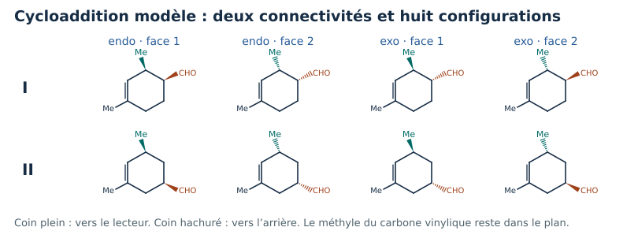

### Question 52

L’interaction $\mathrm{HO}(A)/\mathrm{BV}(B)$ coûte $(-10{,}4)-(-12{,}7)=2{,}3\ \mathrm{eV}$, contre $(-9{,}7)-(-13{,}8)=4{,}1\ \mathrm{eV}$ pour le couple inverse. La première domine. La plus grande amplitude terminale du diène est sur $\mathrm{C5_A}$ ($0{,}65$ contre $0{,}55$ en valeur absolue), celle de la BV de B sur $\mathrm{C4_B}$ ($0{,}66$ contre $0{,}23$). Les apparier conduit à **I**. Dans la convention du document 2, les couples $\mathrm{C5_A/C4_B}$ et $\mathrm{C2_A/C3_B}$ présentent respectivement les signes $+/+$ et $-/-$. L’orientation endo amène en outre le système $\pi$ du carbonyle au-dessus du système $\pi$ du diène. Le recouvrement secondaire stabilise cet état de transition. On attend majoritairement **les deux énantiomères endo de I**, en quantités égales avec ces réactifs achiraux sous contrôle cinétique.

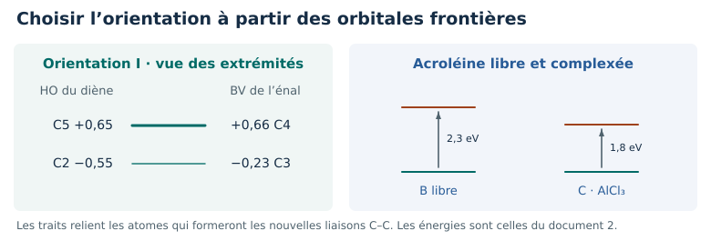

### Question 53

L’aluminium possède trois électrons de valence et forme trois liaisons avec les chlores. Dans $\mathrm{AlCl_3}$ monomère, son entourage ne compte ainsi que six électrons. Une orbitale vacante peut accueillir un doublet fourni, par exemple, par l’oxygène carbonylé. Cette propriété d’accepteur de doublet définit un **acide de Lewis**.

### Question 54

Un doublet de l’oxygène carbonylé se coordonne à l’aluminium. La BV du diénophile passe de $-10{,}4$ à $-10{,}9\ \mathrm{eV}$. Son écart avec la HO de A à $-12{,}7\ \mathrm{eV}$ passe de $2{,}3$ à $1{,}8\ \mathrm{eV}$. L’interaction stabilisante entre ces orbitales augmente et la barrière de cycloaddition diminue. La dissociation du complexe du produit régénère l’acide de Lewis.

### Question 55

En géométrie endo, le carbonyle se place du côté du système $\pi$ du diène. Le coefficient en valeur absolue de la BV sur son carbone $\mathrm{C2}$ passe de $0{,}36$ dans B à $0{,}67$ dans C. Cette augmentation et le rapprochement énergétique de la BV et de la HO renforcent le recouvrement secondaire disponible en endo. Dans l’approche exo, le carbonyle pointe vers l’extérieur. La différence de stabilisation des états de transition accroît la préférence cinétique pour l’endo.

### Question 56

Le groupement acétoxy apporte en $\alpha$ un oxygène à effet inductif attracteur. Son doublet se délocalise aussi vers le carbonyle de l’acétyle, ce qui limite sa donation vers la double liaison de l’énal. Cette polarisation, renforcée par la coordination du carbonyle aldéhydique à $\mathrm{AlCl_3}$, favorise l’interaction entre le diène donneur et le diénophile accepteur. C’est une interprétation qualitative de la réactivité accrue donnée par l’énoncé. Le document 2 fournit des énergies pour B et son complexe C uniquement.

### Question 57

Écrivons la chaîne de 7 sous la forme $\mathrm{R-CH_2-CH_2-CH_2OH}$. Une oxydation douce de l’alcool primaire, par exemple une oxydation de Swern suivie de triéthylamine, donne $\mathrm{R-CH_2-CH_2-CHO}$. À basse température, en THF anhydre, une base forte peu nucléophile telle que le LDA arrache un proton en $\alpha$ de cet aldéhyde. Le produit 8 est l’énolate $\mathrm{R-CH_2-CH=CH-O^-}$, accompagné de son contre-ion. L’oxydation douce permet de s’arrêter à l’aldéhyde, et le travail à froid limite les réactions d’aldolisation.

### Question 58

Dans 9, écrivons $\mathrm{R-CH=CH-CHO}$ pour la chaîne insaturée. Sous contrôle de charge, l’hydrure attaque le carbone du carbonyle en 1,2. L’alcool allylique obtenu après protonation est $\mathrm{R-CH=CH-CH_2OH}$. Avec TBSCl et une base de piégeage de HCl, on forme **10**, $\mathrm{R-CH=CH-CH_2O-TBS}$. La géométrie $E$ de la double liaison, l’acétate, l’ester méthylique, l’éther de TBDPS et les configurations du cycle sont ceux de 9.

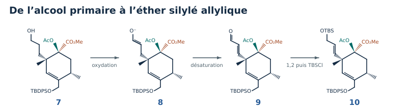

### Question 59

Notons $S$ le carbone du cycle portant $\mathrm{-O-C(=O)CH_3}$ et $\mathrm{-C(=O)OMe}$. Le LHMDS déprotone le méthyle de l’acétate. L’énolate possède une forme nucléophile $\mathrm{S-O-C(=O)-CH_2^-}$. Ce carbone attaque intramoléculairement le carbonyle de $\mathrm{S-C(=O)OMe}$. Le déplacement du doublet $\pi$ sur l’oxygène donne un intermédiaire tétraédrique dans un cycle à cinq. Sa refermeture expulse le méthanolate. Cette **condensation de Dieckmann** fournit une $\beta$-céto-lactone comportant un carbonyle de cétone et un carbonyle d’ester. L’énolisation puis la protonation au traitement final donnent **1a**, dont le parcours du cycle est $\mathrm{S-O-C(=O)-CH=C(OH)-S}$. Le centre spiro conserve les liaisons qui fixent sa configuration.

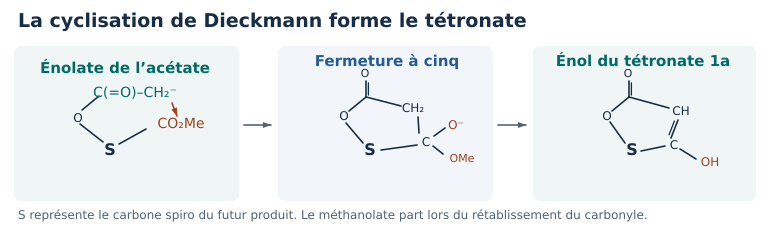

### Question 60

Les groupes sont classés par déplacement chimique croissant. Les lettres sont celles de la figure 8.

| $\delta$ (ppm) | Intégration et multiplicité données | Protons | Justification |
|---|---|---|---|
| 0,21 | 6 H, s | b, c | Les deux méthyles liés au silicium du TBS sont très blindés. |
| 0,69–0,83 | 24 H, massif annoncé s | a, q, g, m | 18 H des deux tert-butyles, 3 H du méthyle g sur carbone quaternaire et 3 H du méthyle m lié à i. Le doublet attendu pour m peut être recouvert dans le massif. |
| 1,78 | 2 H, d, 7,0 Hz | j | Méthylène du cycle voisin du méthine i, avec un couplage vicinal dominant. |
| 2,06 | 1 H, tq, 7,0 Hz | i | Méthine couplé aux deux H de j et aux trois H du méthyle m. |
| 3,51 | 3 H, s | k | Méthoxyde d’énol, sans proton vicinal. |
| 4,46 | 2 H, s | n | Méthylène oxygéné porté par un carbone vinylique sans H. |
| 4,48 | 2 H, d, 5,2 Hz | d | Méthylène oxygéné de la chaîne allylique couplé à e. |
| 5,08 | 1 H, s | l, probable | Proton vinylique du tétronate, isolé et blindé par le méthoxy donneur. |
| 5,48 | 1 H, d, 15,0 Hz | f | Un couplage trans avec e, aucun H sur le carbone quaternaire voisin. |
| 5,59 | 1 H, dt, 5,2 et 15,0 Hz | e | Couplage trans avec f et couplage avec les deux H de d. |
| 5,70 | 1 H, s | h, probable | Proton vinylique isolé du cyclohexène. |
| 7,25–7,60 | 10 H, m | o, p | Les deux phényles du TBDPS. |

L’intégration totale vaut 54 H. La paire d’alcène $\mathrm e$ et $\mathrm f$ se reconnaît d’abord à son couplage mutuel de 15 Hz. Le couplage de 5,2 Hz relie ensuite $\mathrm e$ au méthylène $\mathrm d$, ce qui distingue les deux extrémités de cette chaîne. Le spectre unidimensionnel ne sépare pas de façon certaine b et c, les deux phényles, ni chacun des méthyles du massif de 24 H. Une corrélation à longue portée vers le carbonyle lactonique confirmerait l’attribution proposée pour l.

### Question 61

Dans l’état de transition majoritaire menant à 5, le substituant CHO de 4 est dirigé vers le système $\pi$ du diène. C’est l’approche **endo**. Sur 5, il est du même côté du cyclohexène que le méthyle en tireté à droite du cycle. L’oxydation du formyle puis la cyclisation conservent la liaison au centre stéréogène. Dans 1, la liaison du carbone spiro au carbone énolique du tétronate est du côté de ce méthyle. Le nom **endo-1** rappelle cette filiation stéréochimique.

## II.3 — Synthèse du spirotétronate exo

### Question 62

À connectivité de 20 fixée, l’addition suprafaciale fixe la relation entre les deux méthyles portés par les extrémités de 3. Ils sont trans dans le cycle dessiné. Partant d’une projection avec le méthyle supérieur devant et le méthyle inférieur derrière, on peut placer le substituant $\mathrm{-C(=O)N(Aux)}$ derrière pour l’endo (cis au méthyle inférieur) ou devant pour l’exo (trans à ce méthyle). L’attaque sur l’autre face inverse les trois orientations du cycle. Il existe donc **quatre cycloadduits**. En présence de l’auxiliaire camphorsultame de configuration fixée, il s’agit de quatre diastéréoisomères. Après retrait de l’auxiliaire, les deux membres d’une même famille peuvent conduire aux antipodes du squelette.

La figure 9 donne **exo/endo = 7/1**. L’auxiliaire chiral encombre différemment les deux faces du diénophile, qui deviennent diastéréotopiques. L’exo majoritaire est celui de la série menant à 11, portant dans la projection retenue le méthyle supérieur devant et l’inférieur derrière. L’excès de 78 % correspond, pour la paire exo rapportée au squelette libéré, à $(1+0{,}78)/2=89\,\%$ du majoritaire et 11 % de l’autre.

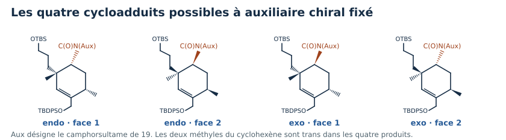

### Question 63

La première voie donne un rapport **endo/exo de 96/4** avec l’α-bromoacroléine. Le diène, le diénophile et le catalyseur étant achiraux, les deux faces énantiotopiques donnent les deux énantiomères en proportions égales. La deuxième voie utilise un auxiliaire chiral. Elle favorise l’adduit exo de 20 (7/1) et enrichit la série exo dans un antipode (78 % d’excès). Les étapes de transformation de l’auxiliaire donnent alors accès à la série absolue nécessaire pour 11 avec moins de matière de configuration indésirable à séparer. En combinant le rapport et l’excès, la fraction de l’ensemble des cycloadduits correspondant à l’antipode exo recherché après départ de l’auxiliaire s’estime à $(7/8)\times0{,}89\simeq0{,}78$. Ce calcul porte sur la composition du mélange de cycloaddition avant les transformations ultérieures. Les deux rapports se rapportent à des **diénophiles différents** et ne sont pas des rendements isolés de 11.

### Question 64

La réduction de CHO par $\mathrm{NaBH_4}$ transforme 11 en bromhydrine portant $\mathrm{-CH_2OH}$ et Br sur le même carbone de rattachement du cyclohexène. Le méthanolate forme l’alcoolate. Son oxygène se rapproche par l’arrière du carbone porteur de Br, ferme le cycle à trois et libère $\mathrm{Br^-}$. **12 est l’époxyde spiro** dont le triangle a pour sommets le carbone du cyclohexène, O et $\mathrm{CH_2}$. La fermeture intramoléculaire avec départ de Br impose l’inversion au centre porteur du groupe partant. Avec les méthyles de 11 orientés comme dans la figure 10, la branche $\mathrm{C_{sp}-O}$ se trouve derrière et la branche $\mathrm{C_{sp}-CH_2}$ devant. Les autres centres sont conservés.

### Question 65

La soude transforme $\mathrm{PhSH}$ en thiophénolate $\mathrm{PhS^-}$. Il attaque le $\mathrm{CH_2}$ primaire de 12 par l’arrière de sa liaison à l’oxygène, dans une ouverture de type $\mathrm{S_N2}$. L’attaque du carbone spiro tertiaire est beaucoup plus encombrée. La rupture $\mathrm{CH_2-O}$ laisse l’oxygène sur le carbone du cyclohexène. Après protonation, **13** porte $\mathrm{-CH_2SPh}$ devant et $\mathrm{-OH}$ derrière sur ce centre dans la projection de 14. Le carbone primaire attaqué porte deux hydrogènes et ne crée aucun centre stéréogène.

### Question 66

Le mCPBA, acide méta-chloroperbenzoïque, **oxyde le sulfure en sulfoxyde** par transfert d’un atome d’oxygène. Si $\mathrm R$ désigne le résidu lié à $\mathrm{CH_2}$, le bilan est
$$
\mathrm{R-CH_2-SPh + m\text{-}ClC_6H_4C(O)OOH
\longrightarrow R-CH_2-S(O)Ph + m\text{-}ClC_6H_4CO_2H}.
$$
Le produit est 14. Cette étape contrôlée à basse température installe un seul oxygène sur le soufre.

### Question 67

Sur le carbone du cyclohexène, **15** porte en arrière le OH de 14 et en avant le groupe $\mathrm{-CH(OAc)-SPh}$. Le réarrangement de Pummerer a substitué par OAc un des hydrogènes en $\alpha$ du soufre. La bande vers $3300\ \mathrm{cm^{-1}}$ correspond au OH resté libre. Deux configurations sur le carbone temporaire $\mathrm{CH(OAc)SPh}$ sont concevables sans information additionnelle.

La nouvelle portion d’anhydride acétique protège le OH du cycle sous forme OAc. L’hydrolyse de l’α-acétoxythioéther passe par un hémithioacétal, qui libère le thiophénol et donne l’aldéhyde. **16** porte ainsi devant $\mathrm{-CHO}$ et derrière $\mathrm{-OAc}$. La disparition du OH et l’apparition d’une bande d’élongation C–H aldéhydique vers $2800\ \mathrm{cm^{-1}}$ concordent avec cette structure. Les deux éthers silylés et le cyclohexène sont conservés.

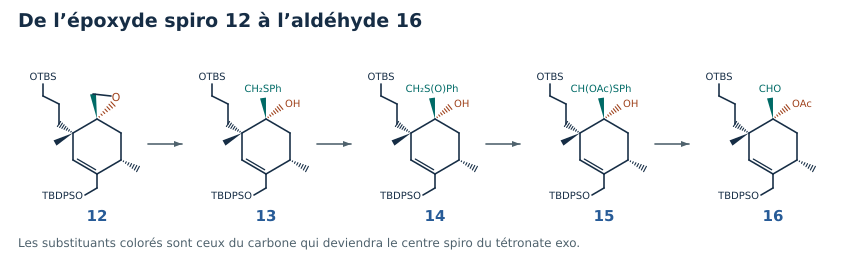

### Question 68

La forme limite $\mathrm{R-CH_2-S^+(Ph)-O^-}$ rend compte du caractère nucléophile de l’oxygène. Il attaque un carbonyle de $\mathrm{Ac_2O}$. L’intermédiaire tétraédrique expulse l’acétate et donne $\mathrm{R-CH_2-S^+(Ph)-OAc}$. L’acétate prélève ensuite le proton en $\alpha$ indiqué dans l’énoncé. La formation de la liaison $\mathrm{C=S}$ s’accompagne de la rupture $\mathrm{S-OAc}$ et donne le thionium $\mathrm{R-CH=S^+-Ph}$, en résonance avec $\mathrm{R-CH^+-SPh}$. Un ion acétate attaque son carbone et fournit le motif $\mathrm{R-CH(OAc)-SPh}$ de 15. Le soufre est revenu à l’état de thioéther.

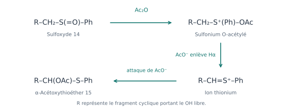

### Question 69

Une **oxydation de Pinnick**, à l’aide de chlorite de sodium $\mathrm{NaClO_2}$ en milieu aqueux tamponné (phosphate, avec un piégeur de HOCl tel que le 2-méthylbut-2-ène), transforme le CHO de 16 en $\mathrm{CO_2H}$. On obtient **17**, en gardant le cyclohexène, l’acétate et les deux éthers silylés. Ce traitement chimiosélectif convient mieux à ce substrat polyfonctionnel qu’un oxydant puissant susceptible d’attaquer la double liaison.

### Question 70

Deux formes limites du diazométhane sont $\mathrm{H_2C=N^+=N^-}$ et $\mathrm{^-CH_2-N^+\equiv N}$. Dans la première, le N terminal porte deux doublets libres. Dans la seconde, le carbone porte un doublet et le N terminal un doublet. L’azote central tétravalent porte $+1$ dans les deux formes. Chaque atome de la deuxième période satisfait l’octet et la molécule est globalement neutre.

### Question 71 — gaz et produit organique

Le gaz est le diazote $\mathrm{N_2}$. Le groupe carboxyle de 17 devient l’ester méthylique $\mathrm{RCO_2CH_3}$ de **18**. Le carbone du méthyle est le carbone supplémentaire et les deux azotes quittent la partie organique. Les centres stéréogènes du squelette sont conservés.

### Question 72

Le PPTS, tosylate de pyridinium, fournit des conditions légèrement acides dans l’éthanol. L’éther de **TBS** de la chaîne saturée est clivé et donne l’alcool primaire, tandis que l’éther de **TBDPS** porté par l’autre chaîne résiste à ces conditions douces. **19** est donc 18 où $\mathrm{-CH_2-CH_2-CH_2OTBS}$ est devenu $\mathrm{-CH_2-CH_2-CH_2OH}$. Sur le carbone du cycle, $\mathrm{CO_2Me}$ est devant et OAc derrière, comme en 17. Le fluorure du TBAF se lie fortement au silicium des deux groupes et risquerait de cliver aussi l’éther de TBDPS.

### Question 73

**19 et 7 sont des épimères**, donc des diastéréoisomères. Les méthyles du cyclohexène, les chaînes latérales, la connectivité et les protections coïncident. La disposition au seul carbone portant à la fois OAc et $\mathrm{CO_2Me}$ est inversée. Dans 7, OAc est devant et $\mathrm{CO_2Me}$ derrière. Dans 19, l’ordre est inversé. Ce carbone deviendra le centre spiro. Les précurseurs 5 et 11 diffèrent déjà par le groupe OAc ou Br, mais présentent leur formyle du même côté sur les figures 6 et 10. **La fermeture de la bromhydrine issue de 11 en époxyde 12** réalise l’inversion qui distingue les deux filiations stéréochimiques. L’ouverture de 12 en 13 conserve ensuite la liaison entre ce centre et l’oxygène.

## II.4 — Couplage des deux synthons

### Question 74

La liaison $\pi$ de l’énol de endo-9-A attaque le brome électrophile de la N-bromosuccinimide par son carbone vinylique portant H, entre le carbonyle lactonique et le carbone porteur de OH. Le doublet de la liaison N–Br revient sur l’azote et un doublet de l’oxygène énolique forme le carbonyle. Déprotonation du carbonyle protoné puis énolisation du composé α-bromé par transfert du H restant sur le carbone bromé redonnent la liaison double et le OH du dessin. Dans **endo-9-B**, ce carbone porte Br à la place de H. Le squelette spiro est conservé.

### Question 75

On effectue l’échange Br/Li sur endo-21 dans du **THF anhydre**, sous atmosphère sèche d’argon ou de diazote. À basse température, par exemple $-78\,^\circ\mathrm C$, on ajoute l’aldéhyde exo-23 à endo-24 et on laisse se former l’alcoolate de lithium. Une hydrolyse finale par une solution aqueuse de $\mathrm{NH_4Cl}$ donne 25. L’eau ou un alcool introduits avant l’addition protoneraient immédiatement l’organolithien.

### Question 76

Écrivons $D$ pour le résidu **endo-24 privé de Li**, la valence libre étant sur le carbone vinylique du tétronate, et $X$ pour le squelette exo au point d’attache de la chaîne $\mathrm{X-CH=CH-CHO}$. Le carbone $\mathrm{C^{\delta-}-Li^{\delta+}}$ de $D$ attaque le carbone $\mathrm{C^{\delta+}=O}$ de cet **énal** en 1,2. La fonction effectivement dessinée sur exo-23 est un aldéhyde conjugué. Le produit après hydrolyse est **$\mathrm{X-CH=CH-CH(OH)-D}$ (25)**. La double liaison $E$ de la chaîne et les configurations des deux fragments sont conservées. La face d’attaque sur le carbonyle n’est pas imposée par l’énoncé. Le nouveau centre carbinolique peut donner deux épimères.

### Question 77

Le doublet porté par le carbone lithien de endo-24 forme une liaison avec le carbone du CHO de exo-23. Simultanément, les électrons $\pi$ de $\mathrm{C=O}$ passent sur O. On obtient $\mathrm{X-CH=CH-CH(O^-Li^+)-D}$. Au traitement aqueux, l’oxygène de cet alcoolate prend un proton et forme l’alcool allylique secondaire 25. La double liaison de la chaîne n’intervient pas dans le déplacement de doublets de cette addition 1,2.

### Question 78

Le chlorochromate de pyridinium (PCC) oxyde le groupe $\mathrm{-CH(OH)-}$ de 25 en $\mathrm{-C(=O)-}$. On obtient **$\mathrm{X-CH=CH-C(=O)-D}$ (26)**, avec le carbone de l’ancien tétronate lithien directement lié au nouveau carbonyle. La chaîne constitue une énone conjuguée. Les deux configurations possibles en 25 convergent vers la même cétone, car le carbone du carbonyle est trigonal. Les deux centres spiro et les éthers silylés correspondent à ceux dessinés sur les fragments initiaux.

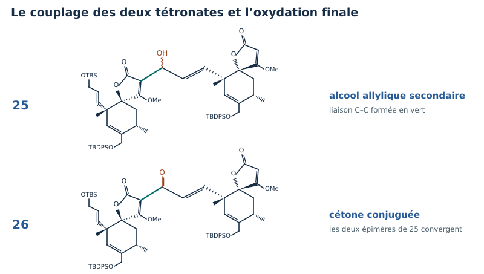
