# ENS PC — Physique C 2026 · Corrigé guidé

*Corrigé rédigé par IA, non officiel.*

**Rédaction** · modèle exact non renseigné (famille GPT-6) · effort non renseigné · vitesse non renseignée

**Révision** · modèle exact non renseigné (famille GPT-6) · effort non renseigné · vitesse non renseignée

**Révision (tour 2)** · GPT-6.2 Astra Ultra · vitesse non renseignée

## Présentation du sujet

Un tas de grains peut conserver une pente sur laquelle des grains déjà en mouvement continuent de couler. De même, un aimant peut conserver son orientation après le renversement du champ extérieur. Cette épreuve de six heures, sans calculatrice, étudie les seuils qui rendent ces deux comportements possibles et le coût énergétique des retournements magnétiques.

Le grain de diamètre $d$ se déplace sur une couche inclinée. Dans le cristal, $M_s$ désigne la norme de l’aimantation à saturation et $B_0$ la composante algébrique du champ extérieur sur un axe fixe. Les deux modèles sont indépendants.

## I — Un grain au repos sur une pente

La géométrie du contact fixe la direction des réactions. Le premier seuil apparaît quand l’un des appuis cesse de porter.

### Question 1

> [!INDICATION]
> Dessiner les deux rayons allant des centres fixes vers le centre du grain. Projeter les forces le long de la pente puis selon sa normale.

#### Solution

Les trois distances entre $C_{n-1},O,C_n$ valent $d$ : leur triangle est équilatéral. Le poids $m\vec g$ est appliqué en $O$. Les réactions des bosses sont appliquées aux contacts et dirigées suivant $C_{n-1}O$ et $C_nO$, vers $O$. Dans le référentiel du sol supposé galiléen, la première loi de Newton impose une résultante nulle pour un grain qui reste au repos. Avec $x$ descendant la pente et $y$ normal au plan, on obtient

$$mg\sin\alpha+\tfrac12(N_{n-1}-N_n)=0,\qquad -mg\cos\alpha+\tfrac{\sqrt3}{2}(N_{n-1}+N_n)=0.$$

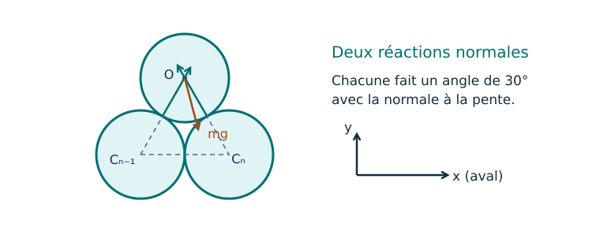

### Question 2

> [!INDICATION]
> Utiliser la somme et la différence obtenues en Q1, puis une identité d’addition des sinus.

> [!INDICATION]
> Pour une pente nulle, les deux forces d’appui doivent être égales. Quel appui s’allège quand la pente augmente ?

#### Solution

On trouve $N_{n-1}=mg(\cos\alpha/\sqrt3-\sin\alpha)$ et $N_n=mg(\cos\alpha/\sqrt3+\sin\alpha)$. Ainsi $k=2mg/\sqrt3$, $\Psi_{n-1}=\pi/6-\alpha$ et $\Psi_n=\pi/6+\alpha$. Pour une pente horizontale, les deux appuis portent la même charge.

### Question 3

> [!INDICATION]
> Une bosse peut pousser le grain, sans le tirer.

#### Solution

Tant que la réaction amont est strictement positive, le contact est porteur. Elle s’annule pour $\alpha_s=\pi/6=30^\circ$. À cet angle le contact est juste déchargé. Au-delà, son maintien exigerait une réaction négative, ce qui est impossible pour ce contact sans adhésion.

## I.1 — Franchissement d’une bosse

Comparer l’énergie de lancement à une barrière de pesanteur, puis étudier le temps que le grain passe au voisinage du sommet.

### Question 4

> [!INDICATION]
> L’angle part de l’axe normal et augmente vers l’aval. Dériver la position dans les axes fixes liés au plan.

#### Solution

La distance $C_nO=d$ reste constante. Avec la convention angulaire du sujet,

$$\vec r=d(\sin\phi\,\vec e_x+\cos\phi\,\vec e_y),\qquad \vec v=d\dot\phi(\cos\phi\,\vec e_x-\sin\phi\,\vec e_y).$$

Sans rotation propre, l’énergie cinétique est $E_c=md^2\dot\phi^2/2$.

### Question 5

> [!INDICATION]
> Relier le poids à la dérivée de l’énergie suivant un axe vertical ascendant.

#### Solution

Pour une altitude $z$ orientée vers le haut, $F_z=-mg=-\mathrm dE_p/\mathrm dz$. Donc $E_p=mgz+\mathrm{constante}$. Pour la sphère homogène, on emploie l’altitude de son centre $O$.

### Question 6

> [!INDICATION]
> Projeter le rayon sur la verticale puis rechercher l’altitude maximale, qui fixe le zéro d’énergie demandé.

#### Solution

La verticale ascendante est $-\sin\alpha\,\vec e_x+\cos\alpha\,\vec e_y$. Sa projection sur $\vec r$ donne $z_O-z_{C_n}=d\cos(\phi+\alpha)$. Au sommet géométrique, $O$ est à la verticale de $C_n$, soit $\phi=-\alpha$ et $z_O-z_{C_n}=d$. Par conséquent

$$E_p(\phi)=mgd[\cos(\phi+\alpha)-1].$$

### Question 7

> [!INDICATION]
> Examiner la puissance de la réaction normale et celle des forces internes d’un solide indéformable.

#### Solution

Le poids dérive du potentiel de Q6. La réaction de $\mathcal S_n$ est radiale, orthogonale à la vitesse de $O$, et son moment en $O$ est nul. Sa puissance sur la sphère est donc nulle. Dans un modèle de solide indéformable, les efforts internes ne fournissent pas de puissance de déformation. Il s’ensuit que $E_m=E_c+E_p$ est constante sur cet arc. Lors du choc avec une autre bosse, la direction de la vitesse doit changer brusquement. Des déformations et de la dissipation peuvent intervenir pendant ce contact bref. La conservation de l’énergie mécanique d’un arc ne s’étend donc pas d’office à la collision.

> [!PIEGE]
> La réaction radiale ne fournit pas de puissance pendant l’arc. Pendant la collision, la vitesse change de manière discontinue dans le modèle.

### Question 8

> [!INDICATION]
> Comparer une droite d’énergie mécanique constante à la hauteur de la barrière à franchir.

> [!INDICATION]
> L’angle nul correspond à la normale au plan incliné. Le sommet géométrique se trouve à la verticale du centre de la bosse.

#### Solution

Le potentiel est la portion de cosinus de Q6 sur $[-\pi/6,\pi/6]$. Le contact amont correspond à $\phi=-\pi/6$, le sommet à $-\alpha$ et le contact aval à $+\pi/6$. Le grain lancé vers l’aval peut visiter les zones où $E_m\ge E_p$. Pour $E_p(-\pi/6)<E_m<0$, il rebrousse chemin au premier point tel que $E_p=E_m$. Pour $E_m=0$, la droite d’énergie est tangente au sommet, qui sépare les deux branches : c’est la trajectoire critique, sans franchissement en temps fini. Pour $E_m>0$, toute la bosse est accessible et le grain atteint $\mathcal S_{n+1}$, sous l’hypothèse du maintien du contact avec $\mathcal S_n$.

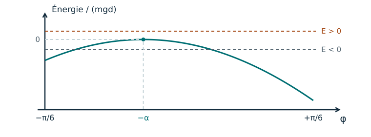

### Question 9

> [!INDICATION]
> À l’entrée, écrire la condition pour que l’énergie mécanique dépasse le maximum du potentiel.

#### Solution

Au départ, $E_m=md^2\dot\phi_0^2/2+mgd[\cos(\alpha-\pi/6)-1]$. Le franchissement en temps fini exige $E_m>0$. Puisque $\dot\phi_0>0$, cela revient à $\dot\phi_0>\dot\phi_c$, où

$$\dot\phi_c=\sqrt{\frac{2g}{d}[1-\cos(\alpha-\pi/6)]}.$$

### Question 10

> [!INDICATION]
> Exprimer l’énergie initiale avec la vitesse critique, puis choisir le signe de la vitesse sur l’arc parcouru vers l’aval.

#### Solution

L’énergie conservée s’écrit $E_m=md^2(\dot\phi_0^2-\dot\phi_c^2)/2$. En retranchant $E_p(\phi)$ puis en choisissant la racine positive, on obtient

$$\dot\phi=\sqrt{\dot\phi_0^2-\dot\phi_c^2+\frac{2g}{d}[1-\cos(\phi+\alpha)]}.$$

À $\phi=\pi/6$, l’identité $\cos(\alpha-\pi/6)-\cos(\alpha+\pi/6)=\sin\alpha$ donne $\dot\phi_f=\sqrt{\dot\phi_0^2+2g\sin\alpha/d}$.

### Question 11

> [!INDICATION]
> Choisir un angle nul au sommet, puis développer le cosinus jusqu’au premier terme qui y varie.

#### Solution

Posons $\delta\phi=\phi+\alpha$. À l’ordre dominant, $1-\cos\delta\phi\simeq\delta\phi^2/2$. La loi de Q10 devient $\tau^2\delta\dot\phi^2=\delta\phi^2+\epsilon$, avec

$$\tau=\sqrt{d/g},\qquad \epsilon=\frac{d}{g}(\dot\phi_0^2-\dot\phi_c^2)>0.$$

Le petit paramètre est sans dimension et tend vers zéro à l’approche de la vitesse critique par valeurs supérieures.

### Question 12

> [!INDICATION]
> Prendre la racine correspondant au déplacement vers l’aval et utiliser la primitive donnée au formulaire.

#### Solution

Sur cette branche, $\mathrm d(\delta\phi)/\sqrt{\delta\phi^2+\epsilon}=\mathrm dt/\tau$. En intégrant depuis le sommet où $t=0$, on trouve $\operatorname{argsh}(\delta\phi/\sqrt\epsilon)=t/\tau$. L’inversion donne $\delta\phi(t)=\sqrt\epsilon\sinh(t/\tau)$.

### Question 13

> [!INDICATION]
> Les deux contacts se produisent de part et d’autre du sommet, généralement à des distances angulaires différentes.

> [!INDICATION]
> La vitesse angulaire reste positive, mais l’instant du contact d’entrée est négatif avec l’origine des temps choisie.

#### Solution

Dans le modèle approché étendu à la trajectoire entière, le temps au point $\delta\phi$ est $\tau\operatorname{argsh}(\delta\phi/\sqrt\epsilon)$. En posant $a=\pi/6$, l’entrée est en $\delta\phi=\alpha-a$, la sortie en $\alpha+a$. Par imparité,

$$T=\tau\left[\operatorname{argsh}\frac{a+\alpha}{\sqrt\epsilon}+\operatorname{argsh}\frac{a-\alpha}{\sqrt\epsilon}\right].$$

### Question 14

> [!INDICATION]
> Pour une pente fixée sous le seuil statique, les deux arguments positifs tendent vers l’infini.

#### Solution

À $x\gg1$, $\operatorname{argsh}x=\ln(x+\sqrt{1+x^2})=\ln(2x)+o(1)$. Pour $0\le\alpha<a=\pi/6$ fixé, les logarithmes des deux extrémités s’additionnent, donnant

$$T=\tau\ln\!\left(\frac{4(a^2-\alpha^2)}{\epsilon}\right)+o(\tau).$$

### Question 15

> [!INDICATION]
> Distinguer le déplacement entre deux creux successifs et la longueur de l’arc effectivement parcouru.

#### Solution

La différence des positions initiale et finale est $d\vec e_x$, car $d[\sin(a)-\sin(-a)]=d$ et les ordonnées sont égales. La vitesse moyenne de progression sur le plan est donc $u_m=d/T$. Avec Q14,

$$u_m\simeq\frac{\sqrt{gd}}{\ln[4((\pi/6)^2-\alpha^2)/\epsilon]}.$$

À la limite $\epsilon\to0^+$, $u_m$ tend vers zéro logarithmiquement. Le temps de traversée diverge à proximité du sommet.

> [!METHODE]
> La progression le long du plan est le déplacement entre les creux successifs divisé par le temps de traversée.

## I.2 — Écoulement stationnaire

La gravité accélère le grain sur chaque arc. Une collision dissipe une partie de l’énergie à sa sortie. Les deux effets fixent la vitesse stationnaire.

### Question 16

> [!INDICATION]
> Évaluer le vecteur tangent de Q4 au point de sortie de l’ancien arc puis au point d’entrée du nouveau.

#### Solution

Au contact, le grain quitte l’arc de centre $C_n$ à $\phi=+\pi/6$ et entame celui de centre $C_{n+1}$ à $\phi=-\pi/6$. Ainsi

$$\vec u_n^{(f)}=d\dot\phi_n^{(f)}(\tfrac{\sqrt3}{2}\vec e_x-\tfrac12\vec e_y),\qquad \vec u_{n+1}^{(i)}=d\dot\phi_{n+1}^{(i)}(\tfrac{\sqrt3}{2}\vec e_x+\tfrac12\vec e_y).$$

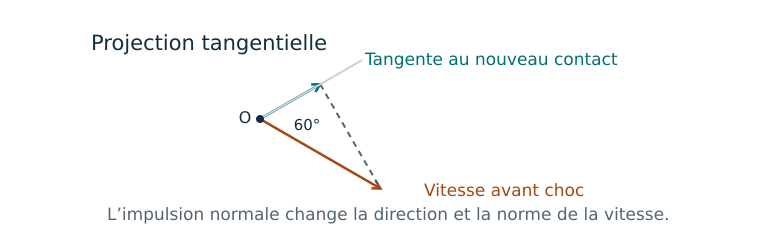

### Question 17

> [!INDICATION]
> Projeter la vitesse d’arrivée sur la tangente à la nouvelle bosse, qui est aussi la direction de la vitesse de départ.

> [!INDICATION]
> Les directions tangentes à deux arcs voisins font un angle double de π/6.

#### Solution

L’angle entre les deux tangentes vaut $\pi/3$. La conservation de la quantité de mouvement suivant la nouvelle tangente donne $md\dot\phi_{n+1}^{(i)}=md\dot\phi_n^{(f)}\cos(\pi/3)$. On a donc $\beta=1/2$. Après le choc, la vitesse est divisée par deux et l’énergie cinétique de translation par quatre. La composante normale entrante est supprimée dans ce modèle dissipatif.

### Question 18

> [!INDICATION]
> Composer l’accélération entre les bosses et la perte à l’impact, dans cet ordre.

#### Solution

Si $v_n=(\dot\phi_n^{(i)})^2$, Q10 et Q17 donnent

$$\dot\phi_{n+1}^{(i)}=\tfrac12\sqrt{(\dot\phi_n^{(i)})^2+2g\sin\alpha/d},\qquad v_{n+1}=\tfrac14v_n+\frac{g\sin\alpha}{2d}.$$

La suite des carrés des vitesses angulaires est arithmético-géométrique.

### Question 19

> [!INDICATION]
> Soustraire le point fixe de l’application affine afin d’obtenir une suite géométrique.

#### Solution

Le point fixe de la récurrence est $v_*=2g\sin\alpha/(3d)$. Comme $v_{n+1}-v_*=(v_n-v_*)/4$, on trouve

$$\dot\phi_n^{(i)}=\sqrt{v_*+4^{-n}\big[(\dot\phi_0^{(i)})^2-v_*\big]}\longrightarrow \sqrt{\frac{2g\sin\alpha}{3d}}.$$

La limite mathématique est indépendante du lancement. Pour l’interpréter comme un écoulement, il faut que le grain franchisse effectivement les bosses successives.

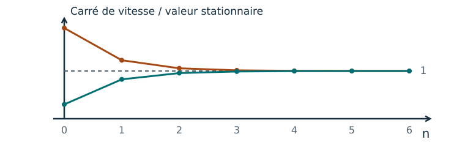

### Question 20

> [!INDICATION]
> Tester le seuil de franchissement en utilisant la vitesse stationnaire à l’entrée d’une bosse.

#### Solution

Un régime stationnaire de vitesse moyenne non nulle exige $\dot\phi_\infty^{(i)}>\dot\phi_c$. En substituant Q9 et Q19 et en simplifiant $2g/d$, on obtient

$$\frac{\sin\alpha}{3}>1-\cos(\alpha-\pi/6).$$

À l’égalité, le temps de passage diverge. Le seuil vérifie $(\sqrt3/2)\cos\alpha_d+(5/6)\sin\alpha_d=1$. En posant $t=\tan(\alpha_d/2)$, on obtient $(6+3\sqrt3)t^2-10t+(6-3\sqrt3)=0$. La seule racine compatible avec $0\leq\alpha_d\leq\pi/6$ est $t=(2-\sqrt3)/3$. Le mouvement stationnaire est ainsi possible au-dessus de $\alpha_d\simeq10{,}2^\circ$, alors que le seuil de départ d’un grain immobile vaut $30^\circ$.

> [!PIEGE]
> Une limite mathématique de la récurrence ne garantit pas le passage de la bosse suivante. Il faut aussi tester la barrière d’énergie.

### Question 21

> [!INDICATION]
> Reprendre la définition du paramètre de Q11 avec la vitesse stationnaire trouvée en Q19.

#### Solution

Dans le régime stationnaire,

$$\epsilon=\frac dg[(\dot\phi_\infty^{(i)})^2-\dot\phi_c^2]=2\left[\frac{\sin\alpha}{3}-1+\cos(\alpha-\pi/6)\right].$$

Cette différence est positive d’après Q20. Le diamètre et la pesanteur se sont simplifiés.

### Question 22

> [!INDICATION]
> La frontière liquide est la racine de la fonction obtenue en Q21. Dériver cette fonction en radians.

#### Solution

La phase liquide stationnaire demande $\delta\alpha=\alpha-\alpha_d>0$. À la frontière, l’égalité de Q20 donne $\epsilon(\alpha_d)=0$, et $\epsilon$ y tend par valeurs positives. Au premier ordre,

$$\epsilon=C_d\,\delta\alpha+O((\delta\alpha)^2),\qquad C_d=2\left[\frac{\cos\alpha_d}{3}-\sin(\alpha_d-\pi/6)\right]>0.$$

Les angles de ce développement sont mesurés en radians.

### Question 23

> [!INDICATION]
> Remplacer le numérateur du logarithme par sa valeur au seuil et le dénominateur par son développement de Q22.

> [!INDICATION]
> On peut prendre un rapport d’écarts angulaires en degrés dans le logarithme une fois la même unité utilisée au numérateur et au dénominateur.

#### Solution

Avec $a=\pi/6$, le logarithme de Q15 devient $\ln[(\alpha_\infty-\alpha_d)/\delta\alpha]+o(1)$, où

$$\alpha_\infty=\alpha_d+\frac{4(a^2-\alpha_d^2)}{C_d}.$$

Ainsi $u_m\simeq\sqrt{gd}/\ln[(\alpha_\infty-\alpha_d)/\delta\alpha]$. La valeur $51{,}6^\circ$ est au-delà de $\alpha_s=30^\circ$. La divergence formelle de la vitesse à $\alpha_\infty$ signale les limites du prolongement de cette formule obtenue près de $\alpha_d$. Pour $20^\circ$ et $d=2\,\mathrm{mm}$, $\sqrt{gd}\simeq0{,}14\,\mathrm{m\,s^{-1}}$ et le rapport dans le logarithme vaut environ $(51{,}6-10)/(20-10)=4{,}2$. D’où $u_m\simeq0{,}10\,\mathrm{m\,s^{-1}}$.

## I.3 — Cycle granulaire et pression de collision

Suivre séparément le démarrage du grain au repos et l’arrêt du grain mobile pour retrouver les deux branches du cycle.

### Question 24

> [!INDICATION]
> Suivre séparément l’état préparé au repos et l’état qui s’écoule déjà. Les deux perdent leur stabilité à des angles différents.

#### Solution

À la montée, le grain reste au repos sur $u_m=0$ jusqu’à $\alpha_s=30^\circ$. Il démarre puis rejoint la branche liquide à vitesse finie et la suit jusqu’à $\alpha_{\max}$ (par exemple $40^\circ$). À la descente, il reste sur cette branche jusqu’à $\alpha_d\simeq10^\circ$, où $u_m\to0$, puis demeure solide jusqu’à zéro. Pour $\alpha_d<\alpha<\alpha_s$, les deux passages au même angle correspondent donc à deux états différents. Au-dessus de $\alpha_s$, les deux parcours se superposent dans la phase liquide.

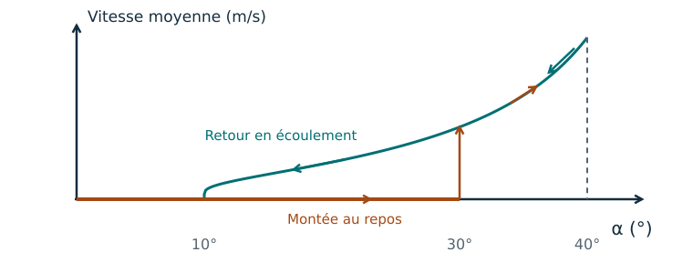

### Question 25

> [!INDICATION]
> En régime stationnaire, la vitesse après le choc est la moitié de celle qui le précède. Soustraire les deux vecteurs de Q16.

#### Solution

Notons $\omega=\dot\phi_\infty^{(i)}$. La vitesse entrante est de norme $2d\omega$ et la sortante de norme $d\omega$. La différence donne $\Delta\vec p=md\omega(-\sqrt3\,\vec e_x/2+3\vec e_y/2)$. Le vecteur de $O$ vers $C_{n+1}$ est $\vec n=\vec e_x/2-\sqrt3\,\vec e_y/2$. Comme $\sqrt3\,d\omega=\sqrt{2gd\sin\alpha}$,

$$\Delta\vec p=-m\sqrt{2gd\sin\alpha}\,\vec n.$$

### Question 26

> [!INDICATION]
> La surface reçoit l’impulsion opposée à celle du grain. Combien de collisions surviennent par seconde ?

#### Solution

Le grain subit une collision par distance $d$ parcourue le long de la pente, soit une fréquence $u_m/d$. L’impulsion transmise à la bosse est $-\Delta\vec p$. La force moyenne de collision exercée par un grain sur le substrat vaut donc

$$\vec f_{\rm coll}=m u_m\sqrt{\frac{2g\sin\alpha}{d}}\,\vec n.$$

### Question 27

> [!INDICATION]
> Associer à chaque grain une aire projetée de l’ordre de son diamètre au carré. Expliciter la géométrie adoptée pour une valeur exacte.

> [!INDICATION]
> Comparer une maille carrée et un empilement triangulaire permet de distinguer l’ordre de grandeur d’un facteur géométrique.

#### Solution

Pour une couche avec un grain par maille carrée de côté $d$, $\sigma=1/d^2$. Le schéma plan ne précise pas l’empilement transverse. Pour un autre arrangement compact, on écrit plus généralement $\sigma=c/d^2$ avec un facteur géométrique d’ordre un (par exemple $c=2/\sqrt3$ pour un réseau triangulaire). La couche compte $\sigma S$ grains. Dans la convention $c=1$, Q26 donne $\vec F_{\rm coll}=P_{\rm coll}S\vec n$, avec

$$P_{\rm coll}=\frac{m u_m}{d^2}\sqrt{\frac{2g\sin\alpha}{d}}.$$

Pour une autre densité, on multiplie ce résultat par $c$.

### Question 28

> [!INDICATION]
> Exprimer les milligrammes en kilogrammes et distinguer cette contrainte de collision d’une pression de repos.

#### Solution

Avec $m=10^{-5}\,\mathrm{kg}$, $d=2\times10^{-3}\,\mathrm m$, $u_m\simeq0{,}10\,\mathrm{m\,s^{-1}}$ et $\sin20^\circ\simeq0{,}34$, la valeur sous la racine de Q27 est environ $3{,}3\times10^3\,\mathrm{s^{-2}}$. Pour $c=1$, $P_{\rm coll}\simeq14\,\mathrm{Pa}$, soit environ $1{,}4\times10^{-4}$ atmosphère. Cette contribution dynamique dépend de la vitesse et s’annule sans écoulement. Son orientation $\vec n$ est imposée par la géométrie des impacts et peut comporter une composante tangentielle au plan moyen. À l’équilibre hydrostatique, la contrainte de pression est isotrope et la force sur une surface lui est normale.

### Question 29

> [!INDICATION]
> Distinguer le frottement d’adhérence du frottement de glissement, puis comparer les angles de démarrage et d’arrêt.

#### Solution

Au repos relatif, la réaction tangentielle peut s’ajuster tant que $\|\vec T\|\le\mu_sN$ (limite d’adhérence). En glissement, $\vec T=-\mu_dN\vec v_{\rm rel}/\|\vec v_{\rm rel}\|$, avec en général $\mu_d<\mu_s$. Sur un plan incliné, cela distingue une pente de mise en mouvement d’une pente plus faible permettant de maintenir un glissement. De même, les grains au repos démarrent à $\alpha_s$ et l’écoulement déjà établi persiste jusqu’à $\alpha_d<\alpha_s$. Ici les contacts individuels sont sans friction. Les barrières géométriques et les collisions dissipatives produisent les deux seuils collectifs.

## II — Aimantation d’un cristal

À basse température, l’échange peut imposer une orientation commune des moments. Tant que le réseau ne privilégie aucune direction, le renversement du champ ne rencontre pas de barrière.

### Question 30

> [!INDICATION]
> Le facteur gyromagnétique orbital fait intervenir la charge divisée par deux fois la masse de l’électron.

#### Solution

Le magnéton de Bohr vaut $\mu_B=e\hbar/(2m_e)\simeq9{,}27\times10^{-24}\,\mathrm{J\,T^{-1}}$ (ou $\mathrm{A\,m^2}$). Les constantes arrondies du formulaire donnent environ $9{,}7\times10^{-24}\,\mathrm{J\,T^{-1}}$, du même ordre de grandeur.

### Question 31

> [!INDICATION]
> Chercher d’abord les angles pour lesquels la dérivée du potentiel s’annule, puis le sens de la courbure.

#### Solution

Pour un champ de norme $B_0>0$, $E_p=-\mu B_0\cos\psi$. Ses positions d’équilibre vérifient $\sin\psi=0$. Le moment parallèle au champ ($\psi=0$ modulo $2\pi$) minimise l’énergie et est stable. L’état antiparallèle ($\psi=\pi$ modulo $2\pi$) est un maximum instable. Si le champ est nul, toutes les orientations sont indifférentes au regard de cette énergie seule.

> [!METHODE]
> Une première dérivée nulle caractérise un angle stationnaire. La forme du potentiel au voisinage de ce point distingue les minimums et les maximums.

### Question 32

> [!INDICATION]
> Comparer la norme de la somme des moments à la somme de leurs normes et utiliser la densité atomique du cristal.

#### Solution

L’inégalité triangulaire donne $\|\sum_i\vec\mu_i\|\leq N\mu$. L’égalité exige que tous les moments aient la même direction et le même sens, ce qui minimise aussi l’énergie d’échange pour $J>0$. Le cristal régulier a une même densité atomique $N/V$ en tout volume de moyennage macroscopique. Son aimantation est alors uniforme et sa norme est $M_s=N\mu/V$.

### Question 33

> [!INDICATION]
> Une rotation en bloc laisse inchangée l’énergie d’échange. Qu’est-ce qui sélectionne alors le sens de l’aimantation ?

#### Solution

Pour $B_0>0$ l’état stable est aligné vers $+\vec e_z$ et $M_z=+M_s=+N\mu/V$. Pour $B_0<0$ il est aligné vers $-\vec e_z$ et $M_z=-M_s$. À $B_0=0$, l’orientation est indifférente. Pour tout champ non nul le graphe comporte deux demi-droites horizontales, $M_z=M_s\operatorname{sgn}B_0$. Le retournement a lieu au même champ nul dans les deux sens. Le graphe cyclique se superpose à lui-même, sans aire d’hystérésis.

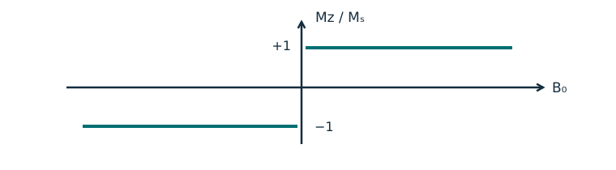

## II.1 — Anisotropie et retournement de l’aimantation

Le cristal possède un axe facile. Rechercher les minima locaux du potentiel puis suivre celui qu’occupe effectivement le matériau.

### Question 34

> [!INDICATION]
> Pour un cristal sans champ extérieur, repérer les directions qui annulent le coût d’anisotropie et celles qui le maximisent.

#### Solution

L’énergie $KV\sin^2\theta$ est stationnaire pour $\theta=k\pi/2$, $k\in\mathbb Z$. Elle est minimale, donc l’équilibre est stable, pour $\theta=0$ ou $\pi$ modulo $2\pi$, les deux sens de l’axe facile. Elle est maximale, donc instable, pour $\theta=\pi/2$ ou $3\pi/2$.

### Question 35

> [!INDICATION]
> Additionner les énergies du champ de tous les moments identiquement orientés, puis diviser par le volume.

#### Solution

L’énergie de Zeeman totale vaut $-V\vec M\cdot\vec B_0=-VM_sB_0\cos(\theta-\theta_B)$ avec $B_0$ algébrique. En ajoutant l’énergie d’anisotropie, et à une constante d’échange indépendante de $\theta$ près, on trouve

$$e_p^{(\mathrm{tot})}=K\sin^2\theta-M_sB_0\cos(\theta-\theta_B).$$

### Question 36

> [!INDICATION]
> Factoriser la dérivée du potentiel lorsque le champ est parallèle à l’axe facile. Vérifier aussi les cas où la dérivée seconde s’annule.

> [!INDICATION]
> Si la courbure est nulle à la fusion de deux branches, revenir directement au potentiel ou développer à l’ordre suivant.

#### Solution

Pour $\theta_B=0$, $e'(\theta)=\sin\theta(2K\cos\theta+M_sB_0)$. Posons $B_c=2K/M_s$ et $h=B_0/B_c$. Les deux orientations axiales $0,\pi$ sont toujours stationnaires. Si $|h|<1$, deux autres apparaissent, $\theta=\arccos(-h)$ et $2\pi-\arccos(-h)$ dans $[0,2\pi[$.

Comme $e''=2K\cos2\theta+M_sB_0\cos\theta$, les courbures axiales valent $2K(1+h)$ en zéro et $2K(1-h)$ en $\pi$. La branche $0$ est donc stable pour $h>-1$ et instable pour $h<-1$. La branche $\pi$ est stable pour $h<1$ et instable pour $h>1$. Les deux branches supplémentaires ont $e''=-2K\sin^2\theta<0$ et sont instables. Au seuil où une orientation axiale perd sa stabilité, elle forme un maximum dégénéré : le premier terme variable du développement est $-K(\delta\theta)^4/4$. La barrière y disparaît.

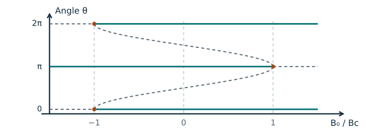

### Question 37

> [!INDICATION]
> Reporter sur un même tour les minima et maxima de Q36. Les deux valeurs axiales permettent de placer les puits à la bonne hauteur.

#### Solution

Le profil réduit est $e/K=\sin^2\theta-2h\cos\theta$. En $0$ et $\pi$, il vaut respectivement $-2h$ et $2h$. Pour $h<-1$, il possède un seul minimum, en $\pi$, et un maximum en zéro (angles modulo $2\pi$). Pour $-1<h<1$, les deux orientations axiales sont des minima, séparés par deux maxima de hauteur $1+h^2$ aux angles de Q36. Le minimum aligné avec le champ est le plus profond, les deux sont de même profondeur à champ nul. Pour $h>1$, le seul minimum est en zéro et le maximum en $\pi$.

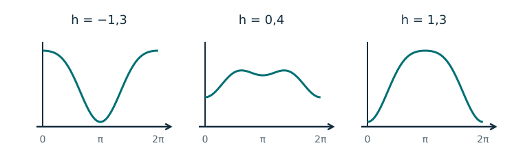

### Question 38

> [!INDICATION]
> Un minimum local peut persister même après que l’autre puits est devenu plus profond.

#### Solution

À $B_0=-B_{\max}<-B_c$, seule l’orientation $\theta=\pi$ est stable. En l’absence de franchissement thermique, le cristal suit ce minimum local pendant la croissance du champ. Il le conserve au-delà de zéro, même lorsque le minimum en $0$ devient plus bas. À $B_0=+B_c$, la barrière disparaît. L’aimantation bascule vers $\theta=0$ et y reste jusqu’à $+B_{\max}$.

> [!PIEGE]
> Le suivi d’un minimum local peut différer de la recherche du minimum absolu à chaque nouvelle valeur du champ. Cette distinction produit ici la métastabilité.

### Question 39

> [!INDICATION]
> Partir de l’orientation atteinte à la fin de Q38 et repérer le seuil de disparition de son minimum local.

#### Solution

À la décroissance, $\theta=0$ reste stable jusqu’à $B_0=-B_c$, en particulier pendant le passage par zéro. Au seuil négatif, l’orientation bascule vers $\pi$. Elle s’y maintient jusqu’à $-B_{\max}$. Les champs de retournement dépendent ainsi du sens de variation.

### Question 40

> [!INDICATION]
> Porter la projection sur le champ en ordonnée et suivre les deux itinéraires de Q38 et Q39 avec leurs flèches.

#### Solution

Avec $B_0/B_c$ en abscisse et $M/M_s$ en ordonnée, on part en bas à gauche. En champ croissant, on parcourt $M/M_s=-1$ vers la droite jusqu’à $B_0/B_c=+1$, puis on saute à $+1$. Après l’excursion à $B_{\max}$, on retrace la branche supérieure vers la gauche, on saute en bas à $B_0/B_c=-1$, puis on revient au départ. Le rectangle est parcouru dans le sens antihoraire. Sur les branches sans saut, une petite inversion du champ fait retracer le même segment. Les deux retournements sont irréversibles : inverser aussitôt la variation ne ramène pas le cristal dans l’autre puits. À champ nul, l’aimantation rémanente vaut $+M_s$ ou $-M_s$ selon le parcours.

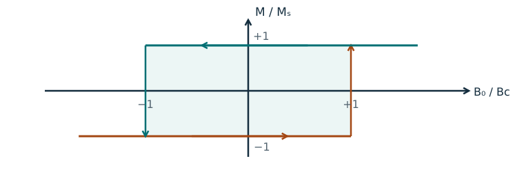

## II.1 — Travail du champ et pertes sur un cycle

Les spires reçoivent une tension liée au champ total. Le courant du bobinage fixe le champ extérieur. Les distinguer permet d’interpréter l’aire du cycle.

### Question 41

> [!INDICATION]
> Orienter le contour par le courant de la figure et la surface par la règle de la main droite.

#### Solution

Pour un circuit fixe, la force électromotrice induite est la circulation du champ électrique induit, $\mathcal E=\oint\vec E_{\rm ind}\cdot\mathrm d\vec\ell$. La loi de Faraday donne $\mathcal E=-\mathrm d\phi/\mathrm dt$, où $\phi$ est le flux magnétique total lié aux spires, orienté suivant le contour choisi. Le signe exprime l’opposition à la variation de flux.

### Question 42

> [!INDICATION]
> Dans une maille de résistance négligeable, la tension du générateur compense la force électromotrice induite.

#### Solution

Avec le sens du courant de la figure 6, la tension fournie par le générateur et la force électromotrice induite vérifient $u_G+\mathcal E=0$. Donc $u_G=+\mathrm d\phi/\mathrm dt$. L’énergie fournie s’écrit

$$E_G=\int_{t_i}^{t_f} i(t)\frac{\mathrm d\phi}{\mathrm dt}\,\mathrm dt=\int_{t_i}^{t_f}i\,\mathrm d\phi.$$

Un courant positif accompagné d’une augmentation du flux positif correspond bien à un apport d’énergie.

### Question 43

> [!INDICATION]
> Identifier la source du champ donné par la formule du solénoïde et vérifier son orientation par la règle de la main droite.

#### Solution

Un solénoïde infini de densité de spires $N/L$ crée à l’intérieur le champ uniforme $\vec B_0=\mu_0(N/L)i\,\vec e_z$ avec l’orientation de la figure. À l’extérieur, sa contribution est nulle. Elle correspond au champ extérieur imposé au barreau par les courants du bobinage. Les moments magnétiques du barreau ajoutent leur propre contribution au champ total.

### Question 44

> [!INDICATION]
> La loi d’induction dépend du champ qui traverse effectivement chaque spire.

#### Solution

Le flux d’une spire est $\int_S\vec B\cdot\mathrm d\vec S=SB_z$ avec le champ uniforme et l’orientation choisie. Au total, $\phi=NSB_z=NS(B_{0,z}+\mu_0M_z)$. C’est le champ total qui intervient, puisque les champs du courant du bobinage et de l’aimantation traversent les mêmes spires.

### Question 45

> [!INDICATION]
> Éliminer le courant avec Q43 et le flux avec Q44. Le volume du barreau est le produit de sa longueur par sa section.

#### Solution

Comme $i=LB_{0,z}/(\mu_0N)$ et $\mathrm d\phi=NS\,\mathrm dB_z$, on a $i\,\mathrm d\phi/(SL)=B_{0,z}\,\mathrm dB_z/\mu_0$. Dans cette géométrie axiale, puis sous la forme vectorielle admise dans l’énoncé,

$$\frac{E_G}{SL}=\int_{t_i}^{t_f}\frac1{\mu_0}\vec B_0\cdot\frac{\mathrm d\vec B}{\mathrm dt}\,\mathrm dt.$$

Sur un intervalle quelconque, ce travail peut comprendre un stockage réversible. Pour un cycle fermé, le stockage revient à sa valeur de départ.

### Question 46

> [!INDICATION]
> Dans l’intégrale du cycle, le terme en dérivée de champ extérieur est une différentielle exacte. Examiner ensuite le signe en suivant le saut à champ positif.

> [!INDICATION]
> Échanger l’abscisse et l’ordonnée inverse le sens apparent du parcours d’un cycle.

#### Solution

Puisque $B=B_0+\mu_0M$, le travail volumique cyclique vaut

$$e_{\rm perte}=\oint\frac{B_0\,\mathrm dB_0}{\mu_0}+\oint B_0\,\mathrm dM=\oint B_0\,\mathrm dM=-\oint M\,\mathrm dB_0.$$

Le premier terme est la variation nulle de $B_0^2/(2\mu_0)$, et $\oint\mathrm d(B_0M)=0$ donne la dernière égalité. Sur le graphe avec $B_0$ en abscisse comme en Q40, le sens positif est antihoraire. Si l’on prend littéralement les axes $(M,B_0)$ dans cet ordre, le même cycle est horaire. Son aire positive donne l’énergie dissipée par unité de volume. Les sauts apportent chacun $2M_sB_c$, donc $e_{\rm perte}=4M_sB_c=\boxed{8K}$, en $\mathrm{J\,m^{-3}}$.

> [!METHODE]
> Une intégrale de différentielle exacte est nulle sur un cycle fermé. L’aire du cycle subsiste parce que l’aimantation et le champ ne sont pas reliés par une même fonction sur les deux branches.

### Question 47

> [!INDICATION]
> Partir de l’énergie dissipée par unité de volume et par cycle. Convertir les centimètres cubes avant de multiplier par la fréquence.

#### Solution

La perte volumique par cycle vaut $8K$ d’après Q46. Pour $V=10\ \mathrm{cm^3}=10^{-5}\ \mathrm{m^3}$ et $f=50\ \mathrm{Hz}$, la puissance est $P_{\rm perte}=8KVf$. Elle vaut **4 800 W pour le néodyme** et **200 W pour l’alliage de fer**. Le fer, de plus faible anisotropie, est préférable. Même ses 200 W dépassent les quelque 100 W demandés par un ordinateur. Ces chiffres supposent que tout le volume parcourt le cycle rectangulaire complet du modèle. Un noyau de transformateur est choisi pour présenter une faible aire de cycle dans sa plage de fonctionnement.

## II.1 — Champ oblique et coercivité

Les points de retournement sont les extrémités des branches stables. Les angles avant et après ces sauts déterminent la forme de la boucle.

### Question 48

> [!INDICATION]
> Annuler la dérivée de l’énergie en Q35, puis évaluer sa dérivée seconde à la position ainsi trouvée.

#### Solution

Écrivons $e=K\sin^2\theta-M_sB_0\cos(\theta-\theta_B)$. L’équilibre impose $e'=K\sin2\theta+M_sB_0\sin(\theta-\theta_B)=0$. Pour les orientations du champ retenues, $\sin(\theta-\theta_B)=0$ ne peut satisfaire cette équation, car $\sin2\theta_B\ne0$. Donc

$$B_0(\theta)=-\frac{K\sin2\theta}{M_s\sin(\theta-\theta_B)}.$$

Une branche stable vérifie $e''=2K\cos2\theta+M_sB_0\cos(\theta-\theta_B)>0$, soit $\cos2\theta>\tfrac12\sin2\theta\,\cot(\theta-\theta_B)$. Le produit par la cotangente donne aussi son sens au membre de droite lorsque le cosinus de la différence est nul. L’égalité marque le seuil de perte de stabilité.

### Question 49

> [!INDICATION]
> Sur le graphe où le champ est porté verticalement, suivre un trait stable lorsque le champ monte ou descend. Quelle droite suit un saut à champ constant ?

#### Solution

En notant $b=M_s B_0/K$, on part sur la branche proche de $\theta=209^\circ$ à $b=-3$. Quand $b$ croît, l’angle décroît en passant par $180^\circ$ à champ nul. À $b=+1$, le minimum local disparaît vers $\theta_c^+=135^\circ$. Le système saute horizontalement jusqu’à la branche stable proche de $15^\circ$, puis rejoint $\theta\simeq29^\circ$ à $b=3$. Au retour, cette branche passe par $0^\circ$, puis perd sa stabilité à $b=-1$, en $\theta_c^-=-45^\circ$ (ou $315^\circ$). Le saut amène le système près de $195^\circ$, sur la branche qui rejoint l’état initial. Les deux seuils sont $B_0=\pm B_c$, avec $B_c=K/M_s$ pour cette orientation.

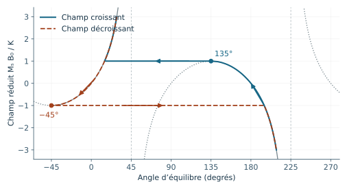

### Question 50

> [!INDICATION]
> À la jonction d’un minimum et d’un maximum de l’énergie, sa pente et sa courbure sont nulles. Séparer les composantes du champ selon l’axe facile et sa perpendiculaire.

> [!INDICATION]
> À la limite de stabilité, la dérivée première du potentiel et sa courbure sont toutes deux nulles.

#### Solution

Les points de retournement vérifient $B_0'(\theta_c)=0$. En dérivant $e'(\theta,B_0(\theta))=0$ avec $\sin(\theta-\theta_B)\ne0$, cette condition donne $e''=0$ à champ fixé. Posons $X=M_s B_0\cos\theta_B/(2K)$ et $Y=M_s B_0\sin\theta_B/(2K)$. Les deux équations s’écrivent

$$X\sin\theta-Y\cos\theta=-\sin\theta\cos\theta,\qquad X\cos\theta+Y\sin\theta=-\cos2\theta.$$

En combinant les deux lignes, on obtient $X=-\cos^3\theta$ et $Y=\sin^3\theta$. Leur rapport donne $\tan^3\theta_c=-\tan\theta_B$. Pour $\theta_B=\pi/4$, on retient $\theta_c^+=3\pi/4$ à la montée et $\theta_c^-=-\pi/4$ à la descente, à $2\pi$ près. Dans l’expression de Q48, ils donnent $+K/M_s$ et $-K/M_s$ respectivement. Ainsi $B_c=K/M_s$.

### Question 51

> [!INDICATION]
> À chaque saut, distinguer le point de départ et le point d’arrivée sur la même horizontale de la figure 7, puis projeter l’aimantation sur l’axe du champ.

#### Solution

Les lectures suivantes utilisent $\theta_B=45^\circ$ et $M/M_s=\cos(\theta-45^\circ)$.

| Étape | $B_0/B_c$ | $\theta$ | $M/M_s$ |
|---|---:|---:|---:|
| a · Avant le saut à la montée | $+1$ | $135^\circ$ | $0$ |
| b · Après ce saut | $+1$ | $15^\circ$ | $+0{,}87$ |
| c · Avant le saut à la descente | $-1$ | $-45^\circ$ | $0$ |
| d · Après ce saut | $-1$ | $195^\circ$ | $-0{,}87$ |
| e · Maximum positif | $+3$ | $29^\circ$ | $+0{,}96$ |
| f · Minimum négatif | $-3$ | $209^\circ$ | $-0{,}96$ |

Au passage par $B_0=0$, la branche montante donne $M/M_s=-1/\sqrt2$, la descendante $+1/\sqrt2$. Sur le graphique demandé, l’aimantation est en abscisse et le champ en ordonnée. À champ fixé, les sauts sont horizontaux. L’aire **en unités physiques** est plus petite que celle du rectangle axial de Q46. Le champ de basculement est deux fois plus faible qu’à $\theta_B=0$, et la séparation entre les deux branches reste inférieure à $2M_s$. À l’extérieur des seuils les deux parcours se superposent.

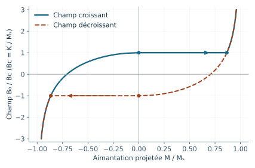

### Question 52

> [!INDICATION]
> Repérer le champ où s’annule la projection mesurée, en suivant une branche issue d’un état déjà aimanté.

#### Solution

En revenant d’un fort champ positif, $M$ s’annule au seuil de la branche en $\theta=-45^\circ$, car $\cos(-90^\circ)=0$. Le champ coercitif, en valeur absolue, vaut donc $B_c=K/M_s$. Le formulaire donne $1{,}2\times10^6/(8\times10^5)=\mathbf{1{,}5\ T}$ pour l’aimant au néodyme et $5\times10^4/(1{,}7\times10^6)\simeq\mathbf{0{,}029\ T}$ pour l’alliage de fer. Il faut un champ environ cinquante fois plus fort pour annuler la projection de l’aimantation du premier.

### Question 53

> [!INDICATION]
> Chercher un dispositif qui doit conserver son aimantation et un autre qui doit en changer de sens.

#### Solution

Pour le rotor à aimants permanents d’un moteur, une forte coercivité préserve l’aimantation face aux champs adverses et maintient la capacité à produire un couple. Pour le noyau d’un transformateur, soumis à de nombreux cycles d’aimantation, une grande coercivité tend à élargir le cycle et à augmenter les pertes thermiques. On recherche alors un matériau magnétique doux.

## II.2 — Paroi de Bloch et domaines de Weiss

Deux tendances s’opposent dans l’épaisseur de la paroi. À une échelle plus grande, une modification de ses deux domaines change l’aimantation globale.

### Question 54

> [!INDICATION]
> Compter chaque liaison une seule fois. Dans quels plans les spins restent-ils parallèles même à l’intérieur de la paroi ?

#### Solution

À des effets de bord près, un réseau cubique simple compte six voisins par site, donc trois paires distinctes par atome. Un cristal aligné contenant $SL/a^3$ sites a l’énergie $E_p^{(0)}=-3J\mu^2 SL/a^3$. Dans la paroi, les liaisons parallèles à $y$ et $z$ gardent des moments parallèles. Seules les liaisons selon $x$ entre deux couches portent le surcoût $J\mu^2(1-\cos\Delta\varphi)$ chacune. Il y en a $(S/a^2)(\delta/a)$ avec le comptage continu du sujet. Ainsi $E_p^{(\mathrm{éch})}=E_p^{(0)}+S\gamma^{(\mathrm{éch})}$, où

$$\gamma^{(\mathrm{éch})}=\frac{J\mu^2\delta}{a^3}\left[1-\cos\!\left(\frac{\pi a}{\delta}\right)\right].$$

$E_p^{(0)}$ est l’énergie d’échange du cristal uniformément aimanté. $\gamma^{(\mathrm{éch})}$ est l’excès d’énergie d’échange par unité d’aire de paroi.

### Question 55

> [!INDICATION]
> Lorsque beaucoup de couches se partagent la rotation, développer le cosinus de l’angle entre voisines.

#### Solution

Pour $n=\delta/a\gg1$, $1-\cos(\pi a/\delta)\simeq\pi^2 a^2/(2\delta^2)$, donc $\gamma^{(\mathrm{éch})}\simeq\pi^2J\mu^2/(2a\delta)$. L’échange **épaissit** la paroi, car une rotation progressive réduit la désorientation de chaque paire voisine.

### Question 56

> [!INDICATION]
> Associer à chaque couche une épaisseur et un angle par rapport à l’axe facile.

#### Solution

À la couche $i$, la densité d’énergie d’anisotropie vaut $K\sin^2(i\pi/n)$. Sa multiplication par le volume $Sa$, puis la division par $S$, conduisent à

$$\gamma^{(\mathrm{an})}=Ka\sum_{i=1}^{n}\sin^2\!\left(\frac{i\pi}{n}\right).$$

Les domaines uniformément alignés dans l’une des deux directions faciles ont une énergie d’anisotropie nulle.

### Question 57

> [!INDICATION]
> Faire apparaître le pas angulaire $\pi/n$ afin de reconnaître une somme de Riemann.

#### Solution

Puisque $a=\delta/n$, on obtient $\gamma^{(\mathrm{an})}\simeq(K\delta/\pi)\int_0^\pi\sin^2\varphi\,d\varphi=K\delta/2$. La somme discrète peut même être évaluée pour tout entier $n\geq2$. En écrivant $2\sin^2(i\pi/n)=1-\cos(2i\pi/n)$, la somme des cosinus est la partie réelle de la somme des $n$ racines de l’unité, donc zéro. La somme des carrés des sinus vaut exactement $n/2$ pour le profil angulaire choisi, et l’énergie d’anisotropie vaut exactement $K\delta/2$. L’anisotropie **amincit** la paroi en réduisant le volume de matériau dont les moments sont inclinés par rapport à l’axe facile. Elle s’oppose donc à l’échange.

### Question 58

> [!INDICATION]
> Minimiser la somme d’un terme inversement proportionnel à l’épaisseur et d’un terme proportionnel à celle-ci.

> [!INDICATION]
> Pour une énergie de la forme A/δ + Bδ, les deux contributions sont égales à l’épaisseur optimale.

#### Solution

L’énergie surfacique est $\gamma(\delta)=A/\delta+K\delta/2$, avec $A=\pi^2 J\mu^2/(2a)$. Elle diverge aux deux extrémités du domaine positif dans ce modèle continu. L’équation $-A/\delta^2+K/2=0$ et la dérivée seconde $2A/\delta^3>0$ donnent un minimum unique. À l’optimum les deux contributions sont égales, donc

$$\delta_*=\pi\sqrt{\frac{J\mu^2}{aK}},\qquad \gamma_*=K\delta_*=\pi\sqrt{\frac{KJ\mu^2}{a}}.$$

| Matériau | Épaisseur $\delta_*$ | Énergie $\gamma_*$ | $\delta_*/a$ |
|---|---:|---:|---:|
| Aimant au néodyme | $9{,}1$ nm | $1{,}1\times10^{-2}\ \mathrm{J/m^2}$ | $13$ |
| Alliage de fer | $44$ nm | $2{,}2\times10^{-3}\ \mathrm{J/m^2}$ | $148$ |

La condition de nombreuses couches est particulièrement bonne pour le fer. Pour le néodyme, l’angle entre voisines vaut environ $\pi/13\simeq0{,}24$ rad, soit un écart relatif d’environ $0{,}49\,\%$ entre $1-\cos(\pi/n)$ et son approximation quadratique. Pour le fer, l’écart tombe à $0{,}0038\,\%$. Ces ordres s’obtiennent en divisant le terme correctif $(\pi/n)^4/24$ par le terme dominant $(\pi/n)^2/2$.

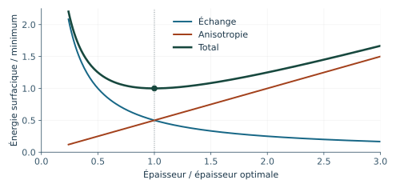

### Question 59

> [!INDICATION]
> Comparer le coût d’une paroi à la baisse d’énergie magnétostatique attendue si deux domaines opposés se compensent.

#### Solution

Pour un cristal de dimensions comparables à $R$, l’énergie du monodomaine est de l’ordre de $N_d\mu_0M_s^2 R^3/2$. Deux domaines d’égaux volumes peuvent presque annuler l’aimantation moyenne du modèle, moyennant une paroi de coût $\gamma R^2$. L’égalité des deux ordres donne $R_c\sim2\gamma/(N_d\mu_0M_s^2)$ avec cette convention de forme. En dessous, la paroi coûte trop cher. Au-dessus, le gain volumique peut payer sa création.

Pour $N_d=1/3$, on trouve environ **80 nm** pour le néodyme et **4 nm** pour le fer, à un facteur géométrique d’ordre un près. Dans le néodyme, $R_c$ vaut près de neuf épaisseurs de paroi. Pour le fer, $R_c$ est même inférieur à l’épaisseur estimée de 44 nm. La comparaison supposait une paroi mince et des domaines formés. La valeur de quelques nanomètres ne donne donc pas un seuil quantitatif fiable pour le fer près de cette taille. Un échantillon macroscopique reste susceptible de comporter de telles parois.

### Question 60

> [!INDICATION]
> Pondérer les deux aimantations opposées par leurs volumes respectifs.

#### Solution

Les longueurs des domaines gauche et droit sont $L/2+x_p$ et $L/2-x_p$. Leur moyenne volumique et l’énergie magnétostatique de l’équation (12) sont donc

$$\vec M_{\rm tot}=\frac{2M_s x_p}{L}\vec e_y,\qquad E_{\rm mag}=\frac{2N_d\mu_0M_s^2 S}{L}x_p^2.$$

En particulier l’aimantation et cette énergie s’annulent pour des domaines de même taille.

### Question 61

> [!INDICATION]
> L’énergie d’un dipôle dans un champ est l’opposé de leur produit scalaire. Quel est ici le moment total ?

#### Solution

Le moment dipolaire vaut $SL\vec M_{\rm tot}$. Son énergie est $-SL\vec M_{\rm tot}\cdot\vec B_0=-2M_s SB_0x_p$. En ajoutant Q60 et l’énergie de paroi, à l’origine imposée en Q54, on trouve

$$E_{\rm tot}(x_p)=\frac{2N_d\mu_0M_s^2 S}{L}x_p^2-2M_sSB_0x_p+S\gamma.$$

> [!PIEGE]
> La paroi s’épaissit ou se translate selon deux coordonnées différentes. À épaisseur fixée, un déplacement augmente un domaine au détriment de l’autre.

### Question 62

> [!INDICATION]
> Pour une paroi d’énergie uniforme, quelle est la forme de l’énergie totale en fonction de sa position ?

#### Solution

La dérivée s’annule en $x_p=LB_0/(2N_d\mu_0M_s)$. La dérivée seconde, $4N_d\mu_0M_s^2 S/L$, est strictement positive. Au minimum unique, $\vec M_{\rm tot}=B_0\vec e_y/(N_d\mu_0)$. Tant que la position reste à l’intérieur du cristal et le champ suffisamment lent, le retour en champ retrace les mêmes états : cette aimantation est réversible. Si $|x_p|$ approche $L/2$, le modèle de paroi intérieure cesse de s’appliquer.

## II.2 — Ancrage de la paroi et cycles

Sur le graphique du champ en fonction de la position, une branche de pente positive représente un équilibre stable. Quand elle se termine, rechercher la prochaine branche stable accessible.

### Question 63

> [!INDICATION]
> Intégrer l’énergie non uniforme sur la surface de la paroi. Factoriser un 2 dans les termes variables afin de retrouver la normalisation demandée.

#### Solution

L’énergie de paroi est $\int_S\gamma(x_p,y,z)\,dy\,dz$. Posons

$$W(x_p)=\frac{N_d\mu_0M_s^2 S}{L}x_p^2+\frac12\int_S\gamma(x_p,y,z)\,dy\,dz.$$

Alors $E_{\rm tot}=2W-2M_sSB_0x_p$. L’équilibre exige $M_sB_0-W'(x_p)/S=0$ et un minimum stable exige $W''(x_p)>0$ sur une branche régulière. $M_sB_0$ est une densité d’énergie, homogène à une **pression** en pascals. La première équation exprime un équilibre des forces sur la paroi, ramenées à son aire. Dans la normalisation de l’énergie totale, la pression motrice est $2M_sB_0$ et la pression de rappel $2W'/S$.

### Question 64

> [!INDICATION]
> Sur la figure 9, comparer l’ordonnée à $B_0$ et la pente au signe de la dérivée seconde.

#### Solution

En $x_p=0$, la courbe $F(x_p)=W'(x_p)/(M_s S)$ vaut zéro, assurant l’équilibre à champ nul. Les deux segments qui s’y rejoignent sont croissants de part et d’autre. Pour $x_p<0$ proche de zéro, $W'<0$, et pour $x_p>0$, $W'>0$. $W$ a donc un minimum strict, même si les deux pentes de $F$ au raccord diffèrent.

### Question 65

> [!INDICATION]
> Tracer deux horizontales à $+1$ et $-1$ T. La branche contenant l’origine se termine-t-elle avant leurs intersections ?

#### Solution

La branche centrale passe par $(-1\ \mathrm{cm},-2\ \mathrm{T})$, $(0,0)$ et $(1\ \mathrm{cm},4\ \mathrm{T})$. À partir de zéro, $x_p$ atteint $+0{,}25$ cm au maximum $+1$ T, passe à nouveau par zéro, descend à $-0{,}50$ cm au minimum $-1$ T, puis remonte sur le même tracé. Les deux pentes diffèrent mais aucun saut ne se produit. Comme $M=2M_s x_p/L$, la courbe $M(B_0)$ est une ligne brisée croissante, de pente deux fois plus grande du côté négatif que du côté positif. Elle est retracée à l’identique au retour, son aire est nulle et il n’y a pas d’hystérésis.

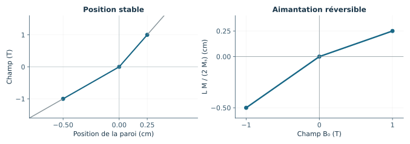

### Question 66

> [!INDICATION]
> À un seuil, suivre le saut à champ constant dans le sens où pousse la force, jusqu’à la première branche stable accessible.

> [!INDICATION]
> Sur un segment instable, le champ ne peut maintenir la paroi à l’équilibre. Lors d’un saut, c’est le champ, et non la position, qui reste fixé.

#### Solution

Les coordonnées ci-dessous sont $(x_p\ \mathrm{en\ cm},B_0\ \mathrm{en\ T})$. Pour une **amplitude de 3 T**, la première montée atteint $(0{,}75,3)$ sans saut. À la descente, la branche centrale se termine en $(-1,-2)$. La paroi saute vers la gauche jusqu’à $x_p\simeq-3{,}67$ cm, puis atteint $-3{,}83$ cm à $-3$ T. Au retour elle suit la branche de gauche, jusqu’à $(-3,+2)$, puis saute sur la centrale en $(0{,}50,+2)$. Le même cycle recommence. Il comprend **deux sauts** et une boucle d’hystérésis.

À **5 T**, la montée initiale passe le maximum $(1,+4)$ et saute jusqu’à $x_p=3{,}50$ cm, puis atteint environ $3{,}67$ cm à $+5$ T. À la descente, la paroi quitte successivement trois branches : à $-1$ T, elle passe de $2$ à $-0{,}50$ cm ; à $-2$ T, de $-1$ à environ $-3{,}67$ cm ; à $-4$ T, de $-4$ à environ $-5{,}56$ cm. Elle atteint environ $-5{,}67$ cm à $-5$ T. À la montée du cycle établi, les sauts ont lieu à $+1$ T (de $-5$ à $-3{,}17$ cm), $+2$ T (de $-3$ à $0{,}50$ cm) et $+4$ T (de $1$ à $3{,}50$ cm). Cette boucle parcourt **quatre branches stables et six sauts** par période. Les discontinuités dépendent du sens de variation du champ.

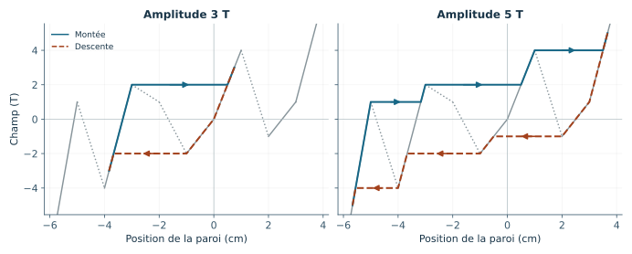

### Question 67

> [!INDICATION]
> Convertir l’aire dans le diagramme de la paroi en perte volumique à l’aide de la relation entre $M$ et $x_p$. Quelles portions sont annulées au retour ?

#### Solution

Sur un cycle fermé, Q46 donne $e_{\rm perte}=\oint B_0\,dM=(2M_s/L)\oint B_0\,dx_p$. Avec $x_p$ horizontal et $B_0$ vertical, on parcourt la boucle dans le sens horaire, de sorte que cette intégrale est son aire **positive** multipliée par $2M_s/L$. Il faut exprimer $x_p$ en mètres pour obtenir des J/m³. Les segments parcourus de façon identique en sens opposés s’annulent. L’amplitude 1 T donne zéro, 3 T enferme une première aire, et 5 T une aire plus grande car des branches de piégeage supplémentaires sont franchies. Pour vérifier quantitativement la lecture de la figure 9, un segment joignant $(x_i,B_i)$ à $(x_{i+1},B_{i+1})$ contribue de $(B_i+B_{i+1})(x_{i+1}-x_i)/2$. En additionnant les segments des cycles établis de Q65–66, sauts compris, on obtient respectivement $0$, $12{,}8$ et $34{,}3\ \mathrm{T\,cm}$ pour $B_{\max}=1$, $3$ et $5\ \mathrm T$. La conversion en $\mathrm{T\,m}$ multiplie ces valeurs par $10^{-2}$ avant application du facteur $2M_s/L$. Les pertes augmentent dans cette succession de cycles. Entre deux nouveaux seuils de saut, prolonger une branche parcourue aller et retour peut laisser l’aire inchangée.

## Bilan

Le seuil de démarrage du grain est fixé par la géométrie des appuis, le seuil d’arrêt par le temps de franchissement et la dissipation lors des chocs. Dans le matériau magnétique, le suivi de minima locaux permet à un même champ de correspondre à plusieurs états selon la préparation. Au cours d’un cycle fermé, les sauts irréversibles dissipent une énergie volumique égale à l’aire de la boucle tracée en variables physiques.
