# ENS PC · Lyon et Paris-Saclay — Physique-chimie 2026 · Corrigé partiel brut

*Corrigé rédigé par IA, non officiel.*

**Rédaction** · modèle exact non renseigné (famille GPT-6) · effort non renseigné · vitesse non renseignée

**Rédaction** · modèle exact non renseigné (famille GPT-6) · effort non renseigné · vitesse non renseignée

**Rédaction** · modèle exact non renseigné (famille GPT-6) · effort non renseigné · vitesse non renseignée

**Périmètre du corrigé partiel.** 60 questions sur 62 sont traitées intégralement, de Q1 à Q51 et de Q54 à Q62. Les questions Q52 et Q53, consacrées au retraitement du combustible nucléaire, sont hors du corrigé. Les questions Q54 à Q62 portent sur le modèle indépendant de dépôt du cuivre en solution de sulfate.

## I.1 — Frottement et masse apparente d’un silo

### Question 1

Le poids $m\vec g$ s’applique au centre de gravité et pointe verticalement vers le bas. La réaction du plan au contact se décompose en une normale $\vec N$ orientée du plan vers le patin et une force tangentielle $\vec T$ dirigée vers le haut de la pente. En effet, le poids tend à faire descendre le patin.

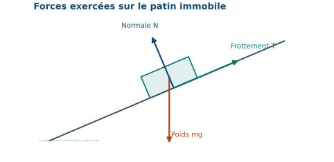

### Question 2

Le bilan $m\vec g+\vec N+\vec T=\vec0$ donne $N=mg\cos\alpha$ et $T=mg\sin\alpha$. L’équilibre est possible tant que $T\leqslant f_2N$. La valeur limite correspond à $\tan\alpha_c=f_2$, d’où $\boxed{\alpha_c=\arctan f_2}$. Le coefficient pertinent au seuil est celui de frottement statique.

### Question 3

Avec la convention du sujet, $f=f_2=\tan(18^\circ)\simeq0{,}325$, soit $\boxed{f\simeq0{,}3}$ à un chiffre significatif. Le coefficient est sans dimension.

### Question 4

Les grains subissent leur poids, la réaction verticale du piston et la réaction de toute la paroi latérale. Cette dernière comprend les normales radiales, dont la somme est nulle par symétrie, et les frottements verticaux. Lors de la descente du piston, les grains glissent vers le bas relativement au tube fixe. La paroi exerce alors une force de frottement vers le haut. En régime quasi statique,
$$
F_{\mathrm{paroi},\uparrow}=(M_{\rm tot}-M_{\rm eff})g.
$$
Dans l’exemple de l’énoncé, $20$ g versés et $7$ g lus correspondent à environ $0{,}13\ \mathrm N$ repris par le tube et par son support.

### Question 5

Au voisinage de $1\ \mathrm g$, la balance donne encore près de $1\ \mathrm g$. Vers $4$ à $5\ \mathrm g$ versés, elle ne donne déjà plus qu’environ $3$ à $4\ \mathrm g$. L’écart dépasse alors nettement la dispersion des points. On retient $\boxed{M_{\rm tot}\sim5\ \mathrm g}$ comme repère graphique. La transition est progressive et un autre seuil relatif raisonnable déplace cette estimation de quelques grammes.

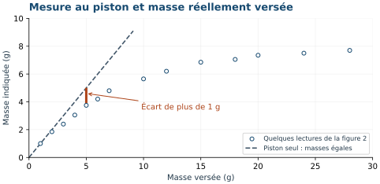

### Question 6

Un empilement de verre a une masse volumique apparente de l’ordre de $10^3\ \mathrm{kg\,m^{-3}}$. Les données précisées ensuite donnent $\rho_{\rm app}=\phi\rho\simeq0{,}6\times2500=1500\ \mathrm{kg\,m^{-3}}$. Pour $D=20\ \mathrm{mm}$, la section vaut $S=\pi D^2/4\simeq3{,}1\times10^{-4}\ \mathrm{m^2}$. Au repère de $5\ \mathrm g$,
$$
H=\frac{M_{\rm tot}}{\rho_{\rm app}S}\simeq1{,}1\ \mathrm{cm},\qquad \frac HD\simeq0{,}5 .
$$
La hauteur caractéristique est du même ordre de grandeur que le diamètre du tube.

## I.2 — Forces de paroi et redirection des contraintes

### Question 7

La section du tube est $S=\pi D^2/4$. Dans le volume $S\,\mathrm dz$, les grains occupent $\phi S\,\mathrm dz$. En orientant $\vec e_z$ vers le bas comme sur la figure 3, on obtient
$$
\mathrm d\vec P=\rho\phi Sg\,\mathrm dz\,\vec e_z .
$$

### Question 8

La matière extérieure pousse la face supérieure vers le bas, avec $SP_v(z)\vec e_z$. Sur la face inférieure elle pousse vers le haut, avec $-SP_v(z+\mathrm dz)\vec e_z$. Au premier ordre, la résultante est
$$
\boxed{\mathrm d\vec F_v=-S\frac{\mathrm dP_v}{\mathrm dz}\,\mathrm dz\,\vec e_z}.
$$
Lorsque la pression croît avec la profondeur, cette résultante est dirigée vers le haut.

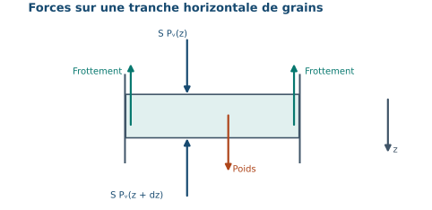

### Question 9

Avec $R=D/2$, l’aire de l’élément est $\mathrm d^2S=R\,\mathrm d\theta\,\mathrm dz$. En choisissant $\vec e_r(\theta)$ dirigé de l’axe vers la paroi, la réaction normale du tube sur les grains est dirigée vers l’axe :
$$
\mathrm d^2\vec N=-P_h(z)R\,\mathrm d\theta\,\mathrm dz\,\vec e_r(\theta).
$$

### Question 10

Le support et le piston descendent lentement alors que le tube reste fixe. La mesure est quasi statique pour le bilan de quantité de mouvement, mais le contact grains-paroi est en glissement. Le frottement cinétique s’oppose à la vitesse relative descendante des grains :
$$
\mathrm d^2\vec T=-fP_h(z)R\,\mathrm d\theta\,\mathrm dz\,\vec e_z .
$$

### Question 11

Les normales opposées se compensent car $P_h$ est indépendant de $\theta$ et $\int_0^{2\pi}\vec e_r(\theta)\,\mathrm d\theta=\vec0$. Toutes les forces tangentielles pointent vers le haut. On obtient
$$
\boxed{\mathrm d\vec N=\vec0,\qquad \mathrm d\vec T=-fP_h(z)\pi D\,\mathrm dz\,\vec e_z.}
$$

### Question 12

En intégrant la composante verticale du frottement sur toute la hauteur, l’équilibre des grains donne
$$
M_{\rm eff}g=M_{\rm tot}g-\pi D f\int_0^H P_h(z)\,\mathrm dz .
$$
Une pression horizontale positive permet à la paroi de reprendre une part du poids. La baisse de l’indication de la balance s’accorde donc avec le sens et le signe des forces calculées.

### Question 13

En l’absence de frottement, chaque force de contact est portée par la droite des centres, inclinée de $\beta$ sur l’horizontale. Les deux appuis exercent sur $i$ des forces de même norme $F$. Les composantes horizontales s’annulent et $2F\sin\beta=mg$. Par action et réaction,
$$
\boxed{\|\vec F_{i\to j}\|=\frac{mg}{2\sin\beta}} .
$$

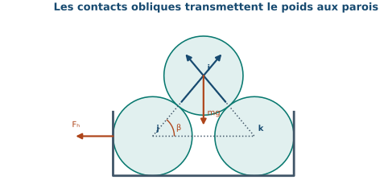

### Question 14

La force du grain supérieur sur $j$ a pour composante horizontale $F\cos\beta$ vers la gauche. Le poids de $j$ et la normale du fond sont verticaux, donc la paroi de gauche reprend cette composante. La force exercée par $j$ sur le support est orientée vers la gauche et a pour norme
$$
\boxed{F_h=\frac{mg}{2}\frac{\cos\beta}{\sin\beta}} .
$$

### Question 15

On trouve $\boxed{k=\cot\beta=1/\tan\beta}$. Le dénominateur $mg/2$ représente la part du poids de $i$ transmise à $j$. Le poids propre de $j$ s’ajoute dans le bilan vertical sur le fond.

### Question 16

Les deux grains du bas ont leurs centres séparés de $d+\delta$ ; les droites de centres entre un grain du bas et le grain du haut ont longueur $d$. Ainsi
$$
\cos\beta=\frac{d+\delta}{2d},\qquad 0\leqslant\delta<d
\quad\Longrightarrow\quad 0<\beta\leqslant60^\circ .
$$
Sur cet intervalle $k=\cot\beta$ décroît. La courbe passe par $(30^\circ,\sqrt3)$, $(45^\circ,1)$ et atteint $1/\sqrt3$ à $60^\circ$ lorsque les deux grains du bas se touchent. Lorsque $\delta\to d^-$, les normales deviennent presque horizontales et $k\to+\infty$. À $\beta=0$, leur composante verticale s’annule et l’équilibre du grain du haut est impossible.

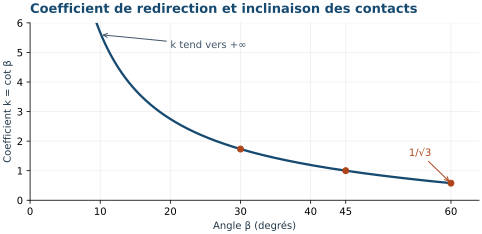

## I.3 — Pression et masse de saturation

### Question 17

L’axe $z$ est orienté vers le bas, depuis la surface libre. Posons $S=\pi D^2/4$, $p=\pi D$, et $\rho_b=\phi\rho$ la masse volumique apparente. Au cours de la mesure, le tassement vers le bas mobilise un frottement des parois vers le haut. Sa norme sur la tranche est $fP_h p\,dz=fkP_vp\,dz$. Les composantes normales radiales des réactions se compensent sur le tour du cylindre. L’équilibre vertical s’écrit
$$
0=\rho_b gS\,dz+S[P_v(z)-P_v(z+dz)]-fkP_v(z)p\,dz .
$$
Ainsi $dP_v/dz+(fk p/S)P_v=\rho_b g$. En posant
$$
\lambda=\frac{S}{fkp}=\frac{D}{4fk},\qquad P_\infty=\rho_b g\lambda ,
$$
on obtient $\lambda P'_v+P_v=P_\infty$. La longueur et la pression ainsi définies sont positives si $fk>0$. En l’absence de frottement ou de redirection, on revient directement à $P'_v=\rho_b g$.

### Question 18

Ici $P_v$ mesure la compression transmise par le squelette granulaire. Aucun grain ni piston ne presse la surface supérieure. L’air pénètre entre les grains et sa pression est pratiquement uniforme à cette échelle ; sur un grain une pression uniforme agit sur toute la surface et sa résultante est nulle. Avec cette convention de contrainte de contact, **$P_v(0)=0$**. Si l’on comptabilisait la contrainte totale de l’air et des grains, on devrait y ajouter la pression interstitielle. À la surface d’un liquide, la condition en pression **absolue** s’écrit au contraire $P(0)=P_{\rm atm}$ ; sa surpression, elle aussi, est nulle à la surface.

### Question 19

L’équation homogène pour $P_v-P_\infty$ donne $P_v=P_\infty+C\exp(-z/\lambda)$. La condition $P_v(0)=0$ impose $C=-P_\infty$. Ainsi
$$P_v(z)=P_\infty\left(1-e^{-z/\lambda}\right).$$
Près de la surface, $P_v(z)\simeq P_\infty z/\lambda=\rho_b gz$.

### Question 20

La courbe part de zéro avec une pente $P_\infty/\lambda$. Elle croît et sa concavité est négative. La tangente à l’origine coupe l’asymptote horizontale $P=P_\infty$ à $z=\lambda$, tandis que la courbe y atteint $(1-e^{-1})P_\infty\simeq0{,}632P_\infty$. Pour une pile très haute, le supplément de poids d’une tranche est presque entièrement supporté par le frottement des parois.

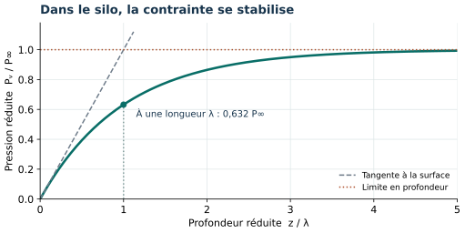

### Question 21

Le piston sans frottement reçoit une poussée descendante $S P_v(H)$ due aux contacts. Après tare du piston, la lecture de la balance vérifie $M_{\rm eff}g=S P_v(H)$. On trouve
$$M_{\rm eff}(H)=\frac{S P_\infty}{g}\left(1-e^{-H/\lambda}\right).$$
La différence avec le poids total est la force verticale transférée aux parois.

### Question 22

La compacité étant uniforme, $M_{\rm tot}=\rho_b S H$. Définissons
$$M_\infty=\rho_b S\lambda=\frac{S P_\infty}{g}=\frac{\pi D^2 P_\infty}{4g}.$$
Alors $H/\lambda=M_{\rm tot}/M_\infty$ et
$$M_{\rm eff}=M_\infty\left[1-\exp\!\left(-\frac{M_{\rm tot}}{M_\infty}\right)\right].$$
Pour $M_{\rm tot}$ exprimée en grammes, il faut employer la même unité pour $M_\infty$ dans l’exponentielle.

### Question 23

Aux faibles masses, le développement donne $M_{\rm eff}=M_{\rm tot}-M_{\rm tot}^2/(2M_\infty)+\cdots$ : presque tout le poids atteint le piston. La figure 2 monte d’abord avec une pente proche de un, puis s’incurve et se stabilise vers **7,5 à 8 g** après mobilisation du frottement. Avec $M_\infty\simeq8$ g et $M_{\rm tot}=20$ g, le modèle donne $M_{\rm eff}\simeq7{,}34$ g, en accord avec l’ordre de grandeur lu à l’étape (c). Les quelque 19 g relevés immédiatement après le versement correspondent à un autre état des contacts. À grande masse, ajouter des billes charge surtout les parois.

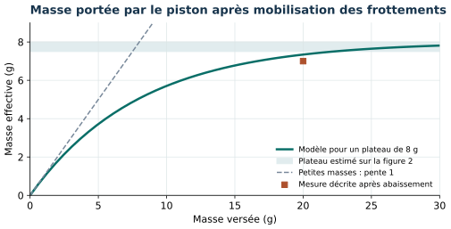

### Question 24

Comme $M_\infty=\rho_b\pi D^3/(16fk)$,
$$f=\frac{\rho\phi\pi D^3}{16 k M_\infty}.$$
Avec $\rho=2500\ \mathrm{kg\,m^{-3}}$, $\phi=0{,}6$, $D=0{,}020\ \mathrm m$, $k=1$ et un plateau de $7{,}5$ à $8{,}0\ \mathrm g$, on obtient $f\simeq0{,}29$ à $0{,}31$, soit **environ 0,30**. Pour $8$ g, $\lambda\simeq1{,}70$ cm. L’ordre de grandeur s’accorde avec $\tan 18^\circ\simeq0{,}325$ obtenu sur le contact verre-verre, compte tenu de l’approximation sur $k$ et de la lecture graphique.

## I.4 — Déplacement d’un embâcle

### Question 25

Sur la figure 5, $x$ croît de l’extrémité libre ($x=0$) vers la plaque du bateau ($x=L$), dans le sens du courant. Le bateau veut déplacer la glace dans le sens $-\mathbf e_x$. Au seuil de ce mouvement, la traînée de l’eau et les frottements des **deux** berges sur les blocs sont dirigés selon $+\mathbf e_x$. Les autres blocs compriment la tranche. La face en $x$ est poussée vers $+\mathbf e_x$, celle en $x+dx$ vers $-\mathbf e_x$. Les réactions normales des berges sont tournées vers l’intérieur et se compensent transversalement dans le modèle symétrique. Poids et poussée d’Archimède sont verticaux.

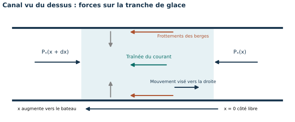

### Question 26

La force distribuée qui joue le rôle du poids des grains est **la traînée exercée par le courant sur les blocs**, vers le bateau. Elle est proportionnelle à la longueur de tranche à compacité uniforme, tout comme la force de pesanteur était proportionnelle à $dz$. Les frottements des berges sont, eux, les analogues des frottements du silo. Leur sens par rapport à la force distribuée change au seuil de la poussée du bateau.

### Question 27

Avec $d=1\ \mathrm m$, $U=2\ \mathrm{m\,s^{-1}}$, $\rho_e\simeq10^3\ \mathrm{kg\,m^{-3}}$ et $\eta=10^{-3}\ \mathrm{Pa\,s}$,
$$\mathrm{Re}=\frac{\rho_e U d}{\eta}\simeq2\times10^6.$$
Même l’épaisseur immergée $0{,}3\ \mathrm m$ donnerait $6\times10^5$. L’écoulement autour d’un bloc n’est pas dans le domaine visqueux de Stokes.

### Question 28

Pour une sphère de diamètre $d$ avançant à la vitesse $\mathbf U$ dans l’eau immobile,
$$\mathbf F_D=-\tfrac12\rho_e C_D S_{\perp}|\mathbf U|\mathbf U,\qquad S_{\perp}=\pi d^2/4.$$
$C_D$ est sans dimension et dépend notamment de Reynolds et de l’état de surface. Le signe traduit l’opposition à la vitesse relative de la sphère. Pour un bloc quasi immobile dans un courant, la force de l’eau sur lui a le sens du courant. La question suivante impose d’employer l’aire **inférieure** des blocs avec le coefficient effectif du modèle.

### Question 29

L’aire d’une base est $s_b=\pi d^2/4$. On compte en moyenne $\phi\ell\,dx/s_b$ blocs dans la tranche, soit une aire inférieure totale $\phi\ell\,dx$. Écrivons $q=\tfrac12\rho_e C_D U^2$, une pression dynamique pondérée par $C_D$. La traînée est donc $+q\phi\ell\,dx\,\mathbf e_x$. Les deux faces transverses donnent ensemble
$$\ell e\,[P_x(x)-P_x(x+dx)]\,\mathbf e_x.$$
Chaque paroi latérale présente une aire $e\,dx$ et une pression normale $P_y=kP_x$. Leurs réactions normales, de sens opposés, ont chacune pour norme $kP_x e\,dx$. Les frottements **s’ajoutent** à la traînée, donnant $+2fkP_x e\,dx\,\mathbf e_x$ au seuil du glissement vers $-\mathbf e_x$. La compacité intervient dans la surface mouillée. Les contraintes macroscopiques $P_x,P_y$ sont déjà rapportées aux aires apparentes des faces.

### Question 30

À la limite quasi statique du démarrage, la projection du bilan précédent donne
$$0=-\ell e\,P'_x\,dx+\phi q\ell\,dx+2fkP_x e\,dx.$$
Posons $\lambda=\ell/(2fk)$ et $P_\infty=\phi q\lambda/e$. Le bilan se met sous la forme
$$\lambda P'_x-P_x=P_\infty,\qquad P_\infty=\frac{\phi\rho_e C_D U^2\lambda}{2e}.$$
Ici $P_\infty$ a la dimension d’une pression et la notation reprend celle du sujet. Le signe devant $P_x$ ne permet pas d’y voir une valeur de saturation positive.

### Question 31

Avec $P_x(0)=0$, la solution est
$$P_x(x)=P_\infty\left(e^{x/\lambda}-1\right).$$
À $x\ll\lambda$, $P_x\simeq\phi q x/e$. À plus grande distance, la croissance est exponentielle dans ce modèle. Dans le silo, le frottement portait une fraction du poids des billes. Ici le bateau pousse contre le courant et la glace tend à glisser contre les parois : celles-ci **augmentent** l’effort à fournir. C’est l’origine physique du changement de signe et de l’absence de plateau.

### Question 32

À $x=L$, la glace exerce sur la plaque une force dirigée vers $+\mathbf e_x$. La force de poussée sur la glace requise au seuil de son déplacement est opposée, de norme
$$F=\ell eP_x(L)=\ell eP_\infty(e^{L/\lambda}-1)=\phi q\ell\lambda(e^{L/\lambda}-1).$$
La plaque est trouée pour laisser passer l’eau. Ce bilan donne la force sur la glace ; une éventuelle traînée propre de la coque sort du modèle.

### Question 33

En unités $F_* = \phi q\ell\lambda$ et $\lambda$, on trace $F/F_*=e^{L/\lambda}-1$. La courbe passe par l’origine, avec une pente physique initiale $\phi q\ell$, et elle est strictement convexe. La tangente $F=\phi q\ell L$ représente la seule traînée de l’eau, également retrouvée si $f k\to0$. Vers $L\simeq\lambda$ et au-delà, la pression latérale accroît le frottement et la poussée s’écarte nettement de la loi linéaire.

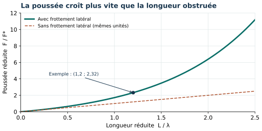

### Question 34

Prenons $\rho_e=1000\ \mathrm{kg\,m^{-3}}$, $k=1$ (contraintes latérales du même ordre que les contraintes longitudinales), $f=0{,}10$ (hypothèse de frottement modéré pour des surfaces mouillées) et $C_D=0{,}5$ (coefficient d’ordre un dans l’analogie proposée avec une traînée inertielle). Ce sont des **hypothèses illustratives**, et non des données mesurées sur le canal. Avec $\ell=5\ \mathrm m$, $L=30\ \mathrm m$, $U=2\ \mathrm{m\,s^{-1}}$ et $\phi=0{,}8$, on trouve
$$\lambda=25\ \mathrm m,\quad q=10^3\ \mathrm {Pa},\quad \phi q\ell\lambda=1{,}0\times10^5\ \mathrm N,$$
soit **$F\simeq2{,}3\times10^5\ \mathrm N$** puisque $e^{1{,}2}-1\simeq2{,}32$. La seule traînée donnerait $1{,}2\times10^5\ \mathrm N$. La loi est linéaire en $C_D$ et très sensible au produit $fk$ par l’exponentielle. Si la face inférieure parallèle au courant relève surtout du frottement de peau, un coefficient effectif plus petit est plausible : à titre de sensibilité, $C_D=0{,}005$ donnerait environ $2{,}3\times10^3\ \mathrm N$ avec les mêmes autres paramètres. Le modèle n’attribue donc pas au canal une force numérique unique.

## II.1 — Orbitales et coordination de NO

### Question 35

NO possède $5+6=11$ électrons de valence. La forme de Lewis usuelle est $\mathrm{N}{=}\mathrm{O}$, avec sur N un doublet non liant et un électron célibataire, et sur O deux doublets non liants. Les deux charges formelles sont nulles. L'azote a sept électrons dans sa couche de valence.

Pour $\mathrm{NO_3^-}$, on compte $5+3\times6+1=24$ électrons. Dans une forme mésomère, l'azote central, sans doublet, porte une charge $+1$, un oxygène lui est doublement lié (deux doublets, charge nulle), et deux oxygènes sont simplement liés (trois doublets chacun, charge $-1$). La double liaison peut être placée sur chacun des trois oxygènes. La géométrie est trigonale plane et les trois liaisons sont équivalentes, d'ordre moyen $4/3$.

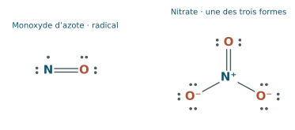

### Question 36

Par ordre d'énergie croissante, la figure 6 donne $\phi_1$, $\phi_2$, $(\phi_3,\phi_4)$, $\phi_5$, $(\phi_6,\phi_7)$, puis $\phi_8$. Avec onze électrons, la configuration de valence est $\phi_1^2\phi_2^2\phi_3^2\phi_4^2\phi_5^2\phi_6^0\phi_7^1\phi_8^0$ dans le choix d'axes de l'énoncé. La dernière orbitale doublement occupée est $\phi_5$ et la première entièrement vacante $\phi_6$. L'orbitale simplement occupée $\phi_7$ est dégénérée avec $\phi_6$. Les deux partenaires peuvent échanger leurs noms avant fixation du repère.

### Question 37

À nombre quantique principal égal, $2s$ est plus basse que $2p$ par pénétration. Pour un même type d'orbitale, les niveaux de O sont plus bas que ceux de N, en accord avec la charge nucléaire effective plus grande de O et son électronégativité. Les trois OA $2p$ de chaque atome isolé sont dégénérées.

Dans le diagramme qualitatif, les combinaisons à dominante $2s$ donnent $\phi_1$ liante de basse énergie et $\phi_2$ antiliante plus élevée. Les orbitales à dominante $2p$ forment notamment les $\pi$ liantes $\phi_3,\phi_4$ et les $\pi^*$ antiliantes $\phi_6,\phi_7$ de part et d'autre des niveaux atomiques parents. Les orbitales axiales $\sigma$ peuvent mélanger $s$ et $p_z$, avec $\phi_5$ sous les $\pi^*$ et $\phi_8$ au sommet, comme sur la figure 6. Le schéma n'attribue pas d'espacement numérique aux niveaux atomiques.

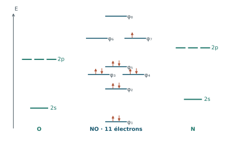

### Question 38

La partie extérieure de l'orbitale $\sigma$ occupée $\phi_5$ est plus développée sur N. Elle peut donner de la densité dans une orbitale adaptée du métal. Les orbitales frontières $\pi^*$ sont également polarisées vers N, ce qui favorise le recouvrement avec une orbitale métallique susceptible de rétrodonner de la densité. Le modèle de Lewis place en outre le radical du côté de N. Ces deux interactions favorisent le motif M–N–O.

### Question 39

L'axe métal–azote est $Oz$. Dans la disposition linéaire, $\phi_7$ est une orbitale $\pi^*$ orientée dans le plan $xz$. Ses deux lobes changent de signe par réflexion $x\mapsto -x$. L'orbitale $d_{z^2}$ ne change pas de signe, donc les deux contributions au recouvrement se compensent. L'orbitale $d_{xz}$ change de signe comme $\phi_7$, ce qui permet un recouvrement latéral $\pi$.

La flexion dans le plan $xz$ brise la symétrie qui imposait le premier zéro. Un lobe de $\phi_7$ se rapproche de l'axe de $d_{z^2}$ et un recouvrement apparaît. Le recouvrement latéral avec $d_{xz}$ perd une partie de l'alignement qu'il avait dans la géométrie linéaire. Il peut subsister dans le cas coudé. La planche fournit une comparaison qualitative et ne fixe pas les valeurs des intégrales.

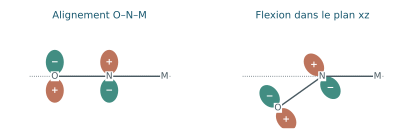

### Question 40

Pour favoriser l'arrangement linéaire, placer $d_{xz}$ près en énergie de $\phi_7$ et diminuer le rôle de $d_{z^2}$, par exemple en éloignant ce dernier niveau. L'interaction latérale stabilise alors préférentiellement l'arrangement aligné. Pour favoriser la flexion, rendre $d_{z^2}$ proche de $\phi_7$ et le canal $d_{xz}$ moins actif. Le recouvrement axial, nul dans l'arrangement linéaire, devient stabilisant dans l'arrangement coudé.

Le remplissage se lit sur les OM formées. Comme $\phi_7$ apporte un électron, une orbitale métallique simplement occupée permet à deux électrons de spins opposés de remplir la combinaison liante en laissant l'antiliante vide, ce qui maximise la stabilisation pour ce couple de niveaux voisins. Une orbitale métallique vide ou doublement occupée donne respectivement un ou trois électrons dans la paire d'OM et une stabilisation nette généralement plus faible. Le champ des autres ligands et le compte électronique du métal peuvent donc modifier la géométrie préférée.

## II.2 — Échange de ligands de la myoglobine

### Question 41

En posant $X(t)=[\mathrm{Mb(NO)}](t)$ et $[\mathrm{Mb(H_2O)}]=c_0-X$, l'absorbance à 409 nm vaut
$$ A(t)=\ell\big[\epsilon_O c_0+(\epsilon_N-\epsilon_O)X(t)\big]. $$
La figure 8 montre un saut positif d'absorbance à la photolyse. À cette longueur d'onde, la dissociation de Mb(NO) produit le complexe aquo plus absorbant. Une ligne de base constante indépendante des deux complexes s'élimine par différence.

### Question 42

En dégénérescence d'ordre, la concentration de NO est pratiquement constante. Le bilan donne
$$ \frac{\mathrm dX}{\mathrm dt}=k_{\rm on}[\mathrm{NO}](c_0-X)-k_{\rm off}X. $$
Ainsi $k_{\rm obs}=k_{\rm on}[\mathrm{NO}]+k_{\rm off}$, en $\mathrm{s^{-1}}$, et $\beta=k_{\rm on}[\mathrm{NO}]c_0$, en concentration par seconde. La teneur à l'équilibre vaut $X_\infty=\beta/k_{\rm obs}$.

### Question 43

À concentration de NO fixée, la solution s'écrit $X(t)=X_\infty+[X(0^+)-X_\infty]\exp(-k_{\rm obs}t)$. Par la question 41, $A(t)-A_\infty$ est aussi une exponentielle simple. On ajuste la trace après le flash, avec amplitude, ligne de base et taux, pour extraire $k_{\rm obs}$. Sur la figure 8, une amplitude initiale d'environ 0,016 est divisée par $e$ vers $0{,}006$ à $0{,}007$ min, ce qui donne quelques $\mathrm{s^{-1}}$. Il faut convertir les minutes si les constantes sont exprimées en secondes.

À température, pression et milieu fixés, on recommence avec plusieurs concentrations de NO en excès. La régression de $k_{\rm obs}$ sur $[\mathrm{NO}]$ a pour pente $k_{\rm on}$ et pour ordonnée à l'origine $k_{\rm off}$. Les incertitudes sur l'ordonnée peuvent être importantes si tous les points sont éloignés de l'origine.

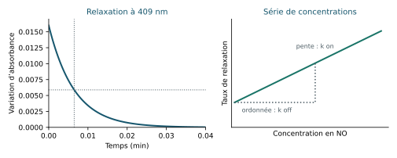

### Question 44

À pression fixée, mesurer les deux constantes à plusieurs températures. Pour chaque sens $i$, au standard de concentration du sujet,
$$ \ln\!\left(\frac{k_i h}{k_{\rm B}T(c^\circ)^{\Delta n}}\right)=-\frac{\Delta H_i^\ddagger}{R}\frac1T+\frac{\Delta S_i^\ddagger}{R}. $$
La pente du tracé en fonction de $1/T$ vaut $-\Delta H_i^\ddagger/R$ et l'ordonnée à l'origine $\Delta S_i^\ddagger/R$. On suppose les grandeurs d'activation suffisamment constantes dans l'intervalle de température. Utiliser le facteur standard approprié rend le logarithme sans dimension.

### Question 45

Pour des estimations indépendantes, rapportons chaque différence entre spectrophotométrie et stopped-flow du laboratoire 1 à $\sqrt{u_1^2+u_2^2}$. Dans l'ordre des colonnes du tableau ($H_{\rm on},S_{\rm on},H_{\rm off},S_{\rm off},V_{\rm on},V_{\rm off}$), on obtient environ $0$, $0{,}06$, $0{,}47$, $0{,}53$, $0{,}30$, $0{,}64$. Toutes les différences sont inférieures à une incertitude-type combinée. Les deux méthodes du laboratoire 1 sont compatibles pour ces six grandeurs. Les incertitudes sur certains volumes sont nettement plus petites avec le stopped-flow.

### Question 46

L'écart normalisé en enthalpie d'activation de la dissociation vaut
$$ E_n=\frac{|83-65|}{\sqrt{2^2+5^2}}=\frac{18}{\sqrt{29}}>3. $$
Il dépasse le seuil usuel de 2. Les deux mesures sont incompatibles au regard des incertitudes annoncées. Le tampon diffère entre laboratoires. Une participation du tampon aux échanges de ligands ou à l'environnement du site hémique pourrait modifier les paramètres apparents de dissociation. Une contribution systématique non incluse aux incertitudes constitue également une hypothèse. Le tableau seul ne tranche pas entre ces causes.

### Question 47

La spectrophotométrie après flash et le stopped-flow déterminent $k_{\rm off}$ par une ordonnée à l'origine. La méthode de piégeage donne directement la vitesse de libération de NO, donc une mesure indépendante de $k_{\rm off}$. Dans le laboratoire 2, par exemple, $83\pm2$ et $78\pm2\ \mathrm{kJ\,mol^{-1}}$ ont un écart normalisé de $5/\sqrt8\simeq1{,}8$. La comparaison teste les biais de mesure ou d'extrapolation, renseigne sur les précisions accessibles, et aide à distinguer un effet du milieu d'un effet de technique. Seules les deux méthodes de relaxation donnent aussi $k_{\rm on}$.

### Question 48

L'équation d'Eyring et l'identité $\mathrm dG=V\,\mathrm dp-S\,\mathrm dT$ donnent, à température constante,
$$ \left(\frac{\partial\ln k_i}{\partial p}\right)_T=-\frac{1}{RT}\left(\frac{\partial\Delta G_i^\ddagger}{\partial p}\right)_T=-\frac{\Delta V_i^\ddagger}{RT}. $$
Pour un volume d'activation indépendant de la pression, la droite $\ln[k_i(p)/k_i(p_0)]$ en fonction de $p-p_0$ a pour pente $-\Delta V_i^\ddagger/(RT)$. Une pente négative correspond à une barrière dont le volume est supérieur à celui des réactifs. Avec des pressions en pascals, le volume calculé est en $\mathrm{m^3\,mol^{-1}}$.

### Question 49

Les volumes d'activation mesurés sont positifs dans les deux sens, de l'ordre de $+16$ à $+21\ \mathrm{cm^3\,mol^{-1}}$. L'étape qui franchit la barrière s'accompagne d'une dilatation. Le mécanisme limite 1, dissociatif, est le plus compatible avec ce résultat. Le départ du ligand ouvre un site avant la coordination du ligand entrant. Le mécanisme limite 2 ferait au contraire intervenir un état de transition associant les deux ligands au site et une contribution de coordination généralement contractante. Les valeurs positives d'entropie du sens direct vont dans le même sens. Les variations de solvatation empêchent de transformer cet indice en preuve unique.

### Question 50

Adoptons les volumes du stopped-flow au laboratoire 1 et prenons $V_R=0$ comme origine pour $\mathrm{Mb(H_2O)+NO}$. On place le complexe activé à $V^\ddagger=21{,}3\ \mathrm{cm^3\,mol^{-1}}$. Comme $V^\ddagger-V_P=16{,}3\ \mathrm{cm^3\,mol^{-1}}$, le niveau final de $\mathrm{Mb(NO)+H_2O}$ est à $+5{,}0\ \mathrm{cm^3\,mol^{-1}}$. Finalement
$$ \Delta_rV=\Delta V_{\rm on}^\ddagger-\Delta V_{\rm off}^\ddagger=(5{,}0\pm1{,}3)\ \mathrm{cm^3\,mol^{-1}}, $$
avec une incertitude-type calculée en supposant des estimations indépendantes. Les deux valeurs de spectrophotométrie du même laboratoire conduiraient à $1{,}1\pm6{,}5\ \mathrm{cm^3\,mol^{-1}}$, compatible mais moins précis. Le maximum représenté est un **volume**, pas une énergie.

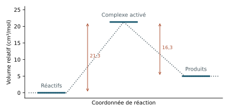

### Question 51

Dans le mécanisme dissociatif direct, la libération d'une seule molécule d'eau pourrait suggérer une variation d'au plus l'ordre du volume molaire de l'eau, $13{,}5\ \mathrm{cm^3\,mol^{-1}}$. La valeur $21{,}3\pm0{,}3\ \mathrm{cm^3\,mol^{-1}}$ est plus grande. Le calcul naïf traite la protéine et son solvant comme rigides. L'ouverture d'une cavité, un réarrangement du site hémique et la réorganisation de plusieurs molécules d'hydratation peuvent tous contribuer au volume apparent. La valeur mesurée ne détermine pas à elle seule combien de molécules d'eau sont déplacées.

## II.3 — Bilan électrochimique d’un bain de sulfate de cuivre

### Question 54

Pour le bain de sulfate de cuivre, l'entrée correspond à $[\mathrm{Cu^{2+}}]=0{,}100\ \mathrm{mol\,L^{-1}}$ et $[\mathrm{H^+}]=2{,}00\ \mathrm{mol\,L^{-1}}$. On emploie l'approximation activités–concentrations des données et $p_{\mathrm{O_2}}=p^\circ$. À la cathode, $\mathrm{Cu^{2+}+2e^-\rightarrow Cu(s)}$. Le couple rapide présente son pied de réduction près de
$$ E_{\rm Cu}=0{,}34+0{,}03\log(0{,}100)=0{,}31\ \mathrm V\ \text{vs ESH}. $$
Pour $E$ plus petit, le courant négatif croît en valeur absolue puis atteint un palier d'apport de cuivre(II). À l'anode, $\mathrm{2H_2O\rightarrow O_2+4H^++4e^-}$. Son potentiel d'équilibre vaut $1{,}23+0{,}06\log 2\simeq1{,}25\ \mathrm V$. Le surpotentiel d'oxydation de $0{,}30\ \mathrm V$ porte le départ de la branche positive vers $1{,}55\ \mathrm V$. Le modèle suppose le couple du dihydrogène lent et un rendement faradique unitaire pour les deux réactions retenues.

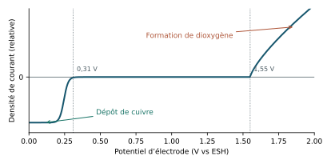

### Question 55

La tension de début d'électrolyse est approximativement $U_{\min}=1{,}55-0{,}31=1{,}24\ \mathrm V$. À courant fini s'ajoutent les pertes ohmiques et les polarisations. En sortie du réacteur, la concentration en cuivre(II) est moindre. Le potentiel d'équilibre du cuivre diminue et la valeur absolue du plateau de courant cathodique baisse. La production d'ions $\mathrm{H^+}$ à l'anode acidifie la solution et décale la vague d'oxydation de l'eau légèrement vers les potentiels plus positifs, toutes choses égales par ailleurs.

### Question 56

Notons $C=C_{\mathrm{Cu^{2+}}}^r$. Le débit volumique est $v h\ell$ et le courant cathodique en valeur absolue sur la tranche vaut $j(x)\ell\,\mathrm dx$. En régime permanent, deux électrons étant nécessaires par ion,
$$ vh\ell\,[C(x)-C(x+\mathrm dx)]=\frac{j(x)\ell\,\mathrm dx}{2F}. $$
En divisant par $vh\ell\,\mathrm dx$, puis en passant à la limite,
$$ \frac{\mathrm dC}{\mathrm dx}+\frac{j(x)}{2Fhv}=0,\qquad \alpha=\frac1{2Fhv}. $$
Le signe exprime la consommation du cuivre dissous dans le sens de l'écoulement.

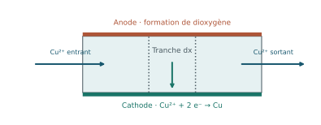

### Question 57

Au plateau d'apport des ions cuivre(II), le modèle de transfert de matière usuel à coefficient $k_m$ constant donne $j_{\lim}=2F k_m(C^r-C^c)\simeq2F k_m C^r$. Dans l'approximation d'une couche de diffusion d'épaisseur constante et d'un électrolyte support abondant, $k_m\simeq D/\delta_c$. On demeure dans l'hypothèse du sujet d'un rendement faradique unitaire pour le dépôt du cuivre.

Avec $\tau=x/v$, le bilan devient $\mathrm dC/\mathrm d\tau=-(k_m/h)C$. On retrouve la loi d'un réacteur piston siège d'une consommation d'ordre 1, $C=C(0)\exp[-(k_m/h)\tau]$. Le coefficient apparent $k_m/h$ a la dimension d'une fréquence.

### Question 58

Dans le modèle macroscopique, l'électroneutralité impose dans chacune des trois zones $u=a,c,r$
$$ 2 C_{\mathrm{Cu^{2+}}}^{u}+C_{\mathrm{H^+}}^{u}=2C_{\mathrm{SO_4^{2-}}}^{u}. $$
Par exemple, à l'entrée, $2\times100+2000=2\times1100$ en $\mathrm{mol\,m^{-3}}$. L'équation s'applique à la solution de part et d'autre des couches limites et à leurs bords, selon la convention du sujet.

### Question 59

Dans la zone centrale du bain de cuivre, $\kappa(x)=\lambda_{\mathrm{Cu^{2+}}}C^r_{\mathrm{Cu^{2+}}}+\lambda_{\mathrm{H^+}}C^r_{\mathrm{H^+}}+\lambda_{\mathrm{SO_4^{2-}}}C^r_{\mathrm{SO_4^{2-}}}$. La loi d'Ohm locale donne $|E_y|=j/\kappa$. Les concentrations centrales sont uniformes suivant $y$ et la densité de courant est conservée sur cette direction. Ainsi la chute positive de potentiel à travers le cœur vaut
$$ U_{z2}(x)=\frac{j(x)(h-\delta_a-\delta_c)}{\kappa(x)}\simeq\frac{j(x)h}{\kappa(x)}. $$
Les concentrations sont en $\mathrm{mol\,m^{-3}}$ lorsque les conductivités molaires ioniques s'expriment en $\mathrm{S\,m^2\,mol^{-1}}$.

### Question 60

Pour cette cellule de dépôt du cuivre, la chute ohmique est proportionnelle à $jh/\kappa$. À densité de courant imposée, elle diminue si l'on rapproche les deux électrodes ou si l'on augmente la conductivité de la solution avec un électrolyte support inerte dans le domaine choisi. À géométrie et composition fixées, elle diminue aussi lorsque $j$ diminue, au prix d'un plus faible débit de dépôt.

### Question 61

Dans le modèle du bain de cuivre, à $x$ donné, $C^r_{\mathrm{Cu^{2+}}}$ est fixé et $C^r_{\mathrm{SO_4^{2-}}}$ est connu par l'équation (6). L'électroneutralité donne $C^r_{\mathrm{H^+}}$. Pour une valeur d'essai de $j$, il reste six concentrations interfaciales, trois à chaque électrode. Les quatre relations de bilan transversal énoncées et les deux électroneutralités interfaciales fournissent six relations pour elles. On peut alors exprimer les trois chutes en solution et, par les courbes courant–potentiel des deux électrodes, les deux chutes interfaciales correspondant à $j$.

La somme des cinq chutes doit être égale à $U$ imposé, ce qui fournit la dernière équation pour $j(x)$. Cette fermeture établit la faisabilité du calcul sur une branche physique admissible. La seule égalité du nombre d'équations et d'inconnues ne prouverait pas l'unicité de toute solution non linéaire.

### Question 62

À $1{,}4\ \mathrm V$, la figure montre que $C^r_{\mathrm{Cu^{2+}}}$ diminue presque linéairement avec le temps de passage sur la plage représentée. Le courant est pratiquement constant. Le même comportement est approché au début de la courbe à $1{,}5\ \mathrm V$. Avec $\tau=x/v$, l'équation de bilan s'écrit
$$ \frac{\mathrm d C}{\mathrm d\tau}=-\frac{j}{2Fh}. $$
Un courant voisin d'une constante $j_0$ donne donc $C(\tau)\simeq C(0)-j_0\tau/(2Fh)$, tant qu'il reste du cuivre en solution dans ce régime. La vitesse apparente $j_0/(2Fh)$ est indépendante de $C$, comme pour une réaction d'ordre zéro. À tension plus élevée, les tracés s'incurvent nettement et le courant décroît avec la teneur en cuivre.

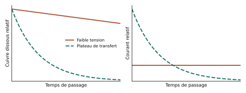
