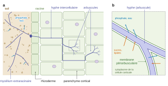
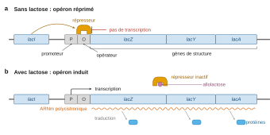
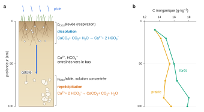
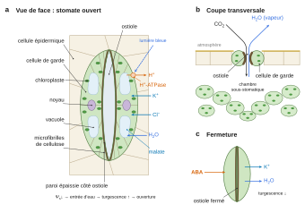
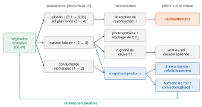

# G2E BCPST — Biologie 2026 · Corrigé brut

*Corrigé rédigé par IA, non officiel. Signalez toute erreur.*

Épreuve de 3 h, en deux compositions indépendantes de 1 h 30 chacune, à numérotation continue (questions 1a à 18). Les valeurs lues sur les graphiques sont des lectures, à une demi-graduation près.

**Remarques d'énoncé** (comme la consigne le demande) :
- la légende du document 4 annonce « pas de différence significative » alors que la figure porte des étoiles : on suit les étoiles ;
- la partie 1.2.B parle de protéome alors que le document 5 mesure des ARNm (transcriptome) ;
- la formule de Shannon est écrite sans le signe moins ;
- le plateau de lœss n'est pas « tropical » ;
- le jujubier est appelé *Ziziphus jujuba* dans le texte et *Zizipus mauritania* dans la légende du document 15 ;
- la question 8b écrit « Fbh7 » pour *Fhb7* ;
- le blé transgénique est dit « à génome diploïde » alors que la métaphase compte environ 40 chromosomes.

# BIOLOGIE 1 — Les symbioses racinaires chez le blé

## Partie 1.1. Anatomie du blé

### Question 1a

**Document 1A (tige, de l'extérieur vers le centre)**
- **1 : épiderme**, assise externe à paroi externe cutinisée. Il est doublé vers l'intérieur d'un anneau de **sclérenchyme** sous-épidermique (petites cellules à paroi épaisse, fortement colorées).
- **2 : parenchyme** fondamental (médullaire) : grandes cellules à paroi mince, peu colorées.
- **3 : phloème** (tissu criblé), petites cellules à paroi mince en position externe dans le faisceau.
- **4 : xylème**, gros vaisseaux de métaxylème à paroi lignifiée et à large lumière, en position interne.
- **5 : faisceau cribro-vasculaire** (conducteur) entouré d'une gaine de sclérenchyme. Il est de type collatéral **fermé** (pas de cambium : Monocotylédone sans croissance secondaire).

**Document 1B (racine)**
- **6 : parenchyme cortical** (écorce).
- **7 : rhizoderme** (assise pilifère), assise la plus externe.
- **8 : poils absorbants**, expansions des cellules rhizodermiques.
- **9 : endoderme**, assise qui limite le cylindre central ; ses parois portent le cadre de Caspary (subérine, lignine), autofluorescent.
- **10 : xylème** du cylindre central (gros vaisseau de métaxylème).

| Organe | Légendes |
|---|---|
| Tige (1A) | 1 épiderme (et sclérenchyme sous-épidermique), 2 parenchyme, 3 phloème, 4 xylème, 5 faisceau cribro-vasculaire |
| Racine (1B) | 6 parenchyme cortical, 7 rhizoderme, 8 poils absorbants, 9 endoderme, 10 xylème |

### Question 1b

Il s'agit d'un **microscope optique (photonique) en lumière transmise, à fond clair**. Trois raisons le montrent :
- l'image est en couleurs, données par un colorant qui absorbe la lumière traversant une coupe fine. La microscopie électronique donne des images en niveaux de gris ; la fluorescence donne un fond noir avec des signaux émis, comme sur le document 1B ;
- l'objet est une coupe mince colorée, observée par transparence ;
- l'échelle (barres de 50 et 200 µm, cellules de 10 à 50 µm) se situe largement au-dessus de la limite de résolution du microscope optique (≈ 0,2 µm). Un microscope électronique ne serait pas nécessaire.

$$\boxed{\text{Microscope photonique à transmission, fond clair, sur coupe colorée}}$$

### Question 1c

Sur le document imprimé, la barre de 100 µm mesure environ 8,6 mm.

$$\begin{aligned}
G&=\frac{\ell_{\text{image}}}{\ell_{\text{réelle}}}\\
&=\frac{8{,}6\times10^{-3}\ \text{m}}{1{,}00\times10^{-4}\ \text{m}}\\
&\approx 86
\end{aligned}$$

$$\boxed{G\approx \times 90\ \text{(ordre de grandeur } 10^2\text{)}}$$

Contrôle : la racine mesure environ 3,5 cm sur le document, soit 3,5 cm / 86 ≈ 0,4 mm de diamètre réel, ce qui est plausible. La valeur dépend de la taille d'impression.

## Partie 1.2. L'effet de la mycorhization sur la physiologie du blé

### Partie 1.2.A. Mycorhization et sensibilité à l'oïdium *Blumeria graminis*

### Question 2a

Une **mycorhize** est un organe mixte formé par l'association **symbiotique** (durable, à bénéfices réciproques) entre les **racines** d'une plante et le **mycélium d'un champignon** du sol. La plante cède au champignon des **photosynthétats** (sucres, lipides) ; le champignon apporte à la plante de l'**eau** et des **ions minéraux**, surtout le **phosphate**, puisés par son mycélium extraracinaire dans un grand volume de sol. Chez le blé, il s'agit d'**endomycorhizes à arbuscules** (Gloméromycètes) : les hyphes pénètrent les cellules corticales et s'y ramifient en arbuscules, sans franchir la membrane plasmique.

### Question 2b

On colore la paroi **chitineuse** des hyphes avec le **bleu coton au lactophénol** (ou le **bleu de trypan**), après éclaircissement des racines à la potasse (KOH) chaude. Les parois cellulosiques végétales restent peu colorées.

### Question 2c

- **Taux de mycorhization** : *F. mossae* 38,4 % > *R. irregularis* 19 % > *Glomus* sp. 8 % ; le témoin n'est pas mycorhizé.
- **Partie aérienne** : la hauteur baisse de 46 ± 3,4 cm (témoin) à 37 ± 3 (−20 %), 35 ± 1,3 (−24 %) et 41 ± 2,8 cm (−11 %). Les intervalles « moyenne ± ES » se séparent nettement pour *R. irregularis* et *Glomus* ; pour *F. mossae* ils se recoupent (42,6–49,4 contre 38,2–43,8), donc la baisse n'est pas établie. Le nombre de feuilles (7 à 8) et de tiges (2) ne change pas : c'est l'élongation qui est touchée, pas l'organogenèse.
- **Racines** : la masse sèche passe de 250 ± 10 mg à 380 ± 90 (+52 %), 320 ± 80 (+28 %) et 430 ± 60 mg (+72 %). La hausse est nette pour *R. irregularis* et *F. mossae*, incertaine pour *Glomus*. Le rapport racines/parties aériennes augmente : le carbone est réalloué vers le compartiment souterrain, ce qui reflète le coût carboné de la symbiose.
- **Oïdium** : le nombre de colonies passe de 65 ± 26 à 43 ± 19 (−34 %), 27 ± 13 (−58 %) et 17 ± 7 (−74 %). Seul *F. mossae* se sépare franchement du témoin ; pour *Glomus*, les intervalles se touchent ; pour *R. irregularis*, ils se recoupent largement.
- **Croisement** : la protection n'est pas proportionnelle au taux de mycorhization. *Glomus* (8 %) protège mieux que *R. irregularis* (19 %) : l'identité du champignon compte.

**Conclusion : la mycorhization réalise un compromis. Elle réduit un peu la croissance en hauteur, augmente la biomasse racinaire et réduit la sensibilité du feuillage à l'oïdium, de façon dépendante de l'espèce fongique. *F. mossae* est le partenaire le plus colonisateur et le plus protecteur.** L'oïdium attaque les feuilles alors que la mycorhize est racinaire : la protection est donc systémique.

### Question 3a

D'après le document 2, *F. mossae* présente le **taux de mycorhization le plus élevé** (38,4 %) et la **plus forte réduction du nombre de colonies** (17 contre 65, −74 %). C'est la seule réduction clairement séparée du témoin. Il donne aussi la plus forte masse racinaire (430 mg) et la plus faible pénalité de hauteur. **C'est le modèle où l'effet mycorhizien est le plus fort et le plus fiable**, donc celui où une modulation par le phosphore sera la plus facile à détecter.

### Question 3b

Lecture du document 3 (colonies par feuille) :

| | P | P/10 |
|---|---|---|
| non mycorhizé | ≈ 81 (b) | ≈ 55 (a) |
| mycorhizé *F. mossae* | ≈ 27 (B) | ≈ 7 (A) |

- À statut mycorhizien égal, **diviser le phosphore par 10 réduit la sensibilité** : −32 % chez le non-mycorhizé, −74 % chez le mycorhizé. Les lettres différentes indiquent des différences significatives.
- À phosphore égal, **la mycorhization protège** : −67 % à P, −87 % à P/10.
- **Les deux facteurs interagissent** : le rapport non-mycorhizé/mycorhizé passe de ≈ 3 (P) à ≈ 8 (P/10). Le bénéfice de la mycorhize est maximal en sol pauvre en phosphore.

Interprétation : un sol riche en phosphate réduit l'intérêt de la symbiose pour la plante. La plante émet moins de signaux d'appel (strigolactones), la colonisation baisse, et la protection avec elle. Le phosphore abondant favorise aussi l'oïdium chez la plante non mycorhizée.

**Conseil : ne pas sur-fertiliser en phosphore et favoriser la mycorhization (inoculation par *F. mossae*, maintien du potentiel mycorhizien du sol par un travail du sol réduit).** Il faut chercher un optimum, pas un minimum de phosphore : le document ne mesure pas le rendement.

### Question 4

| Type de site | non mycorhizé | mycorhizé *F. mossae* |
|---|---|---|
| papille non fluorescente | ≈ 34 % | ≈ 2,5 % |
| papille faiblement fluorescente | ≈ 6 % | ≈ 35 % |
| papille fortement fluorescente | ≈ 0 % | ≈ 9,5 % |
| cellule entièrement fluorescente | ≈ 1 % | ≈ 10,5 % |

Les quatre différences sont significatives (étoiles ; la phrase contraire de la légende est une erreur d'énoncé). Chez le non-mycorhizé, presque tous les sites de pénétration forment des papilles sans composés phénoliques. Chez le mycorhizé, la distribution est **décalée vers les fortes autofluorescences** : les papilles sont imprégnées de phénols toxiques, et environ 10 % des cellules sont entièrement fluorescentes, ce qui évoque une **réaction hypersensible** isolant le site.

**Effet de la mycorhization : elle ne supprime pas les tentatives de pénétration de *B. graminis*, mais rend la réponse de défense locale (papilles renforcées par des phénols, mort cellulaire localisée) plus fréquente et plus intense. Le champignon s'établit moins, d'où moins de colonies (documents 2 et 3) : la sensibilité du blé diminue.** C'est une résistance systémique induite par la symbiose racinaire, par potentialisation (*priming*) des défenses.

### Partie 1.2.B. Mycorhization, pathogène et expression des gènes

### Question 5a

**Puce à ADN** (microarray). On extrait les ARNm des racines et on les rétrotranscrit en ADNc marqués par un fluorochrome. On les dépose sur une lame qui porte, en spots repérés, des milliers de sondes monobrins spécifiques de chaque gène. Les ADNc s'hybrident par complémentarité ; on lave les brins non appariés. Un scanner mesure la fluorescence de chaque spot, qui est proportionnelle à la quantité d'ARNm du gène. Alternative : le **RNA-seq** (séquençage haut débit des ADNc ; le nombre de lectures par gène mesure son expression).

### Question 5b

| Profil | RM | RC | RMX | RX | Logique |
|---|---|---|---|---|---|
| 5A | fort | faible | fort | faible | induit par la mycorhization, avec ou sans pathogène |
| 5B | ≈ nul | fort | ≈ nul | fort | réprimé par la mycorhization, avec ou sans pathogène |
| 5C | nul | nul | fort | nul | induit seulement par mycorhization **et** infection réunies |

Les triplicats sont superposés : les mesures sont reproductibles.

- **5A (biosynthèse des acides gras, transporteurs membranaires)** : les champignons mycorhiziens à arbuscules ne synthétisent pas eux-mêmes leurs acides gras et les reçoivent de la plante. La racine mycorhizée produit des lipides exportés vers le champignon. La membrane périarbusculaire, nouvellement formée, s'équipe de transporteurs (entrée de phosphate et d'ammonium, sortie de sucres et de lipides). *Hypothèse : 5A est la signature du programme symbiotique d'échange.*
- **5B (glycolyse, cycle de Krebs)** : la respiration racinaire est réprimée chez les plants mycorhizés. *Hypothèses* : le carbone importé dans la racine est détourné de l'oxydation respiratoire vers l'export symbiotique (lipides, profil 5A). Ou bien la nutrition minérale assurée par le champignon diminue la demande en ATP de l'absorption active racinaire.
- **5C (détoxification des espèces réactives de l'oxygène, protéines de stress, chitinases)** : ni la mycorhize seule ni le pathogène seul ne déclenchent ces gènes. *Hypothèse : potentialisation (priming).* La mycorhize prépare les défenses sans les activer ; l'arrivée de *X. translucens* déclenche alors une réponse forte. Garder ces défenses éteintes en l'absence d'attaque évite un coût énergétique et protège le symbiote, puisque les chitinases dégradent la chitine des parois fongiques. Les enzymes antioxydantes limitent les dégâts des espèces réactives de l'oxygène produites pendant la réaction de défense.

**Conclusion : la mycorhization reprogramme le métabolisme racinaire (5A induit, 5B réprimé : arbitrage carboné en faveur du symbiote) et arme les défenses, qui ne s'expriment qu'en cas d'infection (5C). C'est le corrélat moléculaire de la résistance induite observée au document 4.** Ces données portent sur des ARNm, pas sur des protéines ni des activités enzymatiques.

### Partie 1.2.C. Mycorhization, salinité et CO₂

### Question 6a

Le **potentiel hydrique** Ψ est l'énergie potentielle de l'eau par unité de volume, comparée à celle de l'eau pure et libre à la pression atmosphérique (Ψ = 0). Il s'exprime en pression (MPa).

$$\Psi=\Psi_p+\Psi_s\ (+\Psi_m)$$

avec, pour le potentiel osmotique (relation de van 't Hoff) :

$$\Psi_s=-RT\sum_i c_i$$

Ψp est le potentiel de pression (turgescence, positif ; tension, négatif dans le xylème), Ψs le potentiel osmotique (toujours négatif), Ψm le potentiel matriciel. **L'eau se déplace passivement des Ψ élevés vers les Ψ plus bas**, du sol vers la feuille puis vers l'atmosphère.

### Question 6b

Lecture du document 6 (Ψl en MPa) :

| | A-S0 | A-S1 | A-S2 | E-S0 | E-S1 | E-S2 |
|---|---|---|---|---|---|---|
| M− | −1,5 | −1,3 | −2,3 | −1,8 | −2,1 | −2,3 |
| M+ | −1,4 | −1,5 | −2,0 | −1,7 | −1,9 | −2,3 |

**L'enrichissement en CO₂ abaisse globalement le potentiel hydrique foliaire** (il devient plus négatif). L'écart vaut ≈ −0,3 MPa à S0, −0,4 à −0,8 MPa à S1 ; à S2, il est nul pour M− et ≈ −0,3 MPa pour M+.

Hypothèses :
1. le CO₂, substrat limitant de la Rubisco, stimule la photosynthèse et la croissance. La surface foliaire transpirante augmente, le flux d'eau et la tension dans le xylème aussi, et Ψl baisse ;
2. les photosynthétats en excès s'accumulent sous forme de sucres solubles, qui abaissent Ψs foliaire. Cet ajustement osmotique entretient le gradient sol → feuille.

Ce résultat s'écarte de l'effet souvent décrit, où le CO₂ élevé ferme partiellement les stomates et améliore l'état hydrique. On suit le document.

### Question 6c

**L'augmentation de salinité abaisse le potentiel hydrique foliaire.** À 400 ppm, Ψl reste à peu près stable de S0 à S1 puis chute à S2 (≈ −0,8 MPa de S0 à S2 pour M−), avec un effet seuil. À 700 ppm, la baisse est progressive (≈ −0,5 MPa de S0 à S2).

Hypothèse : le NaCl dissous abaisse le potentiel osmotique de la solution du sol. Pour S2 :

$$\begin{aligned}
\sum c_i&=2\times\frac{2{,}4}{58{,}5}\ \text{mol·L}^{-1}\\
&\approx 8{,}2\times10^{-2}\ \text{mol·L}^{-1}\\
&=82\ \text{mol·m}^{-3}
\end{aligned}$$

$$\begin{aligned}
\Psi_{s,\text{sol}}&\approx-RT\sum c_i\\
&=-8{,}31\times298\times82\ \text{Pa}\\
&\approx-2{,}0\times10^{5}\ \text{Pa}\\
&=-0{,}2\ \text{MPa}
\end{aligned}$$

Pour continuer à prélever l'eau, la plante doit garder un Ψ inférieur à celui du sol. Elle abaisse son Ψs en absorbant Na⁺ et Cl⁻ et en synthétisant des osmolytes compatibles (proline, glycine-bétaïne, sucres) : c'est l'**ajustement osmotique**. La chute observée (≈ −0,8 MPa) dépasse l'effet passif du sol (−0,2 MPa), ce qui confirme cet ajustement actif. Le stress salin est donc un stress hydrique « physiologique » (sol humide mais eau peu disponible), doublé d'une toxicité ionique.

### Question 6d

Écarts M+ − M− : +0,1 (A-S0), −0,2 (A-S1, seule exception), +0,3 (A-S2), +0,1 (E-S0), +0,2 (E-S1), 0 (E-S2). **Globalement, la mycorhization relève le potentiel hydrique foliaire (le rend moins négatif) de 0,1 à 0,3 MPa**, surtout sous stress intermédiaire (A-S2, E-S1). L'effet disparaît sous la contrainte maximale (E-S2). Les mécanismes possibles sont un volume de sol exploré bien plus grand par le mycélium (meilleur accès à l'eau), une meilleure nutrition phosphatée et potassique, et une rétention partielle du Na⁺ par le champignon.

**Bénéfice en conditions de stress : à contrainte égale, la plante mycorhizée garde mieux la turgescence de ses cellules. Ses stomates restent ouverts plus longtemps, ce qui maintient l'entrée de CO₂, la photosynthèse et la croissance. Elle limite aussi le risque de cavitation du xylème. La mycorhization atténue le stress salin ou le stress lié au CO₂ sans le supprimer.**

## Partie 1.3. L'impact de bactéries de la rhizosphère sur la croissance du blé

### Question 7a

Un **opéron** est, chez les procaryotes, une unité de transcription qui regroupe plusieurs gènes de structure adjacents sous le contrôle d'un **promoteur** et d'un **opérateur** communs. Leur transcription donne un **ARNm polycistronique** unique, traduit en plusieurs protéines. Ces gènes sont **corégulés** et appartiennent généralement à une même voie métabolique. Exemple : l'**opéron lactose** d'*E. coli* (gènes *lacZ*, *lacY*, *lacA*), inductible par l'allolactose, qui lève la répression exercée par le produit de *lacI*. Ici, l'opéron *phz* de *Pseudomonas* dirige la synthèse de la phénazine.

### Question 7b

Le gène de résistance à la rifampicine (rifampine) est un **gène marqueur de sélection**. Après transformation, on cultive les bactéries sur un milieu contenant de la rifampicine. Seules celles qui ont intégré le plasmide survivent et forment des colonies. Comme le marqueur est porté par la même molécule d'ADN que l'opéron modifié, ces colonies portent aussi la construction surproductrice de phénazine.

### Question 7c

- Document 7C : la **masse sèche totale** ne diffère pas significativement entre les conditions (≈ 0,10 g ; 0,098 pour le témoin, 0,104 pour ZN, 0,101 pour WT, 0,111 pour Enh).
- Document 7B (même échelle) : en présence de *Pseudomonas*, le **système racinaire est plus développé** que chez le témoin : racines plus longues, plus nombreuses et plus ramifiées, surtout pour Enh.

Avec $m_{\text{tot}}=m_{\text{rac}}+m_{\text{aér}}$, une masse totale constante et une masse racinaire accrue imposent une masse aérienne plus faible. **La bactérie ne change pas la production totale ; elle oriente l'allocation du carbone vers les racines.**

Intérêt agronomique : **il dépend du milieu.** En conditions irriguées et fertilisées, une partie aérienne réduite (feuilles et épi) est un inconvénient pour le rendement en grain. En conditions limitantes (sécheresse, sol pauvre), un système racinaire plus étendu explore davantage de sol et prélève mieux l'eau et les ions : c'est un avantage (voir 7d).

### Question 7d

Contenu relatif en eau (CRE) :

| Jour | témoin | ZN | WT | Enh |
|---|---|---|---|---|
| 0 | ≈ 100 % | ≈ 105 % | ≈ 100 % | ≈ 100 % |
| 3 | ≈ 48 % | ≈ 77 % | ≈ 73 % | ≈ 70 % |
| 7 | ≈ 26 % | ≈ 27 % | ≈ 46 % | ≈ 45 % |
| 14 | ≈ 36 % | ≈ 35 % | ≈ 52 % | ≈ 65 % |

- Pendant le déficit, les trois souches ralentissent la perte d'eau au début (J3). À J7, seules WT et Enh maintiennent un CRE d'environ 45 % ; ZN est revenu au niveau du témoin.
- Après réhydratation, témoin et ZN récupèrent très peu (feuilles sèches sur la photographie). WT et surtout Enh récupèrent (feuilles vertes et dressées) : **Enh > WT ≫ ZN ≈ témoin.**

Mise en relation avec le document 7B : les trois souches, y compris ZN, développent un réseau racinaire plus important que le témoin (WT proche de ZN, Enh plus dense). Le développement racinaire peut expliquer le retard de dessèchement à J3. Mais ZN, qui a un réseau racinaire développé et produit peu de phénazine, ne protège pas durablement. **La tolérance au déficit hydrique et surtout la capacité de récupération dépendent de la production de phénazine, pas seulement de l'architecture racinaire.** Hypothèses : la phénazine favorise le biofilm bactérien sur les racines, qui retient l'eau au contact de la racine, et déclenche chez la plante des réponses de tolérance (fermeture stomatique, ajustement osmotique, résistance systémique induite). Le document ne permet pas de trancher.

### Question 7e

**Avantages** :
- système racinaire plus étendu (7B), sans perte de biomasse totale (7C) ;
- meilleure tolérance au déficit hydrique et meilleure récupération avec les souches productrices de phénazine (7D) ;
- action antimicrobienne probable de la phénazine contre des pathogènes du sol.

**Inconvénients** :
- partie aérienne réduite, d'où une pénalité possible sur le rendement en conditions favorables ;
- la phénazine, toxique pour d'autres micro-organismes, pourrait nuire aux symbiotes utiles (champignons mycorhiziens de la partie 1.2, fixateurs d'azote) ;
- coût carboné de l'entretien de la rhizosphère ;
- pour les souches transgéniques, risques de dissémination, avec un gène de résistance à un antibiotique d'usage médical.

**Conclusion : la présence de *Pseudomonas* producteurs de phénazine est surtout bénéfique en milieu sec ou contraignant, où la résistance et la récupération après sécheresse priment. En conditions optimales d'irrigation, elle apporte peu et réduit la partie aérienne.** La souche sauvage paraît un bon compromis entre bénéfice hydrique et risque écologique.

## Partie 1.4. Vers un blé plus résistant à certains pathogènes ?

### Question 8a

C'est un **arbre phylogénétique de séquences** (arbre du gène *Fhb7* et de ses homologues), avec des valeurs de bootstrap aux nœuds. Il est **raciné** : toutes les lignées convergent vers un nœud basal unique, à gauche, qui oriente l'arbre dans le temps. Les taxons les plus divergents (*Trichoderma*, *Sodiomyces*) jouent le rôle de groupe externe. Un arbre non raciné ne montre que des parentés relatives, sans ancêtre commun identifié ni polarité.

### Question 8b

Les séquences *Fhb7* de *Thinopyrum elongatum* et *T. ponticum* (des plantes) sont **emboîtées à l'intérieur du clade des champignons *Epichloë*** : elles sont groupe frère d'*E. aotearoae* (bootstrap 87, puis 98), avec 97 % d'identité. Elles sont aussi proches des autres *Epichloë* (91–96 %). Une transmission verticale depuis l'ancêtre commun des plantes et des champignons, il y a plus d'un milliard d'années, placerait la séquence végétale hors du clade fongique et lui donnerait une faible identité.

**L'origine probable de *Fhb7* est un transfert horizontal de gène depuis un champignon endophyte *Epichloë*** (proche d'*E. aotearoae*) vers *Thinopyrum*. Le contact intime de ces endophytes avec les Poacées rend ce transfert plausible. Le gène a ensuite été conservé par sélection, car il apporte une résistance à *Fusarium*. Le sens champignon → plante se justifie ainsi : le gène est répandu chez les champignons, mais isolé chez une seule plante.

### Question 8c

L'**hybridation in situ** localise une séquence d'acide nucléique dans la cellule ou sur les chromosomes, sans extraction. Les étapes sont les suivantes :
1. on fixe des cellules en métaphase ;
2. on dénature l'ADN (chaleur ou pH basique) pour séparer les brins ;
3. on applique une **sonde** monobrin complémentaire de la cible (*Fhb7*), marquée par un fluorochrome (FISH) ;
4. la sonde s'hybride par appariement des bases ; on lave les sondes non fixées ;
5. on observe au microscope à fluorescence : chaque spot marque la position de la séquence. Une contre-coloration de l'ADN (DAPI, en bleu) révèle tous les chromosomes.

### Question 8d

**Deux chromosomes** portent un signal vert, avec un seul spot chacun, en position terminale (voir l'encart).

Interprétation : le gène *Fhb7* est présent en **un seul locus**, sur **les deux chromosomes homologues d'une même paire**. La lignée est **homozygote** pour l'insertion, ce qui est attendu chez le blé autogame après autofécondations et sélection. Une plante hémizygote ne montrerait qu'un chromosome marqué. Remarque : la métaphase compte environ 40 chromosomes, ce qui évoque un blé hexaploïde plutôt que diploïde. L'interprétation (une paire d'homologues marquée) reste la même.

### Question 8e

La lignée portant un *Fhb7* **non fonctionnel** est un **témoin négatif**. Elle a subi exactement la même transgenèse (construction, culture in vitro, régénération, marqueur de sélection, fonds génétique). Seule diffère la fonctionnalité du produit du gène. Elle permet d'écarter d'autres explications d'une différence de résistance : effet de la transformation ou de la culture in vitro, effet de position de l'insertion sur un gène du blé, effet du marqueur ou de l'ADN étranger. Toute différence pourra donc être attribuée à la **fonction de la protéine Fhb7**.

### Question 8f

Analyse du document 8C : après inoculation au milieu de l'épi, les épis **Fhb7(+)** ne montrent qu'une petite zone décolorée au point d'inoculation ; le reste reste vert. Les épis **Fhb7(−)** sont entièrement blanchis et desséchés, au-dessus comme au-dessous du point d'inoculation : le champignon a envahi tout l'épi.

**Conclusion : *Fhb7* confère une résistance à la fusariose en bloquant la propagation de *Fusarium* dans l'épi.** L'infection initiale n'est pas empêchée. Hypothèse cohérente avec son origine fongique : sa protéine détoxifie une toxine du champignon (les trichothécènes sont des facteurs de propagation dans l'épi).

**Avantages d'une culture massive** :
- maintien du rendement les années humides ;
- moins de mycotoxines (déoxynivalénol) dans le grain, donc une meilleure sécurité sanitaire humaine et animale ;
- moins de fongicides, avec des gains économiques et environnementaux.

**Risques** :
- **contournement de la résistance** : une résistance monogénique déployée sur de grandes surfaces sélectionne des souches de *Fusarium* capables de la contourner ;
- uniformisation génétique des cultures, plus vulnérables à d'autres aléas ;
- flux de transgène vers des espèces apparentées (limité par l'autogamie) ;
- effets non intentionnels à évaluer (innocuité, composition du grain) ;
- questions réglementaires et d'acceptabilité des OGM.

Il faut associer ce gène à d'autres résistances (pyramidage) et diversifier les variétés.

# BIOLOGIE 2 — La restauration des écosystèmes dégradés

## Partie 2.1. La restauration de la végétation du plateau de lœss en Chine

### Question 9

La végétation limite l'érosion :
- en **interceptant la pluie** (feuillage, litière), ce qui réduit l'effet splash qui désagrège les agrégats et forme une croûte de battance ;
- en **freinant le ruissellement** (rugosité des tiges et de la litière), ce qui diminue sa capacité d'arrachement et de transport ;
- en **retenant mécaniquement le sol** par les racines ;
- en **améliorant la structure du sol** : la matière organique forme des agrégats stables, et la porosité creusée par les racines et la faune augmente l'infiltration, donc diminue le ruissellement.

### Question 10a

Les pourcentages sont des **recouvrements par projection verticale** de chaque strate, mesurés indépendamment sur la même surface. Les strates arborée, arbustive et herbacée sont **superposées** : un même point du sol peut être couvert à la fois par un arbre, un arbuste et des herbacées. Les recouvrements ne forment pas une partition, et leur somme peut dépasser 100 % (jusqu'à 300 %).

### Question 10b

- **I (9 ans)** : herbacées seules (80 %).
- **II (20 ans)** : les arbustes dominent (85 %), les herbacées régressent (30 %), pas encore d'arbres.
- **III (50 ans)** : les arbres couvrent 95 %, les arbustes reculent (25 %), les herbacées remontent légèrement (40 %).

Le recouvrement cumulé passe de 80 à 115 puis 160 % : la structure verticale se complexifie, de une à trois strates.

**Interprétation : c'est une succession écologique secondaire** (sur un sol conservé après abandon cultural) : stade herbacé pionnier → fruticée → forêt. Deux moteurs l'expliquent :
- la **facilitation** : chaque stade enrichit le sol en matière organique, améliore la rétention en eau et adoucit le microclimat ;
- la **compétition pour la lumière** : les espèces plus hautes ombragent les plus basses, d'où le recul des herbacées puis des arbustes.

Les herbacées de III sont des espèces de sous-bois tolérantes à l'ombre. Limite : c'est une **chronoséquence** (trois parcelles d'âges différents observées au même moment), qui suppose que les parcelles ne diffèrent que par leur âge.

### Question 11a

Le nombre d'espèces S mesure la **richesse** sans tenir compte des effectifs. L'indice de Shannon (formule correcte $H'=-\sum p_i\log p_i$, l'énoncé omet le signe moins) intègre la **répartition des individus entre les espèces**, c'est-à-dire l'**équitabilité**. Il est maximal ($H'_{\max}=\log S$) quand toutes les espèces sont également représentées, et faible quand une espèce domine.

Exemple avec S = 4 : pour $p_i=0{,}25$, $H'=\log 4\approx0{,}60$ ; pour (0,97 ; 0,01 ; 0,01 ; 0,01), $H'\approx0{,}07$.

### Question 11b

**Analyse.** Le nombre d'espèces augmente avec le temps depuis l'abandon : la droite de régression passe d'environ 9 à environ 22 espèces en 50 ans ($R^2=0{,}58$, dispersion notable). L'indice H′ augmente plus faiblement, d'environ 0,65 à 0,85 ($R^2=0{,}42$). L'équitabilité $E=H'/\log S$ reste à peu près stable : environ 0,65/log 9 ≈ 0,68, puis 0,85/log 22 ≈ 0,63. Les nouvelles espèces arrivent en faibles effectifs.

**Mécanisme.** C'est la succession écologique (10b). Des propagules arrivent en continu des milieux voisins (vent, eau, animaux). Chaque stade crée de **nouvelles niches** (ombre, litière, humus, humidité, strates verticales), qui permettent l'installation d'espèces supplémentaires.

**Coexistence.** Il n'y a d'exclusion compétitive qu'entre espèces de même niche. Ici, les espèces se répartissent les ressources (**partition des niches**) : elles occupent des strates distinctes (document 10), enracinent à des profondeurs différentes, ont des phénologies décalées et des besoins en lumière différents. L'hétérogénéité du milieu et des perturbations modérées (pâturage, sécheresses) empêchent aussi une espèce de monopoliser le milieu. Le plateau de lœss n'est d'ailleurs pas un écosystème tropical (erreur d'énoncé).

### Question 12a

- **Carbone organique** : matière organique d'origine biologique. Exemples : **cellulose** et lignine des débris végétaux, ou **humus** (acides humiques et fulviques).
- **Carbone inorganique** : formes minérales. Exemple : **carbonate de calcium CaCO₃** (calcite, abondante dans le lœss) ; aussi le CO₂ dissous et les ions HCO₃⁻ de la solution du sol.

### Question 12b

**Carbone organique** (g·kg⁻¹) :

| Profondeur (cm) | 10 | 20 | 30 | 40 | 50 | 60 | 80 | 100 |
|---|---|---|---|---|---|---|---|---|
| prairie | 12,5 | 7,7 | 6,3 | 5,3 | 4,7 | 3,9 | 3,2 | 2,6 |
| forêt | 11,7 | 6,5 | 3,2 | 2,7 | 2,6 | 2,2 | 2,6 | 2,2 |

Les deux profils **décroissent avec la profondeur** : ils sont maximaux en surface, puis tombent à environ 2–3 g·kg⁻¹ vers 1 m. Ils sont proches en surface (10–20 cm) et se rejoignent au-delà de 80–90 cm. **Entre 30 et 70 cm, la prairie est nettement plus riche** (≈ 1,1 à 3,1 g·kg⁻¹ de plus, soit +40 à +100 %). Dans la forêt, la teneur chute brutalement dès 30 cm.

**Carbone inorganique** (g·kg⁻¹) :

| Profondeur (cm) | 10 | 20 | 50 | 70 | 90 | 100 |
|---|---|---|---|---|---|---|
| prairie | 13,4 | 14,2 | 15,4 | 14,8 | 14,6 | 15,6 |
| forêt | 13,4 | 14,9 | 16,0 | 16,4 | 18,0 | 17,8 |

Les deux profils **augmentent avec la profondeur**. **La forêt est plus riche au-delà de 20 cm**, avec un écart croissant (≈ +3 g·kg⁻¹ vers 90 cm). Les écarts-types se recoupent largement, sauf vers 70–90 cm.

**Synthèse : la prairie stocke plus de carbone organique dans l'horizon intermédiaire (30–70 cm), la forêt plus de carbone inorganique en profondeur. Le carbone inorganique (13–18 g·kg⁻¹) dépasse le carbone organique sur presque tout le profil.**

### Question 12c

**Hypothèse principale : la répartition et le renouvellement des racines.** Les herbacées de prairie ont un système racinaire **fasciculé**, dense, réparti sur tout le premier mètre et renouvelé chaque année. La matière organique est produite directement en profondeur, puis humifiée sur place (comme dans les sols de steppe tempérée). La forêt de feuillus apporte surtout son carbone **par le haut** (litière de feuilles en surface). Ses racines ligneuses sont moins denses et se renouvellent lentement ; l'enfouissement dépend de la faune et du lessivage. D'où un profil riche en surface et pauvre dès 30 cm.

Hypothèses complémentaires :
- le travail du sol lors de la plantation a aéré le sol et minéralisé une partie du stock ;
- les arbres assèchent davantage le profil ;
- une forte part du carbone forestier est stockée dans le bois, pas dans le sol.

Prudence : on compare des teneurs, pas des stocks (densité apparente inconnue).

### Question 12d

Le carbone inorganique est surtout du CaCO₃ du lœss. En surface, la respiration des racines et des micro-organismes enrichit l'air du sol en CO₂. L'eau d'infiltration, acidifiée, **dissout les carbonates** (décarbonatation) :

$$\mathrm{CaCO_3+CO_2+H_2O\rightleftharpoons Ca^{2+}+2\,HCO_3^-}$$

Les ions sont entraînés vers le bas. En profondeur, la pression partielle de CO₂ diminue et la solution se concentre (prélèvement racinaire, évaporation en saison sèche) : l'équilibre se déplace vers la gauche et la **calcite reprécipite** (horizon d'accumulation calcaire). **Ce mécanisme pédologique (dissolution en surface, migration, reprécipitation en profondeur) ne dépend pas du couvert : c'est pourquoi on l'observe dans les deux vallées.** Il est plus marqué sous forêt, où la respiration racinaire et la consommation d'eau sont plus fortes.

### Question 13a

**Ruissellement de crue (m³·km⁻²).** Il varie très fortement d'une année à l'autre (lacune en 1970–1971).

| Année | 1956 | 1960 | 1964 | 1966 | 1968 | 1973 | 1975 |
|---|---|---|---|---|---|---|---|
| prairie | ≈ 29 500 | ≈ 12 500 | ≈ 31 000 | ≈ 24 500 | ≈ 8 800 | ≈ 30 000 | ≈ 13 800 |
| forêt | ≈ 15 000 | ≈ 6 000 | ≈ 16 000 | ≈ 3 200 | ≈ 3 300 | ≈ 8 700 | ≈ 6 800 |

Les pics et les creux (1965, 1967, 1969, 1974) tombent les **mêmes années** dans les deux vallées : la cause commune est le climat (pluies d'orage). La **forêt ruisselle toujours moins** : environ moitié moins jusqu'en 1964, puis 3 à 8 fois moins (1966 : 24 500 contre 3 200 ; 1973 : 30 000 contre 8 700). L'effet s'accentue avec l'âge de la plantation.

**Charge sédimentaire (t·km⁻²).** La prairie présente des pics de ≈ 19 000 (1956), 11 400 (1966), 15 300 (1973) et 8 800 (1975). La forêt atteint ≈ 5 400 en 1956, puis reste **presque nulle** de 1958 à 1972 (au plus ≈ 1 000 en 1968), avec ≈ 2 700 en 1973 et ≈ 1 900 en 1975. La réduction est d'environ 70 % en 1956, puis de 80 à 99 % les années de crue suivantes.

**Analyse : la forêt réduit le ruissellement (infiltration, interception, rugosité) et réduit encore plus l'exportation de sédiments, car l'eau qui ruisselle est aussi moins chargée (sol protégé par la litière et les racines).** Les deux effets se multiplient. L'efficacité s'installe en quelques années (dès 1958) et augmente avec la croissance des arbres.

### Question 13b

- **Stockage du carbone** (document 12) : la prairie contient plus de carbone **organique** (30–70 cm), la forêt plus de carbone **inorganique** en profondeur. En additionnant grossièrement les teneurs sur les 10 profondeurs, les deux excédents se compensent presque (≈ +14 g·kg⁻¹ cumulés chacun). On ne peut donc pas départager les vallées sur le carbone total du sol. Mais seul le carbone organique provient d'une fixation récente du CO₂ atmosphérique par la photosynthèse ; les carbonates sont surtout hérités du lœss. **Pour séquestrer du carbone dans le sol, la prairie naturelle est au moins aussi efficace.** Le carbone stocké dans le bois des arbres, non mesuré, pourrait rééquilibrer en faveur de la forêt. Les densités apparentes ne sont pas connues.
- **Comblement des retenues** (document 13) : la forêt plantée réduit fortement le ruissellement de crue et diminue de 80 à 99 % la charge sédimentaire. **Le reboisement est nettement plus efficace pour protéger les barrages hydroélectriques**, ce qui était l'objectif du gouvernement chinois.

**Conclusion : le reboisement est la meilleure stratégie contre l'envasement des barrages ; l'abandon en prairie, gratuit, stocke au moins autant de carbone organique dans le sol.** On peut combiner les deux : boiser les versants qui fournissent les sédiments et laisser se régénérer la prairie ailleurs.

## Partie 2.2. La restauration de la végétation du Sahel

### Question 14a

**Pour les habitants**, les arbres fournissent :
- des fruits comestibles (*Balanites*, *Tamarindus*, *Sclerocarya*, *Ziziphus*) ;
- du fourrage (feuilles de *Balanites* et d'*A. senegal*) ;
- un revenu (gomme arabique d'*A. senegal*) ;
- des plantes médicinales (tamarinier), du bois et de l'ombre.

Un fourrage ligneux disponible en saison sèche réduit les conflits entre éleveurs nomades, dont les troupeaux mangeaient les cultures, et agriculteurs.

**Pour les sols pauvres**, les arbres apportent :
- de la **matière organique** (litière, racines mortes), qui forme de l'humus et améliore la structure, la rétention en eau et la capacité d'échange cationique ;
- de l'**azote fixé** : les acacias sont des **Fabacées** à nodosités (rhizobiums) qui réduisent le N₂ atmosphérique. Le tamarinier est aussi une Fabacée, mais il nodule peu ou pas ;
- une **remontée d'ions** depuis la profondeur par les racines, redéposés en surface avec la litière ;
- une **protection contre l'érosion** éolienne et hydrique : fixation des dunes par *A. senegal*, effet brise-vent, couvert.

### Question 14b

Taux de germination en pépinière : *Tamarindus* ≈ 84 %, *A. senegal* ≈ 79 %, *Balanites* ≈ 71 %, *Ziziphus* ≈ 67 %, *A. raddiana* ≈ 34 %, ***Sclerocarya* ≈ 27 %** (le plus faible, ± 10).

**Même en conditions idéales, à peine plus d'un quart des graines de *Sclerocarya* germent. Sa rareté peut s'expliquer par un recrutement insuffisant au stade de la germination**, encore plus faible en milieu naturel (sécheresse, prédation des graines). Un taux aussi bas en conditions optimales suggère une cause propre à la graine : dormance, ou noyau ligneux qui demande une scarification. Limite : *A. raddiana* germe aussi mal (34 %) sans être dite rare, donc la germination n'est sans doute pas le seul facteur.

### Question 14c

**Non.** *Ziziphus* germe bien (≈ 67 %, comme *Balanites*, très abondant). Un défaut de germination n'explique donc pas sa rareté. Il faut chercher la cause à un stade ultérieur (survie et croissance des jeunes plants, broutage, sécheresse) : c'est l'objet de 15d.

### Question 14d

**Hypothèse principale : la perte d'un partenaire de dispersion dans une interaction coévolutive.** *Sclerocarya birrea* (« arbre à éléphant ») produit de gros fruits charnus à noyau dur, consommés par les éléphants. Au cours de l'évolution, la sélection naturelle a retenu une dispersion par **endozoochorie**. Le passage dans le tube digestif scarifie le noyau, ce qui lève la dormance, et la graine est déposée loin de l'arbre mère dans un engrais. Une graine non ingérée germe donc mal. Les éléphants ont presque disparu du Sénégal : les graines tombent au pied de l'arbre, non scarifiées, et le recrutement s'effondre. Un caractère autrefois avantageux devient un handicap : c'est un **anachronisme évolutif**. Les adultes, longévifs, subsistent, mais la population ne se renouvelle pas.

Alternative compatible : dans une population devenue petite (et chez une espèce dioïque, où les arbres mâles et femelles sont séparés), la **dérive génétique** et la **consanguinité** réduisent la viabilité des graines (dépression de consanguinité). La pollinisation devient aussi limitante, ce qui entretient la rareté (spirale d'extinction).

Test : une scarification artificielle devrait relever fortement la germination.

### Question 15a

Hors première saison des pluies, **la hauteur moyenne augmente pendant les saisons des pluies** (mois 15–17 et 27–30) et **stagne ou diminue pendant les saisons sèches** (mois 5–15 et 17–27). La croissance est discontinue, rythmée par la disponibilité en eau ; la tendance nette sur 30 mois est une légère croissance.

Mécanisme cellulaire : la croissance en hauteur vient des **mitoses dans les méristèmes apicaux** puis surtout de l'**élongation cellulaire (auxèse)**. L'eau entre dans la vacuole, et la turgescence étire une paroi assouplie (acidification, expansines). L'élongation exige un apport d'eau et s'arrête dès que la turgescence baisse : elle n'a lieu qu'en saison des pluies.

### Question 15b

**Baisse de la hauteur moyenne pendant la première saison sèche** :
- les jeunes plants, encore peu enracinés, ne compensent plus la transpiration. Leurs extrémités (feuilles, apex) se dessèchent et meurent, et l'arbre « descend de cime » ;
- les plants non protégés sont **broutés** par les troupeaux, qui se rabattent sur le feuillage ligneux quand l'herbe a séché ;
- la moyenne est calculée sur les survivants : la mort de certains individus modifie la moyenne (effet de mortalité sélective). Les effectifs n'étant pas donnés, on ne peut pas départager ces causes.

**Disparition des tamariniers** : la courbe de *Tamarindus* s'arrête au cinquième mois, ce qui signifie une **mortalité totale** pendant la première saison sèche. C'était l'espèce la plus petite à la plantation (≈ 32 cm), et la seule à régresser dès la première saison des pluies (≈ 25 cm). Elle avait le moins de réserves et d'enracinement. Elle est aussi beaucoup moins résistante à la sécheresse que *Balanites* et les acacias, et son feuillage est appétent pour le bétail.

### Question 15c

1. **Hypothèse physiologique** : après deux saisons des pluies, le système racinaire des survivants a atteint des horizons profonds encore humides en saison sèche. Les plants ne croissent pas, mais ne se dessèchent plus.
2. **Hypothèse démographique** : la première saison sèche a éliminé les individus et l'espèce (*Tamarindus*) les plus sensibles. Les survivants sont les plus résistants, et la moyenne se maintient.

On peut aussi proposer une **échappée au broutage** : des plants plus grands et plus lignifiés sont moins accessibles et moins appétents. Une **deuxième saison sèche moins sévère** est une autre possibilité. Pour tester ces hypothèses, on suivrait les effectifs, la profondeur racinaire, et on comparerait des parcelles grillagées et non grillagées.

### Question 15d

*Ziziphus* passe d'environ 44 cm (fin de pépinière) à 40 cm, puis **chute à environ 18 cm** pendant la première saison sèche (−55 %, contre −25 % pour *A. senegal* et *Sclerocarya* et ≈ 0 % pour *Balanites*). Il stagne ensuite autour de 20 cm pendant plus d'un an et n'atteint que ≈ 33 cm au 29e mois, sans retrouver sa taille de plantation. **Sa germination est bonne (14c) : sa rareté s'explique par un blocage au stade jeune plant.** Les causes possibles sont une faible tolérance des plantules à la sécheresse et surtout un **abroutissement préférentiel** par le bétail (plants non protégés, maintenus « en boule » à environ 20 cm), qui empêche les jeunes jujubiers d'atteindre l'âge adulte.

### Question 16a

- ***Balanites* (76 % des plants installés naturellement)** : il germe bien (≈ 71 %, document 14) et c'est l'espèce la plus stable en saison sèche (≈ 37 cm avant et après la première saison sèche, puis 43 et 56 cm). Il ne régresse que pendant la phase d'acclimatation. Très résistant à la sécheresse, il franchit la germination puis la survie juvénile. Ses fruits consommés par le bétail et les humains disséminent aussi ses graines.
- ***Sclerocarya* (1,2 %)** : il germe très mal (≈ 27 %, le plus faible taux), alors que ses plants issus de pépinière poussent correctement (≈ 52 cm à 5 mois, puis ≈ 38–41 cm). **Le blocage se situe à la germination.** Sans pépinière ni disperseur qui scarifie les graines, la régénération naturelle est presque nulle.

**L'abondance en régénération naturelle dépend du franchissement de chaque étape du cycle : *Balanites* les franchit toutes, *Sclerocarya* échoue à la première.**

### Question 16b

| Critère | Plantation (doc. 15) | Régénération naturelle (doc. 16) |
|---|---|---|
| Biodiversité | Composition choisie : 5 espèces plantées, dont des espèces rares (*Sclerocarya*, *Ziziphus*) ; 4 survivent à 29 mois (*Tamarindus* perdu) | 5 espèces, mais très forte dominance de *Balanites* (76 %) : équitabilité faible ; les espèces rares restent rares (*Sclerocarya* 1,2 %, *A. senegal* 0,7 %) |
| Intérêt pour les populations | Espèces utiles choisies : gomme arabique, fruits, fourrage, médicinales | Fruits et fourrage de *Balanites* ; *Boscia* (10,1 %), dont les fruits se conservent et évitent les famines ; *Leptadenia* (9,9 %), fourrage mais contraceptif pour chèvres et brebis, donc défavorable aux éleveurs |
| Coût | Élevé (pépinière, main-d'œuvre, mortalité) | Faible (mise en défens éventuelle) |

**La plantation permet de restaurer une diversité choisie et de réintroduire les espèces rares, mais elle est coûteuse et subit des pertes (tamarinier, jujubier bloqué). La régénération naturelle est gratuite, mais donne un peuplement peu diversifié, dominé par une espèce, avec un intérêt alimentaire réel (*Boscia*) et un inconvénient pour l'élevage (*Leptadenia*). Les deux méthodes sont complémentaires :** s'appuyer sur la régénération naturelle pour l'essentiel et réserver la pépinière (avec protection des jeunes plants) aux espèces qui ne se régénèrent pas seules.

## Partie 2.3. Modélisation des conséquences climatiques de la restauration de la végétation

### Question 17a

L'**albédo** est la fraction du rayonnement incident qu'une surface réfléchit. C'est une grandeur sans dimension, comprise entre 0 (surface noire, qui absorbe tout) et 1 (surface blanche, qui réfléchit tout), et qui dépend de la longueur d'onde. **Plus un sol est clair, plus son albédo est élevé ; plus il est foncé, plus il absorbe le rayonnement et s'échauffe.** Le document 17 est cohérent : sol plus foncé (4 contre 3) sous les arbres et albédo IR plus faible (0,01 contre 0,1).

### Question 17b

Les arbres à feuilles caduques déposent chaque année une **litière** abondante, décomposée puis **humifiée** par la faune et les micro-organismes. Les substances humiques brun-noir s'incorporent à l'horizon de surface (horizon A), qui devient foncé. C'est l'analogue du sol d'une **hêtraie ou d'une chênaie tempérée** : son horizon humifère (mull) est sombre, alimenté chaque automne par la chute des feuilles, alors qu'un sol nu ou sous herbacées clairsemées est plus clair. La litière elle-même et l'humidité entretenue par l'ombre foncent aussi la surface.

### Question 17c

Sur la copie, le schéma porte un titre (« Schéma fonctionnel d'un stomate ouvert ») et des légendes reliées par des traits de rappel : deux **cellules de garde** réniformes chlorophylliennes, **ostiole**, **paroi épaissie côté ostiole** et mince côté externe (microfibrilles de cellulose radiales), cellules épidermiques voisines ; en coupe, la chambre sous-stomatique et les flux de CO₂ (entrée) et de H₂O (sortie).

Partie fonctionnelle (flèches sur le schéma) :
- **ouverture** : la lumière bleue ou une faible teneur interne en CO₂ active la H⁺-ATPase. K⁺ et Cl⁻ entrent et du malate est synthétisé dans la cellule, Ψs baisse, l'eau entre par osmose. La turgescence augmente et, la paroi étant inégalement épaissie, les cellules se courbent et l'ostiole s'ouvre ;
- **fermeture** : l'acide abscissique (ABA) fait sortir K⁺ et l'eau, la turgescence baisse et l'ostiole se ferme.

### Question 17d

La conductance stomatique mesure la facilité de passage des gaz par les stomates. Elle conditionne la **transpiration** (sortie de vapeur d'eau) et l'entrée du CO₂. Pour un modèle climatique, elle fixe :
- le **partage de l'énergie** absorbée entre chaleur latente (évapotranspiration, qui refroidit la surface ; $L_v\approx2{,}5\times10^6\ \text{J·kg}^{-1}$) et chaleur sensible (qui réchauffe l'air) ;
- l'**apport de vapeur d'eau à l'atmosphère**, qui alimente les nuages et le recyclage des précipitations au Sahel.

Elle doit être combinée à l'indice de surface foliaire. Si l'on fait le produit (hypothèse d'ordre de grandeur, les unités du tableau étant ambiguës), on obtient 4 × 2 = 8 pour REF et 2 × 6 = 12 pour GGW. La transpiration du couvert arboré serait donc plus forte, même si chaque surface foliaire a une conductance plus faible.

### Question 18

- **Albédo plus faible (0,1 → 0,01)** et **sol plus foncé (3 → 4)** : la surface absorbe davantage de rayonnement. À évaporation égale, cela tend à **réchauffer** la surface et l'air proche.
- **Indice de surface foliaire plus élevé (2 → 6)** : plus de rayonnement intercepté par le feuillage, donc plus de photosynthèse et de stockage de CO₂ (effet global). Le couvert est aussi plus rugueux : il freine le vent au sol (moins d'érosion éolienne) et augmente la turbulence et les échanges verticaux.
- **Conductance stomatique** : combinée à la surface foliaire, elle donne une **évapotranspiration** probablement plus forte. Le flux de chaleur latente augmente, ce qui **refroidit** la surface, et l'air est humidifié.

**Effet global** : deux effets de sens opposés se combinent, le réchauffement par la baisse d'albédo et le refroidissement par l'évapotranspiration. Au Sahel, où l'eau limite la végétation, l'humidité injectée dans l'atmosphère favorise la convection et les **pluies** (recyclage continental). Cela crée une **rétroaction positive** : végétation → évapotranspiration → précipitations → végétation. Le résultat attendu est une atténuation des extrêmes (températures maximales, sécheresses), ce que la simulation GGW cherche à quantifier.

Limites : il s'agit d'un modèle à quelques paramètres, qui suppose une restauration complète alors que 4 % seulement du projet est réalisé. Une forte évapotranspiration peut aussi épuiser les réserves en eau du sol si les pluies ne suivent pas.
