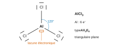
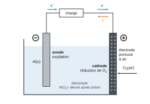
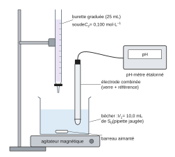
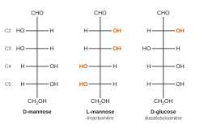

# G2E BCPST — Chimie 2026 · Corrigé brut

*Corrigé rédigé par IA, non officiel. Signalez toute erreur.*

Épreuve de 3 heures, calculatrice autorisée. 33 questions.

Données utilisées :

- masses molaires (en $\mathrm{g\cdot mol^{-1}}$) : H 1,0 ; O 16 ; Al 27 ; Cl 35,5 ;
- $R=8{,}31\ \mathrm{J\cdot mol^{-1}\cdot K^{-1}}$ et $\mathcal F=96500\ \mathrm{C\cdot mol^{-1}}$ ;
- $K_e=10^{-14}$ ;
- $\log\beta=34$ pour $[\mathrm{Al(OH)_4}]^-$.

## 1. Autour de l'aluminium

### 1.1. Propriétés électroniques de l'aluminium

**Question 1.** Deux nucléides sont **isotopes** s'ils ont le même numéro atomique $Z$ (même nombre de protons, donc même élément) et des nombres de masse $A$ différents, donc des nombres de neutrons $N=A-Z$ différents.

Pour $^{27}_{13}\mathrm{Al}$, on lit $Z=13$ et $A=27$. Le noyau compte donc $N=27-13=14$ neutrons.

$$\boxed{\text{noyau de } {}^{27}_{13}\mathrm{Al} : 13 \text{ protons et } 14 \text{ neutrons } (27 \text{ nucléons})}$$

**Question 2.** On remplit les sous-couches dans l'ordre de Klechkowski, en respectant le principe de Pauli. Pour $Z=13$ :

$$\boxed{\mathrm{Al} : 1s^2\,2s^2\,2p^6\,3s^2\,3p^1 = [\mathrm{Ne}]\,3s^2\,3p^1}$$

- **Électrons de cœur** : $1s^2\,2s^2\,2p^6$, soit 10 électrons (configuration du néon).
- **Électrons de valence** : $3s^2\,3p^1$, soit 3 électrons (couche $n=3$, la plus externe).

**Position.** Le nombre quantique principal le plus élevé est $n=3$, d'où la **3e période**. La sous-couche en cours de remplissage est une $3p$ : l'élément est dans le **bloc p**. On compte 2 colonnes pour le bloc s, 10 pour le bloc d, puis 1 électron p, soit $2+10+1=13$ :

$$\boxed{\text{période } 3,\ \text{colonne } 13}$$

**Question 3.** En perdant ses trois électrons de valence, l'aluminium donne $\mathrm{Al^{3+}}$, de configuration $1s^2\,2s^2\,2p^6$. C'est celle du néon, un gaz noble : la couche externe est saturée, ce qui rend cet ion particulièrement stable. L'aluminium est un métal peu électronégatif, il perd donc facilement ces 3 électrons faiblement liés. Une quatrième ionisation arracherait un électron $2p$ du cœur, ce qui coûte beaucoup plus d'énergie. **L'ion stable est donc $\mathrm{Al^{3+}}$, isoélectronique du néon.**

**Question 4.** Électrons de valence : $3+3\times7=24$, soit 12 doublets.

- Schéma de Lewis : Al central, trois liaisons simples Al–Cl, trois doublets non liants sur chaque Cl. Al n'est entouré que de 6 électrons : on dessine une **lacune électronique** sur Al. Toutes les charges formelles sont nulles.
- Autour de Al : 3 doublets liants, aucun doublet non liant, d'où le type VSEPR $\mathrm{AX_3E_0}$.

$$\boxed{\mathrm{AlCl_3} : \text{géométrie triangulaire plane autour de Al, angles } \widehat{\mathrm{ClAlCl}}=120^\circ}$$

La lacune fait de $\mathrm{AlCl_3}$ un acide de Lewis. Elle explique le dimère $\mathrm{Al_2Cl_6}$ : un doublet d'un Cl pontant comble la lacune du Al voisin, et chaque Al devient tétraédrique.

### 1.2. Obtention de l'alumine à partir de la bauxite par le procédé Bayer

**Question 5.** Règles de lecture : le nombre d'oxydation (n.o.) de l'élément croît quand on monte dans le diagramme. À n.o. fixé, on passe en allant vers la droite (pH croissant) du cation à l'hydroxyde, puis à l'hydroxo-complexe anionique.

- **Fer** : n.o. +III pour $\mathrm{Fe^{3+}}$ et $\mathrm{Fe(OH)_3}$ ; n.o. +II pour $\mathrm{Fe^{2+}}$ et $\mathrm{Fe(OH)_2}$ ; n.o. 0 pour Fe.
  - Le domaine D est la bande étroite comprise, pour pH > 7,5, entre les frontières $\mathrm{Fe(OH)_3/Fe(OH)_2}$ et $\mathrm{Fe(OH)_2/Fe}$.
  - Le domaine E est situé sous $E\approx-0{,}44$ V.
- **Aluminium** : n.o. +III pour $\mathrm{Al^{3+}}$, $\mathrm{Al(OH)_3}$ et $[\mathrm{Al(OH)_4}]^-$, séparés par les verticales pH = 4 et pH = 10 (amphotérie de l'hydroxyde) ; n.o. 0 pour Al, tout en bas.

On parle de domaine de **prédominance** pour une espèce dissoute et de domaine d'**existence** pour un solide.

| Domaine | Espèce | n.o. | Nature |
|---|---|---|---|
| A | $\mathrm{Fe^{3+}_{(aq)}}$ | +III | prédominance |
| B | $\mathrm{Fe(OH)_{3(s)}}$ | +III | existence |
| C | $\mathrm{Fe^{2+}_{(aq)}}$ | +II | prédominance |
| D | $\mathrm{Fe(OH)_{2(s)}}$ | +II | existence |
| E | $\mathrm{Fe_{(s)}}$ | 0 | existence |
| 1 | $\mathrm{Al^{3+}_{(aq)}}$ | +III | prédominance |
| 2 | $\mathrm{Al(OH)_{3(s)}}$ | +III | existence |
| 3 | $[\mathrm{Al(OH)_4}]^-_{(aq)}$ | +III | prédominance |
| 4 | $\mathrm{Al_{(s)}}$ | 0 | existence |

**Question 6.** $\mathrm{Al(OH)_{3(s)}} = \mathrm{Al^{3+}} + 3\,\mathrm{HO^-}$, avec $K_{s,1}=[\mathrm{Al^{3+}}][\mathrm{HO^-}]^3$ (concentrations rapportées à $c^\circ$).

Sur la frontière 1/2 (pH = 4,0), le précipité apparaît. On y a :

$$\begin{aligned}
[\mathrm{Al^{3+}}] &= C_T = 1{,}0\cdot10^{-2}\\
[\mathrm{HO^-}] &= K_e/10^{-4} = 10^{-10}
\end{aligned}$$

D'où :

$$\begin{aligned}
K_{s,1} &= 1{,}0\cdot10^{-2}\times(10^{-10})^3\\
&= \boxed{1{,}0\cdot10^{-32}}\qquad(\mathrm{p}K_{s,1}=32)
\end{aligned}$$

**Question 7.** Dans la soude, l'hydroxyde amphotère se dissout en ion aluminate :

$$\boxed{\mathrm{Al(OH)_{3(s)}} + \mathrm{HO^-_{(aq)}} = [\mathrm{Al(OH)_4}]^-_{(aq)}}$$

Sa constante vaut :

$$\begin{aligned}
K_3 &= K_{s,1}\,\beta\\
&= 10^{-32}\times10^{34}\\
&= 10^{2}
\end{aligned}$$

On peut le vérifier sur la figure 1. À la frontière pH = 10, on a :

$$\begin{aligned}
\frac{[\mathrm{Al(OH)_4^-}]}{[\mathrm{HO^-}]} &= \frac{10^{-2}}{10^{-4}}\\
&= 10^{2}
\end{aligned}$$

**Question 8.** Le filtrat contient l'aluminate en milieu très basique. Quand on ajoute l'acide, le pH diminue et on quitte le domaine 3 pour entrer dans le domaine 2 à la frontière verticale :

$$\boxed{\mathrm{pH}_{\text{précipitation}}\approx10}$$

Le domaine d'existence de $\mathrm{Al(OH)_3}$ est borné des deux côtés ($4<\mathrm{pH}<10$). Si l'on ajoute trop d'acide et que le pH descend sous 4, le précipité se redissout en $\mathrm{Al^{3+}}$, et l'aluminium repart en solution. **Il faut donc maintenir $4<\mathrm{pH}<10$**, d'où l'ajout goutte à goutte sous contrôle du pH.

**Question 9.** Réaction lors de l'ajout d'acide :

$$[\mathrm{Al(OH)_4}]^- + \mathrm{H_3O^+} = \mathrm{Al(OH)_{3(s)}} + 2\,\mathrm{H_2O}$$

C'est la combinaison de deux réactions :

- l'inverse de la réaction de Q7, de constante $1/(K_{s,1}\beta)=10^{-2}$ ;
- $\mathrm{H_3O^+}+\mathrm{HO^-}=2\,\mathrm{H_2O}$, de constante $1/K_e=10^{14}$.

$$\begin{aligned}
K^\circ_1 &= \frac{1}{K_{s,1}\,\beta\,K_e}\\
&= \frac{1}{10^{-32}\times10^{34}\times10^{-14}}\\
&= \boxed{10^{12}}
\end{aligned}$$

Écrite avec $\mathrm{H^+}$ ($[\mathrm{Al(OH)_4}]^-+\mathrm{H^+}=\mathrm{Al(OH)_3}+\mathrm{H_2O}$), la réaction a la même constante. Comme $K^\circ_1\gg10^4$, **la réaction est quantitative** : chaque ajout d'acide précipite la quantité stœchiométrique d'hydroxyde. Il faut donc doser l'acide avec soin, car un excès local abaisse le pH sous 4 et redissout le solide.

**Question 10.** La séparation repose sur une **différence de solubilité** en milieu basique concentré. $\mathrm{Al(OH)_3}$ se dissout en aluminate, parce qu'il est amphotère, alors que $\mathrm{Fe(OH)_3}$ reste solide (le domaine B s'étend jusqu'à pH 14). Le fer reste donc sur le filtre et l'aluminium passe dans le filtrat : **la séparation se fait par filtration, grâce à la différence de solubilité des deux hydroxydes.**

### 1.3. Étude d'une pile électrochimique à base d'aluminium

**Question 11.**

Le pôle positif est l'électrode du couple de plus haut potentiel standard, $\mathrm{O_2/H_2O}$ ($0{,}39$ V > $-2{,}30$ V). En générateur, l'aluminium s'oxyde : c'est l'anode. Le dioxygène s'y réduit à l'autre électrode : c'est la cathode.

**Anode : l'aluminium (pôle −). Cathode : l'électrode à dioxygène (pôle +).**

Dans le circuit extérieur, les électrons vont de l'aluminium vers l'électrode à air, et le courant circule en sens inverse.

**Question 12.** Demi-équations en milieu basique :

- anode : $\mathrm{Al_{(s)}} + 3\,\mathrm{HO^-} = \mathrm{Al(OH)_{3(s)}} + 3\,e^-$ (à multiplier par 4) ;
- cathode : $\mathrm{O_{2(g)}} + 2\,\mathrm{H_2O} + 4\,e^- = 4\,\mathrm{HO^-}$ (à multiplier par 3).

$$\boxed{4\,\mathrm{Al_{(s)}} + 3\,\mathrm{O_{2(g)}} + 6\,\mathrm{H_2O_{(\ell)}} = 4\,\mathrm{Al(OH)_{3(s)}}}$$

Cette équation met en jeu $n=12$ électrons échangés.

**Question 13.** Pour la réaction de la pile écrite avec $n$ électrons échangés, les potentiels étant pris à 60 °C :

$$\begin{aligned}
\Delta_rG^\circ &= -n\mathcal F\,(E^\circ_{\text{cathode}}-E^\circ_{\text{anode}})\\
&= -n\mathcal F\,(E^\circ_2-E^\circ_1)
\end{aligned}$$

Avec $n=12$ :

$$\begin{aligned}
\Delta_rG^\circ &= -12\times96500\times(0{,}39+2{,}30)\\
&= -3{,}12\cdot10^{6}\ \mathrm{J\cdot mol^{-1}}
\end{aligned}$$

$$\boxed{\Delta_rG^\circ\approx-3{,}1\cdot10^{3}\ \mathrm{kJ\cdot mol^{-1}}}$$

À $T=60+273=333$ K, on utilise $\Delta_rG^\circ=-RT\ln K^\circ_{(C)}$ :

$$\begin{aligned}
\ln K^\circ_{(C)} &= \frac{3{,}115\cdot10^{6}}{8{,}31\times333}\\
&= 1{,}13\cdot10^{3}\\
\log K^\circ_{(C)} &= \frac{1{,}13\cdot10^{3}}{\ln 10}\\
&= 489
\end{aligned}$$

$$\boxed{K^\circ_{(C)}\approx10^{489}}$$

**Commentaire** : $K^\circ$ est gigantesque, la réaction est totale. La pile ne s'arrête pas en atteignant un équilibre, mais quand l'aluminium est épuisé (ou passivé). Ces valeurs se rapportent à l'équation écrite avec 12 électrons : avec d'autres coefficients, $\Delta_rG^\circ$ et $\log K^\circ$ changent dans la même proportion.

**Question 14.** La capacité électrique est la charge débitée :

$$\begin{aligned}
Q &= I\,\Delta t\\
&= 6{,}0\times4{,}3\cdot10^{4}\\
&= 2{,}58\cdot10^{5}\ \mathrm{C}
\end{aligned}$$

$$\boxed{Q\approx2{,}6\cdot10^{5}\ \mathrm{C}\ \ (\text{soit environ } 72\ \mathrm{A\cdot h})}$$

La quantité d'électrons vaut $n(e^-)=Q/\mathcal F=2{,}67$ mol. La demi-équation anodique cède 3 électrons par atome d'aluminium :

$$\begin{aligned}
n(\mathrm{Al}) &= \frac{n(e^-)}{3}\\
&= 0{,}891\ \mathrm{mol}\\
m_\mathrm{Al} &= n(\mathrm{Al})\,M(\mathrm{Al})\\
&= \frac{I\,\Delta t\,M(\mathrm{Al})}{3\mathcal F}
\end{aligned}$$

$$\boxed{m_\mathrm{Al}\approx24\ \mathrm{g}}$$

C'est la masse minimale à placer dans le compartiment anodique.

### 1.4. Titrage pH-métrique des ions aluminium par une solution de soude

**Question 15.** Pour préparer $\mathrm{S_0}$ par dissolution :

- balance de précision, coupelle (ou verre de montre) et spatule pour peser $m_0$ ;
- entonnoir à solide pour introduire le solide dans une **fiole jaugée de 100,0 mL** ;
- acide chlorhydrique de concentration $C_1$ (dans un bécher) pour dissoudre le solide, puis pour **compléter jusqu'au trait de jauge** avec cette même solution (pas avec de l'eau, qui changerait $C_1$) ; on bouche et on homogénéise.

**Question 16.** Montage :

Le pH-mètre est étalonné au préalable avec deux solutions tampons (par exemple pH 4 et pH 7, ou pH 7 et pH 10). Le volume versé est lu sur la burette, et on resserre les mesures près des sauts de pH.

**Question 17.** La solution titrée contient de l'acide fort en excès, de concentration $C_1$. Elle contient aussi des ions $\mathrm{Al^{3+}}$, de concentration $C_0$. La soude les consomme successivement.

- **Portion a** ($0<V<2$ mL ; pH de 1,7 à 3,7) : la soude titre l'acide fort en excès, $\mathrm{H_3O^+}+\mathrm{HO^-}\to2\,\mathrm{H_2O}$, et le pH augmente lentement. La solution reste limpide.
- **Point b** ($V\approx2{,}0$ mL ; pH ≈ 3,7) : l'acide fort est entièrement consommé, et la solution atteint le pH où $\mathrm{Al(OH)_3}$ commence à précipiter. Le précipité blanc apparaît. Le premier saut de pH est « écrêté » par cette précipitation.
- **Palier de 2 à 11 mL** (pH ≈ 3,7 à 4,3) : précipitation, $\mathrm{Al^{3+}}+3\,\mathrm{HO^-}\to\mathrm{Al(OH)_{3(s)}}$. Tant que le solide et $\mathrm{Al^{3+}}$ coexistent, $[\mathrm{HO^-}]^3=K_{s,1}/[\mathrm{Al^{3+}}]$ et le pH reste presque constant.
- **Portion c** (à partir de 11 mL) : le dernier ion $\mathrm{Al^{3+}}$ est consommé, ce qui produit le grand saut de pH (de 4 à environ 10). Ensuite, le précipité commence à se redissoudre, $\mathrm{Al(OH)_{3(s)}}+\mathrm{HO^-}\to[\mathrm{Al(OH)_4}]^-$. Le pH est de nouveau presque constant (environ 10,3 à 11), et le trouble diminue.
- **Portion d** ($V\approx14$ mL, puis au-delà) : le dernier grain de solide disparaît et la solution redevient limpide (point anguleux à 14,0 mL). Au-delà, la soude est en excès et le pH monte lentement vers 12, parce que la soude ajoutée est diluée dans un volume croissant.

**Attribution des courbes.** La courbe ② vaut 100 % à 2 mL et décroît jusqu'à 0 % à 11 mL, au rythme de la précipitation : **② = $\mathrm{Al^{3+}_{(aq)}}$**. La courbe ③ naît à 11 mL et croît pendant la redissolution : **③ = $[\mathrm{Al(OH)_4}]^-_{(aq)}$**.

**Question 18.** Réactions support de titrage, dans l'ordre :

$$\begin{aligned}
&(\mathrm R_1)\quad \mathrm{H_3O^+}+\mathrm{HO^-}=2\,\mathrm{H_2O} && K=1/K_e=10^{14}\\
&(\mathrm R_2)\quad \mathrm{Al^{3+}}+3\,\mathrm{HO^-}=\mathrm{Al(OH)_{3(s)}} && K=1/K_{s,1}=10^{32}\\
&(\mathrm R_3)\quad \mathrm{Al(OH)_{3(s)}}+\mathrm{HO^-}=[\mathrm{Al(OH)_4}]^- && K=K_{s,1}\beta=10^{2}
\end{aligned}$$

$\mathrm R_1$ et $\mathrm R_2$ sont quantitatives. $\mathrm R_3$ a une constante plus modeste, mais elle est déplacée par l'excès de $\mathrm{HO^-}$.

On lit les volumes équivalents aux ruptures de la courbe ① et aux extrémités de la courbe ② :

$$\boxed{V_{\text{éq},1}=2{,}0\ \mathrm{mL}\ \ (\text{fin de }\mathrm R_1)}$$

$$\boxed{V_{\text{éq},2}=11{,}0\ \mathrm{mL}\ \ (\text{fin de }\mathrm R_2)}$$

La fin de $\mathrm R_3$ se lit au point d, $V_3\approx14{,}0$ mL.

**Question 19.** À la première équivalence, $C_1V_1=C_2V_{\text{éq},1}$ :

$$\begin{aligned}
C_1 &= \frac{0{,}100\times2{,}0}{10{,}0}\\
&= \boxed{2{,}0\cdot10^{-2}\ \mathrm{mol\cdot L^{-1}}}
\end{aligned}$$

Ce résultat est cohérent avec le pH initial : $-\log(2{,}0\cdot10^{-2})=1{,}7$.

Entre les deux équivalences, $\mathrm R_2$ consomme trois ions hydroxyde par ion aluminium. On a donc :

$$3\,C_0V_1=C_2(V_{\text{éq},2}-V_{\text{éq},1})$$

$$\begin{aligned}
C_0 &= \frac{0{,}100\times(11{,}0-2{,}0)}{3\times10{,}0}\\
&= \boxed{3{,}0\cdot10^{-2}\ \mathrm{mol\cdot L^{-1}}}
\end{aligned}$$

Contrôle : $\mathrm R_3$ consomme $C_0V_1/C_2=3{,}0$ mL de soude, et la redissolution doit donc finir à $14{,}0$ mL. C'est bien l'abscisse du point d. La courbe ③ du document atteint 100 % un peu plus loin, vers 14,5 mL, ce qui relève de l'imprécision du tracé.

**Question 20.** Chaque mole de $\mathrm{AlCl_3,6H_2O}$ libère une mole de $\mathrm{Al^{3+}}$, d'où $n_0=C_0V_0=3{,}0\cdot10^{-3}$ mol. La masse molaire du solide hydraté vaut :

$$M=27+3\times35{,}5+6\times18=241{,}5\ \mathrm{g\cdot mol^{-1}}$$

$$\begin{aligned}
m_0 &= C_0V_0M\\
&= 3{,}0\cdot10^{-3}\times241{,}5
\end{aligned}$$

$$\boxed{m_0\approx0{,}72\ \mathrm{g}}$$

**Question 21.** Tant que le solide est présent, $[\mathrm{Al^{3+}}]=K_{s,1}/[\mathrm{HO^-}]^3$, d'où :

$$\begin{aligned}
\beta &= \frac{[\mathrm{Al(OH)_4^-}]}{[\mathrm{Al^{3+}}][\mathrm{HO^-}]^4}\\
&= \frac{1}{K_{s,1}}\cdot\frac{[\mathrm{Al(OH)_4^-}]}{[\mathrm{HO^-}]}\\
&= \frac{K_3}{K_{s,1}}
\end{aligned}$$

**$K_{s,1}$ au point b** (début de la précipitation, $V=2{,}0$ mL, pH ≈ 3,7). On a $[\mathrm{HO^-}]=10^{-10{,}3}$ et :

$$\begin{aligned}
[\mathrm{Al^{3+}}] &= \frac{C_0V_1}{V_1+V}\\
&= \frac{3{,}0\cdot10^{-4}}{12\cdot10^{-3}}\\
&= 2{,}5\cdot10^{-2}\\
K_{s,1} &\approx 2{,}5\cdot10^{-2}\times10^{-30{,}9}\\
&\approx 10^{-32{,}5}
\end{aligned}$$

**$K_3$ au point d** ($V=14{,}0$ mL, pH ≈ 11,0, dernier grain de solide). Tout l'aluminium est sous forme d'aluminate, et $[\mathrm{HO^-}]=10^{-3{,}0}$ :

$$\begin{aligned}
[\mathrm{Al(OH)_4^-}] &= \frac{3{,}0\cdot10^{-4}}{24\cdot10^{-3}}\\
&= 1{,}25\cdot10^{-2}\\
K_3 &= \frac{[\mathrm{Al(OH)_4^-}]}{[\mathrm{HO^-}]}\\
&\approx 12\\
\log K_3 &\approx 1{,}1
\end{aligned}$$

On en déduit :

$$\begin{aligned}
\log\beta &= \log K_3+\mathrm{p}K_{s,1}\\
&\approx 1{,}1+32{,}5
\end{aligned}$$

$$\boxed{\log\beta\approx33{,}5,\ \text{compatible avec la valeur } 34 \text{ à la précision de lecture}}$$

Un point au milieu de la redissolution confirme ce résultat. À $V=12{,}5$ mL, le pH vaut environ 10,9 et :

$$\begin{aligned}
[\mathrm{Al(OH)_4^-}] &= \frac{1{,}5\cdot10^{-4}}{22{,}5\cdot10^{-3}}\\
&= 6{,}7\cdot10^{-3}
\end{aligned}$$

On trouve alors $\log K_3\approx0{,}9$. Si l'on prend $K_{s,1}=10^{-32}$ (Q6), on obtient $\log\beta\approx33$. Comme $\log\beta$ varie d'une unité par unité d'erreur sur le pH lu, la lecture graphique ne fixe $\log\beta$ qu'à ±0,5 environ.

## 2. Synthèse de la brévétoxine B, une approche rétrosynthétique

### 2.1. Étude structurale de la molécule de départ

**Question 22.** Forme linéaire : $\mathrm{OHC{-}CH(OH){-}CH(OH){-}CH(OH){-}CH(OH){-}CH_2OH}$. C1 (aldéhyde, $sp^2$) et C6 ($\mathrm{CH_2}$) ne sont pas stéréogènes. C2, C3, C4 et C5 portent chacun H, OH et deux chaînes carbonées différentes :

$$\boxed{\text{centres stéréogènes : C2, C3, C4, C5}}$$

Les deux extrémités de la chaîne sont différentes, donc aucun composé méso n'est possible :

$$\boxed{2^4=16 \text{ stéréoisomères de configuration}}$$

En projection de Fischer (CHO en haut, liaisons horizontales vers l'avant), l'énantiomère s'obtient en inversant les 4 centres (L-mannose) et un diastéréoisomère en n'en inversant qu'une partie, par exemple C2 seul (D-glucose) :

**Question 23.**

- **C2** : $\mathrm{OH}$ (O) > C1 $(\mathrm{O,O,H})$, la double liaison C=O étant dupliquée, > C3 $(\mathrm{O,C,H})$ > H. En Fischer, OH est à gauche, C1 en haut, C3 en bas et H à droite, vers l'avant. Le sens OH → C1 → C3 est horaire, et il faut l'inverser puisque H pointe vers l'observateur : **C2 est (S)**.
- **C5** : $\mathrm{OH}$ > C4 $(\mathrm{O,C,H})$ > C6 $(\mathrm{O,H,H})$ > H. OH est à droite, C4 en haut et C6 en bas. Le sens est antihoraire, à inverser : **C5 est (R)**.

$$\boxed{\mathrm{C2}:(S)\qquad \mathrm{C5}:(R)}\qquad(\text{D-mannose} = (2S,3S,4R,5R))$$

**Question 24.** *Mécanisme (catalyse acide, hémiacétalisation intramoléculaire)* :

1. Protonation de l'oxygène du carbonyle C1 par $\mathrm{H^+}$. On obtient un ion oxonium, et C1 devient beaucoup plus électrophile (forme mésomère carbocationique).
2. Addition nucléophile intramoléculaire : un doublet non liant de l'oxygène de l'hydroxyle de C5 attaque C1 (flèche du doublet de O5 vers C1, flèche de la liaison π C=O vers l'oxygène). Cela forme un cycle à 6 atomes (5 C et 1 O) qui porte un oxonium sur O5.
3. Déprotonation de O5 (par $\mathrm{H_2O}$), qui régénère le catalyseur et donne l'hémiacétal cyclique, le D-mannopyranose.

C1, plan avant l'attaque, peut être attaqué par ses deux faces. On obtient donc les deux anomères. L'α-D-mannopyranose est celui dont l'OH anomérique est en bas en projection de Haworth (trans par rapport à $\mathrm{CH_2OH}$).

*Anomère le plus stable.* Dans la chaise ${}^4C_1$, l'OH anomérique est axial pour α et équatorial pour β. L'argument stérique seul favoriserait β. Pour le mannose, deux effets jouent pourtant en faveur de α. D'une part, l'**effet anomère** stabilise un substituant électronégatif axial en C1 : un doublet de l'oxygène du cycle est antipériplanaire à la liaison C1–O. D'autre part, l'OH de C2 est lui-même axial, et dans β les liaisons C1–O1 et C2–O2 voisines sont toutes deux orientées vers le même côté, ce qui rapproche leurs dipôles. À l'équilibre en solution aqueuse, on trouve environ 2/3 de α :

$$\boxed{\text{l'anomère }\alpha\text{ est le plus stable (}\approx 67\ \%\text{ à l'équilibre)}}$$

Le D-glucose se comporte à l'inverse : tous ses substituants peuvent être équatoriaux, et c'est β qui domine.

### 2.2. Étude de la synthèse du synthon 4

**Numérotation adoptée** (celle du sucre) : C1 porte la chaîne allyle, C2, C3 et C4 portent les hydroxyles de A, C5 porte $\mathrm{C6H_2O}$–, et l'oxygène du cycle est l'ancien O5. Dans l'orientation de la figure 5, l'oxygène du cycle est en bas, C1 en bas à gauche, C2 en haut à gauche, C3 en haut, C4 en haut à droite et C5 en bas à droite. Dans A, les OH de C2 et C3 et le groupe $\mathrm{CH_2OH}$ sont en coin plein, l'OH de C4 et l'allyle en coin hachuré.

**Question 25.** **B** est A dont seul l'alcool primaire a été silylé : $\mathrm{C6H_2{-}O{-}TBDPS}$, les trois OH secondaires de C2, C3 et C4 restant libres, sans changement de stéréochimie.

$$\boxed{\mathbf B : \text{A avec } \mathrm{CH_2OH}\to\mathrm{CH_2OTBDPS}}$$

*Régiosélectivité.* Le silicium du TBDPSCl porte un tert-butyle et deux phényles, il est très encombré. Sa substitution par l'oxygène de l'alcool est donc très sensible à l'encombrement du nucléophile. L'alcool primaire, le plus accessible, réagit beaucoup plus vite que les alcools secondaires du cycle. Avec un seul équivalent, on n'obtient que la monosilylation. L'imidazole capte HCl (base) et active le chlorosilane (catalyse nucléophile).

**Question 26.** B → C protège le diol **cis** C2/C3 sous forme d'acétonide (2,2-diméthyl-1,3-dioxolane fusionné au cycle). Seul ce diol est cis : les OH de C2 et C3 sont du même côté. L'OH de C4 est trans par rapport à celui de C3.

$$\boxed{\text{propanone (ou 2,2-diméthoxypropane), APTS catalytique, solvant anhydre, élimination de l'eau (ou du méthanol)}}$$

L'acétalisation est équilibrée. On la déplace en éliminant l'eau (tamis moléculaire, Dean-Stark) ou en utilisant le 2,2-diméthoxypropane, qui libère du méthanol. On reste à température modérée pour préserver l'éther silylé.

**Question 27.** D → E est l'hydrolyse de l'acétonide (déprotection du diol cis C2/C3). On la conduit en **milieu aqueux acide**, avec une catalyse acide douce et de l'eau en excès pour déplacer l'équilibre : par exemple acide acétique aqueux (AcOH/$\mathrm{H_2O}$) en chauffant légèrement, ou APTS catalytique dans MeOH/$\mathrm{H_2O}$. On évite un acide fort concentré à chaud, qui couperait l'éther silylé.

*Mécanisme* (deux oxygènes de l'acétal, notés O2 et O3 ; $\mathrm{C^*}$ = carbone de l'acétonide) :

1. Protonation de O3 par $\mathrm{H_3O^+}$.
2. Rupture de la liaison $\mathrm{C^*}$–O3 : le doublet de la liaison part sur O3, ce qui libère l'OH de C3. On obtient l'ion oxocarbénium $\mathrm{C2{-}O^+{=}C(CH_3)_2}$, stabilisé par mésomérie avec le doublet de O2.
3. Addition nucléophile de $\mathrm{H_2O}$ sur $\mathrm{C^*}$, puis départ d'un proton : on obtient un hémiacétal $\mathrm{C2{-}O{-}C(CH_3)_2{-}OH}$.
4. Protonation de O2, puis rupture $\mathrm{C^*}$–O2 assistée par le doublet de l'OH : l'OH de C2 est libéré et on obtient de la propanone protonée.
5. Déprotonation : on obtient la propanone et le catalyseur est régénéré.

Aucune liaison des carbones C2 et C3 n'est rompue, et leurs configurations sont conservées. **E** est le diol cis C2/C3, avec $\mathrm{CH_2}$ en C4 et $\mathrm{CH_2OTBDPS}$ en C6.

**Question 28.** G porte la cétone en C2 et le groupe OBn en C3. La benzylation a donc eu lieu sur l'OH de C3, et l'OH de C2 est resté libre :

$$\boxed{\mathbf F : \text{OBn en C3 (coin plein), OH libre en C2 (coin plein), } \mathrm{CH_2} \text{ en C4, allyle en C1, } \mathrm{CH_2OTBDPS} \text{ en C5}}$$

*Mécanisme* (synthèse de Williamson, en deux temps) :

1. **Acide-base** : LDA, base forte et peu nucléophile car encombrée, arrache le proton de l'OH de C3 ($\mathrm{R{-}OH}+\mathrm{iPr_2N^-}\to\mathrm{R{-}O^-}+\mathrm{iPr_2NH}$, quantitative car $\mathrm{p}K_a(\mathrm{iPr_2NH})\approx36\gg\mathrm{p}K_a(\mathrm{ROH})\approx16$).
2. **$\mathrm{S_N2}$** : l'alcoolate attaque le carbone benzylique de $\mathrm{BnBr}$ par l'arrière de la liaison C–Br, et l'ion bromure part en même temps. Ce carbone primaire et benzylique est très réactif en $\mathrm{S_N2}$.

L'OH de C3 n'a pour voisin que le $\mathrm{CH_2}$ de C4. C'est le moins encombré des deux, alors que l'OH de C2 est voisin de C1, qui porte l'allyle. Le choix est confirmé par la structure de G.

**Question 29.** F → G transforme l'alcool secondaire de C2 en cétone. On calcule le n.o. de C2, en attribuant les électrons de chaque liaison à l'atome le plus électronégatif ($\mathrm{O}>\mathrm{C}>\mathrm{H}$, rien pour C–C). Dans F, C2 a une liaison C–O (+1), une liaison C–H (−1) et deux liaisons C–C : son n.o. vaut **0**. Dans G, C2 a une liaison C=O (+2) et deux liaisons C–C : son n.o. vaut **+II**.

$$\boxed{\Delta\text{n.o.}(\mathrm{C2})=+2 : \text{F}\to\text{G est une oxydation}}$$

La demi-équation s'écrit $\mathrm{R_2CHOH}=\mathrm{R_2C{=}O}+2\,\mathrm{H^+}+2\,e^-$. L'oxydant $\mathrm{CrO_3}$/pyridine (réactif de Collins, Cr +VI) est réduit en Cr(III). Le milieu non acide préserve l'éther silylé.

**Question 30.** $\mathrm{CH_3MgBr}$ s'additionne sur la cétone de C2. On obtient un **alcool tertiaire** en C2, qui porte OH et $\mathrm{CH_3}$. Les autres groupes ne changent pas : OBn en C3, allyle en C1, $\mathrm{CH_2OTBDPS}$ en C5.

Classement CIP en C2 : OH (1) > C1 (2) > C3 (3) > $\mathrm{CH_3}$ (4). C1 et C3 sont tous deux $(\mathrm{O,C,H})$, puis leurs oxygènes portent chacun un C. On départage à la sphère suivante : par l'oxygène du cycle, C1 mène à C5 $(\mathrm{C,C,H})$, alors que par l'oxygène benzylique, C3 mène à $\mathrm{CH_2Ph}$ $(\mathrm{C,H,H})$. Donc C1 > C3.

Dans l'orientation de la figure 5, on place $\mathrm{CH_3}$ (priorité 4) en coin hachuré et OH en coin plein. Le parcours OH → C1 → C3 est alors antihoraire, ce qui donne bien la configuration (S).

$$\boxed{\mathbf H : \text{C2 porte OH en coin plein (même côté que OBn) et } \mathrm{CH_3} \text{ en coin hachuré, C2 de configuration } (S)}$$

**Question 31.** *Mécanisme* :

1. **Addition nucléophile** : la liaison C–Mg est polarisée $\mathrm{C^{\delta-}{-}Mg^{\delta+}}$ ($\chi(\mathrm{Mg})\approx1{,}3<\chi(\mathrm{C})\approx2{,}5$). Le doublet de la liaison $\mathrm{H_3C{-}Mg}$ attaque le carbone électrophile du carbonyle, et le doublet π de C=O bascule sur l'oxygène. Le magnésium, acide de Lewis, se coordonne à l'oxygène. On obtient un alcoolate de bromomagnésium $\mathrm{R_2C(CH_3){-}O^-\,{}^+MgBr}$.
2. **Hydrolyse acide** ($\mathrm{H_2O}$, $\mathrm{H^+}$) : protonation de l'alcoolate, qui donne l'alcool tertiaire H, et dissolution des sels de magnésium.

*Précautions* :

- **milieu rigoureusement anhydre** et sans composé protique, car l'organomagnésien est une base très forte, détruite par l'eau ($\mathrm{CH_3MgBr}+\mathrm{H_2O}\to\mathrm{CH_4}+\mathrm{Mg(OH)Br}$). Il faut une verrerie séchée à l'étuve, de l'éther anhydre, une atmosphère inerte ou une garde à $\mathrm{CaCl_2}$. Le substrat ne porte d'ailleurs aucun H mobile (tous ses OH sont protégés) ;
- **ajout lent, sous agitation, dans un bain de glace**, car l'addition est exothermique et l'éther est très volatil et inflammable (pas de flamme) ;
- **hydrolyse à froid avec un acide dilué**, ajouté prudemment, parce que l'alcool tertiaire se déshydrate en milieu acide et que l'éther silylé craint l'acide.

**Question 32.** L'ion fluorure coupe l'éther silylé (banque de réactions) et libère l'alcool primaire, sans toucher à l'éther benzylique, à l'alcool tertiaire ni à l'alcène :

$$\boxed{\mathbf I : \text{H avec } \mathrm{CH_2OTBDPS}\to\mathrm{CH_2OH} \text{ (OH primaire en C6, OH tertiaire en C2, OBn en C3, allyle en C1)}}$$

**Question 33.** A → B est une **protection sélective et temporaire de l'alcool primaire**. Sans elle, cet hydroxyle, le plus réactif car le moins encombré, aurait réagi :

- en B → C, il aurait pu former un acétonide avec l'OH de C4 (cycle à 6 chaînons) ;
- en E → F, il aurait été benzylé en priorité ;
- en F → G, il aurait été oxydé (en aldéhyde) ;
- en G → H, son hydrogène mobile aurait détruit l'organomagnésien.

En le masquant, on ne garde que les alcools secondaires, que la stéréochimie du substrat permet de différencier (diol cis). Le TBDPS se retire par $\mathrm{F^-}$. Cette condition n'affecte ni l'acétonide (retiré en milieu acide aqueux) ni l'éther benzylique (retiré par $\mathrm{H_2}$, Pd/C) : **les trois groupes protecteurs sont orthogonaux**. L'alcool primaire est rendu en I, prêt pour la suite (introduction de $\mathrm{R_6}$ vers le synthon 4).
