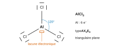
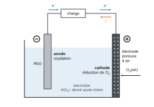
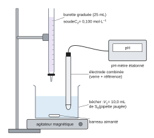
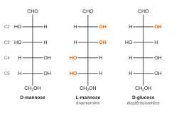

# G2E BCPST — Chimie 2026 · Corrigé guidé

*Corrigé rédigé par IA, non officiel. Signalez toute erreur.*

## Présentation du sujet

**Format** : 3 heures, calculatrice autorisée, aucun document. Le sujet fait 9 pages et compte **33 questions** numérotées de 1 à 33 sans interruption. Il est formé de deux problèmes indépendants. Les données sont regroupées en page 1 : masses molaires, constantes $R$ et $\mathcal F$, produit ionique de l'eau, et $\log\beta=34$ pour l'ion aluminate. La page 2 donne les abréviations organiques et une petite banque de réactions : benzylation et débenzylation, silylation et désilylation des alcools.

| Bloc | Questions | Contenu | Notions mobilisées |
|---|---|---|---|
| 1.1 Propriétés électroniques | Q1–Q4 | Isotopes, configuration, position dans le tableau, ion $\mathrm{Al^{3+}}$, Lewis et VSEPR de $\mathrm{AlCl_3}$ | Atomistique, règle de l'octet, lacune, VSEPR |
| 1.2 Procédé Bayer | Q5–Q10 | Lecture des diagrammes $E$-pH superposés du fer et de l'aluminium, $K_s$, amphotérie, constante d'une réaction de précipitation | Diagrammes $E$-pH, solubilité, combinaison de réactions |
| 1.3 Pile aluminium/air | Q11–Q14 | Schéma, équation de fonctionnement, $\Delta_rG^\circ$ et $K^\circ$ à 60 °C, capacité | Électrochimie, lien $\Delta_rG^\circ$ / f.é.m., loi de Faraday |
| 1.4 Titrage pH-métrique de $\mathrm{Al^{3+}}$ | Q15–Q21 | Verrerie, montage, interprétation d'une courbe à trois réactions successives, concentrations, masse, retour sur $\beta$ | Titrages, précipitation, complexation, bilans de matière |
| 2.1 D-mannose | Q22–Q24 | Stéréogénie, dénombrement, CIP, hémiacétalisation, anomères | Stéréochimie, Fischer, chaise, catalyse acide |
| 2.2 Synthèse du synthon 4 | Q25–Q33 | Protection sélective, acétonide, hydrolyse d'acétal, Williamson, oxydation, organomagnésien, désilylation | Groupes protecteurs, mécanismes au programme, n.o. en chimie organique |

**Difficulté.** Le sujet est long, mais il s'appuie presque partout sur le cours. Les vraies difficultés sont la lecture de la figure 2 (Q17–Q19 et Q21), la justification de l'anomère le plus stable (Q24) et le descripteur CIP du produit H (Q30). Il comporte six mécanismes ou schémas à dessiner (Q11, Q16, Q24, Q27, Q28, Q31), qui demandent du temps.

**Questions à ne pas laisser passer** : Q1–Q4, Q6, Q7, Q12, Q14, Q19, Q20, Q22, Q25, Q29, Q32 et Q33. Elles sont rapides et entièrement guidées par le cours ou par l'énoncé.

**Gestion du temps** : prévoir environ 1 h 45 pour le problème 1, qui compte 21 questions, et 1 h 15 pour le problème 2. La question 21 est la plus délicate du problème 1, mieux vaut la garder pour la fin.

**Mode d'emploi** : chercher seul. En cas de blocage, lire la première indication puis réessayer, et ne lire la solution qu'ensuite.

## Partie 1.1 — Propriétés électroniques de l'aluminium

Quatre questions de cours d'atomistique. Il faut justifier chaque affirmation (colonne, stabilité de l'ion, lacune) plutôt que la réciter.

### Question 1

> [!INDICATION]
> La définition porte sur le noyau : quel nombre est commun à deux isotopes, lequel diffère ?

> [!INDICATION]
> Dans l'écriture $^{A}_{Z}\mathrm{X}$, le nombre de neutrons s'obtient à partir de $A$ et $Z$.

#### Solution

Deux nucléides sont **isotopes** quand ils ont le même numéro atomique $Z$ (même nombre de protons, donc même élément chimique) et des nombres de masse $A$ différents. Ils diffèrent donc par leur nombre de neutrons $N=A-Z$. Comme ils ont le même cortège électronique, leurs propriétés chimiques sont quasi identiques.

Pour $^{27}_{13}\mathrm{Al}$, on lit $Z=13$ et $A=27$. Le noyau compte donc $N=14$ neutrons.

$$\boxed{\text{noyau de } {}^{27}_{13}\mathrm{Al} : 13 \text{ protons et } 14 \text{ neutrons}}$$

> [!PIEGE]
> On ne confond pas « même nombre de protons » avec « même nombre de nucléons ». La composition du **noyau** ne comporte pas d'électrons. On peut ajouter que l'atome neutre en porte 13, mais à part.

### Question 2

> [!INDICATION]
> Remplir les sous-couches par énergie croissante (règle de Klechkowski) jusqu'à 13 électrons.

> [!INDICATION]
> La période se lit sur le plus grand $n$. Pour la colonne, compter les colonnes des blocs s et d qui précèdent, puis les électrons de la sous-couche $p$.

#### Solution

$$\boxed{\mathrm{Al} : 1s^2\,2s^2\,2p^6\,3s^2\,3p^1=[\mathrm{Ne}]\,3s^2\,3p^1}$$

Le cœur est formé de $1s^2\,2s^2\,2p^6$ (10 électrons, configuration du néon). La valence est formée de $3s^2\,3p^1$ (3 électrons, couche $n=3$).

On a $n_{\max}=3$, d'où la **3e période**. La sous-couche en cours de remplissage est une $3p$, d'où le bloc p. Pour la colonne, on compte 2 colonnes pour le bloc s, 10 pour le bloc d, puis 1 pour l'unique électron p :

$$\boxed{\text{période }3,\ \text{colonne }13}$$

> [!METHODE]
> Pour tout élément du bloc p, la colonne vaut $12+$ (nombre d'électrons $np$), car les dix colonnes du bloc d sont comptées même aux périodes 2 et 3, où ce bloc n'existe pas encore.

### Question 3

> [!INDICATION]
> Écrire la configuration de l'ion obtenu après la perte de trois électrons et la comparer à celle d'un gaz noble.

> [!INDICATION]
> Expliquer aussi pourquoi l'aluminium perd des électrons plutôt qu'il n'en gagne, et pourquoi il s'arrête à trois.

#### Solution

$\mathrm{Al}\to\mathrm{Al^{3+}}+3\,e^-$ : l'ion a la configuration $1s^2\,2s^2\,2p^6$, celle du **néon**. Sa couche externe est saturée, ce qui le rend stable. L'aluminium est un métal peu électronégatif : ses trois électrons de valence, faiblement liés, sont facilement cédés. Gagner cinq électrons serait très défavorable. Une quatrième ionisation arracherait un électron $2p$ du cœur, et l'énergie à fournir serait beaucoup plus grande. **L'ion stable est donc $\mathrm{Al^{3+}}$, isoélectronique du néon.**

### Question 4

> [!INDICATION]
> Compter les électrons de valence de la molécule, puis les répartir en doublets liants et non liants.

> [!INDICATION]
> Combien d'électrons entourent l'aluminium ? Qu'est-ce que cela impose de dessiner ? Pour la géométrie, déterminer le type $\mathrm{AX}_n\mathrm{E}_p$.

#### Solution

Il y a $3+3\times7=24$ électrons de valence, soit 12 doublets : 3 doublets liants Al–Cl et 3 doublets non liants sur chaque Cl. Al n'est entouré que de 6 électrons, ce qu'on représente par une **lacune électronique** (rectangle vide) sur Al. Toutes les charges formelles sont nulles.

Autour de Al on trouve 3 doublets liants et aucun non liant, d'où le type $\mathrm{AX_3E_0}$ :

$$\boxed{\text{géométrie triangulaire plane, angles }120^\circ}$$

> [!METHODE]
> Une lacune électronique indique un acide de Lewis. Ici, elle explique le dimère $\mathrm{Al_2Cl_6}$ cité par l'énoncé : un Cl pontant cède un doublet au Al voisin, et chaque Al devient tétraédrique, de type $\mathrm{AX_4}$.

> [!PIEGE]
> N'ajoutez pas de double liaison Al=Cl pour « compléter l'octet » : elle placerait une charge formelle négative sur Al et une positive sur Cl, ce qui contredit les électronégativités.

## Partie 1.2 — Obtention de l'alumine par le procédé Bayer

La figure 1 superpose deux diagrammes $E$-pH. Tout le procédé Bayer se lit sur l'amphotérie de $\mathrm{Al(OH)_3}$ : l'hydroxyde se dissout en milieu très basique, alors que $\mathrm{Fe(OH)_3}$ reste solide.

### Question 5

> [!INDICATION]
> Commencer par classer les espèces de chaque élément par nombre d'oxydation : le n.o. croît vers le haut du diagramme.

> [!INDICATION]
> À n.o. égal, les espèces se rangent de gauche à droite du cation libre vers l'hydroxyde, puis vers l'hydroxo-complexe. Repérer combien de frontières verticales coupent chaque étage.

#### Solution

- **Fer** : n.o. +III pour $\mathrm{Fe^{3+}}$ et $\mathrm{Fe(OH)_3}$ ; n.o. +II pour $\mathrm{Fe^{2+}}$ et $\mathrm{Fe(OH)_2}$ ; n.o. 0 pour Fe. L'étage +III est coupé par la verticale pH = 2 (A à gauche, B à droite). L'étage +II est coupé à pH ≈ 7,5 (C à gauche, D à droite). La bande étroite D est comprise entre les deux droites obliques au-delà de pH 7,5, et E est en bas.
- **Aluminium** : n.o. +III pour $\mathrm{Al^{3+}}$, $\mathrm{Al(OH)_3}$ et $[\mathrm{Al(OH)_4}]^-$, séparés par deux verticales (pH 4 et pH 10), et n.o. 0 pour Al, en bas.

| Domaine | Espèce | Nature |
|---|---|---|
| A | $\mathrm{Fe^{3+}}$ | prédominance |
| B | $\mathrm{Fe(OH)_{3(s)}}$ | existence |
| C | $\mathrm{Fe^{2+}}$ | prédominance |
| D | $\mathrm{Fe(OH)_{2(s)}}$ | existence |
| E | $\mathrm{Fe_{(s)}}$ | existence |
| 1 | $\mathrm{Al^{3+}}$ | prédominance |
| 2 | $\mathrm{Al(OH)_{3(s)}}$ | existence |
| 3 | $[\mathrm{Al(OH)_4}]^-$ | prédominance |
| 4 | $\mathrm{Al_{(s)}}$ | existence |

> [!PIEGE]
> Un solide n'a pas de domaine de « prédominance » : il existe ou il n'existe pas. On réserve le mot « prédominance » aux espèces dissoutes.

### Question 6

> [!INDICATION]
> Sur quelle frontière le produit de solubilité intervient-il ? Quelle est alors la concentration de l'ion dissous ?

> [!INDICATION]
> Passer du pH à $[\mathrm{HO^-}]$ avec $K_e$, sans oublier l'exposant de l'équation de dissolution.

#### Solution

$\mathrm{Al(OH)_{3(s)}}=\mathrm{Al^{3+}}+3\,\mathrm{HO^-}$, avec $K_{s,1}=[\mathrm{Al^{3+}}][\mathrm{HO^-}]^3$.

Sur la frontière 1/2 (pH 4,0), le solide apparaît alors que tout l'aluminium dissous est sous forme $\mathrm{Al^{3+}}$. On y a donc :

$$\begin{aligned}
[\mathrm{Al^{3+}}] &= C_T = 10^{-2}\\
[\mathrm{HO^-}] &= 10^{-10}
\end{aligned}$$

$$\begin{aligned}
K_{s,1} &= 10^{-2}\times(10^{-10})^3\\
&= \boxed{1{,}0\cdot10^{-32}}
\end{aligned}$$

> [!METHODE]
> Sur la frontière entre une espèce dissoute et un solide, la concentration de l'espèce dissoute vaut la concentration de tracé $C_T$, sans partage par moitié. Le partage $C_T/2$ ne concerne que deux espèces dissoutes.

### Question 7

> [!INDICATION]
> Le réactif apporte des ions $\mathrm{HO^-}$ et le produit est l'ion aluminate de l'énoncé.

#### Solution

$$\boxed{\mathrm{Al(OH)_{3(s)}}+\mathrm{HO^-_{(aq)}}=[\mathrm{Al(OH)_4}]^-_{(aq)}}$$

L'équation est équilibrée en Al, O, H et en charge. Sa constante vaut $K_3=K_{s,1}\beta=10^{2}$.

C'est cohérent avec la frontière pH = 10, où le rapport $[\mathrm{Al(OH)_4^-}]/[\mathrm{HO^-}]$ vaut $10^{-2}/10^{-4}$, soit $10^2$.

> [!PIEGE]
> Respectez la notation $[\mathrm{Al(OH)_4}]^-$ imposée par l'énoncé (pas $\mathrm{AlO_2^-}$). Le solide n'apparaît pas dans l'expression de la constante.

### Question 8

> [!INDICATION]
> Ajouter de l'acide fait baisser le pH : sur la figure 1, dans quel sens se déplace-t-on et quelle frontière franchit-on ?

> [!INDICATION]
> Le domaine du solide est borné des deux côtés. Que se passe-t-il si l'on va trop loin ?

#### Solution

On part du domaine 3 (aluminate) et l'on entre dans le domaine 2 en franchissant la verticale :

$$\boxed{\mathrm{pH}_{\text{précipitation}}\approx10}$$

Si l'ajout d'acide amène le pH sous 4, on entre dans le domaine 1 : l'hydroxyde se redissout en $\mathrm{Al^{3+}}$ et l'aluminium repart en solution. **Il faut rester dans la fenêtre $4<\mathrm{pH}<10$**, d'où un ajout goutte à goutte sous contrôle du pH.

> [!METHODE]
> Un hydroxyde amphotère n'existe que dans une fenêtre de pH. Toute précipitation sélective impose de connaître ses deux bornes.

### Question 9

> [!INDICATION]
> Écrire la réaction entre l'ion aluminate et l'acide qui redonne le précipité.

> [!INDICATION]
> L'obtenir comme combinaison de réactions de constantes connues : dissolution, complexation, autoprotolyse de l'eau.

#### Solution

$$[\mathrm{Al(OH)_4}]^-+\mathrm{H_3O^+}=\mathrm{Al(OH)_{3(s)}}+2\,\mathrm{H_2O}$$

Cette réaction est la somme de deux réactions :

- $[\mathrm{Al(OH)_4}]^-=\mathrm{Al(OH)_3}+\mathrm{HO^-}$, de constante $1/(K_{s,1}\beta)=10^{-2}$ ;
- $\mathrm{H_3O^+}+\mathrm{HO^-}=2\,\mathrm{H_2O}$, de constante $1/K_e=10^{14}$.

$$\begin{aligned}
K^\circ_1 &= \frac{1}{K_{s,1}\,\beta\,K_e}\\
&= \boxed{10^{12}}
\end{aligned}$$

On obtient la même valeur en écrivant $\mathrm{H^+}$ au lieu de $\mathrm{H_3O^+}$. Comme $K^\circ_1\gg10^4$, la réaction est **quantitative** : chaque goutte d'acide précipite de l'hydroxyde, et un excès local d'acide redissout le solide (Q8).

> [!METHODE]
> Pour la constante d'une réaction « composée », on écrit l'équation cherchée comme somme d'équations connues. Les constantes se multiplient, et une équation inversée fait intervenir l'inverse de sa constante.

### Question 10

> [!INDICATION]
> Dans le document 2, quelle opération sépare le fer de l'aluminium ?

> [!INDICATION]
> On demande une propriété **physique** : qu'est-ce qui distingue les deux hydroxydes dans la soude concentrée ?

#### Solution

La séparation se fait par **filtration**. Dans la soude concentrée, $\mathrm{Fe(OH)_3}$ reste solide (le domaine B s'étend jusqu'à pH 14) et il est retenu par le filtre. L'aluminium est passé en solution sous forme d'aluminate et traverse le filtre. La propriété physique en jeu est la **différence de solubilité** des deux hydroxydes en milieu basique. Son origine chimique est l'amphotérie de $\mathrm{Al(OH)_3}$.

> [!PIEGE]
> « Amphotérie » est une propriété chimique. Elle explique la différence de solubilité, mais ne répond pas seule à la question.

## Partie 1.3 — Étude d'une pile aluminium/air

Cette partie demande un schéma, une équation-bilan, puis la thermodynamique (lien entre $\Delta_rG^\circ$ et f.é.m.) et la loi de Faraday. Attention à la température de 60 °C.

### Question 11

> [!INDICATION]
> Le pôle positif est l'électrode du couple de plus haut potentiel.

> [!INDICATION]
> Anode et cathode se définissent par la réaction qui s'y produit, pas par le signe du pôle.

#### Solution

Comme $E^\circ_2=0{,}39\ \mathrm V>E^\circ_1=-2{,}30$ V, l'électrode à dioxygène est le pôle +. En générateur, l'aluminium s'oxyde, c'est l'**anode** (pôle −). Le dioxygène se réduit, c'est la **cathode** (pôle +).

**Anode : l'aluminium (pôle −). Cathode : l'électrode à dioxygène (pôle +).**

> [!PIEGE]
> « Anode = pôle + » n'est vrai que pour un électrolyseur. Pour une pile, la règle sûre reste : anode = oxydation, cathode = réduction.

### Question 12

> [!INDICATION]
> Écrire chaque demi-équation avec $\mathrm{H_2O}$ et $\mathrm{HO^-}$ uniquement, puis égaliser les électrons.

#### Solution

- anode : $\mathrm{Al}+3\,\mathrm{HO^-}=\mathrm{Al(OH)_3}+3\,e^-$ (×4) ;
- cathode : $\mathrm{O_2}+2\,\mathrm{H_2O}+4\,e^-=4\,\mathrm{HO^-}$ (×3).

$$\boxed{4\,\mathrm{Al_{(s)}}+3\,\mathrm{O_{2(g)}}+6\,\mathrm{H_2O_{(\ell)}}=4\,\mathrm{Al(OH)_{3(s)}}}$$

Cette équation met en jeu $n=12$ électrons échangés.

> [!METHODE]
> En milieu basique, on équilibre d'abord comme en milieu acide, avec $\mathrm{H^+}$, puis on ajoute autant de $\mathrm{HO^-}$ de chaque côté et l'on simplifie l'eau. On note le nombre d'électrons échangés : la question suivante en a besoin.

### Question 13

> [!INDICATION]
> Quelle relation relie $\Delta_rG^\circ$ aux potentiels standard des deux couples ?

> [!INDICATION]
> Pour $K^\circ$, prendre la température de fonctionnement (en kelvins), et ne pas confondre $\ln$ et $\log$.

#### Solution

Pour l'équation de Q12 ($n=12$) :

$$\begin{aligned}
\Delta_rG^\circ &= -n\mathcal F(E^\circ_2-E^\circ_1)\\
&= -12\times96500\times2{,}69\\
&= -3{,}12\cdot10^{6}\ \mathrm{J\cdot mol^{-1}}
\end{aligned}$$

$$\boxed{\Delta_rG^\circ\approx-3{,}1\cdot10^{3}\ \mathrm{kJ\cdot mol^{-1}}}$$

Avec $T=333$ K et $\Delta_rG^\circ=-RT\ln K^\circ_{(C)}$ :

$$\begin{aligned}
\ln K^\circ_{(C)} &= \frac{3{,}115\cdot10^6}{8{,}31\times333}\\
&= 1{,}13\cdot10^3\\
\log K^\circ_{(C)} &= \frac{1{,}13\cdot10^3}{2{,}303}\\
&= 489
\end{aligned}$$

$$\boxed{K^\circ_{(C)}\approx10^{489}}$$

La réaction est totale. La pile cesse de fonctionner quand l'aluminium est épuisé, pas quand un équilibre est atteint.

> [!PIEGE]
> Trois erreurs sont à éviter : oublier $n$ (on trouve alors −260 kJ/mol), calculer à 298 K, et diviser par $RT$ en oubliant le facteur $\ln10$ pour passer au logarithme décimal. Un exposant de 489 n'est pas une erreur de calcul.

### Question 14

> [!INDICATION]
> La capacité d'une pile est une charge électrique. Pour la masse, passer par la quantité d'électrons, puis par la stœchiométrie de la demi-équation anodique.

#### Solution

$$\begin{aligned}
Q &= I\Delta t\\
&= 6{,}0\times4{,}3\cdot10^4\\
&= 2{,}58\cdot10^5\ \mathrm C
\end{aligned}$$

$$\boxed{Q\approx2{,}6\cdot10^5\ \mathrm C\ \ (\approx72\ \mathrm{A\cdot h})}$$

$$\begin{aligned}
m_\mathrm{Al} &= \frac{Q}{3\mathcal F}M(\mathrm{Al})\\
&= \frac{2{,}58\cdot10^5}{3\times96500}\times27
\end{aligned}$$

$$\boxed{m_\mathrm{Al}\approx24\ \mathrm g}$$

> [!PIEGE]
> Le facteur 3 vient de la demi-équation $\mathrm{Al}\to\mathrm{Al(III)}+3e^-$. Une capacité de pile s'exprime en C ou en A·h, jamais en farads.

## Partie 1.4 — Titrage pH-métrique des ions aluminium

On titre un mélange d'acide fort et d'ions $\mathrm{Al^{3+}}$ par la soude. Trois réactions se succèdent : neutralisation, précipitation, redissolution. Les courbes de pourcentage ② et ③ aident à placer les volumes caractéristiques.

### Question 15

> [!INDICATION]
> C'est une préparation par dissolution d'un solide. Quelle verrerie fixe précisément le volume final ?

> [!INDICATION]
> Avec quel liquide complète-t-on jusqu'au trait de jauge ?

#### Solution

On utilise une balance de précision, une coupelle et une spatule pour peser $m_0$. On introduit le solide avec un entonnoir dans une **fiole jaugée de 100,0 mL**. On le dissout dans de l'acide chlorhydrique de concentration $C_1$, puis on complète **avec cette même solution d'acide** jusqu'au trait de jauge. On bouche et on homogénéise.

> [!PIEGE]
> Compléter avec de l'eau distillée diluerait l'acide et fausserait $C_1$. Une éprouvette graduée n'est pas assez précise pour fixer $V_0$.

### Question 16

> [!INDICATION]
> Lister ce qui contient la solution titrante, ce qui contient la prise d'essai, comment on agite et comment on mesure le pH.

#### Solution

On étalonne le pH-mètre avec deux tampons. L'électrode trempe sans toucher le barreau, et on resserre les mesures près des sauts de pH.

> [!METHODE]
> Un schéma de titrage pH-métrique comporte cinq légendes : la burette et son contenu avec sa concentration, le bécher avec le volume prélevé et la pipette jaugée, l'agitation, l'électrode (de verre et de référence, ou combinée) et le pH-mètre étalonné.

### Question 17

> [!INDICATION]
> Deux espèces consomment $\mathrm{HO^-}$ : l'acide fort en excès et l'ion $\mathrm{Al^{3+}}$. Dans quel ordre ? Que devient ensuite le précipité ?

> [!INDICATION]
> Un pH qui reste presque constant pendant un ajout de soude signale un équilibre hétérogène qui « tamponne » la solution.

> [!INDICATION]
> Pour ② et ③, regarder où chaque courbe commence et où elle s'annule, et relier ces volumes aux réactions.

#### Solution

- **a** (0–2 mL, pH 1,7 → 3,7) : la soude titre l'acide fort ($\mathrm{H_3O^+}+\mathrm{HO^-}\to2\,\mathrm{H_2O}$). La solution reste limpide.
- **b** (2,0 mL, pH ≈ 3,7) : l'acide fort est consommé et le pH atteint le seuil de précipitation de $\mathrm{Al(OH)_3}$. Le **précipité blanc apparaît**, et le saut attendu pour l'acide fort est écrêté.
- **Palier 2–11 mL** (pH ≈ 3,7–4,3) : précipitation, $\mathrm{Al^{3+}}+3\,\mathrm{HO^-}\to\mathrm{Al(OH)_3}$. Tant que le solide coexiste avec $\mathrm{Al^{3+}}$, $[\mathrm{HO^-}]^3=K_{s,1}/[\mathrm{Al^{3+}}]$ et le pH varie très peu.
- **c** (à partir de 11 mL) : le dernier ion $\mathrm{Al^{3+}}$ disparaît, ce qui donne le grand saut de pH. Ensuite, le précipité se **redissout**, $\mathrm{Al(OH)_3}+\mathrm{HO^-}\to[\mathrm{Al(OH)_4}]^-$, sur un second palier (pH ≈ 10,3 à 11). Le trouble diminue.
- **d** (14 mL et au-delà) : le dernier grain de solide disparaît et la solution redevient limpide (point anguleux). Ensuite, la soude est en excès et le pH croît lentement.

**② = $\mathrm{Al^{3+}}$** (100 % à 2 mL, 0 % à 11 mL) ; **③ = $[\mathrm{Al(OH)_4}]^-$** (apparaît à 11 mL et croît pendant la redissolution).

> [!METHODE]
> Pour interpréter une courbe de titrage à plusieurs réactions, on range les réactions par constante décroissante. La plus favorable se fait d'abord. Chaque rupture de pente marque la fin d'une réaction, et chaque palier un système « tamponné ».

> [!PIEGE]
> Les étiquettes de la figure n'ont pas de bornes explicites. Décrivez **tous** les segments, palier 2–11 mL compris, pour que la réponse soit juste quelle que soit la lecture des lettres.

### Question 18

> [!INDICATION]
> Écrire une réaction par segment de la courbe et vérifier que chacune est favorable.

> [!INDICATION]
> Les volumes équivalents se lisent aux ruptures de la courbe ① et se confirment avec les extrémités de la courbe ②.

#### Solution

$$\begin{aligned}
&(\mathrm R_1)\quad \mathrm{H_3O^+}+\mathrm{HO^-}=2\,\mathrm{H_2O} && 1/K_e=10^{14}\\
&(\mathrm R_2)\quad \mathrm{Al^{3+}}+3\,\mathrm{HO^-}=\mathrm{Al(OH)_{3(s)}} && 1/K_{s,1}=10^{32}\\
&(\mathrm R_3)\quad \mathrm{Al(OH)_{3(s)}}+\mathrm{HO^-}=[\mathrm{Al(OH)_4}]^- && K_{s,1}\beta=10^{2}
\end{aligned}$$

$$\boxed{V_{\text{éq},1}=2{,}0\ \mathrm{mL}\ \ (\text{fin de }\mathrm R_1)}$$

$$\boxed{V_{\text{éq},2}=11{,}0\ \mathrm{mL}\ \ (\text{fin de }\mathrm R_2)}$$

La fin de $\mathrm R_3$ correspond au point d, $V_3\approx14{,}0$ mL.

> [!PIEGE]
> N'oubliez pas le coefficient 3 de $\mathrm{HO^-}$ dans $\mathrm R_2$ : toute la question 19 en dépend.

### Question 19

> [!INDICATION]
> Faire un bilan de matière à chaque équivalence, en tenant compte des réactions qui ont déjà eu lieu.

> [!INDICATION]
> Le volume de soude qui sert à la précipitation est la différence des deux volumes équivalents.

#### Solution

À la première équivalence, $C_1V_1=C_2V_{\text{éq},1}$ :

$$\begin{aligned}
C_1 &= \frac{0{,}100\times2{,}0}{10{,}0}\\
&= \boxed{2{,}0\cdot10^{-2}\ \mathrm{mol\cdot L^{-1}}}
\end{aligned}$$

Le pH initial vaut bien $-\log(0{,}020)=1{,}7$.

Entre les deux équivalences, $3\,C_0V_1=C_2(V_{\text{éq},2}-V_{\text{éq},1})$ :

$$\begin{aligned}
C_0 &= \frac{0{,}100\times9{,}0}{3\times10{,}0}\\
&= \boxed{3{,}0\cdot10^{-2}\ \mathrm{mol\cdot L^{-1}}}
\end{aligned}$$

Contrôle : la redissolution consomme $C_0V_1/C_2=3{,}0$ mL de soude et doit donc finir à 14,0 mL. C'est bien le point anguleux d. La courbe ③ du document atteint 100 % un peu plus loin, vers 14,5 mL : c'est une imprécision du tracé.

> [!METHODE]
> Un contrôle de cohérence (pH initial, troisième volume prévu par la stœchiométrie) coûte deux lignes et sécurise les questions suivantes.

### Question 20

> [!INDICATION]
> Passer de la concentration à la quantité de matière dans **tout** le volume $V_0$, puis utiliser la masse molaire du solide **hydraté**.

#### Solution

$$M(\mathrm{AlCl_3,6H_2O})=27+3\times35{,}5+6\times18=241{,}5\ \mathrm{g\cdot mol^{-1}}$$

$$\begin{aligned}
m_0 &= C_0V_0M\\
&= 3{,}0\cdot10^{-2}\times0{,}100\times241{,}5
\end{aligned}$$

$$\boxed{m_0\approx0{,}72\ \mathrm g}$$

> [!PIEGE]
> Oublier les six molécules d'eau donne 0,40 g. Utiliser $V_1$ au lieu de $V_0$ donne une masse dix fois trop faible.

### Question 21

> [!INDICATION]
> Choisir un point de la courbe où le solide coexiste avec l'aluminate : quel équilibre relie alors $[\mathrm{Al^{3+}}]$ à $[\mathrm{HO^-}]$ ?

> [!INDICATION]
> Éliminer $[\mathrm{Al^{3+}}]$ dans l'expression de $\beta$. Il reste trois grandeurs. La concentration en aluminate s'obtient par un bilan de matière (attention à la dilution). La concentration en ions hydroxyde se lit sur la courbe. Reste enfin $K_{s,1}$.

> [!INDICATION]
> Pour être cohérent, on peut aussi tirer $K_{s,1}$ de la même courbe, au point où le précipité apparaît.

#### Solution

Tant que le solide est présent, $[\mathrm{Al^{3+}}]=K_{s,1}/[\mathrm{HO^-}]^3$, donc

$$\begin{aligned}
\beta &= \frac{[\mathrm{Al(OH)_4^-}]}{[\mathrm{Al^{3+}}][\mathrm{HO^-}]^4}\\
&= \frac{1}{K_{s,1}}\,\frac{[\mathrm{Al(OH)_4^-}]}{[\mathrm{HO^-}]}
\end{aligned}$$

**$K_{s,1}$ au point b** ($V=2{,}0$ mL, pH ≈ 3,7) :

$$\begin{aligned}
[\mathrm{Al^{3+}}] &= \frac{3{,}0\cdot10^{-4}}{12\cdot10^{-3}}\\
&= 2{,}5\cdot10^{-2}\\
K_{s,1} &= 2{,}5\cdot10^{-2}\times(10^{-10{,}3})^3\\
&\approx 10^{-32{,}5}
\end{aligned}$$

**Au point d** ($V=14{,}0$ mL, pH ≈ 11,0), il ne reste qu'un dernier grain de solide. On y lit $[\mathrm{HO^-}]=10^{-3}$, et le bilan de matière donne :

$$\begin{aligned}
[\mathrm{Al(OH)_4^-}] &= \frac{3{,}0\cdot10^{-4}}{24\cdot10^{-3}}\\
&= 1{,}25\cdot10^{-2}\\
\frac{[\mathrm{Al(OH)_4^-}]}{[\mathrm{HO^-}]} &\approx 12
\end{aligned}$$

On en déduit :

$$\log\beta\approx\log12+32{,}5$$

$$\boxed{\log\beta\approx33{,}5\ \ (\text{compatible avec }34)}$$

Au milieu de la redissolution ($V=12{,}5$ mL, pH ≈ 10,9), on trouve la même chose à 0,2 près. Avec $K_{s,1}=10^{-32}$ (Q6), on obtient $\log\beta\approx33$.

Une erreur d'une unité sur le pH lu change $\log\beta$ d'une unité : la lecture graphique ne fixe donc $\log\beta$ qu'à ±0,5 environ.

> [!PIEGE]
> Ce n'est pas un titrage d'acide faible : la relation « pH = p$K_a$ à la demi-équivalence » ne s'applique pas, car un solide d'activité 1 intervient. N'oubliez pas non plus la dilution : le volume total vaut $V_1+V$.

> [!JURY]
> Si votre résultat s'écarte de la valeur fournie, dites-le, chiffrez la sensibilité à la grandeur lue et concluez sur l'ordre de grandeur. N'ajustez pas le calcul pour retomber sur la valeur attendue : une démarche honnête et commentée vaut mieux qu'un accord forcé.

## Partie 2.1 — Étude structurale du D-mannose

Cette partie est de la stéréochimie de base sur un aldohexose : centres stéréogènes, projection de Fischer, règles CIP, puis cyclisation en hémiacétal et comparaison des anomères.

### Question 22

> [!INDICATION]
> Un carbone stéréogène porte quatre substituants différents. Examiner les carbones un par un, y compris les deux extrémités.

> [!INDICATION]
> La formule $2^n$ ne vaut que s'il n'existe aucun composé méso. Pour les dessins, préférer la projection de Fischer, où l'inversion d'un centre consiste à échanger H et OH.

#### Solution

C2, C3, C4 et C5 sont stéréogènes. C1 ($sp^2$) et C6 ($\mathrm{CH_2}$) ne le sont pas. Les deux extrémités de la chaîne sont différentes, donc il n'y a pas de composé méso :

$$\boxed{4\text{ centres stéréogènes}\Rightarrow2^4=16\text{ stéréoisomères}}$$

> [!PIEGE]
> Un « énantiomère » où un seul OH a changé de côté est en réalité un diastéréoisomère. L'énantiomère demande d'inverser tous les centres.

### Question 23

> [!INDICATION]
> Classer les substituants par numéro atomique, en dupliquant la double liaison C=O de l'aldéhyde.

> [!INDICATION]
> En projection de Fischer, l'atome H est sur une liaison horizontale, donc dirigé vers l'observateur. Que faut-il faire du sens de rotation lu ?

#### Solution

- **C2** : OH > C1 $(\mathrm{O,O,H})$ > C3 $(\mathrm{O,C,H})$ > H. Le sens OH (à gauche) → C1 (en haut) → C3 (en bas) est horaire, et H pointe vers l'avant : on inverse, **(S)**.
- **C5** : OH > C4 $(\mathrm{O,C,H})$ > C6 $(\mathrm{O,H,H})$ > H. Le sens OH (à droite) → C4 → C6 est antihoraire, et l'on inverse : **(R)**.

$$\boxed{\mathrm{C2}:(S),\quad\mathrm{C5}:(R)}\qquad\text{D-mannose}=(2S,3S,4R,5R)$$

> [!METHODE]
> Si le groupe de priorité 4 est vers l'avant, on lit le sens de rotation puis on prend le descripteur opposé. En Fischer, c'est le cas à chaque centre d'un ose.

### Question 24

> [!INDICATION]
> La cyclisation est une addition nucléophile d'un hydroxyle sur le carbonyle. Quel hydroxyle donne un cycle à six atomes ? Quel rôle joue l'acide ?

> [!INDICATION]
> Le mécanisme comporte trois étapes : activation du carbonyle, addition, transfert de proton. Pour la stabilité, passer de la représentation de Haworth à la chaise et regarder la position de l'OH anomérique.

> [!INDICATION]
> Pour le mannose, un effet électronique s'ajoute à l'argument stérique et favorise la position axiale en C1. Regarder aussi la position de l'OH en C2.

#### Solution

*Mécanisme.*

1. $\mathrm{H^+}$ protone l'oxygène du carbonyle C1, qui devient très électrophile.
2. Un doublet de l'oxygène O5 (hydroxyle de C5) attaque C1, et le doublet π bascule sur l'oxygène. On obtient un cycle à 6 atomes (oxonium sur O5).
3. O5 est déprotoné et le catalyseur est régénéré. On obtient l'hémiacétal cyclique.

C1 est plan, donc attaqué par ses deux faces : les deux anomères se forment. α est celui dont l'OH anomérique est en bas en projection de Haworth.

*Stabilité.* En chaise ${}^4C_1$, l'OH anomérique est axial pour α et équatorial pour β. L'argument stérique seul désignerait β. Mais l'**effet anomère** stabilise un substituant électronégatif axial en C1, et l'OH axial de C2 du mannose défavorise β : dans β, les deux liaisons C1–O et C2–O, voisines, pointent du même côté. On trouve expérimentalement environ 67 % de α à l'équilibre :

$$\boxed{\alpha\text{-D-mannopyranose plus stable}}$$

Le D-glucose se comporte à l'inverse : β y domine, car tous ses substituants peuvent être équatoriaux.

> [!PIEGE]
> « β, car équatorial » est le raisonnement qui vaut pour le glucose. Pour le mannose, il conduit à la mauvaise conclusion. Si vous ne connaissez pas l'effet anomère, donnez au moins l'argument stérique en précisant qu'il est incomplet. Un coin hachuré sur un cycle plan veut dire « sous le plan », pas « axial ».

> [!JURY]
> Un mécanisme de catalyse acide doit montrer l'activation, l'addition et la régénération du catalyseur. Chaque flèche part d'un doublet et arrive sur un atome ou une liaison.

## Partie 2.2 — Étude de la synthèse du synthon 4

**Numérotation** (celle du sucre, à annoncer sur la copie) : C1 porte l'allyle, C2, C3 et C4 les hydroxyles de A, C5 porte $\mathrm{C6H_2O}$–, et l'oxygène du cycle est l'ancien O5. Sur la figure 5, l'oxygène du cycle est en bas, C1 en bas à gauche, C2 en haut à gauche, C3 en haut, C4 en haut à droite et C5 en bas à droite. Dans A, les OH de C2 et C3 et $\mathrm{CH_2OH}$ sont en coin plein, l'OH de C4 et l'allyle en coin hachuré.

La séquence est une leçon sur les groupes protecteurs. Il faut repérer à chaque étape ce qui change entre deux structures données, puis choisir les réactifs en ménageant l'éther silylé.

### Question 25

> [!INDICATION]
> Combien d'équivalents de réactif ? Parmi les quatre hydroxyles de A, lequel se distingue des autres par sa classe ?

> [!INDICATION]
> Pensez à la taille des groupes portés par le silicium.

#### Solution

**B** = A dont seul l'alcool primaire est silylé : $\mathrm{CH_2OTBDPS}$ en C5, les OH secondaires de C2, C3 et C4 restant libres, sans changement de configuration.

Le silicium porte un tert-butyle et deux phényles, il est très encombré. La silylation est donc très sensible à l'encombrement de l'alcool, et l'alcool primaire, beaucoup plus accessible, réagit sélectivement avec le seul équivalent introduit. L'imidazole sert de base (il capte HCl) et de catalyseur nucléophile.

> [!PIEGE]
> La sélectivité ne vient pas d'une acidité plus forte de l'alcool primaire : c'est un argument **stérique**.

### Question 26

> [!INDICATION]
> Identifier le nouveau motif de C : deux oxygènes reliés à un carbone qui porte deux méthyles. De quelle fonction s'agit-il, et de quel composé carbonylé provient-il ?

> [!INDICATION]
> La réaction est équilibrée : comment la déplacer ? Pourquoi est-ce ce diol-là qui réagit ?

#### Solution

C'est la formation d'un **acétonide** (acétal cyclique de la propanone) sur le diol **cis** C2/C3 :

$$\boxed{\text{propanone en excès ou 2,2-diméthoxypropane, APTS catalytique, anhydre, élimination de }\mathrm{H_2O}\text{ (ou MeOH)}}$$

On élimine l'eau avec un tamis moléculaire ou un Dean-Stark. Avec le 2,2-diméthoxypropane, c'est du méthanol qui se forme, et l'équilibre est déplacé sans chauffer fort. Seuls les OH de C2 et C3 sont du même côté du cycle, ce qui permet un dioxolane fusionné sans tension. L'OH de C4 est trans par rapport à celui de C3.

> [!METHODE]
> Pour protéger un diol 1,2-cis, on forme un acétonide. On le retire ensuite par hydrolyse acide aqueuse (Q27).

### Question 27

> [!INDICATION]
> Comparer D et E : quel groupe a disparu ? C'est la réaction inverse de Q26, il faut donc des conditions inverses.

> [!INDICATION]
> Le mécanisme passe deux fois par un ion oxocarbénium stabilisé par mésomérie.

#### Solution

*Conditions* : **hydrolyse acide de l'acétonide**, avec de l'eau en excès et un acide doux (AcOH/$\mathrm{H_2O}$ en chauffant modérément, ou APTS catalytique dans MeOH/$\mathrm{H_2O}$). On évite l'acide fort concentré à chaud, qui couperait l'éther silylé.

*Mécanisme* (O2 et O3 sont les oxygènes de l'acétal, $\mathrm{C^*}$ son carbone central) :

1. Protonation de O3.
2. Rupture de la liaison $\mathrm{C^*}$–O3, qui libère l'OH de C3 et forme l'oxocarbénium $\mathrm{C2{-}O^+{=}C(CH_3)_2}$, stabilisé par mésomérie.
3. Addition de $\mathrm{H_2O}$ sur $\mathrm{C^*}$, puis déprotonation : on obtient un hémiacétal.
4. Protonation de O2, puis rupture assistée par le doublet de l'OH : l'OH de C2 est libéré et on obtient la propanone protonée.
5. Déprotonation : propanone et $\mathrm{H^+}$ régénéré.

**E** est le diol cis C2/C3. Les configurations de C2 et C3 sont conservées, car aucune de leurs liaisons n'est rompue.

> [!PIEGE]
> Ne vous arrêtez pas à l'hémiacétal, et ne faites pas attaquer l'eau avant la protonation.

### Question 28

> [!INDICATION]
> La banque de réactions donne la séquence base forte puis BnBr. Pour savoir quel OH est benzylé, regarder G.

> [!INDICATION]
> Le mécanisme se fait en deux temps : réaction acide-base, puis substitution nucléophile sur un carbone primaire benzylique.

#### Solution

G porte la cétone en C2 et le groupe OBn en C3, donc :

$$\boxed{\mathbf F:\ \text{OBn en C3, OH libre en C2 (coins pleins), } \mathrm{CH_2}\text{ en C4, allyle en C1, }\mathrm{CH_2OTBDPS}}$$

1. **Acide-base** : LDA, base très forte ($\mathrm{p}K_a\approx36$) et peu nucléophile car encombrée, déprotone l'OH de C3 de façon quantitative. On obtient l'alcoolate de lithium.
2. **$\mathrm{S_N2}$** : l'alcoolate attaque le $\mathrm{CH_2}$ benzylique de BnBr par l'arrière de la liaison C–Br, et $\mathrm{Br^-}$ part en même temps.

Le choix de C3 est cohérent : son OH n'est voisin que du $\mathrm{CH_2}$ de C4, il est moins encombré que celui de C2, voisin de C1 qui porte l'allyle.

> [!PIEGE]
> Un alcool neutre est un mauvais nucléophile, et la déprotonation préalable est indispensable. Écrire directement ROH + BnBr → ROBn est faux.

### Question 29

> [!INDICATION]
> Calculer le nombre d'oxydation du carbone fonctionnel avant et après l'étape.

#### Solution

On attribue les électrons de chaque liaison à l'atome le plus électronégatif. Dans F, C2 porte une liaison C–O (+1), une liaison C–H (−1) et deux liaisons C–C (0) : son n.o. vaut 0. Dans G, C2 porte une liaison C=O (+2) et deux liaisons C–C : son n.o. vaut +II.

$$\boxed{\Delta\text{n.o.}=+2 : \text{oxydation}}$$

La demi-équation s'écrit $\mathrm{R_2CHOH}=\mathrm{R_2CO}+2\mathrm{H^+}+2e^-$. Le réactif de Collins ($\mathrm{CrO_3}$, pyridine) est réduit de Cr(+VI) en Cr(+III), en milieu non acide.

> [!PIEGE]
> La liaison double C=O compte pour +2. « Alcool → cétone donc oxydation » n'est pas une justification.

### Question 30

> [!INDICATION]
> L'organomagnésien ajoute un méthyle sur le carbone du carbonyle : quelle classe d'alcool obtient-on ?

> [!INDICATION]
> Pour placer OH et $\mathrm{CH_3}$, classer les quatre substituants de C2. Les deux carbones du cycle se départagent à une sphère lointaine : suivre les branches oxygénées jusqu'au bout.

#### Solution

H est l'alcool tertiaire en C2, qui porte OH et $\mathrm{CH_3}$. Le reste de la molécule ne change pas.

Classement CIP en C2 : OH > C1 > C3 > $\mathrm{CH_3}$. C1 et C3 sont tous deux $(\mathrm{O,C,H})$, et leurs oxygènes portent chacun un C. À la sphère suivante, par l'oxygène du cycle, C1 mène à C5, qui est $(\mathrm{C,C,H})$. Par l'oxygène benzylique, C3 mène à $\mathrm{CH_2Ph}$, qui est $(\mathrm{C,H,H})$. Donc C1 > C3.

Dans l'orientation de la figure 5, avec $\mathrm{CH_3}$ en coin hachuré et OH en coin plein, le sens OH → C1 → C3 est antihoraire, ce qui donne (S).

$$\boxed{\mathbf H:\ \text{OH en coin plein en C2 (même côté que OBn), }\mathrm{CH_3}\text{ en coin hachuré}}$$

> [!METHODE]
> Pour départager deux branches, on compare les ensembles d'atomes sphère par sphère, en explorant d'abord la sous-branche de plus haut rang. Ici, ce sont les branches oxygénées.

### Question 31

> [!INDICATION]
> Quelle est la polarité de la liaison C–Mg ? Où se trouve le site électrophile de la cétone ?

> [!INDICATION]
> Les précautions découlent toutes du caractère très basique de l'organomagnésien, du caractère exothermique de l'addition et de la fragilité du produit en milieu acide.

#### Solution

*Mécanisme* :

1. Le carbone $\mathrm{C^{\delta-}}$ de $\mathrm{CH_3{-}MgBr}$ (Mg est moins électronégatif que C) attaque le carbone du carbonyle, et le doublet π bascule sur l'oxygène, que Mg coordonne. On obtient un alcoolate de bromomagnésium.
2. L'hydrolyse acide protone l'alcoolate. On obtient l'alcool tertiaire, et les sels de magnésium se dissolvent.

*Précautions* :

- **anhydre** : verrerie séchée, éther anhydre, atmosphère inerte ou garde à $\mathrm{CaCl_2}$, car $\mathrm{CH_3MgBr}+\mathrm{H_2O}\to\mathrm{CH_4}+\mathrm{Mg(OH)Br}$ ;
- **ajout lent, à froid, sous agitation**, car l'addition est exothermique. L'éther est volatil et inflammable : pas de flamme ;
- **hydrolyse à froid avec un acide dilué**, car un alcool tertiaire se déshydrate facilement en milieu acide et l'éther silylé craint l'acide.

> [!PIEGE]
> L'intermédiaire est un alcoolate, et l'alcool n'apparaît qu'après l'hydrolyse. La flèche part de la liaison C–Mg, pas du magnésium.

### Question 32

> [!INDICATION]
> Consulter la banque de réactions : que fait l'ion fluorure sur un éther silylé ?

#### Solution

L'ion $\mathrm{F^-}$ coupe la liaison O–Si (la liaison Si–F est très forte) et libère l'alcool primaire. L'éther benzylique, l'alcool tertiaire et l'alcène ne sont pas touchés.

$$\boxed{\mathbf I:\ \text{H avec }\mathrm{CH_2OTBDPS}\to\mathrm{CH_2OH}}$$

### Question 33

> [!INDICATION]
> Reprendre chaque étape suivante et se demander ce que serait devenu l'alcool primaire s'il était resté libre.

> [!INDICATION]
> Comparer aussi les conditions de retrait des trois groupes protecteurs de la séquence.

#### Solution

A → B est une **protection sélective et temporaire de l'alcool primaire**, le plus réactif. Sans elle :

- en B → C, il aurait pu former un acétal avec l'OH de C4 ;
- en E → F, il aurait été benzylé en priorité ;
- en F → G, il aurait été oxydé ;
- en G → H, il aurait détruit l'organomagnésien par réaction acide-base.

Le TBDPS se retire par $\mathrm{F^-}$, l'acétonide en milieu acide aqueux et l'éther benzylique par $\mathrm{H_2}$, Pd/C : ces protections sont **orthogonales**, et l'on peut libérer chaque fonction au moment voulu. L'alcool primaire est rendu en I pour la suite de la synthèse du synthon 4.

> [!METHODE]
> Pour juger le rôle d'une étape de protection, on parcourt la séquence et l'on cite les réactions auxquelles la fonction libre n'aurait pas survécu.

## Bilan

- **Méthodes à retenir** :
  - lire un diagramme $E$-pH (n.o. vers le haut, hydroxylation vers la droite, $C_T$ sur une frontière solide/dissous) ;
  - calculer une constante par combinaison de réactions ;
  - utiliser $\Delta_rG^\circ=-n\mathcal F\Delta E^\circ$ puis $-RT\ln K^\circ$ à la bonne température ;
  - appliquer la loi de Faraday ;
  - interpréter un titrage à réactions successives (palier = équilibre hétérogène, rupture = fin d'une réaction) et faire les bilans de matière avec dilution.
- **En chimie organique** :
  - CIP en Fischer (inversion si H est vers l'avant) et départage à une sphère lointaine ;
  - hémiacétalisation et hydrolyse d'acétal en catalyse acide ;
  - Williamson (base puis $\mathrm{S_N2}$) ;
  - n.o. d'un carbone ;
  - addition d'un organomagnésien et ses précautions ;
  - logique des groupes protecteurs orthogonaux (silyle / acétonide / benzyle).
- **Prérequis à revoir** : VSEPR et lacunes électroniques, amphotérie, verrerie de précision, conformations du cyclohexane et anomères.
- **Questions transposables** : le $K_s$ lu sur une frontière, le procédé Bayer, la capacité d'une pile, le dosage d'un mélange acide fort + cation métallique précipitable, et la stéréochimie des oses, sont des classiques que l'on retrouve d'un concours à l'autre.
