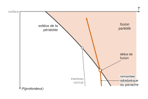
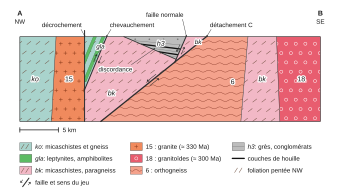
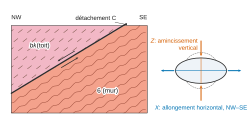
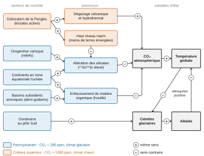
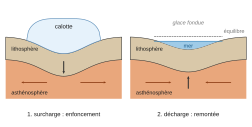
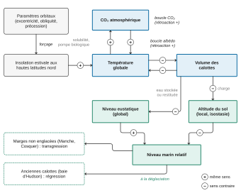

# G2E BCPST — Géologie 2026 · Corrigé brut

*Corrigé rédigé par IA, non officiel. Signalez toute erreur.*

**Le climat au cours des temps géologiques.** Durée : 3 h. Calculatrice et documents interdits. Les figures 8 et 11b et les tableaux 1, 2 et 3 sont à rendre en annexe. Les valeurs lues sur les figures sont données à une graduation près.

---

## 1. Les variations climatiques au cours du Protérozoïque

### 1.1

Le **climat** d'une région est la description statistique, par des valeurs moyennes et par leur variabilité, des paramètres de l'atmosphère (température, précipitations, humidité, vents, ensoleillement, pression) sur une longue période, par convention au moins 30 ans. Il se distingue du temps qu'il fait, qui décrit l'état instantané de l'atmosphère.

Une **variation climatique** est une modification durable et significative de ces moyennes ou de leur variabilité, à l'échelle régionale ou globale. Elle peut se produire sur toutes les échelles de temps, de la décennie au milliard d'années.

### 1.2

La paléolatitude de chaque gisement est déduite de l'aimantation rémanente acquise lors de la formation de la roche : l'inclinaison du champ magnétique fossile dépend de la latitude ($\tan I = 2\tan\lambda$).

Sur la figure 1, de nombreux dépôts glaciaires néoprotérozoïques ont une paléolatitude de 0 à 10° ou de 10 à 20°, y compris des gisements jugés « très fiables » (Australie, Amérique du Nord). Ces marqueurs se sont formés près du niveau de la mer, ce qui exclut des glaciers d'altitude. De la glace atteignait donc le niveau de la mer aux basses latitudes : la Terre a pu être englacée jusqu'à proximité de l'équateur (hypothèse de la « Terre boule de neige »).

Aujourd'hui, ces marqueurs se trouvent sur tous les continents et à toutes les latitudes. Cette répartition n'a pas de signification climatique : depuis 700 Ma, la **tectonique des plaques** (dislocation de Rodinia, assemblage puis dislocation de la Pangée) a déplacé les continents, si bien que la position actuelle d'un gisement diffère de sa position de formation.

$$\boxed{\text{Dépôts glaciaires à moins de }20^\circ\text{ de paléolatitude, au niveau de la mer} \Rightarrow \text{englacement quasi équatorial}}$$

### 1.3

Un facteur qui perturbe l'équilibre radiatif de la Terre est un **forçage radiatif** (ou forçage climatique).

La figure 2 montre deux forçages possibles :

- la **luminosité solaire**, plus faible qu'aujourd'hui : elle valait environ 94 % de l'actuelle vers −700 Ma. Ce forçage négatif varie de façon monotone et lente ; il ne peut pas expliquer à lui seul des épisodes glaciaires brefs, mais il rend le système plus sensible ;
- la **teneur en CO₂**, qui chute brutalement juste avant les glaciations néoprotérozoïques et y atteint des valeurs proches de la valeur actuelle, voire inférieures. Ces chutes coïncident avec les glaciations, comme celles de −3,0 et −2,3 Ga.

**Conclusion : la chute du CO₂ atmosphérique, qui réduit l'effet de serre, est le forçage déclenchant. Elle agit sur fond de Soleil moins lumineux (≈ 94 %).**

### 1.4

Un processus qui amplifie une variation climatique est une **rétroaction positive**.

Lorsque la Terre commence à s'englacer, la **rétroaction glace–albédo** joue ce rôle. L'albédo vaut environ 0,1 pour l'océan et 0,6 à 0,9 pour la neige ou la glace. Le refroidissement étend la neige et la glace, ce qui augmente l'albédo planétaire et diminue la puissance solaire absorbée ; le refroidissement s'accentue et la glace s'étend encore. Au-delà d'une latitude critique (≈ 30°), l'emballement conduit à un englacement global. La baisse de la vapeur d'eau atmosphérique, gaz à effet de serre, dans un air plus froid renforce l'effet.

### 1.5

- Une **source** de carbone est un processus ou un réservoir qui libère plus de carbone vers l'atmosphère qu'il n'en prélève : dégazage volcanique et métamorphique, respiration, oxydation de la matière organique, combustion, dégazage océanique.
- Un **puits** de carbone (ou pompe à carbone) est un processus ou un réservoir qui retire durablement du CO₂ de l'atmosphère et le stocke : photosynthèse suivie de l'enfouissement de la matière organique, altération des silicates suivie de la précipitation des carbonates, dissolution du CO₂ dans l'océan (pompes physique et biologique).

La teneur atmosphérique en CO₂ dépend du bilan entre sources et puits.

### 1.6

La roche qui fond est la **péridotite** du manteau (olivine, pyroxènes, spinelle ou grenat), apportée par le panache.

Le mécanisme est la **fusion partielle par décompression adiabatique**. Le matériel chaud du panache remonte sans échanger de chaleur : sa température ne baisse que de ≈ 0,3–0,5 °C/km, tandis que la pression chute fortement. Le solidus de la péridotite s'abaisse avec la pression ; le chemin pression–température du panache finit donc par le recouper, et la péridotite fond partiellement. L'excès thermique du panache (+100 à +200 °C) donne des taux de fusion élevés (jusqu'à 20–30 %), d'où les millions de km³ de basaltes tholéiitiques des trapps.

$$\boxed{\text{Fusion partielle de la péridotite mantellique par décompression adiabatique}}$$

### 1.7

$$\mathrm{CaAl_2Si_2O_8 + 2\,CO_2 + 3\,H_2O \longrightarrow Al_2Si_2O_5(OH)_4 + Ca^{2+} + 2\,HCO_3^-}$$

L'eau est un réactif et les ions passent en solution : il s'agit d'une **altération chimique par hydrolyse**, acide car le CO₂ dissous forme de l'acide carbonique, source des protons. Le calcium est exporté et l'aluminium et la silice restent sur place dans une argile 1:1, la kaolinite : c'est une **monosiallitisation**, typique des climats chauds et humides.

### 1.8

Équilibre des carbonates :

$$\mathrm{Ca^{2+} + 2\,HCO_3^- \rightleftharpoons CaCO_3 + CO_2 + H_2O}$$

Facteurs qui le déplacent dans le sens de la précipitation (sens direct) :

- la diminution du CO₂ dissous (dégazage par agitation ou faible profondeur, consommation par la photosynthèse) ;
- l'augmentation de la température, qui rend le CO₂ moins soluble ;
- l'augmentation du pH ;
- la diminution de la pression (faible profondeur, au-dessus de la profondeur de compensation des carbonates) ;
- l'augmentation des concentrations en Ca²⁺ et HCO₃⁻ (apports continentaux, évaporation).

Dans les **stromatolithes**, les tapis de cyanobactéries font de la photosynthèse ($\mathrm{6\,CO_2 + 6\,H_2O \rightarrow C_6H_{12}O_6 + 6\,O_2}$). Ils consomment le CO₂ dissous au contact du tapis, ce qui élève le pH et déplace l'équilibre vers la précipitation de CaCO₃ dans le mucilage. La précipitation est induite par le métabolisme et non contrôlée par l'organisme. Le piégeage de particules par le mucilage et le rythme jour/nuit donnent le litage fin.

### 1.9

On somme les deux réactions : l'altération consomme 2 CO₂ et la précipitation en restitue 1 :

$$\mathrm{CaAl_2Si_2O_8 + CO_2 + 2\,H_2O \longrightarrow Al_2Si_2O_5(OH)_4 + CaCO_3}$$

Une mole de CO₂ atmosphérique est consommée nette par mole d'anorthite altérée, et ce carbone est stocké durablement dans le calcaire. L'ensemble est donc un **puits de CO₂**.

À long terme, une fois passé le dégazage bref qui accompagne l'éruption des trapps, l'altération de millions de km³ de basalte retire du CO₂ pendant des millions d'années : l'effet de serre diminue et le climat se **refroidit**.

$$\boxed{\text{Puits net : 1 CO}_2\text{ par mole d'anorthite} \Rightarrow \text{refroidissement à long terme}}$$

### 1.10

La vitesse de l'hydrolyse augmente avec la température (cinétique de type Arrhenius) et avec la disponibilité en eau (pluies abondantes, drainage qui évacue les produits et maintient la réaction loin de l'équilibre). La zone équatoriale est chaude et très arrosée. Les basaltes, riches en verre, en minéraux ferromagnésiens et en plagioclase calcique, s'altèrent de plus très facilement.

**Conclusion : la position équatoriale accélère fortement l'altération des trapps, donc la consommation de CO₂.**

### 1.11

Le contexte est celui d'un Soleil moins lumineux (≈ 94 %), qui rend le climat sensible à une baisse de l'effet de serre. Un panache mantellique produit des trapps basaltiques très volumineux près de l'équateur. Leur hydrolyse rapide sous climat chaud et humide, suivie de la précipitation des carbonates (dont les stromatolithes), est un puits net de CO₂. Le CO₂ chute, l'effet de serre diminue et la Terre se refroidit. La rétroaction glace–albédo amplifie le refroidissement jusqu'à un englacement atteignant les basses latitudes.

$$\boxed{\text{Trapps équatoriaux} \rightarrow \text{hydrolyse intense} \rightarrow \downarrow\mathrm{CO_2} \rightarrow \text{refroidissement} \rightarrow \text{rétroaction albédo} \rightarrow \text{englacement}}$$

---

## 2. Les variations climatiques au cours du Phanérozoïque

### 2.1

Un **fossile** est un reste (coquille, test, os, bois, pollen) ou une trace d'activité (empreinte, piste, terrier) d'un organisme ayant vécu dans le passé, conservé dans une roche.

**Tableau 1**

| | Fossiles de faciès | Fossiles stratigraphiques |
|---|---|---|
| Intérêt en géologie | Reconstituer le paléoenvironnement et le paléoclimat du dépôt (profondeur, température, salinité, énergie, lumière) | Datation relative : définir des biozones et corréler des séries éloignées |
| Caractéristiques du fossile | Exigences écologiques étroites (sténoèce), donc lié à un milieu précis ; longue durée d'existence du taxon, donc mauvais marqueur du temps ; répartition limitée à son milieu ; souvent benthique | Taxon à évolution rapide et à courte durée d'existence ; large répartition géographique, indépendante du faciès (souvent planctonique ou nectonique) ; abondant et facile à identifier |
| Exemple de groupe utilisé | Coraux constructeurs (polypiers), rudistes, stromatolithes, lingules | Ammonites, trilobites, graptolites, foraminifères planctoniques, conodontes |

### 2.2

La roche est rayable à l'ongle (dureté ≈ 2) et a une masse volumique de 2,3 g·cm⁻³. Chauffée, elle se déshydrate et donne une poudre blanche, le plâtre ($\mathrm{CaSO_4\cdot\tfrac12H_2O}$). Le cristal est maclé en fer de lance.

**La roche est du gypse, $\mathrm{CaSO_4\cdot 2H_2O}$, une évaporite.**

### 2.3

Le gypse précipite par **évaporation** d'une eau salée, lorsque la concentration en Ca²⁺ et SO₄²⁻ dépasse la solubilité du sulfate de calcium. Dans la séquence évaporitique (carbonates, puis gypse, puis halite, puis sels de K et de Mg), il apparaît quand il ne reste qu'environ 20 % du volume d'eau initial.

Les conditions sont un **climat chaud et aride**, où l'évaporation dépasse les précipitations et les apports, et un bassin peu profond et confiné (lagune, sebkha) qui n'est que partiellement réalimenté en eau de mer.

### 2.4

Les deux échantillons sont rayables à l'acier et font effervescence à HCl : ce sont des **calcaires** (calcite). La classification appropriée est celle des carbonates (Dunham, Folk).

- **A** : grains sphériques jointifs de 0,5–1 mm. En lame mince, chaque grain montre des lamines concentriques autour d'un nucléus : ce sont des ooïdes. Le ciment est de la calcite claire (sparite), sans boue.
- **B** : éléments centimétriques en faisceaux. En lame mince, on voit des sections d'environ 1 cm à cloisons radiaires (septes) : ce sont des polypiers coloniaux.

**Tableau 2**

| Échantillon | Échantillon A | Échantillon B |
|---|---|---|
| Nom de la roche | Calcaire oolithique : grainstone à ooïdes (Dunham), oosparite (Folk) | Calcaire construit à polypiers : boundstone (framestone) de Dunham, biolithite récifale |
| Conditions de formation | Mer très peu profonde (quelques mètres) et agitée (houle, marée), eau chaude sursaturée en CaCO₃ ; précipitation concentrique autour d'un nucléus roulé ; boue évacuée par l'agitation | Récif édifié en place, en mer peu profonde (zone photique), eau chaude (> 20 °C), claire, oxygénée, de salinité normale ; coraux en symbiose avec des zooxanthelles |
| Indication paléoclimatique | Mer chaude, climat tropical à subtropical | Mer chaude, climat tropical |

### 2.5

Le **principe d'actualisme** énonce que les processus géologiques du passé obéissaient aux mêmes lois que ceux d'aujourd'hui : « le présent est la clé du passé ».

Il consiste à raisonner par analogie. On établit, dans les milieux actuels, le lien entre un objet (sédiment, organisme) et ses conditions de formation, puis on applique ce lien aux objets fossiles. Comme les ooïdes se forment aujourd'hui sur les hauts-fonds chauds et agités des Bahamas et que les coraux constructeurs vivent dans des eaux tropicales claires, les calcaires jurassiques de la figure 4 indiquent une mer chaude et peu profonde. La limite du principe est qu'il suppose des exigences écologiques inchangées au cours de l'évolution.

### 2.6

- **Pennsylvanien** : des tillites et des dropstones sont présents sur le Gondwana, aux hautes latitudes sud (Amérique du Sud, Arabie, Inde, Australie). Des ceintures « froid » et « tempéré froid » s'étendent largement aux deux pôles. La ceinture tropicale humide à charbons est étroite, encadrée par des bandes arides. Le climat est **glaciaire** (*icehouse*).
- **Crétacé supérieur** : il n'y a ni tillite ni dropstone, ni ceinture froide. Des marqueurs « tempéré chaud » (palmiers, crocodiliens, kaolinite) atteignent les hautes latitudes des deux hémisphères. Les bauxites, latérites et marqueurs arides sont largement répandus. Le climat est **chaud, sans calotte** (*greenhouse*).

On observe donc un **réchauffement** important, avec disparition des calottes et diminution du gradient thermique entre l'équateur et les pôles. La variation est **globale** : des marqueurs indépendants l'enregistrent sur tous les continents, dans les deux hémisphères et à toutes les latitudes. Un simple déplacement d'un continent ne pourrait pas faire disparaître partout les ceintures froides.

### 2.7

La densité stomatique varie en sens inverse du CO₂ (figure 6a, ordonnée logarithmique). La droite d'étalonnage passe par ≈ 215 stomates/mm² à 0 ppm et ≈ 24 à 2000 ppm ; la densité est divisée par 10 environ pour +2000 ppm :

$$[\mathrm{CO_2}] \approx 2000\,\log_{10}\!\left(\frac{215}{D}\right)\ \text{ppm}$$

- Pennsylvanien (≈ 300–310 Ma) : la courbe de tendance donne D ≈ 175 stomates/mm², d'où [CO₂] ≈ 2000 × 0,09 ≈ **200 ppm**.
- Début du Crétacé supérieur (≈ 100 Ma) : la tendance donne D ≈ 75 stomates/mm², d'où [CO₂] ≈ 2000 × 0,46 ≈ **900–1000 ppm**.

$$\boxed{[\mathrm{CO_2}]_{\text{Crétacé sup.}} \approx 5 \times [\mathrm{CO_2}]_{\text{Pennsylvanien}}}$$

soit environ 1 000 ppm contre environ 200 ppm.

Au Pennsylvanien, la teneur en CO₂ était comparable à la valeur préindustrielle, voire inférieure. La forte dispersion des points rend ces valeurs indicatives, mais le facteur de 4 à 6 est robuste.

### 2.8

Le ⁸⁷Sr est produit par la **désintégration β⁻ du ⁸⁷Rb** ($^{87}\mathrm{Rb} \rightarrow {}^{87}\mathrm{Sr} + e^- + \bar\nu$), avec une demi-vie d'environ 49 Ga. C'est un isotope **radiogénique**. Le ⁸⁶Sr est stable et non radiogénique.

### 2.9

Un **élément incompatible** est un élément qui, lors de la fusion partielle ou de la cristallisation, se concentre préférentiellement dans le liquide magmatique : son coefficient de partage solide/liquide est $D = C_{\text{solide}}/C_{\text{liquide}} \ll 1$. Son rayon ionique ou sa charge trop élevés l'empêchent d'entrer dans les réseaux des minéraux du manteau (olivine, pyroxènes).

### 2.10

Le Rb, incompatible, a suivi les liquides de fusion partielle du manteau et s'est concentré dans la **croûte continentale** (micas, feldspaths potassiques). Le rapport Rb/Sr de la croûte est élevé : la désintégration du ⁸⁷Rb y produit beaucoup de ⁸⁷Sr, et son rapport ⁸⁷Sr/⁸⁶Sr augmente fortement avec le temps (≈ 0,71–0,72 en moyenne). Le manteau appauvri reste vers 0,703.

### 2.11

Le Sr marin est un mélange entre un pôle hydrothermal peu radiogénique (≈ 0,703) et un pôle continental radiogénique (≈ 0,711). Un rapport plus élevé au Pennsylvanien signifie que la part du **flux continental** était plus grande : altération chimique des continents plus intense, et éventuellement flux hydrothermal plus faible. Au Crétacé supérieur, la dislocation de la Pangée et des dorsales actives renforcent le flux hydrothermal, tandis que le haut niveau marin réduit les surfaces émergées.

L'événement en cause est l'**orogenèse varisque (hercynienne)**, au cours de laquelle la collision Laurussia–Gondwana forme la Pangée. Les reliefs élevés exposent en permanence des roches silicatées fraîches et radiogéniques à l'érosion et à l'altération.

### 2.12

La roche a une masse volumique très faible (1,4 g·cm⁻³), elle est combustible, noire, et laisse une trace noire. **C'est du charbon, plus précisément de la houille.**

### 2.13

**Formation.** Des débris végétaux continentaux, produits en abondance par les forêts marécageuses, s'accumulent dans un milieu aquatique, confiné et **anoxique** (tourbière). Les décomposeurs aérobes n'y agissent pas, et une tourbe se forme. L'enfouissement dans un bassin subsident (hausse de la pression et de la température) provoque la **houillification** : la tourbe perd son eau et ses matières volatiles (H₂O, CO₂, CH₄) et s'enrichit en carbone, en passant par la tourbe (≈ 55 % C), le lignite (≈ 70 %), la houille (≈ 85 %) puis l'anthracite (> 92 %).

**Impact.** Le carbone a été prélevé dans l'atmosphère par la photosynthèse ($\mathrm{6\,CO_2 + 6\,H_2O \rightarrow C_6H_{12}O_6 + 6\,O_2}$). Au lieu d'être reminéralisé, il est enfoui et stocké pour des centaines de millions d'années. La formation du charbon est donc un **puits de CO₂** : elle fait baisser la teneur en CO₂, diminue l'effet de serre et refroidit le climat.

### 2.14

Le profil est horizontal (topographie non prise en compte) et AB ≈ 39 km, puisque la barre de 5 km est contenue environ 7,8 fois dans AB. A est au NW et B au SE ; la flèche du nord de la carte pointe vers le haut et la gauche, et les structures sont de direction NE–SW.

Succession le long de A–B, avec des distances approximatives depuis A :

| De … à (km) | Unité (figure 9) | Nature des roches | Géométrie sur la coupe |
|---|---|---|---|
| 0 – 4,7 | *ko* (protolithe cambro-ordovicien métamorphisé varisque) | Micaschistes et gneiss | Foliation pentée vers le NW |
| 4,7 – 8,4 | **15** (plutonisme varisque, vers 330 Ma, figuré à croix) | Granite subalcalin potassique | Intrusion à contacts sécants |
| ≈ 8,4 | Accident décrochant (demi-flèches) | | Faille subverticale |
| 8,4 – 11,3 | *ko* avec lames de *gla* (complexe leptyno-amphibolique, étoiles = reliques éclogitiques) | Gneiss, leptynites, amphibolites, éclogites rétromorphosées | Lames parallèles à la foliation, pentées vers le NW |
| ≈ 11,3 | Chevauchement (dents triangulaires) | | Contact anormal penté |
| 11,3 – 13,5 | *bk* (Briovérien–Cambrien métamorphisé) | Micaschistes, paragneiss | Socle sous la bordure NW du bassin |
| 13,5 – 21,6 | **h3** (Stéphanien) | Conglomérats, grès, argilites, couches de houille | Remplissage discordant sur *bk* au NW, couches basculées vers le SE et épaississement vers la faille bordière (demi-graben) |
| ≈ 21,6 | Faille normale bordière (barbules carrées) | | Pentée vers le NW, sous le bassin |
| 21,6 – 24,3 | *bk* | Micaschistes à foliation pentée vers le NW | |
| ≈ 24,3 | **Accident C**, détachement (barbules carrées) | | Faille normale à faible pendage NW |
| 24,3 – 29,6 | **6** (orthogneiss, protolithe ≈ 500 Ma) | Orthogneiss | Mur du détachement |
| 29,6 – 33,3 | *bk* | Micaschistes | |
| 33,3 – 39 | **18** (granitoïdes péralumineux varisques, vers 300 Ma, figuré à cercles) | Granite et granodiorite | Pluton du dôme, sécant |

Coupe à dessiner (schéma de principe) :

Légende à reporter dans le cadre : un figuré par unité (*ko*, *gla*, *bk*, 6, 15, 18, *h3* avec ses couches de houille en traits noirs épais) ; des tirets pentés vers le NW pour la foliation ; un trait à la base de *h3* pour la discordance ; des demi-flèches de part et d'autre de chaque faille pour le sens du jeu (toit vers le bas pour la faille bordière et le détachement C, vers le haut pour le chevauchement). Sur la figure 2, la faille bordière s'enracine en profondeur sur le détachement : c'est une interprétation de principe.

### 2.15

D'après la légende de la figure 9, le trait épais à barbules carrées désigne une **faille normale, plus précisément un détachement** : une faille normale ductile à faible pendage. L'accident C sépare les micaschistes *bk* (toit, au NW) d'un dôme d'orthogneiss et de granites (mur, au SE ; massif du Pilat). Il est de direction NE–SW et penté vers le NW.

- **Axe d'amincissement** (raccourcissement Z) : **vertical**, la croûte s'amincit.
- **Axe d'allongement** (X) : **horizontal**, perpendiculaire à la direction de l'accident, donc ≈ **NW–SE**.

Il s'agit d'une **tectonique extensive (distensive)**, tardi- à post-orogénique varisque : la croûte épaissie de la chaîne s'effondre gravitairement, et l'extension exhume le dôme et ouvre des bassins.

$$\boxed{\text{C : détachement (faille normale)} ;\ Z\ \text{vertical},\ X\ \text{horizontal NW–SE} ;\ \text{tectonique extensive post-orogénique}}$$

### 2.16

La houille et les roches *h3* se sont formées dans le **bassin houiller de Saint-Étienne**, un bassin sédimentaire continental intramontagneux en **demi-graben**, contrôlé par la faille normale de sa bordure SE.

Il date du **Stéphanien** (Carbonifère supérieur, ≈ 305–299 Ma). Il est donc tardi-varisque : il se forme après la structuration et le métamorphisme du socle, sur lequel il repose en discordance.

Cette structure favorise la formation de houille pour plusieurs raisons :

- le jeu de la faille normale entretient une **subsidence** continue, qui crée l'espace nécessaire à l'accumulation de grandes épaisseurs de sédiments ;
- les dépressions mal drainées (lacs, marécages) sont **anoxiques**, ce qui préserve la matière organique ;
- l'**enfouissement rapide** sous les apports détritiques permet la houillification ;
- le bassin, alors en zone équatoriale chaude et humide, porte des forêts productives.

### 2.17

Facteurs de contrôle et liens de causalité (+ : les deux grandeurs varient dans le même sens ; − : en sens contraire) :

Au Pennsylvanien, les deux puits de CO₂ (altération des silicates de la chaîne varisque et enfouissement de la houille) et la position polaire du Gondwana expliquent le climat froid, amplifié par l'albédo. Au Crétacé supérieur, le dégazage des dorsales et la réduction des surfaces altérables maintiennent un CO₂ élevé, d'où un climat chaud et sans glace.

---

## 3. Les variations climatiques au cours du Quaternaire

### 3.1

**Tableau 3**

| Photographie | Nom de l'objet paléoclimatique | Mode de formation |
|---|---|---|
| a | Vallée glaciaire en auge (vallée en U) | Un glacier de vallée surcreuse et élargit une vallée préexistante par abrasion (débris contenus dans la glace) et arrachement, sur le fond et les flancs : profil en U à fond plat et versants raides |
| b | Roche moutonnée à poli et stries glaciaires | Les débris de la base du glacier rabotent le substratum : les particules fines le polissent, les blocs y gravent des stries parallèles au sens d'écoulement. La face amont est adoucie, la face aval arrachée |
| c | Galet strié (galet glaciaire facetté) | Un bloc pris dans la glace basale est frotté contre le substratum : il acquiert des facettes planes et des stries ; il n'est pas arrondi, car il n'a pas roulé |
| d | Bloc erratique | Un gros bloc arraché en amont est transporté par le glacier sans tri ni usure, puis abandonné à la fonte sur un substratum de nature différente (roche paléozoïque posée sur du Mésozoïque et du Cénozoïque) |

Au moment de leur formation, l'Europe connaissait un **climat glaciaire** froid, avec des glaciers et des calottes bien plus étendus qu'aujourd'hui (période glaciaire du Pléistocène, notamment le dernier maximum glaciaire vers −20 000 ans).

### 3.2

L'échantillon 11a est entièrement cristallisé, à grains visibles à l'œil nu et jointifs : sa texture est **grenue**, avec des phénocristaux de feldspath pluricentimétriques (texture porphyroïde). On y observe :

- des feldspaths blancs, automorphes, à clivages, en partie de grande taille (feldspath potassique) ;
- du quartz gris translucide, sans clivage ;
- des paillettes noires de biotite.

La texture grenue indique une cristallisation lente, en profondeur. La présence de quartz, de feldspaths et de biotite définit une roche acide.

**C'est un granite (porphyroïde), roche magmatique plutonique.**

### 3.3

Sur la carte 11b, il faut entourer l'affleurement de granite varisque situé au SE du site : la grande masse rouge à traits blancs (granitoïde 18, vers 300 Ma) du **massif du Mont-Blanc**. C'est la seule source granitique paléozoïque importante en amont.

Le trajet à tracer suit les vallées : depuis le massif, par les glaciers de son versant suisse (Trient, val Ferret, Dranse), jusqu'à la confluence avec la vallée du Rhône vers Martigny, puis vers le NW en descendant la vallée du Rhône jusqu'à Monthey (étoile). L'agent de transport est le **glacier du Rhône** et ses affluents, au cours des maximums glaciaires du Pléistocène.

### 3.4

**Obtention.** On carotte la tourbière, où les pollens (dont l'exine, en sporopollénine, résiste à la dégradation) sont préservés en milieu anoxique. On prélève des échantillons à intervalles réguliers. Un traitement chimique (acides, bases) concentre les pollens, que l'on identifie et compte au microscope (quelques centaines de grains par niveau). Pour chaque profondeur, on reporte l'abondance relative de chaque groupe.

**Interprétation.** Le spectre pollinique reflète la végétation régionale. Par actualisme, chaque groupe renseigne sur le climat : les herbacées de milieu froid et sec traduisent une steppe froide ; les pins, un climat frais ; les arbres tempérés, un climat tempéré. Le diagramme se lit de bas en haut, du plus ancien au plus récent ; les datations ¹⁴C donnent l'âge.

**Évolutions identifiées :**

- de 34 à 30 m, les arbres tempérés sont abondants : climat **tempéré** (fin d'interglaciaire ou interstade) ;
- de 30 à 2 m environ, entre plus de 28 000 ans et moins de 18 000 ans, les herbacées de milieu froid et sec dominent, avec les pins : steppe, climat **froid et sec** de la dernière période glaciaire, autour du dernier maximum glaciaire. Des oscillations rapides et répétées entre pins et herbacées traduisent des **fluctuations climatiques brèves** (stades et interstades) ;
- au sommet (≈ 2–0,5 m), les arbres tempérés réapparaissent : début du **réchauffement** de la déglaciation (Tardiglaciaire).

### 3.5

Le ¹⁴C est produit en continu dans la haute atmosphère par l'action des neutrons cosmiques sur l'azote : $^{14}\mathrm{N} + n \rightarrow {}^{14}\mathrm{C} + p$. Il s'oxyde en CO₂, et le rapport ¹⁴C/¹²C atmosphérique est supposé constant. Un être vivant échange du carbone avec le milieu (photosynthèse, alimentation) : son rapport ¹⁴C/¹²C est celui de l'atmosphère. À sa mort, le système se **ferme** et le ¹⁴C, radioactif β⁻ (il redonne ¹⁴N), décroît selon $P_t = P_0\,e^{-\lambda t}$, avec $t_{1/2} = 5730$ ans. En mesurant la radioactivité ou la teneur résiduelle en ¹⁴C et en la comparant à celle d'un échantillon actuel, on obtient l'âge :

$$t = -\frac{1}{\lambda}\ln\frac{P_t}{P_0}$$

La méthode s'applique à la matière organique et aux carbonates biogéniques, jusqu'à ≈ 50 000 ans. Elle nécessite une calibration.

### 3.6

De la loi de décroissance, on tire l'âge :

$$\begin{aligned}
\frac{P_t}{P_0} &= e^{-\lambda t} \\
t &= -\frac{\ln(P_t/P_0)}{\lambda}
\end{aligned}$$

La constante de désintégration vaut :

$$\lambda = \frac{\ln 2}{t_{1/2}} = 1{,}20968\times10^{-4}\ \mathrm{an^{-1}}$$

Application numérique :

$$t = \frac{-\ln(0{,}18)}{1{,}20968\times10^{-4}\ \mathrm{an^{-1}}} = 14\,176\ \text{ans}$$

$$\boxed{t \approx 1{,}4\times10^{4}\ \text{ans}}$$

La tourbe date de la fin du Pléistocène, pendant la déglaciation.

### 3.7

Au cours de l'évaporation, puis des condensations successives, la vapeur s'appauvrit en ¹⁸O : les molécules lourdes précipitent en premier (distillation de Rayleigh). L'appauvrissement est d'autant plus marqué que la température de condensation est basse. Dans la glace polaire, **un δ¹⁸O bas traduit un climat froid** et un δ¹⁸O élevé un climat plus chaud.

Lecture de la figure 13 :

- de 40 000 à 11 700 ans, δ¹⁸O ≈ −40 à −43 ‰ : climat **glaciaire**, avec des oscillations rapides de 3 à 5 ‰ (réchauffements brefs de type Dansgaard–Oeschger) ;
- vers 11 700 ans, hausse brutale jusqu'à ≈ −35 ‰ : **réchauffement** de la transition entre le Pléistocène et l'Holocène ;
- à l'Holocène, δ¹⁸O ≈ −34 à −36 ‰, stable : climat **chaud et stable**.

Le réchauffement correspond à un écart de 6 à 7 ‰.

### 3.8

Le CO₂ vaut ≈ 180–200 ppmv pendant le glaciaire (minimum vers 20 000 ans). Il remonte à partir de ≈ 18 000 ans et atteint ≈ 260–280 ppmv à l'Holocène.

Ces variations sont pilotées surtout par l'océan, qui contient environ 50 à 60 fois plus de carbone que l'atmosphère :

- en période froide, le CO₂ est plus soluble dans l'eau froide (pompe physique) ;
- la pompe biologique est plus active (apports de poussières riches en fer) ;
- l'océan profond est plus stratifié et couvert de banquise, ce qui limite le dégazage.

À la déglaciation, le réchauffement et la réorganisation océanique libèrent ce CO₂.

Ces variations jouent le rôle de **rétroaction positive** : elles amplifient et étendent à toute la planète les variations climatiques déclenchées par le forçage orbital (insolation). Le CO₂ est ici un **amplificateur**, non la cause première.

### 3.9

Le niveau marin relatif, qui fixe la bathymétrie et la position du trait de côte, dépend de trois facteurs :

1. l'**eustatisme**, c'est-à-dire la variation globale du niveau des océans par variation du volume d'eau (glacio-eustatisme, dilatation thermique) ou du volume des bassins océaniques (tectono-eustatisme) ;
2. les **mouvements verticaux du sol** : subsidence ou surrection d'origine tectonique ou isostatique ;
3. les **apports sédimentaires** : le remplissage du bassin réduit la bathymétrie et fait avancer le trait de côte (progradation).

### 3.10

Les sédiments pléistocènes sont **continentaux** (sables, galets, tourbe) et forment des lentilles isolées dans des creux du substratum. Au Pléistocène, le niveau marin était bas et la Manche était émergée, parcourue par des fleuves. Les dépôts n'ont été conservés que dans des chenaux et des dépressions ; ailleurs, ils ont été érodés, notamment lors de la remontée de la mer.

Les sédiments holocènes sont **marins** (sables et argiles à bivalves marins) et recouvrent l'ensemble de la Manche de façon continue. Le passage de dépôts continentaux à des dépôts marins traduit une **transgression** : le niveau marin a **monté** entre le Pléistocène et l'Holocène.

### 3.11

Le modelé est **karstique** (paysage de calanques creusées dans les calcaires du Crétacé).

Une grotte se forme par **dissolution** du calcaire par une eau chargée en CO₂ (atmosphérique et surtout issu des sols) :

$$\mathrm{CaCO_3 + CO_2 + H_2O \rightleftharpoons Ca^{2+} + 2\,HCO_3^-}$$

L'eau s'infiltre par les fractures et les joints, qu'elle élargit ; les conduits les plus larges drainent davantage d'eau et s'agrandissent plus vite. Des galeries se creusent sous le niveau de la nappe, puis sont dénoyées quand le niveau de base s'abaisse. La réaction inverse, par dégazage du CO₂, forme les concrétions (stalactites, stalagmites).

Le modelé karstique d'ensemble comprend des formes de surface (lapiaz, dolines, poljés, vallées sèches, pertes et résurgences) et des formes souterraines (avens, réseaux de galeries).

### 3.12

Des peintures datées de 20 000 ans impliquent que la grotte et son entrée étaient alors **émergées**. Cette entrée est aujourd'hui à −37 m. Le niveau marin a donc **monté d'au moins 37 m** depuis la fin du Pléistocène. Il s'agit d'un minimum : la remontée totale depuis le dernier maximum glaciaire est d'environ 120 m.

Cette observation est **cohérente** avec la transgression enregistrée dans la Manche (3.10). L'énoncé écrit « celle de la question 3.12 » : il faut lire 3.10. Les deux sites sont éloignés et situés sur des façades différentes (Manche et Méditerranée) ; un signal identique ne peut donc pas venir d'un mouvement vertical local ni de la sédimentation. **Le facteur primordial est l'eustatisme, plus précisément le glacio-eustatisme.**

### 3.13

Le réchauffement de la déglaciation est enregistré par le δ¹⁸O (figure 13), par les pollens (figure 12) et par la disparition des glaciers (figure 10). Il a été déclenché par la hausse de l'insolation estivale aux hautes latitudes nord (paramètres orbitaux) et amplifié par l'albédo et le CO₂. Il fait fondre les grandes calottes de l'hémisphère nord (inlandsis laurentidien et fennoscandien), qui restituent leur eau à l'océan : c'est le **glacio-eustatisme**, de l'ordre de **+120 m** entre ≈ 20 000 et ≈ 6 000 ans, soit ≈ 1 cm/an en moyenne. La dilatation thermique de l'eau réchauffée ajoute une contribution faible. Les mouvements verticaux et la sédimentation, locaux, ne font que moduler ce signal global.

$$\boxed{\text{Réchauffement} \rightarrow \text{fonte des calottes} \rightarrow \text{hausse glacio-eustatique} \approx 120\ \text{m}}$$

### 3.14

Les marqueurs formés au niveau de la mer sont d'autant plus haut aujourd'hui qu'ils sont anciens : ≈ 145 m vers 7 000 ans, ≈ 50 m vers 5 000 ans, ≈ 20 m vers 3 500 ans, ≈ 0 m aujourd'hui. Le niveau marin **relatif a baissé** continûment pendant l'Holocène dans la baie d'Hudson, d'environ 145 m en 7 000 ans : c'est une **régression**, rapide au début puis de plus en plus lente.

### 3.15

Les marqueurs glaciaires datés de −20 000 ans montrent que la région était couverte par une épaisse calotte, l'**inlandsis laurentidien**. La baisse du niveau marin relatif, alors que le niveau eustatique montait, implique un **soulèvement du sol** encore plus important : c'est le **rebond glacio-isostatique**.

Mécanisme (isostasie) : la lithosphère flotte en équilibre sur l'asthénosphère ductile.

- Pendant la glaciation, la surcharge de glace enfonce la lithosphère, et l'asthénosphère flue latéralement hors de la zone chargée.
- Après la fonte, la charge disparaît et la lithosphère, trop enfoncée, remonte, tandis que l'asthénosphère reflue lentement sous la région.

Ce soulèvement (plusieurs centaines de mètres) l'emporte sur la hausse eustatique (≈ 120 m) : les anciens rivages se retrouvent perchés.

### 3.16

Le décalage a deux causes.

1. **La calotte fond lentement.** L'inlandsis laurentidien, épais d'environ 2 km, a continué de couvrir la baie d'Hudson bien après le début de l'Holocène et ne s'est disloqué que vers 8 000 ans BP. La décharge complète, et l'invasion marine qui permet de former les marqueurs de rivage, ne datent que de ≈ 8 000–7 500 ans : l'enregistrement de la figure 16 commence à ce moment.
2. **La réponse isostatique est retardée.** La remontée exige le fluage de l'asthénosphère, très visqueuse (≈ $10^{21}$ Pa·s). Le retour à l'équilibre suit une relaxation de temps caractéristique de quelques milliers d'années. Il se poursuit encore aujourd'hui, et la courbe n'a pas atteint de palier.

### 3.17

Lectures sur la figure 16 : z(7 000 ans) ≈ 145 m ; z(5 000 ans) ≈ 50 m ; z(0) = 0.

$$\begin{aligned}
v_1 &= \frac{145 - 50}{7000 - 5000} \\
&= \frac{95\ \mathrm{m}}{2000\ \mathrm{ans}} \\
&\approx 4{,}8\times10^{-2}\ \mathrm{m\,an^{-1}}
\end{aligned}$$

$$\boxed{v_1 \approx 5\ \mathrm{cm\,an^{-1}}}$$

$$\begin{aligned}
v_2 &= \frac{50 - 0}{5000 - 0} \\
&= \frac{50\ \mathrm{m}}{5000\ \mathrm{ans}} \\
&= 1{,}0\times10^{-2}\ \mathrm{m\,an^{-1}}
\end{aligned}$$

$$\boxed{v_2 \approx 1\ \mathrm{cm\,an^{-1}}}$$

La vitesse a été divisée par environ 5. Le moteur du rebond est l'écart à l'équilibre isostatique. À mesure que la lithosphère se rapproche de sa position d'équilibre, cet écart diminue, et la vitesse avec lui : c'est une relaxation de type exponentiel, freinée par la viscosité de l'asthénosphère. Le soulèvement est rapide juste après la décharge, puis de plus en plus lent.

### 3.18

À l'équilibre isostatique, à la profondeur de compensation, le poids de la colonne de glace d'épaisseur $H$ est compensé par le déplacement d'une épaisseur $s$ d'asthénosphère, qui est le matériau qui flue. Le mouvement vertical total vaut $s = 560$ m :

$$\begin{aligned}
d_{\text{glace}}\,H &= d_{\text{asth}}\,s \\
H &= \frac{d_{\text{asth}}}{d_{\text{glace}}}\,s \\
&= \frac{3{,}25}{0{,}93}\times 560\ \mathrm{m}
\end{aligned}$$

$$\boxed{H \approx 1{,}96\times10^{3}\ \mathrm{m} \approx 2\ \mathrm{km}}$$

Cette valeur est cohérente avec l'épaisseur estimée de l'inlandsis laurentidien (2 à 3 km). Les densités de la croûte et de la lithosphère n'interviennent pas, car la lithosphère se déplace d'un bloc sans changer d'épaisseur.

### 3.19

Les variations climatiques du Quaternaire (alternance glaciaire–interglaciaire, déglaciation vers 11 700 ans) sont déclenchées par le **forçage orbital** et amplifiées par les **rétroactions albédo et CO₂**. Leurs conséquences sur le niveau marin sont doubles : une hausse eustatique globale d'environ 120 m, et localement un rebond isostatique qui, sous les anciennes calottes, l'emporte et produit une régression relative.
