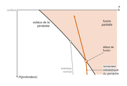
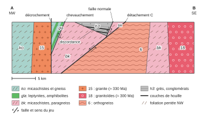
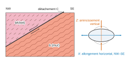
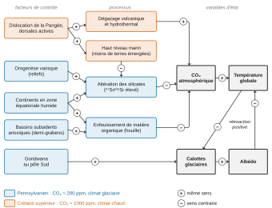
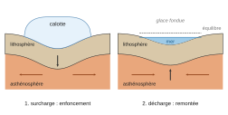
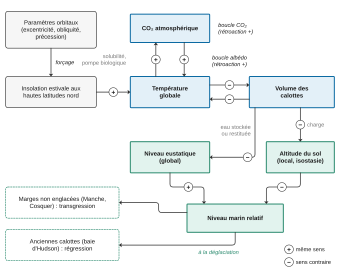

# G2E BCPST — Géologie 2026 · Corrigé guidé

*Corrigé rédigé par IA, non officiel. Signalez toute erreur.*

## Présentation du sujet

**Thème.** « Le climat au cours des temps géologiques ». Le sujet se lit comme une enquête en trois fenêtres temporelles, de plus en plus courtes et de mieux en mieux résolues. Chaque partie suit la même logique : un **marqueur** (roche, fossile, isotope, figure de terrain) révèle un climat passé, on cherche le **forçage** qui l'explique, puis la **rétroaction** qui l'amplifie.

**Cadre.** 3 heures, sans calculatrice ni document, 47 questions. Les figures 8 et 11b et les tableaux 1, 2 et 3 sont à rendre en annexe, et seul le texte écrit dans les cadres est lu.

| Partie | Points | Questions | Contenu |
|---|---|---|---|
| 1. Protérozoïque | 5 | 1.1–1.11 | Vocabulaire du système climatique (climat, forçage, rétroaction, source et puits), Terre boule de neige : trapps, hydrolyse des silicates, carbonates, albédo |
| 2. Phanérozoïque | 7,5 | 2.1–2.17 | Fossiles et roches indicatrices (gypse, calcaires oolithique et récifal, houille), cartes paléoclimatiques, densité stomatique, ⁸⁷Sr/⁸⁶Sr, **coupe géologique** du bassin de Saint-Étienne, schéma de synthèse |
| 3. Quaternaire | 7,5 | 3.1–3.19 | Marqueurs glaciaires, bloc erratique, palynologie, ¹⁴C, δ¹⁸O des glaces, CO₂, niveau marin (eustatisme, isostasie), deux calculs, schéma de synthèse |

**Notions du programme mobilisées.** Bilan radiatif et effet de serre ; cycle du carbone à court et long terme ; altération et hydrolyse ; fusion partielle du manteau ; sédimentologie des carbonates et des évaporites ; classification de Dunham ; principe d'actualisme ; radiochronologie (Rb–Sr, ¹⁴C) ; éléments incompatibles ; lecture de la carte au millionième et réalisation d'une coupe ; tectonique extensive post-orogénique ; marqueurs paléoclimatiques du Quaternaire ; isostasie.

**Difficulté.** La plupart des questions sont du cours appliqué à un document, d'un niveau abordable. Trois points sont délicats :

- la **coupe 2.14** et la question **2.15**, qui demandent de lire une carte au millionième dont le nord n'est **pas** en haut ;
- la lecture **quantitative** des figures à échelle logarithmique (2.7) ;
- les deux **schémas de synthèse** (2.17 et 3.19), qui exigent des liens de causalité orientés.

**Questions à ne pas laisser passer.** Les définitions (1.1, 1.3, 1.4, 1.5, 2.1, 2.5, 2.9), le bilan stœchiométrique de 1.9, les déterminations de roches (2.2, 2.4, 2.12, 3.2), le tableau 3, le calcul ¹⁴C (3.6, dont le résultat est fourni), les vitesses de 3.17 et l'isostasie de 3.18.

**Gestion du temps.** Comptez environ 40 min pour la partie 1, 70 min pour la partie 2 (dont 20 min pour la coupe) et 60 min pour la partie 3. Gardez 10 min pour vérifier les annexes. Préparez coupe et tableaux au brouillon : on ne rature pas une annexe.

---

## Partie 1 — Les variations climatiques au cours du Protérozoïque

Cette partie construit un raisonnement unique. On montre d'abord que la Terre a été englacée jusqu'à l'équateur. On identifie ensuite la cause (chute du CO₂) et l'amplificateur (albédo), puis on remonte à l'origine de la chute du CO₂ : des trapps basaltiques altérés sous climat équatorial. Les outils sont des définitions, des équations chimiques et la lecture de deux figures.

### Question 1.1

> [!INDICATION]
> Une bonne définition du climat comporte trois ingrédients : des paramètres, un traitement statistique et une durée.

> [!INDICATION]
> Opposez le climat au temps qu'il fait. Une variation climatique se définit ensuite naturellement à partir de la définition du climat.

#### Solution

Le **climat** d'une région est la description statistique, par des valeurs moyennes et par leur variabilité, des paramètres atmosphériques (température, précipitations, humidité, vents, ensoleillement, pression) sur une longue période, par convention au moins 30 ans. Le temps qu'il fait, lui, est l'état instantané de l'atmosphère.

Une **variation climatique** est une modification durable et significative de ces moyennes ou de leur variabilité, régionale ou globale. Elle peut se produire à toutes les échelles de temps, de la décennie au milliard d'années.

> [!PIEGE]
> Définir le climat par la seule température, ou confondre une anomalie météorologique (un hiver froid) avec une variation climatique. Le mot décisif est « moyenne sur une longue durée ».

### Question 1.2

> [!INDICATION]
> Demandez-vous comment on peut connaître la latitude **de formation** d'une roche : quelle propriété physique en garde la mémoire ?

> [!INDICATION]
> Relevez les classes de paléolatitude des gisements les plus fiables et exploitez la précision de la légende sur l'altitude de formation. Pour la seconde demande, comparez la position actuelle des gisements à leur position de formation.

#### Solution

La paléolatitude est déduite de l'**aimantation rémanente** acquise lors de la formation de la roche : l'inclinaison $I$ du champ magnétique fossile dépend de la latitude $\lambda$ ($\tan I = 2\tan\lambda$).

Sur la figure 1, de nombreux dépôts glaciaires néoprotérozoïques ont une paléolatitude de 0 à 10° ou de 10 à 20°, y compris des gisements « très fiables » (Australie, Amérique du Nord). La légende précise qu'ils se sont tous formés près du niveau de la mer. On ne peut donc pas invoquer des glaciers de haute montagne tropicaux. La glace atteignait le niveau de la mer aux basses latitudes : l'englacement s'étendait jusqu'à proximité de l'équateur, ce qui correspond à l'hypothèse de la « Terre boule de neige ».

Aujourd'hui, ces marqueurs se trouvent sur tous les continents et à toutes les latitudes. Cette répartition n'a aucune signification climatique : depuis 700 Ma, la **tectonique des plaques** (dislocation de Rodinia, puis assemblage et dislocation de la Pangée) a déplacé les continents, si bien que la position actuelle d'un gisement diffère de sa position de formation.

$$\boxed{\text{Dépôts glaciaires à moins de }20^\circ\text{ de paléolatitude et au niveau de la mer} \Rightarrow \text{englacement quasi équatorial}}$$

> [!METHODE]
> Pour tout marqueur paléoclimatique, distinguez toujours la position actuelle et la position de formation. Le paléomagnétisme donne la paléolatitude, pas la paléolongitude.

### Question 1.3

> [!INDICATION]
> Le mot demandé désigne une perturbation imposée de l'extérieur au bilan radiatif.

> [!INDICATION]
> Comparez les deux courbes de la figure 2 à la position des bandes « glaciations ». L'une évolue de façon monotone, l'autre présente des accidents brefs : laquelle peut déclencher un épisode froid ponctuel ?

#### Solution

Un facteur qui perturbe l'équilibre radiatif et peut causer une variation climatique est un **forçage radiatif** (ou forçage climatique).

La figure 2 propose deux forçages :

- la **luminosité solaire**, qui ne valait qu'environ 94 % de l'actuelle vers −700 Ma. C'est un forçage refroidissant, mais lent et monotone : il ne peut pas expliquer seul des épisodes glaciaires brefs, encadrés de périodes chaudes ;
- la **teneur en CO₂**, qui chute brutalement juste avant les glaciations néoprotérozoïques et y atteint des valeurs proches de l'actuelle, voire inférieures. On observe la même coïncidence pour les glaciations de −3,0 et −2,3 Ga.

**La chute du CO₂, qui affaiblit l'effet de serre, est le forçage déclenchant. Le Soleil moins lumineux en est la condition permissive.**

> [!METHODE]
> Pour hiérarchiser des causes, cherchez le synchronisme entre le phénomène et chaque facteur candidat. Une cause qui varie de façon monotone ne peut pas expliquer seule un événement ponctuel.

### Question 1.4

> [!INDICATION]
> Le terme cherché s'oppose à un processus stabilisateur.

> [!INDICATION]
> Que change l'apparition de neige et de glace dans la fraction du rayonnement solaire réfléchie par la surface ? Construisez une boucle qui revient sur son point de départ.

#### Solution

Un processus qui amplifie une variation climatique est une **rétroaction positive**.

Lorsque la Terre commence à s'englacer, la **rétroaction glace–albédo** joue ce rôle. L'albédo (fraction réfléchie du rayonnement solaire) vaut ≈ 0,1 pour l'océan et 0,6 à 0,9 pour la neige et la glace. La boucle est la suivante :

$$\text{refroidissement} \rightarrow \text{extension de la glace} \rightarrow \uparrow\text{albédo} \rightarrow \downarrow\text{énergie absorbée} \rightarrow \text{refroidissement accru}$$

Au-delà d'une latitude critique (≈ 30°), l'emballement conduit à un englacement global. La diminution de la vapeur d'eau, gaz à effet de serre, dans un air plus froid renforce l'effet.

> [!PIEGE]
> Écrire « rétroaction » sans préciser « positive », ou citer l'albédo sans fermer la boucle.

### Question 1.5

> [!INDICATION]
> Raisonnez en termes de flux vers l'atmosphère ou hors de l'atmosphère, et donnez des exemples à court et à long terme.

#### Solution

- Une **source** de carbone libère plus de carbone vers l'atmosphère qu'elle n'en prélève : dégazage volcanique et métamorphique, respiration, oxydation de la matière organique, combustion, dégazage de l'océan.
- Un **puits** de carbone (pompe à carbone) retire durablement du CO₂ de l'atmosphère et le stocke : photosynthèse suivie de l'enfouissement de la matière organique, altération des silicates suivie de la précipitation de carbonates, dissolution du CO₂ dans l'océan (pompes physique et biologique).

La teneur atmosphérique en CO₂ résulte du bilan entre sources et puits.

> [!PIEGE]
> Un même réservoir peut être source ou puits selon les conditions : l'océan, par exemple, absorbe du CO₂ quand il se refroidit et en dégaze quand il se réchauffe. Il faut donc nommer le processus.

### Question 1.6

> [!INDICATION]
> Quelle roche constitue le manteau ? Un panache mantellique est une remontée de matériel chaud.

> [!INDICATION]
> Tracez dans un diagramme pression–température le chemin d'une matière qui remonte vite, sans échange de chaleur, et le solidus de la péridotite.

#### Solution

La roche qui fond est la **péridotite** du manteau (olivine, pyroxènes, spinelle ou grenat), apportée par le panache.

Le mécanisme est la **fusion partielle par décompression adiabatique**. La matière du panache remonte assez vite pour ne pas échanger de chaleur : sa température ne baisse que de ≈ 0,3–0,5 °C/km, alors que la pression chute fortement. Le solidus de la péridotite s'abaisse avec la pression, si bien que le chemin pression–température du panache finit par le recouper : la péridotite fond partiellement. L'excès thermique du panache (+100 à +200 °C) donne des taux de fusion élevés, jusqu'à 20–30 %, d'où les millions de km³ de basalte tholéiitique des trapps.

$$\boxed{\text{Fusion partielle de la péridotite par décompression adiabatique}}$$

> [!PIEGE]
> Faire fondre la croûte continentale, ce qui donnerait des magmas granitiques et non basaltiques, ou invoquer un apport d'eau, mécanisme propre aux zones de subduction.

### Question 1.7

> [!INDICATION]
> Repérez le rôle de l'eau dans l'équation : est-elle un simple agent de transport ou un réactif ?

> [!INDICATION]
> Le produit solide est une argile. Que reste-t-il sur place et que part en solution ? Cela donne le degré d'altération.

#### Solution

$$\mathrm{CaAl_2Si_2O_8 + 2\,CO_2 + 3\,H_2O \longrightarrow Al_2Si_2O_5(OH)_4 + Ca^{2+} + 2\,HCO_3^-}$$

L'eau est consommée et intégrée à l'argile (groupements OH) : il s'agit d'une **altération chimique par hydrolyse**. Elle est acide, car le CO₂ dissous forme de l'acide carbonique qui fournit les protons. Le calcium est exporté, l'aluminium et la silice restent sur place dans une argile 1:1, la kaolinite : c'est une **monosiallitisation**, typique des climats chauds et humides.

> [!METHODE]
> Le type d'argile formé donne l'intensité de l'hydrolyse. Les argiles 2:1 traduisent une bisiallitisation (climat tempéré), la kaolinite une monosiallitisation (climat chaud et humide), la gibbsite une allitisation (latérites, bauxites).

### Question 1.8

> [!INDICATION]
> Écrivez l'équilibre qui relie Ca²⁺, HCO₃⁻ et CaCO₃. Le CO₂ y apparaît d'un côté.

> [!INDICATION]
> Appliquez la loi de modération : tout ce qui retire du CO₂ dissous favorise la précipitation. Quel processus biologique retire du CO₂ au contact d'un tapis de cyanobactéries ?

#### Solution

$$\mathrm{Ca^{2+} + 2\,HCO_3^- \rightleftharpoons CaCO_3 + CO_2 + H_2O}$$

Facteurs favorisant la précipitation (sens direct) :

- la baisse du CO₂ dissous (agitation, faible profondeur, photosynthèse) ;
- la hausse de la température, qui rend le CO₂ moins soluble ;
- la hausse du pH ;
- la baisse de la pression (faible profondeur, au-dessus de la profondeur de compensation des carbonates) ;
- la hausse des concentrations en Ca²⁺ et HCO₃⁻ (apports, évaporation).

Dans les **stromatolithes**, les cyanobactéries font de la photosynthèse ($\mathrm{6\,CO_2 + 6\,H_2O \rightarrow C_6H_{12}O_6 + 6\,O_2}$). Elles consomment le CO₂ au contact du tapis microbien, ce qui élève le pH et déplace l'équilibre vers la droite : CaCO₃ précipite dans le mucilage. C'est une précipitation **induite** par le métabolisme. Le piégeage de grains par le mucilage et l'alternance jour/nuit donnent le litage caractéristique.

> [!PIEGE]
> Dire que « les bactéries fabriquent du calcaire » comme un mollusque fabrique sa coquille. Ici, la précipitation est une conséquence physico-chimique de la photosynthèse.

### Question 1.9

> [!INDICATION]
> Additionnez les équations de 1.7 et de 1.8 (sens de la précipitation) et comptez les CO₂ de chaque côté.

> [!INDICATION]
> Pour le climat, distinguez le court terme, pendant l'éruption, du long terme, pendant l'altération.

#### Solution

L'altération consomme 2 CO₂ et la précipitation en restitue 1. La somme des deux réactions donne :

$$\mathrm{CaAl_2Si_2O_8 + CO_2 + 2\,H_2O \longrightarrow Al_2Si_2O_5(OH)_4 + CaCO_3}$$

Une mole de CO₂ est donc consommée nette par mole d'anorthite, et ce carbone est piégé dans un calcaire stable : l'ensemble est un **puits de CO₂**.

À long terme, une fois passé le dégazage volcanique bref de la mise en place, l'altération de millions de km³ de basalte retire du CO₂ pendant des millions d'années : l'effet de serre baisse et le climat se **refroidit**.

$$\boxed{\text{Puits net de 1 CO}_2\text{ par anorthite} \Rightarrow \text{refroidissement à long terme}}$$

> [!METHODE]
> Seule l'altération des silicates calciques et magnésiens constitue un puits net à long terme. L'altération d'un calcaire est neutre, car le CO₂ consommé est restitué lors de la reprécipitation.

### Question 1.10

> [!INDICATION]
> Quels paramètres climatiques accélèrent une réaction chimique en milieu aqueux ?

#### Solution

La vitesse de l'hydrolyse augmente avec :

- la **température** (cinétique de type Arrhenius) ;
- la **disponibilité en eau** : de fortes pluies et un bon drainage évacuent les produits et maintiennent la réaction loin de l'équilibre.

La zone équatoriale est la plus chaude et la plus arrosée. Les basaltes, riches en verre, en minéraux ferromagnésiens et en plagioclase calcique, s'y altèrent très vite.

**La position équatoriale accélère fortement l'altération des trapps, donc le pompage du CO₂.**

> [!PIEGE]
> Ne citer que la température : un désert chaud altère peu. L'eau est indispensable.

### Question 1.11

> [!INDICATION]
> Reprenez les conclusions de 1.3 à 1.10 dans l'ordre causal : contexte, cause, forçage, amplification.

#### Solution

Le contexte est celui d'un Soleil plus faible (≈ 94 %), qui rend le climat sensible à toute baisse de l'effet de serre. Un panache mantellique met en place des trapps basaltiques volumineux près de l'équateur. Leur hydrolyse rapide sous climat chaud et humide, suivie de la précipitation des carbonates (stromatolithes notamment), forme un puits net de CO₂. Le CO₂ chute et l'effet de serre diminue : la Terre se refroidit. La rétroaction glace–albédo amplifie ce refroidissement jusqu'à un englacement atteignant les basses latitudes.

$$\boxed{\text{Trapps équatoriaux} \rightarrow \text{hydrolyse} \rightarrow \downarrow\mathrm{CO_2} \rightarrow \text{refroidissement} \rightarrow \text{albédo} \rightarrow \text{englacement}}$$

> [!JURY]
> Une question de conclusion attend un enchaînement causal rédigé et hiérarchisé, pas une liste de mots-clés : chaque maillon doit renvoyer à une question précédente.

---

## Partie 2 — Les variations climatiques au cours du Phanérozoïque

On oppose deux mondes : le Pennsylvanien, froid et englacé, et le Crétacé supérieur, chaud et sans glace. Il faut d'abord savoir lire les marqueurs (fossiles, gypse, calcaires, charbon, cartes), puis quantifier le CO₂ (stomates) et l'altération (⁸⁷Sr/⁸⁶Sr). On étudie enfin un bassin houiller sur carte avant de conclure par un schéma.

### Question 2.1

> [!INDICATION]
> Un fossile ne se réduit pas à un reste d'organisme : pensez aussi aux traces.

> [!INDICATION]
> Pour le tableau, construisez chaque ligne par opposition : ce qui fait un bon marqueur de milieu (exigences écologiques, durée de vie du taxon) fait un mauvais marqueur de temps, et inversement.

#### Solution

Un **fossile** est un reste (coquille, os, test, bois, pollen) ou une trace d'activité (empreinte, piste, terrier) d'un organisme du passé, conservé dans une roche.

| | Fossiles de faciès | Fossiles stratigraphiques |
|---|---|---|
| Intérêt en géologie | Reconstituer le paléoenvironnement et le paléoclimat (profondeur, température, salinité, énergie, lumière) | Datation relative : biozones, corrélations à grande distance |
| Caractéristiques du fossile | Exigences écologiques étroites (sténoèce), taxon de longue durée de vie, répartition limitée à son milieu, souvent benthique | Évolution rapide et taxon de courte durée de vie, large répartition indépendante du faciès (souvent planctonique ou nectonique), abondant, facile à identifier |
| Exemple de groupe utilisé | Coraux constructeurs, rudistes, stromatolithes, lingules | Ammonites, trilobites, graptolites, foraminifères planctoniques, conodontes |

> [!PIEGE]
> Inverser les durées. C'est parce qu'une espèce a vécu peu de temps qu'elle permet de dater précisément.

### Question 2.2

> [!INDICATION]
> Chaque indice élimine des candidats : dureté (ongle), masse volumique, comportement à la chaleur, usage dans le bâtiment.

> [!INDICATION]
> Quel matériau de construction blanc obtient-on par cuisson modérée d'un minéral hydraté ?

#### Solution

La roche est rayable à l'ongle (dureté ≈ 2), sa masse volumique est de 2,3 g·cm⁻³ et elle ne fait pas effervescence (ce n'est pas un carbonate, plus dense et plus dur). Chauffée, elle se déshydrate en plâtre ($\mathrm{CaSO_4\cdot\tfrac12H_2O}$), poudre blanche. Le cristal est maclé en fer de lance.

**C'est du gypse, $\mathrm{CaSO_4\cdot2H_2O}$, une évaporite.**

### Question 2.3

> [!INDICATION]
> Le gypse est une roche d'origine chimique. Quel processus physique concentre les ions d'une eau salée jusqu'à saturation ?

> [!INDICATION]
> Il faut une condition climatique et une condition géographique.

#### Solution

Le gypse précipite par **évaporation** d'une saumure : la concentration en Ca²⁺ et SO₄²⁻ dépasse la solubilité du sulfate de calcium. Dans la séquence évaporitique (carbonates, gypse, halite, puis sels de K et de Mg), il précipite quand il ne reste qu'environ 20 % de l'eau.

Il faut un **climat chaud et aride**, où l'évaporation excède les apports, et un bassin **peu profond et confiné** (lagune, sebkha), seulement partiellement réalimenté en eau de mer.

> [!PIEGE]
> Répondre « climat chaud » seulement. C'est l'aridité, c'est-à-dire un bilan hydrique négatif, qui est décisive.

### Question 2.4

> [!INDICATION]
> Les deux tests communs (rayable à l'acier, effervescence à HCl) fixent la famille de roches, donc la classification à employer.

> [!INDICATION]
> En A, regardez la structure interne des grains en lame mince et la nature du liant. En B, que sont ces sections centimétriques à cloisons rayonnantes ?

> [!INDICATION]
> Dans la classification de Dunham, distinguez une roche à grains jointifs sans boue d'une roche construite en place par des organismes.

#### Solution

Les deux roches sont des **calcaires** (calcite), à nommer avec la classification des carbonates (Dunham, Folk).

- A : grains de 0,5–1 mm à lamines concentriques autour d'un nucléus (ooïdes), jointifs, liés par un ciment de calcite claire (sparite) ;
- B : polypiers coloniaux, dont les sections d'environ 1 cm montrent des septes rayonnants.

| Échantillon | Échantillon A | Échantillon B |
|---|---|---|
| Nom de la roche | Calcaire oolithique : grainstone à ooïdes (Dunham), oosparite (Folk) | Calcaire construit à polypiers : boundstone (framestone), biolithite récifale |
| Conditions de formation | Mer très peu profonde (quelques mètres) et agitée, eau chaude sursaturée en CaCO₃ ; précipitation concentrique autour d'un nucléus roulé ; pas de boue | Récif construit en place, zone photique peu profonde, eau chaude (> 20 °C), claire, oxygénée, de salinité normale ; symbiose des coraux avec des zooxanthelles |
| Indication paléoclimatique | Mer chaude, climat tropical à subtropical | Mer chaude, climat tropical |

> [!PIEGE]
> Écrire seulement « calcaire ». L'énoncé exige la classification appropriée : un qualificatif (oolithique, à polypiers) et un terme de Dunham.

### Question 2.5

> [!INDICATION]
> Le principe tient en une formule célèbre. Expliquer « en quoi il consiste », c'est décrire la démarche qu'il autorise.

#### Solution

Le **principe d'actualisme** énonce que les processus géologiques du passé obéissaient aux mêmes lois qu'aujourd'hui : « le présent est la clé du passé ».

Il consiste à raisonner par **analogie**. On établit dans les milieux actuels le lien entre un objet (sédiment, organisme) et ses conditions de formation, puis on l'applique aux objets fossiles. Les ooïdes se forment aujourd'hui sur les hauts-fonds chauds et agités des Bahamas, et les coraux constructeurs vivent dans des eaux tropicales claires et peu profondes. On en déduit que les calcaires jurassiques de la figure 4 se sont formés dans une mer chaude et peu profonde. La limite du principe est qu'il suppose des exigences écologiques inchangées au cours de l'évolution.

### Question 2.6

> [!INDICATION]
> Comparez marqueur par marqueur : où sont les tillites et les dropstones ? Jusqu'à quelles latitudes trouve-t-on palmiers et crocodiliens ?

> [!INDICATION]
> Pour trancher entre une variation locale et une variation globale, demandez-vous combien de continents et d'hémisphères enregistrent le même changement.

#### Solution

- **Pennsylvanien** : tillites et dropstones sur le Gondwana, aux hautes latitudes sud ; larges ceintures « froid » et « tempéré froid » ; ceinture tropicale humide étroite, encadrée de bandes arides. Le climat est **glaciaire** (*icehouse*).
- **Crétacé supérieur** : ni tillite ni ceinture froide ; le « tempéré chaud » (palmiers, crocodiliens, kaolinite) atteint les hautes latitudes des deux hémisphères ; bauxites, latérites et évaporites sont très répandues. Le climat est **chaud, sans calotte** (*greenhouse*).

On observe un **réchauffement** important, avec disparition des calottes et diminution du gradient thermique entre l'équateur et les pôles. La variation est **globale** : des marqueurs indépendants l'enregistrent sur tous les continents et dans les deux hémisphères. Un déplacement de continent ne pourrait pas supprimer partout les ceintures froides.

> [!METHODE]
> Pour démontrer qu'un changement est global, invoquez la convergence de marqueurs indépendants, sur des sites répartis sur toute la planète.

### Question 2.7

> [!INDICATION]
> Lisez d'abord la densité stomatique de chaque période sur la courbe de tendance de la figure 6b, puis convertissez-la en CO₂ avec la figure 6a.

> [!INDICATION]
> L'ordonnée de la figure 6a est logarithmique : relevez deux points de la droite et écrivez $\log_{10} D$ comme une fonction affine de [CO₂].

> [!INDICATION]
> Attention à la date : la bande grise de droite est placée vers 100 Ma, pas au minimum de la courbe.

#### Solution

Sur la figure 6a, la droite passe par ≈ 215 stomates/mm² à 0 ppm et ≈ 24 à 2000 ppm : la densité est divisée par 10 environ pour +2000 ppm. On en tire :

$$[\mathrm{CO_2}] \approx 2000\,\log_{10}\!\left(\frac{215}{D}\right)\ \text{ppm}$$

- Pennsylvanien (≈ 300–310 Ma) : D ≈ 175, d'où [CO₂] ≈ 2000 × 0,09 ≈ **200 ppm** ;
- début du Crétacé supérieur (≈ 100 Ma) : D ≈ 75, d'où [CO₂] ≈ 2000 × 0,46 ≈ **900–1000 ppm**.

$$\boxed{[\mathrm{CO_2}]_{\text{Crétacé sup.}} \approx 5\times[\mathrm{CO_2}]_{\text{Pennsylvanien}}}$$

Au Pennsylvanien, le CO₂ était comparable à la valeur préindustrielle (280 ppm), voire inférieur. La forte dispersion des points rend les valeurs indicatives ; le facteur de 4 à 6 est robuste.

> [!PIEGE]
> Lire l'axe logarithmique comme un axe linéaire, ou oublier que la densité stomatique varie en sens inverse du CO₂ : une plante limite ses pertes d'eau en ouvrant moins de stomates quand le CO₂ est abondant.

> [!JURY]
> Une question qui demande une comparaison quantitative attend des valeurs chiffrées et un rapport, accompagnés d'une phrase sur l'incertitude de lecture.

### Question 2.8

> [!INDICATION]
> Quel est l'élément père du ⁸⁷Sr ? Comment appelle-t-on un isotope produit par désintégration radioactive ?

#### Solution

Le ⁸⁷Sr est produit par la **désintégration β⁻ du ⁸⁷Rb** ($^{87}\mathrm{Rb}\rightarrow{}^{87}\mathrm{Sr}+e^-+\bar\nu$), dont la demi-vie est d'environ 49 Ga. C'est un isotope **radiogénique** (stable). Le ⁸⁶Sr, stable et non radiogénique, sert de référence dans le rapport.

> [!PIEGE]
> Qualifier le ⁸⁷Sr de « radioactif » : il est stable, c'est son père qui est radioactif.

### Question 2.9

> [!INDICATION]
> La définition porte sur le partage d'un élément entre les solides et le liquide magmatique.

#### Solution

Un **élément incompatible** se concentre préférentiellement dans le liquide lors de la fusion partielle ou de la cristallisation : son coefficient de partage est $D = C_{\text{solide}}/C_{\text{liquide}} \ll 1$. Son rayon ionique ou sa charge trop élevés l'empêchent d'entrer dans les réseaux des minéraux du manteau. K, Rb, Ba, U, Th et les terres rares légères en sont des exemples.

### Question 2.10

> [!INDICATION]
> Appliquez 2.9 : la croûte continentale dérive des liquides de fusion partielle du manteau.

> [!INDICATION]
> Que devient avec le temps le rapport ⁸⁷Sr/⁸⁶Sr d'un réservoir dont le rapport Rb/Sr est élevé ?

#### Solution

Le Rb, incompatible, a suivi les liquides et s'est concentré dans la **croûte continentale**, où il se substitue au K dans les micas et les feldspaths potassiques. Le rapport Rb/Sr de la croûte étant élevé, la désintégration du ⁸⁷Rb y produit beaucoup de ⁸⁷Sr : son rapport ⁸⁷Sr/⁸⁶Sr **croît fortement avec le temps** (≈ 0,71–0,72). Le manteau appauvri reste vers 0,703.

### Question 2.11

> [!INDICATION]
> Le rapport marin est un mélange de deux pôles. Une hausse du rapport peut venir de deux variations opposées des flux.

> [!INDICATION]
> Quel grand événement tectonique du Carbonifère a créé des reliefs considérables, exposés à l'érosion ?

#### Solution

Le Sr marin mélange un pôle hydrothermal peu radiogénique (≈ 0,703) et un pôle continental radiogénique (≈ 0,711). Un rapport plus élevé au Pennsylvanien traduit une **part plus grande du flux continental** : altération des continents plus intense, éventuellement associée à un flux hydrothermal plus faible. Au Crétacé supérieur, les dorsales actives (dislocation de la Pangée) et le haut niveau marin, qui réduit les surfaces émergées, font baisser le rapport.

L'événement en cause est l'**orogenèse varisque (hercynienne)** : la collision Laurussia–Gondwana forme la Pangée, et ses reliefs exposent en permanence des roches silicatées fraîches et radiogéniques à l'érosion et à l'altération. Cette altération intense est aussi un puits de CO₂ (1.9), cohérent avec le faible CO₂ trouvé en 2.7.

> [!METHODE]
> Pour un traceur de mélange, envisagez toujours les deux causes possibles, hausse d'un pôle ou baisse de l'autre, avant de trancher.

### Question 2.12

> [!INDICATION]
> Une masse volumique de 1,4 g·cm⁻³ exclut toute roche silicatée ou carbonatée. Que reste-t-il, sachant que la roche brûle ?

#### Solution

La masse volumique est très faible (1,4 g·cm⁻³), la roche est combustible, noire et tachante. **C'est du charbon, plus précisément de la houille.**

### Question 2.13

> [!INDICATION]
> Pour qu'une matière organique végétale soit conservée, il faut empêcher son oxydation : dans quel milieu ?

> [!INDICATION]
> Pour l'impact sur le CO₂, suivez le carbone depuis l'atmosphère jusqu'à la roche.

#### Solution

**Formation.** Des débris végétaux continentaux, issus de forêts marécageuses très productives, s'accumulent dans un milieu aquatique, confiné et **anoxique** (tourbière), où les décomposeurs aérobes n'agissent pas : il se forme une tourbe. L'enfouissement dans un bassin subsident (hausse de la pression et de la température) provoque la **houillification**. La matière perd son eau et ses volatils (H₂O, CO₂, CH₄) et s'enrichit en carbone : tourbe (≈ 55 % C), lignite (≈ 70 %), houille (≈ 85 %), anthracite (> 92 %).

**Impact.** Ce carbone a été prélevé dans l'atmosphère par la photosynthèse. Au lieu d'être reminéralisé, il est enfoui pour des centaines de millions d'années. La formation du charbon est donc un **puits de CO₂** : elle diminue l'effet de serre et refroidit le climat.

> [!PIEGE]
> Raisonner sur la combustion du charbon, qui est une source de CO₂, alors que la question porte sur sa formation.

### Question 2.14

> [!INDICATION]
> Commencez par orienter la carte : regardez où pointe la flèche du nord et vérifiez que A est bien au NW et B au SE. Calculez la longueur de A–B avec la barre d'échelle de 5 km.

> [!INDICATION]
> Suivez le trait de coupe et notez chaque limite rencontrée. Identifiez chaque unité avec la figure 9, et chaque accident par son figuré : barbules carrées, dents triangulaires ou demi-flèches.

> [!INDICATION]
> En profondeur, respectez le sens de pendage indiqué par les symboles de foliation (côté du triangle). Faites jouer la faille bordière du bassin *h3* en faille normale, et posez *h3* en discordance sur son socle.

#### Solution

**Orientation et échelle.** La flèche du nord pointe vers le haut et la gauche : les structures orientées verticalement sur la carte sont de direction **NE–SW**. La barre de 5 km est contenue environ 7,8 fois dans A–B, d'où **AB ≈ 39 km**. Le profil est horizontal (topographie non prise en compte).

**Succession de A (NW) vers B (SE)** (distances approximatives) :

| De … à (km) | Unité (figure 9) | Nature des roches | Géométrie |
|---|---|---|---|
| 0 – 4,7 | *ko* métamorphisé | Micaschistes et gneiss | Foliation pentée vers le NW |
| 4,7 – 8,4 | 15, granitoïde varisque (≈ 330 Ma, figuré à croix) | Granite subalcalin potassique | Intrusion sécante |
| ≈ 8,4 | Accident décrochant | | Faille subverticale |
| 8,4 – 11,3 | *ko* et lames de *gla* (étoiles = reliques éclogitiques) | Gneiss, leptynites, amphibolites | Lames parallèles à la foliation, pentées vers le NW |
| ≈ 11,3 | Chevauchement | | Contact anormal penté |
| 11,3 – 13,5 | *bk* | Micaschistes, paragneiss | Socle de la bordure NW du bassin |
| 13,5 – 21,6 | *h3* (Stéphanien) | Conglomérats, grès, argilites, houille | Discordant sur *bk* ; couches basculées vers le SE, épaississement vers la faille bordière (demi-graben) |
| ≈ 21,6 | Faille normale bordière | | Pentée vers le NW |
| 21,6 – 24,3 | *bk* | Micaschistes, foliation pentée vers le NW | |
| ≈ 24,3 | Accident C (détachement) | | Faille normale à faible pendage NW |
| 24,3 – 29,6 | 6 (orthogneiss, protolithe ≈ 500 Ma) | Orthogneiss | Mur du détachement |
| 29,6 – 33,3 | *bk* | Micaschistes | |
| 33,3 – 39 | 18 (granitoïde péralumineux, ≈ 300 Ma, figuré à cercles) | Granite, granodiorite | Pluton sécant |

**Coupe à dessiner** (schéma de principe) :

**Légende** à reporter dans le cadre de l'annexe : un figuré par unité (*ko*, *gla*, *bk*, 6, 15, 18, *h3* avec ses couches de houille en traits noirs épais) ; des tirets pentés vers le NW pour la foliation ; un trait à la base de *h3* pour la discordance ; des demi-flèches de part et d'autre de chaque faille pour le sens du jeu (toit vers le bas pour la faille bordière et le détachement C, vers le haut pour le chevauchement). Sur la figure 2, la faille bordière s'enracine en profondeur sur le détachement : c'est une interprétation de principe.

> [!PIEGE]
> Supposer que le nord est en haut de la carte. Ici, une erreur d'orientation fausse toutes les directions données en 2.15.

> [!PIEGE]
> Dessiner des failles normales sur les deux bords du bassin. Sur la carte, la bordure NW de *h3* est un contact stratigraphique (discordance) : le bassin est un demi-graben contrôlé par une seule faille majeure.

> [!JURY]
> Une coupe est évaluée sur les éléments que demande l'énoncé : unités et limites, accidents, pendages, nature des roches, légende complète, échelle respectée et orientation indiquée.

### Question 2.15

> [!INDICATION]
> Retrouvez le figuré de l'accident C dans les « éléments structuraux » de la figure 9.

> [!INDICATION]
> Pour une faille normale, où se place l'axe de raccourcissement de l'ellipsoïde de déformation, et où se place l'axe d'allongement ? Exprimez-les en direction géographique, à l'aide de la flèche du nord.

#### Solution

Le trait épais à barbules carrées correspond à une **faille normale, plus précisément un détachement** : une faille normale ductile à faible pendage. L'accident C sépare les micaschistes *bk* (toit, au NW) d'un dôme d'orthogneiss et de granites (mur, au SE ; massif du Pilat). Il est de direction NE–SW et penté vers le NW.

- **Axe d'amincissement** (Z) : **vertical**.
- **Axe d'allongement** (X) : **horizontal, perpendiculaire à la direction de l'accident**, soit ≈ **NW–SE**.

Il s'agit d'une **tectonique extensive (distensive)**, tardi- à post-orogénique varisque : la croûte épaissie s'effondre gravitairement, l'extension exhume le dôme et ouvre des bassins comme celui de Saint-Étienne.

$$\boxed{\text{Détachement (faille normale)} ;\ Z\ \text{vertical},\ X\ \text{horizontal NW–SE} ;\ \text{extension post-orogénique}}$$

> [!PIEGE]
> Confondre les barbules carrées (faille normale) et les dents triangulaires (chevauchement), ou donner les axes de contrainte à la place des axes de déformation demandés.

### Question 2.16

> [!INDICATION]
> Quelle structure fait apparaître un remplissage sédimentaire limité par une faille normale sur un seul de ses bords ?

> [!INDICATION]
> Pour l'âge, utilisez le code *h3* de la légende. Pour l'intérêt de la structure, reprenez les conditions établies en 2.13.

#### Solution

La houille et les roches *h3* se sont formées dans le **bassin houiller de Saint-Étienne**, un bassin sédimentaire continental intramontagneux en **demi-graben**, contrôlé par la faille normale de sa bordure SE.

Il date du **Stéphanien** (Carbonifère supérieur, ≈ 305–299 Ma), donc de la période tardi-varisque : il est postérieur à la structuration du socle, sur lequel il repose en discordance.

La structure est favorable à la formation de houille pour quatre raisons :

- la **subsidence** continue entretenue par la faille crée l'espace d'accumulation ;
- les zones basses mal drainées (lacs, marécages) sont **anoxiques** et préservent la matière organique ;
- l'**enfouissement rapide** sous les apports détritiques permet la houillification ;
- la situation équatoriale, chaude et humide, assure une forte production végétale.

### Question 2.17

> [!INDICATION]
> Reprenez toutes les réponses de la partie 2 et classez-les en trois catégories : facteurs de contrôle (tectonique, paléogéographie), processus (altération, enfouissement, dégazage), variables d'état (CO₂, température).

> [!INDICATION]
> Indiquez sur chaque flèche le sens de l'effet (+ ou −) et faites apparaître au moins une boucle de rétroaction.

#### Solution

Liens signés : + si les deux grandeurs varient dans le même sens, − si elles varient en sens contraire.

Le même système explique les deux climats, avec des pondérations différentes. Au Pennsylvanien, deux puits de CO₂ (altération des silicates de la chaîne varisque et enfouissement de la houille) et la position polaire du Gondwana imposent un climat froid, amplifié par l'albédo. Au Crétacé supérieur, le dégazage des dorsales et la réduction des surfaces altérables maintiennent un CO₂ élevé, d'où un climat chaud sans glace.

> [!METHODE]
> Dans un schéma de causalité, distinguez visuellement facteurs, processus et variables d'état, et signez chaque flèche. Une flèche sans signe ne dit pas dans quel sens agit le lien.

---

## Partie 3 — Les variations climatiques au cours du Quaternaire

La partie 3 reconstitue la dernière glaciation et la déglaciation à l'aide des marqueurs de terrain, des pollens, du ¹⁴C et des carottes de glace. Elle en tire ensuite les conséquences sur le niveau marin. Le point central est l'opposition entre l'**eustatisme**, global, et l'**isostasie**, locale.

### Question 3.1

> [!INDICATION]
> Les quatre objets ont le même agent de formation. Quel est-il ?

> [!INDICATION]
> Pour chacun, nommez l'objet précisément puis décrivez l'action de cet agent : érosion du fond et des flancs, polissage et striation, frottement d'un bloc pris dans la glace, transport puis abandon.

#### Solution

| Photographie | Nom de l'objet paléoclimatique | Mode de formation |
|---|---|---|
| a | Vallée glaciaire en auge (vallée en U) | Un glacier de vallée surcreuse et élargit une vallée par abrasion et arrachement, sur le fond comme sur les flancs : profil en U à fond plat et versants raides |
| b | Roche moutonnée polie et striée | Les débris de la base du glacier polissent le substratum (particules fines) et y gravent des stries parallèles à l'écoulement (blocs) ; la face amont est adoucie, la face aval arrachée |
| c | Galet strié (galet glaciaire facetté) | Un bloc maintenu dans la glace basale est frotté contre le substratum : facettes planes et stries, sans arrondi, car il n'a pas roulé |
| d | Bloc erratique | Un gros bloc arraché en amont est transporté par le glacier sans tri ni usure, puis abandonné à la fonte sur un substratum de nature différente |

L'Europe connaissait alors un **climat glaciaire** froid, avec des glaciers bien plus étendus qu'aujourd'hui (dernière période glaciaire du Pléistocène, maximum vers −20 000 ans).

> [!JURY]
> La conclusion climatique fait partie de la question, même si elle n'a pas de case dans le tableau : elle se rédige sur la copie.

### Question 3.2

> [!INDICATION]
> Décrivez la texture (tous les cristaux sont-ils visibles ?), puis identifiez les minéraux par leur couleur et leur aspect.

#### Solution

La roche est entièrement cristallisée, à grains visibles et jointifs : sa texture est **grenue**, avec de grands phénocristaux de feldspath (texture porphyroïde). On y voit des feldspaths blancs automorphes, à clivages (dont du feldspath potassique), du quartz gris translucide sans clivage et des paillettes noires de biotite. La texture grenue implique une cristallisation lente, en profondeur. L'association quartz, feldspaths et biotite caractérise une roche acide.

**C'est un granite porphyroïde, roche magmatique plutonique.**

> [!PIEGE]
> Confondre avec un gneiss. Ici, les minéraux ne sont pas alignés en lits clairs et sombres : il n'y a pas de foliation.

### Question 3.3

> [!INDICATION]
> Cherchez sur la carte 11b, en amont du site, un figuré de granitoïde paléozoïque (voir la figure 9).

> [!INDICATION]
> Un glacier est canalisé par les vallées : le trajet doit suivre les vallées actuelles, pas une ligne droite.

#### Solution

Il faut entourer la grande masse rouge à traits blancs située au SE (granitoïde varisque 18, vers 300 Ma) : le **massif du Mont-Blanc**, source granitique paléozoïque en amont.

Le trajet suit les glaciers du versant suisse du massif (Trient, val Ferret, Dranse) jusqu'à la vallée du Rhône vers Martigny, puis descend la vallée du Rhône vers le NW jusqu'à Monthey (étoile). L'agent de transport est le **glacier du Rhône** et ses affluents, au cours des maximums glaciaires du Pléistocène.

> [!PIEGE]
> Entourer une zone sédimentaire, ou tracer un trajet rectiligne à travers les reliefs.

### Question 3.4

> [!INDICATION]
> Pour la méthode, pensez à la conservation des pollens, à leur extraction, à leur détermination et à leur comptage.

> [!INDICATION]
> Pour l'interprétation, quel principe permet de passer d'une végétation à un climat ? Pour la lecture, partez du bas de la carotte, c'est-à-dire du plus ancien.

> [!INDICATION]
> Ne négligez ni la base ni le sommet de la carotte, et regardez la forme du signal entre les deux.

#### Solution

**Obtention.** On carotte la tourbière, où les pollens, dont l'exine en sporopollénine est très résistante, sont conservés en milieu anoxique. On prélève des échantillons à intervalles réguliers et on concentre les pollens par traitement chimique. On les identifie au microscope d'après la forme et l'ornementation de l'exine, puis on les compte (quelques centaines par niveau). On reporte enfin, pour chaque profondeur, le pourcentage de chaque groupe.

**Interprétation.** Le spectre pollinique reflète la végétation régionale. Par actualisme, chaque groupe renseigne sur le climat : les herbacées de milieu froid et sec indiquent une steppe froide, les pins un climat frais, les arbres tempérés un climat tempéré. Les datations ¹⁴C donnent l'âge.

**Évolutions :**

- de 34 à 30 m, les arbres tempérés abondent : climat **tempéré** ;
- de 30 à 2 m environ, de plus de 28 000 ans à moins de 18 000 ans, les herbacées dominent, avec les pins : steppe, climat **froid et sec** de la dernière période glaciaire. Les oscillations rapides traduisent des **fluctuations brèves** (stades et interstades) ;
- au sommet, les arbres tempérés reviennent : début du **réchauffement** de la déglaciation.

> [!PIEGE]
> Lire le diagramme de haut en bas, ce qui inverse l'histoire, ou oublier qu'il s'agit d'abondances relatives : une baisse en pourcentage peut résulter de la hausse d'un autre groupe.

### Question 3.5

> [!INDICATION]
> Organisez la réponse en trois temps : production du ¹⁴C, équilibre avec le vivant, décroissance après la fermeture du système.

#### Solution

Le ¹⁴C se forme dans la haute atmosphère par l'action des neutrons cosmiques sur l'azote ($^{14}\mathrm{N}+n\rightarrow{}^{14}\mathrm{C}+p$). Il est oxydé en CO₂, et le rapport ¹⁴C/¹²C atmosphérique est supposé constant. Un organisme vivant échange du carbone avec le milieu : son rapport ¹⁴C/¹²C est celui de l'atmosphère. À sa mort, le système se **ferme** et le ¹⁴C, radioactif β⁻ (il redonne ¹⁴N), décroît selon $P_t = P_0e^{-\lambda t}$, avec $t_{1/2} = 5730$ ans. En comparant l'activité résiduelle à celle d'un échantillon actuel, on obtient l'âge :

$$t = -\frac{1}{\lambda}\ln\frac{P_t}{P_0}$$

La méthode s'applique à la matière organique et aux carbonates biogéniques, jusqu'à ≈ 50 000 ans, et nécessite une calibration.

> [!PIEGE]
> Écrire que le ¹⁴C se transforme en ¹²C. Le produit de la désintégration est ¹⁴N.

### Question 3.6

> [!INDICATION]
> Isolez $t$ dans la loi de décroissance, puis cherchez parmi les trois résultats fournis celui qui correspond exactement à votre expression.

#### Solution

De la loi de décroissance, on tire l'âge :

$$\begin{aligned}
\frac{P_t}{P_0} &= e^{-\lambda t} \\
t &= \frac{-\ln(P_t/P_0)}{\lambda}
\end{aligned}$$

La constante de désintégration vaut :

$$\lambda = \frac{\ln 2}{5730} = 1{,}20968\times10^{-4}\ \mathrm{an^{-1}}$$

Application numérique :

$$t = \frac{-\ln(0{,}18)}{1{,}20968\times10^{-4}\ \mathrm{an^{-1}}} = 14\,176\ \text{ans}$$

$$\boxed{t \approx 1{,}4\times10^{4}\ \text{ans}}$$

La tourbe date de la fin du Pléistocène, pendant la déglaciation.

> [!PIEGE]
> Retenir 3972 ans ($5730\ln2$) ou confondre $\lambda$ avec un âge. Ces deux valeurs sont des leurres.

### Question 3.7

> [!INDICATION]
> Lors des changements d'état de l'eau, quelles molécules s'évaporent le plus facilement, et lesquelles condensent en premier ?

> [!INDICATION]
> Plus une masse d'air est froide, plus elle a perdu de vapeur en route : que devient alors le δ¹⁸O de la neige ?

#### Solution

La vapeur s'appauvrit en ¹⁸O au fil des condensations successives (distillation de Rayleigh), et d'autant plus que la température est basse. Dans la glace polaire, **un δ¹⁸O bas traduit un climat froid**.

Lecture de la figure 13 :

- de 40 000 à 11 700 ans, δ¹⁸O ≈ −40 à −43 ‰, avec des oscillations rapides de 3 à 5 ‰ : période **glaciaire** ponctuée de réchauffements brefs (Dansgaard–Oeschger) ;
- vers 11 700 ans, saut à ≈ −35 ‰ : **réchauffement** brutal, transition entre le Pléistocène et l'Holocène ;
- à l'Holocène, δ¹⁸O ≈ −34 à −36 ‰, stable : climat **chaud et stable**.

> [!PIEGE]
> Inverser le sens de la relation. Dans les carbonates marins, un δ¹⁸O élevé indique au contraire un climat froid, car l'eau légère est stockée dans les calottes.

### Question 3.8

> [!INDICATION]
> Relevez les valeurs de CO₂ en période glaciaire et à l'Holocène. Quel réservoir peut absorber puis restituer autant de carbone en quelques milliers d'années ?

> [!INDICATION]
> Pour le rôle, demandez-vous si le CO₂ est ici le déclencheur ou l'amplificateur. Quel est le forçage premier des cycles du Quaternaire ?

#### Solution

Le CO₂ vaut ≈ 180–200 ppmv pendant le glaciaire, remonte à partir de ≈ 18 000 ans et atteint ≈ 260–280 ppmv à l'Holocène.

Ces variations sont contrôlées surtout par l'**océan**. En période froide, le CO₂ est plus soluble dans une eau froide (pompe physique), la pompe biologique est plus active (poussières riches en fer) et l'océan profond, stratifié et couvert de banquise, dégaze moins. À la déglaciation, ce CO₂ est restitué.

Ces variations constituent une **rétroaction positive** : elles amplifient et étendent à toute la planète les variations déclenchées par le **forçage orbital**. Le CO₂ est ici un amplificateur, non la cause première.

> [!METHODE]
> Le statut du CO₂ dépend de l'échelle de temps. Dans la partie 1, il était le forçage (trapps et altération) ; au Quaternaire, il est une rétroaction du forçage astronomique.

### Question 3.9

> [!INDICATION]
> Le niveau marin relatif est la différence entre l'altitude de la surface de la mer et celle du fond : qu'est-ce qui peut faire bouger l'une, l'autre, ou combler l'espace entre les deux ?

#### Solution

1. L'**eustatisme** : variation globale du niveau des océans, liée au volume d'eau (glacio-eustatisme, dilatation thermique) ou au volume des bassins océaniques (tectono-eustatisme).
2. Les **mouvements verticaux du sol** : subsidence ou surrection d'origine tectonique ou isostatique.
3. Les **apports sédimentaires** : le comblement du bassin réduit la bathymétrie et fait avancer le trait de côte.

> [!PIEGE]
> Citer la fonte des glaces et la dilatation thermique comme deux facteurs distincts : elles relèvent toutes deux de l'eustatisme.

### Question 3.10

> [!INDICATION]
> La légende indique le milieu de dépôt de chaque ensemble : continental ou marin ?

> [!INDICATION]
> Dans un domaine émergé, où les sédiments sont-ils conservés ? Que signifie le passage vertical d'un dépôt continental à un dépôt marin ?

#### Solution

Les sédiments pléistocènes sont **continentaux** (sables, galets, tourbe) et forment des lentilles isolées dans des creux du substratum. Au Pléistocène, la Manche était émergée et parcourue par des fleuves : les dépôts n'ont été conservés que dans les chenaux et les dépressions, et ont été érodés ailleurs, notamment lors de la remontée de la mer.

Les sédiments holocènes sont **marins** et continus. Le passage de dépôts continentaux à des dépôts marins traduit une **transgression** : le niveau marin a **monté** entre le Pléistocène et l'Holocène.

### Question 3.11

> [!INDICATION]
> Le figuré en briques désigne des calcaires. Quelle réaction chimique attaque le calcaire ?

#### Solution

Le modelé est **karstique** (calanques creusées dans les calcaires du Crétacé). Une grotte se forme par **dissolution** du calcaire par une eau chargée en CO₂ :

$$\mathrm{CaCO_3 + CO_2 + H_2O \rightleftharpoons Ca^{2+} + 2\,HCO_3^-}$$

L'eau s'infiltre par les fractures, qu'elle élargit ; les conduits les plus larges captent plus d'eau et s'élargissent plus vite. Des galeries se creusent sous le niveau de la nappe, puis sont dénoyées quand le niveau de base s'abaisse. La réaction inverse, par dégazage, forme les concrétions. Le karst comporte des formes de surface (lapiaz, dolines, poljés, vallées sèches, pertes, résurgences) et des formes souterraines (avens, galeries).

> [!PIEGE]
> Parler d'érosion mécanique. Le karst est un modelé de dissolution.

### Question 3.12

> [!INDICATION]
> Où se trouvait forcément l'entrée de la grotte au moment où les peintures ont été réalisées ?

> [!INDICATION]
> Pour désigner le facteur primordial, comparez deux sites très éloignés qui enregistrent le même signal : un facteur local peut-il l'expliquer ?

#### Solution

Les peintures datées de 20 000 ans impliquent que la grotte était **émergée** à cette époque. Son entrée est aujourd'hui à −37 m : le niveau marin a **monté d'au moins 37 m** depuis la fin du Pléistocène. C'est un minimum : la remontée totale atteint environ 120 m.

L'observation est **cohérente** avec la transgression de la Manche (3.10). L'énoncé écrit « question 3.12 », il faut lire 3.10 : on le signale et on poursuit. Deux sites éloignés, sur deux façades différentes, enregistrent le même signal : un mouvement vertical local ou la sédimentation ne peuvent pas l'expliquer. **Le facteur primordial est l'eustatisme, plus précisément le glacio-eustatisme.**

> [!METHODE]
> Un signal identique sur des sites éloignés désigne un facteur global ; un signal propre à un site désigne un facteur local.

### Question 3.13

> [!INDICATION]
> Remontez la chaîne causale jusqu'au climat : que devient l'eau stockée dans les calottes au moment du réchauffement ?

#### Solution

Le réchauffement de la déglaciation, visible sur le δ¹⁸O, les pollens et les marqueurs glaciaires, a été déclenché par la hausse de l'insolation estivale aux hautes latitudes nord (paramètres orbitaux) et amplifié par l'albédo et le CO₂. Il fait fondre les grandes calottes de l'hémisphère nord, qui restituent leur eau à l'océan : c'est le **glacio-eustatisme**, ≈ **+120 m** entre ≈ 20 000 et ≈ 6 000 ans, soit ≈ 1 cm/an en moyenne. La dilatation thermique y ajoute une faible contribution. Les deux autres facteurs, locaux, ne font que moduler ce signal.

$$\boxed{\text{Réchauffement} \rightarrow \text{fonte des calottes} \rightarrow \text{hausse glacio-eustatique} \approx 120\ \text{m}}$$

### Question 3.14

> [!INDICATION]
> L'abscisse est un âge : le temps s'écoule de la droite vers la gauche. Un marqueur formé au niveau de la mer et retrouvé aujourd'hui à +100 m, que vous apprend-il ?

#### Solution

Plus les marqueurs sont anciens, plus ils sont haut aujourd'hui : ≈ 145 m vers 7 000 ans, ≈ 50 m vers 5 000 ans, ≈ 20 m vers 3 500 ans, ≈ 0 m aujourd'hui. Le niveau marin **relatif a baissé** de façon continue pendant l'Holocène, d'environ 145 m en 7 000 ans, rapidement d'abord puis de plus en plus lentement : c'est une **régression**.

> [!PIEGE]
> Lire « l'altitude augmente » et conclure que la mer monte. Un rivage soulevé traduit une baisse du niveau marin relatif.

### Question 3.15

> [!INDICATION]
> Le niveau eustatique montait ; le niveau relatif a pourtant baissé. Qu'est-ce qui a dû bouger ?

> [!INDICATION]
> Que fait une charge de glace de plusieurs kilomètres à une lithosphère qui flotte sur un matériau ductile, puis que se passe-t-il quand cette charge disparaît ?

#### Solution

Les marqueurs glaciaires datés de −20 000 ans montrent que la région était couverte par l'**inlandsis laurentidien**. La baisse du niveau relatif, alors que le niveau eustatique montait, impose un **soulèvement du sol** plus important encore : c'est le **rebond glacio-isostatique**.

Mécanisme : la lithosphère est en équilibre isostatique sur l'asthénosphère ductile.

- La surcharge de glace enfonce la lithosphère, et l'asthénosphère flue latéralement hors de la zone chargée.
- Après la fonte, la lithosphère trop enfoncée remonte, tandis que l'asthénosphère reflue lentement sous la région.

Le soulèvement, de plusieurs centaines de mètres, l'emporte sur la hausse eustatique d'environ 120 m.

> [!METHODE]
> On peut écrire le bilan : variation du niveau relatif = variation eustatique − soulèvement du sol. Ici, ≈ +120 m − (plusieurs centaines de m) < 0.

### Question 3.16

> [!INDICATION]
> Deux délais s'additionnent : celui de la disparition de la charge, puis celui de la réponse du manteau.

> [!INDICATION]
> Une calotte de 2 km d'épaisseur disparaît-elle instantanément ? Et le manteau se déforme-t-il comme un liquide peu visqueux ?

#### Solution

1. **La calotte fond lentement.** L'inlandsis laurentidien a persisté sur la baie d'Hudson bien après le début de l'Holocène et ne s'est disloqué que vers 8 000 ans BP. Les rivages marins n'ont pu se former qu'après le départ de la glace et l'invasion de la mer, vers 8 000–7 500 ans : la figure 16 commence à ce moment.
2. **La réponse isostatique est retardée.** Le rebond exige le fluage de l'asthénosphère, très visqueuse (≈ $10^{21}$ Pa·s). Le retour à l'équilibre est une relaxation de temps caractéristique de quelques milliers d'années, encore inachevée aujourd'hui puisque la courbe n'a pas atteint de palier.

> [!PIEGE]
> Croire que les calottes ont fondu d'un coup à 11 700 ans. La transition climatique est brutale au Groenland, mais la fonte d'un inlandsis prend plusieurs millénaires.

### Question 3.17

> [!INDICATION]
> Lisez trois altitudes sur la figure 16 (7 000 ans, 5 000 ans, aujourd'hui), divisez les écarts d'altitude par les durées et convertissez en cm·an⁻¹.

> [!INDICATION]
> Pour l'interprétation : quel est le moteur du rebond, et que devient-il à mesure que la lithosphère approche de l'équilibre ?

#### Solution

On lit z(7 000) ≈ 145 m, z(5 000) ≈ 50 m et z(0) = 0.

$$\begin{aligned}
v_1 &= \frac{145-50}{2000}\ \mathrm{m\,an^{-1}} \\
&\approx 4{,}8\times10^{-2}\ \mathrm{m\,an^{-1}}
\end{aligned}$$

$$\boxed{v_1 \approx 5\ \mathrm{cm\,an^{-1}}}$$

$$\begin{aligned}
v_2 &= \frac{50-0}{5000}\ \mathrm{m\,an^{-1}} \\
&= 1{,}0\times10^{-2}\ \mathrm{m\,an^{-1}}
\end{aligned}$$

$$\boxed{v_2 \approx 1\ \mathrm{cm\,an^{-1}}}$$

La vitesse est divisée par environ 5. Le moteur du rebond est l'écart à l'équilibre isostatique, qui diminue à mesure que la lithosphère remonte : la vitesse décroît donc elle aussi. C'est une relaxation de type exponentiel, freinée par la viscosité de l'asthénosphère.

> [!PIEGE]
> Diviser par 2 000 ans pour la seconde période, au lieu de 5 000, ou rendre le résultat en m·an⁻¹ au lieu de cm·an⁻¹.

### Question 3.18

> [!INDICATION]
> Écrivez l'égalité des pressions à la profondeur de compensation, entre l'état chargé et l'état déchargé.

> [!INDICATION]
> Parmi les densités fournies, laquelle est celle du matériau qui flue et compense la charge ?

#### Solution

À l'équilibre isostatique, le poids de la glace d'épaisseur $H$ est compensé par le déplacement d'une épaisseur $s$ d'asthénosphère, avec $s = 560$ m. La lithosphère se déplace d'un bloc, sans changer d'épaisseur, si bien que les densités de la croûte et de la lithosphère s'éliminent :

$$\begin{aligned}
d_{\text{glace}}\,H &= d_{\text{asth}}\,s \\
H &= \frac{3{,}25}{0{,}93}\times560\ \mathrm{m}
\end{aligned}$$

$$\boxed{H \approx 1{,}96\times10^{3}\ \mathrm{m} \approx 2\ \mathrm{km}}$$

Ce résultat est cohérent avec les 2 à 3 km estimés pour l'inlandsis laurentidien.

> [!METHODE]
> Sans calculatrice : $3{,}25/0{,}93 \approx 3{,}5$, et $3{,}5\times560 = 1960$. Vérifiez toujours l'ordre de grandeur : une calotte continentale fait quelques kilomètres, pas 160 m.

### Question 3.19

> [!INDICATION]
> Partez du forçage premier (orbital), passez par la température et ses deux rétroactions, puis séparez deux conséquences de la fonte des calottes sur le niveau marin.

> [!INDICATION]
> Les deux branches du niveau marin ont des signes opposés et des extensions différentes (globale ou locale) : faites-le apparaître sur le schéma.

#### Solution

Les variations climatiques du Quaternaire sont déclenchées par le **forçage orbital** et amplifiées par deux **rétroactions positives**, l'albédo et le CO₂. La fonte des calottes a deux conséquences sur le niveau marin : une hausse **eustatique globale** d'environ 120 m, et un **rebond isostatique local** qui, sous les anciennes calottes, l'emporte et provoque une régression relative.

> [!PIEGE]
> Reprendre tel quel le schéma de 2.17. Au Quaternaire, le CO₂ n'est plus le forçage mais une rétroaction, et les deux boucles, albédo et CO₂, sont distinctes.

---

## Bilan

**Méthodes à retenir.**

- Distinguer **forçage** et **rétroaction**, et voir que le CO₂ change de statut selon l'échelle de temps : forçage aux échelles géologiques (trapps, orogenèse, dorsales), rétroaction aux échelles orbitales.
- Faire un **bilan stœchiométrique** pour décider si un processus est une source ou un puits de CO₂ (hydrolyse des silicates puis précipitation des carbonates : 1 CO₂ net).
- Raisonner par **actualisme** pour passer d'un objet (ooïde, polypier, pollen, galet strié) à un milieu et à un climat.
- Traiter un **traceur de mélange** (⁸⁷Sr/⁸⁶Sr) en envisageant les deux pôles.
- Lire une figure à **échelle logarithmique** en écrivant la droite d'étalonnage.
- **Orienter** une carte avant toute mesure de direction, et appliquer l'échelle de la coupe.
- Décomposer le **niveau marin relatif** en une composante eustatique globale et une composante verticale locale (isostasie, tectonique), sans oublier la sédimentation.

**Prérequis à revoir.** Hydrolyse et types d'argiles ; équilibre des carbonates ; fusion partielle par décompression ; classification de Dunham ; légende de la carte au millionième (figurés des failles, métamorphisme, plutonisme) ; δ¹⁸O des glaces et des carbonates ; ¹⁴C et Rb–Sr ; isostasie d'Airy et rebond.

**Questions classiques transposables.** La « Terre boule de neige » et la rétroaction albédo ; l'altération des silicates comme thermostat à long terme ; l'opposition *icehouse*/*greenhouse* ; la coupe d'un bassin houiller stéphanien en demi-graben ; le rebond glacio-isostatique de la Scandinavie ou du Canada (vitesses et épaisseur de glace) ; le contraste entre transgression eustatique et régression isostatique.
