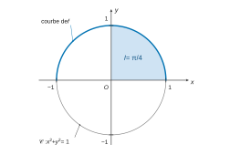
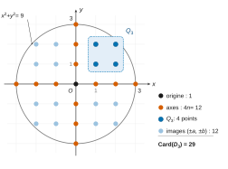
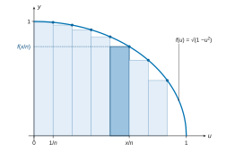
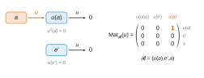
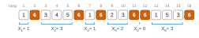

# G2E BCPST — Mathématiques 2026 · Corrigé brut

*Corrigé rédigé par IA, non officiel. Signalez toute erreur.*

Épreuve de 4 heures, calculatrices programmables et alphanumériques interdites, aucun document. Deux problèmes indépendants.

## Problème 1

Dans tout le problème, le repère du plan est orthonormal.

### Partie A : Calcul d'une intégrale à l'aide de deux fonctions intermédiaires

Sur $[1,+\infty[$ : $\varphi(t)=\dfrac{t^2-1}{t^2+1}$ et $\psi(t)=\dfrac{t}{t^2+1}+\arctan(t)$.

#### 1. (a)

Les fonctions $t\mapsto t^2-1$, $t\mapsto t$ et $t\mapsto t^2+1$ sont polynomiales, donc de classe $\mathcal C^1$ sur $\mathbb R$.

De plus, $t^2+1\geqslant 1>0$ ne s'annule pas. Par quotient, $\varphi$ et $t\mapsto t/(t^2+1)$ sont de classe $\mathcal C^1$ sur $[1,+\infty[$.

La fonction $\arctan$ est de classe $\mathcal C^1$ sur $\mathbb R$, de dérivée $t\mapsto 1/(1+t^2)$.

Par somme, $\psi$ est de classe $\mathcal C^1$ sur $[1,+\infty[$.

$$\varphi'(t)=\frac{2t(t^2+1)-(t^2-1)\,2t}{(t^2+1)^2}=\frac{4t}{(t^2+1)^2}.$$

$$\begin{aligned}
\psi'(t)&=\frac{(t^2+1)-2t^2}{(t^2+1)^2}+\frac{1}{t^2+1}\\
&=\frac{1-t^2+t^2+1}{(t^2+1)^2}\\
&=\frac{2}{(t^2+1)^2}.
\end{aligned}$$

Ainsi, pour tout $t\geqslant 1$ :

$$\boxed{\begin{aligned}
\varphi'(t)&=\frac{4t}{(t^2+1)^2}\\
\psi'(t)&=\frac{2}{(t^2+1)^2}
\end{aligned}}$$

#### 1. (b)

Pour $t\geqslant 1$, on a $4t>0$, donc $\varphi'(t)>0$.

**$\varphi$ est strictement croissante sur $[1,+\infty[$.**

$\varphi$ est continue en $1$, donc

$$\begin{aligned}
\lim_{t\to1}\varphi(t)&=\varphi(1)\\
&=\frac{0}{2}\\
&=0.
\end{aligned}$$

En $+\infty$, pour $t\neq 0$ :

$$\varphi(t)=\frac{1-1/t^2}{1+1/t^2}\longrightarrow 1.$$

$$\boxed{\begin{aligned}
\lim_{t\to 1}\varphi(t)&=0\\
\lim_{t\to+\infty}\varphi(t)&=1
\end{aligned}}$$

Continue et strictement croissante, $\varphi$ réalise donc une bijection de $[1,+\infty[$ sur $[0,1[$.

#### 2. (a)

$f:x\mapsto\sqrt{1-x^2}$ est continue sur $[-1,1]$, donc $I=\int_0^1 f(x)\,\mathrm dx$ est l'intégrale d'une fonction continue sur un segment.

*Hypothèses.* Soit $A\geqslant 1$. Sur le segment $[1,A]$, $\varphi$ est de classe $\mathcal C^1$ (question 1(a)).

Elle est à valeurs dans $[0,\varphi(A)]\subset[0,1]$ (question 1(b)), intervalle sur lequel $f$ est continue.

Le théorème de changement de variable donne, avec $x=\varphi(t)$ et $\mathrm dx=\varphi'(t)\,\mathrm dt$ :

$$\int_{0}^{\varphi(A)}f(x)\,\mathrm dx=\int_1^A f(\varphi(t))\,\varphi'(t)\,\mathrm dt .$$

*Calcul.* On a

$$\begin{aligned}
1-\varphi(t)^2&=\frac{(t^2+1)^2-(t^2-1)^2}{(t^2+1)^2}\\
&=\frac{4t^2}{(t^2+1)^2}.
\end{aligned}$$

Comme $t>0$, on en déduit $f(\varphi(t))=\dfrac{2t}{t^2+1}$. D'où

$$f(\varphi(t))\,\varphi'(t)=\frac{2t}{t^2+1}\cdot\frac{4t}{(t^2+1)^2}=\frac{8t^2}{(t^2+1)^3}.$$

*Passage à la limite.* $F:y\mapsto\int_0^y f$ est continue sur $[0,1]$ (primitive de $f$ continue).

De plus, $\varphi(A)\to 1$ quand $A\to+\infty$, donc

$$\int_0^{\varphi(A)}f=F(\varphi(A))\xrightarrow[A\to+\infty]{}F(1)=I.$$

Ainsi $\int_1^A\frac{8t^2}{(t^2+1)^3}\,\mathrm dt$ admet la limite finie $I$ : l'intégrale impropre converge et

$$\boxed{I=\int_1^{+\infty}\frac{8t^2}{(t^2+1)^3}\,\mathrm dt.}$$

#### 2. (b)

Soit $A\geqslant1$. On pose, sur $[1,A]$, les fonctions de classe $\mathcal C^1$ suivantes :

$$\begin{aligned}
u(t)&=t, & u'(t)&=1,\\
v(t)&=-\frac{2}{(t^2+1)^2}, & v'(t)&=\frac{8t}{(t^2+1)^3}.
\end{aligned}$$

On a donc $u(t)v'(t)=\dfrac{8t^2}{(t^2+1)^3}$. Par intégration par parties :

$$\begin{aligned}
\int_1^A\frac{8t^2}{(t^2+1)^3}\,\mathrm dt&=\Big[-\frac{2t}{(t^2+1)^2}\Big]_1^A+\int_1^A\frac{2\,\mathrm dt}{(t^2+1)^2}\\
&=-\frac{2A}{(A^2+1)^2}+\frac12+2\int_1^A\frac{\mathrm dt}{(t^2+1)^2}.
\end{aligned}$$

Quand $A\to+\infty$, le membre de gauche tend vers $I$ (question 2(a)). Par ailleurs :

$$\begin{aligned}
0\leqslant\frac{2A}{(A^2+1)^2}&\leqslant\frac{2A}{A^4}\\
&=\frac{2}{A^3}\to0.
\end{aligned}$$

Donc $\int_1^A\frac{\mathrm dt}{(t^2+1)^2}$ a une limite finie : l'intégrale $\int_1^{+\infty}\frac{\mathrm dt}{(t^2+1)^2}$ converge et

$$\boxed{I=\frac12+2\int_1^{+\infty}\frac{\mathrm dt}{(t^2+1)^2}.}$$

#### 2. (c)

D'après 1(a), $\frac12\psi$ est une primitive de $t\mapsto\frac{1}{(t^2+1)^2}$ sur $[1,+\infty[$. Donc

$$2\int_1^{A}\frac{\mathrm dt}{(t^2+1)^2}=\psi(A)-\psi(1).$$

Or

$$\psi(1)=\frac12+\frac\pi4$$

et

$$\psi(A)=\frac{A}{A^2+1}+\arctan A\xrightarrow[A\to+\infty]{}0+\frac\pi2 .$$

Ainsi

$$\begin{aligned}
2\int_1^{+\infty}\frac{\mathrm dt}{(t^2+1)^2}&=\frac\pi2-\frac12-\frac\pi4\\
&=\frac\pi4-\frac12.
\end{aligned}$$

Avec 2(b) :

$$\begin{aligned}
I&=\frac12+\frac\pi4-\frac12\\
&=\frac\pi4.
\end{aligned}$$

$$\boxed{I=\frac{\pi}{4}.}$$

#### 3. (a)

Le cercle $\mathcal C$ de centre $O$ et de rayon $1$ est l'ensemble des points $M(x,y)$ tels que $OM=1$.

Le repère étant orthonormal, cela s'écrit $\sqrt{x^2+y^2}=1$ :

$$\boxed{\mathcal C:\ x^2+y^2=1.}$$

Un point de la courbe de $f$ s'écrit $(x,\sqrt{1-x^2})$ avec $x\in[-1,1]$, et

$$\begin{aligned}
x^2+\big(\sqrt{1-x^2}\big)^2&=x^2+1-x^2\\
&=1.
\end{aligned}$$

**Il appartient donc à $\mathcal C$.** Comme $f\geqslant 0$, la courbe de $f$ est le demi-cercle supérieur de $\mathcal C$.

#### 3. (b)

$f$ est continue et positive sur $[0,1]$, donc $I$ est l'aire du domaine

$$\{(x,y):0\leqslant x\leqslant 1,\ 0\leqslant y\leqslant\sqrt{1-x^2}\}.$$

Pour $x\in[0,1]$ et $y\geqslant 0$ :

$$y\leqslant\sqrt{1-x^2}\iff x^2+y^2\leqslant1.$$

Ce domaine est donc $\{x\geqslant0,\ y\geqslant0,\ x^2+y^2\leqslant1\}$, le quart du disque unité situé dans le premier quadrant.

Le repère étant orthonormal, son aire est le quart de celle du disque de rayon $1$ :

$$\boxed{I=\frac{\pi\cdot 1^2}{4}=\frac\pi4,}$$

ce qui confirme 2(c).

### Partie B : Dénombrement de points dans un disque

$D_n=\{(x,y)\in\mathbb Z^2,\ x^2+y^2\leqslant n^2\}$, $Q_n=\{(x,y)\in(\mathbb N^*)^2,\ x^2+y^2\leqslant n^2\}$.

#### 4.

- $D_1$ : on a $x^2\leqslant1$ et $y^2\leqslant 1$, donc $x,y\in\{-1,0,1\}$.
  - Parmi ces 9 couples, les couples $(\pm1,\pm1)$ donnent $2>1$.
  - Il reste $(0,0),(\pm1,0),(0,\pm1)$.
- $Q_1$ : si $x,y\geqslant1$, alors $x^2+y^2\geqslant2>1$, donc $Q_1=\varnothing$.
- $Q_3$ : $y\geqslant1$ impose $x^2\leqslant 8$, donc $x\in\{1,2\}$.
  - Pour $x=1$ : $y^2\leqslant8$, donc $y\in\{1,2\}$.
  - Pour $x=2$ : $y^2\leqslant5$, donc $y\in\{1,2\}$.
  - Donc $Q_3=\{(1,1),(1,2),(2,1),(2,2)\}$.

$$\boxed{\begin{aligned}
\operatorname{Card}(D_1)&=5\\
\operatorname{Card}(Q_1)&=0\\
\operatorname{Card}(Q_3)&=4
\end{aligned}}$$

#### 5. (a)

On partitionne $D_n$ en trois parties disjointes :

- l'origine $(0,0)$ : 1 point ;
- les points non nuls situés sur un axe, au nombre de $4n$ :
  - $(x,0)$ avec $x\neq0$ est dans $D_n$ si et seulement si $|x|\leqslant n$, soit $2n$ points ;
  - de même, il y a $2n$ points $(0,y)$ ;
- les points $(x,y)$ de $D_n$ tels que $x\neq0$ et $y\neq0$ :
  - l'application $(x,y)\mapsto(|x|,|y|)$ envoie cet ensemble dans $Q_n$, car $|x|,|y|\in\mathbb N^*$ et $|x|^2+|y|^2=x^2+y^2$ ;
  - tout $(a,b)\in Q_n$ a exactement quatre antécédents distincts $(\pm a,\pm b)$, tous dans $D_n$ (symétries par rapport aux axes et à l'origine) ;
  - cet ensemble a donc $4\operatorname{Card}(Q_n)$ éléments.

$$\boxed{\forall n\in\mathbb N^*,\quad \operatorname{Card}(D_n)=1+4n+4\operatorname{Card}(Q_n).}$$

#### 5. (b)

Si $(x,y)\in Q_n$, alors $y\geqslant1$, donc $x^2\leqslant n^2-1<n^2$ et $x\in\llbracket1,n-1\rrbracket$.

On compte $Q_n$ par colonnes : pour $x\in\llbracket1,n-1\rrbracket$ fixé et $y\in\mathbb N^*$,

$$\begin{aligned}
(x,y)\in Q_n&\iff y^2\leqslant n^2-x^2\\
&\iff y\leqslant\sqrt{n^2-x^2}\\
&\iff y\leqslant\big\lfloor\sqrt{n^2-x^2}\big\rfloor.
\end{aligned}$$

La deuxième équivalence vient de la croissance de la racine sur $\mathbb R_+$ ($y>0$). La troisième vient de ce que $y$ est entier.

En effet, si $y\leqslant t$ avec $y\in\mathbb Z$, alors $y\leqslant\lfloor t\rfloor$ par définition de la partie entière (plus grand entier inférieur ou égal à $t$). La réciproque vient de $\lfloor t\rfloor\leqslant t$.

La colonne d'abscisse $x$ contient donc $\lfloor\sqrt{n^2-x^2}\rfloor$ points. D'où, pour tout $n\in\mathbb N^*$ :

$$\boxed{\operatorname{Card}(Q_n)=\sum_{x=1}^{n-1}\big\lfloor\sqrt{n^2-x^2}\big\rfloor}$$

(somme vide, nulle, pour $n=1$, en accord avec $Q_1=\varnothing$).

#### 5. (c)

Pour tout réel $t$, $t-1<\lfloor t\rfloor\leqslant t$. On l'applique à $t=\sqrt{n^2-x^2}$ et on somme pour $x\in\llbracket1,n-1\rrbracket$ ($n-1$ termes) :

$$\sum_{x=1}^{n-1}\sqrt{n^2-x^2}-(n-1)\leqslant\operatorname{Card}(Q_n)\leqslant\sum_{x=1}^{n-1}\sqrt{n^2-x^2}.$$

Le terme $x=n$ de $\sum_{x=1}^{n}\sqrt{n^2-x^2}$ est nul, donc $\sum_{x=1}^{n-1}\sqrt{n^2-x^2}=\sum_{x=1}^{n}\sqrt{n^2-x^2}$.

Ainsi, pour tout $n\in\mathbb N^*$ :

$$\boxed{1-n+\sum_{x=1}^{n}\sqrt{n^2-x^2}\leqslant\operatorname{Card}(Q_n)\leqslant\sum_{x=1}^{n}\sqrt{n^2-x^2}.}$$

#### 6. (a)

Pour $x\in\llbracket1,n\rrbracket$, $\sqrt{n^2-x^2}=n\sqrt{1-(x/n)^2}$ ($n>0$), donc

$$\begin{aligned}
R_n&=\frac1{n^2}\sum_{x=1}^n n\sqrt{1-\Big(\frac xn\Big)^2}\\
&=\frac1n\sum_{x=1}^{n}f\Big(\frac xn\Big),
\end{aligned}$$

avec $f(u)=\sqrt{1-u^2}$.

**$R_n$ est la somme de Riemann (à droite, pas $1/n$) de la fonction $f:u\mapsto\sqrt{1-u^2}$ sur le segment $[0,1]$.** Elle est associée à la subdivision régulière $\big(\frac kn\big)_{0\leqslant k\leqslant n}$.

#### 6. (b)

$f$ est continue sur le segment $[0,1]$, donc la suite de ses sommes de Riemann converge vers son intégrale :

$$\boxed{R_n\xrightarrow[n\to+\infty]{}\int_0^1\sqrt{1-u^2}\,\mathrm du=I=\frac\pi4.}$$

#### 6. (c)

En divisant l'encadrement de 5(c) par $n^2>0$ :

$$\frac{1-n}{n^2}+R_n\leqslant\frac{\operatorname{Card}(Q_n)}{n^2}\leqslant R_n .$$

Comme $\frac{1-n}{n^2}\to0$ et $R_n\to\frac\pi4$, le théorème des gendarmes donne $\frac{\operatorname{Card}(Q_n)}{n^2}\to\frac\pi4\neq0$, c'est-à-dire

$$\boxed{\operatorname{Card}(Q_n)\underset{n\to+\infty}{\sim}\frac{\pi n^2}{4}.}$$

Avec 5(a) :

$$\begin{aligned}
\frac{\operatorname{Card}(D_n)}{n^2}&=\frac1{n^2}+\frac4n+4\,\frac{\operatorname{Card}(Q_n)}{n^2}\\
&\longrightarrow 0+0+4\cdot\frac\pi4=\pi.
\end{aligned}$$

Cette limite est non nulle, donc

$$\boxed{\operatorname{Card}(D_n)\underset{n\to+\infty}{\sim}\pi n^2.}$$

### Partie C : Convergence en loi

$X_n,Y_n\hookrightarrow\mathcal U(\llbracket-n,n\rrbracket)$, et $(X_1,\dots,X_N,Y_1,\dots,Y_N)$ sont mutuellement indépendantes pour tout $N$.

On a $Z_n=1$ si $X_n^2+Y_n^2\leqslant n^2$, et $0$ sinon.

#### 7. (a)

$X_n$ est finie, de loi $P(X_n=k)=\frac1{2n+1}$ pour $k\in\llbracket-n,n\rrbracket$, donc

$$\begin{aligned}
E(X_n)&=\frac{1}{2n+1}\sum_{k=-n}^{n}k\\
&=0,
\end{aligned}$$

la somme étant nulle (les termes $k$ et $-k$ se compensent ; le changement d'indice $k\mapsto-k$ montre qu'elle est égale à son opposée).

$$\boxed{\forall n\in\mathbb N^*,\quad E(X_n)=0.}$$

#### 7. (b)

Par la formule de König-Huygens et 7(a), $V(X_n)=E(X_n^2)-E(X_n)^2=E(X_n^2)$. Par le théorème de transfert :

$$\begin{aligned}
E(X_n^2)&=\frac1{2n+1}\sum_{k=-n}^nk^2\\
&=\frac{2}{2n+1}\sum_{k=1}^nk^2\\
&=\frac{2}{2n+1}\cdot\frac{n(n+1)(2n+1)}{6}\\
&=\frac{n(n+1)}3 .
\end{aligned}$$

$$\boxed{\forall n\in\mathbb N^*,\quad V(X_n)=\frac{n(n+1)}{3}.}$$

#### 8. (a)

Soit $N\in\mathbb N^*$. Pour tout $n$, $Z_n=h_n(X_n,Y_n)$ avec

$$h_n(x,y)=\begin{cases}1&\text{si } x^2+y^2\leqslant n^2,\\0&\text{sinon.}\end{cases}$$

La famille $(X_1,\dots,X_N,Y_1,\dots,Y_N)$ est mutuellement indépendante et les paquets $\{X_1,Y_1\},\dots,\{X_N,Y_N\}$ sont disjoints.

D'après le lemme des coalitions, $h_1(X_1,Y_1),\dots,h_N(X_N,Y_N)$, c'est-à-dire $Z_1,\dots,Z_N$, sont mutuellement indépendantes. Ceci valant pour tout $N$ :

**les variables aléatoires $(Z_n)_{n\in\mathbb N^*}$ sont mutuellement indépendantes.**

#### 8. (b)

$Z_n(\Omega)\subset\{0,1\}$, donc $Z_n$ suit une loi de Bernoulli de paramètre $p_n=P(Z_n=1)$.

Les variables $X_n$ et $Y_n$ sont indépendantes. Pour $(x,y)\in\llbracket-n,n\rrbracket^2$, on a donc $P(X_n=x,Y_n=y)=\frac{1}{(2n+1)^2}$.

Le couple est ainsi uniforme sur $\llbracket-n,n\rrbracket^2$, de cardinal $(2n+1)^2$.

Si $(x,y)\in\mathbb Z^2$ vérifie $x^2+y^2\leqslant n^2$, alors $|x|\leqslant n$ et $|y|\leqslant n$.

L'ensemble des couples favorables de $\llbracket-n,n\rrbracket^2$ est donc exactement $D_n$. Donc

$$\boxed{Z_n\hookrightarrow\mathcal B\left(\frac{\operatorname{Card}(D_n)}{(2n+1)^2}\right).}$$

#### 9. (a)

Soient $(T_n)$ une suite de variables aléatoires et $T$ une variable aléatoire, toutes à valeurs dans $\mathbb N$.

La suite $(T_n)$ converge en loi vers $T$ si et seulement si, pour tout $k\in\mathbb N$ :

$$\boxed{P(T_n=k)\xrightarrow[n\to+\infty]{}P(T=k).}$$

#### 9. (b)

D'après 6(c), $\operatorname{Card}(D_n)\sim\pi n^2$, et $(2n+1)^2\sim4n^2$.

Par quotient d'équivalents, $p_n\sim\frac{\pi n^2}{4n^2}=\frac\pi4$, donc $p_n\to\frac\pi4$.

Les $Z_n$ sont à valeurs dans $\{0,1\}\subset\mathbb N$ et

$$\begin{aligned}
P(Z_n=1)&=p_n\to\frac\pi4,\\
P(Z_n=0)&=1-p_n\to1-\frac\pi4,\\
P(Z_n=k)&=0\ \text{ pour } k\geqslant2.
\end{aligned}$$

Comme $3<\pi<4$, on a $\frac\pi4\in\,]0,1[$ et l'on peut considérer $Z\hookrightarrow\mathcal B(\pi/4)$.

Les limites ci-dessus sont exactement les $P(Z=k)$, $k\in\mathbb N$. Donc $(Z_n)$ converge en loi vers $Z$, avec

$$\boxed{\begin{aligned}
Z&\hookrightarrow\mathcal B\Big(\frac\pi4\Big)\\
E(Z)&=\frac\pi4\\
V(Z)&=\frac\pi4\Big(1-\frac\pi4\Big)
\end{aligned}}$$

#### 10. (a)

Notons $\overline Z_n=\frac1n\sum_{k=1}^nZ_k$ la moyenne empirique. Par linéarité de l'espérance et 8(b), $E(\overline Z_n)=\frac1n\sum_{k=1}^n p_k$.

La suite $(p_k)$ converge vers $\frac\pi4$ (question 9(b)), donc par le théorème de Cesàro :

$$\boxed{E(\overline Z_n)=\frac1n\sum_{k=1}^np_k\xrightarrow[n\to+\infty]{}\frac\pi4.}$$

#### 10. (b)

Les $Z_k$ sont mutuellement indépendantes (8(a)), donc la variance de leur somme est la somme des variances :

$$\begin{aligned}
V(\overline Z_n)&=\frac1{n^2}\sum_{k=1}^nV(Z_k)\\
&=\frac1n\cdot\Big(\frac1n\sum_{k=1}^np_k(1-p_k)\Big).
\end{aligned}$$

Par continuité de $t\mapsto t(1-t)$, $p_k(1-p_k)\to\frac\pi4\big(1-\frac\pi4\big)$. Par Cesàro, la parenthèse converge donc vers ce réel ; multipliée par $\frac1n\to0$, elle donne

$$\boxed{V(\overline Z_n)\xrightarrow[n\to+\infty]{}0.}$$

## Problème 2

### Partie A : Matrice de carré nul

#### 1. (a)

$$\begin{aligned}
S^2&=O_2,\\
T^2&=\begin{pmatrix}0&0&0\\0&0&0\\2&0&0\end{pmatrix}\neq O_3,\\
U^2&=O_3.
\end{aligned}$$

**Les matrices de carré nul sont $S$ et $U$** ; $T$ ne l'est pas.

#### 1. (b)

Soit $A$ telle que $A^2=O_n$. Soit $\lambda$ une valeur propre de $A$, de vecteur propre $X\neq0$ : $AX=\lambda X$. Alors

$$\begin{aligned}
A^2X&=A(\lambda X)\\
&=\lambda AX\\
&=\lambda^2X.
\end{aligned}$$

Or $A^2X=0$. Donc $\lambda^2X=0$ avec $X\neq0$, d'où $\lambda^2=0$ :

$$\boxed{\lambda=0.}$$

#### 1. (c)

Soit $A=(a_{ij})$ symétrique avec $A^2=O_n$. Le coefficient diagonal $(i,i)$ de $A^2$ vaut

$$\begin{aligned}
(A^2)_{ii}&=\sum_{k=1}^na_{ik}a_{ki}\\
&=\sum_{k=1}^na_{ik}^2
\end{aligned}$$

car $a_{ki}=a_{ik}$. Il est nul : une somme de carrés de réels nulle a tous ses termes nuls, donc $a_{ik}=0$ pour tous $i,k$ :

$$\boxed{A=O_n.}$$

(Variante : $A$ symétrique réelle est diagonalisable, $A=PDP^{-1}$ avec $D$ diagonale formée des valeurs propres. Celles-ci sont toutes nulles d'après 1(b), donc $D=O_n$ et $A=O_n$.)

#### 2. (a)

Si $m=1$, $A=O_2$ donc $A^2=O_2$ ; si $m=2$, $A^2=O_2$ est l'hypothèse. **Dans les deux cas $A^2=O_2$.**

#### 2. (b)

Supposons que l'on ait $A^2X=0$ pour tout $X\in\mathcal M_{2,1}(\mathbb R)$. Prenons $X=E_1$ puis $X=E_2$ (colonnes de la base canonique).

Les deux colonnes de $A^2$ sont alors nulles et $A^2=O_2$, ce qui est exclu.

**Il existe donc $X\in\mathcal M_{2,1}(\mathbb R)$ tel que $A^2X\neq0$.**

#### 2. (c)

On a $A^3=O_2$, donc $A^4=A\cdot A^3=O_2$. Soient $\alpha,\beta,\gamma$ réels tels que $\alpha X+\beta AX+\gamma A^2X=0$.

- En multipliant à gauche par $A^2$ : $\alpha A^2X+\beta A^3X+\gamma A^4X=\alpha A^2X=0$. Comme $A^2X\neq0$, $\alpha=0$.
- Il reste $\beta AX+\gamma A^2X=0$ ; en multipliant par $A$ : $\beta A^2X=0$, donc $\beta=0$.
- Il reste $\gamma A^2X=0$, donc $\gamma=0$.

La famille $(X,AX,A^2X)$ est libre. Or $\mathcal M_{2,1}(\mathbb R)$ est de dimension $2$, et une famille libre y compte au plus $2$ vecteurs : contradiction.

Donc $A^2=O_2$, et avec 2(a) :

**pour $A\in\mathcal M_2(\mathbb R)$, s'il existe $m\in\{1,2,3\}$ tel que $A^m=O_2$, alors $A^2=O_2$.**

#### 3.

Soient $M,N\in\mathcal M_2(\mathbb R)$ avec $(MN)^2=O_2$. Par associativité,

$$\begin{aligned}
(NM)^3&=NMNMNM\\
&=N(MN)(MN)M\\
&=N(MN)^2M\\
&=O_2 .
\end{aligned}$$

La matrice $NM\in\mathcal M_2(\mathbb R)$ vérifie $(NM)^3=O_2$. D'après la question 2 (avec $m=3$), **$(NM)^2=O_2$ : $NM$ est de carré nul.**

### Partie B : Endomorphisme de $\mathbb R^3$ de carré nul

#### 4.

Si $u=0$, prenons une base $\mathcal B$ quelconque de $\mathbb R^3$ (par exemple la base canonique).

Toutes les colonnes de $\operatorname{Mat}_{\mathcal B}(u)$ sont nulles : $\operatorname{Mat}_{\mathcal B}(u)=O_3$.

C'est la forme voulue avec **$\varepsilon=0$ (et n'importe quelle base $\mathcal B$).**

#### 5. (a)

Comme $u\neq0$, il existe $a\in\mathbb R^3$ tel que $u(a)\neq0$.

Soient $\alpha,\beta$ réels tels que $\alpha u(a)+\beta a=0$. En appliquant $u$ (linéaire) :

$$\alpha u^2(a)+\beta u(a)=\beta u(a)=0.$$

Donc $\beta=0$ puisque $u(a)\neq0$ ; puis $\alpha u(a)=0$ donne $\alpha=0$.

**La famille $(u(a),a)$ est libre.**

#### 5. (b)

$(u(a),a)$ est une famille libre de $\mathbb R^3$, espace de dimension finie $3$.

D'après le théorème de la base incomplète, on peut la compléter en une base de $\mathbb R^3$. Comme elle a $2$ vecteurs, il suffit d'en ajouter un.

**Il existe $e\in\mathbb R^3$ tel que $\mathcal A=(u(a),a,e)$ soit une base de $\mathbb R^3$.**

#### 5. (c)

On a, dans la base $\mathcal A$ :

$$\begin{aligned}
a&=0\cdot u(a)+1\cdot a+0\cdot e,\\
u(a)&=1\cdot u(a)+0\cdot a+0\cdot e.
\end{aligned}$$

Par unicité des coordonnées dans la base $\mathcal A$ :

$$\boxed{\begin{aligned}
a_1&=0\\
u(a)_1&=1
\end{aligned}}$$

#### 6. (a)

D'après 5(c), et puisque $u(u(a))=u^2(a)=0$ a une première coordonnée nulle :

$$\begin{aligned}
\varphi(a)&=(a_1,u(a)_1)=(0,1),\\
\varphi(u(a))&=(u(a)_1,u^2(a)_1)=(1,0).
\end{aligned}$$

L'image de $\varphi$ contient la base $\big((1,0),(0,1)\big)$ de $\mathbb R^2$.

Donc $\operatorname{Im}\varphi=\mathbb R^2$ et

$$\boxed{\operatorname{rg}(\varphi)=2.}$$

Par le théorème du rang appliqué à $\varphi\in\mathcal L(\mathbb R^3,\mathbb R^2)$ : $\dim\operatorname{Ker}\varphi=3-2=1$.

**$\operatorname{Ker}(\varphi)$ est une droite vectorielle de $\mathbb R^3$.**

#### 6. (b)

Soit $e'$ un vecteur directeur de $\operatorname{Ker}\varphi$ : $e'\neq0$ et $\varphi(e')=(0,0)$.

Soient $\alpha,\beta,\gamma$ réels tels que $\alpha u(a)+\beta e'+\gamma a=0$. En appliquant $\varphi$ (linéaire) :

$$\alpha(1,0)+\beta(0,0)+\gamma(0,1)=(\alpha,\gamma)=(0,0),$$

donc $\alpha=\gamma=0$, puis $\beta e'=0$ et $\beta=0$.

La famille $\mathcal B=(u(a),e',a)$ est libre et a $3=\dim\mathbb R^3$ vecteurs : **$\mathcal B$ est une base de $\mathbb R^3$.**

#### 6. (c)

Comme $\varphi(e')=(e'_1,u(e')_1)=(0,0)$, on a $u(e')_1=0$. Alors

$$\varphi(u(e'))=\big(u(e')_1,\ u^2(e')_1\big)=(0,0)$$

car $u^2=0$. Donc **$u(e')\in\operatorname{Ker}\varphi$**.

Ce noyau est la droite $\operatorname{Vect}(e')$ : il existe $\mu\in\mathbb R$ tel que $u(e')=\mu e'$.

Ainsi $e'\neq0$ est un vecteur propre de $u$ associé à $\mu$. Comme en 1(b), on applique $u$ :

$$\begin{aligned}
0&=u^2(e')\\
&=\mu\,u(e')\\
&=\mu^2e'.
\end{aligned}$$

D'où $\mu^2=0$ puisque $e'\neq0$. Ainsi $\mu=0$ et

$$\boxed{u(e')=0.}$$

#### 6. (d)

Dans la base $\mathcal B=(u(a),e',a)$ :

$$\begin{aligned}
u(u(a))&=0,\\
u(e')&=0\quad\text{(question 6(c))},\\
u(a)&=1\cdot u(a)+0\cdot e'+0\cdot a.
\end{aligned}$$

Donc

$$\operatorname{Mat}_{\mathcal B}(u)=\begin{pmatrix}0&0&1\\0&0&0\\0&0&0\end{pmatrix},$$

forme voulue avec $\varepsilon=1$. On conclut avec la question 4 (cas $u=0$, $\varepsilon=0$).

**Pour tout endomorphisme $u$ de $\mathbb R^3$ de carré nul, il existe une base $\mathcal B$ de $\mathbb R^3$ et $\varepsilon\in\{0,1\}$ tels que**

$$\boxed{\operatorname{Mat}_{\mathcal B}(u)=\begin{pmatrix}0&0&\varepsilon\\0&0&0\\0&0&0\end{pmatrix},}$$

**avec $\varepsilon=0$ si $u=0$ et $\varepsilon=1$ sinon.**

### Partie C : Avec un dé

Les lancers sont indépendants et chacun donne $6$ avec probabilité $\frac16$. L'événement « on n'obtient jamais six fois le $6$ » est de probabilité nulle et n'affecte aucun calcul.

#### 7. (a)

Soit $G$ le rang du premier six. C'est le temps d'attente du premier succès dans une suite d'épreuves de Bernoulli indépendantes de paramètre $\frac16$.

Ainsi $G\hookrightarrow\mathcal G(\frac16)$, $G(\Omega)=\mathbb N^*$, et pour $k\in\mathbb N^*$ :

$$P(G=k)=\frac16\Big(\frac56\Big)^{k-1}.$$

Le nombre de lancers avant le premier six est $X_1=G-1$, donc $X_1(\Omega)=\mathbb N$ et, pour tout $n\in\mathbb N$ :

$$\boxed{\begin{aligned}
P(X_1=n)&=P(G=n+1)\\
&=\frac16\Big(\frac56\Big)^{n}.
\end{aligned}}$$

Avec $p=\frac16$ :

$$\begin{aligned}
E(G)&=\frac1p=6,\\
V(G)&=\frac{1-p}{p^2}\\
&=\frac{5/6}{1/36}=30.
\end{aligned}$$

Donc :

$$\boxed{\begin{aligned}
E(X_1)&=E(G)-1=5\\
V(X_1)&=V(G)=30
\end{aligned}}$$

#### 7. (b)

Soient $n_1,\dots,n_6\in\mathbb N$, et notons $H$ l'événement $\{X_1=n_1,\dots,X_6=n_6\}$.

Il signifie exactement que, parmi les $n_1+\dots+n_6+6$ premiers lancers, ceux de rangs

$$n_1+1,\quad n_1+n_2+2,\quad\dots,\quad n_1+\dots+n_6+6$$

donnent $6$, et que tous les autres donnent autre chose que $6$. Par indépendance des lancers :

$$P(H)=\prod_{i=1}^6\frac16\Big(\frac56\Big)^{n_i}.$$

En sommant sur les $n_j$, $j\neq i$ (séries géométriques de somme $1$), on obtient

$$P(X_i=n_i)=\frac16\Big(\frac56\Big)^{n_i},$$

et la loi conjointe est le produit des lois marginales.

**Les variables $X_1,\dots,X_6$ sont mutuellement indépendantes et suivent toutes la même loi que $X_1$** (géométrique décalée : $X_i+1\hookrightarrow\mathcal G(\frac16)$), d'espérance $5$ et de variance $30$.

#### 8. (a)

$P(X_i=0)=\frac16$ pour tout $i$. Par indépendance mutuelle de $X_1,X_4,X_6$ :

$$\boxed{\begin{aligned}
P(X_1=X_4=X_6=0)&=\Big(\frac16\Big)^3\\
&=\frac1{216}.
\end{aligned}}$$

#### 8. (b)

Par la formule de Poincaré et l'indépendance de $X_2$ et $X_5$ :

$$\begin{aligned}
P(\{X_2=0\}\cup\{X_5=0\})&=\frac16+\frac16-\frac16\cdot\frac16\\
&=\boxed{\frac{11}{36}.}
\end{aligned}$$

(Contrôle par le complémentaire : $1-\big(\frac56\big)^2=\frac{11}{36}$.)

#### 9.

Écrivons $A=A(\omega)$. Un calcul direct donne

$$A^2=\begin{pmatrix}X_1^2&X_1X_2+X_2X_4&X_1X_3+X_2X_5+X_3X_6\\0&X_4^2&X_4X_5+X_5X_6\\0&0&X_6^2\end{pmatrix}.$$

Si $A^2=O_3$, les coefficients diagonaux donnent $X_1=X_4=X_6=0$.

Alors $A^2$ se réduit à la matrice dont le seul coefficient éventuellement non nul est $(A^2)_{13}=X_2X_5$.

Réciproquement, si $X_1=X_4=X_6=0$ et $X_2X_5=0$, tous les coefficients de $A^2$ sont nuls. Donc

$$\begin{aligned}
\{A^2=O_3\}&=\big(\{X_1=0\}\cap\{X_4=0\}\cap\{X_6=0\}\big)\\
&\quad\cap\big(\{X_2=0\}\cup\{X_5=0\}\big).
\end{aligned}$$

Le premier événement ne dépend que de $(X_1,X_4,X_6)$, le second que de $(X_2,X_5)$.

Ces paquets sont disjoints et $X_1,\dots,X_6$ sont mutuellement indépendantes (7(b)). Par le lemme des coalitions, les deux événements sont donc indépendants. Avec 8(a) et 8(b) :

$$\boxed{\begin{aligned}
P(A^2=O_3)&=\frac1{216}\cdot\frac{11}{36}\\
&=\frac{11}{7776}\\
&\approx1{,}41\times10^{-3}.
\end{aligned}}$$
