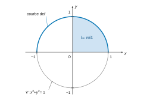
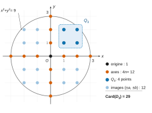
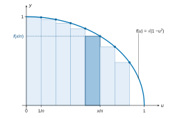
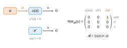
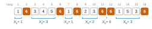

# G2E BCPST — Mathématiques 2026 · Corrigé guidé

*Corrigé rédigé par IA, non officiel. Signalez toute erreur.*

## Présentation du sujet

**Format.** Épreuve de 4 heures, calculatrices programmables et alphanumériques interdites, aucun document. L'énoncé demande de respecter ses notations et de préciser la numérotation de chaque question : comme les deux problèmes sont numérotés à partir de 1, écrivez « Problème 2, question 5(b) » et non « 5(b) ».

**Deux problèmes indépendants, 42 questions en tout.**

- **Problème 1 (22 questions) : trois façons d'obtenir $\pi/4$.**
  - *Partie A* (analyse) : on calcule $I=\int_0^1\sqrt{1-x^2}\,\mathrm dx$ par le changement de variable $x=\varphi(t)$, qui transforme l'intégrale sur un segment en une intégrale impropre sur $[1,+\infty[$, puis par une intégration par parties ; la fonction $\psi$ fournie par l'énoncé est la primitive qui conclut. On retrouve ensuite le résultat géométriquement (aire d'un quart de disque).
  - *Partie B* (dénombrement) : on compte les points à coordonnées entières d'un disque de rayon $n$, on encadre ce nombre avec des parties entières, puis une somme de Riemann ramène tout à l'intégrale $I$ : $\operatorname{Card}(D_n)\sim\pi n^2$.
  - *Partie C* (probabilités) : un point tiré uniformément dans le carré $\llbracket-n,n\rrbracket^2$ tombe dans le disque avec une probabilité qui tend vers $\pi/4$ ; on en déduit une convergence en loi vers une loi de Bernoulli, puis le comportement de la moyenne empirique (théorème de Cesàro admis).
- **Problème 2 (20 questions) : l'équation $A^2=O$.**
  - *Partie A* : valeurs propres d'une matrice de carré nul, cas des matrices symétriques, puis en taille 2 : $A^3=O_2\Rightarrow A^2=O_2$, et application à $MN$ / $NM$.
  - *Partie B* : réduction d'un endomorphisme $u$ de $\mathbb R^3$ tel que $u^2=0$, entièrement guidée (base incomplète, théorème du rang).
  - *Partie C* : lancers d'un dé jusqu'au sixième six, lois géométriques, indépendance ; la dernière question demande la probabilité qu'une matrice triangulaire formée avec les $X_i$ soit de carré nul, et réunit les parties A et C.

**Notions mobilisées** (programme BCPST) : dérivation, changement de variable et intégration par parties, intégrales impropres, sommes de Riemann, partie entière, équivalents et théorème des gendarmes ; lois uniforme, de Bernoulli et géométrique, espérance et variance, indépendance et lemme des coalitions, convergence en loi ; calcul matriciel, valeurs propres, familles libres, base incomplète, théorème du rang, matrice d'un endomorphisme.

**Difficulté et gestion du temps.** Le sujet est long mais très guidé, sans question vraiment difficile. Les questions qui demandent le plus de soin sont P1 2(a) (hypothèses du changement de variable et borne infinie), P1 5(a)–5(c) (dénombrement rigoureux et décalage d'indices) et P2 2(c). Les questions à ne pas laisser passer : P1 1, 3, 4, 7, 9(a) ; P2 1(a), 1(b), 2(a), 3, 4, 5(c), 7(a), 8. Comptez environ 1 h 50 par problème et gardez du temps pour relire. Si vous bloquez, admettez le résultat donné par l'énoncé (par exemple $I=\pi/4$) et continuez : toutes les parties restent accessibles.

## Problème 1 — Partie A : calcul d'une intégrale à l'aide de deux fonctions intermédiaires

On travaille avec $\varphi(t)=\dfrac{t^2-1}{t^2+1}$ et $\psi(t)=\dfrac{t}{t^2+1}+\arctan t$ sur $[1,+\infty[$. La partie est un calcul d'intégrale classique dont toutes les étapes sont indiquées : il faut surtout bien justifier le changement de variable vers une borne infinie.

### Question 1(a)

> [!INDICATION]
> Opérations sur les fonctions de classe $\mathcal C^1$ : quel dénominateur faut-il contrôler ?

> [!INDICATION]
> Pour $\psi'$, mettez les deux termes sur le dénominateur commun $(t^2+1)^2$ et simplifiez jusqu'au bout : la forme obtenue resservira.

#### Solution

Les fonctions $t\mapsto t^2-1$, $t\mapsto t$, $t\mapsto t^2+1$ sont polynomiales, donc de classe $\mathcal C^1$ sur $\mathbb R$.

De plus, $t^2+1\geqslant1>0$. Par quotient, $\varphi$ et $t\mapsto t/(t^2+1)$ sont de classe $\mathcal C^1$ sur $[1,+\infty[$.

La fonction $\arctan$ est de classe $\mathcal C^1$ sur $\mathbb R$, de dérivée $1/(1+t^2)$. Par somme, $\psi$ est de classe $\mathcal C^1$.

$$\varphi'(t)=\frac{2t(t^2+1)-(t^2-1)2t}{(t^2+1)^2}=\frac{4t}{(t^2+1)^2},$$

$$\psi'(t)=\frac{(t^2+1)-2t^2}{(t^2+1)^2}+\frac{t^2+1}{(t^2+1)^2}=\frac{2}{(t^2+1)^2}.$$

$$\boxed{\begin{aligned}
\varphi'(t)&=\frac{4t}{(t^2+1)^2}\\
\psi'(t)&=\frac{2}{(t^2+1)^2}
\end{aligned}}$$

> [!METHODE]
> Quand l'énoncé fournit une fonction sans dire à quoi elle sert, simplifiez sa dérivée au maximum : c'est souvent une primitive « offerte » pour une question ultérieure (ici, la 2(c)).

### Question 1(b)

> [!INDICATION]
> Le signe de $\varphi'$ est immédiat sur $[1,+\infty[$.

> [!INDICATION]
> En $+\infty$, factorisez par le terme dominant au numérateur et au dénominateur.

#### Solution

Pour $t\geqslant1$, $\varphi'(t)>0$ : **$\varphi$ est strictement croissante sur $[1,+\infty[$.**

Elle est continue en $1$, donc $\lim_{t\to1}\varphi(t)=\varphi(1)=0$. Pour $t\neq0$,

$$\varphi(t)=\frac{1-1/t^2}{1+1/t^2}\xrightarrow[t\to+\infty]{}1 .$$

$$\boxed{\begin{aligned}
\lim_{t\to1}\varphi(t)&=0\\
\lim_{t\to+\infty}\varphi(t)&=1
\end{aligned}}$$

Continue et strictement croissante, $\varphi$ est une bijection de $[1,+\infty[$ sur $[0,1[$.

> [!PIEGE]
> L'intervalle image est $[0,1[$ et non $[0,1]$ : la valeur $1$ n'est jamais atteinte. C'est pour cela que l'intégrale transformée en 2(a) aura une borne infinie.

### Question 2(a)

> [!INDICATION]
> Le théorème de changement de variable du cours s'énonce sur un segment. Comment faire avec $[1,+\infty[$ ?

> [!INDICATION]
> Travaillez sur $[1,A]$, puis faites tendre $A$ vers $+\infty$ en utilisant la continuité de $y\mapsto\int_0^yf$.

> [!INDICATION]
> Pour simplifier $f(\varphi(t))$, calculez $1-\varphi(t)^2$ à l'aide de $\alpha^2-\beta^2=(\alpha-\beta)(\alpha+\beta)$ ; attention au signe en sortant de la racine.

#### Solution

$f$ est continue sur $[0,1]$ : $I$ est une intégrale sur un segment.

*Hypothèses.* Soit $A\geqslant1$. Sur $[1,A]$, $\varphi$ est de classe $\mathcal C^1$ (1(a)) et strictement croissante.

Elle est à valeurs dans $[0,\varphi(A)]\subset[0,1]$ (1(b)), et $f$ est continue sur cet intervalle.

Le changement de variable $x=\varphi(t)$, $\mathrm dx=\varphi'(t)\,\mathrm dt$ donne

$$\int_0^{\varphi(A)}f(x)\,\mathrm dx=\int_1^Af(\varphi(t))\varphi'(t)\,\mathrm dt .$$

*Calcul.* On a

$$\begin{aligned}
1-\varphi(t)^2&=\frac{(t^2+1)^2-(t^2-1)^2}{(t^2+1)^2}\\
&=\frac{2\cdot2t^2}{(t^2+1)^2}.
\end{aligned}$$

Comme $t>0$, $f(\varphi(t))=\dfrac{2t}{t^2+1}$, puis

$$f(\varphi(t))\varphi'(t)=\frac{8t^2}{(t^2+1)^3}.$$

*Limite.* $F:y\mapsto\int_0^yf$ est continue sur $[0,1]$ et $\varphi(A)\to1$, donc $\int_0^{\varphi(A)}f\to I$.

Ainsi $\int_1^A\frac{8t^2}{(t^2+1)^3}\,\mathrm dt$ a une limite finie quand $A\to+\infty$ : l'intégrale impropre converge et

$$\boxed{I=\int_1^{+\infty}\frac{8t^2}{(t^2+1)^3}\,\mathrm dt.}$$

> [!METHODE]
> Pour une intégrale impropre, on raisonne sur un segment $[a,A]$ puis on passe à la limite. Cette démarche démontre en même temps la convergence de l'intégrale obtenue.

> [!JURY]
> Quand l'énoncé demande de détailler les hypothèses d'un théorème, chacune doit être écrite : classe $\mathcal C^1$ de $\varphi$, continuité de $f$ sur l'intervalle image, et traitement de la borne infinie.

### Question 2(b)

> [!INDICATION]
> Écrivez $8t^2=t\cdot 8t$ et repérez la dérivée de $t^2+1$ dans $\dfrac{8t}{(t^2+1)^3}$.

> [!INDICATION]
> Faites l'intégration par parties sur $[1,A]$ ; le terme tout intégré en $A$ doit tendre vers $0$.

#### Solution

Soit $A\geqslant1$. On prend les fonctions de classe $\mathcal C^1$

$$\begin{aligned}
u(t)&=t,\\
v(t)&=-\frac{2}{(t^2+1)^2},\quad\text{de dérivée } v'(t)=\frac{8t}{(t^2+1)^3}.
\end{aligned}$$

L'intégration par parties donne :

$$\begin{aligned}
\int_1^A\frac{8t^2}{(t^2+1)^3}\,\mathrm dt&=\Big[-\frac{2t}{(t^2+1)^2}\Big]_1^A+2\int_1^A\frac{\mathrm dt}{(t^2+1)^2}\\
&=-\frac{2A}{(A^2+1)^2}+\frac12+2\int_1^A\frac{\mathrm dt}{(t^2+1)^2}.
\end{aligned}$$

Quand $A\to+\infty$, le membre de gauche tend vers $I$, et $0\leqslant\frac{2A}{(A^2+1)^2}\leqslant\frac2{A^3}\to0$.

Donc $\int_1^{+\infty}\frac{\mathrm dt}{(t^2+1)^2}$ converge et

$$\boxed{I=\frac12+2\int_1^{+\infty}\frac{\mathrm dt}{(t^2+1)^2}.}$$

> [!PIEGE]
> En $t=1$, le crochet vaut $-\frac{2}{4}=-\frac12$, et on le **retranche** : d'où $+\frac12$. Une erreur de signe ici conduit à $I=\frac\pi4-1<0$, absurde pour l'intégrale d'une fonction positive.

### Question 2(c)

> [!INDICATION]
> Relisez la question 1(a) : une primitive de $t\mapsto\frac{1}{(t^2+1)^2}$ est sous vos yeux.

#### Solution

D'après 1(a), $2\int_1^A\frac{\mathrm dt}{(t^2+1)^2}=\psi(A)-\psi(1)$.

Or $\psi(1)=\frac12+\frac\pi4$ et $\psi(A)=\frac{A}{A^2+1}+\arctan A\to\frac\pi2$. Donc

$$\begin{aligned}
2\int_1^{+\infty}\frac{\mathrm dt}{(t^2+1)^2}&=\frac\pi2-\frac12-\frac\pi4\\
&=\frac\pi4-\frac12.
\end{aligned}$$

Avec 2(b) :

$$\begin{aligned}
I&=\frac12+\frac\pi4-\frac12\\
&=\boxed{\frac\pi4.}
\end{aligned}$$

> [!METHODE]
> Contrôle gratuit : $0\leqslant f\leqslant1$ sur $[0,1]$ et $f(x)\geqslant1-x$ (la corde est sous l'arc), donc $\frac12\leqslant I\leqslant1$. La valeur $\frac\pi4\approx0{,}785$ est plausible.

### Question 3(a)

> [!INDICATION]
> Traduisez « $OM=1$ » dans un repère orthonormal, puis vérifiez l'équation pour le point $(x,f(x))$.

#### Solution

$M(x,y)\in\mathcal C\iff OM=1\iff x^2+y^2=1$ (repère orthonormal) :

$$\boxed{\mathcal C:\ x^2+y^2=1.}$$

Pour $x\in[-1,1]$, le point $(x,f(x))$ vérifie $x^2+(1-x^2)=1$ : il appartient à $\mathcal C$.

Comme $f\geqslant0$, la courbe de $f$ est le **demi-cercle supérieur** de $\mathcal C$.

### Question 3(b)

> [!INDICATION]
> Interprétez $I$ comme une aire, puis décrivez précisément le domaine concerné.

#### Solution

$f$ étant continue et positive sur $[0,1]$, $I$ est l'aire de $\{0\leqslant x\leqslant1,\ 0\leqslant y\leqslant f(x)\}$.

Pour $y\geqslant0$, $y\leqslant\sqrt{1-x^2}\iff x^2+y^2\leqslant1$ : ce domaine est le quart du disque unité contenu dans le premier quadrant.

Son aire vaut le quart de $\pi\cdot1^2$ :

$$\boxed{I=\frac\pi4.}$$

> [!PIEGE]
> L'intégrale porte sur $[0,1]$ et non sur $[-1,1]$ : c'est un **quart** de disque, pas un demi-disque. Répondre $\frac\pi2$ vient de cette confusion.

## Problème 1 — Partie B : dénombrement de points dans un disque

On note $D_n$ les points entiers du disque de rayon $n$ et $Q_n$ ceux qui ont leurs deux coordonnées dans $\mathbb N^*$.

La partie relie $\operatorname{Card}(D_n)$ à $\operatorname{Card}(Q_n)$ par symétrie, compte $Q_n$ colonne par colonne, puis encadre et passe à la limite grâce à une somme de Riemann.

### Question 4

> [!INDICATION]
> Bornez d'abord chaque coordonnée, puis testez les couples restants un par un. N'oubliez pas que $\mathbb N^*$ exclut $0$ et que l'inégalité est large.

#### Solution

- $D_1$ : $x,y\in\{-1,0,1\}$ et les couples $(\pm1,\pm1)$ sont exclus ($2>1$) ; restent $(0,0),(\pm1,0),(0,\pm1)$.
- $Q_1$ : pour $x,y\geqslant1$, $x^2+y^2\geqslant2>1$, donc $Q_1=\varnothing$.
- $Q_3$ : $y\geqslant1$ impose $x^2\leqslant8$, soit $x\in\{1,2\}$.
  - $x=1$ : $y^2\leqslant8$, $y\in\{1,2\}$ ;
  - $x=2$ : $y^2\leqslant5$, $y\in\{1,2\}$.
  - Donc $Q_3=\{(1,1),(1,2),(2,1),(2,2)\}$.

$$\boxed{\begin{aligned}
\operatorname{Card}(D_1)&=5\\
\operatorname{Card}(Q_1)&=0\\
\operatorname{Card}(Q_3)&=4
\end{aligned}}$$

> [!METHODE]
> Contrôlez avec l'exemple de l'énoncé ($\operatorname{Card}(D_2)=13$, $\operatorname{Card}(Q_2)=1$) et avec la formule de 5(a) : $1+4\cdot2+4\cdot1=13$.

### Question 5(a)

> [!INDICATION]
> Partitionnez $D_n$ selon le nombre de coordonnées nulles.

> [!INDICATION]
> Pour les points sans coordonnée nulle, regardez l'application $(x,y)\mapsto(|x|,|y|)$ : combien d'antécédents a chaque point de $Q_n$ ?

#### Solution

$D_n$ est la réunion disjointe de :

- $\{(0,0)\}$ : 1 point ;
- les points non nuls d'un axe, $4n$ points :
  - $(x,0)\in D_n\iff|x|\leqslant n$, d'où $2n$ points avec $x\neq0$ ;
  - de même, $2n$ points $(0,y)$ avec $y\neq0$ ;
- les points à coordonnées toutes deux non nulles : $(x,y)\mapsto(|x|,|y|)$ les envoie dans $Q_n$, et chaque $(a,b)\in Q_n$ a exactement les quatre antécédents distincts $(\pm a,\pm b)$, tous dans $D_n$ : $4\operatorname{Card}(Q_n)$ points.

$$\boxed{\operatorname{Card}(D_n)=1+4n+4\operatorname{Card}(Q_n).}$$

> [!PIEGE]
> L'application $(x,y)\mapsto(|x|,|y|)$ n'est pas une bijection : elle est « quatre pour un », et c'est ce qui donne le facteur 4. Un dessin ne remplace pas la partition écrite.

### Question 5(b)

> [!INDICATION]
> Comptez par colonnes : à $x$ fixé, quelles valeurs de $y\in\mathbb N^*$ conviennent ?

> [!INDICATION]
> Pour un entier $y$ et un réel $t$, $y\leqslant t$ équivaut à $y\leqslant\lfloor t\rfloor$. Pensez aussi à justifier la borne $n-1$ de la somme.

#### Solution

Si $(x,y)\in Q_n$, alors $y\geqslant1$ donc $x^2\leqslant n^2-1$ et $x\in\llbracket1,n-1\rrbracket$. Pour un tel $x$ et $y\in\mathbb N^*$ :

$$(x,y)\in Q_n\iff y\leqslant\sqrt{n^2-x^2}\iff y\leqslant\big\lfloor\sqrt{n^2-x^2}\big\rfloor,$$

par croissance de la racine puis parce que $y$ est entier ($\lfloor t\rfloor$ est le plus grand entier inférieur ou égal à $t$). La colonne d'abscisse $x$ contient donc $\lfloor\sqrt{n^2-x^2}\rfloor$ points :

$$\boxed{\operatorname{Card}(Q_n)=\sum_{x=1}^{n-1}\big\lfloor\sqrt{n^2-x^2}\big\rfloor.}$$

Vérification : pour $n=3$, $\lfloor\sqrt8\rfloor+\lfloor\sqrt5\rfloor=2+2=4$.

### Question 5(c)

> [!INDICATION]
> Réécrivez la caractérisation de la partie entière sous la forme d'un encadrement de $\lfloor t\rfloor$ par deux fonctions de $t$.

> [!INDICATION]
> Combien de termes compte la somme de 5(b) ? Et que vaut le terme d'indice $x=n$ de $\sum_{x=1}^n\sqrt{n^2-x^2}$ ?

#### Solution

Pour tout réel $t$, $t-1<\lfloor t\rfloor\leqslant t$. Avec $t=\sqrt{n^2-x^2}$ et en sommant sur les $n-1$ valeurs $x\in\llbracket1,n-1\rrbracket$ :

$$\sum_{x=1}^{n-1}\sqrt{n^2-x^2}-(n-1)\leqslant\operatorname{Card}(Q_n)\leqslant\sum_{x=1}^{n-1}\sqrt{n^2-x^2}.$$

Le terme $x=n$ étant nul, on peut sommer jusqu'à $n$ :

$$\boxed{1-n+\sum_{x=1}^{n}\sqrt{n^2-x^2}\leqslant\operatorname{Card}(Q_n)\leqslant\sum_{x=1}^{n}\sqrt{n^2-x^2}.}$$

> [!PIEGE]
> On soustrait $n-1$ et non $n$ : il y a $n-1$ termes « $-1$ ».

### Question 6(a)

> [!INDICATION]
> Une somme de Riemann a la forme $\frac1n\sum g\big(\frac kn\big)$ : factorisez $n^2$ **sous** la racine.

#### Solution

$\sqrt{n^2-x^2}=n\sqrt{1-(x/n)^2}$, donc, en posant $f(u)=\sqrt{1-u^2}$ :

$$R_n=\frac1n\sum_{x=1}^nf\Big(\frac xn\Big).$$

**$R_n$ est la somme de Riemann (points à droite, pas $\frac1n$) de $f:u\mapsto\sqrt{1-u^2}$ sur le segment $[0,1]$.**

$f$ étant décroissante, les rectangles sont sous la courbe.

> [!JURY]
> « Préciser » la fonction et le segment signifie les nommer explicitement : $u\mapsto\sqrt{1-u^2}$ et $[0,1]$.

### Question 6(b)

> [!INDICATION]
> Quelle hypothèse sur la fonction garantit la convergence des sommes de Riemann ? Reliez ensuite la limite à la partie A.

#### Solution

$f$ est continue sur le segment $[0,1]$, donc

$$\boxed{R_n\xrightarrow[n\to+\infty]{}\int_0^1\sqrt{1-u^2}\,\mathrm du=I=\frac\pi4.}$$

### Question 6(c)

> [!INDICATION]
> Divisez l'encadrement de 5(c) par $n^2$ et appliquez le théorème des gendarmes.

> [!INDICATION]
> Pour $D_n$, ne sommez pas d'équivalents : passez par la limite de $\operatorname{Card}(D_n)/n^2$ en utilisant 5(a).

#### Solution

De 5(c) :

$$\frac{1-n}{n^2}+R_n\leqslant\frac{\operatorname{Card}(Q_n)}{n^2}\leqslant R_n.$$

Les deux bornes tendent vers $\frac\pi4$, donc $\frac{\operatorname{Card}(Q_n)}{n^2}\to\frac\pi4\neq0$ :

$$\boxed{\operatorname{Card}(Q_n)\underset{n\to+\infty}{\sim}\frac{\pi n^2}4.}$$

Puis, avec 5(a) :

$$\frac{\operatorname{Card}(D_n)}{n^2}=\frac1{n^2}+\frac4n+4\frac{\operatorname{Card}(Q_n)}{n^2}\longrightarrow\pi\neq0.$$

Donc :

$$\boxed{\operatorname{Card}(D_n)\underset{n\to+\infty}{\sim}\pi n^2.}$$

Contrôle numérique : $\operatorname{Card}(D_{10})=317$ et $100\pi\approx314{,}2$.

> [!METHODE]
> Pour établir $u_n\sim v_n$, montrez que $u_n/v_n\to1$ ou, comme ici, que $u_n/n^2$ tend vers une limite **non nulle**. Les équivalents ne s'additionnent pas.

## Problème 1 — Partie C : convergence en loi

$X_n$ et $Y_n$ suivent la loi uniforme sur $\llbracket-n,n\rrbracket$, et toutes les variables sont mutuellement indépendantes.

$Z_n$ vaut $1$ si le point $(X_n,Y_n)$ est dans le disque de rayon $n$. La partie combine les lois usuelles, le lemme des coalitions et le résultat de la partie B.

### Question 7(a)

> [!INDICATION]
> Combien d'éléments compte $\llbracket-n,n\rrbracket$ ? Exploitez ensuite la symétrie de cet ensemble.

#### Solution

$P(X_n=k)=\frac1{2n+1}$ pour $k\in\llbracket-n,n\rrbracket$, et $\sum_{k=-n}^nk=0$ (les termes $k$ et $-k$ se compensent), donc

$$\boxed{\begin{aligned}
E(X_n)&=\frac1{2n+1}\sum_{k=-n}^nk\\
&=0.
\end{aligned}}$$

### Question 7(b)

> [!INDICATION]
> Formule de König-Huygens, théorème de transfert, et somme des carrés des $n$ premiers entiers.

#### Solution

Comme $E(X_n)=0$, $V(X_n)=E(X_n^2)$, et par transfert

$$\begin{aligned}
E(X_n^2)&=\frac{1}{2n+1}\sum_{k=-n}^nk^2\\
&=\frac{2}{2n+1}\cdot\frac{n(n+1)(2n+1)}6\\
&=\frac{n(n+1)}3.
\end{aligned}$$

$$\boxed{V(X_n)=\frac{n(n+1)}3.}$$

> [!PIEGE]
> Le cardinal est $2n+1$, pas $2n$. Si le facteur $2n+1$ ne se simplifie pas à la fin, c'est le signe d'une erreur. Contrôle : pour $n=1$, $V(X_1)=\frac{1+0+1}3=\frac23$.

### Question 8(a)

> [!INDICATION]
> $Z_n$ est une fonction du seul couple $(X_n,Y_n)$. Quel résultat du cours transmet l'indépendance à des fonctions de paquets disjoints ?

#### Solution

Soit $N\in\mathbb N^*$. On a $Z_n=h_n(X_n,Y_n)$ avec

$$h_n(x,y)=\begin{cases}1&\text{si } x^2+y^2\leqslant n^2,\\0&\text{sinon.}\end{cases}$$

La famille $(X_1,\dots,X_N,Y_1,\dots,Y_N)$ est mutuellement indépendante et les paquets $\{X_k,Y_k\}$ ($1\leqslant k\leqslant N$) sont disjoints.

Par le lemme des coalitions, $Z_1,\dots,Z_N$ sont mutuellement indépendantes. Ceci vaut pour tout $N$ : **les $(Z_n)$ sont mutuellement indépendantes.**

> [!PIEGE]
> Les $Z_n$ sont indépendantes mais **pas de même loi** : le paramètre dépend de $n$. On ne pourra donc pas appliquer telles quelles les formules pour des variables identiquement distribuées en question 10.

### Question 8(b)

> [!INDICATION]
> Quelle est la loi du couple $(X_n,Y_n)$ ? Comparez ensuite l'ensemble des issues favorables avec $D_n$.

#### Solution

$Z_n$ ne prend que les valeurs $0$ et $1$ : elle suit une loi de Bernoulli de paramètre $p_n=P(Z_n=1)$.

Par indépendance, $P(X_n=x,Y_n=y)=\frac{1}{(2n+1)^2}$ pour $(x,y)\in\llbracket-n,n\rrbracket^2$ : le couple est uniforme sur ce carré.

Un point entier vérifiant $x^2+y^2\leqslant n^2$ a $|x|\leqslant n$ et $|y|\leqslant n$. Les issues favorables sont donc exactement les éléments de $D_n$ :

$$\boxed{Z_n\hookrightarrow\mathcal B\Big(\frac{\operatorname{Card}(D_n)}{(2n+1)^2}\Big).}$$

### Question 9(a)

> [!INDICATION]
> Question de cours : la caractérisation porte sur les probabilités ponctuelles $P(T_n=k)$.

#### Solution

Pour des variables $T_n$ et $T$ à valeurs dans $\mathbb N$, $(T_n)$ converge en loi vers $T$ si et seulement si, pour tout $k\in\mathbb N$ :

$$\boxed{P(T_n=k)\xrightarrow[n\to+\infty]{}P(T=k).}$$

### Question 9(b)

> [!INDICATION]
> Déterminez la limite de $p_n$ grâce à 6(c) et à un équivalent du dénominateur.

> [!INDICATION]
> Vérifiez ensuite le critère de 9(a) pour toutes les valeurs $k\in\mathbb N$ et identifiez une loi limite connue.

#### Solution

$\operatorname{Card}(D_n)\sim\pi n^2$ et $(2n+1)^2\sim4n^2$, donc $p_n\sim\frac\pi4$ et $p_n\to\frac\pi4$. Ainsi :

$$\begin{aligned}
P(Z_n=1)&\to\frac\pi4,\\
P(Z_n=0)&\to1-\frac\pi4,\\
P(Z_n=k)&=0\quad\text{pour } k\geqslant2.
\end{aligned}$$

Comme $\frac\pi4\in\,]0,1[$, ces limites forment la loi de Bernoulli de paramètre $\frac\pi4$. Donc $(Z_n)$ converge en loi vers $Z$ avec

$$\boxed{\begin{aligned}
Z&\hookrightarrow\mathcal B\Big(\frac\pi4\Big)\\
E(Z)&=\frac\pi4\approx0{,}785\\
V(Z)&=\frac\pi4\Big(1-\frac\pi4\Big)\approx0{,}169
\end{aligned}}$$

> [!METHODE]
> Interprétation géométrique : $p_n$ est presque le rapport entre l'aire du disque de rayon $n$ et celle du carré de côté $2n$, soit $\frac{\pi n^2}{4n^2}$. Le calcul confirme cette intuition.

### Question 10(a)

> [!INDICATION]
> Définissez la moyenne empirique, puis utilisez la linéarité de l'espérance. À quelle suite appliquer le théorème de Cesàro ?

#### Solution

Avec $\overline Z_n=\frac1n\sum_{k=1}^nZ_k$ : $E(\overline Z_n)=\frac1n\sum_{k=1}^np_k$. Comme $p_k\to\frac\pi4$ (9(b)), le théorème de Cesàro donne

$$\boxed{E(\overline Z_n)\xrightarrow[n\to+\infty]{}\frac\pi4.}$$

### Question 10(b)

> [!INDICATION]
> L'indépendance (8(a)) permet d'additionner les variances. N'oubliez pas le facteur $\frac1{n^2}$.

> [!INDICATION]
> Faites apparaître une moyenne de Cesàro multipliée par un facteur qui tend vers $0$.

#### Solution

Par indépendance des $Z_k$ :

$$\begin{aligned}
V(\overline Z_n)&=\frac1{n^2}\sum_{k=1}^np_k(1-p_k)\\
&=\frac1n\Big(\frac1n\sum_{k=1}^np_k(1-p_k)\Big).
\end{aligned}$$

Par continuité, $p_k(1-p_k)\to\frac\pi4\big(1-\frac\pi4\big)$ ; par Cesàro la parenthèse converge vers ce réel, et le facteur $\frac1n$ tend vers $0$ :

$$\boxed{V(\overline Z_n)\xrightarrow[n\to+\infty]{}0.}$$

> [!PIEGE]
> La limite n'est pas $\frac\pi4\big(1-\frac\pi4\big)$ : Cesàro s'applique à la parenthèse, qu'il faut encore multiplier par $\frac1n$. Avec 10(a) et l'inégalité de Bienaymé-Tchebychev, on obtient que $\overline Z_n$ est proche de $\frac\pi4$ avec grande probabilité : c'est une méthode de Monte-Carlo pour estimer $\pi$.

## Problème 2 — Partie A : matrice de carré nul

On étudie les matrices $A$ telles que $A^2=O_n$ : toute valeur propre est nulle, une matrice symétrique de carré nul est nulle, et en taille 2, $A^3=O_2$ entraîne déjà $A^2=O_2$.

### Question 1(a)

> [!INDICATION]
> Faites les trois produits au brouillon : l'aspect d'une matrice ne suffit pas à conclure.

#### Solution

$$\begin{aligned}
S^2&=\begin{pmatrix}4-4&-8+8\\2-2&-4+4\end{pmatrix}=O_2,\\
T^2&=\begin{pmatrix}0&0&0\\0&0&0\\2&0&0\end{pmatrix}\neq O_3,\\
U^2&=O_3.
\end{aligned}$$

**Sont de carré nul : $S$ et $U$.**

> [!PIEGE]
> $T$ est triangulaire stricte, donc $T^3=O_3$, mais $T^2\neq O_3$. Inversement, $U$ n'est pas triangulaire et pourtant $U^2=O_3$ (elle est de rang 1 et de trace nulle).

### Question 1(b)

> [!INDICATION]
> Partez d'un vecteur propre et appliquez $A$ deux fois.

#### Solution

Soit $X\neq0$ avec $AX=\lambda X$. Alors

$$\begin{aligned}
A^2X&=\lambda AX\\
&=\lambda^2X.
\end{aligned}$$

Or $A^2X=0$. Comme $X\neq0$, $\lambda^2=0$ :

$$\boxed{\lambda=0.}$$

> [!PIEGE]
> Le seul point délicat est $X\neq0$, qui permet de passer de $\lambda^2X=0$ à $\lambda^2=0$ : écrivez-le.

### Question 1(c)

> [!INDICATION]
> Calculez les coefficients diagonaux de $A^2$ en utilisant $a_{ki}=a_{ik}$.

> [!INDICATION]
> Une somme de carrés de réels nulle…

#### Solution

Pour $A=(a_{ij})$ symétrique :

$$\begin{aligned}
(A^2)_{ii}&=\sum_{k=1}^na_{ik}a_{ki}\\
&=\sum_{k=1}^na_{ik}^2.
\end{aligned}$$

Ces sommes de carrés sont nulles, donc tous les $a_{ik}$ sont nuls :

$$\boxed{A=O_n.}$$

Variante : $A$ symétrique réelle est diagonalisable, ses valeurs propres sont nulles (1(b)), donc $A=PO_nP^{-1}=O_n$.

> [!PIEGE]
> Sans la symétrie, c'est faux : $S$ est de carré nul et non nulle. La symétrie doit donc intervenir explicitement dans la preuve.

### Question 2(a)

> [!INDICATION]
> Il n'y a que deux cas à examiner.

#### Solution

Si $m=1$, $A=O_2$ donc $A^2=O_2$ ; si $m=2$, c'est l'hypothèse. **Dans les deux cas, $A^2=O_2$.**

### Question 2(b)

> [!INDICATION]
> Que vaut $A^2E_j$ si $E_j$ est le $j$-ième vecteur de la base canonique de $\mathcal M_{2,1}(\mathbb R)$ ?

#### Solution

$A^2E_1$ et $A^2E_2$ sont les colonnes de $A^2$. Si elles étaient toutes deux nulles, on aurait $A^2=O_2$ : l'une au moins est non nulle.

**Il existe $X\in\mathcal M_{2,1}(\mathbb R)$ (à savoir $E_1$ ou $E_2$) tel que $A^2X\neq0$.**

### Question 2(c)

> [!INDICATION]
> Partez d'une relation $\alpha X+\beta AX+\gamma A^2X=0$ et multipliez-la par une puissance de $A$ bien choisie pour isoler un coefficient.

> [!INDICATION]
> Commencez par la plus haute puissance utile, puis redescendez. Pour la contradiction, comparez le nombre de vecteurs à la dimension.

#### Solution

On a $A^3=O_2$ et $A^4=A\cdot A^3=O_2$. Si $\alpha X+\beta AX+\gamma A^2X=0$ :

- en multipliant par $A^2$ : $\alpha A^2X=0$, donc $\alpha=0$ ;
- puis en multipliant $\beta AX+\gamma A^2X=0$ par $A$ : $\beta A^2X=0$, donc $\beta=0$ ;
- enfin $\gamma A^2X=0$ donne $\gamma=0$.

$(X,AX,A^2X)$ est donc une famille libre de trois vecteurs de $\mathcal M_{2,1}(\mathbb R)$, espace de dimension 2. C'est impossible, car une famille libre y a au plus 2 vecteurs. Donc $A^2=O_2$ :

**si $A^m=O_2$ avec $m\in\{1,2,3\}$, alors $A^2=O_2$.**

> [!METHODE]
> Pour montrer qu'une famille $(X,AX,\dots,A^{p-1}X)$ est libre quand $A^p=O$ et $A^{p-1}X\neq0$, on multiplie la relation de liaison par $A^{p-1}$, puis $A^{p-2}$, etc. C'est un argument classique sur les matrices nilpotentes.

> [!PIEGE]
> Le résultat est propre à la taille 2 : la matrice $T$ de 1(a) vérifie $T^3=O_3$ et $T^2\neq O_3$.

### Question 3

> [!INDICATION]
> Écrivez $(NM)^3$ comme un produit de six matrices et regroupez-les autrement.

#### Solution

Si $(MN)^2=O_2$, alors

$$\begin{aligned}
(NM)^3&=N(MN)(MN)M\\
&=N(MN)^2M\\
&=O_2 .
\end{aligned}$$

Par la question 2 appliquée à $NM\in\mathcal M_2(\mathbb R)$ avec $m=3$ : **$(NM)^2=O_2$.**

> [!PIEGE]
> $(NM)^2=N(MN)M$ ne permet pas de conclure, car $MN$ n'est pas nulle : il faut aller jusqu'au cube, et c'est pour cela que la question 2 traite le cas $m=3$.

## Problème 2 — Partie B : endomorphisme de $\mathbb R^3$ de carré nul

On veut une base $\mathcal B$ dans laquelle la matrice de $u$ (avec $u^2=0$) vaut $\begin{pmatrix}0&0&\varepsilon\\0&0&0\\0&0&0\end{pmatrix}$.

On construit la base pas à pas : un vecteur $a$, puis $u(a)$, puis un vecteur $e'$ du noyau, repéré grâce à l'application auxiliaire $\varphi$.

### Question 4

> [!INDICATION]
> Que vaut la matrice de l'endomorphisme nul dans une base quelconque ?

#### Solution

Si $u=0$, dans **n'importe quelle** base $\mathcal B$ de $\mathbb R^3$, toutes les colonnes de $\operatorname{Mat}_{\mathcal B}(u)$ sont nulles : $\operatorname{Mat}_{\mathcal B}(u)=O_3$, forme voulue avec **$\varepsilon=0$**.

### Question 5(a)

> [!INDICATION]
> Choisissez d'abord $a$ grâce à l'hypothèse $u\neq0$.

> [!INDICATION]
> Appliquez $u$ à une relation de liaison et utilisez $u^2=0$.

#### Solution

Comme $u\neq0$, il existe $a$ tel que $u(a)\neq0$. Si $\alpha u(a)+\beta a=0$, en appliquant $u$ :

$$\alpha u^2(a)+\beta u(a)=\beta u(a)=0.$$

Donc $\beta=0$ ; puis $\alpha u(a)=0$ donne $\alpha=0$. **$(u(a),a)$ est libre.**

### Question 5(b)

> [!INDICATION]
> Quel théorème permet de compléter une famille libre en une base ?

#### Solution

$(u(a),a)$ est libre dans $\mathbb R^3$, de dimension 3. Par le théorème de la base incomplète, on la complète en une base en ajoutant $3-2=1$ vecteur : **il existe $e$ tel que $\mathcal A=(u(a),a,e)$ soit une base de $\mathbb R^3$.**

### Question 5(c)

> [!INDICATION]
> $a$ et $u(a)$ sont eux-mêmes des vecteurs de la base $\mathcal A$ : à quelle place ?

#### Solution

$$\begin{aligned}
a&=0\cdot u(a)+1\cdot a+0\cdot e,\\
u(a)&=1\cdot u(a)+0\cdot a+0\cdot e.
\end{aligned}$$

Par unicité des coordonnées :

$$\boxed{\begin{aligned}
a_1&=0\\
u(a)_1&=1
\end{aligned}}$$

> [!PIEGE]
> $u(a)$ est le **premier** vecteur de $\mathcal A$ et $a$ le **deuxième**. Inverser les deux fausse toute la question 6.

### Question 6(a)

> [!INDICATION]
> Calculez $\varphi(a)$ et $\varphi(u(a))$ à l'aide de 5(c) et de $u^2=0$.

> [!INDICATION]
> Une fois le rang connu, appliquez le théorème du rang en prenant la dimension de l'espace de départ.

#### Solution

Comme $u^2(a)=0$ :

$$\begin{aligned}
\varphi(a)&=(a_1,u(a)_1)=(0,1),\\
\varphi(u(a))&=(u(a)_1,u^2(a)_1)=(1,0).
\end{aligned}$$

$\operatorname{Im}\varphi$ contient une base de $\mathbb R^2$, donc

$$\boxed{\operatorname{rg}(\varphi)=2,}$$

et par le théorème du rang, $\dim\operatorname{Ker}\varphi=3-2=1$ : **$\operatorname{Ker}(\varphi)$ est une droite vectorielle.**

### Question 6(b)

> [!INDICATION]
> Appliquez $\varphi$ à une relation de liaison entre $u(a)$, $e'$ et $a$ : que devient le terme en $e'$ ?

#### Solution

Si $\alpha u(a)+\beta e'+\gamma a=0$, en appliquant $\varphi$ :

$$\alpha(1,0)+\beta(0,0)+\gamma(0,1)=(0,0).$$

Donc $\alpha=\gamma=0$ ; puis $\beta e'=0$ avec $e'\neq0$, donc $\beta=0$.

La famille est libre et a 3 vecteurs en dimension 3 : **$\mathcal B=(u(a),e',a)$ est une base de $\mathbb R^3$.**

> [!METHODE]
> Pour prouver qu'une famille est libre, on peut appliquer à la relation de liaison une application linéaire qui annule certains vecteurs et pas les autres : on isole ainsi les coefficients par groupes.

### Question 6(c)

> [!INDICATION]
> Lisez $\varphi(e')=(0,0)$ coordonnée par coordonnée, puis calculez $\varphi(u(e'))$.

> [!INDICATION]
> Un vecteur de $\operatorname{Ker}\varphi$ est colinéaire à $e'$ : appliquez $u$ à cette relation de colinéarité.

#### Solution

$\varphi(e')=(e'_1,u(e')_1)=(0,0)$ donne $u(e')_1=0$. Donc

$$\varphi(u(e'))=\big(u(e')_1,u^2(e')_1\big)=(0,0),$$

et **$u(e')\in\operatorname{Ker}\varphi$.** Ainsi $u(e')=\mu e'$ pour un réel $\mu$. En appliquant $u$ :

$$0=u^2(e')=\mu^2e'.$$

Avec $e'\neq0$, on obtient $\mu=0$ (c'est l'argument de 1(b)) :

$$\boxed{u(e')=0.}$$

> [!PIEGE]
> Savoir que $u(e')$ est dans le noyau de $u$ ne suffirait pas : ce noyau est un plan. C'est l'appartenance à la droite $\operatorname{Ker}\varphi$ qui force la colinéarité avec $e'$.

### Question 6(d)

> [!INDICATION]
> Écrivez les images des trois vecteurs de $\mathcal B$, dans l'ordre imposé, et leurs coordonnées dans $\mathcal B$. N'oubliez pas le cas $u=0$.

#### Solution

$$\begin{aligned}
u(u(a))&=0,\\
u(e')&=0,\\
u(a)&=1\cdot u(a)+0\cdot e'+0\cdot a.
\end{aligned}$$

Donc, avec $\varepsilon=1$ :

$$\operatorname{Mat}_{\mathcal B}(u)=\begin{pmatrix}0&0&1\\0&0&0\\0&0&0\end{pmatrix}.$$

Avec la question 4 : **tout endomorphisme $u$ de $\mathbb R^3$ de carré nul admet une base $\mathcal B$ et $\varepsilon\in\{0,1\}$ tels que**

$$\boxed{\operatorname{Mat}_{\mathcal B}(u)=\begin{pmatrix}0&0&\varepsilon\\0&0&0\\0&0&0\end{pmatrix}}$$

($\varepsilon=0$ si $u=0$, $\varepsilon=1$ sinon).

On a donc $\operatorname{rg}u=1$ et $\operatorname{Ker}u=\operatorname{Vect}(u(a),e')$.

> [!METHODE]
> $u^2=0$ équivaut à $\operatorname{Im}u\subset\operatorname{Ker}u$. Avec le théorème du rang, $\operatorname{rg}u\leqslant3-\operatorname{rg}u$, donc $\operatorname{rg}u\leqslant1$ : cela explique d'avance la dichotomie $\varepsilon\in\{0,1\}$.

## Problème 2 — Partie C : avec un dé

On lance un dé équilibré jusqu'au sixième six ; $X_i$ est le nombre de lancers entre le $(i-1)$-ième et le $i$-ième six (avant le premier pour $X_1$). La partie mobilise la loi géométrique et l'indépendance, puis réinvestit le calcul matriciel de la partie A.

### Question 7(a)

> [!INDICATION]
> Introduisez le rang $G$ du premier six : quelle est sa loi ? Quel lien y a-t-il entre $G$ et $X_1$ ?

> [!INDICATION]
> Espérance et variance par transformation affine : seule l'espérance est affectée par une translation.

#### Solution

$G$, rang du premier six dans une suite d'épreuves de Bernoulli indépendantes de paramètre $\frac16$, suit la loi $\mathcal G(\frac16)$.

On a $X_1=G-1$ et $X_1(\Omega)=\mathbb N$. Pour tout $n\in\mathbb N$ :

$$\boxed{P(X_1=n)=\frac16\Big(\frac56\Big)^n.}$$

Ensuite :

$$\boxed{\begin{aligned}
E(X_1)&=6-1=5\\
V(X_1)&=V(G)=\frac{5/6}{1/36}=30
\end{aligned}}$$

> [!PIEGE]
> $X_1$ compte les lancers **avant** le premier six : il peut valoir $0$ (l'exemple de l'énoncé donne $X_5=0$). Écrire $\frac16\big(\frac56\big)^{n-1}$ revient à confondre $X_1$ et $G$.

### Question 7(b)

> [!INDICATION]
> Que signifie l'événement $\{X_1=n_1,\dots,X_6=n_6\}$ en termes de résultats des premiers lancers ?

> [!INDICATION]
> Calculez sa probabilité par indépendance des lancers et comparez au produit des lois marginales.

#### Solution

Notons $H$ l'événement $\{X_1=n_1,\dots,X_6=n_6\}$. Il signifie que, parmi les $n_1+\dots+n_6+6$ premiers lancers, les six aux rangs

$$n_1+1,\quad n_1+n_2+2,\quad\dots,\quad n_1+\dots+n_6+6$$

sont des $6$ et que tous les autres n'en sont pas. Par indépendance des lancers :

$$P(H)=\prod_{i=1}^6\frac16\Big(\frac56\Big)^{n_i}.$$

En sommant sur les autres indices, $P(X_i=n_i)=\frac16\big(\frac56\big)^{n_i}$. **Les variables $X_1,\dots,X_6$ sont mutuellement indépendantes et de même loi que $X_1$** (espérance 5, variance 30).

> [!METHODE]
> Pour établir l'indépendance de variables définies par des « temps d'attente » successifs, le plus sûr est de calculer la loi conjointe et de constater qu'elle se factorise. Les blocs de lancers n'ont pas de frontières fixes, donc le lemme des coalitions ne s'applique pas directement.

### Question 8(a)

> [!INDICATION]
> Calculez $P(X_i=0)$, puis utilisez 7(b).

#### Solution

$P(X_i=0)=\frac16$ ; par indépendance de $X_1,X_4,X_6$ :

$$\boxed{\begin{aligned}
P(X_1=X_4=X_6=0)&=\Big(\frac16\Big)^3\\
&=\frac1{216}.
\end{aligned}}$$

### Question 8(b)

> [!INDICATION]
> C'est une réunion d'événements qui ne sont pas incompatibles : formule de Poincaré, ou passage au complémentaire.

#### Solution

$$\begin{aligned}
P(\{X_2=0\}\cup\{X_5=0\})&=\frac16+\frac16-\frac1{36}\\
&=1-\Big(\frac56\Big)^2\\
&=\boxed{\frac{11}{36}.}
\end{aligned}$$

> [!PIEGE]
> Ni $\frac1{36}$ (intersection), ni $\frac13$ (somme sans retrancher l'intersection).

### Question 9

> [!INDICATION]
> Calculez $A(\omega)^2$ : pour une matrice triangulaire supérieure, que valent les coefficients diagonaux du carré ?

> [!INDICATION]
> Une fois la diagonale nulle, il reste un seul coefficient à annuler. Traduisez la condition obtenue en événements, puis utilisez 8(a), 8(b) et l'indépendance.

#### Solution

$$A^2=\begin{pmatrix}X_1^2&X_2(X_1+X_4)&X_1X_3+X_2X_5+X_3X_6\\0&X_4^2&X_5(X_4+X_6)\\0&0&X_6^2\end{pmatrix}.$$

Si $A^2=O_3$, la diagonale impose $X_1=X_4=X_6=0$ ; il reste alors $(A^2)_{13}=X_2X_5$.

Réciproquement, si $X_1=X_4=X_6=0$ et $X_2X_5=0$, alors $A^2=O_3$. Donc

$$\begin{aligned}
\{A^2=O_3\}&=\{X_1=X_4=X_6=0\}\\
&\quad\cap\big(\{X_2=0\}\cup\{X_5=0\}\big).
\end{aligned}$$

Ces deux événements portent sur les paquets disjoints $(X_1,X_4,X_6)$ et $(X_2,X_5)$ de variables mutuellement indépendantes : ils sont indépendants (lemme des coalitions). Avec 8(a) et 8(b) :

$$\boxed{\begin{aligned}
P(A^2=O_3)&=\frac1{216}\cdot\frac{11}{36}\\
&=\frac{11}{7776}\\
&\approx1{,}41\times10^{-3}.
\end{aligned}}$$

Variante pour la diagonale : $A$ triangulaire a pour valeurs propres $X_1,X_4,X_6$, nulles d'après 1(b).

> [!PIEGE]
> S'arrêter à la diagonale donne $\frac1{216}$ : il manque la condition $X_2X_5=0$. Quand une question préliminaire, ici 8(b), n'a pas encore servi, c'est souvent qu'une étape a été oubliée.

> [!PIEGE]
> La question 2 de la partie A ne s'applique qu'en taille 2 : elle ne permet pas de conclure sur cette matrice de taille 3.

## Bilan

**Méthodes à retenir.**

- Changement de variable vers une borne infinie : on travaille sur un segment $[a,A]$, puis on passe à la limite, ce qui prouve aussi la convergence.
- Primitive « offerte » : une fonction auxiliaire de l'énoncé dont la dérivée se simplifie sert presque toujours plus loin.
- Dénombrement : partition explicite, application « $k$ pour un », comptage par colonnes avec la partie entière ($y\leqslant t\iff y\leqslant\lfloor t\rfloor$ pour $y$ entier).
- Sommes de Riemann : faire apparaître $\frac1n\sum f\big(\frac kn\big)$, citer la continuité de $f$ sur le segment.
- Équivalents : passer par la limite d'un quotient non nulle, ne jamais additionner des équivalents.
- Indépendance : lemme des coalitions pour des fonctions de paquets disjoints ; factorisation de la loi conjointe pour des temps d'attente successifs.
- Famille $(X,AX,A^2X)$ et matrices nilpotentes : multiplier la relation de liaison par la plus haute puissance utile.
- Réduction guidée : base incomplète, théorème du rang, application auxiliaire qui isole les coefficients.

**Prérequis à revoir.** Dérivée de $\arctan$ ; intégration par parties ; somme des carrés $\sum k^2=\frac{n(n+1)(2n+1)}6$ ; lois géométrique et de Bernoulli (espérance, variance) ; caractérisation de la convergence en loi pour des variables entières ; théorème du rang.

**Questions classiques transposables.** Le calcul de $\int_0^1\sqrt{1-x^2}\,\mathrm dx$ (aire du quart de disque), le problème du cercle de Gauss ($\operatorname{Card}(D_n)\sim\pi n^2$), la méthode de Monte-Carlo pour $\pi$, le lemme « $A^3=O_2\Rightarrow A^2=O_2$ » en taille 2, la réduction des endomorphismes de carré nul, et le passage d'un temps d'attente à une loi géométrique décalée.
