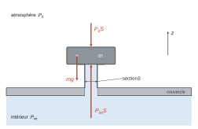
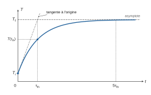
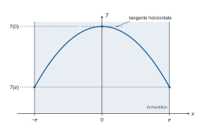
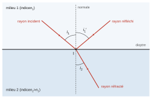
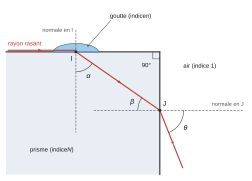

# G2E BCPST — Physique 2026 · Corrigé brut

*Corrigé rédigé par IA, non officiel. Signalez toute erreur.*

## A. Cuisson des aliments

### Cuisson à la cocotte-minute

Volume gazeux : $V_{\mathrm{gaz}}=V-V_{\mathrm{eau}}=7{,}0$ L $=7{,}0\times10^{-3}$ m³.

#### Question 1

L'eau bout lorsque sa pression de vapeur saturante égale la pression qui règne au-dessus du liquide : $P_s(\theta_{\mathrm{eb}})=P_0$, soit $\left(\theta_{\mathrm{eb}}/100\right)^4=1$ :

$$\boxed{\theta_{\mathrm{eb}}=100\ ^\circ\mathrm{C}}$$

soit $T_{\mathrm{eb}}=373$ K.

#### Question 2

À l'ouverture de la soupape, la pression dans la cocotte vaut $P_0+\Delta P$. L'eau bouillonnante est à la température $\theta_1$ telle que $P_s(\theta_1)=P_0+\Delta P$ :

$$\begin{aligned}
P_0\left(\frac{\theta_1}{100}\right)^4&=P_0+\Delta P\\
&\Longrightarrow\quad\boxed{\theta_1=100\left(1+\frac{\Delta P}{P_0}\right)^{1/4}}
\end{aligned}$$

Avec $\Delta P=P_0=1$ bar : $\theta_1=100\times2^{1/4}$, soit $\boxed{\theta_1\simeq119\ ^\circ\mathrm C\ (T_1\simeq392\ \mathrm K)}$.

**Intérêt** : l'eau, et donc l'aliment, est portée à près de 120 °C au lieu de 100 °C. Les transformations chimiques de la cuisson étant d'autant plus rapides que la température est élevée (loi d'Arrhenius), le temps de cuisson est nettement réduit (typiquement divisé par 3 environ) ; de plus, l'enceinte close limite les pertes d'eau par évaporation.

#### Question 3

La soupape (masse $m$, sur le tuyau de section $S$) est soumise, selon la verticale ascendante, à trois forces :
- la force pressante intérieure $+P_{\mathrm{int}}S$ ;
- la force pressante atmosphérique $-P_0S$ ;
- son poids $-mg$.

Elle se soulève dès que $(P_{\mathrm{int}}-P_0)S$ dépasse $mg$ :

$$\begin{aligned}
\Delta P&=\frac{mg}{S}\\
&=\frac{40\times10^{-3}\times10}{4\times10^{-6}}\\
&\Longrightarrow\quad\boxed{\Delta P=1{,}0\times10^5\ \mathrm{Pa}=1{,}0\ \mathrm{bar}}
\end{aligned}$$

Il s'agit bien d'une soupape différentielle de 1 bar.



#### Question 4

L'air, gaz parfait, garde la même quantité de matière $n_{\mathrm{air}}$ (soupape fermée) et occupe le même volume $V_{\mathrm{gaz}}$ (la variation de volume du liquide est négligeable, cf. Q5). Sa pression partielle vérifie donc

$$\begin{aligned}
n_{\mathrm{air}}&=\frac{P_0V_{\mathrm{gaz}}}{RT_0}\\
&=\frac{p_{\mathrm{air}}V_{\mathrm{gaz}}}{RT_1}\\
&\Longrightarrow\quad\boxed{p_{\mathrm{air}}=P_0\,\frac{T_1}{T_0}}
\end{aligned}$$

On prend $T_0=293$ K et $T_1=392$ K. Pour $P_0=1{,}00$ bar, on obtient $p_{\mathrm{air}}=1{,}34$ bar. Pour $P_0=1{,}013$ bar, on obtiendrait $1{,}36$ bar. On retient

$$\boxed{p_{\mathrm{air}}\simeq1{,}35\ \mathrm{bar}}$$

#### Question 5

La pression totale au déclenchement vaut $P_0+\Delta P=2{,}0$ bar ; d'après la loi de Dalton, la pression partielle de la vapeur est

$$\begin{aligned}
p_{\mathrm{vap}}&=P_0+\Delta P-p_{\mathrm{air}}\\
&=2{,}00-1{,}35\\
&=0{,}65\ \mathrm{bar}.
\end{aligned}$$

La vapeur, gaz parfait occupant $V_{\mathrm{gaz}}$ à $T_1$ :

$$\begin{aligned}
n_{\mathrm{eau}}&=\frac{p_{\mathrm{vap}}V_{\mathrm{gaz}}}{RT_1}\\
&=\frac{0{,}65\times10^5\times7{,}0\times10^{-3}}{8{,}31\times392}\\
&\Longrightarrow\quad\boxed{n_{\mathrm{eau}}\simeq0{,}14\ \mathrm{mol}}
\end{aligned}$$

$$\boxed{m_{\mathrm{eau}}=n_{\mathrm{eau}}M\simeq2{,}5\ \mathrm g}$$

**Commentaire.** La cocotte contient $\rho V_{\mathrm{eau}}=1{,}0$ kg d'eau : seule une fraction de $0{,}25\ \%$ est vaporisée, ce qui justifie de négliger la variation de volume du liquide.

On remarque que le modèle n'est pas parfaitement cohérent : si l'eau était à $119$ °C, sa vapeur saturante serait à $2{,}0$ bar et la pression totale à $3{,}35$ bar.

En réalité, avec l'air présent, la soupape s'ouvre dès que $p_{\mathrm{air}}(T)+P_s(\theta)=2$ bar, soit vers $93$ °C. Elle chasse alors l'air, et le régime de fonctionnement (vapeur quasi pure à 2 bar, $\theta\simeq119$ °C) s'établit ensuite.

Avec $p_{\mathrm{vap}}=2{,}0$ bar on trouverait $0{,}43$ mol, soit $7{,}7$ g : la conclusion (quelques grammes de vapeur seulement) est inchangée.

### Cuisson par micro-ondes

#### Question 6

$$\begin{aligned}
\lambda&=\frac cf\\
&=\frac{3{,}00\times10^8}{3\times10^9}\\
&\Longrightarrow\quad\boxed{\lambda=0{,}10\ \mathrm m=10\ \mathrm{cm}}
\end{aligned}$$

Le visible s'étend de 400 nm à 800 nm environ : $\lambda$ est environ $10^5$ fois plus grande ($0{,}10/(5\times10^{-7})=2\times10^5$). C'est le domaine des micro-ondes (ondes centimétriques).

#### Question 7

L'onde est émise à une fréquence unique $f=3$ GHz : son spectre se réduit à une seule fréquence, elle est **monochromatique**. Ses champs varient dans le temps selon une fonction sinusoïdale de pulsation $\omega=2\pi f$ (de la forme $E_0\cos(\omega t-kx+\varphi)$) : elle est **sinusoïdale**. Les deux qualificatifs sont équivalents : une onde monochromatique est une onde sinusoïdale (idéalisation d'un train d'onde de durée très grande devant la période).

#### Question 8

Système : l'électron (masse $m$, charge $q=-e$) ; référentiel lié au noyau, galiléen. Deuxième loi de Newton projetée sur $\vec e_x$ :

$$m\frac{\mathrm d^2x}{\mathrm dt^2}=-kx-\frac m\tau\frac{\mathrm dx}{\mathrm dt}+qE_0\cos(\omega t)$$

$$\boxed{m\frac{\mathrm d^2x}{\mathrm dt^2}+\frac m\tau\frac{\mathrm dx}{\mathrm dt}+kx=qE_0\cos(\omega t)=-eE_0\cos(\omega t)}$$

#### Question 9

En divisant par $m$ et en posant $\omega_0=\sqrt{k/m}$ et $Q=\omega_0\tau$ :

$$\boxed{\frac{\mathrm d^2x}{\mathrm dt^2}+\frac{\omega_0}{Q}\frac{\mathrm dx}{\mathrm dt}+\omega_0^2x=\frac{qE_0}{m}\cos(\omega t)}$$

avec $\dfrac{\omega_0}{Q}=\dfrac1\tau$.

#### Question 10

Sans frottement ni excitation, l'équation devient $\ddot x+\frac kmx=0$, équation d'un oscillateur harmonique dont les solutions sont sinusoïdales de pulsation

$$\boxed{\omega_0=\sqrt{\frac km}}$$

($[k/m]=\mathrm{N\,m^{-1}\,kg^{-1}}=\mathrm s^{-2}$ : c'est bien une pulsation.)

#### Question 11

En régime permanent, on associe à $x(t)=A_m\cos(\omega t+\varphi)$ le complexe $\underline x=\underline X\,\mathrm e^{j\omega t}$ avec $\underline X=A_m\mathrm e^{j\varphi}$, l'excitation étant $\frac{qE_0}{m}\mathrm e^{j\omega t}$. La dérivation revient à multiplier par $j\omega$ :

$$\begin{aligned}
\left(\omega_0^2-\omega^2+j\frac\omega\tau\right)\underline X&=\frac{qE_0}{m}\\
\Longrightarrow\quad\underline X&=\frac{qE_0/m}{\omega_0^2-\omega^2+j\omega/\tau}
\end{aligned}$$

Module ($|q|=e$) :

$$\boxed{A_m=\frac{eE_0/m}{\sqrt{\left(\omega_0^2-\omega^2\right)^2+\omega^2/\tau^2}}}$$

Argument : $\varphi=\arg(q)-\arg\left(\omega_0^2-\omega^2+j\omega/\tau\right)$, avec $\arg(q)=\pi$ puisque $q<0$. Par ailleurs

$$\arg\left(\omega_0^2-\omega^2+j\frac\omega\tau\right)=\frac\pi2-\arctan\frac{\tau(\omega_0^2-\omega^2)}{\omega}\in\,]0,\pi[$$

d'où

$$\boxed{\varphi=\frac\pi2+\arctan\!\left(\frac{\tau\left(\omega_0^2-\omega^2\right)}{\omega}\right)\in\,]0,\pi[}$$

soit $\tan\varphi=-\dfrac{\omega/\tau}{\omega_0^2-\omega^2}$ avec $\sin\varphi>0$. Cas limites :
- $\varphi\to\pi$ quand $\omega\to0$ ;
- $\varphi=\pi/2$ en $\omega=\omega_0$ ;
- $\varphi\to0$ quand $\omega\to\infty$.

$A_m$ est l'**amplitude** des oscillations forcées de l'électron ; $\varphi$ est le **déphasage** (avance de phase) de la réponse $x(t)$ par rapport à l'excitation $E_0\cos(\omega t)$.

### Cuisson traditionnelle

#### Question 12

La conduction thermique :
- est un transfert d'énergie **sans déplacement macroscopique de matière**, de proche en proche, par l'agitation thermique microscopique (chocs entre molécules, vibrations du réseau, électrons libres dans les métaux) ;
- nécessite un milieu matériel ; elle est le mode de transfert prépondérant dans les solides ;
- se fait spontanément **du chaud vers le froid** ; c'est un phénomène irréversible ;
- obéit à la **loi de Fourier** $\vec\jmath_{\mathrm{th}}=-\lambda\,\overrightarrow{\mathrm{grad}}\,T$ ;
- est un phénomène **diffusif**, lent : la durée caractéristique croît comme le carré de la distance.

#### Question 13

$D_{\mathrm{th}}=L^2/\tau$, d'où $[D_{\mathrm{th}}]=\mathrm L^2\,\mathrm T^{-1}$ :

$$\boxed{D_{\mathrm{th}}\ \text{en}\ \mathrm m^2\cdot\mathrm s^{-1}}$$

#### Question 14

La masse est proportionnelle au volume (même masse volumique) : $m\propto\frac43\pi R^3$. Donc $\dfrac{2m}{m}=\left(\dfrac{R_2}{R_1}\right)^3$ :

$$\boxed{R_2=2^{1/3}R_1\simeq1{,}26\,R_1}$$

#### Question 15

La cuisson est terminée lorsque la chaleur a diffusé jusqu'au cœur, sur la longueur $L=R$ : $\Delta t\propto R^2/D_{\mathrm{th}}$, avec la même diffusivité. D'où

$$\begin{aligned}
\frac{\Delta t_2}{\Delta t_1}&=\left(\frac{R_2}{R_1}\right)^2\\
&=2^{2/3}\\
&\simeq1{,}6
\end{aligned}$$

$$\boxed{\Delta t_2=2^{a}\,\Delta t_1\ \text{avec}\ a=\frac23}$$

**Critique.** « 1 h 30 par kilo » revient à $\Delta t\propto m$ ($a=1$), alors que la diffusion donne $\Delta t\propto m^{2/3}$. Calée sur 1 kg, la règle donne 9 h pour 6 kg contre $1{,}5\times6^{2/3}\simeq5{,}0$ h selon la loi d'échelle : elle surestime fortement le temps de cuisson des grosses pièces (dinde desséchée). Elle n'est valable qu'autour de la masse qui a servi à la calibrer. (Le modèle reste lui-même approché : dinde ni sphérique ni homogène.)

## B. Évolution temporelle et spatiale de la température lors de la cuisson

### Cas des systèmes à gradient de température nul

#### Question 16

Loi de Newton : flux reçu par le corps

$$\boxed{\Phi_{cc}=hS\left(T_f-T(t)\right)}$$

en W, avec $h$ en W·m⁻²·K⁻¹ ; $\Phi_{cc}>0$ tant que $T<T_f$.

#### Question 17

Système : le corps, phase condensée indilatable et incompressible, de température uniforme $T(t)$. Premier principe entre $t$ et $t+\mathrm dt$ :

$$\mathrm dU=\delta W+\delta Q$$

avec $\delta W=0$, $\mathrm dU=mc\,\mathrm dT$ et $\delta Q=\Phi_{cc}\,\mathrm dt$ :

$$\begin{aligned}
mc\,\mathrm dT&=hS\left(T_f-T\right)\mathrm dt\\
\Longrightarrow\quad\frac{\mathrm dT}{\mathrm dt}+\frac{hS}{mc}T&=\frac{hS}{mc}T_f
\end{aligned}$$

$$\begin{aligned}
&\boxed{A=\frac{hS}{mc}\ (\mathrm s^{-1})}\\
&\boxed{B=\frac{hS\,T_f}{mc}\ (\mathrm{K\,s^{-1}})}
\end{aligned}$$

#### Question 18

On pose $\tau_{\mathrm{th}}=1/A=\dfrac{mc}{hS}$. La solution homogène est $K\mathrm e^{-t/\tau_{\mathrm{th}}}$ et la solution particulière constante vaut $B/A=T_f$. La condition $T(0)=T_i$ donne $K=T_i-T_f$ :

$$\boxed{T(t)=T_f+\left(T_i-T_f\right)\mathrm e^{-hSt/(mc)}}$$

#### Question 19

Allure : courbe croissante, concave, partant de $T_i$ en $t=0$. Elle tend asymptotiquement vers $T_f$ (asymptote horizontale $T=T_f$, jamais atteinte). Repères :
- la tangente à l'origine, de pente $(T_f-T_i)/\tau_{\mathrm{th}}$, coupe l'asymptote en $t=\tau_{\mathrm{th}}$ ;
- $T(\tau_{\mathrm{th}})=T_i+0{,}63\,(T_f-T_i)$ ;
- à $5\tau_{\mathrm{th}}$, $T$ diffère de $T_f$ de moins de 1 % de l'écart initial.



#### Question 20

$\mathrm e^{-\Delta t/\tau_{\mathrm{th}}}=\dfrac{T_f-T(\Delta t)}{T_f-T_i}$, d'où

$$\boxed{\Delta t=\frac{mc}{hS}\ln\!\left(\frac{T_f-T_i}{T_f-T(\Delta t)}\right)}$$

#### Question 21

$$\begin{aligned}
Q&=\int_0^{\Delta t}hS\left(T_f-T_i\right)\mathrm e^{-t/\tau_{\mathrm{th}}}\,\mathrm dt\\
&=hS\left(T_f-T_i\right)\tau_{\mathrm{th}}\left(1-\mathrm e^{-\Delta t/\tau_{\mathrm{th}}}\right)
\end{aligned}$$

$$\boxed{Q=mc\left(T_f-T_i\right)\left(1-\mathrm e^{-hS\Delta t/(mc)}\right)}$$

On retrouve $Q=mc\,(T(\Delta t)-T_i)$ (premier principe entre $0$ et $\Delta t$).

### Profil de température en régime stationnaire dans un four à micro-ondes

#### Question 22

Loi de Fourier, pour un problème unidimensionnel selon $x$ :

$$\boxed{\vec\jmath_{\mathrm{th}}=-\lambda\frac{\mathrm dT}{\mathrm dx}\,\vec e_x}$$

| Grandeur | Signification | Unité |
|---|---|---|
| $\vec\jmath_{\mathrm{th}}$ | densité de flux thermique (puissance par unité de surface) | W·m⁻² |
| $\lambda$ | conductivité thermique ($>0$) | W·m⁻¹·K⁻¹ |
| $T$ | température | K |
| $\mathrm dT/\mathrm dx$ | gradient de température | K·m⁻¹ |

Le flux à travers la section $S$ est $\Phi(x)=-\lambda S\,\dfrac{\mathrm dT}{\mathrm dx}$ (en W).

#### Question 23

**Signe.** La puissance est déposée uniformément dans le volume et évacuée par les deux faces $x=\pm e$ ; le problème est symétrique par rapport au plan $x=0$, où la température est maximale. Pour $x>0$, l'énergie s'écoule vers $+\vec e_x$. Ainsi $j_{\mathrm{th}}=-\lambda\,\mathrm dT/\mathrm dx>0$, donc $\boxed{\mathrm dT/\mathrm dx<0}$.

**Bilan.** Puissance volumique déposée : $p_v=\dfrac{\mathcal P}{2eS}$. Pour la tranche $[x,x+\mathrm dx]$ (volume $S\,\mathrm dx$), en régime stationnaire, pendant $\mathrm dt$ :

$$\begin{aligned}
0&=\Phi(x)\,\mathrm dt-\Phi(x+\mathrm dx)\,\mathrm dt+p_vS\,\mathrm dx\,\mathrm dt\\
\Longrightarrow\quad\frac{\mathrm d\Phi}{\mathrm dx}&=\frac{\mathcal P}{2e}
\end{aligned}$$

Avec $\Phi=-\lambda S\,\mathrm dT/\mathrm dx$ :

$$\boxed{\lambda\frac{\mathrm d^2T}{\mathrm dx^2}+\frac{\mathcal P}{2eS}=0}$$

#### Question 24

Le script impose en $x=0$ :
- `dTsurdt0 = 0`, soit $\left.\frac{\mathrm dT}{\mathrm dx}\right|_{x=0}=0$ : condition physiquement justifiée par la symétrie (profil pair, flux nul à travers le plan médian, maximum de température) ; le nom de variable `dTsurdt` désigne en fait $\mathrm dT/\mathrm dx$ ;
- `T0 = 373`, soit $T(0)=373$ K : valeur arbitraire (100 °C au cœur), la vraie valeur dépendant des échanges en $x=\pm e$ (Q34). L'équation ne faisant intervenir que $T''$, changer cette valeur translate le profil sans en changer la forme. Ce `T0` n'est pas la température extérieure $T_0$ de l'énoncé.

Deux conditions en un même point sont nécessaires pour résoudre numériquement (problème de Cauchy) une équation du second ordre.

#### Question 25

`x = np.linspace(0,e,1000)` crée un tableau de 1000 abscisses régulièrement réparties de 0 à $e$ (bornes incluses, pas $e/999$). C'est la discrétisation du domaine d'étude $[0,e]$ : les abscisses où `odeint` calcule $T$ et qui servent d'axe pour le tracé.

#### Question 26

Les lignes 19 à 21 ramènent l'équation du second ordre à un système du premier ordre sur le vecteur $Y=(T,\ \mathrm dT/\mathrm dx)$ :
- l. 19 : la fonction `derivee(Y,x)` reçoit l'état `Y` et l'abscisse `x` ;
- l. 20 : elle en extrait $T$ et $\mathrm dT/\mathrm dx$ ;
- l. 21 : elle renvoie la dérivée de l'état, $\left(\dfrac{\mathrm dT}{\mathrm dx},\ \dfrac{\mathrm d^2T}{\mathrm dx^2}\right)$, la dérivée seconde étant tirée de l'équation de Q23 :

$$\frac{\mathrm d^2T}{\mathrm dx^2}=-\frac{\mathcal P}{2eS\lambda}$$

#### Question 27

```python
def temperature(T0, dTsurdt0):
    return odeint(derivee, [T0, dTsurdt0], x)[:,0]
```

`odeint` renvoie un tableau de 1000 lignes et 2 colonnes (colonne 0 : $T$ ; colonne 1 : $\mathrm dT/\mathrm dx$). `[:,0]` sélectionne toutes les lignes de la colonne 0, c'est-à-dire la liste des valeurs de $T(x)$.

#### Question 28

```python
plt.plot(x, temperature(T0, dTsurdt0), 'b--')
```

**Commentaire.** Le graphe est un arc de parabole ($T''$ constante négative). La tangente est horizontale en $x=0$ ($\mathrm dT/\mathrm dx=0$), puis la décroissance est de plus en plus rapide, de 373 K à 323 K en $x=e$. En effet

$$T(x)=T(0)-\frac{\mathcal P}{4eS\lambda}x^2$$

et

$$\begin{aligned}
T(0)-T(e)&=\frac{\mathcal Pe}{4S\lambda}\\
&=\frac{200\times5{,}0\times10^{-3}}{4\times1{,}0\times10^{-2}\times0{,}50}\\
&=50\ \mathrm K.
\end{aligned}$$

Le cœur est le point le plus chaud.

#### Question 29

Par symétrie, le profil est pair : parabole concave $T(x)=T(0)-\dfrac{\mathcal P}{4eS\lambda}x^2$ sur $[-e,e]$. Elle est maximale en $x=0$ avec tangente horizontale, minimale et égale à $T(e)=T(-e)$ sur les deux faces.



#### Question 30

$\dfrac{\mathrm d^2T}{\mathrm dx^2}=-\dfrac{\mathcal P}{2eS\lambda}$ ; deux intégrations successives :

$$\boxed{T(x)=-\frac{\mathcal P}{4eS\lambda}x^2+A_1x+A_2}$$

#### Question 31

$T(e)=T(-e)$ donne $2A_1e=0$, donc $A_1=0$. Puis $A_2=T(e)+\dfrac{\mathcal Pe}{4S\lambda}$ :

$$\boxed{T(x)=T(e)+\frac{\mathcal P}{4eS\lambda}\left(e^2-x^2\right)}$$

#### Question 32

$T$ est maximale en $x=0$ :

$$\boxed{T_{\max}=T(e)+\frac{\mathcal Pe}{4S\lambda}}$$

#### Question 33

$$\begin{aligned}
\Phi(x)&=-\lambda S\frac{\mathrm dT}{\mathrm dx}\\
&=-\lambda S\left(-\frac{\mathcal Px}{2eS\lambda}\right)
\end{aligned}$$

d'où

$$\begin{aligned}
&\boxed{\Phi(x)=\frac{\mathcal P}{2e}\,x}\\
&\boxed{\Phi(e)=\frac{\mathcal P}{2}}
\end{aligned}$$

Chaque face évacue la moitié de la puissance reçue, ce qui est cohérent avec le bilan global en régime stationnaire.

#### Question 34

Loi de Newton en $x=e$ (flux sortant vers le milieu à $T_0$) : $\Phi(e)=hS\left(T(e)-T_0\right)$. La continuité du flux à l'interface donne $hS\left(T(e)-T_0\right)=\dfrac{\mathcal P}{2}$ :

$$\begin{aligned}
&\boxed{T(e)=T_0+\frac{\mathcal P}{2hS}}\\
&\boxed{T_{\max}=T_0+\frac{\mathcal P}{2hS}+\frac{\mathcal Pe}{4S\lambda}}
\end{aligned}$$

#### Question 35

$$\begin{aligned}
\frac{\mathcal P}{2hS}&=\frac{200}{2\times10\times1{,}0\times10^{-2}}\\
&=1{,}0\times10^3\ \mathrm K\\
\frac{\mathcal Pe}{4S\lambda}&=50\ \mathrm K
\end{aligned}$$

$$\begin{aligned}
&\boxed{T(e)\simeq1{,}29\times10^3\ \mathrm K}\\
&\boxed{T_{\max}\simeq1{,}34\times10^3\ \mathrm K}
\end{aligned}$$

Ces valeurs (plus de 1000 °C) sont absurdes pour un aliment aqueux.

#### Question 36

La modélisation n'est pas satisfaisante : elle prévoit plus de 1000 °C alors qu'un aliment contenant de l'eau liquide ne dépasse guère 100 °C. Le phénomène à prendre en compte est la **vaporisation de l'eau** (changement d'état) : au voisinage de 100 °C, la puissance reçue sert à vaporiser l'eau (enthalpie de vaporisation $\approx2{,}3\times10^6$ J/kg ; $\mathcal P/L_v\approx9\times10^{-5}$ kg/s, soit $0{,}3$ kg/h) à température quasi constante. Par ailleurs, le régime stationnaire n'est pas atteint pendant une cuisson (régime transitoire), la puissance absorbée n'est pas uniforme (atténuation de l'onde dans l'aliment, ondes stationnaires dans la cavité), et le rayonnement est négligé.

## C. Microfiltration des boissons

Lois données : cake $D_v=\dfrac{KS}{\eta}\dfrac{\Delta P_1}{H}$ ; filtre $D_v=\dfrac{S}{\beta\eta}\Delta P_2$.

#### Question 37

$K=\dfrac{D_v\,\eta\,H}{S\,\Delta P_1}$ : $[K]=\dfrac{\mathrm{m^3\,s^{-1}}\cdot\mathrm{Pa\,s}\cdot\mathrm m}{\mathrm{m^2}\cdot\mathrm{Pa}}=\mathrm m^2$, soit $\boxed{K\ \text{en}\ \mathrm m^2}$.

$\beta=\dfrac{S\,\Delta P_2}{\eta\,D_v}$ : $[\beta]=\dfrac{\mathrm m^2\cdot\mathrm{Pa}}{\mathrm{Pa\,s}\cdot\mathrm{m^3\,s^{-1}}}=\mathrm m^{-1}$, soit $\boxed{\beta\ \text{en}\ \mathrm m^{-1}}$.

#### Question 38

La loi de Darcy suppose : un écoulement lent, laminaire, dominé par la viscosité (nombre de Reynolds construit sur la taille des pores très petit devant 1), d'où la proportionnalité débit/différence de pression ; un fluide newtonien, incompressible, de viscosité uniforme ; un milieu poreux homogène, isotrope, saturé, indéformable (perméabilité constante) ; un régime permanent (ou quasi permanent) ; un écoulement unidirectionnel dont le moteur est la différence de pression (pesanteur négligée ou incluse dans la pression motrice).

#### Question 39

Par analogie avec la loi d'Ohm ($\Delta P\leftrightarrow U$, $D_v\leftrightarrow I$), la résistance hydraulique d'un élément est $R_h=\dfrac{\Delta P}{D_v}$ (en Pa·s·m⁻³).

$$\begin{aligned}
R_{h1}&=\frac{\Delta P_1}{D_v}\\
&=\boxed{\frac{\eta H}{KS}}\\
R_{h2}&=\frac{\Delta P_2}{D_v}\\
&=\boxed{\frac{\beta\eta}{S}}
\end{aligned}$$

#### Question 40

Le fluide traverse successivement le cake puis le filtre : même débit $D_v$, chutes de pression qui s'ajoutent (association série) :

$$\begin{aligned}
\Delta P&=\Delta P_1+\Delta P_2\\
&=\left(R_{h1}+R_{h2}\right)D_v\\
\Longrightarrow\quad R_h&=R_{h1}+R_{h2}\\
&=\frac{\eta H}{KS}+\frac{\beta\eta}{S}\\
&=\boxed{\frac{\eta}{S}\left(\frac HK+\beta\right)}
\end{aligned}$$

#### Question 41

$$\boxed{D_v=\frac{\mathrm dV}{\mathrm dt}}$$

#### Question 42

$V=Sh$, donc $H=\alpha h=\dfrac{\alpha V}{S}$. En reportant dans $\Delta P=R_hD_v$ :

$$\begin{aligned}
\Delta P&=\left(\frac{\alpha\eta V}{KS^2}+\frac{\beta\eta}{S}\right)\frac{\mathrm dV}{\mathrm dt}\\
\Longrightarrow\quad\mathrm dt&=\frac{\alpha\eta}{KS^2\Delta P}V\,\mathrm dV+\frac{\beta\eta}{S\Delta P}\,\mathrm dV
\end{aligned}$$

$$\boxed{\mathrm dt=AV\,\mathrm dV+B\,\mathrm dV}$$

avec

$$\begin{aligned}
&\boxed{A=\frac{\alpha\eta}{KS^2\Delta P}\ (\mathrm{s\,m^{-6}})}\\
&\boxed{B=\frac{\beta\eta}{S\Delta P}\ (\mathrm{s\,m^{-3}})}
\end{aligned}$$

#### Question 43

Avec $V=0$ à $t=0$ et $\Delta P$ constante :

$$\boxed{t=\frac A2V^2+BV}$$

#### Question 44

$$\frac tV=\frac A2V+B$$

La courbe $t/V$ en fonction de $V$ est une **droite**. Sa pente vaut $A/2$ et son ordonnée à l'origine $B$.

Méthode :
- on filtre à $\Delta P$ constante et on relève des couples $(t_i,V_i)$ ;
- on trace $t_i/V_i$ en fonction de $V_i$ et on effectue une régression linéaire (l'alignement des points valide le modèle) ;
- on en déduit $A$ (deux fois la pente) et $B$ (ordonnée à l'origine) ;
- connaissant $\alpha,\ \eta,\ S,\ \Delta P$, on obtient enfin :

$$\begin{aligned}
&\boxed{K=\frac{\alpha\eta}{AS^2\Delta P}}\\
&\boxed{\beta=\frac{BS\Delta P}{\eta}}
\end{aligned}$$

#### Question 45

$S=20$ cm² $=2{,}0\times10^{-3}$ m², $\Delta P=1{,}0\times10^5$ Pa.

$$\begin{aligned}
K&=\frac{\alpha\eta}{AS^2\Delta P}\\
&=\frac{0{,}48\times1{,}0\times10^{-3}}{A\times4{,}0\times10^{-6}\times1{,}0\times10^5}
\end{aligned}$$

Avec la valeur de l'énoncé $A=1{,}9\times10^{-9}$ s·m⁻⁶, on obtient $K=6{,}3\times10^5$ m². Cette valeur est dépourvue de sens physique (perméabilités usuelles entre $10^{-16}$ et $10^{-10}$ m²). On suppose une erreur d'exposant, $A=1{,}9\times10^{9}$ s·m⁻⁶, qui donne

$$\boxed{K\simeq6{,}3\times10^{-13}\ \mathrm m^2}$$

ordre de grandeur plausible pour un dépôt de particules microniques.

$$\begin{aligned}
\beta&=\frac{BS\Delta P}{\eta}\\
&=\frac{3{,}6\times10^6\times2{,}0\times10^{-3}\times1{,}0\times10^5}{1{,}0\times10^{-3}}\\
&\Longrightarrow\quad\boxed{\beta\simeq7{,}2\times10^{11}\ \mathrm m^{-1}}
\end{aligned}$$

valeur typique de la résistance d'une membrane de microfiltration (le résultat sur $\beta$ ne dépend pas de $A$).

## D. Étude d'un réfractomètre à prisme

#### Question 46

Dioptre plan séparant deux milieux d'indices $n_1$ et $n_2$, rayon incident en $I$ sous l'angle $i_1$ compté par rapport à la normale :
- les rayons réfléchi et réfracté sont dans le **plan d'incidence** (défini par le rayon incident et la normale en $I$) ;
- **réflexion** : $i_1'=i_1$, le rayon réfléchi étant symétrique du rayon incident par rapport à la normale ;
- **réfraction** : $\boxed{n_1\sin i_1=n_2\sin i_2}$, le rayon réfracté passant de l'autre côté de la normale.



Le réfracté se rapproche de la normale si $n_2>n_1$. Si $n_1>n_2$, il n'y a plus de rayon réfracté au-delà de l'angle limite $\arcsin(n_2/n_1)$ (réflexion totale).

#### Question 47



Le rayon rasant (incidence 90° dans le liquide) se rapproche de la normale en entrant dans le verre ($N>n$). L'angle $\alpha$ se compte depuis la normale en $I$ (verticale). L'angle $\beta$ se compte depuis la normale en $J$ (horizontale) ; cette dernière est parallèle à la direction incidente, d'où $\theta$.

#### Question 48

Les deux faces étant perpendiculaires, les normales en $I$ et en $J$ le sont aussi ; dans le triangle rectangle formé par $IJ$ et ces deux normales :

$$\boxed{\alpha+\beta=90^\circ}$$

En $I$ (incidence rasante) : $n\sin90^\circ=N\sin\alpha$, soit $\sin\alpha=n/N$.

En $J$ : $N\sin\beta=\sin\theta$.

Or, comme $0<\alpha<90^\circ$,

$$\begin{aligned}
\sin\beta&=\cos\alpha\\
&=\sqrt{1-n^2/N^2}
\end{aligned}$$

d'où

$$\boxed{\sin\theta=\sqrt{N^2-n^2}}$$

Pour l'eau :

$$\begin{aligned}
\sin\theta&=\sqrt{1{,}625^2-1{,}333^2}\\
&=\sqrt{0{,}8637}\\
&=0{,}9294
\end{aligned}$$

soit $\boxed{\theta\simeq68{,}3^\circ}$.

#### Question 49

Le rayon rasant n'entre dans le prisme que si $\sin\alpha=n/N\le1$ ; sinon il y a réflexion totale sur la face supérieure. D'où

$$\boxed{n_{\max}=N=1{,}625}$$

(En outre, l'émergence en $J$ exige $\sqrt{N^2-n^2}\le1$, soit $n\ge\sqrt{N^2-1}\simeq1{,}28$ : la plage de mesure est $1{,}28\le n\le1{,}625$.)

#### Question 50

- **Diode laser** : source quasi monochromatique. L'indice dépendant de la longueur d'onde (dispersion), une lumière blanche donnerait une limite d'éclairement irisée et floue ; une seule longueur d'onde donne une limite nette et une mesure rapportée à une longueur d'onde connue. La source est en outre intense et directive.
- **Régulation de la température** : l'indice d'un liquide varie avec la température (environ $10^{-4}$ à $5\times10^{-4}$ K⁻¹ en valeur absolue), ce qui est comparable à la précision visée (10⁻³ à 10⁻⁴) ; les valeurs tabulées sont données à température fixée (20 °C). La régulation assure des mesures reproductibles et comparables aux tables.

#### Question 51

La valeur tabulée étant prise sans incertitude :

$$\begin{aligned}
z&=\frac{|n-n'|}{u(n)}\\
&=\frac{|1{,}4100-1{,}4060|}{1{,}1\times10^{-3}}\\
&\Longrightarrow\quad\boxed{z\simeq3{,}6>2}
\end{aligned}$$

**Les deux valeurs ne sont pas compatibles** (critère usuel $z\le2$). Explications possibles : mesure à une température différente de 20 °C (l'indice diminuant quand $T$ croît, une valeur mesurée trop grande suggère une température inférieure, d'une dizaine de degrés pour un liquide organique avec $|\mathrm dn/\mathrm dT|\approx4\times10^{-4}$ K⁻¹) ; longueur d'onde de la source différente de celle de la table (raie D du sodium, 589 nm) ; liquide impur ; biais d'étalonnage de l'appareil ou incertitude sous-estimée.
