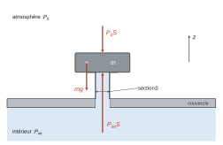
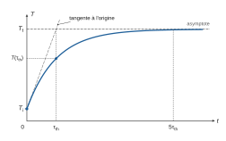
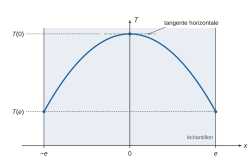
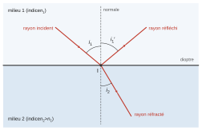
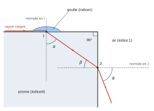

# G2E BCPST — Physique 2026 · Corrigé guidé

*Corrigé rédigé par IA, non officiel. Signalez toute erreur.*

## Présentation du sujet

**Thème.** Un fil conducteur culinaire : cuire, conserver, filtrer et contrôler des aliments. Le sujet balaie une grande partie du programme de physique de BCPST : thermodynamique (gaz parfaits, équilibre liquide-vapeur, premier principe), mécanique (statique, oscillateur amorti en régime sinusoïdal forcé), transferts thermiques (conduction, loi de Fourier, loi de Newton, diffusion), hydrodynamique (loi de Darcy, résistances hydrauliques), optique géométrique (Snell-Descartes) et traitement des incertitudes (écart normalisé), avec une question de programmation Python (`odeint`).

**Découpage (51 questions, 3 h 30, calculatrice autorisée).**

| Partie | Questions | Contenu |
|---|---|---|
| A. Cuisson des aliments | 1–15 | cocotte-minute (Duperray, soupape, pressions partielles), électron élastiquement lié forcé par une micro-onde, loi d'échelle diffusive et critique d'une recette |
| B. Température lors de la cuisson | 16–36 | modèle à gradient nul (équation du premier ordre), profil stationnaire avec source dans un échantillon, script `odeint`, résolution analytique, raccordement conducto-convectif, critique |
| C. Microfiltration | 37–45 | loi de Darcy, résistances en série, loi de filtration $t=\frac A2V^2+BV$, linéarisation, application numérique |
| D. Réfractomètre de Pulfrich | 46–51 | Snell-Descartes, $\sin\theta=\sqrt{N^2-n^2}$, domaine de mesure, choix technologiques, $z$-score |

**Difficulté.** Le sujet est long mais très progressif : la plupart des questions sont des applications directes du cours. Les points délicats sont la phase en Q11, le bilan avec source de Q23, la lecture attentive des lois de la partie C (le $S$ au numérateur de la loi du filtre) et la critique des applications numériques : deux résultats numériques sont physiquement absurdes (Q35, qui appelle la critique de Q36, et Q45, où une donnée semble erronée).

**Questions à ne pas laisser passer.** 1, 3, 6, 7, 10, 13, 14, 16, 17, 18, 22, 25, 27, 30–33, 37, 41, 43, 46, 48, 51 : courtes, indépendantes ou presque, et entièrement guidées par l'énoncé.

**Gestion du temps.** Environ 4 minutes par question. Les quatre parties sont indépendantes ; la partie D, courte, peut être traitée tôt. Ne pas s'enliser dans Q11 ni dans la discussion de Q5.

## Partie A — Cuisson des aliments

La cocotte-minute mobilise la relation de Duperray, l'équilibre d'un solide et le mélange idéal de gaz parfaits. Le four à micro-ondes sert de prétexte à l'étude complète d'un oscillateur amorti forcé. La cuisson traditionnelle introduit la loi d'échelle diffusive.

Données : $V=8$ L et $V_{\mathrm{eau}}=1$ L, d'où $V_{\mathrm{gaz}}=7{,}0$ L.

Conditions initiales : $\theta_0=20$ °C et $P_0=1$ atm $\approx1$ bar. Relation de Duperray :

$$P_s=P_0(\theta/100)^4$$

### Question 1

> [!INDICATION]
> Quelle condition sur la pression de vapeur saturante définit l'ébullition sous une pression donnée ?

#### Solution

L'eau bout lorsque $P_s(\theta)$ égale la pression au-dessus du liquide : $P_0(\theta_{\mathrm{eb}}/100)^4=P_0$, d'où

$$\boxed{\theta_{\mathrm{eb}}=100\ ^\circ\mathrm C\ (373\ \mathrm K)}$$

### Question 2

> [!INDICATION]
> Quelle est la pression absolue dans la cocotte quand la soupape s'ouvre ? Le mot « différentielle » est essentiel.

> [!INDICATION]
> Réinjecter cette pression dans la relation de Duperray et isoler $\theta$ par une racine quatrième.

#### Solution

À l'ouverture, $P=P_0+\Delta P$ et l'eau bouillonnante vérifie $P_s(\theta_1)=P_0+\Delta P$ :

$$\boxed{\theta_1=100\left(1+\frac{\Delta P}{P_0}\right)^{1/4}}$$

Numériquement :

$$\begin{aligned}
\theta_1&=100\times2^{1/4}\\
&\simeq\boxed{119\ ^\circ\mathrm C\ (392\ \mathrm K)}
\end{aligned}$$

**Intérêt.** On cuit vers 120 °C au lieu de 100 °C. Les réactions de cuisson étant activées thermiquement (loi d'Arrhenius), elles sont plusieurs fois plus rapides (de l'ordre d'un facteur 3) : le temps de cuisson est fortement réduit, sans perte d'eau par évaporation.

> [!PIEGE]
> Une soupape différentielle de 1 bar ne maintient pas 1 bar dans la cocotte, mais une **surpression** de 1 bar : la pression absolue vaut 2 bar.

### Question 3

> [!INDICATION]
> Faire le bilan des forces verticales sur la soupape au moment où elle décolle, sans oublier l'atmosphère qui appuie sur sa face supérieure.

#### Solution

Forces sur la soupape (axe vertical ascendant) : $+P_{\mathrm{int}}S$, $-P_0S$, $-mg$. Elle se soulève lorsque $(P_{\mathrm{int}}-P_0)S=mg$ :

$$\begin{aligned}
\Delta P&=\frac{mg}{S}\\
&=\frac{40\times10^{-3}\times10}{4\times10^{-6}}\\
&\Longrightarrow\quad\boxed{\Delta P=1{,}0\times10^5\ \mathrm{Pa}=1{,}0\ \mathrm{bar}}
\end{aligned}$$

C'est bien une soupape différentielle de 1 bar.



> [!PIEGE]
> $1\ \mathrm{mm}^2=10^{-6}\ \mathrm m^2$ : une surface se convertit avec le carré du facteur de conversion des longueurs.

### Question 4

> [!INDICATION]
> L'air est enfermé : que deviennent sa quantité de matière et son volume entre l'état initial et le déclenchement ?

> [!INDICATION]
> Écrire deux fois la loi des gaz parfaits pour l'air seul, avec sa pression partielle.

#### Solution

$n_{\mathrm{air}}$ et $V_{\mathrm{gaz}}$ sont constants (soupape fermée ; volume du liquide quasi inchangé, cf. Q5) :

$$\begin{aligned}
\frac{P_0V_{\mathrm{gaz}}}{RT_0}&=\frac{p_{\mathrm{air}}V_{\mathrm{gaz}}}{RT_1}\\
&\Longrightarrow\quad\boxed{p_{\mathrm{air}}=P_0\frac{T_1}{T_0}}
\end{aligned}$$

On prend $T_1=392$ K et $T_0=293$ K. Pour $P_0=1{,}00$ bar, on obtient $p_{\mathrm{air}}=1{,}34$ bar.

Pour $P_0=1{,}013$ bar, on aurait $1{,}36$ bar. On retient environ $1{,}35$ bar.

> [!METHODE]
> Dans un mélange idéal de gaz parfaits, chaque constituant obéit à $p_iV=n_iRT$ avec le volume total du mélange, et la pression totale est la somme des pressions partielles (loi de Dalton).

### Question 5

> [!INDICATION]
> La pression totale est imposée par la soupape ; en déduire la pression partielle de la vapeur.

> [!INDICATION]
> Pour commenter, comparer la masse trouvée à la masse d'eau introduite, puis vérifier si l'hypothèse « eau à 119 °C » est compatible avec la présence d'air.

#### Solution

$$\begin{aligned}
p_{\mathrm{vap}}&=P_0+\Delta P-p_{\mathrm{air}}\\
&=2{,}00-1{,}35\\
&=0{,}65\ \mathrm{bar}
\end{aligned}$$

$$\begin{aligned}
n_{\mathrm{eau}}&=\frac{p_{\mathrm{vap}}V_{\mathrm{gaz}}}{RT_1}\\
&=\frac{0{,}65\times10^5\times7{,}0\times10^{-3}}{8{,}31\times392}\\
&\Longrightarrow\quad\boxed{n_{\mathrm{eau}}\simeq0{,}14\ \mathrm{mol}}
\end{aligned}$$

$$\boxed{m_{\mathrm{eau}}=n_{\mathrm{eau}}M\simeq2{,}5\ \mathrm g}$$

**Commentaire.** Sur 1,0 kg d'eau, seuls 2,5 g (0,25 %) sont sous forme vapeur : la phase liquide est à peine entamée, ce qui justifie de considérer $V_{\mathrm{gaz}}$ constant.

Le modèle n'est cependant pas entièrement cohérent : à 119 °C la vapeur saturante serait à 2,0 bar et la pression totale à 3,35 bar.

En présence d'air, la soupape s'ouvre en fait dès que $p_{\mathrm{air}}(T)+P_s(\theta)=2$ bar, vers 93 °C. Elle chasse l'air, puis le régime « vapeur quasi pure à 2 bar et 119 °C » s'installe.

Avec $p_{\mathrm{vap}}=2{,}0$ bar, on trouverait 0,43 mol, soit 7,7 g : la conclusion qualitative est la même.

> [!JURY]
> L'en-tête du sujet invite à signaler ce qui semble être une incohérence d'énoncé et à expliquer les initiatives prises. Une remarque brève et argumentée est préférable à un long développement.

### Question 6

> [!INDICATION]
> Relation entre longueur d'onde, célérité et fréquence dans le vide ; rappeler les bornes du visible.

#### Solution

$$\begin{aligned}
\lambda&=\frac cf\\
&=\frac{3{,}00\times10^8}{3\times10^9}\\
&=\boxed{0{,}10\ \mathrm m}
\end{aligned}$$

Le visible va de 400 à 800 nm : $\lambda$ est environ $10^5$ fois plus grande ($0{,}10/5\times10^{-7}=2\times10^5$). Ce sont des ondes centimétriques (micro-ondes).

### Question 7

> [!INDICATION]
> Que signifie « monochromatique » en termes de spectre ? Quelle forme temporelle cela impose-t-il ?

#### Solution

L'onde a une fréquence unique ($f=3$ GHz) : elle est **monochromatique**. Une onde de fréquence unique a une dépendance temporelle sinusoïdale, $E_0\cos(\omega t-kx+\varphi)$ avec $\omega=2\pi f$ : elle est **sinusoïdale**. C'est une idéalisation (un train d'onde réel a une durée finie, donc une petite largeur spectrale).

> [!PIEGE]
> Ne pas confondre monochromatique (une seule fréquence) avec plane (géométrie des surfaces d'onde) ou polarisée (direction du champ).

### Question 8

> [!INDICATION]
> Préciser système, référentiel et bilan des forces, puis projeter sur $\vec e_x$. Quelle est la charge $q$ de l'électron ?

#### Solution

Électron (masse $m$, charge $q=-e$), référentiel galiléen lié au noyau :

$$\begin{aligned}
m\ddot x&=-kx-\frac m\tau\dot x+qE_0\cos(\omega t)\\
&\Longrightarrow\quad\boxed{m\frac{\mathrm d^2x}{\mathrm dt^2}+\frac m\tau\frac{\mathrm dx}{\mathrm dt}+kx=-eE_0\cos(\omega t)}
\end{aligned}$$

> [!PIEGE]
> Les signes « $-$ » des forces de rappel et de frottement sont déjà dans leurs expressions vectorielles : ne pas en ajouter un second. Le signe de $q$ ne change pas l'amplitude mais décale la phase de $\pi$.

### Question 9

> [!INDICATION]
> Forme canonique : coefficient 1 devant la dérivée seconde, puis identification de $\omega_0$ et du facteur de qualité.

#### Solution

$$\boxed{\ddot x+\frac{\omega_0}{Q}\dot x+\omega_0^2x=\frac{qE_0}{m}\cos(\omega t)}$$

avec

$$\begin{aligned}
\omega_0&=\sqrt{\frac km}\\
Q&=\omega_0\tau
\end{aligned}$$

### Question 10

> [!INDICATION]
> Que devient l'équation sans frottement et sans excitation ?

#### Solution

Sans frottement ni excitation : $\ddot x+\frac kmx=0$, équation de l'oscillateur harmonique, de solutions sinusoïdales de pulsation

$$\boxed{\omega_0=\sqrt{\frac km}}$$

homogène à des s⁻¹ ($[k]=\mathrm{kg\,s^{-2}}$).

### Question 11

> [!INDICATION]
> Associer à $x(t)$ l'amplitude complexe $\underline X=A_m\mathrm e^{j\varphi}$ et remplacer chaque dérivation temporelle par une multiplication par $j\omega$.

> [!INDICATION]
> $A_m$ est le module de $\underline X$, $\varphi$ son argument. Penser que $q<0$ et que l'argument du dénominateur varie dans $]0,\pi[$ : la fonction arctangente seule ne suffit pas.

#### Solution

En régime permanent, avec l'excitation complexe $\frac{qE_0}{m}\mathrm e^{j\omega t}$ :

$$\begin{aligned}
\left(\omega_0^2-\omega^2+j\frac\omega\tau\right)\underline X&=\frac{qE_0}{m}\\
\Longrightarrow\quad\underline X&=\frac{qE_0/m}{\omega_0^2-\omega^2+j\omega/\tau}
\end{aligned}$$

$$\boxed{A_m=\frac{eE_0/m}{\sqrt{(\omega_0^2-\omega^2)^2+\omega^2/\tau^2}}}$$

Le dénominateur a une partie imaginaire positive, donc un argument $\psi=\frac\pi2-\arctan\frac{\tau(\omega_0^2-\omega^2)}{\omega}\in\,]0,\pi[$ ; et $\arg(q)=\pi$. D'où $\varphi=\pi-\psi$ :

$$\boxed{\varphi=\frac\pi2+\arctan\!\left(\frac{\tau(\omega_0^2-\omega^2)}{\omega}\right)\in\,]0,\pi[}$$

c'est-à-dire $\tan\varphi=-\dfrac{\omega/\tau}{\omega_0^2-\omega^2}$ avec $\sin\varphi>0$.

$A_m$ est l'**amplitude** des oscillations forcées. $\varphi$ est le **déphasage** de $x(t)$ par rapport à l'excitation $E_0\cos\omega t$.

À basse fréquence ($\omega\ll\omega_0$), $\varphi\to\pi$ : l'électron, de charge négative, oscille en opposition de phase avec le champ.

> [!METHODE]
> Pour obtenir une phase sans ambiguïté, déterminer d'abord le signe de la partie réelle ou imaginaire du complexe, puis choisir l'intervalle. L'écriture $\arg(a+jb)=\frac\pi2-\arctan(a/b)$, valable quand $b>0$, évite de distinguer les cas selon le signe de $\omega_0-\omega$.

### Question 12

> [!INDICATION]
> Opposer la conduction à la convection et au rayonnement : support matériel, mouvement de matière, sens du transfert, loi phénoménologique.

#### Solution

La conduction est un transfert d'énergie **sans mouvement macroscopique de matière**, de proche en proche, par agitation thermique (chocs moléculaires, vibrations du réseau, électrons libres). Elle exige un milieu matériel, se fait **du chaud vers le froid** (phénomène irréversible), obéit à la **loi de Fourier** $\vec\jmath_{\mathrm{th}}=-\lambda\,\overrightarrow{\mathrm{grad}}\,T$ et est **diffusive** : lente, de durée caractéristique proportionnelle au carré de la distance.

### Question 13

> [!INDICATION]
> Isoler $D_{\mathrm{th}}$ dans la loi d'échelle.

#### Solution

$D_{\mathrm{th}}=L^2/\tau$ : $\boxed{D_{\mathrm{th}}\ \text{s'exprime en m}^2\cdot\text{s}^{-1}}$, unité commune à tous les coefficients de diffusion.

### Question 14

> [!INDICATION]
> Masse proportionnelle au volume, volume d'une sphère proportionnel à $R^3$.

#### Solution

$m\propto R^3$ (même masse volumique), donc $(R_2/R_1)^3=2$ :

$$\boxed{R_2=2^{1/3}R_1\simeq1{,}26\,R_1}$$

### Question 15

> [!INDICATION]
> Quelle est la longueur caractéristique sur laquelle la chaleur doit diffuser pour cuire le cœur ?

> [!INDICATION]
> Pour la critique, écrire la règle du livre sous la forme $\Delta t\propto m^{a}$ et comparer les exposants sur un exemple chiffré.

#### Solution

$\Delta t\propto R^2/D_{\mathrm{th}}$, même $D_{\mathrm{th}}$ pour les deux préparations :

$$\begin{aligned}
\frac{\Delta t_2}{\Delta t_1}&=\left(\frac{R_2}{R_1}\right)^2\\
&=2^{2/3}
\end{aligned}$$

d'où

$$\begin{aligned}
&\boxed{a=\frac23}\\
&\boxed{\Delta t_2\simeq1{,}6\,\Delta t_1}
\end{aligned}$$

**Critique.** « 1 h 30 par kilo » suppose $\Delta t\propto m$ ($a=1$). La diffusion donne $\Delta t\propto m^{2/3}$ : doubler la masse ne multiplie le temps que par 1,6. Calée sur 1 kg, la règle donne 9 h pour une dinde de 6 kg, contre environ 5 h selon la loi d'échelle : elle surestime nettement le temps des grosses pièces. Elle n'est acceptable qu'au voisinage de la masse qui a servi à l'établir (et la dinde n'est ni sphérique ni homogène).

> [!METHODE]
> Loi d'échelle diffusive : $\tau\sim L^2/D$. Avec $L\propto m^{1/3}$ à masse volumique fixée, toute durée de diffusion varie comme $m^{2/3}$.

## Partie B — Évolution temporelle et spatiale de la température lors de la cuisson

Deux modèles complémentaires : un corps de température uniforme chauffé par son contact avec l'air du four (équation du premier ordre en temps), puis un échantillon chauffé en volume par les micro-ondes, en régime stationnaire (équation du second ordre en espace), résolu numériquement puis analytiquement.

### Question 16

> [!INDICATION]
> Loi de Newton : proportionnalité à la surface et à l'écart de température ; choisir l'orientation « reçu par le corps ».

#### Solution

$$\boxed{\Phi_{cc}=hS\left(T_f-T(t)\right)}$$

flux reçu par le corps (en W ; $h$ en W·m⁻²·K⁻¹), positif tant que $T<T_f$.

### Question 17

> [!INDICATION]
> Premier principe pour une phase condensée entre $t$ et $t+\mathrm dt$ : expression de $\mathrm dU$, du travail, du transfert thermique.

#### Solution

Premier principe : $\mathrm dU=\delta W+\delta Q$. Ici $\delta W=0$ (phase condensée indilatable), $\mathrm dU=mc\,\mathrm dT$ et $\delta Q=hS(T_f-T)\,\mathrm dt$ :

$$\frac{\mathrm dT}{\mathrm dt}+\frac{hS}{mc}T=\frac{hS}{mc}T_f$$

$$\begin{aligned}
&\boxed{A=\frac{hS}{mc}}\\
&\boxed{B=\frac{hST_f}{mc}}
\end{aligned}$$

### Question 18

> [!INDICATION]
> Solution générale de l'équation homogène, solution particulière constante, puis condition initiale.

#### Solution

Avec $\tau_{\mathrm{th}}=\dfrac{mc}{hS}$ :

$$\boxed{T(t)=T_f+\left(T_i-T_f\right)\mathrm e^{-t/\tau_{\mathrm{th}}}}$$

On vérifie $T(0)=T_i$ et $T(t)\to T_f$.

> [!PIEGE]
> $T(t)=T_f+T_i\,\mathrm e^{-t/\tau}$ ne vérifie pas la condition initiale : la constante se détermine sur la solution complète, pas sur la solution homogène seule.

### Question 19

> [!INDICATION]
> Repérer la valeur initiale, l'asymptote, la pente à l'origine et le point $t=\tau_{\mathrm{th}}$.

#### Solution

Courbe croissante et concave, partant de $T_i$, tendant vers l'asymptote horizontale $T=T_f$ sans l'atteindre.

La tangente à l'origine (pente $(T_f-T_i)/\tau_{\mathrm{th}}$) coupe l'asymptote en $t=\tau_{\mathrm{th}}$, instant où $T=T_i+0{,}63(T_f-T_i)$.

Au bout de $5\tau_{\mathrm{th}}$, l'écart à $T_f$ est inférieur à 1 % de l'écart initial.



### Question 20

> [!INDICATION]
> Isoler l'exponentielle puis prendre le logarithme ; vérifier que le résultat est positif.

#### Solution

$$\boxed{\Delta t=\frac{mc}{hS}\ln\!\left(\frac{T_f-T_i}{T_f-T(\Delta t)}\right)}$$

Le logarithme est positif car $T_f-T(\Delta t)<T_f-T_i$ ; $\Delta t\to\infty$ quand la cible tend vers $T_f$.

### Question 21

> [!INDICATION]
> Intégrer le flux de Q16 en y reportant l'expression de $T(t)$.

#### Solution

$$\begin{aligned}
Q&=\int_0^{\Delta t}hS(T_f-T_i)\,\mathrm e^{-t/\tau_{\mathrm{th}}}\,\mathrm dt\\
&=hS(T_f-T_i)\,\tau_{\mathrm{th}}\left(1-\mathrm e^{-\Delta t/\tau_{\mathrm{th}}}\right)
\end{aligned}$$

$$\boxed{Q=mc\left(T_f-T_i\right)\left(1-\mathrm e^{-hS\Delta t/(mc)}\right)}$$

Contrôle : c'est bien $mc\,(T(\Delta t)-T_i)$, et $Q\to mc(T_f-T_i)$ aux temps longs.

> [!PIEGE]
> Sortir $T$ de l'intégrale comme s'il était constant donne $hS(T_f-T_i)\Delta t$, qui croît sans limite : résultat faux.

### Question 22

> [!INDICATION]
> Forme vectorielle de la loi, puis projection sur l'axe $x$ ; dresser la liste des grandeurs avec leurs unités.

#### Solution

$$\boxed{\vec\jmath_{\mathrm{th}}=-\lambda\frac{\mathrm dT}{\mathrm dx}\vec e_x}$$

| Grandeur | Signification | Unité |
|---|---|---|
| $\vec\jmath_{\mathrm{th}}$ | densité de flux thermique | W·m⁻² |
| $\lambda$ | conductivité thermique | W·m⁻¹·K⁻¹ |
| $T$ | température | K |
| $\mathrm dT/\mathrm dx$ | gradient de température | K·m⁻¹ |

Flux à travers la section : $\Phi(x)=-\lambda S\,\mathrm dT/\mathrm dx$ (W). Le signe « $-$ » traduit le transfert du chaud vers le froid.

### Question 23

> [!INDICATION]
> Pour le signe : où la température est-elle maximale, compte tenu de la symétrie et du fait que la chaleur ne s'évacue que par les faces ?

> [!INDICATION]
> Pour le bilan : la puissance $\mathcal P$ est une puissance totale ; quelle puissance est déposée dans une tranche de volume $S\,\mathrm dx$ ?

> [!INDICATION]
> En régime stationnaire : flux entrant en $x$ + puissance produite = flux sortant en $x+\mathrm dx$.

#### Solution

**Signe.** Source uniforme, évacuation par les seules faces $x=\pm e$, symétrie par rapport à $x=0$ : $T$ est maximale au centre.

L'énergie s'écoule donc vers $+\vec e_x$ pour $x>0$. Ainsi $-\lambda\,\mathrm dT/\mathrm dx>0$, soit $\mathrm dT/\mathrm dx<0$.

**Bilan.** Puissance volumique $p_v=\dfrac{\mathcal P}{2eS}$. Sur la tranche $[x,x+\mathrm dx]$, en régime stationnaire :

$$\begin{aligned}
\Phi(x)+p_vS\,\mathrm dx&=\Phi(x+\mathrm dx)\\
\Longrightarrow\quad\frac{\mathrm d\Phi}{\mathrm dx}&=\frac{\mathcal P}{2e}
\end{aligned}$$

et, avec $\Phi=-\lambda S\,\mathrm dT/\mathrm dx$ :

$$\boxed{\lambda\frac{\mathrm d^2T}{\mathrm dx^2}+\frac{\mathcal P}{2eS}=0}$$

> [!METHODE]
> Bilan local en régime stationnaire : ce qui entre + ce qui est produit = ce qui sort. La source s'écrit toujours avec une puissance **volumique** multipliée par le volume de la tranche.

### Question 24

> [!INDICATION]
> Deux conditions sont imposées en $x=0$ : laquelle découle d'une propriété physique du problème, laquelle est un choix ?

#### Solution

- `dTsurdt0 = 0` : $\mathrm dT/\mathrm dx=0$ en $x=0$, imposé par la symétrie (profil pair, flux nul dans le plan médian, maximum de température). Le nom `dTsurdt` désigne en fait $\mathrm dT/\mathrm dx$.
- `T0 = 373` : $T(0)=373$ K, valeur arbitraire (la vraie valeur dépend des échanges aux faces, Q34). Comme l'équation ne porte que sur $T''$, cette valeur ne fait que translater le profil verticalement. Ce `T0` n'est pas la température extérieure $T_0$ de l'énoncé.

Une équation du second ordre résolue par `odeint` exige deux conditions en un même point.

### Question 25

> [!INDICATION]
> Que renvoie `np.linspace(a, b, n)` et à quoi sert ce tableau dans la suite du script ?

#### Solution

`x = np.linspace(0,e,1000)` crée 1000 abscisses régulièrement espacées de 0 à $e$ inclus (pas $e/999$). C'est la discrétisation de $[0,e]$, où `odeint` renvoie $T$ et qui sert d'abscisse pour le tracé.

### Question 26

> [!INDICATION]
> Comment ramener une équation du second ordre à un système du premier ordre ? Quel est le vecteur d'état ?

#### Solution

On pose $Y=(T,\ \mathrm dT/\mathrm dx)$. `derivee(Y,x)` reçoit l'état et l'abscisse (l. 19), puis en extrait $T$ et $\mathrm dT/\mathrm dx$ (l. 20). Elle renvoie (l. 21), la dérivée seconde étant tirée de l'équation de Q23 :

$$\frac{\mathrm dY}{\mathrm dx}=\left(\frac{\mathrm dT}{\mathrm dx},\ -\frac{\mathcal P}{2eS\lambda}\right)$$

### Question 27

> [!INDICATION]
> Suivre la notice de l'annexe : fonction, conditions initiales, liste des abscisses, dans cet ordre.

#### Solution

```python
def temperature(T0, dTsurdt0):
    return odeint(derivee, [T0, dTsurdt0], x)[:,0]
```

`odeint` renvoie un tableau à 1000 lignes et 2 colonnes ($T$ puis $\mathrm dT/\mathrm dx$) ; `[:,0]` prend toutes les lignes de la colonne 0, donc les valeurs de $T(x)$.

> [!PIEGE]
> `[0,:]` renverrait la première **ligne** (l'état en $x=0$ seulement), pas le profil.

### Question 28

> [!INDICATION]
> `plt.plot` attend les abscisses, les ordonnées, puis éventuellement un style ; observer le style du graphe fourni.

> [!INDICATION]
> Pour commenter : forme de la courbe, pente en $x=0$, valeur en $x=e$ que l'on peut recalculer.

#### Solution

```python
plt.plot(x, temperature(T0, dTsurdt0), 'b--')
```

Le graphe est un arc de parabole concave ($T''<0$ constante). La tangente est horizontale en $x=0$, puis la décroissance est de plus en plus rapide, de 373 K à 323 K en $x=e$. En effet

$$T(x)=T(0)-\frac{\mathcal P}{4eS\lambda}x^2$$

et

$$\begin{aligned}
T(0)-T(e)&=\frac{\mathcal Pe}{4S\lambda}\\
&=50\ \mathrm K.
\end{aligned}$$

Le cœur est le point le plus chaud.

### Question 29

> [!INDICATION]
> Utiliser la symétrie du problème par rapport au plan $x=0$.

#### Solution

Profil pair : parabole $T(x)=T(0)-\dfrac{\mathcal P}{4eS\lambda}x^2$ sur $[-e,e]$, maximale au centre (tangente horizontale), égale à $T(e)$ sur les deux faces.



> [!PIEGE]
> Prolonger la courbe de façon impaire (décroissante sur tout $[-e,e]$) contredit la symétrie du dispositif.

### Question 30

> [!INDICATION]
> Le second membre est constant : deux intégrations successives.

#### Solution

$$\boxed{T(x)=-\frac{\mathcal P}{4eS\lambda}x^2+A_1x+A_2}$$

### Question 31

> [!INDICATION]
> Écrire $T(e)$ et $T(-e)$ avec l'expression précédente, puis les combiner.

#### Solution

La différence donne $A_1=0$, puis $A_2=T(e)+\dfrac{\mathcal Pe}{4S\lambda}$ :

$$\boxed{T(x)=T(e)+\frac{\mathcal P}{4eS\lambda}\left(e^2-x^2\right)}$$

### Question 32

> [!INDICATION]
> Où une parabole paire tournée vers le bas atteint-elle son maximum ?

#### Solution

$$\boxed{T_{\max}=T(0)=T(e)+\frac{\mathcal Pe}{4S\lambda}}$$

L'écart cœur-surface croît avec $\mathcal P$ et $e$ et décroît avec $\lambda$.

### Question 33

> [!INDICATION]
> Appliquer $\Phi=-\lambda S\,\mathrm dT/\mathrm dx$ au profil de Q31.

#### Solution

$$\begin{aligned}
&\boxed{\Phi(x)=\frac{\mathcal P}{2e}x}\\
&\boxed{\Phi(e)=\frac{\mathcal P}{2}}
\end{aligned}$$

Chaque face évacue la moitié de la puissance déposée : le bilan global est vérifié.

### Question 34

> [!INDICATION]
> Écrire le flux conducto-convectif cédé par la face $x=e$ à l'extérieur, puis l'égaler au flux conductif arrivant à cette face.

#### Solution

$\Phi(e)=hS\left(T(e)-T_0\right)=\dfrac{\mathcal P}{2}$ par continuité du flux, d'où

$$\begin{aligned}
&\boxed{T(e)=T_0+\frac{\mathcal P}{2hS}}\\
&\boxed{T_{\max}=T_0+\frac{\mathcal P}{2hS}+\frac{\mathcal Pe}{4S\lambda}}
\end{aligned}$$

> [!METHODE]
> L'élévation de température au cœur est la somme de deux contributions en série : le saut à l'interface (résistance conducto-convective) et la chute dans le matériau (résistance de conduction). Leur rapport $he/(2\lambda)$ indique laquelle limite le transfert.

### Question 35

> [!INDICATION]
> Calculer séparément les deux termes ajoutés à $T_0$ ; regarder le résultat d'un œil critique.

#### Solution

$$\begin{aligned}
\frac{\mathcal P}{2hS}&=\frac{200}{2\times10\times1{,}0\times10^{-2}}\\
&=1{,}0\times10^3\ \mathrm K\\
\frac{\mathcal Pe}{4S\lambda}&=\frac{200\times5{,}0\times10^{-3}}{4\times1{,}0\times10^{-2}\times0{,}50}\\
&=50\ \mathrm K
\end{aligned}$$

$$\begin{aligned}
&\boxed{T(e)\simeq1{,}29\times10^3\ \mathrm K}\\
&\boxed{T_{\max}\simeq1{,}34\times10^3\ \mathrm K}
\end{aligned}$$

Résultat absurde pour un aliment aqueux (plus de 1000 °C), dominé par le saut à l'interface.

### Question 36

> [!INDICATION]
> À quelle température plafonne un aliment contenant de l'eau liquide sous 1 bar, et pourquoi ?

> [!INDICATION]
> Revenir aussi sur les hypothèses : régime stationnaire, source uniforme, modes de transfert retenus.

#### Solution

Non : la modélisation prévoit plus de 1000 °C, alors qu'un aliment humide plafonne vers 100 °C. Il faut prendre en compte la **vaporisation de l'eau** : au voisinage de 100 °C, la puissance absorbée sert au changement d'état (enthalpie de vaporisation $\approx2{,}3\times10^6$ J/kg ; 200 W vaporisent environ $9\times10^{-5}$ kg/s, soit 0,3 kg/h) à température quasi constante. Le modèle néglige aussi le caractère transitoire de la cuisson, la non-uniformité de la puissance absorbée (atténuation de l'onde, ondes stationnaires dans la cavité) et le rayonnement.

## Partie C — Microfiltration des boissons

On modélise la filtration par deux résistances hydrauliques en série : celle du « cake », qui grossit au cours du temps, et celle du filtre, constante. On en tire une loi $t(V)$ qu'on linéarise pour remonter aux caractéristiques des deux milieux.

Lois de l'énoncé : $D_v=\dfrac{KS}{\eta}\dfrac{\Delta P_1}{H}$ pour le cake, $D_v=\dfrac{S}{\beta\eta}\Delta P_2$ pour le filtre.

> [!PIEGE]
> Lire attentivement la loi du filtre : c'est la surface $S$ qui figure au numérateur, pas la perméabilité $K$.
>
> Une confusion ici fausse $R_{h2}$, $R_h$, la constante $B$ et la valeur de $\beta$.
>
> L'unité de $\beta$ sortirait pourtant juste, $K$ et $S$ s'exprimant tous deux en m².

### Question 37

> [!INDICATION]
> Isoler $K$ dans la loi de Darcy et $\beta$ dans la loi du filtre, puis remplacer chaque grandeur par son unité SI.

#### Solution

$$\begin{aligned}
K&=\frac{D_v\eta H}{S\Delta P_1}\\
{[K]}&=\frac{\mathrm{m^3\,s^{-1}\cdot Pa\,s\cdot m}}{\mathrm{m^2\cdot Pa}}\\
&\Longrightarrow\quad\boxed{K\ \text{en m}^2}
\end{aligned}$$

$$\begin{aligned}
\beta&=\frac{S\Delta P_2}{\eta D_v}\\
{[\beta]}&=\frac{\mathrm{m^2\cdot Pa}}{\mathrm{Pa\,s\cdot m^3\,s^{-1}}}\\
&\Longrightarrow\quad\boxed{\beta\ \text{en m}^{-1}}
\end{aligned}$$

$K$ est de l'ordre du carré de la taille des pores ; $\beta$ s'interprète comme le rapport épaisseur/perméabilité d'un milieu poreux équivalent au filtre.

### Question 38

> [!INDICATION]
> Pourquoi la relation débit/pression est-elle linéaire ? Quelles hypothèses sur le fluide, le milieu et le régime d'écoulement ?

#### Solution

Écoulement lent et laminaire, dominé par la viscosité (Reynolds de pore très petit devant 1), d'où la linéarité ; fluide newtonien, incompressible, de viscosité uniforme ; milieu poreux homogène, isotrope, saturé et indéformable ; régime permanent ou quasi permanent ; écoulement unidirectionnel mû par la différence de pression (pesanteur négligée ou incluse dans la pression motrice).

### Question 39

> [!INDICATION]
> Définir la résistance par analogie avec la loi d'Ohm : quelle grandeur joue le rôle de la tension, laquelle celui de l'intensité ?

#### Solution

$R_h=\dfrac{\Delta P}{D_v}$ (en Pa·s·m⁻³), analogue de $R=U/I$.

$$\begin{aligned}
&\boxed{R_{h1}=\frac{\eta H}{KS}}\\
&\boxed{R_{h2}=\frac{\beta\eta}{S}}
\end{aligned}$$

### Question 40

> [!INDICATION]
> Le fluide traverse-t-il le cake et le filtre successivement ou parallèlement ? Qu'est-ce qui est commun aux deux ?

#### Solution

Même débit à travers le cake puis le filtre, chutes de pression additives (série) :

$$\begin{aligned}
\Delta P&=(R_{h1}+R_{h2})D_v\\
R_h&=R_{h1}+R_{h2}\\
&=\boxed{\frac{\eta}{S}\left(\frac HK+\beta\right)}
\end{aligned}$$

> [!METHODE]
> Analogie électrique : débit commun, pressions additives (série) ; pression commune, débits additifs (parallèle).

### Question 41

> [!INDICATION]
> Définition du débit volumique.

#### Solution

$$\boxed{D_v=\frac{\mathrm dV}{\mathrm dt}}$$

> [!PIEGE]
> $D_v=V/t$ n'est valable qu'à débit constant, ce qui n'est pas le cas ici puisque le cake s'épaissit.

### Question 42

> [!INDICATION]
> Exprimer $h$ puis $H$ en fonction de $V$ et $S$.

> [!INDICATION]
> Reporter dans $\Delta P=R_hD_v$ avec $D_v=\mathrm dV/\mathrm dt$, puis séparer les variables (on rappelle que $\Delta P$ est constante).

#### Solution

$h=V/S$, donc $H=\alpha V/S$ :

$$\begin{aligned}
\Delta P&=\left(\frac{\alpha\eta V}{KS^2}+\frac{\beta\eta}{S}\right)\frac{\mathrm dV}{\mathrm dt}\\
&\Longrightarrow\quad\boxed{\mathrm dt=AV\,\mathrm dV+B\,\mathrm dV}
\end{aligned}$$

avec

$$\begin{aligned}
&\boxed{A=\frac{\alpha\eta}{KS^2\Delta P}}\\
&\boxed{B=\frac{\beta\eta}{S\Delta P}}
\end{aligned}$$

Unités : $A$ en s·m⁻⁶, $B$ en s·m⁻³.

### Question 43

> [!INDICATION]
> Intégrer entre l'instant initial, où aucun filtrat n'est recueilli, et l'instant $t$.

#### Solution

$$\boxed{t=\frac A2V^2+BV}$$

Aux faibles volumes le filtre limite ($V\propto t$), aux grands volumes le cake ($V\propto\sqrt t$).

### Question 44

> [!INDICATION]
> Diviser la relation précédente par $V$ : quelle fonction de $V$ obtient-on ?

> [!INDICATION]
> Que mesurer, quoi tracer, et quelles grandeurs lire sur la droite ? Chaque coefficient fait intervenir une seule des deux inconnues.

#### Solution

$$\frac tV=\frac A2V+B$$

$t/V$ est une fonction affine de $V$. Sa représentation est une **droite** de pente $A/2$ et d'ordonnée à l'origine $B$.

On filtre à $\Delta P$ constante et on relève des couples $(t_i,V_i)$. On trace $t_i/V_i$ en fonction de $V_i$, on vérifie l'alignement et on fait une régression linéaire. D'où

$$\begin{aligned}
&\boxed{K=\frac{\alpha\eta}{AS^2\Delta P}}\\
&\boxed{\beta=\frac{BS\Delta P}{\eta}}
\end{aligned}$$

> [!METHODE]
> Linéariser une loi pour exploiter une régression linéaire : on teste le modèle (alignement) et on obtient pente et ordonnée à l'origine avec leurs incertitudes.

### Question 45

> [!INDICATION]
> Convertir $S$ et $\Delta P$ en unités SI, appliquer les formules de Q44, puis comparer $K$ à des valeurs usuelles de perméabilité.

> [!INDICATION]
> Si un résultat est physiquement impossible, chercher quelle donnée pourrait être erronée et le dire.

#### Solution

$S=2{,}0\times10^{-3}$ m², $S^2=4{,}0\times10^{-6}$ m⁴, $\Delta P=1{,}0\times10^5$ Pa.

$$K=\frac{0{,}48\times1{,}0\times10^{-3}}{A\times4{,}0\times10^{-6}\times1{,}0\times10^5}$$

Avec $A=1{,}9\times10^{-9}$ s·m⁻⁶ (valeur de l'énoncé), $K=6{,}3\times10^5$ m². Cette valeur est absurde (les perméabilités usuelles vont de $10^{-16}$ à $10^{-10}$ m²). On suppose une erreur d'exposant, $A=1{,}9\times10^{9}$ s·m⁻⁶ :

$$\boxed{K\simeq6{,}3\times10^{-13}\ \mathrm m^2}$$

$$\begin{aligned}
\beta&=\frac{BS\Delta P}{\eta}\\
&=\frac{3{,}6\times10^6\times2{,}0\times10^{-3}\times1{,}0\times10^5}{1{,}0\times10^{-3}}\\
&\Longrightarrow\quad\boxed{\beta\simeq7{,}2\times10^{11}\ \mathrm m^{-1}}
\end{aligned}$$

ordre de grandeur courant pour la résistance d'une membrane de microfiltration ; $\beta$ ne dépend pas de la valeur de $A$.

> [!JURY]
> Un résultat numérique invraisemblable doit être commenté. Lorsqu'une donnée paraît erronée, on le signale, on explique l'hypothèse retenue et on poursuit le calcul, comme le prévoit l'en-tête du sujet.

## Partie D — Étude d'un réfractomètre à prisme

Deux réfractions successives dans un prisme rectangle conduisent à une relation entre l'angle d'émergence et l'indice du liquide, indépendante de la géométrie ; on en déduit le domaine de mesure, puis on discute la qualité d'une mesure.

### Question 46

> [!INDICATION]
> Trois énoncés : plan d'incidence, réflexion, réfraction ; les angles se comptent à partir de la normale.

#### Solution

Dioptre plan entre milieux d'indices $n_1$ et $n_2$, incidence $i_1$ en $I$ :
- rayons réfléchi et réfracté dans le **plan d'incidence** (rayon incident et normale en $I$) ;
- **réflexion** : $i_1'=i_1$ (rayon réfléchi symétrique par rapport à la normale) ;
- **réfraction** : $\boxed{n_1\sin i_1=n_2\sin i_2}$, rayon réfracté de l'autre côté de la normale.



Le réfracté se rapproche de la normale ($i_2<i_1$) si $n_2>n_1$. Si $n_1>n_2$, au-delà de l'angle limite $\arcsin(n_2/n_1)$, il y a réflexion totale.

### Question 47

> [!INDICATION]
> En incidence rasante, le rayon entre dans un milieu plus réfringent : se rapproche-t-il ou s'éloigne-t-il de la normale ? Tracer les deux normales.

#### Solution



Entrant dans un verre plus réfringent ($N>n$), le rayon se rapproche de la normale en $I$ (verticale), d'où $\alpha$ ; en $J$, $\beta$ se compte depuis la normale horizontale, parallèle à la direction incidente, d'où $\theta$.

> [!PIEGE]
> Les angles se mesurent par rapport aux normales, pas aux faces : sinon sinus et cosinus s'échangent dans la suite.

### Question 48

> [!INDICATION]
> Les deux normales sont perpendiculaires : regarder le triangle qu'elles forment avec le segment $IJ$.

> [!INDICATION]
> Écrire Snell-Descartes en $I$ avec une incidence de 90°, puis en $J$, et éliminer $\alpha$ et $\beta$.

#### Solution

Faces perpendiculaires, donc normales perpendiculaires : $\boxed{\alpha+\beta=90^\circ}$.

En $I$ : $n\sin90^\circ=N\sin\alpha$, d'où $\sin\alpha=n/N$. En $J$ : $N\sin\beta=\sin\theta$ avec $\sin\beta=\cos\alpha=\sqrt{1-n^2/N^2}$. Donc

$$\boxed{\sin\theta=\sqrt{N^2-n^2}}$$

Eau :

$$\begin{aligned}
\sin\theta&=\sqrt{2{,}6406-1{,}7769}\\
&=0{,}9294
\end{aligned}$$

soit $\boxed{\theta\simeq68{,}3^\circ}$.

### Question 49

> [!INDICATION]
> À quelle condition le rayon rasant peut-il pénétrer dans le prisme en $I$ ?

#### Solution

Il faut $\sin\alpha=n/N\le1$ ; sinon il y a réflexion totale sur la face supérieure :

$$\boxed{n_{\max}=N=1{,}625}$$

De plus, l'émergence en $J$ exige $N^2-n^2\le1$, soit $n\ge\sqrt{N^2-1}\simeq1{,}28$ : la plage de mesure est $[1{,}28\,;\,1{,}625]$.

### Question 50

> [!INDICATION]
> De quels paramètres, autres que la nature du liquide, l'indice de réfraction dépend-il ?

#### Solution

- **Diode laser** : source quasi monochromatique. L'indice dépend de la longueur d'onde (dispersion) : en lumière blanche, la limite d'éclairement serait irisée et floue. Une seule longueur d'onde donne une limite nette et une mesure associée à une longueur d'onde connue ; la source est en outre intense et directive.
- **Prisme thermostaté** : l'indice d'un liquide varie avec la température (de $10^{-4}$ à quelques $10^{-4}$ par kelvin en valeur absolue), ce qui est du même ordre que la précision visée ; les tables donnent les indices à température fixée (20 °C). La régulation rend les mesures reproductibles et comparables aux tables.

### Question 51

> [!INDICATION]
> L'écart normalisé compare l'écart entre les deux valeurs à l'incertitude-type ; à quel seuil le compare-t-on ?

> [!INDICATION]
> Pour expliquer un désaccord, reprendre les paramètres d'influence identifiés à la question précédente.

#### Solution

La valeur tabulée étant prise sans incertitude :

$$\begin{aligned}
z&=\frac{|n-n'|}{u(n)}\\
&=\frac{4{,}0\times10^{-3}}{1{,}1\times10^{-3}}\\
&\Longrightarrow\quad\boxed{z\simeq3{,}6>2}
\end{aligned}$$

Les deux valeurs **ne sont pas compatibles**. Explications possibles : température de mesure différente de 20 °C (l'indice diminue quand la température augmente ; une valeur trop élevée suggère une mesure à plus basse température, d'une dizaine de degrés pour un liquide organique) ; longueur d'onde différente de celle de la table (raie D du sodium, 589 nm) ; liquide impur ; biais d'étalonnage ou incertitude sous-estimée.

> [!METHODE]
> Écart normalisé : $z=\dfrac{|x_1-x_2|}{\sqrt{u_1^2+u_2^2}}$ ; compatibilité si $z\le2$. Si une valeur de référence est donnée sans incertitude, on prend $u_2=0$.

## Bilan

**Méthodes à retenir.**
- Équilibre liquide-vapeur : ébullition quand $P_s(T)$ égale la pression extérieure ; loi de Dalton pour un mélange de gaz parfaits.
- Oscillateur amorti forcé : forme canonique, passage en complexes, module et argument avec un choix d'intervalle soigné.
- Loi d'échelle diffusive $\tau\sim L^2/D$ et ses conséquences ($\Delta t\propto m^{2/3}$).
- Premier principe pour une phase condensée : $mc\,\mathrm dT=\Phi\,\mathrm dt$, équation du premier ordre, constante de temps $mc/(hS)$.
- Bilan thermique local avec source sur une tranche, symétrie et conditions aux limites, continuité du flux à une interface (loi de Newton).
- Résolution numérique d'une équation du second ordre avec `odeint` (vecteur d'état, extraction de colonne).
- Résistances hydrauliques en série, loi de filtration, linéarisation et régression linéaire.
- Snell-Descartes, incidence rasante, réflexion totale ; écart normalisé.

**Prérequis à revoir.** Conversions d'unités (mm², cm²) ; argument d'un nombre complexe ; conduction et loi de Fourier ; lecture attentive des formules données par l'énoncé.

**Questions classiques transposables.** Soupape de cocotte-minute ; électron élastiquement lié ; refroidissement ou chauffage d'un corps de température uniforme ; profil de température avec source interne (résistance électrique, réaction exothermique, combustible nucléaire) ; filtration sur gâteau et loi de Darcy ; réfractomètres d'Abbe et de Pulfrich ; compatibilité d'une mesure et d'une valeur de référence.
