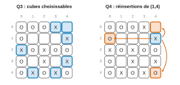
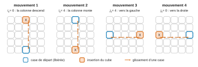
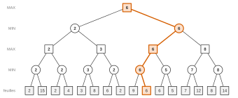
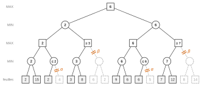

# Mines-Ponts MP-PC-PSI — Informatique commune 2026 · Corrigé brut

*Corrigé rédigé par IA, non officiel. Signalez toute erreur.*

**Jeu Quixo à deux joueurs.** Épreuve de 2 heures, sans calculatrice. Le code est écrit en Python, sans fonction interne de complexité linéaire sur les listes (tranchage et extraction exceptés). La valeur `0` code une face neutre, `1` un pion X (joueur 1), `2` un pion O (joueur 2).

**Avertissement sur les documents.** Q8, Q9, Q13, Q15 et Q18 portent sur des documents du **cahier de réponses**, qui n'est pas reproduit dans l'énoncé public :

- le code incomplet de `deplacement_case` ;
- l'arbre de jeu à 16 feuilles ;
- le code de `deplacements_possibles`.

Ces documents sont reconstruits ci-dessous, sous une forme compatible avec l'énoncé. L'arbre de Q13 et Q18 est un **exemple illustratif**, dont les valeurs ne sont pas celles du cahier. Pour ces questions, la méthode est la partie fiable du corrigé.

**Lemme utilisé dans tout le corrigé.** Un cube prélevé en $(i,j)$ sur le bord se réinsère à une extrémité de sa ligne ($(i,0)$ ou $(i,4)$) ou de sa colonne ($(0,j)$ ou $(4,j)$), sa propre case exceptée. En effet, la poussée se propage en ligne droite depuis la case d'insertion jusqu'à la case libérée, ce qui impose une extrémité de la ligne ou de la colonne. On obtient donc **2 destinations pour un coin** (sa case est extrémité de sa ligne et de sa colonne) et **3 pour une autre case de bord**.

## 2 Jeu à deux joueurs humains

### Q1

```python
def initialisation():
    jeu = []
    for i in range(5):
        jeu.append([0] * 5)
    return jeu
```

Chaque ligne est une liste distincte. Avec `[[0] * 5] * 5`, les cinq lignes seraient le même objet.

### Q2

Chaque case est dans l'un des 3 états $0,1,2$, indépendamment des autres. Le nombre de configurations est donc majoré par
$$\boxed{N\le 3^{25}\approx 8{,}5\cdot10^{11}.}$$
Coder $N$ valeurs distinctes sur $n$ bits impose $2^n\ge N$, soit $n\ge\log_2 N$ :
$$\begin{aligned}
n&=\left\lceil\log_2\left(3^{25}\right)\right\rceil\\
&=\left\lceil 25\log_2 3\right\rceil\\
&=\left\lceil 25\,\frac{\ln 3}{\ln 2}\right\rceil\\
&=\boxed{40.}
\end{aligned}$$
Vérification sans calculatrice :

- $3^5=243<256=2^8$, donc $3^{25}<2^{40}$ ;
- $3^{12}=531\,441>2^{19}=524\,288$, donc $3^{25}=3\,(3^{12})^2>3\cdot2^{38}>2^{39}$.

Il faut donc **40 bits**, contre $25\times16=400$ pour le stockage naïf.

### Q3

Le joueur 1 peut prendre les cases de bord qui portent un X ou qui sont neutres. Dans l'ordre des lignes croissantes :
$$\boxed{(0,3),\ (0,4),\ (1,4),\ (2,0),\ (3,4),\ (4,1),\ (4,3)}$$
La case $(0,4)$ est neutre. Les autres portent un X.

### Q4

$(1,4)$ est une case de bord qui n'est pas un coin. Les extrémités de la ligne 1 sont $(1,0)$ et $(1,4)$, celles de la colonne 4 sont $(0,4)$ et $(4,4)$. On retire la case d'origine $(1,4)$ :
$$\boxed{(0,4),\ (1,0),\ (4,4)}$$



### Q5

```python
def case_bord(i, j):
    return i == 0 or i == 4 or j == 0 or j == 4
```

### Q6

```python
def case_choix_valide(jeu, i, j, joueur):
    return case_bord(i, j) and (jeu[i][j] == 0 or jeu[i][j] == joueur)
```

### Q7

D'après le lemme, la nouvelle case est valide dans deux cas :

- elle est sur la même ligne, à une extrémité, et distincte de la case de départ ;
- elle est sur la même colonne, à une extrémité, et distincte de la case de départ.

La fonction renvoie directement la disjonction de ces deux conditions.

```python
def case_deplacement_valide(i_d, j_d, i_n, j_n):
    meme_ligne = i_n == i_d and (j_n == 0 or j_n == 4) and j_n != j_d
    meme_colonne = j_n == j_d and (i_n == 0 or i_n == 4) and i_n != i_d
    return meme_ligne or meme_colonne
```

### Q8

*Reconstruction du code du cahier de réponses* (structure en quatre cas, boucles `while`). Les lignes du mouvement 2 sont déjà complétées, ce qui est l'objet de Q9.

```python
def deplacement_case(jeu, i_d, j_d, i_n, j_n, joueur):
    if j_n == j_d and i_n == 0:        # mouvement 1
        i = i_d
        while i > 0:
            jeu[i][j_d] = jeu[i - 1][j_d]
            i = i - 1
    elif j_n == j_d and i_n == 4:      # mouvement 2
        i = i_d
        while i < 4:
            jeu[i][j_d] = jeu[i + 1][j_d]
            i = i + 1
    elif j_n == 4:                     # mouvement 3 (i_n == i_d)
        j = j_d
        while j < 4:
            jeu[i_d][j] = jeu[i_d][j + 1]
            j = j + 1
    else:                              # mouvement 4 (i_n == i_d, j_n == 0)
        j = j_d
        while j > 0:
            jeu[i_d][j] = jeu[i_d][j - 1]
            j = j - 1
    jeu[i_n][j_n] = joueur
```

**Mouvement global des pièces.** Dans chaque cas, les cubes situés entre la case d'insertion et la case libérée glissent d'une case vers la case libérée, puis la case d'insertion reçoit la marque du joueur.

- **Mouvement 1** (insertion en haut de la colonne $j_d$) : les cubes des lignes $0$ à $i_d-1$ **descendent** d'une case.
- **Mouvement 2** (insertion en bas de la colonne) : les cubes des lignes $i_d+1$ à $4$ **montent** d'une case.
- **Mouvement 3** (insertion à droite de la ligne $i_d$) : les cubes des colonnes $j_d+1$ à $4$ **glissent vers la gauche**.
- **Mouvement 4** (insertion à gauche de la ligne) : les cubes des colonnes $0$ à $j_d-1$ **glissent vers la droite**.



**Terminaison (mouvement 1).** Variant : $\boxed{V=i}$.

- $V$ est entier : il vaut $i_d\in\{0,\dots,4\}$ au départ et n'est modifié que par `i = i - 1`.
- $V$ est positif : la boucle ne s'exécute que si $i>0$, donc $V\ge1$ avant chaque itération.
- $V$ décroît strictement : chaque itération le diminue de 1.

Une suite strictement décroissante d'entiers naturels est finie. La boucle s'arrête donc après $i_d\le4$ itérations, quand $i=0$, et la procédure se termine (une seule affectation suit la boucle). L'accès `jeu[i - 1][j_d]` est licite car $i\ge1$ dans la boucle.

### Q9

Le mouvement 2 est le symétrique du mouvement 1 : on recopie de bas en haut avec un indice croissant.

```python
        i = i_d
        while i < 4:
            jeu[i][j_d] = jeu[i + 1][j_d]
            i = i + 1
```

Le variant est $4-i$, et la boucle fait $4-i_d$ itérations.

### Q10

On parcourt la ligne une seule fois en tenant à jour `c`, le nombre de pions consécutifs du joueur qui se terminent à la case courante.

```python
def alig(jeu, joueur, i, n):
    c = 0
    for j in range(5):
        if jeu[i][j] == joueur:
            c = c + 1
            if c == n:
                return True
        else:
            c = 0
    return False
```

**Invariant.** Après le traitement de la colonne $j$, `c` est la longueur du bloc maximal de pions du joueur qui se termine en $(i,j)$. Comme `c` augmente d'une unité à la fois, il atteint $n$ si et seulement si la ligne contient $n$ pions consécutifs du joueur. Chaque case est lue une seule fois, d'où au plus 5 accès.

### Q11

Un alignement gagnant occupe une ligne, une colonne ou une diagonale entière ($n=5$).

```python
def gagnant(jeu, joueur):
    for k in range(5):
        if alig(jeu, joueur, k, 5) or acol(jeu, joueur, k, 5):
            return True
    return adiag1(jeu, joueur, 5) or adiag2(jeu, joueur, 5)
```

## 3 Jeu contre un ordinateur

### Q12

**Situation initiale.** Tous les cubes sont neutres, donc les 16 cases de bord sont disponibles : 4 coins à 2 destinations et 12 autres cases à 3 destinations.
$$\boxed{4\times2+12\times3=44\ \text{mouvements.}}$$

**Situation minimale : 4 mouvements.** Exemple pour le joueur 1 : le joueur 2 occupe tout le bord sauf deux coins opposés, $(0,0)$ et $(4,4)$, qui sont neutres.

| | 0 | 1 | 2 | 3 | 4 |
|---|---|---|---|---|---|
| **0** | · | O | O | O | O |
| **1** | O | X | X | · | O |
| **2** | O | X | · | · | O |
| **3** | O | · | · | X | O |
| **4** | O | O | O | O | · |

Aucun joueur n'a d'alignement de 5. Le joueur 1 n'a que deux coins disponibles, soit $2\times2=\boxed{4}$ mouvements : $(0,0)\to(0,4)$, $(0,0)\to(4,0)$, $(4,4)\to(0,4)$, $(4,4)\to(4,0)$.

Pourquoi on ne peut pas faire moins : avec au plus une case de bord disponible, l'adversaire possède au moins 15 des 16 cases de bord, donc toute la ligne 0 ou toute la ligne 4. Il a alors déjà gagné.

### Q13

**Méthode (à appliquer à l'arbre du cahier).** On remonte les valeurs des feuilles vers la racine, niveau par niveau. Chaque nœud MIN (rond) prend le **minimum** de ses fils et chaque nœud MAX (carré) le **maximum**. La racine est MAX, puis les niveaux alternent MIN, MAX, MIN jusqu'aux feuilles. Le coup choisi est celui qui mène au fils de valeur maximale.

**Exemple illustratif** (arbre binaire de même forme, valeurs fictives) :



Sur cet exemple, on remonte $\min$ puis $\max$ niveau par niveau jusqu'à la racine, qui vaut $\max(2,6)=6$ : MAX choisit la branche droite.

### Q14

On majore le nombre de mouvements à chaque tour depuis la position initiale.

- **Tour 1** (joueur 1) : 44 mouvements (Q12).
- **Tour 2** (joueur 2) : il y a un seul X, sur une case de bord (la case d'insertion). Le joueur 2 peut prendre les 15 autres cases de bord, soit $44-2=42$ mouvements si le X est sur un coin et $44-3=41$ sinon. Au plus 42.
- **Tour 3** (joueur 1) : seul le O, sur le bord, lui est interdit. Au plus 42 mouvements.

$$\boxed{44\times42\times42=77\,616\approx 8\cdot10^4\ \text{suites de 3 coups au plus.}}$$

Le maximum 42 est atteint aux tours 2 et 3 quand le coup précédent a été joué dans un coin. Une énumération exhaustive donne exactement $76\,596$ suites.

**Discussion.** Pour une profondeur de 3, explorer environ $8\cdot10^4$ feuilles (une copie du plateau et une évaluation par nœud) est faisable. Mais le nombre de feuilles croît comme $b^p$ avec $b\approx 40$ :

- environ $4\cdot10^6$ à la profondeur 4 ;
- environ $7\cdot10^9$ à la profondeur 6.

Une partie dure plusieurs dizaines de tours et peut ne jamais finir, puisqu'aucun cube n'est retiré du jeu. **Le minimax sur l'arbre complet est donc impossible.** On ne peut l'utiliser qu'à faible profondeur, avec une heuristique d'évaluation des feuilles, et on gagne à élaguer l'arbre (alpha-bêta).

### Q15

*Hypothèse sur le code du cahier.* `deplacements_possibles` balaie les cases de départ par lignes puis colonnes croissantes. Pour chaque départ valide, il balaie de même les cases d'arrivée :

```python
def deplacements_possibles(jeu, joueur):
    depl = []
    for i in range(5):
        for j in range(5):
            if case_choix_valide(jeu, i, j, joueur):
                for i_n in range(5):
                    for j_n in range(5):
                        if case_deplacement_valide(i, j, i_n, j_n):
                            depl.append([i, j, i_n, j_n])
    return depl
```

Sur la figure 3, toutes les cases de bord portent un O, sauf trois X : $(0,3)$, $(2,0)$ et $(4,4)$. Les deux cases neutres, $(1,1)$ et $(1,3)$, sont intérieures. Il y a donc $3+3+2=8$ mouvements, et la fonction renvoie :
$$\boxed{\begin{aligned}\lbrack&[0,3,0,0],\ [0,3,0,4],\ [0,3,4,3],\\ &[2,0,0,0],\ [2,0,2,4],\ [2,0,4,0],\\ &[4,4,0,4],\ [4,4,4,0]]\end{aligned}}$$

L'ensemble de ces 8 mouvements ne dépend pas du code. Seul leur ordre dépend du parcours.

### Q16

Les fonctions de Q10 sont booléennes : on compte les lignes, colonnes et diagonales qui contiennent au moins 4 pions consécutifs du joueur.

```python
def alignement_4(jeu, joueur):
    c = 0
    for k in range(5):
        if alig(jeu, joueur, k, 4):
            c = c + 1
        if acol(jeu, joueur, k, 4):
            c = c + 1
    if adiag1(jeu, joueur, 4):
        c = c + 1
    if adiag2(jeu, joueur, 4):
        c = c + 1
    return c
```

Le résultat est compris entre 0 et 12.

### Q17

Le score est orienté vers le joueur 1 (positif s'il gagne, négatif si c'est le joueur 2). Si les deux joueurs sont alignés en même temps, l'énoncé donne la victoire au joueur dont ce n'était pas le tour. Le dernier coup a été joué par l'adversaire de `joueur` : on lit donc `joueur` comme le joueur dont c'est le tour, ce qui correspond à l'appel fait dans `alphabeta`.

```python
def evaluation(jeu, joueur, profondeur):
    g1 = gagnant(jeu, 1)
    g2 = gagnant(jeu, 2)
    if g1 and g2:                  # double alignement : gagne le joueur dont c'est le tour
        if joueur == 1:
            return 100 + profondeur
        return -100 - profondeur
    if g1:
        return 100 + profondeur
    if g2:
        return -100 - profondeur
    val = 5 * alignement_4(jeu, joueur) + profondeur
    if jeu[2][2] == joueur:
        val = val + 20
    for i in range(5):
        for j in range(5):
            if jeu[i][j] == joueur:
                val = val + 1
            elif jeu[i][j] != 0:
                val = val - 1
    if joueur == 1:
        return val
    return -val
```

Contrôle sur la figure 3, avec une profondeur de 3. Personne n'a gagné.

- **Joueur 1** : un alignement de 4 (la ligne 2), le centre, 10 X contre 13 O. On obtient $5+20-3+3=25$, et la fonction renvoie $25$.
- **Joueur 2** : deux alignements de 4 (la ligne 4 et la colonne 4), pas le centre. On obtient $10+3+3=16$, et la fonction renvoie $-16$.

### Q18

**Méthode (à appliquer à l'arbre du cahier).** On parcourt l'arbre en profondeur, de gauche à droite, en transmettant l'intervalle $[\alpha,\beta]$ aux fils :

- $\alpha$ est la meilleure valeur déjà garantie à MAX ;
- $\beta$ est la meilleure valeur déjà garantie à MIN.

Dans un nœud MAX, dès que $v\ge\beta$, on coupe les fils restants (**coupure $\beta$**). Dans un nœud MIN, dès que $v\le\alpha$, on coupe (**coupure $\alpha$**). Un nœud coupé ne porte qu'une borne : $\le v$ pour un nœud MIN, $\ge v$ pour un nœud MAX.

**Exemple illustratif** (arbre de Q13). Les branches coupées, qui ne sont pas calculées, sont en pointillé gris.



Les quatre coupures, dans l'ordre de l'exploration :

- sous le deuxième MIN de gauche, la feuille 2 donne $v=2\le\alpha=2$ : coupure $\alpha$, la feuille 4 n'est pas lue ;
- le MAX suivant atteint $3\ge\beta=2$ : coupure $\beta$, son second fils n'est pas calculé ;
- dans la moitié droite, la feuille 6 donne $v=6\le\alpha=6$ : coupure $\alpha$ (feuille 5) ;
- le dernier MAX atteint $7\ge\beta=6$ : coupure $\beta$ (feuilles 8 et 14).

On trouve la même valeur 6 à la racine, avec 4 coupures et 10 feuilles évaluées sur 16.

### Q19

```python
    if profondeur == 0 or gagnant(jeu, 1) or gagnant(jeu, 2):     # ligne 3
        eval = evaluation(jeu, joueur, profondeur)                 # ligne 4
        return eval, None

            deplacement_case(jeu_c, depl[0], depl[1], depl[2], depl[3], joueur)   # ligne 12
            v = max(v, alphabeta(jeu_c, 2, alpha, beta, profondeur)[0])         # ligne 13
```

- **Ligne 3.** Un nœud est une feuille quand la partie est finie, c'est-à-dire quand un des deux joueurs a gagné. Il y a toujours au moins 4 coups possibles dans une partie non finie (Q12). La profondeur est atteinte quand elle vaut 0.
- **Ligne 12.** Le coup est joué sur la copie `jeu_c`, jamais sur `jeu`. L'ordre des arguments suit la reconstruction de `deplacement_case` de Q8.
- **Ligne 13.** L'appel récursif porte sur `jeu_c`, avec l'adversaire (joueur 2, puisque ce bloc est celui du joueur 1) et la profondeur **déjà décrémentée** à la ligne 6.

## 4 Gestion d'une base de données

### Q20

```sql
SELECT COUNT(*) AS nb_parties, AVG(P.nbtours) AS moyenne_tours
FROM Partie AS P
JOIN Joueur AS J ON P.id_joueur1 = J.id
WHERE J.prenom = 'John' AND J.nom = 'Doe';
```

La jointure se fait sur `id_joueur1` seulement, ce qui traduit « quand il a commencé la partie ».

### Q21

```sql
SELECT P.nbtours, J1.nom, J1.prenom, J2.nom, J2.prenom
FROM Partie AS P
JOIN Joueur AS J1 ON P.id_joueur1 = J1.id
JOIN Joueur AS J2 ON P.id_joueur2 = J2.id
WHERE P.nbtours = (SELECT MIN(nbtours) FROM Partie);
```

La table `Joueur` est jointe deux fois, sous deux alias, une fois par joueur. Comme la partie minimale est unique, la requête renvoie une seule ligne.
