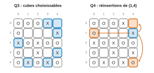
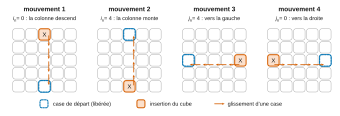
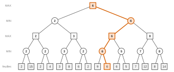
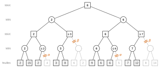

# Mines-Ponts MP-PC-PSI — Informatique commune 2026 · Corrigé guidé

*Corrigé rédigé par IA, non officiel. Signalez toute erreur.*

## Présentation du sujet

**Format.** Épreuve de 2 heures, commune aux filières MP, PC et PSI. La calculatrice et tout dispositif électronique sont interdits. On répond sur un cahier de réponses de 8 pages. Le code est en Python, les requêtes en SQL. L'énoncé impose trois règles :

- ne pas recopier la signature des fonctions ;
- soigner la concision ;
- **ne pas utiliser de fonction interne de complexité linéaire** sur les listes, dictionnaires et chaînes (`sum`, `count`, `in` sur une liste, `max` d'une liste…), le tranchage et l'extraction restant permis.

**Thème.** Le jeu Quixo est un morpion $5\times5$ à cubes glissants. À chaque tour, on prélève un cube sur le bord (neutre ou à sa marque), puis on le réinsère à une extrémité de sa ligne ou de sa colonne, ce qui pousse les autres cubes. Le premier joueur qui aligne 5 symboles gagne.

**Découpage.**

- **Partie 2, jeu à deux joueurs humains** (Q1 à Q11) : représentation du plateau, dénombrement des configurations, règles de validité d'un coup, procédure de glissement avec preuve de terminaison, détection des alignements. Les questions sont courtes et très abordables.
- **Partie 3, jeu contre un ordinateur** (Q12 à Q19) : dénombrement des coups, minimax sur un arbre, coût de l'exploration, heuristique d'évaluation, élagage alpha-bêta décrit par l'énoncé.
- **Partie 4, base de données** (Q20, Q21) : agrégats, jointure, double jointure sur la même table.

**Notions du programme.** Listes de listes et piège de la copie superficielle, booléens paresseux, boucles et variant de boucle, invariant, complexité, représentation des entiers en binaire et logarithme, jeux à deux joueurs et algorithme min-max avec heuristique, SQL (jointures, agrégats, requêtes imbriquées).

**Documents du cahier de réponses.** Q8, Q9, Q13, Q15 et Q18 s'appuient sur des documents qui ne figurent que sur le cahier de réponses : le code de `deplacement_case`, un arbre de jeu à 16 feuilles et le code de `deplacements_possibles`. Ce corrigé les reconstruit. L'arbre est un exemple illustratif, dont les valeurs ne sont pas celles du cahier. Pour ces questions, retenez surtout la méthode.

**Difficulté et gestion du temps.** Le sujet est long pour 2 heures mais sans piège profond. Les points se gagnent sur la précision.

- **Questions à ne pas laisser passer** : Q1, Q3, Q4, Q5, Q6, Q7, Q11, Q12 (première partie), Q16, Q20, Q21. Le rapport 2026 juge Q9 très réussie : une erreur y coûte cher.
- **Questions qui demandent du soin** : Q2 (arrondi par excès), Q8 (variant), Q10 (un seul accès par case), Q14 (discussion chiffrée), Q17 (respect exact des règles) et Q18–Q19 (application fidèle du pseudo-code).
- **Questions discriminantes** d'après le rapport 2026 : Q12, dont peu de copies traitent correctement les deux parties, puis Q17 et Q18, peu traitées. L'alpha-bêta, inconnu de la plupart des candidats, départage ceux qui savent s'approprier un algorithme nouveau.

**Rédaction (rapport 2026).** Le jury rappelle que les réponses doivent tenir dans l'espace du document-réponse, sans astérisques ni renvois. Il demande des commentaires courts, réservés aux astuces. Il signale aussi des erreurs de syntaxe récurrentes : `assert` à la place de `if`, parenthèses oubliées après `range`, `=` au lieu de `==`, syntaxe numpy appliquée à des listes.

Comptez environ 50 minutes pour la partie 2, 55 minutes pour la partie 3 et 15 minutes pour le SQL.

**Un lemme qui sert partout.** Avant Q4, établissez une fois pour toutes où peut se réinsérer un cube prélevé en $(i,j)$ sur le bord. La poussée se fait en ligne droite depuis la case d'insertion jusqu'à la case libérée.

Les seules destinations sont donc :

- les extrémités de la ligne $i$, soit $(i,0)$ et $(i,4)$ ;
- les extrémités de la colonne $j$, soit $(0,j)$ et $(4,j)$ ;
- à l'exclusion de la case $(i,j)$ elle-même.

On obtient **2 destinations pour un coin** et **3 pour les autres cases de bord**. Le lemme resservira en Q4, Q7, Q12, Q14 et Q15.

## Partie 2 — Jeu à deux joueurs humains

On construit, fonction par fonction, un tour de jeu complet : choix du cube, choix de la destination, glissement, test de victoire. Chaque fonction doit être courte et réutiliser les précédentes.

### Question 1

> [!INDICATION]
> Il faut 5 lignes qui soient 5 objets distincts en mémoire.

> [!INDICATION]
> Méfiez-vous de la répétition d'une liste de listes par `*` : que duplique-t-elle exactement ?

#### Solution

```python
def initialisation():
    jeu = []
    for i in range(5):
        jeu.append([0] * 5)
    return jeu
```

`[0] * 5` est correct pour une ligne d'entiers, et chaque tour de boucle crée une nouvelle ligne. La compréhension `[[0] * 5 for i in range(5)]` convient aussi.

> [!PIEGE]
> `[[0] * 5] * 5` duplique cinq fois **la même référence** de ligne : `jeu[0][0] = 1` modifierait alors toute la colonne 0. C'est le caractère superficiel de la copie de listes, explicitement au programme.

> [!JURY]
> Le rapport 2026 relève trois erreurs : l'usage de numpy alors que le sujet impose une liste de listes, des lignes « dépendantes les unes des autres » (le piège ci-dessus), et l'affectation `plateau[i][j]=0` sur une liste encore vide, qui lève une erreur d'indice.

### Question 2

> [!INDICATION]
> Chaque case peut prendre combien d'états, indépendamment des autres ? Le dénombrement est un produit.

> [!INDICATION]
> Pour coder $N$ valeurs distinctes sur $n$ bits, comparez $2^n$ à $N$. Le nombre de bits est un entier : quel arrondi faut-il ?

#### Solution

Une configuration associe à chacune des 25 cases un état parmi $\{0,1,2\}$. Sans tenir compte des symétries ni des configurations inaccessibles :
$$\boxed{N\le3^{25}\approx8{,}5\cdot10^{11}.}$$
Il faut $2^n\ge N$, donc
$$\begin{aligned}
n&=\left\lceil\log_2\left(3^{25}\right)\right\rceil\\
&=\left\lceil25\log_2 3\right\rceil\\
&=\left\lceil 25\,\frac{\ln3}{\ln2}\right\rceil\\
&=\boxed{40.}
\end{aligned}$$
Sans calculatrice :

- $3^5=243<2^8$ donne $3^{25}<2^{40}$ ;
- $3^{12}=531\,441>2^{19}=524\,288$ donne $3^{25}=3\,(3^{12})^2>2^{39}$.

Donc 39 bits ne suffisent pas et 40 suffisent, contre $25\times16=400$ bits pour le stockage naïf.

> [!PIEGE]
> Deux confusions classiques : écrire $25^3$ au lieu de $3^{25}$ (ce sont les cases qui choisissent un état), et arrondir $25\log_2 3\approx39{,}6$ à 39. Un arrondi par défaut rend le codage non injectif.

> [!JURY]
> Rapport 2026 : « Peu de candidats font le lien entre le nombre de bits nécessaires et $\log_2$. » C'est pourtant ce que demande l'énoncé (« à l'aide d'un logarithme ») : $n$ bits codent $2^n$ valeurs.

> [!METHODE]
> Pour encadrer une puissance sans calculatrice, comparez de petites puissances ($3^5$ et $2^8$, $3^{12}$ et $2^{19}$), puis élevez à la puissance voulue.

### Question 3

> [!INDICATION]
> Deux conditions : être sur le bord, et porter un X **ou** être neutre.

> [!INDICATION]
> Parcourez les 16 cases de bord ligne par ligne. N'oubliez pas les bords gauche et droit des lignes 1 à 3.

#### Solution

Sur la figure 2, les cases de bord neutres ou marquées X sont, par ligne croissante :
$$\boxed{(0,3),\ (0,4),\ (1,4),\ (2,0),\ (3,4),\ (4,1),\ (4,3)}$$
Il y a 7 cubes, dont un neutre en $(0,4)$.

> [!PIEGE]
> Le cube neutre $(0,4)$ est choisissable : la règle autorise « l'un de ses cubes **ou** un cube neutre ».

### Question 4

> [!INDICATION]
> Dans quelle direction la poussée peut-elle se propager pour reboucher la case libérée ?

> [!INDICATION]
> Repérez les extrémités de la ligne et de la colonne du cube, puis appliquez la règle sur la case d'origine.

#### Solution

D'après le lemme de la présentation, les destinations possibles sont les extrémités de la ligne 1, $(1,0)$ et $(1,4)$, et celles de la colonne 4, $(0,4)$ et $(4,4)$. On retire la case d'origine :
$$\boxed{(0,4),\ (1,0),\ (4,4)}$$

- Réinsérer en $(1,0)$ pousse la ligne 1 vers la droite.
- Réinsérer en $(0,4)$ fait descendre le cube $(0,4)$ en $(1,4)$.
- Réinsérer en $(4,4)$ fait remonter les cubes $(2,4)$, $(3,4)$ et $(4,4)$.



> [!PIEGE]
> Un cube ne se déplace pas d'une case : il est **réinséré à une extrémité**. Des réponses comme $(0,3)$ ou $(2,4)$ sont fausses.

### Question 5

> [!INDICATION]
> Caractérisez le bord par une condition sur les indices, sans liste de cases.

#### Solution

```python
def case_bord(i, j):
    return i == 0 or i == 4 or j == 0 or j == 4
```

> [!PIEGE]
> Énumérer les 16 cases du bord est interdit par l'énoncé, et le rapport 2026 signale que certains candidats l'ont pourtant fait.

> [!PIEGE]
> `i == 0 or 4` est toujours vrai : si `i != 0`, l'expression vaut `4`, entier non nul, donc considéré comme vrai. Chaque comparaison doit être écrite en entier.

### Question 6

> [!INDICATION]
> Combinez `case_bord` (obligatoire) avec un test sur le contenu de la case.

> [!INDICATION]
> Attention à la priorité de `and` sur `or`.

#### Solution

```python
def case_choix_valide(jeu, i, j, joueur):
    return case_bord(i, j) and (jeu[i][j] == 0 or jeu[i][j] == joueur)
```

> [!PIEGE]
> Rapport 2026 : « Oubli récurrent des cases neutres. » Tester seulement `jeu[i][j] == joueur` refuse les cubes neutres, que la règle autorise.

> [!PIEGE]
> Sans parenthèses, `case_bord(i, j) and jeu[i][j] == 0 or jeu[i][j] == joueur` accepterait toute case à la marque du joueur, même à l'intérieur du plateau.

### Question 7

> [!INDICATION]
> Traduisez le lemme : même ligne et extrémité de ligne, **ou** même colonne et extrémité de colonne.

> [!INDICATION]
> Quelle condition supplémentaire impose l'interdiction de remettre le cube à sa place ?

#### Solution

```python
def case_deplacement_valide(i_d, j_d, i_n, j_n):
    meme_ligne = i_n == i_d and (j_n == 0 or j_n == 4) and j_n != j_d
    meme_colonne = j_n == j_d and (i_n == 0 or i_n == 4) and i_n != i_d
    return meme_ligne or meme_colonne
```

Les deux cas couvrent exactement les destinations du lemme. Les conditions $j_n\ne j_d$ et $i_n\ne i_d$ excluent la case de départ. On renvoie directement le booléen, sans `if … return True … return False`.

> [!JURY]
> Le rapport 2026 demande de « synthétiser leurs codes lorsque c'est possible » : certaines propositions étaient longues et complexes. Dans ses remarques générales, il juge que `if a==b : return True ... else : return False`, sans être incorrect, « montre le manque de familiarisation avec les booléens ».

> [!PIEGE]
> Le seul test `i_n == i_d or j_n == j_d` est insuffisant : il accepterait $(0,2)\to(0,1)$, qui ne pousse rien. Sans les conditions de différence, chaque case de bord gagnerait une destination fictive, sa propre case, et la question 12 donnerait 60 au lieu de 44.

### Question 8

> [!INDICATION]
> Pour chaque branche, identifiez l'extrémité d'insertion. Les cubes glissent vers la case libérée, donc en s'éloignant de l'insertion.

> [!INDICATION]
> Pour la terminaison, cherchez une quantité entière, positive tant que la boucle tourne, et qui diminue à chaque tour.

#### Solution

*Le code est celui du cahier de réponses, reconstruit ici avec quatre cas et des boucles `while`. Les lignes du mouvement 2, objet de Q9, sont déjà complétées.*

```python
def deplacement_case(jeu, i_d, j_d, i_n, j_n, joueur):
    if j_n == j_d and i_n == 0:        # mouvement 1
        i = i_d
        while i > 0:
            jeu[i][j_d] = jeu[i - 1][j_d]
            i = i - 1
    elif j_n == j_d and i_n == 4:      # mouvement 2
        i = i_d
        while i < 4:
            jeu[i][j_d] = jeu[i + 1][j_d]
            i = i + 1
    elif j_n == 4:                     # mouvement 3 (i_n == i_d)
        j = j_d
        while j < 4:
            jeu[i_d][j] = jeu[i_d][j + 1]
            j = j + 1
    else:                              # mouvement 4 (i_n == i_d, j_n == 0)
        j = j_d
        while j > 0:
            jeu[i_d][j] = jeu[i_d][j - 1]
            j = j - 1
    jeu[i_n][j_n] = joueur
```

**Mouvements globaux.**

- **Mouvement 1** (insertion en $(0,j_d)$) : la partie de la colonne $j_d$ au-dessus de la case libérée **descend** d'une case.
- **Mouvement 2** (insertion en $(4,j_d)$) : la partie en dessous **monte** d'une case.
- **Mouvement 3** (insertion en $(i_d,4)$) : la partie de la ligne $i_d$ à droite **glisse vers la gauche**.
- **Mouvement 4** (insertion en $(i_d,0)$) : la partie à gauche **glisse vers la droite**.

Dans les quatre cas, la case d'insertion reçoit ensuite la marque du joueur.



**Terminaison du mouvement 1.** On prend pour variant $\boxed{V=i}$.

- C'est un entier : il vaut $i_d$ au départ et n'est modifié que par décrément de 1.
- Il est positif dans la boucle, puisque la condition `i > 0` garantit $V\ge1$.
- Il décroît strictement, de 1 à chaque itération.

Une suite d'entiers naturels strictement décroissante est finie. La boucle s'arrête donc après $i_d$ itérations, et la procédure se termine. L'accès `jeu[i - 1][j_d]` reste dans le tableau car $i\ge1$.

> [!METHODE]
> Pour un décalage en place, on recopie **depuis la case libérée vers l'insertion**. Pour faire descendre une colonne, on parcourt donc $i$ en décroissant : on écrit `jeu[i]` à partir de `jeu[i-1]`. Dans l'autre sens, une même valeur se propagerait dans toute la colonne.

> [!JURY]
> Rapport 2026 : « La notion d'invariant ne semble pas toujours maitrisée et est confondue avec la notion de variant. Il s'agit d'une question d'analyse appelant une question courte et précise, pas une paraphrase du code. » On attend un **variant** (ici $i$), avec ses trois propriétés, et non un invariant ni un récit ligne à ligne de la boucle.

### Question 9

> [!INDICATION]
> C'est le symétrique du mouvement 1 : dans quel sens faut-il parcourir la colonne ?

#### Solution

```python
        i = i_d
        while i < 4:
            jeu[i][j_d] = jeu[i + 1][j_d]
            i = i + 1
```

On parcourt en croissant, de la case libérée vers le bas. Le variant est $4-i$, et la boucle fait $4-i_d$ itérations.

### Question 10

> [!INDICATION]
> Un seul accès par case interdit de tester chaque position de départ possible. Il faut un seul balayage.

> [!INDICATION]
> Tenez à jour un compteur de pions consécutifs du joueur. Que doit-il devenir sur une case qui n'est pas au joueur ?

#### Solution

```python
def alig(jeu, joueur, i, n):
    c = 0
    for j in range(5):
        if jeu[i][j] == joueur:
            c = c + 1
            if c == n:
                return True
        else:
            c = 0
    return False
```

**Invariant.** Après le traitement de la colonne $j$, `c` est la longueur du bloc maximal de pions du joueur qui se termine en $(i,j)$. Ce bloc s'allonge de 1 si la case est au joueur et tombe à 0 sinon. Comme `c` ne croît que d'une unité à la fois, il prend la valeur $n$ si et seulement si la ligne contient $n$ pions consécutifs du joueur. Chaque case est lue une seule fois.

Les fonctions `acol`, `adiag1` et `adiag2` s'écrivent de même, en lisant `jeu[k][j]`, `jeu[k][k]` et `jeu[k][4 - k]`.

> [!PIEGE]
> Le rapport 2026 relève trois défauts : la condition d'optimalité (un seul accès par case) non respectée, une sortie de boucle mal gérée, et le test `c == n` placé au mauvais endroit. Ici, il est fait juste après l'incrément, dans la branche où la case est au joueur, et il provoque un `return` immédiat.

> [!PIEGE]
> Le rapport 2026 note aussi que plusieurs copies testent si $n$ cases de la ligne sont au joueur « sans tester qu'elles sont consécutives ». Le mot important est « consécutifs ». Compter les pions du joueur sur la ligne est faux : `X X . X X` contient quatre X mais aucun alignement de trois. La remise à zéro `c = 0` est le cœur de la fonction.

### Question 11

> [!INDICATION]
> Sur un plateau $5\times5$, un alignement de 5 occupe une ligne, une colonne ou une diagonale entière. Combien de droites faut-il tester ?

#### Solution

```python
def gagnant(jeu, joueur):
    for k in range(5):
        if alig(jeu, joueur, k, 5) or acol(jeu, joueur, k, 5):
            return True
    return adiag1(jeu, joueur, 5) or adiag2(jeu, joueur, 5)
```

On teste 12 droites (5 lignes, 5 colonnes, 2 diagonales), en s'arrêtant au premier alignement trouvé. La règle de départage, quand les deux joueurs sont alignés, relève de l'appelant : cette fonction ne juge qu'un seul joueur.

> [!PIEGE]
> Une seule boucle sur `k` suffit, puisque `alig` et `acol` parcourent déjà leur ligne ou leur colonne. Le rapport 2026 signale que plusieurs candidats ont écrit des boucles imbriquées.

## Partie 3 — Jeu contre un ordinateur

On dénombre d'abord les coups pour mesurer la taille de l'arbre de jeu. On applique ensuite minimax, on construit une heuristique pour évaluer les positions sans aller jusqu'au bout de la partie, puis on implémente l'élagage alpha-bêta fourni en pseudo-code.

### Question 12

> [!INDICATION]
> En position initiale, quels cubes de bord sont disponibles ? Combien de destinations a chacun, selon qu'il est un coin ou non ?

> [!INDICATION]
> Pour le minimum, cherchez à priver le joueur de presque toutes ses cases de bord, puis vérifiez que la position n'est pas déjà gagnée par l'adversaire.

#### Solution

**Situation initiale.** Les 16 cases de bord sont neutres, donc toutes disponibles : 4 coins à 2 destinations et 12 cases à 3 destinations.
$$\boxed{4\times2+12\times3=44\ \text{mouvements.}}$$

**Situation minimale.** Le joueur 2 occupe tout le bord sauf les coins opposés $(0,0)$ et $(4,4)$, qui sont neutres :

| | 0 | 1 | 2 | 3 | 4 |
|---|---|---|---|---|---|
| **0** | · | O | O | O | O |
| **1** | O | X | X | · | O |
| **2** | O | X | · | · | O |
| **3** | O | · | · | X | O |
| **4** | O | O | O | O | · |

Les lignes 0 et 4, les colonnes 0 et 4 et la diagonale principale sont toutes coupées par un coin libre : personne n'a gagné. Le joueur 1 n'a que deux coins, soit
$$\boxed{4\ \text{mouvements}.}$$
On ne peut pas descendre plus bas. Avec au plus une case de bord disponible, l'adversaire tiendrait 15 cases de bord sur 16, donc la ligne 0 ou la ligne 4 en entier : la partie serait déjà finie.

> [!PIEGE]
> Le calcul $16\times3=48$ oublie que les coins n'ont que 2 destinations. Autre confusion : compter les cubes au lieu des couples (départ, arrivée).

> [!PIEGE]
> Une position à 0 ou 2 mouvements suppose que l'adversaire a déjà aligné 5 cubes : ce n'est plus une situation de jeu. Si les deux coins libres sont du même côté, la ligne opposée est complète.

> [!JURY]
> Question discriminante : d'après le rapport 2026, « peu de copies traitent correctement les 2 parties de la question ». Le jury ajoute qu'il est possible d'utiliser un dessin, ce que fait le tableau ci-dessus.

### Question 13

> [!INDICATION]
> Identifiez d'abord le type de chaque niveau, en alternant MAX et MIN depuis la racine.

> [!INDICATION]
> Remontez des feuilles vers la racine, un niveau complet à la fois.

#### Solution

**Méthode.** On remplit l'arbre du cahier de bas en haut. Chaque rond (MIN) reçoit le **minimum** des valeurs de ses fils, chaque carré (MAX) le **maximum**. La racine, qui est MAX, reçoit la valeur de la partie supposée jouée au mieux par les deux joueurs. Le coup choisi est celui qui mène au fils de valeur maximale.

**Exemple illustratif** (même forme que l'arbre du cahier, valeurs fictives) :



La racine vaut $\max(2,6)=6$ : MAX choisit la branche droite.

> [!PIEGE]
> La valeur de la racine n'est pas la meilleure feuille (ici 15). C'est la meilleure valeur que MAX peut **garantir** face à un adversaire qui joue au mieux pour lui.

### Question 14

> [!INDICATION]
> Majorez le nombre de coups à chacun des trois tours, en partant de la position initiale. Quels cubes sont interdits au joueur à chaque tour ?

> [!INDICATION]
> Le nombre de suites de trois coups est un produit. Comment croît-il avec la profondeur ?

#### Solution

- **Tour 1** : 44 mouvements (Q12).
- **Tour 2** : le seul X est sur le bord (la case d'insertion). Le joueur 2 dispose des 15 autres cases de bord, soit $44-2=42$ mouvements si le X est sur un coin et $41$ sinon.
- **Tour 3** : seul le O, sur le bord, est interdit au joueur 1, qui a au plus 42 mouvements.

$$\boxed{44\times42\times42=77\,616\approx8\cdot10^4\ \text{suites de 3 coups au plus.}}$$

Le maximum 42 est atteint quand le coup précédent a été joué dans un coin. Le nombre exact de suites, obtenu par énumération, est $76\,596$, du même ordre.

**Discussion.** À la profondeur 3, environ $8\cdot10^4$ feuilles, chacune avec une copie du plateau et une évaluation, restent explorables. Mais le nombre de feuilles croît comme $b^p$, avec $b\approx40$ :

- environ $4\cdot10^6$ à la profondeur 4 ;
- environ $7\cdot10^9$ à la profondeur 6.

Une partie compte des dizaines de tours et peut ne jamais finir, puisqu'aucun cube n'est retiré. **Le minimax complet est donc hors de portée.** On le limite à quelques coups d'avance, avec une heuristique aux feuilles (Q16, Q17) et un élagage (Q18, Q19).

> [!PIEGE]
> Additionner les nombres de coups ($44+42+42$) au lieu de les multiplier. À l'inverse, conclure « impossible » à partir de $8\cdot10^4$ : ce nombre est petit. L'obstacle vient de la croissance exponentielle avec la profondeur.

> [!JURY]
> Rapport 2026 : « Les interprétations proposées ne sont pas toujours en accord avec l'ordre de grandeur proposé. Il est demandé aux candidats de vérifier la cohérence de leurs réponses. » La conclusion doit découler du nombre calculé : $8\cdot10^4$ est faisable, c'est la croissance avec la profondeur qui ne l'est pas.

### Question 15

> [!INDICATION]
> Repérez les cubes de bord que le joueur 1 peut prendre sur la figure 3. Il y en a très peu.

> [!INDICATION]
> L'ordre de la liste est celui du parcours de `deplacements_possibles` : déroulez ses boucles au lieu de deviner.

#### Solution

*Hypothèse sur le code du cahier* : on balaie les départs par lignes puis colonnes croissantes, et pour chaque départ valide, les arrivées de la même façon.

```python
def deplacements_possibles(jeu, joueur):
    depl = []
    for i in range(5):
        for j in range(5):
            if case_choix_valide(jeu, i, j, joueur):
                for i_n in range(5):
                    for j_n in range(5):
                        if case_deplacement_valide(i, j, i_n, j_n):
                            depl.append([i, j, i_n, j_n])
    return depl
```

Sur la figure 3, les seuls cubes de bord disponibles pour X sont $(0,3)$, $(2,0)$ et le coin $(4,4)$. Tout le reste du bord porte un O, et les cases neutres $(1,1)$ et $(1,3)$ sont intérieures. On obtient $3+3+2=8$ mouvements :
$$\boxed{\begin{aligned}\lbrack&[0,3,0,0],\ [0,3,0,4],\ [0,3,4,3],\\ &[2,0,0,0],\ [2,0,2,4],\ [2,0,4,0],\\ &[4,4,0,4],\ [4,4,4,0]]\end{aligned}}$$

Seul l'ordre dépend du code exact du cahier : l'ensemble des 8 mouvements, lui, n'en dépend pas.

> [!METHODE]
> Les choix de X sur cette position sont tous mauvais, ce qui montre l'intérêt de regarder plusieurs coups à l'avance. Pour chacun des 8 coups, O a une réponse gagnante, par exemple prélever un O de la colonne 4 et le réinsérer en $(4,4)$. Les deux coups du coin $(4,4)$ complètent même immédiatement la ligne 4 de O. Une évaluation à profondeur 0 ne voit pas cette menace, alors qu'une recherche à profondeur 2 la voit.

### Question 16

> [!INDICATION]
> Les fonctions `alig`, `acol`, `adiag1` et `adiag2` renvoient un booléen. Que peut-on compter avec elles ?

#### Solution

```python
def alignement_4(jeu, joueur):
    c = 0
    for k in range(5):
        if alig(jeu, joueur, k, 4):
            c = c + 1
        if acol(jeu, joueur, k, 4):
            c = c + 1
    if adiag1(jeu, joueur, 4):
        c = c + 1
    if adiag2(jeu, joueur, 4):
        c = c + 1
    return c
```

On compte les droites (5 lignes, 5 colonnes, 2 diagonales) qui contiennent au moins 4 pions consécutifs du joueur. Le résultat est entre 0 et 12. Une ligne de 5 pions compte une fois.

> [!PIEGE]
> Le rapport 2026 signale, comme en Q11, des boucles imbriquées qui conduisent ici à une erreur de dénombrement : une même droite est comptée plusieurs fois. Autre défaut relevé, des `if`, `elif`, `else` mal enchaînés. Avec `elif`, une ligne alignée empêcherait de compter la colonne de même indice : il faut deux `if` indépendants.

### Question 17

> [!INDICATION]
> Traduisez les règles dans l'ordre : d'abord le cas gagnant, qui court-circuite tout, puis les contributions, puis le signe.

> [!INDICATION]
> Le score gagnant dépend de **qui** a gagné. Pensez aussi au cas où les deux joueurs sont alignés en même temps, prévu par l'énoncé.

> [!INDICATION]
> Le décompte des pions se fait par une double boucle, sans fonction linéaire interne.

#### Solution

Le score est orienté vers le joueur 1. En cas de double alignement, l'énoncé fait gagner le joueur dont ce n'était pas le tour. Dans `alphabeta`, `joueur` est le joueur dont c'est le tour : le dernier coup a été joué par son adversaire, et c'est donc `joueur` qui gagne.

```python
def evaluation(jeu, joueur, profondeur):
    g1 = gagnant(jeu, 1)
    g2 = gagnant(jeu, 2)
    if g1 and g2:                  # double alignement : gagne le joueur dont c'est le tour
        if joueur == 1:
            return 100 + profondeur
        return -100 - profondeur
    if g1:
        return 100 + profondeur
    if g2:
        return -100 - profondeur
    val = 5 * alignement_4(jeu, joueur) + profondeur
    if jeu[2][2] == joueur:
        val = val + 20
    for i in range(5):
        for j in range(5):
            if jeu[i][j] == joueur:
                val = val + 1
            elif jeu[i][j] != 0:
                val = val - 1
    if joueur == 1:
        return val
    return -val
```

**Contrôle sur la figure 3**, avec une profondeur de 3. Personne n'a gagné.

- **Joueur 1** : la ligne 2 est un alignement de 4 ($+5$), il a le centre ($+20$), et 10 X contre 13 O donnent $-3$. Avec la profondeur, on obtient $25$.
- **Joueur 2** : la ligne 4 et la colonne 4 donnent $+10$, il n'a pas le centre, et les pions donnent $+3$. Avec la profondeur, on obtient $16$, et la fonction renvoie $-16$.

Le terme $+$profondeur favorise les victoires rapides : une victoire trouvée plus tôt dans la recherche laisse une profondeur restante plus grande.

> [!JURY]
> Rapport 2026 sur Q17 : « Question peu traitée. » La traduire fidèlement règle par règle rapporte des points que beaucoup laissent.

> [!PIEGE]
> Trois oublis possibles : le `return` immédiat du cas gagnant (sinon on ajoute des bonus à 100), le signe final pour le joueur 2, et l'exclusion des cases neutres dans le décompte (`elif jeu[i][j] != 0`).

### Question 18

> [!INDICATION]
> Explorez en profondeur, de gauche à droite, en transmettant aux fils l'intervalle $[\alpha,\beta]$ des valeurs encore utiles.

> [!INDICATION]
> Coupez dans un nœud MAX dès que sa valeur partielle atteint $\beta$, et dans un nœud MIN dès qu'elle descend à $\alpha$. Qu'écrire alors dans le nœud coupé ?

#### Solution

**Méthode.** $\alpha$ est la meilleure valeur déjà garantie à MAX et $\beta$ la meilleure déjà garantie à MIN. Les deux bornes descendent vers les fils et se resserrent.

- Dans un nœud MAX : si $v\ge\beta$, **coupure $\beta$**, et le nœud porte « $\ge v$ ».
- Dans un nœud MIN : si $v\le\alpha$, **coupure $\alpha$**, et le nœud porte « $\le v$ ».

Sur le cahier, on barre les branches coupées comme sur la figure 4.

**Exemple illustratif** (arbre de Q13). Les branches non calculées sont en pointillé gris.



Les quatre coupures, dans l'ordre de l'exploration :

- sous le deuxième MIN de gauche, la feuille 2 donne $v=2\le\alpha=2$ : coupure $\alpha$, la feuille 4 n'est pas lue ;
- le MAX suivant atteint $3\ge\beta=2$ : coupure $\beta$, son second fils n'est pas calculé ;
- dans la moitié droite, la feuille 6 donne $v=6\le\alpha=6$ : coupure $\alpha$ (feuille 5) ;
- le dernier MAX atteint $7\ge\beta=6$ : coupure $\beta$ (feuilles 8 et 14).

On retrouve la même valeur 6 à la racine, avec 4 coupures et 10 feuilles évaluées sur 16.

> [!PIEGE]
> Un nœud coupé ne porte qu'une **borne**, qui peut différer de sa vraie valeur minimax. Ici, le nœud « $\le 6$ » vaut en réalité 5, et le nœud « $\ge 7$ » vaut 8. N'y écrivez pas la vraie valeur : vous ne l'avez pas calculée.

> [!JURY]
> Rapport 2026 sur Q18 : « Question peu traitée. » L'énoncé explique pourtant les deux coupures sur la figure 4 : il suffit d'appliquer ce mécanisme.

> [!METHODE]
> L'efficacité de l'élagage dépend de l'ordre d'exploration. Si les meilleurs coups sont examinés en premier, on coupe davantage.

### Question 19

> [!INDICATION]
> Ligne 3 : qu'est-ce qu'une feuille dans ce jeu, et quand la profondeur est-elle atteinte ? Ligne 4 : quelle fonction donne l'heuristique ?

> [!INDICATION]
> Lignes 12 et 13 : sur quel plateau joue-t-on le coup ? Quel joueur et quelle profondeur passe-t-on à l'appel récursif, sachant que la ligne 6 a déjà décrémenté ?

#### Solution

```python
    if profondeur == 0 or gagnant(jeu, 1) or gagnant(jeu, 2):     # ligne 3
        eval = evaluation(jeu, joueur, profondeur)                 # ligne 4
        return eval, None

            deplacement_case(jeu_c, depl[0], depl[1], depl[2], depl[3], joueur)   # ligne 12
            v = max(v, alphabeta(jeu_c, 2, alpha, beta, profondeur)[0])         # ligne 13
```

- **Ligne 3.** Une feuille est une position où la partie est finie, c'est-à-dire où un des deux joueurs est aligné. Une partie non finie offre toujours au moins 4 coups (Q12). La profondeur est atteinte quand elle vaut 0, qui correspond à une évaluation directe.
- **Ligne 12.** Le coup s'applique à la copie profonde `jeu_c`, sinon les coups suivants de la boucle partiraient d'un plateau modifié. L'ordre des arguments est celui de la reconstruction de Q8.
- **Ligne 13.** On passe `jeu_c`, l'adversaire (joueur 2, puisque ce bloc est celui du joueur 1, et on peut écrire `3 - joueur`) et `profondeur` sans nouveau décrément. Le `[0]` extrait la valeur du couple renvoyé.

Le nom `eval` est imposé par la ligne 5 de l'ébauche, même s'il masque une fonction interne de Python.

> [!PIEGE]
> Transmettre `profondeur - 1` décrémente deux fois par niveau. Oublier de changer de joueur empile des nœuds MAX. Jouer le coup sur `jeu` au lieu de `jeu_c` fausse tous les frères.

## Partie 4 — Gestion d'une base de données

La table `Partie` a trois clés étrangères vers `Joueur.id`. Toute requête qui a besoin des deux joueurs d'une partie doit donc joindre `Joueur` deux fois.

### Question 20

> [!INDICATION]
> Une seule jointure suffit. Sur quelle clé étrangère porte-t-elle pour traduire « il a commencé la partie » ?

> [!INDICATION]
> « John Doe » se répartit entre deux attributs.

#### Solution

```sql
SELECT COUNT(*) AS nb_parties, AVG(P.nbtours) AS moyenne_tours
FROM Partie AS P
JOIN Joueur AS J ON P.id_joueur1 = J.id
WHERE J.prenom = 'John' AND J.nom = 'Doe';
```

Il ne faut pas de `GROUP BY` : après le filtre, l'agrégat porte sur les seules parties où John Doe est joueur 1.

> [!PIEGE]
> Joindre aussi sur `id_joueur2`, ou utiliser `OR`, compterait les parties où il joue en second.

> [!PIEGE]
> Le rapport 2026 relève une confusion entre `WHERE` et `HAVING` et sur l'usage de `LIKE`. Le filtre porte sur des attributs de lignes, avant agrégation : c'est un `WHERE`. `HAVING` filtre des groupes après un `GROUP BY`. Une égalité exacte suffit, `LIKE` sert aux motifs.

### Question 21

> [!INDICATION]
> Deux joueurs par partie : il faut deux exemplaires de `Joueur`, sous deux alias.

> [!INDICATION]
> Un agrégat ne peut pas figurer dans `WHERE`. Comment obtenir le minimum de `nbtours` pour le comparer ?

#### Solution

```sql
SELECT P.nbtours, J1.nom, J1.prenom, J2.nom, J2.prenom
FROM Partie AS P
JOIN Joueur AS J1 ON P.id_joueur1 = J1.id
JOIN Joueur AS J2 ON P.id_joueur2 = J2.id
WHERE P.nbtours = (SELECT MIN(nbtours) FROM Partie);
```

La sous-requête calcule le minimum sur toute la table. Comme la partie minimale est unique, la requête renvoie une seule ligne.

> [!PIEGE]
> `WHERE nbtours = MIN(nbtours)` est illégal. Sans alias, les colonnes `nom` et `prenom` sont ambiguës. Enfin, la projection doit inclure `nbtours`, qui est demandé.

> [!JURY]
> Rapport 2026 : « l'attribut id de la table Joueur doit être égal à l'attribut id_joueur1 ou id_joueur2 de la table Partie ». Le jury relève aussi `attribut.table` au lieu de `table.attribut`, `SELECT a AND b` au lieu de `SELECT a,b`, et une confusion entre `JOIN` et `UNION`. Il demande de réfléchir à l'utilité du renommage d'une table : ici, les deux alias `J1` et `J2` sont indispensables, puisque `Joueur` apparaît deux fois.

## Bilan

**Méthodes à retenir.**

- Établir une fois pour toutes un **lemme sur les règles** (ici, les destinations d'un cube), puis s'en servir partout : Q4, Q7, Q12, Q14 et Q15 en découlent.
- **Variant de boucle** : le nommer, puis vérifier qu'il est entier, minoré et strictement décroissant.
- **Balayage à compteur avec remise à zéro** pour détecter des blocs consécutifs en un seul passage (Q10), justifié par un invariant.
- **Coût d'une recherche dans un arbre de jeu** : un produit de facteurs de branchement, $b^p$, d'où la nécessité de l'heuristique et de l'élagage.
- **Minimax et alpha-bêta à la main** : remonter niveau par niveau, transmettre $[\alpha,\beta]$, écrire des bornes dans les nœuds coupés.
- **SQL** : une jointure par rôle quand une table est référencée plusieurs fois, et une sous-requête pour comparer à un agrégat.

**Questions discriminantes (rapport 2026).** Q12 (les deux parties), Q17 et Q18 ont fait la différence. Le jury insiste aussi sur la manipulation des booléens (parenthèses, lois de De Morgan, renvoi direct d'une condition) et sur les fonctions qui doivent renvoyer une valeur dans tous les cas.

**Prérequis à revoir.** Copie superficielle des listes, priorité et paresse de `and`/`or`, logarithme en base 2 et nombre de bits, décalage d'un tableau en place, jointures et agrégats SQL.

**Questions transposables.** L'initialisation d'une grille, le test d'appartenance au bord, la détection d'alignements (puissance 4, morpion), le nombre de bits d'un codage, le minimax sur un arbre donné, la complétion d'un alpha-bêta et la double jointure sur une table de joueurs reviennent régulièrement dans les sujets de jeux à deux joueurs de l'informatique commune.
