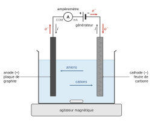
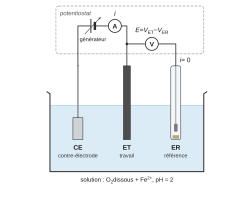
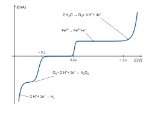
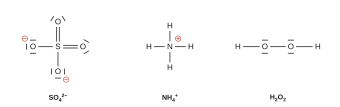
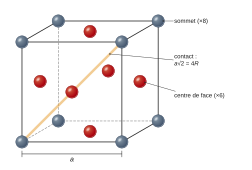

# Mines-Ponts MP — Chimie 2026 · Corrigé

*Corrigé rédigé par IA, non officiel. Signalez toute erreur.*

Épreuve de 1 h 30, calculatrice interdite. « La chimie et le traitement des eaux » : 26 questions en deux parties indépendantes.

Les applications numériques utilisent les approximations de l'annexe 1 :

- $\sqrt2\approx10/7\approx1{,}4$ et $\ln10\approx2{,}3$ ;
- $\frac{RT}{\mathcal F}\ln x\approx0{,}06\log x$ (en V, à 298 K) ;
- $R\approx8\ \mathrm{J\cdot K^{-1}\cdot mol^{-1}}$ et $\mathcal N_A\approx6\cdot10^{23}\ \mathrm{mol^{-1}}$.

Dans les quotients, les concentrations sont rapportées à $c^\circ=1\ \mathrm{mol\cdot L^{-1}}$ et les pressions à $P^\circ=1$ bar.

## Traitement des eaux par le procédé électro-Fenton

### Q1

Demi-équations des deux couples, avec leurs potentiels standard (annexe 3) :

$$\begin{aligned}
&\mathrm{HO^\bullet + H^+ + e^- = H_2O}, && E^\circ(\mathrm{HO^\bullet/H_2O})=2{,}80\ \mathrm V\\
&\mathrm{Cl_2 + 2\,e^- = 2\,Cl^-}, && E^\circ(\mathrm{Cl_2/Cl^-})=1{,}36\ \mathrm V
\end{aligned}$$

L'oxydant le plus fort est celui du couple de potentiel standard le plus élevé. Comme $2{,}80\ \mathrm V>1{,}36\ \mathrm V$ :

**Le radical hydroxyle $\mathrm{HO^\bullet}$ est un oxydant plus fort que le dichlore.**

### Q2

L'anode est l'électrode siège d'une oxydation, la cathode celle d'une réduction.

- Électrode A : $\mathrm{H_2O \longrightarrow \tfrac12\,O_2 + 2\,H^+ + 2\,e^-}$ ; l'eau perd des électrons, c'est une oxydation.
- Électrode B : $\mathrm{O_2 + 2\,H^+ + 2\,e^- \longrightarrow H_2O_2}$ et $\mathrm{Fe^{3+} + e^- \longrightarrow Fe^{2+}}$ ; ce sont des réductions.

**A est l'anode, B est la cathode.**

### Q3

L'électrolyse est une transformation forcée : on relie la **plaque de graphite (anode)** au **pôle $+$** du générateur et le **feutre de carbone (cathode)** au **pôle $-$**. L'**ampèremètre** est branché **en série** dans le circuit extérieur (par exemple entre le pôle $+$ et l'anode), sa borne d'entrée (mA) du côté du pôle $+$.

Sens des électrons : ils sont libérés à l'anode par l'oxydation, parcourent le fil de l'anode vers le pôle $+$, traversent le générateur et partent du pôle $-$ vers la cathode, où ils sont consommés par la réduction.

**Dans les fils, les électrons vont de l'anode vers la cathode (en passant par le générateur), en sens inverse du courant $i$.** Dans la solution il n'y a pas d'électrons libres : le courant est porté par les ions (cations vers la cathode, anions vers l'anode).

### Q4

On utilise un **montage à trois électrodes** :

- l'**électrode de travail** (carbone/graphite), siège des réactions étudiées, dont on fait varier le potentiel $E$ ;
- l'**électrode de référence** (électrode au calomel saturé, ou au chlorure d'argent), de potentiel connu et fixe, traversée par un courant nul ;
- la **contre-électrode** (électrode auxiliaire, par exemple en platine), qui ferme le circuit.

Branchements :

- un **générateur** de tension réglable (potentiostat) est relié entre l'électrode de travail et la contre-électrode ;
- l'**ampèremètre** est **en série** dans ce circuit ET–CE et mesure $i$ ;
- le **voltmètre** est branché **entre l'électrode de travail et l'électrode de référence** et mesure $E=V_{\mathrm{ET}}-V_{\mathrm{ER}}$.

On relève $i$ en fonction de $E$, avec $i>0$ pour une oxydation.

### Q5

Espèces présentes : $\mathrm{H_2O}$, $\mathrm{H^+}$ (pH 2), $\mathrm{O_2}$ dissous, $\mathrm{Fe^{2+}}$ ; pas de $\mathrm{Fe^{3+}}$ initialement.

Les systèmes $\mathrm{O_2/H_2O_2}$ (réduction) et $\mathrm{O_2/H_2O}$ (oxydation) sont lents : leurs vagues sont décalées de $-0{,}5$ V et $+0{,}5$ V par rapport à leurs potentiels d'équilibre. Le système $\mathrm{Fe^{3+}/Fe^{2+}}$ est rapide.

Un courant positif correspond à une oxydation, un courant négatif à une réduction. Description de la courbe, dans le sens des potentiels croissants :

| Portion de la courbe | Réaction |
|---|---|
| Branche cathodique raide, sans palier, aux potentiels les plus bas (mur du solvant) | $\mathrm{2\,H^+ + 2\,e^- \longrightarrow H_{2(g)}}$ (réduction du solvant) |
| Vague cathodique avec palier de diffusion (potentiel voisin de $0{,}69-0{,}06\times2-0{,}5\approx0{,}1$ V) | $\mathrm{O_{2(aq)} + 2\,H^+ + 2\,e^- \longrightarrow H_2O_{2(aq)}}$ |
| Zone de courant nul | aucune réaction |
| Vague anodique raide avec palier de diffusion, démarrant vers $0{,}68$ V (système rapide) | $\mathrm{Fe^{2+} \longrightarrow Fe^{3+} + e^-}$ |
| Branche anodique raide, sans palier, aux potentiels les plus élevés (vers $1{,}23-0{,}12+0{,}5\approx1{,}6$ V ; mur du solvant) | $\mathrm{2\,H_2O \longrightarrow O_{2(g)} + 4\,H^+ + 4\,e^-}$ (oxydation du solvant) |

Les paliers correspondent à des espèces minoritaires ($\mathrm{O_2}$ dissous, $\mathrm{Fe^{2+}}$) dont le courant est limité par la diffusion. Les branches extrêmes correspondent au solvant, en excès, sans palier. Le couple du fer n'a pas de branche cathodique, faute de $\mathrm{Fe^{3+}}$.

### Q6

La tension minimale est l'écart entre les potentiels auxquels démarrent les deux réactions voulues, surpotentiels compris.

- Cathode, $\mathrm{O_2 + 2\,H^+ + 2\,e^- \to H_2O_2}$ : $E_c\approx E_{\mathrm{eq}}(\mathrm{O_2/H_2O_2})-0{,}5$ V.
- Anode, $\mathrm{2\,H_2O \to O_2 + 4\,H^+ + 4\,e^-}$ : $E_a\approx E_{\mathrm{eq}}(\mathrm{O_2/H_2O})+0{,}5$ V.

Les deux potentiels d'équilibre contiennent le même terme $-0{,}06\,\mathrm{pH}$ (un proton par électron dans les deux couples) et la même pression de $\mathrm{O_2}$. En prenant les autres activités égales à 1 :

$$\begin{aligned}
U_{\min}&=E_a-E_c\\
&\approx(1{,}23+0{,}5)-(0{,}69-0{,}5)\\
&\approx0{,}54+1{,}0
\end{aligned}$$

$$\boxed{U_{\min}\approx1{,}5\ \mathrm V}$$

À pH 2, on a $E_c\approx0{,}07$ V et $E_a\approx1{,}61$ V : même écart. En fonctionnement, il faut y ajouter la chute ohmique dans la solution.

### Q7

Pour un élément des blocs $s$ et $p$, le nombre d'électrons de valence se lit sur la colonne de la classification : il vaut le numéro de colonne pour les colonnes 1 et 2, et ce numéro diminué de 10 pour les colonnes 13 à 18.

- **N** (colonne 15) : **5 électrons de valence**.
- **O** (colonne 16) : **6 électrons de valence**.
- **S** (juste sous O, donc colonne 16) : **6 électrons de valence**.

### Q8

**Ion sulfate $\mathrm{SO_4^{2-}}$** : $6+4\times6+2=32$ électrons, soit 16 doublets. Le soufre est l'atome central, lié aux quatre oxygènes.

- Représentation usuelle (S hypervalent, charges formelles minimisées) : deux liaisons $\mathrm{S{=}O}$, chaque O portant 2 doublets non liants ; deux liaisons $\mathrm{S{-}O^-}$, chaque O portant 3 doublets non liants et la charge formelle $-1$ ; aucun doublet non liant sur S.
- Une forme à quatre liaisons simples respecte l'octet et est aussi acceptable : S porte $+2$, chaque O porte $-1$ et 3 doublets non liants.

**Ion ammonium $\mathrm{NH_4^+}$** : $5+4-1=8$ électrons, 4 doublets, tous liants. N est lié à quatre H par des liaisons simples, sans doublet non liant, et porte la charge formelle $+1$.

**Peroxyde d'hydrogène $\mathrm{H_2O_2}$** : $2\times6+2\times1=14$ électrons, 7 doublets. Enchaînement $\mathrm{H{-}O{-}O{-}H}$ (3 doublets liants), chaque O portant 2 doublets non liants ; aucune charge formelle.

### Q9

Nombres d'oxydation du fer (O : $-\mathrm{II}$, H : $+\mathrm I$) :

| Espèce | n.o.(Fe) |
|---|---|
| $\mathrm{Fe_{(s)}}$ | $0$ |
| $\mathrm{Fe^{2+}}$ | $+\mathrm{II}$ |
| $\mathrm{Fe(OH)_{2(s)}}$ : $x+2\times(-\mathrm I)=0$ | $+\mathrm{II}$ |
| $\mathrm{Fe^{3+}}$ | $+\mathrm{III}$ |
| $\mathrm{Fe(OH)_{3(s)}}$ : $x+3\times(-\mathrm I)=0$ | $+\mathrm{III}$ |

**Classement vertical.** À pH fixé, le nombre d'oxydation croît avec le potentiel : le fer(III) est en haut, le fer(II) au milieu, le fer métallique (domaine E, sous la frontière horizontale la plus basse) en bas.

**Classement horizontal.** À nombre d'oxydation fixé, l'hydroxyde se forme par apport d'ions hydroxyde :

$$\begin{aligned}
&\mathrm{Fe^{3+}_{(aq)} + 3\,HO^-_{(aq)} = Fe(OH)_{3(s)}}\\
&\mathrm{Fe^{2+}_{(aq)} + 2\,HO^-_{(aq)} = Fe(OH)_{2(s)}}
\end{aligned}$$

Il apparaît donc quand le pH augmente : l'ion libre occupe les pH acides, l'hydroxyde les pH plus élevés. D'où :

$$\boxed{\begin{aligned}
&\mathbf A:\ \mathrm{Fe^{3+}} && \mathbf B:\ \mathrm{Fe(OH)_{3(s)}}\\
&\mathbf C:\ \mathrm{Fe^{2+}} && \mathbf D:\ \mathrm{Fe(OH)_{2(s)}}\\
&\mathbf E:\ \mathrm{Fe_{(s)}}
\end{aligned}}$$

Contrôles sur le diagramme :

- les frontières A/C et C/E sont horizontales (couples sans proton $\mathrm{Fe^{3+}/Fe^{2+}}$ et $\mathrm{Fe^{2+}/Fe}$) ;
- les frontières A/B (pH ≈ 1,7) et C/D (pH ≈ 7) sont verticales (précipitations) ; $\mathrm{Fe(OH)_3}$ ($\mathrm pK_s=38$) précipite à pH beaucoup plus faible que $\mathrm{Fe(OH)_2}$ ($\mathrm pK_s=15$) ;
- la frontière B/C ($\mathrm{Fe(OH)_3 + 3\,H^+ + e^- = Fe^{2+} + 3\,H_2O}$) a une pente de $-0{,}18$ V par unité de pH, trois fois plus forte que celles de B/D et D/E ($-0{,}06$).

### Q10

Les ions $\mathrm{Fe^{2+}}$ proviennent des 10 mL de solution de sel de Mohr :

$$\begin{aligned}
n&=C_1V_1\\
&=4{,}5\cdot10^{-3}\times10\cdot10^{-3}\\
&=4{,}5\cdot10^{-5}\ \mathrm{mol}
\end{aligned}$$

Le volume total vaut $V=170+10=180$ mL (variation due au sulfate de sodium et aux gouttes d'acide négligée) :

$$\begin{aligned}
C_0&=\frac{n}{V}\\
&=\frac{4{,}5\cdot10^{-5}}{0{,}180}
\end{aligned}$$

$$\boxed{C_0=2{,}5\cdot10^{-4}\ \mathrm{mol\cdot L^{-1}}}$$

### Q11

Équilibre de dissolution, écrit avec les ions hydroxyde :

$$\mathrm{Fe(OH)_{3(s)} = Fe^{3+}_{(aq)} + 3\,HO^-_{(aq)}}$$

Sa constante est $K_s=[\mathrm{Fe^{3+}}][\mathrm{HO^-}]^3=10^{-38}$. Au début de la précipitation, le solide apparaît alors que tout le fer(III) est encore dissous : $[\mathrm{Fe^{3+}}]=C_0'$ et l'égalité $C_0'[\mathrm{HO^-}]^3=K_s$ est vérifiée.

$$\begin{aligned}
[\mathrm{HO^-}]^3&=\frac{10^{-38}}{10^{-4}}\\
&=10^{-34}\\
\mathrm{pOH}&=\frac{34}{3}\\
&\approx11{,}3
\end{aligned}$$

$$\boxed{\mathrm{pH}=14-11{,}3\approx2{,}7}$$

L'expérience est menée à pH 2, inférieur à 2,7 : le fer(III) ne précipite pas. Il reste en solution et peut être réduit en fer(II) à la cathode, ce qui entretient le cycle catalytique de Fenton.

**C'est cohérent** : le pH 2 est choisi précisément pour éviter la précipitation de $\mathrm{Fe(OH)_3}$, qui retirerait le fer du cycle. Avec $C_0=2{,}5\cdot10^{-4}$ mol/L, la précipitation commencerait vers pH 2,5, toujours au-dessus de 2.

### Q12

On règle le spectrophotomètre au **maximum d'absorption** du bleu de méthylène, lu sur l'annexe 6 :

$$\boxed{\lambda\approx665\ \mathrm{nm}}$$

À ce maximum, $\varepsilon$ est le plus grand : la sensibilité de $A$ à la concentration est meilleure. De plus $\mathrm dA/\mathrm d\lambda=0$ : la mesure est peu sensible à une petite erreur de réglage de $\lambda$.

Cette longueur d'onde est dans l'orange-rouge, couleur complémentaire du bleu : la solution paraît bleue parce qu'elle absorbe l'orange-rouge. Le bleu de méthylène étant la seule espèce colorée, l'absorbance ne mesure que lui.

### Q13

Les produits étant incolores et l'absorbance proportionnelle à la concentration (loi de Beer-Lambert), $A$ est proportionnelle à $[\mathrm{BM}]$. Le temps de demi-réaction est donc atteint quand l'absorbance est divisée par deux : $A=A_0/2=0{,}937$.

Cette valeur est comprise entre $A(240\ \mathrm s)=0{,}993$ et $A(300\ \mathrm s)=0{,}863$. Interpolation linéaire :

$$\begin{aligned}
t_{1/2}&\approx240+60\times\frac{0{,}993-0{,}937}{0{,}993-0{,}863}\\
&\approx240+26
\end{aligned}$$

$$\boxed{t_{1/2}\approx2{,}7\cdot10^2\ \mathrm s\ (\approx4{,}5\ \mathrm{min})}$$

### Q14

Pour une solution diluée d'une espèce absorbante de concentration $c$, traversée sur une longueur $\ell$ par une lumière monochromatique de longueur d'onde $\lambda$ :

$$A=\log\frac{I_0}{I}=\varepsilon(\lambda)\,\ell\,c$$

- $A$ : absorbance, sans dimension ($I_0$ intensité incidente, $I$ intensité transmise) ;
- $\varepsilon(\lambda)$ : coefficient d'absorption molaire, en $\mathrm{L\cdot mol^{-1}\cdot cm^{-1}}$, dépendant de l'espèce, du solvant, de $\lambda$ et de la température ;
- $\ell$ : longueur de solution traversée (largeur de la cuve), en cm ;
- $c$ : concentration de l'espèce absorbante, en $\mathrm{mol\cdot L^{-1}}$.

Pour plusieurs espèces absorbantes, les absorbances s'ajoutent : $A=\ell\sum_i\varepsilon_ic_i$. La loi est valable pour des solutions suffisamment diluées.

### Q15

Loi de vitesse d'ordre 1, en réacteur fermé à volume constant. La vitesse de disparition du colorant est positive :

$$v=-\frac{\mathrm d[\mathrm{BM}]}{\mathrm dt}=k[\mathrm{BM}]$$

On sépare les variables et on intègre de $0$ à $t$ :

$$\begin{aligned}
\frac{\mathrm d[\mathrm{BM}]}{[\mathrm{BM}]}&=-k\,\mathrm dt\\
[\mathrm{BM}](t)&=[\mathrm{BM}]_0\,e^{-kt}
\end{aligned}$$

Le bleu de méthylène est la seule espèce colorée. Par la loi de Beer-Lambert à $\lambda$ et $\ell$ fixés, $A(t)=\varepsilon\ell[\mathrm{BM}](t)$ et $A_0=\varepsilon\ell[\mathrm{BM}]_0$, d'où $A/A_0=[\mathrm{BM}]/[\mathrm{BM}]_0$ :

$$\boxed{A(t)=A_0\,e^{-kt}}$$

soit, de façon équivalente :

$$\boxed{\ln A=\ln A_0-k\,t}$$

(L'ordre 1 est un ordre apparent : la concentration en $\mathrm{HO^\bullet}$, produit en continu, est supposée constante.)

### Q16

D'après Q15, un ordre 1 impose que $\ln A$ soit une fonction **affine** (et non linéaire : l'ordonnée à l'origine $\ln A_0$ n'est pas nulle) décroissante de $t$, de pente $-k$.

Les points de la figure 5 sont bien répartis autour de la droite $y=-2{,}23\cdot10^{-3}x+0{,}563$ (coefficient de corrélation, recalculé sur le tableau, $r\approx-0{,}995$). **L'allure est compatible avec un ordre 1**, avec toutefois une légère courbure systématique (points au-dessus de la droite aux extrémités, en dessous au milieu) qui montre que le modèle n'est qu'approché.

Par identification, la pente de la régression fournie vaut $-k$ ; la constante de vitesse est positive :

$$\boxed{k=2{,}23\cdot10^{-3}\ \mathrm{s^{-1}}}$$

### Q17

Éliminer 99 % du colorant, c'est atteindre $[\mathrm{BM}]/[\mathrm{BM}]_0=A/A_0=10^{-2}$ :

$$\begin{aligned}
e^{-kt_{99}}&=10^{-2}\\
t_{99}&=\frac{2\ln10}{k}\\
&=\frac{4{,}6}{2{,}23\cdot10^{-3}}
\end{aligned}$$

$$\boxed{t_{99}\approx2{,}1\cdot10^3\ \mathrm s\approx34\ \mathrm{min}}$$

C'est bien plus que les 10 min de l'expérience, au bout desquelles il reste encore $0{,}495/1{,}873\approx26\ \%$ du colorant.

### Q18

Maille conventionnelle cubique à faces centrées : un cube d'arête $a$, avec un atome à chacun des 8 sommets et au centre de chacune des 6 faces, et aucun atome au centre du cube.

Population : chaque sommet est partagé entre 8 mailles, chaque centre de face entre 2 :

$$\boxed{N=8\times\tfrac18+6\times\tfrac12=4\ \text{atomes par maille}}$$

Coordinence (nombre de plus proches voisins d'un atome) : un atome de centre de face a pour plus proches voisins, à la distance $a\sqrt2/2$, les 4 sommets de sa face et les 4 centres de faces de chacune des deux mailles qui partagent cette face (4 + 4 + 4) :

$$\boxed{\text{coordinence }12}$$

### Q19

Les atomes sont tangents le long de la diagonale d'une face, de longueur $a\sqrt2$, qui contient $4R$ :

$$\begin{aligned}
a\sqrt2&=4R\\
a&=2\sqrt2\,R\\
&\approx2\times\frac{10}{7}\times140\ \mathrm{pm}
\end{aligned}$$

$$\boxed{a\approx4{,}0\cdot10^2\ \mathrm{pm}=4{,}0\cdot10^{-10}\ \mathrm m}$$

Avec $\sqrt2\approx1{,}4$, on trouve $a\approx392$ pm, même ordre de grandeur ; la valeur réelle pour le platine est 392 pm.

### Q20

La masse volumique est la masse des atomes de la maille divisée par le volume $a^3$ de la maille (cube) :

$$\begin{aligned}
\rho&=\frac{N\,M(\mathrm{Pt})}{\mathcal N_A\,a^3}\\
&=\frac{4\times200\cdot10^{-3}}{6\cdot10^{23}\times(4{,}0\cdot10^{-10})^3}\\
&=\frac{0{,}8}{6\cdot10^{23}\times64\cdot10^{-30}}\\
&=\frac{0{,}8}{3{,}84\cdot10^{-5}}
\end{aligned}$$

$$\boxed{\rho\approx2{,}1\cdot10^4\ \mathrm{kg\cdot m^{-3}}\ (21\ \mathrm{g\cdot cm^{-3}})}$$

Avec $a=392$ pm, on trouve $2{,}2\cdot10^4\ \mathrm{kg\cdot m^{-3}}$. La valeur réelle, 21,4 g/cm³, est bien retrouvée ; les écarts de quelques pour cent viennent des valeurs arrondies de $M$ et $\mathcal N_A$.

## Traitement des eaux par des procédés biologiques

### Traitement des eaux en milieu aérobie

### Q21

Bilan en C (2 $\mathrm{CO_2}$), en H (3 $\mathrm{H_2O}$), puis en O ($4+3=7=1+2\times3$) :

$$\boxed{\mathrm{C_2H_6O_{(aq)} + 3\,O_{2(aq)} \longrightarrow 2\,CO_{2(g)} + 3\,H_2O_{(\ell)}}}$$

Contrôle électronique : le carbone passe de $-\mathrm{II}$ (moyenne dans l'éthanol) à $+\mathrm{IV}$, soit 12 électrons cédés, captés par 3 $\mathrm{O_2}$ ($3\times4=12$).

### Q22

Loi de Hess, avec les nombres stœchiométriques de Q21 :

$$\begin{aligned}
\Delta_rH^\circ&=2(-400)+3(-300)-(-300)-3(-10)\\
&=-1370\ \mathrm{kJ\cdot mol^{-1}}
\end{aligned}$$

$$\begin{aligned}
\Delta_rS^\circ&=2(200)+3(50)-150-3(100)\\
&=+100\ \mathrm{J\cdot K^{-1}\cdot mol^{-1}}
\end{aligned}$$

En convertissant $\Delta_rS^\circ$ en $\mathrm{kJ\cdot K^{-1}\cdot mol^{-1}}$ :

$$\begin{aligned}
\Delta_rG^\circ&=\Delta_rH^\circ-T\Delta_rS^\circ\\
&=-1370-298\times0{,}100\\
&\approx-1400\ \mathrm{kJ\cdot mol^{-1}}
\end{aligned}$$

$$\boxed{\Delta_rG^\circ\approx-1{,}4\cdot10^3\ \mathrm{kJ\cdot mol^{-1}}}$$

Constante d'équilibre ($\Delta_rG^\circ$ en $\mathrm{J\cdot mol^{-1}}$), puis passage au logarithme décimal :

$$\begin{aligned}
\ln K_1^\circ&=-\frac{\Delta_rG^\circ}{RT}\\
&\approx\frac{1{,}4\cdot10^6}{8\times298}\\
&\approx5{,}9\cdot10^2\\
\log K_1^\circ&=\frac{\ln K_1^\circ}{\ln10}\\
&\approx\frac{587}{2{,}3}\\
&\approx2{,}5\cdot10^2
\end{aligned}$$

$$\boxed{K_1^\circ\approx10^{255}}$$

Seul l'ordre de grandeur de l'exposant a un sens avec les données arrondies.

**Conclusion** : $K_1^\circ\gg10^4$, la réaction est totale (quantitative) ; l'oxydation de l'éthanol par le dioxygène est thermodynamiquement très favorable. Elle est pourtant lente à température ambiante : les bactéries jouent le rôle de catalyseurs (enzymes), elles accélèrent la réaction sans modifier $K_1^\circ$.

### Traitement des eaux en milieu anaérobie (dépourvu d'oxygène)

### Q23

L'oxygène, plus électronégatif que l'azote, a le nombre d'oxydation $-\mathrm{II}$. La somme des nombres d'oxydation est égale à la charge de l'ion :

$$x+3(-\mathrm{II})=-\mathrm I$$

$$\boxed{\text{n.o.(N)}=+\mathrm V\ \text{dans}\ \mathrm{NO_3^-}}$$

### Q24

Équilibrage en N, puis O (par $\mathrm{H_2O}$), H (par $\mathrm{H^+}$), charges (par $e^-$). On vérifie que $10=2\times5$ électrons correspondent au passage de N de $+\mathrm V$ à $0$ :

$$\boxed{\mathrm{2\,NO^-_{3(aq)} + 12\,H^+_{(aq)} + 10\,e^- = N_{2(g)} + 6\,H_2O_{(\ell)}}}$$

Formule de Nernst : l'oxydant et $\mathrm{H^+}$ au numérateur, le diazote gazeux par sa pression partielle au dénominateur, l'eau solvant d'activité 1 :

$$\boxed{E_1=1{,}25+\frac{0{,}06}{10}\log\left(\frac{[\mathrm{NO_3^-}]^2\,[\mathrm{H^+}]^{12}}{(c^\circ)^{14}}\cdot\frac{P^\circ}{P_{\mathrm{N_2}}}\right)}$$

soit $E_1=1{,}25+0{,}012\log\dfrac{[\mathrm{NO_3^-}]}{c^\circ}-0{,}072\,\mathrm{pH}-0{,}006\log\dfrac{P_{\mathrm{N_2}}}{P^\circ}$.

### Q25

Le carbone passe de $+\mathrm{IV}$ ($\mathrm{CO_2}$) à $-\mathrm{II}$ (moyenne dans l'éthanol) : $2\times6=12$ électrons.

$$\boxed{\mathrm{2\,CO_{2(g)} + 12\,H^+_{(aq)} + 12\,e^- = C_2H_6O_{(aq)} + 3\,H_2O_{(\ell)}}}$$

Le dioxyde de carbone, gazeux, intervient par sa pression partielle :

$$\boxed{E_2=-0{,}33+\frac{0{,}06}{12}\log\left(\frac{(P_{\mathrm{CO_2}}/P^\circ)^2\,([\mathrm{H^+}]/c^\circ)^{12}}{[\mathrm{C_2H_6O}]/c^\circ}\right)}$$

soit $E_2=-0{,}33+0{,}010\log\dfrac{P_{\mathrm{CO_2}}}{P^\circ}-0{,}06\,\mathrm{pH}-0{,}005\log\dfrac{[\mathrm{C_2H_6O}]}{c^\circ}$.

### Q26

L'oxydant le plus fort ($\mathrm{NO_3^-}$, $E^\circ=1{,}25$ V) réagit avec le réducteur le plus fort ($\mathrm{C_2H_6O}$, $E^\circ=-0{,}33$ V).

On combine $6\times$(Q24) et $5\times$(Q25 renversée), soit $n=60$ électrons échangés. Après simplification de $60\,\mathrm{H^+}$ et $15\,\mathrm{H_2O}$ :

$$\boxed{\mathrm{5\,C_2H_6O_{(aq)} + 12\,NO^-_{3(aq)} + 12\,H^+_{(aq)} \longrightarrow 10\,CO_{2(g)} + 6\,N_{2(g)} + 21\,H_2O_{(\ell)}}}$$

(C : 10 = 10 ; N : 12 = 12 ; H : 42 = 42 ; O : 41 = 41 ; charges : 0 = 0.)

À l'équilibre, les potentiels des deux couples sont égaux ; en regroupant les termes logarithmiques de $E_1=E_2$, on obtient :

$$\begin{aligned}
\log K_2^\circ&=\frac{n\,\big(E^\circ(\mathrm{NO_3^-/N_2})-E^\circ(\mathrm{CO_2/C_2H_6O})\big)}{0{,}06}\\
&=\frac{60\times(1{,}25+0{,}33)}{0{,}06}\\
&=1580
\end{aligned}$$

$$\boxed{K_2^\circ=10^{1580}}$$

(Si l'on écrit l'équation avec un nombre stœchiométrique 1 pour l'éthanol, $n=12$ et $K_2^\circ=10^{316}$.)

**Conclusion** : la constante est immense, la réaction est totale. L'oxydation de la matière organique par les nitrates est thermodynamiquement très favorable ; elle élimine à la fois la pollution organique et les nitrates, transformés en diazote gazeux. Comme en milieu aérobie, la réaction est lente et ce sont les bactéries qui la catalysent.
