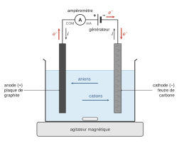
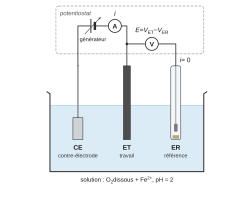
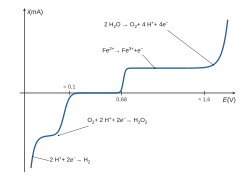
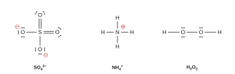
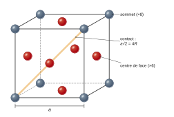

# Mines-Ponts MP — Chimie 2026 · Corrigé guidé

*Corrigé rédigé par IA, non officiel. Signalez toute erreur.*

## Présentation du sujet

**Thème.** « La chimie et le traitement des eaux » : deux façons de dépolluer une eau. La première est électrochimique (procédé électro-Fenton, qui fabrique *in situ* le radical hydroxyle $\mathrm{HO^\bullet}$, oxydant très puissant). La seconde est biologique : des bactéries oxydent la matière organique, modélisée par l'éthanol, par le dioxygène ou, en son absence, par les ions nitrate.

**Format.** 1 h 30, calculatrice interdite, 26 questions courtes (Q1 à Q26). Toutes les applications numériques sont pensées pour se faire de tête avec les approximations de l'annexe 1 :

- $\sqrt2\approx10/7\approx1{,}4$ et $\ln10\approx2{,}3$ ;
- $\frac{RT}{\mathcal F}\ln x\approx0{,}06\log x$ ;
- $R\approx8$ SI et $\mathcal N_A\approx6\cdot10^{23}\ \mathrm{mol^{-1}}$.

**Découpage.**

| Partie | Questions | Contenu |
|---|---|---|
| Procédé électro-Fenton | Q1–Q6 | pouvoir oxydant, électrolyseur (anode, cathode, branchements), montage à trois électrodes, courbe intensité-potentiel, tension minimale d'électrolyse |
| | Q7–Q11 | électrons de valence, schémas de Lewis, diagramme potentiel-pH du fer, dilution, pH de précipitation |
| | Q12–Q17 | suivi spectrophotométrique, Beer-Lambert, cinétique d'ordre 1, temps de demi-réaction |
| | Q18–Q20 | maille cubique à faces centrées du platine |
| Procédés biologiques | Q21–Q22 | combustion de l'éthanol, $\Delta_rH^\circ$, $\Delta_rS^\circ$, $\Delta_rG^\circ$, $K^\circ$ |
| | Q23–Q26 | nombre d'oxydation, demi-équations, potentiels de Nernst, constante d'équilibre d'une réaction d'oxydoréduction |

**Notions du programme mobilisées.** Première année : structure électronique et schémas de Lewis, cristallographie (maille CFC), cinétique (ordre 1, méthode intégrale, suivi spectrophotométrique), oxydoréduction (n.o., demi-équations, formule de Nernst, constante d'équilibre), diagrammes potentiel-pH, précipitation. Deuxième année MP : thermodynamique chimique ($\Delta_rG^\circ$, $K^\circ$), courbes intensité-potentiel, électrolyse.

**Difficulté.** Faible à moyenne : l'épreuve est une suite de questions de cours appliquées. Le rapport 2026 juge que le sujet comportait un grand nombre de questions accessibles à des candidats préparés, et qu'une bonne connaissance du cours est nécessaire et suffisante. L'épreuve se joue sur la vitesse, la rigueur des justifications et la propreté des schémas (Q3, Q4, Q5, Q8, Q18).

**Questions discriminantes (rapport 2026).**

- Q5 (courbe intensité-potentiel) : très peu de bonnes réponses, le mur du solvant étant rarement reconnu.
- Q6 (tension minimale) : peu abordée, peu de réponses correctes, surpotentiels oubliés.
- Q3–Q4 (schémas de montage) : branchements souvent faux, confusion pile/électrolyseur.
- Q24–Q26 (Nernst, constante rédox) : la deuxième partie a rarement été traitée en entier, et Q26 a été rarement abordée.

**Questions à ne pas laisser passer.** Q1, Q2, Q7, Q9, Q10, Q11, Q14, Q15, Q17, Q18, Q19, Q21, Q23 : immédiates si le cours est su. Ce sont aussi celles où le jury retire des points pour une justification absente (Q2, Q9, Q13, Q23).

**Gestion du temps.** Environ 3 minutes par question. Les deux parties sont indépendantes, et à l'intérieur de la première les blocs (électrochimie, structure, cinétique, cristallographie) le sont aussi. Le jury conseille néanmoins de rédiger dans l'ordre de l'énoncé et de numéroter chaque réponse : si l'on commence par un bloc, on garde l'ordre des questions à l'intérieur.

> [!JURY]
> Le rapport 2026 rappelle que les applications numériques doivent être menées jusqu'à leur terme : « Les valeurs numériques présentées sous forme de fraction ne sont pas acceptées. Le résultat final doit être accompagné de son unité adéquate. » Un résultat dimensionné sans unité ne rapporte aucun point (remarques générales, p. 29–30).

## Partie I — Traitement des eaux par le procédé électro-Fenton

Le procédé produit $\mathrm{H_2O_2}$ et régénère $\mathrm{Fe^{2+}}$ à la cathode. La réaction de Fenton $\mathrm{Fe^{2+}+H_2O_2+H^+\to Fe^{3+}+H_2O+HO^\bullet}$ fournit le radical qui détruit les polluants.

La partie part de l'électrolyseur (Q1–Q6), passe par la chimie du fer et la structure des ions présents (Q7–Q11), étudie la cinétique de décoloration d'un colorant témoin (Q12–Q17) et se termine sur la cristallographie d'une électrode en platine (Q18–Q20).

### Question 1

> [!INDICATION]
> Comparer des pouvoirs oxydants revient à comparer des grandeurs tabulées en annexe 3.

> [!INDICATION]
> Écrire les deux couples sous forme de demi-équations pour bien repérer l'oxydant de chacun.

#### Solution

Demi-équations :

$$\begin{aligned}
&\mathrm{HO^\bullet + H^+ + e^- = H_2O}, && E^\circ(\mathrm{HO^\bullet/H_2O})=2{,}80\ \mathrm V\\
&\mathrm{Cl_2 + 2\,e^- = 2\,Cl^-}, && E^\circ(\mathrm{Cl_2/Cl^-})=1{,}36\ \mathrm V
\end{aligned}$$

Le meilleur oxydant est l'oxydant du couple de potentiel standard le plus élevé. Comme $2{,}80\ \mathrm V>1{,}36\ \mathrm V$, **le radical hydroxyle est plus oxydant que le dichlore**.

La conclusion vaut aussi à pH 2 : $E(\mathrm{HO^\bullet/H_2O})$ perd $0{,}06\,\mathrm{pH}\approx0{,}12$ V et reste vers 2,7 V, tandis que $E(\mathrm{Cl_2/Cl^-})$ ne dépend pas du pH.

> [!PIEGE]
> Ne pas comparer à $E^\circ(\mathrm{O_2/H_2O})$ : le radical $\mathrm{HO^\bullet}$ est l'oxydant du couple $\mathrm{HO^\bullet/H_2O}$, c'est ce potentiel qu'il faut lire. Et ne pas invoquer l'électronégativité ou des nombres d'oxydation d'éléments différents : le rapport 2026 qualifie ces arguments de farfelus.

> [!JURY]
> Rapport 2026 (p. 92) : « une comparaison des potentiels standard était attendue pour répondre à la question ».

### Question 2

> [!INDICATION]
> Les mots anode et cathode se définissent par la nature de la réaction qui se produit à l'électrode, pas par la polarité.

> [!INDICATION]
> Sur la figure 1, regarder à chaque électrode si les électrons sont gagnés ou perdus.

#### Solution

Anode : siège d'une oxydation ; cathode : siège d'une réduction.

- Électrode A : $\mathrm{H_2O \to \tfrac12\,O_2 + 2\,H^+ + 2\,e^-}$, perte d'électrons, oxydation.
- Électrode B : $\mathrm{O_2 + 2\,H^+ + 2\,e^- \to H_2O_2}$ et $\mathrm{Fe^{3+} + e^- \to Fe^{2+}}$, gains d'électrons, réductions.

**A est l'anode, B la cathode.**

Remarque : le dioxygène produit à l'anode diffuse vers la cathode ; le fer(III) formé par la réaction de Fenton y est réduit en fer(II), qui est donc régénéré. Une quantité catalytique de fer suffit.

> [!METHODE]
> Anode = oxydation, cathode = réduction, dans une pile comme dans un électrolyseur. Seule la polarité change : l'anode est le pôle $+$ d'un électrolyseur mais le pôle $-$ d'une pile.

> [!JURY]
> Rapport 2026 (p. 92) : « Une justification succincte était attendue ». Le jury reproche autant la réponse sèche que le raisonnement développé inutilement : une ligne par électrode suffit.

### Question 3

> [!INDICATION]
> Une électrolyse est une transformation forcée : à quel pôle du générateur faut-il relier l'électrode où l'on veut arracher des électrons ?

> [!INDICATION]
> Un ampèremètre mesure le courant qui le traverse : comment le brancher ? Pour le sens des électrons, partir de l'électrode où ils sont produits.

#### Solution

On relie la **plaque de graphite (anode)** au **pôle $+$** du générateur, le **feutre de carbone (cathode)** au **pôle $-$**. On place l'**ampèremètre en série** avec le générateur (par exemple entre le pôle $+$ et l'anode).

Les électrons, libérés à l'anode par l'oxydation, parcourent le fil jusqu'au pôle $+$, traversent le générateur, puis vont du pôle $-$ à la cathode où la réduction les consomme.

**Dans le circuit extérieur, les électrons circulent de l'anode vers la cathode, en sens inverse du courant**. Dans la solution, le courant est assuré par les ions.

> [!PIEGE]
> Erreurs relevées par le rapport 2026 : confusion entre pile et électrolyseur, symboles du générateur et de l'ampèremètre mal connus, ampèremètre en dérivation, sens des électrons incohérent avec les polarités et le sens du courant. Faire passer des électrons dans la solution est une autre faute de fond.

> [!JURY]
> Rapport 2026 (p. 92) : « L'ampèremètre est trop souvent branché en dérivation au lieu d'être en série avec le générateur. » Vérifier sur le schéma final que le sens des électrons, les polarités et le sens du courant sont cohérents entre eux.

### Question 4

> [!INDICATION]
> On veut connaître le potentiel d'une électrode traversée par un courant ; or on ne mesure que des différences de potentiel.

> [!INDICATION]
> Une électrode de référence ne doit pas être traversée par un courant : il faut donc une troisième électrode pour fermer le circuit.

#### Solution

**Montage à trois électrodes** :

- **électrode de travail** (carbone/graphite) : électrode étudiée, dont on impose le potentiel ;
- **électrode de référence** (calomel saturé, ou chlorure d'argent) : potentiel fixe et connu, courant nul ;
- **contre-électrode** (par exemple en platine) : ferme le circuit et laisse passer le courant.

Branchements :

- le **générateur** réglable (potentiostat) est relié entre l'électrode de travail et la contre-électrode ;
- l'**ampèremètre**, en série dans ce circuit ET–CE, mesure $i$ ;
- le **voltmètre**, entre l'électrode de travail et l'électrode de référence, mesure $E=V_{\mathrm{ET}}-V_{\mathrm{ER}}$.

On compte $i>0$ pour une oxydation.

> [!JURY]
> Rapport 2026 (p. 92) : les trois électrodes sont généralement identifiées, « mais les branchements du voltmètre, de l'ampèremètre et du générateur sont souvent incorrects, ce dernier étant parfois absent du schéma ». Les trois appareils doivent figurer, chacun à sa place.

### Question 5

> [!INDICATION]
> Faire l'inventaire des espèces réellement présentes en solution : chacune ne peut être que réduite, oxydée, ou les deux selon le couple.

> [!INDICATION]
> Un système lent voit sa vague décalée par le surpotentiel ; une espèce minoritaire donne un palier de diffusion, le solvant n'en donne pas.

> [!INDICATION]
> Le fer est introduit sous forme de fer(II) seulement : quelle branche du couple $\mathrm{Fe^{3+}/Fe^{2+}}$ peut apparaître ?

#### Solution

Espèces présentes : $\mathrm{H_2O}$, $\mathrm{H^+}$ (pH 2), $\mathrm{O_2}$ dissous, $\mathrm{Fe^{2+}}$, pas de $\mathrm{Fe^{3+}}$. Un courant positif correspond à une oxydation, un courant négatif à une réduction.

| Portion de la courbe (potentiels croissants) | Réaction |
|---|---|
| Branche cathodique raide, sans palier (mur du solvant) | $\mathrm{2\,H^+ + 2\,e^- \to H_{2(g)}}$ |
| Vague cathodique avec palier, démarrant vers $0{,}69-0{,}12-0{,}5\approx0{,}1$ V (système lent) | $\mathrm{O_{2(aq)} + 2\,H^+ + 2\,e^- \to H_2O_{2(aq)}}$ |
| Zone de courant nul | aucune réaction |
| Vague anodique raide avec palier, démarrant vers $0{,}68$ V (système rapide) | $\mathrm{Fe^{2+} \to Fe^{3+} + e^-}$ |
| Branche anodique raide, sans palier (mur du solvant), vers $1{,}23-0{,}12+0{,}5\approx1{,}6$ V | $\mathrm{2\,H_2O \to O_{2(g)} + 4\,H^+ + 4\,e^-}$ |

Les paliers traduisent une limitation par la diffusion d'espèces peu concentrées ($\mathrm{O_2}$ dissous, $\mathrm{Fe^{2+}}$). Les deux branches extrêmes, sans palier, correspondent au solvant. Faute de $\mathrm{Fe^{3+}}$, le couple du fer n'apparaît que par sa branche anodique.

> [!PIEGE]
> Oublier le mur du solvant aux deux extrémités : c'est l'erreur qui a coûté le plus de points selon le rapport 2026. Autre piège relevé : écrire la réaction dans le mauvais sens, ou sans sens, alors que le signe du courant le fixe.

> [!PIEGE]
> Le surpotentiel élargit toujours la zone où il ne se passe rien : une réduction lente démarre *en dessous* du potentiel d'équilibre, une oxydation lente *au-dessus*.

> [!METHODE]
> Pour attribuer les vagues d'une courbe intensité-potentiel : (1) inventaire des espèces, (2) potentiels de Nernst, (3) décalage par les surpotentiels, (4) palier si l'espèce est minoritaire, pas de palier pour le solvant, (5) pas de vague pour une espèce absente.

> [!JURY]
> Rapport 2026 (p. 92) : « Très peu de bonnes réponses, le mur du solvant étant rarement reconnu par les candidats. » Question discriminante.

### Question 6

> [!INDICATION]
> Repérer, à chaque électrode, le potentiel auquel la réaction voulue démarre effectivement.

> [!INDICATION]
> Le potentiel de démarrage est le potentiel d'équilibre corrigé du surpotentiel, avec le bon signe. Regarder comment le pH intervient dans les deux couples.

#### Solution

- Cathode ($\mathrm{O_2 \to H_2O_2}$) : $E_c\approx E_{\mathrm{eq}}(\mathrm{O_2/H_2O_2})-0{,}5$ V.
- Anode ($\mathrm{H_2O \to O_2}$) : $E_a\approx E_{\mathrm{eq}}(\mathrm{O_2/H_2O})+0{,}5$ V.

Les deux couples échangent un proton par électron : leurs potentiels d'équilibre contiennent le même terme $-0{,}06\,\mathrm{pH}$, qui disparaît dans la différence.

$$\begin{aligned}
U_{\min}&=E_a-E_c\\
&\approx(1{,}23+0{,}5)-(0{,}69-0{,}5)\\
&\approx0{,}54+1{,}0
\end{aligned}$$

$$\boxed{U_{\min}\approx1{,}5\ \mathrm V}$$

À pH 2, on a $E_c\approx0{,}07$ V et $E_a\approx1{,}61$ V. En fonctionnement réel, il faut ajouter la chute ohmique $R\,i$ dans la solution, que le sulfate de sodium (électrolyte support) permet de réduire.

> [!PIEGE]
> Oublier les surpotentiels (rapport 2026 : « Les surpotentiels sont souvent oubliés ») donne la seule tension thermodynamique $0{,}54$ V. Les retrancher au lieu de les ajouter donne $U\approx0{,}5$ V, encore plus absurde : la lenteur d'un système ne peut qu'augmenter la tension à fournir.

> [!JURY]
> Rapport 2026 (p. 92) : « Question peu abordée, avec peu de réponses correctes. » Question discriminante, accessible pour qui a bien placé les vagues en Q5.

### Question 7

> [!INDICATION]
> Le numéro de colonne d'un élément du bloc $p$ donne directement son nombre d'électrons de valence.

#### Solution

Pour les blocs $s$ et $p$, le nombre d'électrons de valence se lit sur la colonne : numéro de colonne pour les colonnes 1–2, numéro diminué de 10 pour les colonnes 13–18.

- N (2e ligne, colonne 15) : **5 électrons de valence** ;
- O (2e ligne, colonne 16) : **6 électrons de valence** ;
- S (3e ligne, juste sous O, colonne 16) : **6 électrons de valence**.

> [!PIEGE]
> Confondre le nombre d'électrons de valence avec le nombre d'électrons de la dernière sous-couche (4 pour O si l'on ne regarde que $2p^4$).

> [!JURY]
> Rapport 2026 (p. 92) : pour les blocs $s$ et $p$, il suffisait de se référer à la colonne. La configuration électronique de l'état fondamental « n'est ni attendue, ni au programme, et ne permet pas toujours aux candidats de répondre à la question ».

### Question 8

> [!INDICATION]
> Commencer par compter les électrons de valence de l'édifice en tenant compte de sa charge, et en déduire le nombre de doublets.

> [!INDICATION]
> Le soufre, élément de la troisième période, peut dépasser l'octet ; vérifier ensuite les charges formelles.

#### Solution

**$\mathrm{SO_4^{2-}}$** : $6+4\times6+2=32$ électrons, 16 doublets ; S est l'atome central.

- Forme usuelle : deux liaisons $\mathrm{S{=}O}$ (O avec 2 doublets non liants), deux liaisons $\mathrm{S{-}O^-}$ (O avec 3 doublets non liants, charge formelle $-1$), aucun doublet non liant sur S, charge globale $2-$.
- La forme à quatre liaisons simples ($\mathrm S^{2+}$, quatre $\mathrm O^-$) respecte l'octet et est aussi recevable.

**$\mathrm{NH_4^+}$** : $5+4-1=8$ électrons, 4 doublets liants $\mathrm{N{-}H}$, aucun doublet non liant ; charge formelle $+1$ sur N.

**$\mathrm{H_2O_2}$** : $12+2=14$ électrons, 7 doublets ; $\mathrm{H{-}O{-}O{-}H}$, deux doublets non liants sur chaque O, aucune charge formelle.

> [!PIEGE]
> Oublier la charge dans le décompte : $+2$ électrons pour le sulfate, $-1$ pour l'ammonium. Un azote à quatre liaisons ne porte pas de doublet non liant.

> [!JURY]
> Rapport 2026 (p. 92) : beaucoup de bonnes réponses, « même si le squelette proposé est parfois fantaisiste, notamment pour l'ion sulfate, ou si les charges sont mal attribuées aux atomes ». Le jury relève aussi des schémas incohérents avec les électrons de valence donnés en Q7 : les deux réponses doivent concorder.

### Question 9

> [!INDICATION]
> Calculer le nombre d'oxydation du fer dans chaque espèce, puis se rappeler comment il varie avec le potentiel.

> [!INDICATION]
> À nombre d'oxydation égal, l'ion libre et l'hydroxyde se répartissent selon le pH : écrire l'équation de précipitation pour voir lequel occupe les pH élevés.

#### Solution

n.o. du fer :

| Espèce | Calcul | n.o.(Fe) |
|---|---|---|
| $\mathrm{Fe}$ | corps simple | $0$ |
| $\mathrm{Fe^{2+}}$ | charge de l'ion | $+\mathrm{II}$ |
| $\mathrm{Fe(OH)_2}$ | $x+2(-\mathrm I)=0$ | $+\mathrm{II}$ |
| $\mathrm{Fe^{3+}}$ | charge de l'ion | $+\mathrm{III}$ |
| $\mathrm{Fe(OH)_3}$ | $x+3(-\mathrm I)=0$ | $+\mathrm{III}$ |

**Classement vertical.** Le n.o. croît avec $E$ : fer(III) en haut, fer(II) au milieu, fer métallique en bas.

**Classement horizontal.** À n.o. fixé, l'hydroxyde se forme par apport d'ions hydroxyde, donc quand le pH augmente :

$$\begin{aligned}
&\mathrm{Fe^{3+}_{(aq)} + 3\,HO^-_{(aq)} = Fe(OH)_{3(s)}}\\
&\mathrm{Fe^{2+}_{(aq)} + 2\,HO^-_{(aq)} = Fe(OH)_{2(s)}}
\end{aligned}$$

L'hydroxyde occupe donc les pH plus élevés que l'ion :

$$\boxed{\begin{aligned}
&\mathbf A:\ \mathrm{Fe^{3+}} && \mathbf B:\ \mathrm{Fe(OH)_{3(s)}}\\
&\mathbf C:\ \mathrm{Fe^{2+}} && \mathbf D:\ \mathrm{Fe(OH)_{2(s)}}\\
&\mathbf E:\ \mathrm{Fe_{(s)}}
\end{aligned}}$$

Contrôles :

- A/C et C/E horizontales (couples sans proton) ;
- A/B (pH ≈ 1,7) et C/D (pH ≈ 7) verticales, $\mathrm{Fe(OH)_3}$ ($\mathrm pK_s=38$) précipitant bien plus tôt que $\mathrm{Fe(OH)_2}$ ($\mathrm pK_s=15$) ;
- B/C, de demi-équation $\mathrm{Fe(OH)_3+3\,H^+ + e^- = Fe^{2+}+3\,H_2O}$, a une pente $-0{,}18$ V par unité de pH, trois fois celle de B/D et D/E.

> [!METHODE]
> Les pentes des frontières ($-0{,}06\times$ nombre de protons par électron) sont le meilleur contrôle d'une attribution de domaines.

> [!JURY]
> Rapport 2026 (p. 92) : les n.o. sont bien calculés, mais l'attribution est souvent insuffisamment justifiée. « Deux justifications claires et explicites sont attendues : l'une portant sur le classement vertical et l'autre sur le classement horizontal. » L'écriture des équilibres de précipitation justifie l'apparition des hydroxydes par apport d'ions hydroxyde.

### Question 10

> [!INDICATION]
> La quantité de fer(II) se conserve lors du mélange ; c'est le volume qui change.

#### Solution

$$\begin{aligned}
n&=C_1V_1\\
&=4{,}5\cdot10^{-3}\times10\cdot10^{-3}\\
&=4{,}5\cdot10^{-5}\ \mathrm{mol}
\end{aligned}$$

Le volume total vaut $V=170+10=180$ mL (variation de volume due au sulfate de sodium et aux gouttes d'acide négligée) :

$$\begin{aligned}
C_0&=\frac{n}{V}\\
&=\frac{4{,}5\cdot10^{-5}}{0{,}180}
\end{aligned}$$

$$\boxed{C_0=2{,}5\cdot10^{-4}\ \mathrm{mol\cdot L^{-1}}}$$

> [!PIEGE]
> L'énoncé donne la concentration du sel de Mohr *en ions* $\mathrm{Fe^{2+}}$ : pas de facteur stœchiométrique à appliquer.

> [!JURY]
> Rapport 2026 (p. 92) : « Quand cette question est traitée, et que l'application numérique est menée jusqu'à son terme, les candidats arrivent à la bonne concentration. » La division $4{,}5/1{,}8=2{,}5$ se fait de tête.

### Question 11

> [!INDICATION]
> Au tout début de la précipitation, le solide apparaît alors que le fer(III) est encore entièrement dissous : quelle égalité est alors vérifiée ?

> [!INDICATION]
> Écrire l'équilibre de dissolution qui définit $K_s$ ; attention à l'exposant de $[\mathrm{HO^-}]$.

#### Solution

Équilibre de dissolution et produit de solubilité :

$$\mathrm{Fe(OH)_{3(s)} = Fe^{3+}_{(aq)} + 3\,HO^-_{(aq)}}$$

$$K_s=[\mathrm{Fe^{3+}}][\mathrm{HO^-}]^3=10^{-38}$$

À l'apparition du solide, $[\mathrm{Fe^{3+}}]=C_0'$ et $C_0'[\mathrm{HO^-}]^3=K_s$, donc :

$$\begin{aligned}
[\mathrm{HO^-}]^3&=\frac{10^{-38}}{10^{-4}}\\
&=10^{-34}\\
\mathrm{pOH}&=\frac{34}{3}\\
&\approx11{,}3
\end{aligned}$$

$$\boxed{\mathrm{pH}\approx2{,}7}$$

L'expérience se déroule à pH 2, inférieur à 2,7 : le fer(III) ne précipite pas. **C'est cohérent et voulu** : le fer(III) doit rester en solution pour être réduit à la cathode et entretenir le cycle catalytique. Avec $C_0=2{,}5\cdot10^{-4}$ mol/L, on trouverait pH ≈ 2,5, toujours supérieur à 2.

> [!PIEGE]
> Écrire la dissolution avec des ions $\mathrm{H^+}$ ($\mathrm{Fe(OH)_3 + 3\,H^+ = Fe^{3+} + 3\,H_2O}$) et lui attribuer la valeur $K_s$ : cette constante n'est pas le produit de solubilité, et le calcul est faux. Le rapport 2026 signale cette erreur.

> [!METHODE]
> Diviser la concentration par $10^3$ décale le pH de précipitation d'un hydroxyde $\mathrm{M(OH)_3}$ d'une unité : on retrouve 2,7 à partir de la frontière A/B du diagramme (1,7, tracée pour $0{,}1$ mol/L).

> [!JURY]
> Rapport 2026 (p. 92) : « le commentaire de cohérence est souvent imprécis et montre que l'expérience réalisée n'a pas toujours été comprise ». Il faut dire *pourquoi* il est important que le fer(III) ne précipite pas : il doit rester disponible pour le cycle de Fenton.

### Question 12

> [!INDICATION]
> Lire l'annexe 6 et chercher la longueur d'onde où la mesure est la plus sensible à la concentration.

> [!INDICATION]
> Penser aussi à la stabilité de la mesure si la longueur d'onde est légèrement mal réglée.

#### Solution

On choisit le maximum d'absorption du spectre :

$$\boxed{\lambda\approx665\ \mathrm{nm}}$$

Là, $\varepsilon$ est maximal (meilleure sensibilité) et $\mathrm dA/\mathrm d\lambda=0$ (mesure peu sensible à un léger déréglage). Le bleu de méthylène étant la seule espèce colorée, l'absorbance ne renseigne que sur lui.

Cohérence : la solution absorbe dans l'orange-rouge et apparaît bleue (couleur complémentaire).

> [!PIEGE]
> Choisir une longueur d'onde dans le bleu parce que la solution est bleue : une solution transmet ce qu'elle n'absorbe pas.

> [!JURY]
> Rapport 2026 (p. 92) : le jury attendait une lecture graphique précise du spectre et la mention du maximum d'absorbance. « La seule évocation du domaine approximatif de longueur d'onde de la couleur complémentaire restait insuffisante, le spectre permettant une lecture plus précise. »

### Question 13

> [!INDICATION]
> Le colorant est la seule espèce absorbante : à quelle absorbance correspond la demi-réaction ?

> [!INDICATION]
> Encadrer cette valeur par deux mesures du tableau et interpoler.

#### Solution

L'absorbance est proportionnelle à la concentration du colorant, seule espèce colorée. Le temps de demi-réaction correspond donc à l'absorbance divisée par deux : $A=A_0/2=0{,}937$.

Cette valeur est comprise entre $A(240\ \mathrm s)=0{,}993$ et $A(300\ \mathrm s)=0{,}863$ :

$$\begin{aligned}
t_{1/2}&\approx240+60\times\frac{0{,}993-0{,}937}{0{,}993-0{,}863}\\
&\approx266\ \mathrm s
\end{aligned}$$

$$\boxed{t_{1/2}\approx2{,}7\cdot10^2\ \mathrm s}$$

> [!PIEGE]
> L'énoncé demande une estimation « à partir du tableau » : utiliser $\ln2/k$, qui n'est connu qu'en Q16, ne répond pas à la question. Cela donne d'ailleurs une valeur un peu différente, environ 310 s, car la loi d'ordre 1 n'est qu'approchée.

> [!JURY]
> Rapport 2026 (p. 93) : réponse souvent insuffisamment justifiée ; « il fallait identifier dans le tableau le temps correspondant à une division par deux de l'absorbance, en lien avec la proportionnalité entre absorbance et concentration ».

### Question 14

> [!INDICATION]
> Question de cours : énoncer la loi, puis définir chaque grandeur avec son unité et le domaine de validité.

#### Solution

Pour une solution diluée traversée sur une longueur $\ell$ par une lumière monochromatique de longueur d'onde $\lambda$ :

$$A=\log\frac{I_0}{I}=\varepsilon(\lambda)\,\ell\,c$$

- $A$ : absorbance, sans dimension ;
- $\varepsilon(\lambda)$ : coefficient d'absorption molaire, en $\mathrm{L\cdot mol^{-1}\cdot cm^{-1}}$ (dépend de l'espèce, du solvant, de $\lambda$, de la température) ;
- $\ell$ : longueur de solution traversée, en cm ;
- $c$ : concentration de l'espèce absorbante, en $\mathrm{mol\cdot L^{-1}}$.

Les absorbances de plusieurs espèces s'ajoutent : $A=\ell\sum_i\varepsilon_ic_i$. Validité : solutions suffisamment diluées, lumière monochromatique.

> [!PIEGE]
> Le rapport 2026 relève des copies qui mobilisent des grandeurs sans rapport (conductivité, loi d'Arrhenius, permittivité). Le cœur de la réponse est la proportionnalité entre absorbance et concentration ; c'est elle que le jury a acceptée.

### Question 15

> [!INDICATION]
> Écrire la loi de vitesse, puis l'intégrer.

> [!INDICATION]
> Relier ensuite concentration et absorbance par la loi de Beer-Lambert ; dire pourquoi seul le colorant compte.

#### Solution

La vitesse de disparition est positive :

$$v=-\frac{\mathrm d[\mathrm{BM}]}{\mathrm dt}=k[\mathrm{BM}]$$

On sépare les variables et on intègre :

$$\begin{aligned}
\frac{\mathrm d[\mathrm{BM}]}{[\mathrm{BM}]}&=-k\,\mathrm dt\\
[\mathrm{BM}](t)&=[\mathrm{BM}]_0\,e^{-kt}
\end{aligned}$$

Les produits étant incolores, $A(t)=\varepsilon\ell[\mathrm{BM}](t)$ et $A_0=\varepsilon\ell[\mathrm{BM}]_0$, d'où $A/A_0=[\mathrm{BM}]/[\mathrm{BM}]_0$ :

$$\boxed{A(t)=A_0\,e^{-kt}}$$

soit :

$$\boxed{\ln A=\ln A_0-k\,t}$$

Il s'agit d'un ordre apparent : la concentration en $\mathrm{HO^\bullet}$, produit en continu, est supposée constante. Le rapport $A/A_0$ ne fait intervenir ni $\varepsilon$ ni $\ell$ : aucun étalonnage n'est nécessaire.

> [!PIEGE]
> Le signe moins dans $v=-\mathrm d[\mathrm{BM}]/\mathrm dt$. Le rapport 2026 note que les erreurs de signe sur la vitesse de disparition conduisent à une concentration croissante, puis à des constantes de vitesse négatives en Q16.

### Question 16

> [!INDICATION]
> Que prévoit la relation de Q15 pour le graphe de $\ln A$ en fonction de $t$ ?

> [!INDICATION]
> Identifier les coefficients de la droite modèle avec ceux de la relation théorique.

#### Solution

L'ordre 1 prévoit que $\ln A$ soit une fonction **affine** décroissante de $t$, de pente $-k$ (et non linéaire : l'ordonnée à l'origine $\ln A_0$ n'est pas nulle).

Les points sont bien répartis autour de la droite modèle ($r\approx-0{,}995$ en refaisant la régression sur le tableau) : **les mesures sont compatibles avec un ordre 1**. On devine une légère courbure systématique (points au-dessus de la droite aux extrémités, en dessous au milieu).

Par identification de la pente de la régression fournie, la constante de vitesse, positive, vaut :

$$\boxed{k=2{,}23\cdot10^{-3}\ \mathrm{s^{-1}}}$$

Remarque : sur la figure, les points à $t=0$ et $t=600$ s sont placés un peu sous les valeurs $\ln1{,}873=0{,}63$ et $\ln0{,}495=-0{,}70$ du tableau. La droite fournie est bien la régression du tableau ; ce défaut de tracé ne change rien.

> [!PIEGE]
> $k$ est positif : c'est la pente qui vaut $-k$. Et un alignement ne « démontre » pas un ordre, il le rend compatible avec les mesures.

> [!JURY]
> Rapport 2026 (p. 93) : le jury attendait que l'on précise que la courbe est une droite affine, et non linéaire. « La constante de vitesse est souvent donnée négative et sans unité. Ces erreurs ont été sanctionnées. » Inutile de recalculer la pente : la régression est fournie.

### Question 17

> [!INDICATION]
> Traduire « 99 % éliminé » en rapport $A/A_0$, puis inverser la loi de Q15.

#### Solution

$$\begin{aligned}
\frac{A}{A_0}&=10^{-2}\\
t_{99}&=\frac{\ln100}{k}=\frac{2\ln10}{k}\\
&=\frac{4{,}6}{2{,}23\cdot10^{-3}}
\end{aligned}$$

$$\boxed{t_{99}\approx2{,}1\cdot10^3\ \mathrm s\approx34\ \mathrm{min}}$$

C'est environ $6{,}6\,t_{1/2}$, bien au-delà des 10 min de l'expérience : à 600 s, il reste encore environ 26 % du colorant.

> [!PIEGE]
> Prendre $A/A_0=0{,}99$ (il resterait 99 %) donne une durée de quelques secondes, inférieure au temps de demi-réaction : un contrôle d'ordre de grandeur suffit à détecter l'erreur.

### Question 18

> [!INDICATION]
> Placer les atomes aux sommets et aux centres des faces, puis tenir compte du partage entre mailles voisines.

> [!INDICATION]
> Pour la coordinence, raisonner sur un atome de centre de face et compter ses voisins dans les trois plans qui le contiennent.

#### Solution

Maille : cube d'arête $a$, un atome à chacun des 8 sommets et au centre de chacune des 6 faces, rien au centre du cube.

Population :

$$\boxed{N=8\times\tfrac18+6\times\tfrac12=4}$$

Coordinence (nombre de plus proches voisins) : un atome de centre de face a 4 voisins dans sa face et 4 dans chacune des deux mailles qui la partagent, tous à $a\sqrt2/2$.

$$\boxed{\text{coordinence }12}$$

> [!PIEGE]
> Ajouter un atome au centre du cube (ce serait un autre réseau), dessiner une maille qui n'est pas cubique, ou confondre coordinence et compacité : trois erreurs relevées par le rapport 2026. La coordinence est un nombre de voisins, la compacité une fraction de volume.

### Question 19

> [!INDICATION]
> Dans quelle direction les atomes sont-ils tangents dans une structure CFC ?

> [!INDICATION]
> Exprimer la longueur de cette direction en fonction de $a$ et en fonction de $R$.

#### Solution

Contact le long de la diagonale d'une face :

$$\begin{aligned}
a\sqrt2&=4R\\
a&=2\sqrt2\,R\\
&\approx2\times\frac{10}{7}\times140\ \mathrm{pm}
\end{aligned}$$

$$\boxed{a\approx4{,}0\cdot10^2\ \mathrm{pm}}$$

Avec $\sqrt2\approx1{,}4$ dans $4R/\sqrt2$, on trouve 392 pm ; les deux valeurs sont acceptables.

> [!PIEGE]
> Contact selon l'arête ($a=2R$, cubique simple) ou selon la grande diagonale ($a\sqrt3=4R$, cubique centrée) : ce ne sont pas les bonnes directions pour le CFC.

> [!JURY]
> Rapport 2026 (p. 93) : la longueur de la diagonale d'une face peut être admise comme propriété géométrique du cube, sans longue démonstration.

### Question 20

> [!INDICATION]
> Masse des atomes contenus dans une maille, divisée par le volume de la maille ; soigner les unités.

#### Solution

$$\begin{aligned}
\rho&=\frac{4\,M(\mathrm{Pt})}{\mathcal N_A\,a^3}\\
&=\frac{4\times0{,}200}{6\cdot10^{23}\times(4{,}0\cdot10^{-10})^3}\\
&=\frac{0{,}8}{3{,}84\cdot10^{-5}}
\end{aligned}$$

$$\boxed{\rho\approx2{,}1\cdot10^4\ \mathrm{kg\cdot m^{-3}}}$$

Avec $a=392$ pm, on trouve $2{,}2\cdot10^4\ \mathrm{kg\cdot m^{-3}}$. Valeur réelle du platine : $2{,}14\cdot10^4\ \mathrm{kg\cdot m^{-3}}$ ; l'écart de quelques pour cent provient des valeurs arrondies de $M$ (200 au lieu de 195 g/mol) et de $\mathcal N_A$.

> [!METHODE]
> Convertir $a$ en mètres et $M$ en $\mathrm{kg\cdot mol^{-1}}$ avant de calculer, puis contrôler l'ordre de grandeur (métal lourd : quelques $10^4\ \mathrm{kg\cdot m^{-3}}$).

> [!PIEGE]
> Le volume de la maille est $a^3$ : ni le volume d'une sphère, ni le volume des atomes qu'elle contient. Le rapport 2026 trouve « surprenant » que le volume d'un cube soit parfois confondu avec celui d'une sphère.

> [!JURY]
> Rapport 2026 (p. 93) : l'application numérique est souvent abandonnée, alors qu'une valeur avec son unité était attendue. Le jury a été tolérant sur la valeur pourvu que l'ordre de grandeur soit raisonnable : mieux vaut un $2\cdot10^4\ \mathrm{kg\cdot m^{-3}}$ bien conduit que rien.

## Partie II — Traitement des eaux par des procédés biologiques

On modélise la matière organique par l'éthanol et on montre, par la thermodynamique, que son oxydation par le dioxygène (Q21–Q22) puis par les nitrates (Q23–Q26) est totale. Les outils sont la loi de Hess, la relation $\Delta_rG^\circ=-RT\ln K^\circ$ et la formule de Nernst.

Selon le rapport 2026, cette partie a rarement été traitée en entier : les points des questions de fin (Nernst, constante rédox) restent à prendre.

### Question 21

> [!INDICATION]
> Équilibrer successivement le carbone, l'hydrogène, puis l'oxygène.

#### Solution

$$\boxed{\mathrm{C_2H_6O_{(aq)} + 3\,O_{2(aq)} \longrightarrow 2\,CO_{2(g)} + 3\,H_2O_{(\ell)}}}$$

Contrôles :

- oxygène : $1+6=4+3$ ;
- électrons : le carbone passe de $-\mathrm{II}$ à $+\mathrm{IV}$ (12 électrons cédés), captés par 3 $\mathrm{O_2}$ ($3\times4$).

> [!JURY]
> Rapport 2026 (p. 93) : question souvent bien traitée, mais le jury invite à vérifier les coefficients stœchiométriques, car une erreur ici pénalise les questions suivantes (Q22).

### Question 22

> [!INDICATION]
> Appliquer la loi de Hess aux enthalpies de formation et aux entropies molaires, avec les nombres stœchiométriques de Q21.

> [!INDICATION]
> Attention aux unités (kJ et J) dans $\Delta_rH^\circ-T\Delta_rS^\circ$ ; passer ensuite de $\ln$ à $\log$ avec $\ln10\approx2{,}3$.

#### Solution

$$\begin{aligned}
\Delta_rH^\circ&=2(-400)+3(-300)-(-300)-3(-10)\\
&=-1370\ \mathrm{kJ\cdot mol^{-1}}
\end{aligned}$$

$$\begin{aligned}
\Delta_rS^\circ&=2(200)+3(50)-150-3(100)\\
&=+100\ \mathrm{J\cdot K^{-1}\cdot mol^{-1}}
\end{aligned}$$

$$\begin{aligned}
\Delta_rG^\circ&=\Delta_rH^\circ-T\Delta_rS^\circ\\
&=-1370-298\times0{,}100
\end{aligned}$$

$$\boxed{\Delta_rG^\circ\approx-1{,}4\cdot10^3\ \mathrm{kJ\cdot mol^{-1}}}$$

$$\begin{aligned}
\ln K_1^\circ&=-\frac{\Delta_rG^\circ}{RT}\\
&\approx\frac{1{,}4\cdot10^6}{8\times298}\\
&\approx587\\
\log K_1^\circ&\approx\frac{587}{2{,}3}\\
&\approx255
\end{aligned}$$

$$\boxed{K_1^\circ\approx10^{255}}$$

**Conclusion** : la réaction est totale, l'oxydation de la matière organique par le dioxygène est thermodynamiquement très favorable. Elle est pourtant lente sans catalyseur : les bactéries accélèrent la réaction sans changer $K_1^\circ$.

> [!PIEGE]
> Les entropies molaires standard sont absolues : celle de $\mathrm{O_2}$ (100 J/K/mol) n'est pas nulle. Autre source d'erreur relevée par le rapport 2026 : la conversion des J en kJ et le passage du logarithme népérien à la puissance de 10.

> [!JURY]
> Rapport 2026 (p. 93) : les erreurs de calcul sur ces applications numériques simples ont été sanctionnées, et « certains candidats oublient le commentaire demandé sur la valeur de la constante thermodynamique d'équilibre ». « Conclure » appelle une phrase chimique : réaction totale.

### Question 23

> [!INDICATION]
> Somme des nombres d'oxydation égale à la charge de l'ion.

#### Solution

L'oxygène, plus électronégatif que l'azote, a le n.o. $-\mathrm{II}$. La somme des n.o. est égale à la charge de l'ion :

$$x+3(-\mathrm{II})=-\mathrm I$$

$$\boxed{\text{n.o.(N)}=+\mathrm V}$$

C'est le n.o. maximal de l'azote (5 électrons de valence) : le nitrate est un oxydant.

> [!JURY]
> Rapport 2026 (p. 93) : « Question bien traitée mais une justification était attendue. » La ligne de calcul ci-dessus suffit ; la valeur seule ne rapporte pas tous les points.

### Question 24

> [!INDICATION]
> Équilibrer dans l'ordre : élément azote, oxygène avec l'eau, hydrogène avec $\mathrm{H^+}$, charges avec les électrons.

> [!INDICATION]
> Vérifier le nombre d'électrons par la variation du n.o., puis écrire Nernst avec des activités (gaz en $P/P^\circ$).

#### Solution

$$\boxed{\mathrm{2\,NO^-_{3(aq)} + 12\,H^+_{(aq)} + 10\,e^- = N_{2(g)} + 6\,H_2O_{(\ell)}}}$$

Contrôle : 10 électrons $=2\times(5-0)$.

Formule de Nernst, avec l'oxydant et $\mathrm{H^+}$ au numérateur, le diazote gazeux par sa pression partielle, l'eau d'activité 1 :

$$\boxed{E_1=1{,}25+\frac{0{,}06}{10}\log\left(\frac{[\mathrm{NO_3^-}]^2\,[\mathrm{H^+}]^{12}}{(c^\circ)^{14}}\cdot\frac{P^\circ}{P_{\mathrm{N_2}}}\right)}$$

soit $E_1=1{,}25+0{,}012\log\dfrac{[\mathrm{NO_3^-}]}{c^\circ}-0{,}072\,\mathrm{pH}-0{,}006\log\dfrac{P_{\mathrm{N_2}}}{P^\circ}$.

> [!PIEGE]
> Erreurs relevées par le rapport 2026 sur Q24–Q25 :
>
> - oublier l'activité de $\mathrm{H^+}$ ;
> - intervertir oxydant et réducteur dans le logarithme ;
> - traiter $\mathrm{N_2}$ ou $\mathrm{CO_2}$ comme des solutés, alors qu'ils sont gazeux (pression partielle) ;
> - confondre logarithme népérien et décimal (le $0{,}06$ va avec $\log$).

### Question 25

> [!INDICATION]
> Même méthode qu'en Q24 ; calculer le n.o. moyen du carbone dans l'éthanol pour contrôler le nombre d'électrons.

#### Solution

Le carbone passe de $+\mathrm{IV}$ à $-\mathrm{II}$ : 12 électrons pour deux carbones.

$$\boxed{\mathrm{2\,CO_{2(g)} + 12\,H^+_{(aq)} + 12\,e^- = C_2H_6O_{(aq)} + 3\,H_2O_{(\ell)}}}$$

Le dioxyde de carbone, gazeux, intervient par sa pression partielle :

$$\boxed{E_2=-0{,}33+\frac{0{,}06}{12}\log\left(\frac{(P_{\mathrm{CO_2}}/P^\circ)^2\,([\mathrm{H^+}]/c^\circ)^{12}}{[\mathrm{C_2H_6O}]/c^\circ}\right)}$$

soit $E_2=-0{,}33+0{,}010\log\dfrac{P_{\mathrm{CO_2}}}{P^\circ}-0{,}06\,\mathrm{pH}-0{,}005\log\dfrac{[\mathrm{C_2H_6O}]}{c^\circ}$.

> [!PIEGE]
> 12 électrons et non 6 : il y a deux atomes de carbone dans l'éthanol.

> [!JURY]
> Rapport 2026 (p. 93) : « De nombreuses erreurs sont commises dans l'écriture des demi-équations rédox. » Vérifier chaque demi-équation par un double bilan (éléments et charges) avant d'écrire Nernst.

### Question 26

> [!INDICATION]
> Combiner les deux demi-équations pour que les électrons s'éliminent : chercher le plus petit multiple commun de 10 et 12.

> [!INDICATION]
> À l'équilibre, les deux potentiels de Nernst sont égaux ; en déduire $\log K^\circ$ en fonction de l'écart des potentiels standard et du nombre d'électrons de l'équation écrite.

#### Solution

On ajoute $6\times$(Q24) et $5\times$(Q25 renversée) : 60 électrons échangés. On simplifie $60\,\mathrm{H^+}$ et $15\,\mathrm{H_2O}$ :

$$\boxed{\mathrm{5\,C_2H_6O_{(aq)} + 12\,NO^-_{3(aq)} + 12\,H^+_{(aq)} \longrightarrow 10\,CO_{2(g)} + 6\,N_{2(g)} + 21\,H_2O_{(\ell)}}}$$

Vérification : C 10 = 10, N 12 = 12, H 42 = 42, O 41 = 41, charges 0 = 0.

À l'équilibre $E_1=E_2$, d'où :

$$\begin{aligned}
\log K_2^\circ&=\frac{60\,\big(E^\circ(\mathrm{NO_3^-/N_2})-E^\circ(\mathrm{CO_2/C_2H_6O})\big)}{0{,}06}\\
&=\frac{60\times1{,}58}{0{,}06}\\
&=1580
\end{aligned}$$

$$\boxed{K_2^\circ=10^{1580}}$$

Avec un nombre stœchiométrique 1 pour l'éthanol, $n=12$ et $K_2^\circ=10^{316}$.

**Conclusion** : la réaction est totale. La dénitrification élimine à la fois la matière organique et les nitrates (transformés en diazote) ; comme en milieu aérobie, la réaction est lente et les bactéries la catalysent.

Prolongement : à pH 7 (eau naturelle), $E_1\approx1{,}25-0{,}072\times7\approx0{,}75$ V passe sous $E(\mathrm{O_2/H_2O})\approx1{,}23-0{,}42\approx0{,}81$ V. Le dioxygène est alors le meilleur oxydant, ce qui est cohérent avec l'emploi des nitrates seulement en son absence.

> [!PIEGE]
> Le $n$ de la formule est celui de l'équation telle qu'elle est écrite (ici 60). Et comparer $10^{1580}$ à $10^{255}$ n'a pas de sens : les deux constantes ne correspondent pas au même nombre d'électrons échangés.

> [!METHODE]
> $\log K^\circ=\dfrac{n\,(E^\circ_{\mathrm{ox}}-E^\circ_{\mathrm{red}})}{0{,}06}$ à 298 K, avec $E^\circ_{\mathrm{ox}}$ le potentiel du couple de l'oxydant qui réagit et $n$ le nombre d'électrons échangés dans l'équation écrite.

> [!JURY]
> Rapport 2026 (p. 93) : question rarement abordée. « Le jury n'attendait pas la démonstration de la relation permettant de calculer la constante d'équilibre d'une réaction rédox à partir des potentiels standards ; son expression pouvait être utilisée directement. » Les démarches correctement amorcées ont été valorisées.

## Bilan

**Méthodes à retenir.**

- Électrochimie : anode = oxydation, cathode = réduction ; montage à trois électrodes avec générateur, ampèremètre et voltmètre à leur place ; attribution des vagues d'une courbe intensité-potentiel (inventaire, Nernst, surpotentiels, paliers de diffusion, murs du solvant) ; tension minimale d'électrolyse = écart des potentiels de démarrage, augmenté de la chute ohmique en pratique.
- Diagramme potentiel-pH : n.o. croissant vers le haut, hydroxydes à droite (équation de précipitation à l'appui), pentes en $-0{,}06\times$ (protons par électron).
- Cinétique : méthode intégrale pour l'ordre 1 ($\ln A$ affine en $t$), suivi par l'absorbance grâce à Beer-Lambert, $t_{1/2}$ et durée d'élimination d'une fraction donnée ($t=\ln(1/x)/k$).
- Cristallographie CFC : 4 atomes par maille, coordinence 12, contact selon la diagonale de face.
- Thermodynamique : loi de Hess, $\Delta_rG^\circ=-RT\ln K^\circ$, et constante d'une réaction rédox par $\log K^\circ=n\Delta E^\circ/0{,}06$.

**Ce que le rapport 2026 a sanctionné.** Justifications absentes ou implicites (Q2, Q9, Q13, Q23), applications numériques abandonnées ou sans unité (Q10, Q20, Q22), constante de vitesse négative ou sans unité (Q16), mur du solvant oublié (Q5), surpotentiels oubliés (Q6), branchements faux (Q3, Q4), erreurs de demi-équations et de Nernst (Q24, Q25).

**Prérequis à revoir.** Formule de Nernst avec gaz et solutés ; demi-équations en milieu acide ; schémas de Lewis avec hypervalence ; produit de solubilité ; symboles et branchements des appareils de mesure.

**Questions classiques transposables.** La tension minimale d'électrolyse à partir des surpotentiels (Q6), le pH de début de précipitation (Q11), la linéarisation $\ln A=f(t)$ (Q15–Q16), la maille CFC (Q18–Q20) et le calcul de $K^\circ$ par les potentiels standard (Q26) reviennent très souvent dans les épreuves de chimie de la filière MP.

**Fil rouge.** Les constantes d'équilibre gigantesques de Q22 et Q26 et les surpotentiels de Q5–Q6 rappellent qu'une transformation thermodynamiquement favorable peut être lente : électrode, catalyseur ou bactérie interviennent sur la vitesse, jamais sur la constante d'équilibre.
