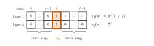
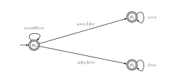
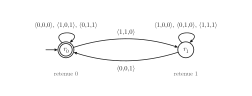
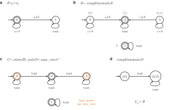

# Mines-Ponts MP — Informatique (option) 2026 · Corrigé brut

*Corrigé rédigé par IA, non officiel. Signalez toute erreur.*

Conventions.

- Une lettre de $\Sigma_2$ est notée $\binom{a}{b}$, une lettre de $\Sigma_3$ est notée $\langle a,b,c\rangle$ (lignes 1, 2, 3, de haut en bas).
- La lettre nulle de $\Sigma_n$ est notée $\mathbf{0}$.
- Les lignes d'un mot sont numérotées de $1$ à $n$, comme dans l'énoncé : la ligne $i$ correspond à l'indice $i-1$ du tableau OCaml.
- Pour un mot $m=m_0\cdots m_{\ell-1}$, $\widehat{\delta}(q,m)$ désigne l'ensemble des états atteints depuis $q$ en lisant $m$.
- Le coût d'une opération arithmétique est compté $O(1)$, conformément à l'hypothèse de l'énoncé.

## 1. Implémentation de quelques fonctions utiles

### Question 1

```ocaml
(* pow2 n = 2^n, par exponentiation rapide *)
let rec pow2 n =
  if n = 0 then 1
  else
    let p = pow2 (n / 2) in
    if n mod 2 = 0 then p * p else 2 * p * p
```

Correction, par récurrence forte sur $n$. Le cas $n=0$ donne $1=2^0$. Pour $n\ge1$, on a $\lfloor n/2\rfloor<n$, donc $p=2^{\lfloor n/2\rfloor}$.

La fonction renvoie alors $p^2=2^n$ si $n$ est pair, et $2p^2=2^{2\lfloor n/2\rfloor+1}=2^n$ si $n$ est impair.

L'appel récursif est nommé une seule fois : écrire `pow2 (n/2) * pow2 (n/2)` donnerait un coût linéaire.

### Question 2

Soit $C(n)$ le nombre d'appels déclenchés par `pow2 n`. Hors appel récursif, chaque appel effectue un nombre borné d'opérations, et un seul appel récursif. On a
$$\begin{aligned}
C(0)&=1,\\
C(n)&=1+C(\lfloor n/2\rfloor)\quad\text{pour } n\ge1.
\end{aligned}$$

Montrons par récurrence forte que $C(n)=\lfloor\log_2 n\rfloor+2$ pour $n\ge1$. Pour $n=1$, $C(1)=1+C(0)=2$.

Pour $n\ge2$, écrivons $2^k\le n<2^{k+1}$ avec $k\ge1$. Alors $2^{k-1}\le\lfloor n/2\rfloor<2^k$, donc $\lfloor\log_2\lfloor n/2\rfloor\rfloor=k-1$. D'où $C(n)=1+(k-1)+2=k+2$.

Le coût total est donc
$$\boxed{\Theta(\log n)=O(\log n).}$$

### Question 3

On note une lettre $t\in\Sigma_n$ par ses composantes $(t_1,\dots,t_n)$, de haut en bas, et on pose
$$\gamma(t)=\sum_{i=1}^{n}2^{\,i-1}t_i .$$

- **$\gamma$ est à valeurs dans $[\![0,2^n-1]\!]$**, car $0\le\gamma(t)\le\sum_{i=1}^n2^{i-1}=2^n-1$.
- **$\gamma$ est injective.** Si $s\neq t$, soit $j$ le plus grand indice où elles diffèrent, avec par exemple $s_j=1$ et $t_j=0$. Alors
$$\gamma(s)-\gamma(t)\ge 2^{j-1}-\sum_{i<j}2^{i-1}=1 .$$

Comme $\lvert\Sigma_n\rvert=2^n=\lvert[\![0,2^n-1]\!]\rvert$, l'injection $\gamma$ est une bijection. Sa réciproque $\beta$ associe à $x$ la lettre $(b_1,\dots,b_n)$ définie par
$$\boxed{b_i=\big\lfloor x/2^{\,i-1}\big\rfloor \bmod 2\quad\text{pour } i\in[\![1,n]\!]}$$
c'est-à-dire l'écriture binaire de $x$ sur $n$ bits, poids faible en haut.

C'est la même convention que $v$ : pour une lettre $t$, $\gamma(t)$ est la valeur $v$ du mot $t_1\cdots t_n$.

### Question 4

On procède par divisions euclidiennes successives par 2 : le reste donne le bit courant, le quotient est divisé à son tour.

```ocaml
(* decompose x n : la lettre beta(x) ; la case i porte le bit de poids 2^i *)
let decompose x n =
  assert (0 <= x && x < pow2 n);
  let t = Array.make n 0 in
  let y = ref x in
  for i = 0 to n - 1 do
    t.(i) <- !y mod 2;
    y := !y / 2
  done;
  t
```

Invariant : avant le tour $i$, on a `!y` $=\lfloor x/2^i\rfloor$, et `t.(j)` $=\lfloor x/2^j\rfloor\bmod2$ pour $j<i$. En sortie, `t` $=\beta(x)$. Le coût est $\Theta(n)$.

## 2. Automates finis sur $\Sigma_n$

### Question 5

**Lecture de $\mathcal{A}_1$.** Chaque couple (état, lettre) a au plus un successeur, et $q_2$ n'a aucune transition sortante. L'automate est donc déterministe, $q_2$ est bloquant non final, et $q_1$ est le seul état final.

- En $q_0$, seule $\binom00$ boucle, $\binom11$ mène en $q_1$, et les autres lettres mènent en $q_2$.
- En $q_1$, les lettres $\binom00$ et $\binom10$ bouclent, et les autres mènent en $q_2$.

D'où
$$\mathcal{L}(\mathcal{A}_1)=\Big\{\tbinom00^{k}\,\tbinom11\,s\ :\ k\in\mathbb{N},\ s\in\big\{\tbinom00,\tbinom10\big\}^*\Big\}.\qquad(\star)$$



Écrivons $m_j=\binom{u_j}{w_j}$, et notons $\ell$ la longueur de $m$.

**Cas $v_1(m)=0$.** Toutes les puissances de $2$ divisent $0$ : il n'y a pas de plus grande puissance, donc $m\notin E$.

D'autre part, tout mot de $(\star)$ contient un $1$ sur la ligne 1, donc $m\notin\mathcal{L}(\mathcal{A}_1)$. On suppose désormais $v_1(m)\neq0$.

**Première inclusion : $\mathcal{L}(\mathcal{A}_1)\subseteq E$.** Soit $m$ de la forme $(\star)$.

- Sur la ligne 2, on a $w_k=1$ et $w_j=0$ pour $j\ne k$, donc $v_2(m)=2^k$.
- Sur la ligne 1, on a $u_j=0$ pour $j<k$ et $u_k=1$, donc $v_1(m)=2^k(1+2t)$ avec $t\in\mathbb{N}$.

Ainsi $2^k$ divise $v_1(m)$ mais pas $2^{k+1}$ : $v_2(m)=2^k$ est la plus grande puissance de 2 qui divise $v_1(m)$, et $m\in E$.

**Seconde inclusion : $E\subseteq\mathcal{L}(\mathcal{A}_1)$.** Soit $m\in E$, et $k$ l'exposant de la plus grande puissance de 2 qui divise $v_1(m)\neq0$. Alors $v_2(m)=2^k$.

- Comme $v_2(m)<2^\ell$, on a $k<\ell$. Par unicité de l'écriture binaire sur $\ell$ bits, $w_k=1$ et $w_j=0$ pour $j\ne k$.
- Soit $i_0=\min\{j:u_j=1\}$. Alors $v_1(m)=2^{i_0}(1+2t')$, donc $i_0=k$ : $u_j=0$ pour $j<k$ et $u_k=1$.

Les lettres de rang $j<k$ valent $\binom00$, la lettre de rang $k$ vaut $\binom11$, et les suivantes ont une ligne 2 nulle. Le mot a la forme $(\star)$, donc il est accepté.

$$\boxed{\mathcal{L}(\mathcal{A}_1)=E}$$

### Question 6

Soit $m\in\mathcal{L}(\mathcal{A}_1)$. D'après Q5, $v_2(m)=2^k$ et $v_1(m)=2^k(1+2t)$. Donc
$$v_1(m)-v_2(m)=2^{k+1}t=t\cdot\big(2\,v_2(m)\big),$$
c'est-à-dire
$$\boxed{v_1(m)\equiv v_2(m)\ [2\times v_2(m)].}$$

### Question 7

$$\boxed{\mathcal{L}(\mathcal{A}_2)=\{m\in\Sigma_2^*\ :\ v_1(m)>v_2(m)\}}$$

L'état $q_1$ signifie que la valeur du préfixe lu sur la ligne 1 dépasse strictement celle de la ligne 2. Comme on lit du poids faible au poids fort, la dernière lettre où les lignes diffèrent tranche la comparaison.

### Question 8

Pour des mots de même longueur, $v_i(m)=v_j(m)$ équivaut à $\pi_i(m)=\pi_j(m)$, par unicité de l'écriture binaire. Il s'agit donc de reconnaître les mots dont toutes les lettres $\langle a,b,c\rangle$ vérifient $a=c$, ou dont toutes vérifient $b=c$.

On propose un automate déterministe (incomplet) à 3 états. L'état $p_0$ est initial, et **les trois états sont finaux**.

| état | signification | $a=c \text{ et } b=c$ | $a=c,\ b\ne c$ | $a\ne c,\ b=c$ | $a\ne c,\ b\ne c$ |
|---|---|---|---|---|---|
| $p_0$ (initial, final) | les deux égalités tiennent | $p_0$ | $p_1$ | $p_2$ | — |
| $p_1$ (final) | seule $v_1=v_3$ est possible | $p_1$ | $p_1$ | — | — |
| $p_2$ (final) | seule $v_2=v_3$ est possible | $p_2$ | — | $p_2$ | — |

Les lettres concernées sont, colonne par colonne :

- $a=c$ et $b=c$ : $\langle0,0,0\rangle$ et $\langle1,1,1\rangle$ ;
- $a=c$ et $b\ne c$ : $\langle0,1,0\rangle$ et $\langle1,0,1\rangle$ ;
- $a\ne c$ et $b=c$ : $\langle1,0,0\rangle$ et $\langle0,1,1\rangle$.

Le mot vide est accepté, et en effet $v_1(\varepsilon)=v_3(\varepsilon)=0$.



### Question 9

```ocaml
let est_deterministe_complet a =
  let ok = ref true in
  for x = 0 to pow2 a.n - 1 do
    let lettre = decompose x a.n in   (* chaque lettre construite une fois *)
    for q = 0 to a.k - 1 do
      match a.delta q lettre with
      | [_] -> ()                     (* exactement un successeur *)
      | _ -> ok := false
    done
  done;
  !ok
```

Les $2^n$ valeurs de $x$ énumèrent chaque lettre de $\Sigma_n$ exactement une fois (Q3). Le test porte sur tous les couples (état, lettre). Le filtrage `[_]` reconnaît les listes de longueur 1 en $O(1)$, sans parcourir la liste.

**Complexité.** Il y a $\lvert\Sigma_n\rvert=2^n$ tours externes. Chacun coûte :

- $\Theta(n)$ pour `decompose` ;
- $\lvert Q\rvert$ appels à `delta`, chacun en $O(n)$ (lecture d'une lettre de taille $n$), suivis d'un filtrage en $O(1)$.

Le calcul de `pow2 a.n`, en $O(\log n)$, n'est fait qu'une fois. Le total vaut
$$\boxed{O\big(n\times\lvert Q\rvert\times\lvert\Sigma_n\rvert\big).}$$

Avec `List.length`, le coût pourrait atteindre $\lvert Q\rvert$ par test et dépasser la borne.

### Question 10

Construction par sous-ensembles. À $\mathcal{A}=(\Sigma,Q,q_0,\delta,F)$, on associe $\mathcal{A}'=\big(\Sigma,\ \mathcal{P}(Q),\ \{q_0\},\ \delta',\ F'\big)$, où
$$\begin{aligned}
\delta'(S,a)&=\Big\{\textstyle\bigcup_{q\in S}\delta(q,a)\Big\}\qquad\text{pour } S\subseteq Q,\ a\in\Sigma,\\
F'&=\{S\subseteq Q:\ S\cap F\neq\emptyset\}.
\end{aligned}$$

$\delta'$ est une fonction de $\mathcal{P}(Q)\times\Sigma$ dans $\mathcal{P}(\mathcal{P}(Q))$ qui renvoie toujours un singleton : $\mathcal{A}'$ est déterministe complet. L'ensemble vide est un état, non final, et c'est le puits.

**Correction.** Par récurrence sur $\lvert m\rvert$, l'unique état atteint dans $\mathcal{A}'$ en lisant $m$ depuis $\{q_0\}$ est $\widehat{\delta}(q_0,m)$. C'est vrai pour $\varepsilon$, et l'hérédité vient de
$$\widehat{\delta}(q_0,ma)=\bigcup_{q\in\widehat{\delta}(q_0,m)}\delta(q,a).$$

Donc $m\in\mathcal{L}(\mathcal{A}')$ si et seulement si $\widehat{\delta}(q_0,m)\cap F\neq\emptyset$, c'est-à-dire si et seulement si $m\in\mathcal{L}(\mathcal{A})$.

### Question 11

```ocaml
let union etats a lettre =
  let t = Array.make a.k 0 in
  for q = 0 to a.k - 1 do
    if etats.(q) = 1 then
      List.iter (fun i -> t.(i) <- 1) (a.delta q lettre)
  done;
  t
```

`t.(i)` passe à 1 si et seulement s'il existe $q$ avec `etats.(q) = 1` et $i\in\delta(q,\texttt{lettre})$. Le tableau `etats` n'est pas modifié.

### Question 12

On code une partie $S$ de $Q=[\![0,k-1]\!]$ par l'entier $\sum_{q\in S}2^q$, et `decompose` fait la conversion inverse.

Mais le type impose que **l'état initial soit l'état 0**, alors que $\{q_0\}$ a pour code $1$.

On compose donc le codage avec la transposition $\rho$ qui échange $0$ et $1$.

L'état $0$ représente alors $\{q_0\}$, et l'état $1$ représente $\emptyset$.

```ocaml
(* code t : entier dont t est l'ecriture binaire (bit q de poids 2^q) *)
let code t =
  let s = ref 0 in
  for q = Array.length t - 1 downto 0 do
    s := 2 * !s + t.(q)
  done;
  !s

(* transposition 0 <-> 1, involutive *)
let echange x = if x = 0 then 1 else if x = 1 then 0 else x

let determinise a =
  let nb = pow2 a.k in
  let ens x = decompose (echange x) a.k in   (* partie representee par l'etat x *)
  let num t = echange (code t) in            (* etat representant la partie t *)
  let finaux = Array.make nb false in
  for x = 0 to nb - 1 do
    let t = ens x in
    for q = 0 to a.k - 1 do
      if t.(q) = 1 && a.finaux.(q) then finaux.(x) <- true
    done
  done;
  { k = nb; n = a.n; finaux = finaux;
    delta = (fun x lettre -> [ num (union (ens x) a lettre) ]) }
```

`ens` $=\beta\circ\rho$ et `num` $=\rho\circ\gamma$ sont des bijections réciproques entre $[\![0,2^k-1]\!]$ et les parties de $Q$. L'automate renvoyé est donc l'automate $\mathcal{A}'$ de Q10, à un renommage bijectif des états près :

- l'état initial $0$ représente $\{q_0\}$ ;
- la transition renvoie un singleton, calculé par `union` (Q11) ;
- un état est final si et seulement si sa partie rencontre $F$.

**Il est déterministe complet et reconnaît $\mathcal{L}(\mathcal{A})$.**

### Question 13

On commence par **déterminiser** (et compléter), puis on échange finaux et non-finaux.

```ocaml
let complementaire a =
  let d = determinise a in
  { d with finaux = Array.map not d.finaux }
```

Dans l'automate déterministe complet $\mathcal{D}$, tout mot $m$ a exactement un chemin depuis l'état initial. Il est accepté par l'automate renvoyé si et seulement si ce chemin finit hors de $F_{\mathcal{D}}$, c'est-à-dire si et seulement si $m\notin\mathcal{L}(\mathcal{A})$. Échanger les finaux sans déterminiser ni compléter serait faux.

### Question 14

Avec $\mathcal{A}_1=(\Sigma_n,Q_1,q_1,\delta_1,F_1)$ et $\mathcal{A}_2=(\Sigma_n,Q_2,q_2,\delta_2,F_2)$, on pose
$$\boxed{\mathcal{P}=\big(\Sigma_n,\ Q_1\times Q_2,\ (q_1,q_2),\ \delta,\ F_1\times F_2\big)}$$
où, pour $(p,q)\in Q_1\times Q_2$ et $a\in\Sigma_n$,
$$\delta\big((p,q),a\big)=\delta_1(p,a)\times\delta_2(q,a).$$

Les objets ont la bonne nature : $(q_1,q_2)$ est un élément de $Q_1\times Q_2$, $F_1\times F_2$ en est une partie, et $\delta$ va de $(Q_1\times Q_2)\times\Sigma_n$ dans $\mathcal{P}(Q_1\times Q_2)$.

**Lemme.** Pour tout mot $m$, on a
$$\widehat{\delta}((q_1,q_2),m)=\widehat{\delta_1}(q_1,m)\times\widehat{\delta_2}(q_2,m).$$

Par récurrence sur $\lvert m\rvert$. Le cas $\varepsilon$ est immédiat.

Pour l'hérédité, un couple $(r,s)$ est atteint en lisant $ma$ si et seulement s'il existe $(p,q)$ atteint en lisant $m$ avec $r\in\delta_1(p,a)$ et $s\in\delta_2(q,a)$.

Par hypothèse de récurrence, les choix de $p$ et de $q$ sont indépendants. Cela revient donc à $r\in\widehat{\delta_1}(q_1,ma)$ et $s\in\widehat{\delta_2}(q_2,ma)$.

**Conclusion.** $m\in\mathcal{L}(\mathcal{P})$ si et seulement si ce produit rencontre $F_1\times F_2$. Cela équivaut à $\widehat{\delta_1}(q_1,m)\cap F_1\ne\emptyset$ et $\widehat{\delta_2}(q_2,m)\cap F_2\ne\emptyset$, c'est-à-dire à $m\in\mathcal{L}(\mathcal{A}_1)\cap\mathcal{L}(\mathcal{A}_2)$.

## 3. Opérations arithmétiques

### Question 15

L'état est la **retenue** $e\in\{0,1\}$. L'automate est $\mathcal{A}_+=(\Sigma_3,\{r_0,r_1\},r_0,\delta_+,\{r_0\})$, avec
$$\delta_+\big(r_e,\langle a,b,c\rangle\big)=\begin{cases}\{r_{e'}\}&\text{si } a+b+e=c+2e',\ e'\in\{0,1\},\\ \emptyset&\text{si } a+b+e\not\equiv c\ [2].\end{cases}$$

Chaque état a exactement quatre transitions sortantes, une par lettre de bonne parité :

| état | vers $r_0$ | vers $r_1$ |
|---|---|---|
| $r_0$ (initial, final) | $\langle0,0,0\rangle,\ \langle1,0,1\rangle,\ \langle0,1,1\rangle$ | $\langle1,1,0\rangle$ |
| $r_1$ (non final) | $\langle0,0,1\rangle$ | $\langle1,0,0\rangle,\ \langle0,1,0\rangle,\ \langle1,1,1\rangle$ |

Les huit autres couples (état, lettre) n'ont pas de transition.



### Question 16

Soit $m=m_0\cdots m_{\ell-1}$ avec $m_j=\langle a_j,b_j,c_j\rangle$. Pour $0\le j\le\ell$, notons $A_j=\sum_{l<j}2^la_l$, et de même $B_j$ et $C_j$.

Ces trois valeurs sont dans $[\![0,2^j-1]\!]$, donc
$$-2^j<A_j+B_j-C_j<2^{j+1}.\qquad(\mathrm{B}_j)$$

**Invariant** $(I_j)$ : l'ensemble $S_j$ des états atteints après $j$ lettres est
$$S_j=\{r_e:\ e\in\{0,1\},\ A_j+B_j=C_j+e\,2^j\}.$$

- **Initialisation.** $S_0=\{r_0\}$, et l'égalité $0=0+e$ impose $e=0$.
- **Hérédité.** Supposons $(I_j)$, et notons $m_j=\langle a,b,c\rangle$. On a $r_{e'}\in S_{j+1}$ si et seulement s'il existe $e$ avec $r_e\in S_j$ et $a+b+e=c+2e'$.
  - Si un tel $e$ existe, on calcule :
$$\begin{aligned}
A_{j+1}+B_{j+1}&=A_j+B_j+2^j(a+b)\\
&=C_j+2^j(a+b+e)\\
&=C_j+2^j(c+2e')\\
&=C_{j+1}+e'\,2^{j+1}.
\end{aligned}$$
  - Réciproquement, supposons $A_{j+1}+B_{j+1}=C_{j+1}+e'2^{j+1}$, et posons $e=c+2e'-a-b$. Alors $A_j+B_j-C_j=e\,2^j$.
  - L'encadrement $(\mathrm{B}_j)$ donne alors $e\in\{0,1\}$. Par hypothèse de récurrence, $r_e\in S_j$, et $a+b+e=c+2e'$ par définition de $e$.

  D'où $(I_{j+1})$.

Ce raisonnement couvre aussi les blocages : si aucune transition n'existe, $S_{j+1}=\emptyset$, et aucune égalité n'est possible à ce rang.

Pour $j=\ell$, on a $A_\ell=v_1(m)$, $B_\ell=v_2(m)$ et $C_\ell=v_3(m)$.

Donc $m$ est accepté si et seulement si $r_0\in S_\ell$, c'est-à-dire si et seulement si $v_1(m)+v_2(m)=v_3(m)$. Ainsi
$$\boxed{\mathcal{L}(\mathcal{A}_+)=L_+.}$$

### Question 17

**$L_\times$ n'est pas reconnaissable.**

**Lemme de l'étoile.** Si un langage $L$ est reconnu par un automate à $N$ états, alors tout mot $m\in L$ de longueur $\ge N$ s'écrit $m=xyz$ avec :

- $\lvert xy\rvert\le N$ ;
- $y\neq\varepsilon$ ;
- $xy^kz\in L$ pour tout $k\in\mathbb{N}$.

Il se démontre par le principe des tiroirs : parmi les $N+1$ premiers états d'un chemin acceptant, deux coïncident, et la portion entre eux est une boucle qu'on peut répéter.

**Application.** Supposons $L_\times$ reconnu par un automate à $N$ états, et posons $p=N$. Soit $m$ le mot de longueur $2p+1$ défini par
$$\begin{aligned}
\pi_1(m)&=0^p\,1\,0^p,\\
\pi_2(m)&=0^p\,1\,0^p,\\
\pi_3(m)&=0^{2p}\,1 .
\end{aligned}$$

On a $v_1(m)=v_2(m)=2^p$ et $v_3(m)=2^{2p}$, donc $m\in L_\times$.

Le lemme donne $m=xyz$ avec $\lvert xy\rvert\le p$ et $y\ne\varepsilon$.

Les $p$ premières lettres de $m$ valent $\mathbf{0}$, donc $y=\mathbf{0}^t$ avec $t\ge1$.

Le mot $m'=xy^2z$ est celui obtenu en insérant $t$ lettres $\mathbf{0}$ au début de $m$, et il devrait être dans $L_\times$.

Or $v_1(m')=v_2(m')=2^{p+t}$ et $v_3(m')=2^{2p+t}$. Ainsi
$$v_1(m')\,v_2(m')=2^{2p+2t}\neq2^{2p+t}=v_3(m'),$$
et $m'\notin L_\times$. C'est une contradiction.

## 4. Arithmétique de Presburger

### Question 18

$$\boxed{\mathrm{div}_2(x):=\exists y.\ x=y+y}$$

Elle est vraie si et seulement s'il existe $N\in\mathbb{N}$ avec $x=2N$.

### Question 19

Dans $\mathbb{N}$, $x=x+x$ équivaut à $x=0$. On pose
$$\begin{aligned}
z(x)&:=\ x=x+x &&(x=0),\\
u(x)&:=\ \neg z(x)\ \wedge\ \neg\exists a.\,\exists b.\,\big(x=a+b\wedge\neg z(a)\wedge\neg z(b)\big) &&(x=1).
\end{aligned}$$

La formule $u(x)$ dit que $x\ne0$ et que $x$ n'est pas somme de deux entiers non nuls.

Si $x\ge2$, $x=1+(x-1)$ est une telle somme.

Si $x=1$, une somme de deux entiers $\ge1$ vaut au moins $2$. Donc $u(x)$ est vraie si et seulement si $x=1$.

On définit alors $f_n$ par récurrence. À chaque rang, on prend des variables fraîches $y_n,t_n$, et dans chaque copie de $u$ on renomme les variables liées $a,b$ en variables fraîches. L'ensemble $V$ est infini, et la règle de formation des quantificateurs est ainsi respectée.
$$\boxed{\begin{aligned}
f_0(x)&:=\ x=x+x,\\
f_{n+1}(x)&:=\ \exists y_n.\,\exists t_n.\,\big(f_n(y_n)\wedge u(t_n)\wedge x=y_n+t_n\big).
\end{aligned}}$$

Par récurrence sur $n$, $f_n(x)$ est vraie si et seulement si $x=n$.

Pour $f_{n+1}$, l'hypothèse de récurrence force $y_n=n$, et $u$ force $t_n=1$, donc $x=n+1$. Réciproquement, ces valeurs conviennent.

### Question 20

On note $\mathrm{VL}(\varphi)$ l'ensemble des variables libres de $\varphi$. On définit une traduction $S(\varphi)$ par induction sur $\varphi$, puis on prouve, toujours par induction, que $S(\varphi)$ est sous forme simple, a les mêmes variables libres que $\varphi$ et lui est équivalente.

**Termes.** Pour un terme $t$ et une variable $z$ fraîche, on définit par induction sur $t$ :
$$\begin{aligned}
\theta_x(z)&:=\ (z=x)\qquad\text{pour } x\in V,\\
\theta_{t_1+t_2}(z)&:=\ \exists u.\,\exists v.\,\big(\theta_{t_1}(u)\wedge\theta_{t_2}(v)\wedge z=u+v\big),
\end{aligned}$$
avec $u,v$ fraîches.

Par induction sur $t$, $\theta_t(z)$ est sous forme simple, et ses variables libres sont $z$ et celles de $t$.

De plus, $\theta_t(z)$ est vraie sous $a[z\mapsto N]$ si et seulement si $N$ est la valeur de $t$ sous $a$.

Dans le cas $t_1+t_2$, cela revient à l'existence de $N_1,N_2$, valeurs de $t_1,t_2$, avec $N=N_1+N_2$.

**Formules.** On pose, avec $z$ fraîche dans le cas atomique :
$$\begin{aligned}
S(t_1=t_2)&:=\ \exists z.\,\big(\theta_{t_1}(z)\wedge\theta_{t_2}(z)\big),\\
S(\neg\varphi)&:=\ \neg S(\varphi),\\
S(\varphi_1\wedge\varphi_2)&:=\ S(\varphi_1)\wedge S(\varphi_2),\\
S(\varphi_1\vee\varphi_2)&:=\ \neg\big(\neg S(\varphi_1)\wedge\neg S(\varphi_2)\big),\\
S(\varphi_1\to\varphi_2)&:=\ \neg\big(S(\varphi_1)\wedge\neg S(\varphi_2)\big),\\
S(\exists x.\varphi)&:=\ \exists x.\,S(\varphi),\\
S(\forall x.\varphi)&:=\ \neg\exists x.\,\neg S(\varphi).
\end{aligned}$$

**Preuve par induction structurelle.** Soit $a$ une assignation.

- **Cas de l'égalité de deux termes.** $S(t_1=t_2)$ ne contient que des atomes $z=x$ ou $z=u+v$, des $\wedge$ et des $\exists$ : il est sous forme simple.
  - La variable $z$ est liée, donc ses variables libres sont celles de $t_1$ et de $t_2$.
  - Il est vrai sous $a$ si et seulement s'il existe un entier égal à la fois à la valeur de $t_1$ et à celle de $t_2$, c'est-à-dire si et seulement si $t_1=t_2$ est vraie sous $a$.
- **Cas $\neg$ et $\wedge$.** Immédiat par hypothèse d'induction.
- **Cas $\vee$ et $\to$.** Par hypothèse d'induction et par les équivalences propositionnelles $A\vee B\equiv\neg(\neg A\wedge\neg B)$ et $A\to B\equiv\neg(A\wedge\neg B)$, qui se lisent sur les tables de vérité.
- **Cas $\exists x.\varphi$.** Pour tout $N$, $S(\varphi)$ et $\varphi$ ont la même valeur sous $a[x\mapsto N]$, donc les deux formules existentielles ont la même valeur sous $a$.
- **Cas $\forall x.\varphi$.** La formule $\forall x.\varphi$ est vraie sous $a$ si et seulement si aucun $N$ ne rend $\neg\varphi$ vraie sous $a[x\mapsto N]$.
  - C'est la valeur de $\neg\exists x.\neg S(\varphi)$, par hypothèse d'induction.

Dans tous les cas, $S$ n'introduit ni $\vee$, ni $\to$, ni $\forall$, et ne produit que des atomes conformes au point (iii). Les variables introduites sont fraîches : il n'y a pas de capture, et la règle de formation des quantificateurs reste respectée. **Toute formule $\varphi$ est donc équivalente à la formule sous forme simple $S(\varphi)$.**

### Question 21

On note $A=\varphi(x)$, $B=\psi(y)$ et $\Gamma=\{A\vee B,\ \neg A\}$. La branche $A$ se ferme par l'absurde :
$$\mathcal{D}=\dfrac{\dfrac{\dfrac{}{\Gamma,A\vdash\neg A}\,\mathrm{ax}\qquad\dfrac{}{\Gamma,A\vdash A}\,\mathrm{ax}}{\Gamma,A\vdash\bot}\,\neg e}{\Gamma,A\vdash B}\,\bot$$

Puis on assemble :
$$\dfrac{\dfrac{\dfrac{\dfrac{}{\Gamma\vdash A\vee B}\,\mathrm{ax}\qquad\mathcal{D}\qquad\dfrac{}{\Gamma,B\vdash B}\,\mathrm{ax}}{\Gamma\vdash B}\,\vee e}{A\vee B\vdash\neg A\to B}\,\to i}{\vdash(A\vee B)\to(\neg A\to B)}\,\to i$$

Le séquent $\vdash(\varphi(x)\vee\psi(y))\to(\neg\varphi(x)\to\psi(y))$ est donc prouvable. Aucune règle de quantificateur n'intervient.

### Question 22

**La formule est** $\varphi(x,y,z):=(x=y\wedge y=z)\to x=z$. Elle est sans quantificateur, donc ses trois variables sont libres.

Pour lire l'arbre, on abrège les trois atomes :
$$\begin{aligned}
E_1&:=\ (x=y),\\
E_2&:=\ (y=z),\\
E_3&:=\ (x=z).
\end{aligned}$$

On applique $\mathrm{sub}_=$ avec l'hypothèse $E_1$ (variable $x$, terme $t=y$), le contexte $\Gamma=\{E_2\}$ et la formule $E_3$.

Sa substituée $E_3[y/x]$ est $E_2$, qui est un axiome. La règle $\mathrm{cut}$ met ensuite les deux égalités de la conjonction dans le contexte :
$$\dfrac{\dfrac{\dfrac{\dfrac{}{E_2,\ E_1\vdash E_2}\,\mathrm{ax}}{E_2,\ E_1\vdash E_3}\,\mathrm{sub}_=}{E_1\wedge E_2\vdash E_3}\,\mathrm{cut}}{\vdash(E_1\wedge E_2)\to E_3}\,\to i$$

## 5. Retour sur les automates

### Question 23

Un état doit devenir final s'il atteint un état final par une suite, **éventuellement vide**, de transitions étiquetées $\mathbf{0}$. On sature :

```ocaml
let sans_zero a =
  let zero = Array.make a.n 0 in
  let f = Array.copy a.finaux in          (* les finaux restent finaux *)
  let change = ref true in
  while !change do
    change := false;
    for q = 0 to a.k - 1 do
      if not f.(q) then
        List.iter (fun r -> if f.(r) then (f.(q) <- true; change := true))
          (a.delta q zero)
    done
  done;
  { a with finaux = f }
```

**Terminaison.** Chaque tour où `change` passe à vrai ajoute au moins un état marqué, donc il y a au plus $k+1$ tours.

**Correction.** Un état marqué atteint un état final par des transitions $\mathbf{0}$, par récurrence sur l'ordre de marquage.

Réciproquement, on raisonne par récurrence sur la longueur $p$ du plus court chemin $\mathbf{0}^p$ vers un état final. Si $q\xrightarrow{\mathbf{0}}r$ avec $r$ marqué, le tour qui suit le marquage de $r$ marque $q$.

Le coût est de $O(k^3)$ opérations élémentaires au pire, hors coût des appels à `delta`.

### Question 24

La ligne 2 devient libre, et la longueur est conservée :
$$\boxed{L_{\exists2}=\Big\{\varepsilon,\ \langle0,0,1\rangle,\ \langle0,1,1\rangle\Big\}\cup\Big\{\langle0,b_0,0\rangle\langle1,b_1,1\rangle\ :\ (b_0,b_1)\in\{0,1\}^2\Big\}}$$
soit $1+2+4=7$ mots.

### Question 25

```ocaml
let automate_existe a i =
  let delta q lettre =
    let l0 = Array.copy lettre and l1 = Array.copy lettre in
    l0.(i - 1) <- 0;                     (* ligne i = indice i-1 *)
    l1.(i - 1) <- 1;
    List.sort_uniq compare (a.delta q l0 @ a.delta q l1)
  in
  { a with delta = delta }
```

La nouvelle transition est $\delta'(q,a)=\delta(q,a[i\leftarrow0])\cup\delta(q,a[i\leftarrow1])$.

Par récurrence sur $\lvert m\rvert$, $\widehat{\delta'}(q,m)$ est la réunion des $\widehat{\delta}(q,w)$, sur les mots $w$ qui ont la longueur de $m$ et coïncident avec lui hors de la ligne $i$.

Les finaux étant inchangés, l'automate reconnaît $\mathcal{L}(\mathcal{A})_{\exists i}$. Les copies évitent de modifier la lettre de l'appelant.

### Question 26

Récursion sur la formule sous forme simple $\varphi$, l'entier $n$ étant fixé. Tous les automates sont sur $\Sigma_n$, et la ligne $j$ porte la valeur de $x_j$.

- **$x_i=x_j$** : on renvoie `automate_egalite n i j`.
- **$x_i=x_j+x_k$** : on renvoie `automate_somme n j k i`, car c'est $x_i$ qui est la somme.
- **$\neg\psi$** : on renvoie le complémentaire de l'automate de $\psi$ (déterminisation incluse), car $L_{\neg\psi}=\Sigma_n^*\setminus L_\psi$.
- **$\psi_1\wedge\psi_2$** : on renvoie l'intersection des deux automates, car $L_{\psi_1\wedge\psi_2}=L_{\psi_1}\cap L_{\psi_2}$. Les deux sous-formules lisent leurs variables sur les mêmes lignes du même mot.
- **$\exists x_i.\psi$** : on applique `automate_existe` (ligne $i$ libre), **puis** `sans_zero`.

Pour le dernier cas, la projection seule limite le témoin à $\lvert m\rvert$ bits. Or $v_j(m\mathbf{0}^p)=v_j(m)$ pour tout $j$. On accepte donc $m$ dès qu'un prolongement $m\mathbf{0}^p$ admet un témoin, ce que réalise `sans_zero`.

### Question 27

Ici $n=2$ : la ligne 1 porte $x_1$, la ligne 2 porte $x_2$.

**Étape 0, feuille $x_1=x_2$.** On prend pour `automate_egalite 2 1 2` l'automate $\mathcal{E}$ à deux états : $0$ (initial, final) et $1$ (puits). Pour une lettre $\binom ab$, les transitions sont :

- $0\xrightarrow{a=b}0$ et $0\xrightarrow{a\ne b}1$ ;
- $1\xrightarrow{\text{tout}}1$.

**Étape 1, `complementaire` $\mathcal{E}$.** La déterminisation numérote $0\mapsto\{0\}$, $1\mapsto\emptyset$, $2\mapsto\{1\}$ et $3\mapsto\{0,1\}$. Les transitions sont :

| état | lettre $a=b$ | lettre $a\ne b$ |
|---|---|---|
| $0=\{0\}$ | $0$ | $2$ |
| $1=\emptyset$ | $1$ | $1$ |
| $2=\{1\}$ | $2$ | $2$ |
| $3=\{0,1\}$ | $3$ | $2$ |

Dans le déterminisé, les finaux sont $0$ et $3$. Après échange, l'automate $\mathcal{B}$ a pour finaux $1$ et $2$, et reconnaît $\{v_1\ne v_2\}$.

**Étape 2, `automate_existe` $\mathcal{B}$ 1.** On a $\delta_\mathcal{C}(q,\binom ab)=\delta_\mathcal{B}(q,\binom0b)\cup\delta_\mathcal{B}(q,\binom1b)$. Pour toute lettre, cela donne :

- $0\to\{0,2\}$ et $1\to\{1\}$ ;
- $2\to\{2\}$ et $3\to\{2,3\}$.

Les finaux sont $1$ et $2$. L'automate $\mathcal{C}$ est non déterministe, et reconnaît $\Sigma_2^*\setminus\{\varepsilon\}$.

**Étape 3, `sans_zero` $\mathcal{C}$.** Par $\binom00$, l'état $0$ mène à $2$ (final), et l'état $3$ aussi.

**Tous les états deviennent finaux**, et l'automate $\mathcal{D}$ reconnaît $\Sigma_2^*$. Le mot vide est désormais accepté : $\exists x_1.\,x_1\neq x_2$ est toujours vrai.

**Étape 4, `complementaire` $\mathcal{D}$.** On déterminise sur les $16$ parties de $\{0,1,2,3\}$.

Depuis $\{0\}$ (état 0), toute lettre mène à $\{0,2\}$, qui se reproduit, car $\{0,2\}\cup\{2\}=\{0,2\}$. Les deux états accessibles rencontrent les finaux de $\mathcal{D}$, donc ils sont finaux, et ne le sont plus après échange. L'automate final n'a aucun état final accessible :
$$\boxed{L_\varphi=\emptyset}$$



C'est cohérent avec la sémantique : $\varphi(x_2)$ signifie « tout entier est égal à $x_2$ », ce qui est faux pour toute valeur de $x_2$.

### Question 28

```ocaml
let rec automate_formule phi n =
  match phi with
  | Egale (V i, V j) -> automate_egalite n i j
  | Egale (V i, Plus (j, k)) -> automate_somme n j k i     (* x_j + x_k = x_i *)
  | Egale (Plus (j, k), V i) -> automate_somme n j k i     (* cas symetrique *)
  | Egale (Plus _, Plus _) -> failwith "formule non sous forme simple"
  | Non psi -> complementaire (automate_formule psi n)
  | Et (psi1, psi2) ->
      intersection (automate_formule psi1 n) (automate_formule psi2 n)
  | Existe (i, psi) ->
      sans_zero (automate_existe (automate_formule psi n) i)
```

La récursion porte sur des sous-formules strictes, donc la fonction termine.

### Question 29

Soit $\varphi$ sous forme simple, de variables d'indices $\le n$. On note $a_m$ l'assignation $x_j\mapsto v_j(m)$.

**Lemme 1.** Pour tout $p\ge0$, $v_j(m\mathbf{0}^p)=v_j(m)$. Donc $m\in L_\varphi$ si et seulement si $m\mathbf{0}^p\in L_\varphi$.

**Lemme 2.** Pour $\varphi=\exists x_i.\psi$, on a
$$L_\varphi=\{m:\ \exists p\ge0,\ m\mathbf{0}^p\in(L_\psi)_{\exists i}\}.$$

- ($\subseteq$) Supposons $\psi$ vraie sous $a_m[x_i\mapsto N]$, et choisissons $p$ avec $N<2^{\lvert m\rvert+p}$.
  - Soit $w$ le mot égal à $m\mathbf{0}^p$ hors de la ligne $i$, dont la ligne $i$ est l'écriture binaire de $N$.
  - Par le lemme 1, $a_w$ coïncide avec $a_m[x_i\mapsto N]$ sur les variables libres de $\psi$. Donc $w\in L_\psi$, et $m\mathbf{0}^p\in(L_\psi)_{\exists i}$.
- ($\supseteq$) Si $w\in L_\psi$ coïncide avec $m\mathbf{0}^p$ hors de la ligne $i$, alors $N=v_i(w)$ est un témoin pour $m$.

**Lemme 3.** L'automate `sans_zero` $\mathcal{A}$ reconnaît $\{m:\exists p,\ m\mathbf{0}^p\in\mathcal{L}(\mathcal{A})\}$. En effet, ses finaux sont les $q$ tels que $\widehat{\delta}(q,\mathbf{0}^p)\cap F\ne\emptyset$ pour un $p$ (Q23), et
$$\widehat{\delta}(q_0,m\mathbf{0}^p)=\bigcup_{q\in\widehat{\delta}(q_0,m)}\widehat{\delta}(q,\mathbf{0}^p).$$

**Théorème.** L'automate `automate_formule phi n` reconnaît $L_\varphi$. Preuve par induction structurelle sur $\varphi$ :

- **Atomes.** Par hypothèse sur `automate_egalite` et `automate_somme`. En effet, $[\![x_i=x_j]\!]_{a_m}$ est vraie si et seulement si $v_i(m)=v_j(m)$. De même, $[\![x_i=x_j+x_k]\!]_{a_m}$ est vraie si et seulement si $v_j(m)+v_k(m)=v_i(m)$.
- **$\neg\psi$.** Mêmes variables libres, donc $L_{\neg\psi}=\Sigma_n^*\setminus L_\psi$, et Q13 conclut.
- **$\psi_1\wedge\psi_2$.** $a_m$ donne à $x_j$ la valeur $v_j(m)$ quelle que soit la sous-formule. Donc $L_\varphi=L_{\psi_1}\cap L_{\psi_2}$, et Q14 conclut.
- **$\exists x_i.\psi$.** Par hypothèse d'induction et Q25, `automate_existe` reconnaît $(L_\psi)_{\exists i}$. Les lemmes 3 et 2 concluent.

### Question 30

Si $\varphi$ est close, $[\![\varphi]\!]_{a_m}$ ne dépend pas de $m$.

On a donc $L_\varphi=\Sigma_n^*$ si $\varphi$ est vraie, et $L_\varphi=\emptyset$ sinon. Il suffit de tester $\varepsilon$, qui est accepté si et seulement si l'état initial $0$ est final.

```ocaml
let est_vraie phi n =
  (automate_formule phi n).finaux.(0)
```

**$\varphi$ est vraie si et seulement si l'état $0$ de l'automate de Q28 est final.** La lecture du bit est immédiate, mais le coût réside dans la construction de l'automate (déterminisation à chaque négation).
