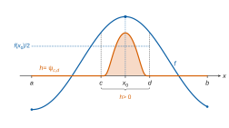
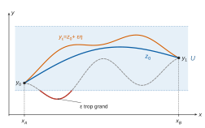
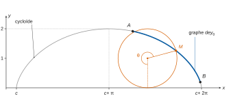
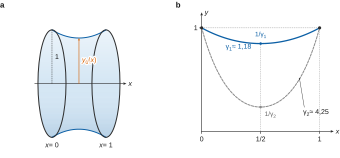

# Mines-Ponts MP — Maths 1 2026 · Corrigé brut

*Corrigé rédigé par IA, non officiel. Signalez toute erreur.*

Épreuve : « Équation d'Euler-Lagrange et quelques applications ». Durée 3 h, calculatrice interdite. Toutes les normes sur les espaces de fonctions sont la norme $\lVert\cdot\rVert_\infty$.

## I - Lemme fondamental du calcul variationnel

Soient $a<b$ et $f:[a,b]\to\mathbf R$ continue.

On suppose $\int_a^b f(x)h(x)\,\mathrm dx=0$ pour toute $h\in\mathcal C^\infty([a,b],\mathbf R)$ vérifiant $h(a)=h(b)=0$.

On pose
$$\varphi(x)=\begin{cases}e^{-1/x}&\text{si }x>0,\\0&\text{si }x\le0.\end{cases}$$

### Question 1

Sur $\mathbf R_+^\star$, $x\mapsto -1/x$ est de classe $\mathcal C^\infty$, et $\exp$ l'est sur $\mathbf R$.

Par composition, $\varphi$ est de classe $\mathcal C^\infty$ sur $\mathbf R_+^\star$.

Montrons par récurrence sur $n$ l'existence d'un polynôme $P_n$ tel que $\varphi^{(n)}(x)=P_n(1/x)e^{-1/x}$ pour tout $x>0$.

- $n=0$ : $P_0=1$ convient.
- Si $P_n$ convient, alors pour $x>0$, en dérivant le produit (la dérivée de $x\mapsto P_n(1/x)$ est $x\mapsto-\frac1{x^2}P_n'(1/x)$) :
$$\begin{aligned}
\varphi^{(n+1)}(x)&=-\frac1{x^2}P_n'\!\left(\frac1x\right)e^{-1/x}+\frac1{x^2}P_n\!\left(\frac1x\right)e^{-1/x}\\
&=P_{n+1}\!\left(\frac1x\right)e^{-1/x},
\end{aligned}$$
avec $P_{n+1}=X^2\,(P_n-P_n')$, qui est un polynôme.

$$\boxed{\begin{aligned}
&P_0=1,\\
&P_{n+1}=X^2(P_n-P_n'),\\
&\varphi^{(n)}(x)=P_n\!\left(\tfrac1x\right)e^{-1/x}\ \ (x>0).
\end{aligned}}$$

### Question 2

**Lemme.** Pour tout polynôme $P$, $P(1/x)e^{-1/x}\to0$ quand $x\to0^+$. En effet, avec $t=1/x\to+\infty$, $P(t)e^{-t}\to0$ par croissances comparées.

Montrons par récurrence sur $n$ : « $\varphi$ est de classe $\mathcal C^n$ sur $\mathbf R$ et $\varphi^{(n)}$ est nulle sur $\mathbf R_-$ ».

- $n=0$ : $\varphi$ est continue sur $\mathbf R_-^\star$ (nulle) et sur $\mathbf R_+^\star$.

  En $0$, $\varphi(x)\to0=\varphi(0)$ à gauche, et à droite par le lemme avec $P=1$.

  Donc $\varphi$ est continue sur $\mathbf R$, nulle sur $\mathbf R_-$.
- Hérédité : supposons la propriété vraie au rang $n$ et posons $g=\varphi^{(n)}$. Vérifions les hypothèses du théorème de la limite de la dérivée (prolongement de la classe $\mathcal C^1$) :
  - $g$ est **continue sur $\mathbf R$**, en particulier en $0$ (hypothèse de récurrence) ;
  - $g$ est de classe $\mathcal C^1$ sur $\mathbf R^\star$ : $g'=0$ sur $\mathbf R_-^\star$,
    et $g'(x)=P_{n+1}(1/x)e^{-1/x}$ sur $\mathbf R_+^\star$ (Q1) ;
  - $g'(x)\to0$ quand $x\to0^-$ (fonction nulle) et quand $x\to0^+$ (lemme).

  Le théorème donne : $g$ est dérivable en $0$, $g'(0)=0$, et $g'$ est continue en $0$.

  Ainsi $\varphi$ est de classe $\mathcal C^{n+1}$ sur $\mathbf R$ et $\varphi^{(n+1)}$ est nulle sur $\mathbf R_-$.

**Donc $\varphi$ est de classe $\mathcal C^\infty$ sur $\mathbf R$**, avec $\varphi^{(n)}(0)=0$ pour tout $n$.

### Question 3

Posons, pour $x\in\mathbf R$,
$$\boxed{\psi_{c,d}(x)=\varphi(x-c)\,\varphi(d-x).}$$

- Par composition avec des fonctions affines et produit, $\psi_{c,d}$ est de classe $\mathcal C^\infty$ sur $\mathbf R$ (Q2).
- Si $c<x<d$ : $x-c>0$ et $d-x>0$, donc $\psi_{c,d}(x)=e^{-1/(x-c)}e^{-1/(d-x)}>0$.
- Si $x\le c$, $\varphi(x-c)=0$ ; si $x\ge d$, $\varphi(d-x)=0$. Donc $\psi_{c,d}$ est nulle sur $\mathbf R\setminus\,]c,d[$.

### Question 4

Raisonnons par l'absurde : supposons qu'il existe $x_0\in\,]a,b[$ tel que $f(x_0)\ne0$.

Quitte à changer $f$ en $-f$ (l'hypothèse est inchangée), $f(x_0)>0$.

Par continuité de $f$ en $x_0$, il existe $\delta>0$ tel que $[x_0-\delta,x_0+\delta]\subset\,]a,b[$ et $f\ge f(x_0)/2>0$ sur ce segment.

Posons $c=x_0-\delta$, $d=x_0+\delta$, et $h=\psi_{c,d}$ restreinte à $[a,b]$.

Alors $h$ est de classe $\mathcal C^\infty$, et $h(a)=h(b)=0$ puisque $a,b\notin\,]c,d[$. Donc $\int_a^b fh=0$.

Or $fh$ est nulle hors de $]c,d[$, d'où $\int_a^b fh=\int_c^d fh$. C'est l'intégrale d'une fonction continue, positive sur $[c,d]$ et strictement positive en $x_0$.

Une fonction continue positive d'intégrale nulle sur un segment étant nulle, $\int_c^d fh>0$. Contradiction.

Donc $f$ est nulle sur $]a,b[$, puis sur $[a,b]$ par continuité en $a$ et $b$ :
$$\boxed{f=0\ \text{sur}\ [a,b].}$$

*La preuve n'utilise que des fonctions test $\psi_{c,d}$ avec $a<c<d<b$ ; ce point resservira en Q12.*

## II - Équation d'Euler-Lagrange

**Convention.** Les questions 7 à 9 font intervenir $\partial f/\partial y$, $\partial f/\partial z$ et $\frac{\mathrm d}{\mathrm dx}\frac{\partial f}{\partial z}$ jusqu'aux bornes de $[x_A,x_B]$.

Or $f$ n'est supposée de classe $\mathcal C^2$ que sur l'ouvert $]x_A,x_B[\times U\times V$.

On lit l'énoncé ainsi : les dérivées partielles de $f$ d'ordre au plus $2$ se prolongent continûment à $[x_A,x_B]\times U\times V$.

C'est le cas dans toutes les applications (parties III à V), où $f$ ne dépend pas de $x$ et est de classe $\mathcal C^\infty$ sur $\mathbf R\times U\times V$.

### Question 5

Soit $y\in\mathcal C$. L'application $\Gamma:x\mapsto(x,y(x),y'(x))$ est continue sur $[x_A,x_B]$, car $y$ est de classe $\mathcal C^1$.

Elle est à valeurs dans $[x_A,x_B]\times U\times V$ par définition de $\mathcal C$. Comme $f$ est continue sur cet ensemble, $f\circ\Gamma$ est continue sur le segment $[x_A,x_B]$, donc intégrable : **$T(y)$ existe**.

### Question 6

Pour tout $\varepsilon$, $y_\varepsilon=z_0+\varepsilon\eta$ est de classe $\mathcal C^2$. De plus $y_\varepsilon(x_A)=y_0$ et $y_\varepsilon(x_B)=y_1$ car $\eta(x_A)=\eta(x_B)=0$.

Il reste à trouver $\alpha>0$ tel que, pour $\lvert\varepsilon\rvert<\alpha$ et tout $x\in[x_A,x_B]$, $y_\varepsilon(x)\in U$ et $y_\varepsilon'(x)\in V$.

Par l'absurde : sinon, pour tout $n\ge1$, il existe $\varepsilon_n\in\,]-\frac1n,\frac1n[$ et $x_n\in[x_A,x_B]$ tels que
$$z_0(x_n)+\varepsilon_n\eta(x_n)\notin U\qquad\text{ou}\qquad z_0'(x_n)+\varepsilon_n\eta'(x_n)\notin V.$$
L'un des deux cas se produit pour une infinité d'indices ; quitte à extraire, c'est toujours le premier. Le second se traite de même en remplaçant $(z_0,\eta,U)$ par $(z_0',\eta',V)$, ces fonctions étant continues.

La suite $(x_n)$ est bornée : par Bolzano-Weierstrass, une sous-suite $(x_{\sigma(n)})$ converge vers $\ell\in[x_A,x_B]$ (segment fermé).

Comme $z_0$ est continue, $\eta$ bornée sur le segment et $\varepsilon_{\sigma(n)}\to0$,
$$u_n=z_0(x_{\sigma(n)})+\varepsilon_{\sigma(n)}\eta(x_{\sigma(n)})\longrightarrow z_0(\ell).$$
Or $u_n\in\mathbf R\setminus U$, fermé puisque $U$ est ouvert ; par caractérisation séquentielle, $z_0(\ell)\notin U$. C'est absurde car $z_0\in\mathcal C$.

**Il existe donc $\alpha>0$ tel que $y_\varepsilon\in\mathcal C$ pour tout $\varepsilon\in\,]-\alpha,\alpha[$.**

### Question 7

Posons $F(\varepsilon,x)=f(x,y_\varepsilon(x),y_\varepsilon'(x))$ pour $\lvert\varepsilon\rvert<\alpha$ et $x\in[x_A,x_B]$. Fixons $\beta\in\,]0,\alpha[$ et travaillons sur $J=[-\beta,\beta]$.

- Pour $\varepsilon\in J$, $x\mapsto F(\varepsilon,x)$ est continue sur le segment (Q5), donc intégrable.
- Pour $x$ fixé, $\varepsilon\mapsto(x,z_0(x)+\varepsilon\eta(x),z_0'(x)+\varepsilon\eta'(x))$ est affine, à valeurs dans $[x_A,x_B]\times U\times V$, où $f$ est de classe $\mathcal C^1$.

  Par la règle de la chaîne, $\varepsilon\mapsto F(\varepsilon,x)$ est de classe $\mathcal C^1$ et
$$\frac{\partial F}{\partial\varepsilon}(\varepsilon,x)=\eta(x)\frac{\partial f}{\partial y}(x,y_\varepsilon(x),y_\varepsilon'(x))+\eta'(x)\frac{\partial f}{\partial z}(x,y_\varepsilon(x),y_\varepsilon'(x)),$$
fonction continue de $x$ à $\varepsilon$ fixé.
- Domination : $\Phi:(\varepsilon,x)\mapsto(x,y_\varepsilon(x),y_\varepsilon'(x))$ est continue sur le compact $J\times[x_A,x_B]$.

  Donc $K=\Phi(J\times[x_A,x_B])$ est un compact, inclus dans $[x_A,x_B]\times U\times V$ (Q6).

  Les fonctions continues $\partial f/\partial y$ et $\partial f/\partial z$ y sont bornées par un réel $M$.

  C'est ici que sert la convention : les dérivées partielles doivent être continues jusqu'aux bornes du segment.

  D'où, pour $\varepsilon\in J$ et $x\in[x_A,x_B]$,
$$\left\lvert\frac{\partial F}{\partial\varepsilon}(\varepsilon,x)\right\rvert\le M\big(\lVert\eta\rVert_\infty+\lVert\eta'\rVert_\infty\big),$$
constante indépendante de $\varepsilon$, intégrable sur le segment.

Par le théorème de dérivation sous le signe intégral, $\varphi$ est de classe $\mathcal C^1$ sur $]-\beta,\beta[$ pour tout $\beta<\alpha$, donc sur $]-\alpha,\alpha[$, et
$$\boxed{\varphi'(\varepsilon)=\int_{x_A}^{x_B}\left(\eta(x)\frac{\partial f}{\partial y}(x,y_\varepsilon(x),y_\varepsilon'(x))+\eta'(x)\frac{\partial f}{\partial z}(x,y_\varepsilon(x),y_\varepsilon'(x))\right)\mathrm dx.}$$

### Question 8

Traitons un minimum local (le maximum est symétrique) : il existe $r>0$ tel que $T(y)\ge T(z_0)$ pour tout $y\in\mathcal C$ avec $\lVert y-z_0\rVert_\infty\le r$.

Soit $\lvert\varepsilon\rvert<\min\big(\alpha,\ r/(\lVert\eta\rVert_\infty+1)\big)$. Alors $y_\varepsilon\in\mathcal C$ et
$$\lVert y_\varepsilon-z_0\rVert_\infty=\lvert\varepsilon\rvert\,\lVert\eta\rVert_\infty\le r,$$
donc $\varphi(\varepsilon)=T(y_\varepsilon)\ge T(z_0)=\varphi(0)$.

Ainsi $\varphi$ a un minimum local en $0$. Or en un extremum d'une fonction dérivable sur un intervalle ouvert, la dérivée s'annule ; $0$ est intérieur à $]-\alpha,\alpha[$ et $\varphi$ y est dérivable (Q7) : $\varphi'(0)=0$.

Posons $w(x)=\frac{\partial f}{\partial z}(x,z_0(x),z_0'(x))$. Avec $y_{\varepsilon=0}=z_0$, Q7 donne
$$\int_{x_A}^{x_B}\left(\eta\,\frac{\partial f}{\partial y}(x,z_0,z_0')+\eta'\,w\right)\mathrm dx=0.$$

L'application $x\mapsto(x,z_0(x),z_0'(x))$ est de classe $\mathcal C^1$, car $z_0$ est de classe $\mathcal C^2$.

De plus $\partial f/\partial z$ est de classe $\mathcal C^1$, car $f$ est de classe $\mathcal C^2$.

Donc $w$ est de classe $\mathcal C^1$ sur $[x_A,x_B]$.

Sa dérivée est $w'=\frac{\mathrm d}{\mathrm dx}\left(\frac{\partial f}{\partial z}(x,z_0,z_0')\right)$.

L'intégration par parties ($\eta$ et $w$ de classe $\mathcal C^1$) donne, car $\eta(x_A)=\eta(x_B)=0$ :
$$\begin{aligned}
\int_{x_A}^{x_B}\eta'w&=\big[\eta w\big]_{x_A}^{x_B}-\int_{x_A}^{x_B}\eta w'\\
&=-\int_{x_A}^{x_B}\eta w'.
\end{aligned}$$
D'où
$$\boxed{\int_{x_A}^{x_B}\left(\frac{\partial f}{\partial y}(x,z_0(x),z_0'(x))-\frac{\mathrm d}{\mathrm dx}\left(\frac{\partial f}{\partial z}(x,z_0(x),z_0'(x))\right)\right)\eta(x)\,\mathrm dx=0.}$$

### Question 9

Posons $E:x\mapsto\frac{\partial f}{\partial y}(x,z_0(x),z_0'(x))-w'(x)$. Elle est continue sur $[x_A,x_B]$ (composée de fonctions continues, et $w$ de classe $\mathcal C^1$).

Toute $h\in\mathcal C^\infty([x_A,x_B],\mathbf R)$ nulle en $x_A$ et $x_B$ est de classe $\mathcal C^2$, donc admissible comme $\eta$ en Q8 : $\int_{x_A}^{x_B}Eh=0$.

Les hypothèses de Q4 sont donc réunies (avec $a=x_A$, $b=x_B$ et $E$ continue à la place de $f$) : $E=0$, soit
$$\boxed{\forall x\in[x_A,x_B],\quad \frac{\partial f}{\partial y}(x,z_0(x),z_0'(x))-\frac{\mathrm d}{\mathrm dx}\left(\frac{\partial f}{\partial z}(x,z_0(x),z_0'(x))\right)=0.}$$

*Remarque.* Sans la convention de prolongement, on obtient la même équation sur $]x_A,x_B[$ en prenant $\eta=\psi_{c,d}$ avec $x_A<c<d<x_B$. En effet, $\varphi(\varepsilon)$ ne diffère alors d'une constante que par une intégrale sur $[c,d]$, où tout est de classe $\mathcal C^2$, et la preuve de Q4 n'utilise que ces fonctions test.

### Question 10

Posons, pour $x\in\,]x_A,x_B[$, $H(x)=f(x,z_0(x),z_0'(x))-z_0'(x)\,w(x)$.

Comme $f$ est de classe $\mathcal C^2$ sur $]x_A,x_B[\times U\times V$ et $x\mapsto(x,z_0,z_0')$ de classe $\mathcal C^1$, $H$ est dérivable (règle de la chaîne).

En abrégeant les arguments $(x,z_0(x),z_0'(x))$ :
$$\begin{aligned}
H'&=\frac{\partial f}{\partial x}+z_0'\frac{\partial f}{\partial y}+z_0''\frac{\partial f}{\partial z}-z_0''w-z_0'w'\\
&=\frac{\partial f}{\partial x}+z_0'\left(\frac{\partial f}{\partial y}-w'\right),
\end{aligned}$$
puisque $w=\frac{\partial f}{\partial z}(x,z_0,z_0')$.

Le premier terme est nul par hypothèse, le second par l'équation d'Euler-Lagrange (Q9). Donc $H'=0$ sur l'intervalle $]x_A,x_B[$, et $H$ y est constante :
$$\boxed{\exists C\in\mathbf R,\ \forall x\in\,]x_A,x_B[,\quad f(x,z_0(x),z_0'(x))-z_0'(x)\frac{\partial f}{\partial z}(x,z_0(x),z_0'(x))=C.}$$

## III - Le chemin le plus court est la ligne droite !

### Question 11

On applique la partie II avec $U=V=\mathbf R$, les valeurs aux bords $y_A$, $y_B$, et
$$f:(x,y,z)\in[x_A,x_B]\times\mathbf R\times\mathbf R\longmapsto\sqrt{1+z^2},$$
restriction d'une fonction de classe $\mathcal C^\infty$ sur $\mathbf R^3$ (car $1+z^2>0$).

L'ensemble $\mathcal C$ est celui de la partie II, et un extremum de $T$ est en particulier un extremum local. On a $\partial f/\partial x=0$ et $\partial f/\partial z=z/\sqrt{1+z^2}$.

L'identité de Beltrami donne $C\in\mathbf R$ tel que, pour $x\in\,]x_A,x_B[$,
$$\begin{aligned}
C&=\sqrt{1+y_0'^2}-\frac{y_0'^2}{\sqrt{1+y_0'^2}}\\
&=\frac{1}{\sqrt{1+y_0'(x)^2}}.
\end{aligned}$$
Donc $C>0$ (inverse d'une racine strictement positive) et $y_0'(x)^2=\frac1{C^2}-1=:k^2$ avec $k\ge0$.

Ainsi $y_0'$ est à valeurs dans $\{-k,k\}$ sur $]x_A,x_B[$. Comme $y_0'$ est continue, $y_0'(]x_A,x_B[)$ est un intervalle (théorème des valeurs intermédiaires) contenu dans $\{-k,k\}$, donc un singleton.

Donc $y_0'$ est constante, égale à $m$, sur $]x_A,x_B[$, puis sur $[x_A,x_B]$ par continuité. Ainsi $y_0(x)=mx+p$ :
$$\boxed{y_0\ \text{est affine :}\quad y_0(x)=y_A+\frac{y_B-y_A}{x_B-x_A}(x-x_A).}$$

## IV - Le chemin le plus rapide est la cycloïde

### Question 12

Posons $f(x,y,z)=\sqrt{(1+z^2)/y}$, de classe $\mathcal C^\infty$ sur $\mathbf R\times\mathbf R_+^\star\times\mathbf R$. On a $\frac{\partial f}{\partial x}=0$ et
$$\frac{\partial f}{\partial z}(x,y,z)=\frac{z}{\sqrt y\,\sqrt{1+z^2}}.$$

**Équation d'Euler-Lagrange sur $]x_A,x_B[$.** L'ensemble $\mathcal C$ de cette partie n'est pas exactement de la forme de la partie II : la condition $y'<0$ ne porte que sur $]x_A,x_B]$, et $y_0$ ne minimise $T$ que sur cet ensemble. On refait donc l'argument de variation.

Soient $x_A<c<d<x_B$ et $\eta=\psi_{c,d}$ (restreinte), de classe $\mathcal C^\infty$, nulle hors de $]c,d[$. Posons
$$\begin{aligned}
m&=\min_{[x_A,x_B]}y_0>0,\\
\mu&=-\max_{[c,d]}y_0'>0
\end{aligned}$$
(fonctions continues sur des segments, et $[c,d]\subset\,]x_A,x_B]$), puis
$$\alpha=\min\left(\frac{m}{\lVert\eta\rVert_\infty+1},\ \frac{\mu}{\lVert\eta'\rVert_\infty+1}\right).$$

Pour $\lvert\varepsilon\rvert<\alpha$, $y_\varepsilon=y_0+\varepsilon\eta$ est de classe $\mathcal C^2$ et a les bonnes valeurs aux bords. De plus :

- $y_\varepsilon\ge m-\lvert\varepsilon\rvert\lVert\eta\rVert_\infty>0$ ;
- $y_\varepsilon'=y_0'<0$ sur $]x_A,x_B]\setminus[c,d]$ ;
- $y_\varepsilon'\le-\mu+\lvert\varepsilon\rvert\lVert\eta'\rVert_\infty<0$ sur $[c,d]$.

Donc $y_\varepsilon\in\mathcal C$, et $\varphi(\varepsilon)=T(y_\varepsilon)\ge T(y_0)=\varphi(0)$ sur $]-\alpha,\alpha[$.

Les preuves de Q7 et Q8 s'appliquent mot pour mot : le compact $K$ est inclus dans $\mathbf R\times\mathbf R_+^\star\times\mathbf R$, où $f$ est $\mathcal C^\infty$. Elles donnent $\int_{x_A}^{x_B}E\,\psi_{c,d}=0$, où $E=\frac{\partial f}{\partial y}(x,y_0,y_0')-\frac{\mathrm d}{\mathrm dx}\frac{\partial f}{\partial z}(x,y_0,y_0')$ est continue.

Comme la preuve de Q4 n'utilise que ces fonctions test, $E=0$ sur $[x_A,x_B]$.

**Intégrale première.** Le calcul de Q10 n'utilise que $\partial f/\partial x=0$ et l'équation d'Euler-Lagrange sur $]x_A,x_B[$. Il fournit $K\in\mathbf R$ tel que, pour $x\in\,]x_A,x_B[$,
$$\begin{aligned}
K&=\sqrt{\frac{1+y_0'^2}{y_0}}-\frac{y_0'^2}{\sqrt{y_0}\sqrt{1+y_0'^2}}\\
&=\frac{1}{\sqrt{y_0(x)\big(1+y_0'(x)^2\big)}}.
\end{aligned}$$
Donc $K>0$ et $y_0(x)(1+y_0'(x)^2)=1/K^2$ sur $]x_A,x_B[$, puis sur $[x_A,x_B]$ par continuité. Avec $C=1/K^2>0$ :
$$\boxed{\forall x\in[x_A,x_B],\quad y_0(x)\big(1+y_0'(x)^2\big)=C.}$$

*(Si l'on admet que la partie II s'applique avec $U=\mathbf R_+^\star$, le résultat est une application directe de l'identité de Beltrami ; l'argument ci-dessus justifie cette application.)*

Dans la suite, $C=2$.

### Question 13

$\operatorname{cotan}=\cos/\sin$ est définie là où $\sin$ ne s'annule pas :
$$\boxed{\mathcal D_{\operatorname{cotan}}=\mathbf R\setminus\pi\mathbf Z.}$$

Sur $]0,\pi[$, $\operatorname{cotan}$ est dérivable et
$$\begin{aligned}
\operatorname{cotan}'(x)&=\frac{-\sin^2x-\cos^2x}{\sin^2x}\\
&=-\frac1{\sin^2x}<0.
\end{aligned}$$
Elle est continue et strictement décroissante.

Quand $x\to0^+$, $\cos x\to1$ et $\sin x\to0^+$, donc $\operatorname{cotan}x\to+\infty$.

Quand $x\to\pi^-$, $\cos x\to-1$ et $\sin x\to0^+$, donc $\operatorname{cotan}x\to-\infty$.

Par le théorème de la bijection (fonction continue et strictement monotone sur un intervalle), **$\operatorname{cotan}$ réalise une bijection de $]0,\pi[$ sur $\mathbf R$**. On note $\operatorname{arccotan}:\mathbf R\to\,]0,\pi[$ sa réciproque, continue et strictement décroissante.

Comme $\operatorname{cotan}'$ ne s'annule pas sur $]0,\pi[$, $\operatorname{arccotan}$ est dérivable en tout point de $\mathbf R$. Soit $t\in\mathbf R$ et $u=\operatorname{arccotan}t$ ; on a
$$\sin^2u=\frac1{1+\operatorname{cotan}^2u}=\frac1{1+t^2}.$$
D'où
$$\boxed{\begin{aligned}
\forall t\in\mathbf R,\quad \operatorname{arccotan}'(t)&=-\sin^2(\operatorname{arccotan}t)\\
&=-\frac{1}{1+t^2}.
\end{aligned}}$$

### Question 14

Soit $x\in[x_A,x_B]$ et $u=\theta(x)/2=\operatorname{arccotan}(y_0'(x))\in\,]0,\pi[$. Alors $\sin u\ne0$, $\operatorname{cotan}u=y_0'(x)$ et
$$\begin{aligned}
1-\cos\theta(x)&=1-\cos(2u)\\
&=2\sin^2u\\
&=\frac{2}{1+\operatorname{cotan}^2u}\\
&=\frac{2}{1+y_0'(x)^2}.
\end{aligned}$$
Or Q12 avec $C=2$ donne $y_0(x)=\dfrac{2}{1+y_0'(x)^2}$. Donc
$$\boxed{\forall x\in[x_A,x_B],\quad y_0(x)=1-\cos\theta(x).}$$

### Question 15

$y_0'$ est de classe $\mathcal C^1$ et $\operatorname{arccotan}$ aussi (dérivée continue, Q13), donc $\theta$ est de classe $\mathcal C^1$ sur $[x_A,x_B]$. En dérivant Q14 :
$$\begin{aligned}
y_0'(x)&=\theta'(x)\sin\theta(x)\\
&=2\theta'(x)\sin\frac{\theta(x)}2\cos\frac{\theta(x)}2.
\end{aligned}$$
Par ailleurs, par définition de $\theta$,
$$y_0'(x)=\operatorname{cotan}\frac{\theta(x)}2=\frac{\cos(\theta(x)/2)}{\sin(\theta(x)/2)}.$$

Soit $x\in\,]x_A,x_B]$ : $y_0'(x)<0$ et $\sin\frac{\theta(x)}2>0$ imposent $\cos\frac{\theta(x)}2<0$, en particulier non nul.

En égalant les deux expressions, en multipliant par $\sin\frac{\theta(x)}2$ et en simplifiant par $\cos\frac{\theta(x)}2$ :
$$\begin{aligned}
1&=2\theta'(x)\sin^2\frac{\theta(x)}2\\
&=\theta'(x)\big(1-\cos\theta(x)\big).
\end{aligned}$$

Posons $\Lambda(x)=\theta(x)-\sin\theta(x)-x$, de classe $\mathcal C^1$ sur $[x_A,x_B]$. Sur $]x_A,x_B[$, $\Lambda'=\theta'(1-\cos\theta)-1=0$.

Donc $\Lambda$ y est constante, égale à $-c$, puis sur $[x_A,x_B]$ par continuité. Ainsi
$$\boxed{\exists c\in\mathbf R,\ \forall x\in[x_A,x_B],\quad x=\theta(x)-\sin\theta(x)+c.}$$

La courbe de $y_0$ est donc l'arc $\theta\mapsto(\theta-\sin\theta+c,\ 1-\cos\theta)$, $\theta\in\theta([x_A,x_B])$ : un arc de cycloïde (avec $\theta(x)\in\,]\pi,2\pi[$ pour $x\in\,]x_A,x_B]$).

## V - Une application à une structure optimale : la caténoïde

### Question 16

Le facteur $2\pi>0$ ne change pas les minimiseurs : $y_0$ minimise $y\mapsto\int_0^1 y\sqrt{1+y'^2}$ sur $\mathcal C$.

C'est l'ensemble de la partie II avec $x_A=0$, $x_B=1$, $U=V=\mathbf R$ et les valeurs $1$, $1$ aux bords.

On prend $f(x,y,z)=y\sqrt{1+z^2}$, de classe $\mathcal C^\infty$ sur $\mathbf R^3$, avec $\partial f/\partial x=0$ et $\partial f/\partial z=yz/\sqrt{1+z^2}$.

L'identité de Beltrami fournit $K$ tel que, pour $x\in\,]0,1[$,
$$\begin{aligned}
K&=y_0\sqrt{1+y_0'^2}-\frac{y_0y_0'^2}{\sqrt{1+y_0'^2}}\\
&=\frac{y_0(x)}{\sqrt{1+y_0'(x)^2}}.
\end{aligned}$$
Le membre de droite est continu sur $[0,1]$ : l'égalité vaut sur $[0,1]$.

En $x=0$, $K=1/\sqrt{1+y_0'(0)^2}>0$. Avec $c=1/K\neq0$, $\sqrt{1+y_0'^2}=c\,y_0$, et en élevant au carré :
$$\boxed{\exists c\in\mathbf R^\star,\ \forall x\in[0,1],\quad 1+y_0'(x)^2=c^2y_0(x)^2.}$$
De plus $y_0=K\sqrt{1+y_0'^2}>0$ sur $[0,1]$.

### Question 17

$\operatorname{ch}$ est de classe $\mathcal C^\infty$, de dérivée $\operatorname{sh}$. On a $\operatorname{sh}(0)=0$ et $\operatorname{sh}(x)=\frac{e^x-e^{-x}}2>0$ pour $x>0$.

Donc $\operatorname{ch}$ est continue et strictement croissante sur $\mathbf R_+$. De plus $\operatorname{ch}(0)=1$ et $\operatorname{ch}(x)\ge e^x/2\to+\infty$.

Par le théorème de la bijection, **$\operatorname{ch}$ réalise une bijection de $\mathbf R_+$ sur $[1,+\infty[$**. Sa réciproque $\operatorname{argch}:[1,+\infty[\to\mathbf R_+$ est continue et strictement croissante.

Pour $t>1$, $u=\operatorname{argch}t>0$ et $\operatorname{ch}'(u)=\operatorname{sh}u\ne0$ : $\operatorname{argch}$ est dérivable en $t$.

Comme $\operatorname{sh}u>0$, $\operatorname{sh}u=\sqrt{\operatorname{ch}^2u-1}=\sqrt{t^2-1}$, d'où
$$\boxed{\forall t>1,\quad \operatorname{argch}'(t)=\frac{1}{\sqrt{t^2-1}}.}$$

En $t=1$, $\operatorname{argch}$ n'est pas dérivable. Sinon, en dérivant $\operatorname{ch}(\operatorname{argch}t)=t$ en $1$, on aurait $1=\operatorname{sh}(0)\operatorname{argch}'(1)=0$.

### Question 18

**Remarque sur l'énoncé.** L'hypothèse « $y_0'>0$ sur $[0,1]$ » est incompatible avec $y_0(0)=y_0(1)=1$ : par le théorème de Rolle, $y_0'$ s'annule sur $]0,1[$.

On mène donc le calcul sur un intervalle non trivial $I\subset[0,1]$ où $y_0'>0$ et $c^2y_0^2>1$, puis on détermine $y_0$ sur $[0,1]$ sans hypothèse de signe.

**Calcul sous les hypothèses.** Posons $\gamma=\lvert c\rvert>0$. Comme $y_0>0$ (Q16), $c^2y_0^2>1$ s'écrit $\gamma y_0>1$.

Sur $I$, Q16 et $y_0'>0$ donnent $y_0'=\sqrt{\gamma^2y_0^2-1}$. La fonction $u=\operatorname{argch}(\gamma y_0)$ est dérivable sur $I$ (car $\gamma y_0\in\,]1,+\infty[$, Q17) et
$$\begin{aligned}
u'(x)&=\frac{\gamma\,y_0'(x)}{\sqrt{\gamma^2y_0(x)^2-1}}\\
&=\gamma.
\end{aligned}$$
Donc il existe $k\in\mathbf R$ tel que $u(x)=\gamma x+k$ sur $I$, et en appliquant $\operatorname{ch}$, avec $\gamma=\lvert c\rvert$ et $k\in\mathbf R$ constante d'intégration :
$$\boxed{\begin{aligned}
y_0(x)&=\frac{1}{\gamma}\operatorname{ch}(\gamma x+k)\\
&=\frac{e^{\gamma x+k}+e^{-\gamma x-k}}{2\gamma}.
\end{aligned}}$$
Réciproquement, $y_0'=\operatorname{sh}(\gamma x+k)$ et $1+y_0'^2=\operatorname{ch}^2(\gamma x+k)=c^2y_0^2$.

**Détermination sur $[0,1]$.** Pour $f=y\sqrt{1+z^2}$, $\frac{\partial f}{\partial y}=\sqrt{1+z^2}$, et un calcul direct donne
$$\frac{\mathrm d}{\mathrm dx}\left(\frac{y_0y_0'}{\sqrt{1+y_0'^2}}\right)=\frac{y_0'^2+y_0'^4+y_0y_0''}{(1+y_0'^2)^{3/2}}.$$
L'équation d'Euler-Lagrange (Q9) s'écrit donc $y_0y_0''=1+y_0'^2$ sur $[0,1]$.

Avec Q16 et $y_0>0$ : $y_0''=\gamma^2y_0$, donc $y_0=A\operatorname{ch}(\gamma x)+B\operatorname{sh}(\gamma x)$. En reportant dans Q16 : $\gamma^2(A^2-B^2)=1$, et $A=y_0(0)=1>0$.

Il existe donc $k$ tel que $A=\frac1\gamma\operatorname{ch}k$ et $B=\frac1\gamma\operatorname{sh}k$, d'où $y_0=\frac1\gamma\operatorname{ch}(\gamma x+k)$ sur tout $[0,1]$.

Les conditions aux bords donnent $\operatorname{ch}k=\operatorname{ch}(\gamma+k)=\gamma$. La parité de $\operatorname{ch}$ et son injectivité sur $\mathbf R_+$ donnent $\gamma+k=-k$, soit $k=-\gamma/2$ :
$$\begin{aligned}
&y_0(x)=\frac1\gamma\operatorname{ch}\!\Big(\gamma\big(x-\tfrac12\big)\Big),\\
&\text{avec}\ \operatorname{ch}\frac\gamma2=\gamma.
\end{aligned}$$

Cette équation a exactement deux solutions $\gamma_1\approx1{,}18$ et $\gamma_2\approx4{,}25$.

En effet, $g:\gamma\mapsto\operatorname{ch}(\gamma/2)-\gamma$ vaut $1$ en $0$, est strictement convexe, tend vers $+\infty$ et prend une valeur strictement négative, par exemple $g(2)=\operatorname{ch}1-2<0$.

Le profil décroît sur $[0,\frac12]$ et croît sur $[\frac12,1]$ : l'hypothèse $y_0'>0$ ne vaut que sur $]\frac12,1]$.

