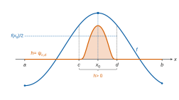
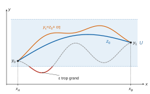
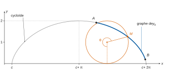
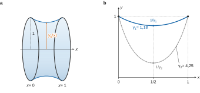

# Mines-Ponts MP — Maths 1 2026 · Corrigé guidé

*Corrigé rédigé par IA, non officiel. Signalez toute erreur.*

## Présentation du sujet

**Thème.** Le sujet démontre l'**équation d'Euler-Lagrange**. C'est la condition nécessaire satisfaite par une fonction $z_0$ qui rend extrémale une intégrale de la forme $T(y)=\int_{x_A}^{x_B}f(x,y(x),y'(x))\,\mathrm dx$.

Il l'applique ensuite à trois problèmes historiques du calcul des variations : le plus court chemin (la droite), le chemin de descente le plus rapide (la cycloïde, problème de la brachistochrone) et le film de savon entre deux cercles (la caténoïde). L'épreuve dure 3 heures, sans calculatrice.

**Découpage.**

| Partie | Questions | Contenu |
|---|---|---|
| I – Lemme fondamental | 1 à 4 | fonction $\varphi(x)=e^{-1/x}$ prolongée par $0$, classe $\mathcal C^\infty$, fonction bosse $\psi_{c,d}$, lemme « orthogonale à toutes les fonctions test $\Rightarrow$ nulle » |
| II – Euler-Lagrange | 5 à 10 | existence de $T$, stabilité de $\mathcal C$ par Bolzano-Weierstrass, dérivation sous l'intégrale, théorème de Fermat et intégration par parties, équation d'Euler-Lagrange, identité de Beltrami |
| III – Ligne droite | 11 | Beltrami pour $f=\sqrt{1+z^2}$ |
| IV – Cycloïde | 12 à 15 | intégrale première, fonction $\operatorname{arccotan}$, paramétrage par $\theta$ |
| V – Caténoïde | 16 à 18 | intégrale première, fonction $\operatorname{argch}$, chaînette |

**Notions du programme mobilisées.** Récurrence, croissances comparées, théorème de la limite de la dérivée (classe $\mathcal C^k$ par prolongement) ; continuité, fonction continue positive d'intégrale nulle ; Bolzano-Weierstrass, fermés et caractérisation séquentielle, image continue d'un compact ; théorème de dérivation des intégrales à paramètre (domination) ; règle de la chaîne pour les fonctions de plusieurs variables ; théorème de Fermat (extremum en un point intérieur) ; intégration par parties ; théorème des valeurs intermédiaires ; théorème de la bijection et dérivée d'une réciproque ; équations différentielles linéaires d'ordre 2 à coefficients constants (complément de Q18).

**Difficulté et longueur.** Le sujet est court (18 questions) et très guidé. Les parties I et II sont des classiques de l'analyse (fonctions plateau, intégrales à paramètre) où se joue l'essentiel de la rigueur. Les parties III à V sont des calculs qui n'utilisent que le **résultat** de Q10 : elles sont abordables même sans avoir fait la partie II.

Le rapport 2026 juge que « La longueur et la difficulté étaient raisonnables » : les meilleurs candidats ont pratiquement terminé l'épreuve. Il note des résultats très contrastés, parce que « les questions onze, douze et seize reposent sur la même technique, utilisée dans trois contextes différents ».

**Questions discriminantes selon le jury.** Q11, Q12 et Q16 (application rigoureuse de l'identité de Beltrami) : qui maîtrise la technique une fois la réussit trois fois. Le rapport relève aussi la faiblesse des copies sur Q1–Q2, des hypothèses oubliées en Q2, Q7, Q13 et Q17, du bluff en Q14–Q15, et une Q18 presque jamais réussie.

**Questions à ne pas laisser passer.** Q1, Q3, Q5, Q11, Q13, Q14, Q16, Q17 : courtes et purement techniques. Q2, Q6, Q7 et Q15 demandent plus de soin.

**Gestion du temps.** Environ 45 min pour la partie I, 1 h pour la partie II, 1 h 15 pour III à V. Si la partie II résiste, admettre Q9–Q10 et traiter III à V.

**Présentation.** Le sujet manipule beaucoup de dérivées partielles : le rapport 2026 signale que leur lecture au milieu des ratures pouvait s'avérer impossible, et prévient : « Si on n'arrive pas à lire, il met zéro à la question. »

**Trois points d'énoncé à connaître** (à signaler sur la copie, comme l'énoncé y invite) :

1. En partie II, $f$ n'est supposée de classe $\mathcal C^2$ que sur l'**ouvert** $]x_A,x_B[\times U\times V$, mais Q7–Q9 utilisent ses dérivées jusqu'aux bornes. On suppose que les dérivées partielles d'ordre $\le2$ se prolongent continûment à $[x_A,x_B]\times U\times V$ (c'est vrai dans toutes les applications).
2. En partie IV, la contrainte $y'<0$ ne porte que sur $]x_A,x_B]$ : on ne peut pas citer la partie II telle quelle, il faut adapter l'argument (voir Q12).
3. En Q18, l'hypothèse $y_0'>0$ sur $[0,1]$ contredit $y_0(0)=y_0(1)$ (théorème de Rolle).

## Partie I — Lemme fondamental du calcul variationnel

On construit une fonction de classe $\mathcal C^\infty$, nulle hors d'un intervalle et strictement positive dedans, pour « tester » une fonction continue localement. Outils : récurrence, croissances comparées, limite de la dérivée, continuité.

Notations : $a<b$, et $f:[a,b]\to\mathbf R$ est continue.

On suppose $\int_a^bfh=0$ pour toute $h\in\mathcal C^\infty([a,b],\mathbf R)$ telle que $h(a)=h(b)=0$.

Enfin $\varphi(x)=e^{-1/x}$ pour $x>0$, et $\varphi(x)=0$ pour $x\le0$.

### Question 1

> [!INDICATION]
> La régularité sur $\mathbf R_+^\star$ découle des théorèmes généraux. Pour la formule, raisonner par récurrence sur $n$.

> [!INDICATION]
> Dériver $P_n(1/x)e^{-1/x}$ comme un produit : chaque dérivation fait apparaître un facteur $1/x^2$. En déduire une relation donnant $P_{n+1}$ à partir de $P_n$ et $P_n'$.

#### Solution

Sur $\mathbf R_+^\star$, $x\mapsto-1/x$ est de classe $\mathcal C^\infty$ (fonction rationnelle sans pôle), et $\exp$ l'est sur $\mathbf R$.

Par composition, **$\varphi$ est de classe $\mathcal C^\infty$ sur $\mathbf R_+^\star$**.

Montrons par récurrence sur $n\in\mathbf N$ : il existe $P_n\in\mathbf R[X]$ tel que $\varphi^{(n)}(x)=P_n(1/x)e^{-1/x}$ pour tout $x>0$.

*Initialisation.* $P_0=1$.

*Hérédité.* Si $P_n$ convient, pour $x>0$, la règle de dérivation des fonctions composées donne
$$\frac{\mathrm d}{\mathrm dx}P_n\!\left(\frac1x\right)=-\frac1{x^2}P_n'\!\left(\frac1x\right),$$
et
$$\frac{\mathrm d}{\mathrm dx}e^{-1/x}=\frac1{x^2}e^{-1/x}.$$
Donc
$$\begin{aligned}
\varphi^{(n+1)}(x)&=\frac1{x^2}\left(P_n\!\left(\frac1x\right)-P_n'\!\left(\frac1x\right)\right)e^{-1/x}\\
&=P_{n+1}\!\left(\frac1x\right)e^{-1/x}
\end{aligned}$$
avec $P_{n+1}=X^2(P_n-P_n')$, polynôme.

$$\boxed{\begin{aligned}
&P_0=1,\\
&P_{n+1}=X^2(P_n-P_n').
\end{aligned}}$$

Par exemple $P_1=X^2$, $P_2=X^4-2X^3$ ; on vérifie que $\deg P_n=2n$.

> [!PIEGE]
> $P_n$ est évalué en $1/x$, pas en $x$. Écrire $\varphi^{(n)}(x)=P_n(x)e^{-1/x}$ rend la récurrence fausse et ruine la question 2.

> [!PIEGE]
> Oublier le facteur $-1/x^2$ en dérivant $x\mapsto P_n(1/x)$, c'est-à-dire la dériver en $x\mapsto P_n'(1/x)$. Le rapport 2026 relève cette erreur de dérivation des fonctions composées « dans une proportion non négligeable des copies ».

> [!JURY]
> Le rapport 2026 sur Q1 et Q2, deux questions « très classiques d'analyse réelle » : « Nous avons été très surpris par la faiblesse des copies sur ces questions ». Des questions faciles en début de problème doivent être rédigées complètement pour rapporter tous leurs points.

### Question 2

> [!INDICATION]
> Le seul point délicat est le raccord en $0$. Montrer d'abord que $\varphi^{(n)}(x)$ tend vers $0$ quand $x\to0^+$, pour tout $n$.

> [!INDICATION]
> Un calcul de limite ne suffit pas à prouver la dérivabilité en $0$. Montrer par récurrence que $\varphi$ est de classe $\mathcal C^n$ sur $\mathbf R$ en utilisant le théorème de la limite de la dérivée (prolongement de la classe $\mathcal C^1$).

#### Solution

**Lemme.** Pour tout polynôme $P$, $P(1/x)e^{-1/x}\xrightarrow[x\to0^+]{}0$. En effet, avec $t=1/x\to+\infty$, $P(t)e^{-t}\to0$ par croissances comparées.

Pour $n\in\mathbf N$, notons $\mathcal Q(n)$ la propriété :

« $\varphi$ est de classe $\mathcal C^n$ sur $\mathbf R$ et $\varphi^{(n)}$ est nulle sur $\mathbf R_-$ ».

Montrons-la par récurrence.

*$\mathcal Q(0)$.* $\varphi$ est continue sur $\mathbf R_-^\star$ (nulle) et sur $\mathbf R_+^\star$ (Q1).

En $0$, $\varphi(x)\to0=\varphi(0)$ à gauche (fonction nulle) et à droite (lemme avec $P=1$). Donc $\varphi$ est continue sur $\mathbf R$.

*$\mathcal Q(n)\Rightarrow\mathcal Q(n+1)$.* Soit $g=\varphi^{(n)}$. Vérifions les hypothèses du théorème de la limite de la dérivée :

- $g$ est **continue sur $\mathbf R$**, en particulier en $0$ (hypothèse de récurrence) ;
- $g$ est de classe $\mathcal C^1$ sur $\mathbf R^\star$ : sa dérivée est nulle sur $\mathbf R_-^\star$ et vaut $P_{n+1}(1/x)e^{-1/x}$ en $x>0$ (Q1) ;
- par le lemme, $g'(x)\to0$ quand $x\to0^+$, et $g'(x)\to0$ quand $x\to0^-$.

Le théorème donne : $g$ est dérivable en $0$ avec $g'(0)=0$, et $g'$ est continue en $0$.

Donc $\varphi$ est de classe $\mathcal C^{n+1}$ sur $\mathbf R$, et $\varphi^{(n+1)}=g'$ est nulle sur $\mathbf R_-$.

Conclusion : **$\varphi$ est de classe $\mathcal C^\infty$ sur $\mathbf R$**, et $\varphi^{(n)}(0)=0$ pour tout $n$.

> [!METHODE]
> Pour montrer qu'une fonction définie par morceaux est de classe $\mathcal C^\infty$ en un point de raccord : récurrence sur $n$ + théorème de la limite de la dérivée à chaque étape. Les hypothèses à vérifier sont : continuité au point, classe $\mathcal C^1$ sur un voisinage épointé, limite finie de la dérivée.

> [!PIEGE]
> Montrer seulement que $\varphi^{(n)}(x)\to0$ en $0^+$ ne prouve rien sur l'existence de $\varphi^{(n)}(0)$ : c'est l'existence de $\varphi^{(n)}$ sur $\mathbf R$ entier qu'il faut établir de proche en proche.

> [!JURY]
> Rapport 2026 : « il fallait appliquer le théorème de prolongement de la dérivée qui nécessite une certaine précision dans les hypothèses, celle de continuité étant souvent absente. Il y a eu très peu de solutions complètes. » La continuité de $\varphi^{(n)}$ en $0$, fournie par l'hypothèse de récurrence, doit donc être écrite.

*Remarque.* Toutes les dérivées de $\varphi$ sont nulles en $0$, mais $\varphi$ n'est pas nulle au voisinage de ce point.

Ainsi $\varphi$ est de classe $\mathcal C^\infty$ sans être développable en série entière en $0$.

### Question 3

> [!INDICATION]
> $\varphi$ est nulle à gauche de $0$ et strictement positive à droite. Comment obtenir une fonction nulle à gauche de $c$ ? nulle à droite de $d$ ?

> [!INDICATION]
> Combiner deux fonctions de ce type par une opération qui conserve la classe $\mathcal C^\infty$ et qui s'annule dès qu'un des facteurs s'annule.

#### Solution

Posons
$$\boxed{\psi_{c,d}(x)=\varphi(x-c)\,\varphi(d-x)\qquad(x\in\mathbf R).}$$

- *Régularité.* Composée de $\varphi$ (de classe $\mathcal C^\infty$ par Q2) avec des fonctions affines, puis produit : $\psi_{c,d}$ est de classe $\mathcal C^\infty$ sur $\mathbf R$.
- *Positivité.* Si $c<x<d$, $x-c>0$ et $d-x>0$, donc $\psi_{c,d}(x)=e^{-1/(x-c)}\,e^{-1/(d-x)}>0$.
- *Annulation.* Si $x\le c$, $\varphi(x-c)=0$ ; si $x\ge d$, $\varphi(d-x)=0$. Donc $\psi_{c,d}=0$ sur $\mathbf R\setminus\,]c,d[$.

> [!PIEGE]
> Une fonction comme $(x-c)^2(d-x)^2$ sur $[c,d]$, prolongée par $0$, n'est que de classe $\mathcal C^1$ : elle ne convient pas.

> [!JURY]
> Le rapport 2026 constate que la construction à partir de la question 2 rendait la justification assez simple. Avec une autre fonction, il fallait reprendre de zéro la preuve du caractère $\mathcal C^\infty$, qui n'était d'ailleurs pas toujours vérifié.

### Question 4

> [!INDICATION]
> Raisonner par l'absurde : si $f$ ne s'annule pas en un point, elle garde un signe strict au voisinage.

> [!INDICATION]
> Prendre pour $h$ une fonction $\psi_{c,d}$ portée par ce voisinage et examiner le signe de $\int_a^b fh$. Se placer d'abord à l'intérieur de $]a,b[$ et conclure aux bornes par continuité.

#### Solution

Supposons qu'il existe $x_0\in\,]a,b[$ tel que $f(x_0)\ne0$. Quitte à remplacer $f$ par $-f$, qui vérifie la même hypothèse, on suppose $f(x_0)>0$.

Par continuité de $f$ en $x_0$, il existe $\delta>0$ tel que $[x_0-\delta,x_0+\delta]\subset\,]a,b[$ et $f(x)\ge f(x_0)/2>0$ sur ce segment.

Posons $c=x_0-\delta$, $d=x_0+\delta$.

La restriction $h$ de $\psi_{c,d}$ à $[a,b]$ est de classe $\mathcal C^\infty$, et $h(a)=h(b)=0$ puisque $a,b\notin\,]c,d[$.

Par hypothèse, $\int_a^bfh=0$.

Mais $h$ est nulle hors de $]c,d[$, donc $\int_a^bfh=\int_c^dfh$. Sur $[c,d]$, $fh$ est continue, positive, et $f(x_0)h(x_0)>0$.

Une fonction continue positive d'intégrale nulle sur un segment est nulle : on aurait $f(x_0)h(x_0)=0$, contradiction. Donc $\int_c^dfh>0$, ce qui contredit l'hypothèse.

Ainsi $f=0$ sur $]a,b[$, et par continuité en $a$ et en $b$ :
$$\boxed{f=0\ \text{sur}\ [a,b].}$$

> [!METHODE]
> La preuve n'utilise que des fonctions test $\psi_{c,d}$ avec $a<c<d<b$, nulles au voisinage des bornes. Retenir ce raffinement : il permet d'appliquer le lemme quand seules des perturbations « loin des bords » sont autorisées (c'est le cas en Q12).

> [!PIEGE]
> Oublier le cas $f(x_0)<0$, ou affirmer « $\int_c^dfh>0$ car $fh>0$ » sans citer le résultat sur les fonctions continues positives d'intégrale nulle.

> [!PIEGE]
> Traiter séparément « $f$ positive » et « $f$ négative » : $f$ peut changer de signe, ces deux cas n'épuisent rien. Le rapport 2026 cite cette erreur. Le raisonnement local en un point $x_0$ où $f(x_0)\ne0$ évite le problème.

> [!JURY]
> Rapport 2026 : « Question classique et les bons candidats ont fait le raisonnement par l'absurde attendu. »

## Partie II — Équation d'Euler-Lagrange

On transforme le problème d'extremum en dimension infinie en un problème à une variable : $\varepsilon\mapsto T(z_0+\varepsilon\eta)$. Sa dérivée nulle en $0$, après intégration par parties et application du lemme de la partie I, donne l'équation d'Euler-Lagrange. Outils : compacité, dérivation sous l'intégrale, règle de la chaîne.

**Convention de lecture.** On suppose que les dérivées partielles de $f$ d'ordre au plus $2$ se prolongent continûment à $[x_A,x_B]\times U\times V$ (voir la présentation). On note $(x,y,z)$ les variables de $f$, la troisième étant la place de $y'$.

### Question 5

> [!INDICATION]
> Sur un segment, une fonction continue est intégrable. Pourquoi $x\mapsto(x,y(x),y'(x))$ est-elle à valeurs dans le domaine de $f$ ?

#### Solution

Soit $y\in\mathcal C$. Comme $y$ est de classe $\mathcal C^2$, $\Gamma:x\mapsto(x,y(x),y'(x))$ est continue sur $[x_A,x_B]$.

Par définition de $\mathcal C$ ($y(x)\in U$, $y'(x)\in V$), elle est à valeurs dans $[x_A,x_B]\times U\times V$, où $f$ est continue.

Donc $f\circ\Gamma$ est continue sur le segment $[x_A,x_B]$, donc intégrable : **$T(y)$ existe**.

> [!JURY]
> Pour le rapport 2026, l'important était de préciser que $x\mapsto f(x,y(x),y'(x))$ est continue sur le segment, « donc intégrable sur ce segment ». Les performances y ont été plus satisfaisantes.

### Question 6

> [!INDICATION]
> Les conditions de régularité et de valeurs aux bords sont vraies pour tout $\varepsilon$. Seules les conditions $y_\varepsilon(x)\in U$ et $y_\varepsilon'(x)\in V$ doivent être vérifiées, et ce **uniformément en $x$**.

> [!INDICATION]
> Par l'absurde, construire des suites $\varepsilon_n\to0$ et $x_n\in[x_A,x_B]$ qui fautent. Extraire une sous-suite de $(x_n)$ convergente et utiliser que le complémentaire d'un ouvert est fermé.

#### Solution

Pour tout $\varepsilon$, $y_\varepsilon=z_0+\varepsilon\eta$ est de classe $\mathcal C^2$. De plus $y_\varepsilon(x_A)=y_0$ et $y_\varepsilon(x_B)=y_1$ car $\eta(x_A)=\eta(x_B)=0$.

Supposons qu'aucun $\alpha>0$ ne convienne. Pour tout $n\ge1$, $\alpha=1/n$ ne convient pas : il existe $\varepsilon_n\in\,]-\frac1n,\frac1n[$ et $x_n\in[x_A,x_B]$ tels que
$$z_0(x_n)+\varepsilon_n\eta(x_n)\notin U\qquad\text{ou}\qquad z_0'(x_n)+\varepsilon_n\eta'(x_n)\notin V.$$
L'un des deux cas se produit pour une infinité d'indices ; quitte à extraire, on suppose que c'est toujours le premier. Le second se traite à l'identique avec $(z_0',\eta',V)$ à la place de $(z_0,\eta,U)$.

$(x_n)$ est à valeurs dans le segment $[x_A,x_B]$ : par le théorème de Bolzano-Weierstrass, il existe une sous-suite $(x_{\sigma(n)})$ convergeant vers $\ell\in[x_A,x_B]$.

Comme $z_0$ est continue, $\eta$ bornée sur le segment et $\varepsilon_{\sigma(n)}\to0$ :
$$u_n=z_0(x_{\sigma(n)})+\varepsilon_{\sigma(n)}\eta(x_{\sigma(n)})\longrightarrow z_0(\ell).$$
Chaque $u_n$ appartient à $\mathbf R\setminus U$, qui est fermé car $U$ est ouvert. Par caractérisation séquentielle des fermés, $z_0(\ell)\in\mathbf R\setminus U$.

C'est absurde puisque $z_0\in\mathcal C$ donne $z_0(\ell)\in U$.

**Il existe donc $\alpha>0$ tel que $y_\varepsilon\in\mathcal C$ pour tout $\varepsilon\in\,]-\alpha,\alpha[$.**

> [!PIEGE]
> Raisonner à $x$ fixé : pour chaque $x$, il existe bien un $\alpha_x>0$, mais rien n'empêche $\inf_x\alpha_x=0$. Tout l'intérêt de la compacité est de rendre le seuil uniforme.

> [!PIEGE]
> Invoquer Bolzano-Weierstrass sans avoir construit de suite : le théorème porte sur une suite bornée, pas sur un ensemble. Le rapport 2026 relève, dans une petite minorité de copies, de telles versions fantaisistes du théorème.

> [!METHODE]
> « Absurde + suite de contre-exemples + extraction (Bolzano-Weierstrass) + passage à la limite dans un fermé » : schéma standard pour obtenir une propriété uniforme sur un compact. On aurait pu aussi raisonner avec la distance de l'ensemble compact $z_0([x_A,x_B])$ au fermé $\mathbf R\setminus U$.

> [!JURY]
> Le rapport 2026 classe Q6 parmi les questions plus difficiles : un nombre non négligeable de candidats l'a sautée, mais une proportion raisonnable de ceux qui l'ont abordée avaient de bonnes idées.

### Question 7

> [!INDICATION]
> C'est une intégrale dépendant d'un paramètre : appliquer le théorème de dérivation sous le signe intégral. Calculer $\partial F/\partial\varepsilon$ par la règle de la chaîne.

> [!INDICATION]
> Pour la domination, se restreindre à $\varepsilon\in[-\beta,\beta]$ avec $\beta<\alpha$, et considérer l'image de $[-\beta,\beta]\times[x_A,x_B]$ par $(\varepsilon,x)\mapsto(x,y_\varepsilon(x),y_\varepsilon'(x))$.

#### Solution

Posons $F(\varepsilon,x)=f(x,y_\varepsilon(x),y_\varepsilon'(x))$. Fixons $\beta\in\,]0,\alpha[$ et $J=[-\beta,\beta]$.

*Intégrabilité.* Pour $\varepsilon\in J$, $y_\varepsilon\in\mathcal C$ et $x\mapsto F(\varepsilon,x)$ est continue sur le segment (Q5).

*Dérivée en $\varepsilon$.* Pour $x$ fixé, $\varepsilon\mapsto\big(x,\ z_0(x)+\varepsilon\eta(x),\ z_0'(x)+\varepsilon\eta'(x)\big)$ est affine.

Elle est à valeurs dans $[x_A,x_B]\times U\times V$, où $f$ est de classe $\mathcal C^1$. Par la règle de la chaîne (le terme en $\partial f/\partial x$ est multiplié par $0$) :
$$\frac{\partial F}{\partial\varepsilon}(\varepsilon,x)=\eta(x)\frac{\partial f}{\partial y}(x,y_\varepsilon(x),y_\varepsilon'(x))+\eta'(x)\frac{\partial f}{\partial z}(x,y_\varepsilon(x),y_\varepsilon'(x)),$$
continue en $\varepsilon$ à $x$ fixé et continue en $x$ à $\varepsilon$ fixé.

*Domination.* $\Phi:(\varepsilon,x)\mapsto(x,y_\varepsilon(x),y_\varepsilon'(x))$ est continue sur le compact $J\times[x_A,x_B]$. Son image $K$ est donc compacte, et incluse dans $[x_A,x_B]\times U\times V$ par Q6.

Les fonctions continues $\partial f/\partial y$, $\partial f/\partial z$ sont bornées sur $K$ par un réel $M$. C'est là que sert la convention de lecture : il faut ces dérivées continues jusqu'aux bornes du segment. D'où
$$\left\lvert\frac{\partial F}{\partial\varepsilon}(\varepsilon,x)\right\rvert\le M\big(\lVert\eta\rVert_\infty+\lVert\eta'\rVert_\infty\big),$$
majorant indépendant de $\varepsilon$ et intégrable sur $[x_A,x_B]$.

*Conclusion.* Le théorème de dérivation sous le signe intégral montre que $\varphi$ est de classe $\mathcal C^1$ sur $]-\beta,\beta[$ pour tout $\beta<\alpha$, donc sur $]-\alpha,\alpha[$, avec
$$\boxed{\varphi'(\varepsilon)=\int_{x_A}^{x_B}\left(\eta(x)\frac{\partial f}{\partial y}(x,y_\varepsilon(x),y_\varepsilon'(x))+\eta'(x)\frac{\partial f}{\partial z}(x,y_\varepsilon(x),y_\varepsilon'(x))\right)\mathrm dx.}$$

> [!PIEGE]
> Écrire « $\partial f/\partial y$ est continue, donc bornée » : c'est faux sur l'ouvert $U\times V$, qui peut être non borné ou dont les dérivées peuvent exploser au bord. C'est la compacité de $K$, rendue possible par le $\alpha$ uniforme de Q6, qui donne la borne.

> [!JURY]
> Rapport 2026 : « Les hypothèses de régularités étaient assez souvent justifiées mais l'hypothèse de domination, pour laquelle les hypothèses de l'énoncé étaient légèrement insuffisantes a souvent été carrément oubliée. » Chaque hypothèse du théorème (continuité en $x$, classe $\mathcal C^1$ en $\varepsilon$, domination indépendante du paramètre) doit être énoncée et vérifiée ; l'insuffisance de l'énoncé se signale et se comble par une hypothèse explicite, comme la convention ci-dessus.

### Question 8

> [!INDICATION]
> Relier $\lVert y_\varepsilon-z_0\rVert_\infty$ à $\lvert\varepsilon\rvert$ pour montrer que $\varphi$ a un extremum local en $0$, puis utiliser la condition nécessaire d'extremum en un point intérieur.

> [!INDICATION]
> Pour faire disparaître $\eta'$, intégrer par parties le terme $\eta'(x)\frac{\partial f}{\partial z}(\ldots)$. Vérifier que l'autre facteur est de classe $\mathcal C^1$ et regarder les termes de bord.

#### Solution

*Étape 1 : $\varphi'(0)=0$.* Supposons que $T$ admet un minimum local en $z_0$ (le cas d'un maximum se traite en renversant les inégalités).

Il existe $r>0$ tel que $T(y)\ge T(z_0)$ pour tout $y\in\mathcal C$ avec $\lVert y-z_0\rVert_\infty\le r$.

Soit $\alpha'=\min\big(\alpha,\ r/(\lVert\eta\rVert_\infty+1)\big)>0$. Pour $\lvert\varepsilon\rvert<\alpha'$, $y_\varepsilon\in\mathcal C$ et
$$\lVert y_\varepsilon-z_0\rVert_\infty=\lvert\varepsilon\rvert\,\lVert\eta\rVert_\infty\le r,$$
donc $\varphi(\varepsilon)=T(y_\varepsilon)\ge T(z_0)=\varphi(0)$.

La fonction $\varphi$ admet un minimum local en $0$, point intérieur de $]-\alpha,\alpha[$, et y est dérivable : $\varphi'(0)=0$.

Posons $w(x)=\frac{\partial f}{\partial z}(x,z_0(x),z_0'(x))$. Comme $y_\varepsilon=z_0$ pour $\varepsilon=0$, Q7 donne
$$\int_{x_A}^{x_B}\left(\eta(x)\frac{\partial f}{\partial y}(x,z_0(x),z_0'(x))+\eta'(x)\,w(x)\right)\mathrm dx=0.\tag{1}$$

*Étape 2 : intégration par parties.* $x\mapsto(x,z_0(x),z_0'(x))$ est de classe $\mathcal C^1$, car $z_0$ est $\mathcal C^2$.

Et $\partial f/\partial z$ est de classe $\mathcal C^1$, car $f$ est $\mathcal C^2$.

Donc $w$ est de classe $\mathcal C^1$ sur $[x_A,x_B]$, et $w'$ est la dérivée notée $\frac{\mathrm d}{\mathrm dx}\big(\frac{\partial f}{\partial z}(x,z_0,z_0')\big)$.

Comme $\eta$ est de classe $\mathcal C^1$ et $\eta(x_A)=\eta(x_B)=0$ :
$$\begin{aligned}
\int_{x_A}^{x_B}\eta'w&=\big[\eta w\big]_{x_A}^{x_B}-\int_{x_A}^{x_B}\eta w'\\
&=-\int_{x_A}^{x_B}\eta w'.
\end{aligned}$$
En reportant dans (1) :
$$\boxed{\int_{x_A}^{x_B}\left(\frac{\partial f}{\partial y}(x,z_0(x),z_0'(x))-\frac{\mathrm d}{\mathrm dx}\left(\frac{\partial f}{\partial z}(x,z_0(x),z_0'(x))\right)\right)\eta(x)\,\mathrm dx=0.}$$

> [!PIEGE]
> La condition $\varphi'(0)=0$ n'est valable que parce que $0$ est **intérieur** à l'intervalle de définition de $\varphi$ : la fonction $t\mapsto t$ sur $[0,1]$ a un minimum en $0$ sans dérivée nulle. Le dire.

> [!PIEGE]
> Ne pas confondre $\frac{\mathrm d}{\mathrm dx}$ (dérivée de la fonction composée $x\mapsto\frac{\partial f}{\partial z}(x,z_0(x),z_0'(x))$) avec la dérivée partielle $\frac{\partial}{\partial x}$.

> [!JURY]
> Rapport 2026 : une justification précise était attendue, à savoir « en un extrémum d'une fonction sur un intervalle ouvert, la dérivée s'annule ». Puis : « La rédaction la plus claire ensuite était une intégration par parties, et il était préférable de le dire. » Le jury met en garde contre le passage sans formalisme, qui « conduisait souvent à une tentative d'escroquerie ».

### Question 9

> [!INDICATION]
> Reconnaître la situation de la partie I. Quelle fonction joue le rôle de $f$ ? Est-elle continue ?

> [!INDICATION]
> Vérifier que les fonctions test de la partie I sont admissibles comme $\eta$ en Q8.

#### Solution

Posons $E(x)=\frac{\partial f}{\partial y}(x,z_0(x),z_0'(x))-w'(x)$. Le premier terme est continu (composée de fonctions continues), et $w'$ est continue ($w$ de classe $\mathcal C^1$, Q8). Donc $E$ est continue sur $[x_A,x_B]$.

Soit $h\in\mathcal C^\infty([x_A,x_B],\mathbf R)$ telle que $h(x_A)=h(x_B)=0$. Elle est de classe $\mathcal C^2$, donc admissible comme $\eta$ dans Q8 : $\int_{x_A}^{x_B}Eh=0$.

Par le lemme fondamental (Q4, avec $a=x_A$, $b=x_B$), $E=0$ sur $[x_A,x_B]$ :
$$\boxed{\forall x\in[x_A,x_B],\quad \frac{\partial f}{\partial y}(x,z_0(x),z_0'(x))-\frac{\mathrm d}{\mathrm dx}\left(\frac{\partial f}{\partial z}(x,z_0(x),z_0'(x))\right)=0.}$$

*Remarque.* Sans la convention de prolongement, on obtient l'équation sur $]x_A,x_B[$ en prenant $\eta=\psi_{c,d}$ avec $x_A<c<d<x_B$.

En effet, $\varphi(\varepsilon)$ vaut alors une constante plus une intégrale sur $[c,d]$, où $f$ est bien de classe $\mathcal C^2$, et la preuve de Q4 n'utilise que ces fonctions test.

> [!METHODE]
> L'équation d'Euler-Lagrange n'est qu'une condition **nécessaire** : elle donne des candidats, pas des extremums. Les parties III à V déterminent les seuls candidats possibles, en admettant l'existence d'un extremum.

> [!JURY]
> Question souvent réussie, mais le rapport 2026 rappelle que « pour appliquer un résultat antérieur, il faut en vérifier un minimum d'hypothèses » : un simple renvoi à la première partie ne suffit pas. Ici, les deux hypothèses à écrire sont la continuité de $E$ et l'admissibilité des fonctions test.

### Question 10

> [!INDICATION]
> Dériver la fonction $H(x)=f(x,z_0,z_0')-z_0'\frac{\partial f}{\partial z}(x,z_0,z_0')$ en utilisant la règle de la chaîne.

> [!INDICATION]
> Dans $H'$, deux termes en $z_0''$ se compensent ; le reste se factorise par $z_0'$ et fait apparaître l'expression de Q9.

#### Solution

Pour $x\in\,]x_A,x_B[$, posons $H(x)=f(x,z_0(x),z_0'(x))-z_0'(x)\,w(x)$.

Sur $]x_A,x_B[\times U\times V$, $f$ est de classe $\mathcal C^2$ et $x\mapsto(x,z_0,z_0')$ est de classe $\mathcal C^1$.

Par la règle de la chaîne, $x\mapsto f(x,z_0,z_0')$ est dérivable, et $z_0'w$ aussi (produit de fonctions $\mathcal C^1$).

En abrégeant les arguments :
$$\begin{aligned}
H'&=\frac{\partial f}{\partial x}+z_0'\frac{\partial f}{\partial y}+z_0''\frac{\partial f}{\partial z}-z_0''w-z_0'w'\\
&=\frac{\partial f}{\partial x}+z_0'\left(\frac{\partial f}{\partial y}-w'\right),
\end{aligned}$$
car $w=\frac{\partial f}{\partial z}(x,z_0,z_0')$.

Par hypothèse $\frac{\partial f}{\partial x}=0$, et le crochet est nul par Q9. Donc $H'=0$ sur l'**intervalle** $]x_A,x_B[$, et $H$ y est constante :
$$\boxed{\exists C\in\mathbf R,\ \forall x\in\,]x_A,x_B[,\quad f(x,z_0(x),z_0'(x))-z_0'(x)\frac{\partial f}{\partial z}(x,z_0(x),z_0'(x))=C.}$$

> [!METHODE]
> L'identité de Beltrami est une **intégrale première** : quand le lagrangien ne dépend pas de $x$, l'équation d'Euler-Lagrange (ordre 2) se ramène à une équation d'ordre 1. C'est l'analogue de la conservation de l'énergie en mécanique.

> [!JURY]
> Le rapport 2026 note que la question a été assez peu abordée, peut-être à cause de sa position en fin de partie, alors qu'il suffisait de dériver par la règle de la chaîne puis d'appliquer Q9. Une question courte en fin de partie mérite d'être tentée.

## Partie III — Le chemin le plus court est la ligne droite !

Première application : la longueur d'un graphe. L'intégrale première donne $y_0'^2$ constante ; il reste un argument de connexité.

### Question 11

> [!INDICATION]
> Identifier $f$, $U$ et $V$, et vérifier les hypothèses de Q10. Calculer $f-z\,\partial f/\partial z$.

> [!INDICATION]
> On obtient que $y_0'^2$ est constante. Pourquoi cela entraîne-t-il que $y_0'$ est constante ? Penser à la continuité de $y_0'$ sur un intervalle.

#### Solution

On applique la partie II avec $U=V=\mathbf R$, les valeurs aux bords $y_A$, $y_B$ et
$$f:(x,y,z)\in[x_A,x_B]\times\mathbf R\times\mathbf R\longmapsto\sqrt{1+z^2},$$
de classe $\mathcal C^\infty$ (car $1+z^2>0$).

L'ensemble $\mathcal C$ est celui de la partie II, et un extremum de $T$ est en particulier un extremum local. On a $\frac{\partial f}{\partial x}=0$ et $\frac{\partial f}{\partial z}=\frac{z}{\sqrt{1+z^2}}$.

L'identité de Beltrami fournit $C$ tel que, pour $x\in\,]x_A,x_B[$ :
$$\begin{aligned}
C&=\sqrt{1+y_0'^2}-\frac{y_0'^2}{\sqrt{1+y_0'^2}}\\
&=\frac{1}{\sqrt{1+y_0'(x)^2}}.
\end{aligned}$$
Donc $C>0$ et $y_0'(x)^2=\frac1{C^2}-1$ ; ce réel est positif, notons-le $k^2$ avec $k\ge0$. Ainsi $y_0'(]x_A,x_B[)\subset\{-k,k\}$.

Comme $y_0'$ est continue sur l'intervalle $]x_A,x_B[$, son image est un intervalle (théorème des valeurs intermédiaires). Un intervalle non vide inclus dans $\{-k,k\}$ est un singleton : sinon il contiendrait $0\notin\{-k,k\}$ lorsque $k>0$.

Donc $y_0'$ est constante, égale à $m$, sur $]x_A,x_B[$, puis sur $[x_A,x_B]$ par continuité. La fonction $y_0-mx$ est de dérivée nulle sur $[x_A,x_B]$, donc constante :
$$\boxed{y_0\ \text{est affine :}\quad y_0(x)=y_A+\frac{y_B-y_A}{x_B-x_A}(x-x_A).}$$
Son graphe est le segment $[AB]$.

> [!PIEGE]
> « $y_0'^2$ constante donc $y_0'$ constante » est faux sans argument : une fonction à valeurs dans $\{-1,1\}$ n'est pas forcément constante. C'est la **continuité** de $y_0'$ qui conclut.

> [!PIEGE]
> Écrire le lagrangien $f(x,y,y')$ au lieu d'une fonction de trois variables $(x,y,z)\mapsto f(x,y,z)$ : le rapport 2026 demande de définir $f$ ainsi, de préciser son domaine de définition et de ne pas oublier l'hypothèse $\partial f/\partial x=0$.

> [!JURY]
> Rapport 2026 : « Obtenir la bonne équation sans les précisions précédentes ne rapportait pas la totalité des points affectés à ce calcul. » De même, « la résolution de l'équation demandait de la précision au niveau des arguments de continuité et de non-nullité » : ici, $C\ne0$ et la continuité de $y_0'$. Question discriminante, comme Q12 et Q16.

*Remarque (minimalité effective).* La question ne montre pas que la droite minimise : elle montre que c'est le seul candidat. On le vérifie directement, avec $m=\frac{y_B-y_A}{x_B-x_A}$.

L'inégalité de Cauchy-Schwarz dans $\mathbf R^2$ appliquée à $(1,t)$ et $(1,m)$ donne $\sqrt{1+t^2}\sqrt{1+m^2}\ge1+mt$. En intégrant avec $t=y'(x)$, pour toute $y\in\mathcal C$,
$$\begin{aligned}
L(y)\sqrt{1+m^2}&\ge(x_B-x_A)+m(y_B-y_A)\\
&=(x_B-x_A)(1+m^2),
\end{aligned}$$
soit $L(y)\ge(x_B-x_A)\sqrt{1+m^2}=AB$.

## Partie IV — Le chemin le plus rapide est la cycloïde

On obtient une intégrale première, puis on la résout par un changement de variable angulaire $\theta=2\operatorname{arccotan}(y_0')$. La fonctionnelle correspond à une vitesse proportionnelle à $\sqrt y$ ; le modèle physique de l'énoncé est simplifié et n'intervient pas dans les questions.

### Question 12

> [!INDICATION]
> Avec $f(x,y,z)=\sqrt{(1+z^2)/y}$, le calcul de $f-z\,\partial f/\partial z$ est le même qu'en Q11 au facteur $1/\sqrt y$ près.

> [!INDICATION]
> Avant de citer Beltrami, vérifier que la partie II s'applique : $y_0$ ne minimise $T$ que sur un ensemble où $y'<0$ sur $]x_A,x_B]$.
>
> Pour rester dans cet ensemble, choisir des perturbations $\eta$ nulles au voisinage de $x_A$ et $x_B$ (voir la méthode de Q4).

> [!INDICATION]
> La constante de Beltrami s'exprime comme l'inverse d'une racine : elle est donc non nulle, et l'égalité s'étend aux bornes par continuité.

#### Solution

Posons $f(x,y,z)=\sqrt{\dfrac{1+z^2}{y}}$, de classe $\mathcal C^\infty$ sur $\mathbf R\times\mathbf R_+^\star\times\mathbf R$. On a $\frac{\partial f}{\partial x}=0$ et
$$\frac{\partial f}{\partial z}(x,y,z)=\frac{z}{\sqrt y\,\sqrt{1+z^2}}.$$

*Équation d'Euler-Lagrange.* Soient $x_A<c<d<x_B$ et $\eta$ la restriction de $\psi_{c,d}$ à $[x_A,x_B]$. Les nombres
$$\begin{aligned}
m&=\min_{[x_A,x_B]}y_0,\\
\mu&=-\max_{[c,d]}y_0'
\end{aligned}$$
sont strictement positifs (fonctions continues sur des segments ; $y_0'<0$ sur $[c,d]\subset\,]x_A,x_B]$). Soit
$$\lvert\varepsilon\rvert<\alpha=\min\left(\frac{m}{\lVert\eta\rVert_\infty+1},\ \frac{\mu}{\lVert\eta'\rVert_\infty+1}\right).$$
Alors $y_\varepsilon=y_0+\varepsilon\eta$ est de classe $\mathcal C^2$ et prend les valeurs $y_A$, $y_B$ aux bords. De plus :

- $y_\varepsilon\ge m-\lvert\varepsilon\rvert\lVert\eta\rVert_\infty>0$ ;
- $y_\varepsilon'=y_0'<0$ sur $]x_A,x_B]\setminus[c,d]$ ;
- $y_\varepsilon'\le-\mu+\lvert\varepsilon\rvert\lVert\eta'\rVert_\infty<0$ sur $[c,d]$.

Donc $y_\varepsilon\in\mathcal C$, et $\varphi(\varepsilon)=T(y_\varepsilon)\ge T(y_0)=\varphi(0)$ sur $]-\alpha,\alpha[$.

Les raisonnements de Q7 et Q8 s'appliquent sans changement : l'ensemble compact $K$ est inclus dans $\mathbf R\times\mathbf R_+^\star\times\mathbf R$, où $f$ est de classe $\mathcal C^\infty$.

Ils donnent $\int_{x_A}^{x_B}E\,\psi_{c,d}=0$ avec $E=\frac{\partial f}{\partial y}(x,y_0,y_0')-\frac{\mathrm d}{\mathrm dx}\frac{\partial f}{\partial z}(x,y_0,y_0')$ continue. La preuve de Q4 n'utilisant que ces fonctions test, $E=0$ sur $[x_A,x_B]$.

*Intégrale première.* Le calcul de Q10 n'utilise que $\partial f/\partial x=0$ et l'équation d'Euler-Lagrange sur $]x_A,x_B[$. Il existe donc $K$ tel que, pour $x\in\,]x_A,x_B[$,
$$\begin{aligned}
K&=\sqrt{\frac{1+y_0'^2}{y_0}}-\frac{y_0'^2}{\sqrt{y_0}\,\sqrt{1+y_0'^2}}\\
&=\frac{(1+y_0'^2)-y_0'^2}{\sqrt{y_0}\,\sqrt{1+y_0'^2}}\\
&=\frac{1}{\sqrt{y_0(x)\big(1+y_0'(x)^2\big)}}.
\end{aligned}$$
Donc $K>0$ et $y_0(1+y_0'^2)=1/K^2$ sur $]x_A,x_B[$.

La fonction $y_0(1+y_0'^2)$ étant continue sur $[x_A,x_B]$, l'égalité vaut aux bornes. Avec $C=1/K^2$ :
$$\boxed{\forall x\in[x_A,x_B],\quad y_0(x)\big(1+y_0'(x)^2\big)=C\qquad(C>0).}$$

*Si l'on admet que la partie II s'applique avec $U=\mathbf R_+^\star$, le résultat est une application directe de Beltrami ; l'argument ci-dessus justifie cette application. La suite prend $C=2$.*

> [!PIEGE]
> Ne pas confondre la constante $C$ de cette question (imposée ensuite égale à $2$) avec la constante de Beltrami de Q10, qui vaut ici $1/\sqrt C$.

> [!JURY]
> Le rapport 2026 fait pour Q12 et Q16 les mêmes commentaires que pour Q11 (définir $f$ et son domaine, vérifier $\partial f/\partial x=0$, justifier continuité et non-nullité), et ajoute : « Ces trois questions relevaient de la même technique, donc les candidats qui l'ont comprise s'assuraient une avance confortable. » La relation demandée sur le segment fermé exige en outre la ligne de passage à la limite par continuité.

### Question 13

> [!INDICATION]
> Domaine : où $\sin$ s'annule-t-il ? Pour la bijection : signe de la dérivée, limites aux bornes de $]0,\pi[$, théorème de la bijection.

> [!INDICATION]
> Pour la dérivée de la réciproque, exprimer $\sin^2$ en fonction de $\operatorname{cotan}$ par une identité trigonométrique.

#### Solution

$\operatorname{cotan}(x)=\cos x/\sin x$ est définie si et seulement si $\sin x\ne0$ :
$$\boxed{\mathcal D_{\operatorname{cotan}}=\mathbf R\setminus\pi\mathbf Z.}$$
Sur $]0,\pi[$, $\operatorname{cotan}$ est dérivable et
$$\begin{aligned}
\operatorname{cotan}'(x)&=\frac{-\sin^2x-\cos^2x}{\sin^2x}\\
&=-\frac{1}{\sin^2x}<0,
\end{aligned}$$
donc $\operatorname{cotan}$ est continue et strictement décroissante sur $]0,\pi[$.

Quand $x\to0^+$ : $\cos x\to1$, $\sin x\to0^+$, donc $\operatorname{cotan}x\to+\infty$.

Quand $x\to\pi^-$ : $\cos x\to-1$, $\sin x\to0^+$, donc $\operatorname{cotan}x\to-\infty$.

Par le théorème de la bijection, **$\operatorname{cotan}$ réalise une bijection de $]0,\pi[$ sur $\mathbf R$**. Sa réciproque $\operatorname{arccotan}:\mathbf R\to\,]0,\pi[$ est continue et strictement décroissante.

Comme $\operatorname{cotan}'$ ne s'annule pas sur $]0,\pi[$, $\operatorname{arccotan}$ est dérivable **en tout point** de $\mathbf R$.

Pour $t\in\mathbf R$, avec $u=\operatorname{arccotan}t$ : $1+\operatorname{cotan}^2u=\frac1{\sin^2u}$, donc $\sin^2u=\frac1{1+t^2}$, et
$$\boxed{\begin{aligned}
\operatorname{arccotan}'(t)&=\frac{1}{\operatorname{cotan}'(u)}\\
&=-\sin^2u\\
&=-\frac{1}{1+t^2}.
\end{aligned}}$$

> [!PIEGE]
> Le « lorsque cela est possible » n'annonce pas d'exception ici : $\operatorname{cotan}'$ ne s'annule jamais sur $]0,\pi[$. Contrairement à Q17.

> [!JURY]
> Rapport 2026 sur Q13 et Q17, questions du niveau de première année : « oublier l'hypothèse de continuité invalide la démonstration », et « les performances sur le calcul de la dérivée de la réciproque d'une fonction ont été décevantes ». Le théorème de la bijection s'applique à une fonction **continue** et strictement monotone sur un intervalle ; la dérivabilité de la réciproque demande que la dérivée ne s'annule pas.

### Question 14

> [!INDICATION]
> Q12 avec $C=2$ exprime $y_0$ en fonction de $y_0'$. Exprimer $1-\cos\theta$ en fonction de $\operatorname{cotan}(\theta/2)$.

> [!INDICATION]
> Formule de duplication pour $1-\cos(2u)$, puis identité $1+\operatorname{cotan}^2=1/\sin^2$.

#### Solution

Soit $x\in[x_A,x_B]$ et $u=\theta(x)/2=\operatorname{arccotan}(y_0'(x))\in\,]0,\pi[$. Alors $\sin u\ne0$ et $\operatorname{cotan}u=y_0'(x)$, d'où
$$\begin{aligned}
1-\cos\theta(x)&=1-\cos(2u)\\
&=2\sin^2u\\
&=\frac{2}{1+\operatorname{cotan}^2u}\\
&=\frac{2}{1+y_0'(x)^2}.
\end{aligned}$$
Or Q12 avec $C=2$ donne $y_0(x)=\dfrac{2}{1+y_0'(x)^2}$. Donc
$$\boxed{\forall x\in[x_A,x_B],\quad y_0(x)=1-\cos\theta(x).}$$

*Remarque.* Pour $x\in\,]x_A,x_B]$, $y_0'(x)<0$ impose $u\in\,]\pi/2,\pi[$, donc $\theta(x)\in\,]\pi,2\pi[$. C'est la seconde moitié d'une arche de cycloïde, où l'ordonnée décroît de $2$ à $0$.

> [!PIEGE]
> Confondre $1-\cos\theta=2\sin^2(\theta/2)$ et $1+\cos\theta=2\cos^2(\theta/2)$. Ne pas chercher à dériver ici : la question est purement algébrique.

> [!JURY]
> Rapport 2026 sur Q14 et Q15 : « Ces questions ont été peu abordées et il y a eu beaucoup de tentatives de bluff, puisque les réponses étaient indiquées dans l'énoncé. » Quand le résultat est donné, chaque égalité intermédiaire doit être justifiée : c'est elle seule qui rapporte des points.

### Question 15

> [!INDICATION]
> Il s'agit de montrer que $x\mapsto\theta(x)-\sin\theta(x)-x$ est constante. Établir d'abord que $\theta$ est de classe $\mathcal C^1$, puis chercher à prouver $\theta'(1-\cos\theta)=1$.

> [!INDICATION]
> Dériver la relation de Q14 et la confronter à $y_0'=\operatorname{cotan}(\theta/2)$, en écrivant $\sin\theta$ à l'aide de l'angle moitié.

> [!INDICATION]
> Une simplification par $\cos(\theta/2)$ est nécessaire : c'est là que sert l'hypothèse $y_0'<0$ sur $]x_A,x_B]$. Traiter $x_A$ par continuité.

#### Solution

*Régularité.* $y_0'$ est de classe $\mathcal C^1$, car $y_0$ est de classe $\mathcal C^2$.

De plus $\operatorname{arccotan}$ est de classe $\mathcal C^1$ sur $\mathbf R$ (dérivée $-1/(1+t^2)$ continue).

Donc $\theta=2\operatorname{arccotan}\circ y_0'$ est de classe $\mathcal C^1$ sur $[x_A,x_B]$.

*Relation entre $\theta$ et $\theta'$.* En dérivant $y_0=1-\cos\theta$ (Q14) :
$$\begin{aligned}
y_0'(x)&=\theta'(x)\sin\theta(x)\\
&=2\theta'(x)\sin\frac{\theta(x)}2\cos\frac{\theta(x)}2.
\end{aligned}$$
Par définition de $\theta$,
$$y_0'(x)=\operatorname{cotan}\frac{\theta(x)}2=\dfrac{\cos(\theta(x)/2)}{\sin(\theta(x)/2)}.$$
Égalons et multiplions par $\sin\frac{\theta(x)}2\ne0$ :
$$\cos\frac{\theta(x)}2=2\theta'(x)\sin^2\frac{\theta(x)}2\cos\frac{\theta(x)}2.$$
Soit $x\in\,]x_A,x_B]$ : $y_0'(x)<0$ et $\sin\frac{\theta(x)}2>0$ imposent $\cos\frac{\theta(x)}2<0$, donc non nul. En simplifiant :
$$\begin{aligned}
1&=2\theta'(x)\sin^2\frac{\theta(x)}2\\
&=\theta'(x)\big(1-\cos\theta(x)\big).
\end{aligned}$$

*Conclusion.* Soit $\Lambda(x)=\theta(x)-\sin\theta(x)-x$, de classe $\mathcal C^1$ sur $[x_A,x_B]$. Sur $]x_A,x_B[$, $\Lambda'=\theta'(1-\cos\theta)-1=0$.

Donc $\Lambda$ y est constante, égale à un réel $-c$, et par continuité $\Lambda(x_A)=-c$. Ainsi
$$\boxed{\exists c\in\mathbf R,\ \forall x\in[x_A,x_B],\quad x=\theta(x)-\sin\theta(x)+c.}$$
Le graphe de $y_0$ est l'ensemble des points $(\theta-\sin\theta+c,\ 1-\cos\theta)$, $\theta$ parcourant l'intervalle $\theta([x_A,x_B])$ : **un arc de cycloïde**.

> [!METHODE]
> Pour montrer qu'une courbe $y=y_0(x)$ admet un paramétrage $\theta\mapsto(X(\theta),Y(\theta))$ avec $y_0=Y\circ\theta$ déjà acquis, il suffit de prouver que $x-X(\theta(x))$ est constante, c'est-à-dire $X'(\theta(x))\,\theta'(x)=1$.

> [!PIEGE]
> Diviser par $\cos(\theta/2)$ sans justification. Sans l'hypothèse $y_0'\ne0$, la simplification est illégitime aux points où $y_0'$ s'annule.

*Vérification.* Pour $x=\theta-\sin\theta+c$ et $y=1-\cos\theta$, on a
$$\frac{\mathrm dy}{\mathrm dx}=\frac{\sin\theta}{1-\cos\theta}=\operatorname{cotan}\frac\theta2,$$
puis
$$y(1+y'^2)=\frac{2\sin^2(\theta/2)}{\sin^2(\theta/2)}=2 :$$
le paramétrage est cohérent avec Q12.

## Partie V — Une application à une structure optimale : la caténoïde

Dernière application : l'aire d'une surface de révolution. L'intégrale première se résout par la fonction $\operatorname{argch}$ ; la courbe obtenue est une chaînette.

### Question 16

> [!INDICATION]
> Identifier $f$ (le facteur $2\pi$ ne change pas les minimiseurs) et appliquer Beltrami. Le calcul est celui de Q11, multiplié par $y$.

> [!INDICATION]
> Pour montrer que la constante obtenue est non nulle, évaluer en un point où l'on connaît $y_0$.

#### Solution

Le facteur $2\pi>0$ ne change pas les minimiseurs : $y_0$ minimise $y\mapsto\int_0^1y\sqrt{1+y'^2}$ sur $\mathcal C$.

C'est l'ensemble de la partie II avec $x_A=0$, $x_B=1$, $U=V=\mathbf R$ et les valeurs $1$, $1$ aux bords.

On prend $f(x,y,z)=y\sqrt{1+z^2}$, de classe $\mathcal C^\infty$ sur $\mathbf R^3$, avec $\frac{\partial f}{\partial x}=0$ et $\frac{\partial f}{\partial z}=\frac{yz}{\sqrt{1+z^2}}$.

L'identité de Beltrami fournit $K$ tel que, pour $x\in\,]0,1[$ :
$$\begin{aligned}
K&=y_0\sqrt{1+y_0'^2}-\frac{y_0\,y_0'^2}{\sqrt{1+y_0'^2}}\\
&=\frac{y_0(x)}{\sqrt{1+y_0'(x)^2}}.
\end{aligned}$$
Le membre de droite est continu sur $[0,1]$ : l'égalité vaut sur $[0,1]$. En $x=0$, où $y_0(0)=1$ :
$$K=\frac{1}{\sqrt{1+y_0'(0)^2}}>0.$$
Posons $c=1/K\ne0$. Alors $\sqrt{1+y_0'^2}=c\,y_0$ et, en élevant au carré :
$$\boxed{\exists c\in\mathbf R^\star,\ \forall x\in[0,1],\quad 1+y_0'(x)^2=c^2y_0(x)^2.}$$
On note au passage que $y_0=K\sqrt{1+y_0'^2}>0$ sur $[0,1]$.

> [!PIEGE]
> Poser $c=1/K$ sans avoir justifié $K\ne0$. L'énoncé insiste sur « $c$ non nul » : la condition au bord $y_0(0)=1$ règle la question en une ligne.

> [!JURY]
> Mêmes exigences qu'en Q11 et Q12 selon le rapport 2026 : définir $f$ comme fonction de $(x,y,z)$ avec son domaine, vérifier $\partial f/\partial x=0$, puis justifier la non-nullité de la constante et le prolongement par continuité à $[0,1]$.

### Question 17

> [!INDICATION]
> Même plan qu'en Q13 : signe de la dérivée, valeurs aux bornes, théorème de la bijection.

> [!INDICATION]
> Pour la dérivée de la réciproque, repérer le point où $\operatorname{ch}'$ s'annule et exprimer $\operatorname{sh}$ en fonction de $\operatorname{ch}$ en tranchant le signe.

#### Solution

$\operatorname{ch}$ est de classe $\mathcal C^\infty$, de dérivée $\operatorname{sh}=\frac{e^x-e^{-x}}2$. Celle-ci est nulle en $0$ et strictement positive sur $\mathbf R_+^\star$ (car $e^x>1>e^{-x}$).

Donc $\operatorname{ch}$ est continue et strictement croissante sur $\mathbf R_+$. De plus $\operatorname{ch}(0)=1$ et $\operatorname{ch}x\ge e^x/2\to+\infty$.

Par le théorème de la bijection, **$\operatorname{ch}$ réalise une bijection de $\mathbf R_+$ sur $[1,+\infty[$**. Sa réciproque $\operatorname{argch}:[1,+\infty[\to\mathbf R_+$ est continue et strictement croissante.

Pour $t>1$, $u=\operatorname{argch}t>0$, donc $\operatorname{ch}'(u)=\operatorname{sh}u>0$ : $\operatorname{argch}$ est dérivable en $t$.

Comme $\operatorname{ch}^2u-\operatorname{sh}^2u=1$ et $\operatorname{sh}u>0$, $\operatorname{sh}u=\sqrt{t^2-1}$ :
$$\boxed{\begin{aligned}
\forall t>1,\quad \operatorname{argch}'(t)&=\frac{1}{\operatorname{sh}(\operatorname{argch}t)}\\
&=\frac{1}{\sqrt{t^2-1}}.
\end{aligned}}$$
En $t=1$, $\operatorname{argch}$ **n'est pas dérivable**. Si elle l'était, en dérivant $\operatorname{ch}(\operatorname{argch}t)=t$ en $t=1$, on obtiendrait $1=\operatorname{sh}(0)\,\operatorname{argch}'(1)=0$. (La courbe a une demi-tangente verticale en $(1,0)$.)

> [!PIEGE]
> L'image est $[1,+\infty[$, **fermé** en $1$ (valeur atteinte en $0$). Et l'exception en $t=1$ doit être signalée : c'est exactement ce que vise « lorsque cela est possible ».

> [!JURY]
> Voir Q13 : le rapport 2026 rappelle qu'oublier la continuité invalide l'application du théorème de la bijection, et juge décevant le calcul de la dérivée d'une réciproque.

### Question 18

> [!INDICATION]
> Sous les hypothèses données, exprimer $y_0'$ en fonction de $y_0$ en tranchant le signe. La question 17 fournit l'outil.

> [!INDICATION]
> Dériver $x\mapsto\operatorname{argch}(\lvert c\rvert y_0(x))$ : vérifier que $\operatorname{argch}$ est dérivable au point considéré, puis simplifier.

> [!INDICATION]
> Les hypothèses sont-elles compatibles avec $y_0(0)=y_0(1)$ ? Penser au théorème de Rolle, et le signaler.

#### Solution

**Remarque sur l'énoncé.** L'hypothèse « $y_0'(x)>0$ pour tout $x\in[0,1]$ » est incompatible avec $y_0(0)=y_0(1)=1$ : par le théorème de Rolle, $y_0'$ s'annule en un point de $]0,1[$.

On mène donc le calcul sur un intervalle non trivial $I\subset[0,1]$ où $y_0'>0$ et $c^2y_0^2>1$ — ce qui donne l'expression demandée — puis on détermine $y_0$ sur $[0,1]$ sans hypothèse de signe.

**Calcul sous les hypothèses.** Posons $\gamma=\lvert c\rvert>0$ (seul $c^2$ intervient). Comme $y_0>0$ (Q16), $c^2y_0^2>1$ équivaut à $\gamma y_0>1$.

Sur $I$, Q16 donne $y_0'^2=\gamma^2y_0^2-1>0$ et, avec $y_0'>0$,
$$y_0'=\sqrt{\gamma^2y_0^2-1}.$$
Posons $u(x)=\operatorname{argch}(\gamma y_0(x))$. Comme $\gamma y_0(x)\in\,]1,+\infty[$, où $\operatorname{argch}$ est dérivable (Q17), $u$ est dérivable sur $I$ et
$$\begin{aligned}
u'(x)&=\frac{\gamma\,y_0'(x)}{\sqrt{\gamma^2y_0(x)^2-1}}\\
&=\gamma.
\end{aligned}$$
Donc $u-\gamma x$ est constante sur l'intervalle $I$ : il existe $k\in\mathbf R$ tel que $\operatorname{argch}(\gamma y_0(x))=\gamma x+k$.

En appliquant $\operatorname{ch}$, avec $\gamma=\lvert c\rvert$ et $k$ constante d'intégration :
$$\boxed{\begin{aligned}
y_0(x)&=\frac{1}{\gamma}\operatorname{ch}(\gamma x+k)\\
&=\frac{e^{\gamma x+k}+e^{-(\gamma x+k)}}{2\gamma}.
\end{aligned}}$$
Réciproquement, $y_0'=\operatorname{sh}(\gamma x+k)$ et $1+y_0'^2=\operatorname{ch}^2(\gamma x+k)=c^2y_0^2$. Le graphe est une **chaînette**, et la surface de révolution engendrée une **caténoïde**.

**Détermination complète sur $[0,1]$ (complément).** Pour $f=y\sqrt{1+z^2}$, $\frac{\partial f}{\partial y}=\sqrt{1+z^2}$ et
$$\frac{\mathrm d}{\mathrm dx}\left(\frac{y_0y_0'}{\sqrt{1+y_0'^2}}\right)=\frac{y_0'^2+y_0'^4+y_0y_0''}{(1+y_0'^2)^{3/2}}.$$
L'équation d'Euler-Lagrange (Q9) s'écrit donc, après multiplication par $(1+y_0'^2)^{3/2}$, $y_0y_0''=1+y_0'^2$ sur $[0,1]$.

Avec Q16 et $y_0>0$ : $y_0''=\gamma^2y_0$. Donc $y_0=A\operatorname{ch}(\gamma x)+B\operatorname{sh}(\gamma x)$.

En reportant dans Q16, $\gamma^2(A^2-B^2)=1$, et $A=y_0(0)=1>0$.

Il existe donc $k$ tel que $\gamma A=\operatorname{ch}k$ et $\gamma B=\operatorname{sh}k$, d'où $y_0=\frac1\gamma\operatorname{ch}(\gamma x+k)$ sur tout $[0,1]$.

Les conditions aux bords donnent $\operatorname{ch}k=\operatorname{ch}(\gamma+k)=\gamma$. La parité de $\operatorname{ch}$ et son injectivité sur $\mathbf R_+$ donnent $\lvert\gamma+k\rvert=\lvert k\rvert$, donc $k=-\gamma/2$ (car $\gamma\ne0$) :
$$\begin{aligned}
&y_0(x)=\frac1\gamma\operatorname{ch}\!\Big(\gamma\big(x-\tfrac12\big)\Big),\\
&\text{avec}\ \operatorname{ch}\frac\gamma2=\gamma.
\end{aligned}$$
La fonction $g:\gamma\mapsto\operatorname{ch}(\gamma/2)-\gamma$ est strictement convexe, vaut $1$ en $0$, tend vers $+\infty$ et vérifie $g(2)=\operatorname{ch}1-2<0$.

L'équation a donc exactement deux solutions strictement positives, $\gamma_1\approx1{,}18$ et $\gamma_2\approx4{,}25$. Le profil est symétrique par rapport à $x=\frac12$, décroissant puis croissant : l'hypothèse $y_0'>0$ n'est satisfaite que sur $]\frac12,1]$.

> [!METHODE]
> Pour intégrer une équation autonome $y'=F(y)$ sans « séparer les variables » formellement, chercher une primitive $G$ de $1/F$ et montrer que $x\mapsto G(y(x))-x$ est de dérivée nulle. Ici $G=\frac1\gamma\operatorname{argch}(\gamma\,\cdot)$.

> [!PIEGE]
> Invoquer la dérivabilité de $\operatorname{argch}$ en un point où $\gamma y_0=1$ : elle échoue en $1$. C'est pourquoi l'énoncé ajoute l'hypothèse $c^2y_0^2>1$.

> [!JURY]
> Rapport 2026 : « Cette question n'a été abordée que dans de rares copies et pratiquement jamais réussie. » L'énoncé invite par ailleurs à signaler toute erreur repérée et à expliquer les initiatives prises : relever l'incompatibilité entre $y_0'>0$ et $y_0(0)=y_0(1)$, puis traiter la question sur un intervalle où les hypothèses valent, est la conduite attendue.

*Remarque culturelle.* Des deux chaînettes, seule celle de col le plus large ($\gamma_1\approx1{,}18$, rayon minimal $1/\gamma_1\approx0{,}85$) est un minimum de l'aire ; l'étude de stabilité (second ordre) dépasse le programme.

## Bilan

**Méthodes à retenir.**

- **Fonctions plateau** : $e^{-1/x}$ prolongée par $0$ est de classe $\mathcal C^\infty$ (récurrence + limite de la dérivée) ; les produits $\varphi(x-c)\varphi(d-x)$ fournissent des fonctions test localisées.
- **Lemme fondamental** : une fonction continue orthogonale à toutes les fonctions test est nulle — preuve par l'absurde, continuité et positivité de l'intégrale. Les fonctions test peuvent être choisies nulles près des bords.
- **Uniformité par compacité** : absurde, suite de contre-exemples, Bolzano-Weierstrass, fermeture du complémentaire d'un ouvert.
- **Dérivation sous l'intégrale** : domination obtenue en bornant une fonction continue sur un compact image.
- **Calcul des variations** : perturber $z_0$ en $z_0+\varepsilon\eta$, écrire $\varphi'(0)=0$ (point intérieur), intégrer par parties, appliquer le lemme. Quand le lagrangien ne dépend pas de $x$, utiliser l'intégrale première de Beltrami.
- **Fonctions réciproques** : théorème de la bijection, dérivabilité là où la dérivée ne s'annule pas, et non-dérivabilité aux points où elle s'annule.

**Ce que le rapport 2026 retient.** Le classement s'est fait sur la rigueur d'application des théorèmes : hypothèses complètes en Q2 (continuité), Q7 (domination), Q9 (renvoi à la partie I), Q13 et Q17 (continuité). Les questions Q11, Q12 et Q16, qui relèvent de la même technique, ont fait la différence. Le jury rappelle que l'application d'un théorème suppose d'en vérifier toutes les hypothèses, et que le programme de première année fait partie du programme du concours.

**Prérequis à revoir.** Théorème de la limite de la dérivée ; théorème de dérivation des intégrales à paramètre (énoncé exact du programme) ; règle de la chaîne en plusieurs variables ; formules trigonométriques de l'angle moitié ; fonctions hyperboliques ; théorème de Rolle.

**Questions transposables.** Q1–Q2 (fonction $e^{-1/x}$) et Q3 (fonction bosse) reviennent régulièrement, de même que Q6 (uniformité par compacité) et Q7 (intégrale à paramètre). Les études de Q13 et Q17 se refont pour toute fonction réciproque construite par l'énoncé ($\operatorname{arccotan}$, $\operatorname{argch}$, $\operatorname{argsh}$…). Le schéma général de la partie II (perturbation, dérivée nulle, intégration par parties, lemme fondamental) sert dans tout problème de minimisation d'une fonctionnelle intégrale.
