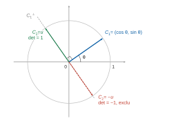
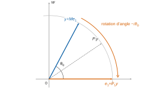
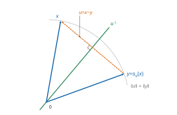

# Mines-Ponts MP — Maths 2 2026 · Corrigé brut

*Corrigé rédigé par IA, non officiel. Signalez toute erreur.*

**Autour de $\mathrm{O}_n(\mathbb{R})$ et $\mathrm{SL}_n(\mathbb{R})$.** Durée 4 h, calculatrice et tout dispositif électronique interdits. 30 questions.

**Conventions.** $n\ge 2$, $E=\mathbb{R}^n$ muni du produit scalaire canonique et de la norme euclidienne $\|\cdot\|$. On munit $\mathcal{M}_n(\mathbb{R})$ du produit scalaire et de la norme associée :

$$\begin{aligned}\langle A,B\rangle&=\operatorname{tr}(A^\top B)=\sum_{i,j}a_{ij}b_{ij},\\\|A\|&=\sqrt{\langle A,A\rangle},\end{aligned}$$

de sorte que $g(M)=\|M\|^2$ et $\|A^\top\|=\|A\|$. Par l'inégalité de Cauchy-Schwarz appliquée à chaque coefficient $(AB)_{ij}=\sum_k a_{ik}b_{kj}$, on a $\|AB\|\le\|A\|\,\|B\|$.

De même, $\|AX\|\le\|A\|\,\|X\|$ pour $X\in\mathbb{C}^n$, muni de la norme hermitienne canonique $\|X\|^2=\sum|x_k|^2$, car la majoration $|\sum_k a_{ik}x_k|^2\le(\sum_k a_{ik}^2)(\sum_k|x_k|^2)$ reste valable. On note $\mathcal{A}_n(\mathbb{R})$ l'ensemble des matrices antisymétriques.

---

## I. Quelques propriétés de $\mathrm{O}_n(\mathbb{R})$

### Question 1

Le polynôme caractéristique est $\chi_{R_\theta}=X^2-2\cos(\theta)X+1$, de discriminant $4\cos^2\theta-4=-4\sin^2\theta$.

- Si $\sin\theta=0$ ($\theta\in\pi\mathbb{Z}$) : $R_\theta=\cos(\theta)I_2=\pm I_2$ est diagonale, donc diagonalisable sur $\mathbb{R}$ et sur $\mathbb{C}$.
- Si $\sin\theta\neq0$ : le discriminant est $<0$, donc $\chi_{R_\theta}$ n'a pas de racine réelle et $R_\theta$ n'a aucune valeur propre réelle.

  Une matrice diagonalisable sur $\mathbb{R}$ est semblable à une matrice diagonale réelle dont les coefficients sont des valeurs propres réelles : $R_\theta$ n'est donc pas diagonalisable sur $\mathbb{R}$.

  Sur $\mathbb{C}$, $\chi_{R_\theta}$ a les deux racines $e^{i\theta}$ et $e^{-i\theta}$ (somme $2\cos\theta$, produit $1$).

  Elles sont distinctes puisque $e^{i\theta}-e^{-i\theta}=2i\sin\theta\neq0$. Une matrice de taille 2 ayant deux valeurs propres distinctes est diagonalisable : $R_\theta$ est semblable à $\operatorname{diag}(e^{i\theta},e^{-i\theta})$.

**$R_\theta$ est toujours diagonalisable sur $\mathbb{C}$ ; elle est diagonalisable sur $\mathbb{R}$ si et seulement si $\theta\in\pi\mathbb{Z}$, c'est-à-dire $R_\theta=\pm I_2$.**

### Question 2

*Inclusion $\supset$.* Par le calcul direct,

$$R_\theta^\top R_\theta=\begin{pmatrix}\cos^2\theta+\sin^2\theta&0\\0&\sin^2\theta+\cos^2\theta\end{pmatrix}=I_2,$$

et $\det R_\theta=\cos^2\theta+\sin^2\theta=1$, donc $R_\theta\in\mathrm{SO}_2(\mathbb{R})$.

*Inclusion $\subset$.* Soit $M=\begin{pmatrix}a&b\\c&d\end{pmatrix}\in\mathrm{SO}_2(\mathbb{R})$, de colonnes $C_1=(a,c)$ et $C_2=(b,d)$. La relation $M^\top M=I_2$ signifie que $(C_1,C_2)$ est orthonormée :

$$\begin{aligned}a^2+c^2&=1,\\b^2+d^2&=1,\\ab+cd&=0.\end{aligned}$$

Comme $a^2+c^2=1$, il existe $\theta\in\mathbb{R}$ tel que $a=\cos\theta$ et $c=\sin\theta$ (paramétrage du cercle unité).

Le vecteur $C_2$ appartient à $C_1^\perp$, droite de $\mathbb{R}^2$ dirigée par le vecteur unitaire $u=(-\sin\theta,\cos\theta)$. Étant unitaire, $C_2=\pm u$.

Si $C_2=-u$, alors $M=\begin{pmatrix}\cos\theta&\sin\theta\\\sin\theta&-\cos\theta\end{pmatrix}$ et $\det M=-1$, exclu. Donc $C_2=u$ et $M=R_\theta$.

$$\boxed{\mathrm{SO}_2(\mathbb{R})=\{R_\theta,\ \theta\in\mathbb{R}\}}$$

### Question 3

*Compacité.* L'application $f:M\mapsto M^\top M$ est continue, car ses coefficients sont polynomiaux en ceux de $M$. Donc $\mathrm{O}_n(\mathbb{R})=f^{-1}(\{I_n\})$ est fermé, image réciproque d'un fermé par une application continue.

Pour $M\in\mathrm{O}_n(\mathbb{R})$, $\|M\|^2=\operatorname{tr}(M^\top M)=\operatorname{tr}(I_n)=n$, donc $\|M\|=\sqrt n$ : $\mathrm{O}_n(\mathbb{R})$ est borné. Fermé et borné dans l'espace $\mathcal{M}_n(\mathbb{R})$ de dimension finie, **$\mathrm{O}_n(\mathbb{R})$ est compact**.

*Non-connexité par arcs.* Pour $M\in\mathrm{O}_n(\mathbb{R})$, $(\det M)^2=\det(M^\top M)=1$, donc $\det M\in\{-1,1\}$. Les deux valeurs sont atteintes :

- $I_n\in\mathrm{O}_n(\mathbb{R})$, de déterminant $1$ ;
- $S=\operatorname{diag}(-1,1,\dots,1)\in\mathrm{O}_n(\mathbb{R})$, car $S^\top S=S^2=I_n$, de déterminant $-1$.

S'il existait un chemin continu $\gamma:[0,1]\to\mathrm{O}_n(\mathbb{R})$ de $I_n$ à $S$, la fonction réelle continue $\det\circ\gamma$ passerait de $1$ à $-1$.

Par le théorème des valeurs intermédiaires, elle s'annulerait, ce qui contredit $\det(\mathrm{O}_n(\mathbb{R}))\subset\{-1,1\}$. **$\mathrm{O}_n(\mathbb{R})$ n'est pas connexe par arcs.**

### Question 4

Il suffit de joindre tout $M\in\mathrm{SO}_n(\mathbb{R})$ à $I_n$ par un chemin continu à valeurs dans $\mathrm{SO}_n(\mathbb{R})$ : deux éléments quelconques sont alors reliés en passant par $I_n$ (concaténation de chemins). On le montre par récurrence sur $n\ge2$.

*Cas $n=2$.* Par la question 2, $M=R_\theta$.

Le chemin $t\mapsto R_{(1-t)\theta}$, $t\in[0,1]$, est continu, à valeurs dans $\mathrm{SO}_2(\mathbb{R})$, et va de $M$ à $I_2$.

*Hérédité.* Soit $n\ge3$, la propriété étant acquise en dimension $n-1$. Soit $M\in\mathrm{SO}_n(\mathbb{R})$ et $y=Me_1$, unitaire.

1. *On ramène $y$ sur $e_1$.* Choisissons un vecteur unitaire $w\perp e_1$ et $\theta_0\in[0,\pi]$ tels que $y=\cos(\theta_0)e_1+\sin(\theta_0)w$.

   - Si $y\neq\pm e_1$, on prend $\cos\theta_0=\langle y,e_1\rangle$, $\sin\theta_0=\|y-\langle y,e_1\rangle e_1\|$ et
     $$w=\dfrac{y-\langle y,e_1\rangle e_1}{\|y-\langle y,e_1\rangle e_1\|}.$$
   - Si $y=e_1$, $\theta_0=0$ et $w$ est quelconque ; si $y=-e_1$, $\theta_0=\pi$ et $w$ est quelconque.

   Complétons $(e_1,w)$ en une base orthonormée de $E$, de matrice de passage $U\in\mathrm{O}_n(\mathbb{R})$, et posons, pour $t\in[0,1]$,
   $$P_t=U\begin{pmatrix}R_{-t\theta_0}&0\\0&I_{n-2}\end{pmatrix}U^{-1}.$$
   $P_t$ est orthogonale (produit de matrices orthogonales), de déterminant $\det R_{-t\theta_0}=1$. L'application $t\mapsto P_t$ est continue et $P_0=I_n$.

   Comme $U^{-1}y=(\cos\theta_0,\sin\theta_0,0,\dots,0)^\top$ et $R_{-\theta_0}(\cos\theta_0,\sin\theta_0)^\top=(1,0)^\top$, on a $P_1y=e_1$.

   Le chemin $t\mapsto P_tM$ est continu dans $\mathrm{SO}_n(\mathbb{R})$ et joint $M$ à $M'=P_1M$, qui vérifie $M'e_1=e_1$.
2. *On descend en dimension $n-1$.* $M'$ fixe $e_1$. Pour $x\perp e_1$,
   $$\begin{aligned}\langle M'x,e_1\rangle&=\langle M'x,M'e_1\rangle\\&=\langle x,e_1\rangle=0,\end{aligned}$$
   donc $M'$ stabilise $e_1^\perp=\operatorname{Vect}(e_2,\dots,e_n)$ et $M'=\begin{pmatrix}1&0\\0&M''\end{pmatrix}$, avec $M''^\top M''=I_{n-1}$ et $\det M''=\det M'=1$.

   Par hypothèse de récurrence, un chemin $\Gamma$ joint $M''$ à $I_{n-1}$ dans $\mathrm{SO}_{n-1}(\mathbb{R})$.

   Le chemin $t\mapsto\begin{pmatrix}1&0\\0&\Gamma(t)\end{pmatrix}$ joint alors $M'$ à $I_n$ dans $\mathrm{SO}_n(\mathbb{R})$.

Par concaténation, $M$ est joint à $I_n$ dans $\mathrm{SO}_n(\mathbb{R})$. **$\mathrm{SO}_n(\mathbb{R})$ est connexe par arcs.**

### Question 5

Soit $H$ un sous-groupe de $\mathrm{O}_n(\mathbb{R})$ contenant $\mathrm{SO}_n(\mathbb{R})$. Si $H\subset\mathrm{SO}_n(\mathbb{R})$, alors $H=\mathrm{SO}_n(\mathbb{R})$.

Sinon, il existe $A\in H$ avec $\det A=-1$. Soit $B\in\mathrm{O}_n(\mathbb{R})$.

- Si $\det B=1$, alors $B\in\mathrm{SO}_n(\mathbb{R})\subset H$.
- Si $\det B=-1$, alors $A^{-1}B\in\mathrm{O}_n(\mathbb{R})$ et $\det(A^{-1}B)=1$, donc $A^{-1}B\in\mathrm{SO}_n(\mathbb{R})\subset H$, puis $B=A(A^{-1}B)\in H$.

Ainsi $\mathrm{O}_n(\mathbb{R})\subset H\subset\mathrm{O}_n(\mathbb{R})$.

**$H=\mathrm{SO}_n(\mathbb{R})$ ou $H=\mathrm{O}_n(\mathbb{R})$.**

### Question 6

*$\mathrm{GL}_2$.* On a $\det Z_2=U-V$ avec $U=Y_{1,1}Y_{2,2}$ et $V=Y_{1,2}Y_{2,1}$. Ces variables sont à valeurs dans $\{0,1\}$ et indépendantes (fonctions de familles disjointes de variables indépendantes).

Par indépendance, $P(U=1)=P(V=1)=p^2$. Alors $Z_2\in\mathrm{GL}_2(\mathbb{R})\iff U\neq V$, d'où

$$\begin{aligned}P(Z_2\in\mathrm{GL}_2(\mathbb{R}))&=P(U=1)P(V=0)+P(U=0)P(V=1)\\&=2p^2(1-p^2).\end{aligned}$$

$$\boxed{P(Z_2\in\mathrm{GL}_2(\mathbb{R}))=2p^2(1-p^2)}$$

*$\mathrm{O}_n$.* Soit $A$ à coefficients dans $\{0,1\}$ et orthogonale.

Chaque colonne $C_j$ vérifie $\|C_j\|^2=\sum_i a_{ij}^2=\sum_i a_{ij}=1$ : elle contient exactement un coefficient $1$, en une ligne notée $\sigma(j)$.

Pour $j\neq j'$, $\langle C_j,C_{j'}\rangle=\sum_i a_{ij}a_{ij'}=0$ avec des termes positifs, donc $\sigma(j)\neq\sigma(j')$. Ainsi $\sigma$ est injective, donc bijective, et $A$ est la matrice de permutation $P_\sigma$. Réciproquement, toute matrice de permutation est orthogonale (ses colonnes forment une permutation de la base canonique).

Les événements $\{Z_n=P_\sigma\}$ sont deux à deux incompatibles. Par indépendance des $n^2$ coefficients, $P(Z_n=P_\sigma)=p^n(1-p)^{n^2-n}$. Donc

$$\boxed{P(Z_n\in\mathrm{O}_n(\mathbb{R}))=n!\,p^n(1-p)^{n^2-n}.}$$

*$\mathrm{SO}_n$.* On a $\det P_\sigma=\varepsilon(\sigma)$, donc $P_\sigma\in\mathrm{SO}_n(\mathbb{R})$ si et seulement si $\sigma$ est paire.

Pour $n\ge2$, la signature est un morphisme surjectif de $\mathfrak{S}_n$ sur $\{-1,1\}$, de noyau $\mathfrak{A}_n$ ; donc $\mathfrak{A}_n$ a $n!/2$ éléments, et

$$\boxed{P(Z_n\in\mathrm{SO}_n(\mathbb{R}))=\frac{n!}{2}\,p^n(1-p)^{n^2-n}.}$$

### Question 7

Pour $u\in E$ non nul, la réflexion d'hyperplan $u^\perp$ est

$$s_u:v\mapsto v-2\dfrac{\langle v,u\rangle}{\|u\|^2}u ;$$

sa matrice dans la base canonique est une matrice de réflexion (orthogonale, de déterminant $-1$).

- Si $x\neq y$, posons $u=x-y\neq0$. Comme $\|x\|=\|y\|$,
  $$\begin{aligned}\|u\|^2&=\|x\|^2-2\langle x,y\rangle+\|y\|^2\\&=2(\|x\|^2-\langle x,y\rangle)\\&=2\langle x,u\rangle,\end{aligned}$$
  donc $s_u(x)=x-u=y$. Géométriquement : $\langle x+y,x-y\rangle=\|x\|^2-\|y\|^2=0$, donc $x+y\in u^\perp$ est fixé par $s_u$ et $x-y$ est changé en son opposé.

  Avec $x=\frac12(x+y)+\frac12(x-y)$, on retrouve $s_u(x)=\frac12(x+y)-\frac12(x-y)=y$.
- Si $x=y$, comme $n\ge2$, l'hyperplan $x^\perp$ est de dimension au moins $n-1\ge1$.

  Il existe donc $u\neq0$ orthogonal à $x$, et alors $s_u(x)=x=y$.

  L'identité, de déterminant $1$, n'est pas une réflexion : ce cas demande bien une réflexion d'hyperplan contenant $x$.

**Dans les deux cas, la matrice $A$ de $s_u$ est une matrice de réflexion telle que $Ax=y$.**

### Question 8

Soient $G\in\mathcal{G}$, $x$ unitaire et $\lambda=\|Gx\|$ ; $\lambda>0$ car $G$ est inversible et $x\neq0$.

*Cas $p=1$.* On a $\|\lambda x\|=\lambda=\|Gx\|$. Par la question 7, il existe une matrice de réflexion $A$ avec $A(Gx)=\lambda x$.

Comme $A\in\mathrm{O}_n(\mathbb{R})\subset\mathcal{G}$ et que $\mathcal{G}$ est un groupe, $G_1:=AG\in\mathcal{G}$ et $G_1x=\lambda x$.

*Cas général.* Posons $G_p=G_1^{\,p}\in\mathcal{G}$ pour $p\in\mathbb{Z}$ (stabilité d'un groupe par puissances entières). Par récurrence, $G_1^{\,p}x=\lambda^px$ pour $p\in\mathbb{N}$.

De $G_1x=\lambda x$ et $\lambda\neq0$, on tire $G_1^{-1}x=\lambda^{-1}x$, puis $G_1^{-p}x=\lambda^{-p}x$ pour $p\in\mathbb{N}$. Ainsi

$$\boxed{\forall p\in\mathbb{Z},\ G_p\in\mathcal{G}\ \text{ et }\ G_px=\|Gx\|^p\,x.}$$

### Question 9

$\mathcal{G}$ est compact donc borné : il existe $C>0$ tel que $\|H\|\le C$ pour tout $H\in\mathcal{G}$.

Soient $G\in\mathcal{G}$, $x$ unitaire et $\lambda=\|Gx\|>0$. Pour tout $p\in\mathbb{Z}$, avec $G_p$ de la question 8,

$$\begin{aligned}\lambda^p&=\|G_px\|\\&\le\|G_p\|\,\|x\|\\&\le C.\end{aligned}$$

Si $\lambda>1$, $\lambda^p\to+\infty$ quand $p\to+\infty$ ; si $\lambda<1$, $\lambda^p\to+\infty$ quand $p\to-\infty$ : contradiction dans les deux cas.

Donc $\|Gx\|=1$ pour tout $x$ unitaire, puis, par homogénéité, $\|Gv\|=\|v\|$ pour tout $v\in E$.

Par polarisation, avec $\langle a,b\rangle=\frac12(\|a+b\|^2-\|a\|^2-\|b\|^2)$, on obtient $\langle Ga,Gb\rangle=\langle a,b\rangle$, c'est-à-dire $\langle(G^\top G-I_n)a,b\rangle=0$ pour tous $a,b$. Avec $b=(G^\top G-I_n)a$, on obtient $G^\top G=I_n$.

Donc $\mathcal{G}\subset\mathrm{O}_n(\mathbb{R})$, et l'inclusion réciproque est une hypothèse :

$$\boxed{\mathcal{G}=\mathrm{O}_n(\mathbb{R}).}$$

---

## II. Calcul différentiel sur $\mathrm{O}_n(\mathbb{R})$ et $\mathrm{SL}_n(\mathbb{R})$

### Question 10

*Classe $\mathcal{C}^1$.* Les coordonnées de $f$ dans la base canonique sont

$$\begin{aligned}f(M)_{ij}&=(M^\top M)_{ij}\\&=\sum_{k=1}^n m_{ki}m_{kj},\end{aligned}$$

fonctions polynomiales des coefficients de $M$. Toutes les dérivées partielles existent et sont continues : **$f$ est de classe $\mathcal{C}^1$** (et même $\mathcal{C}^\infty$).

*Différentielle.* Pour $M,H\in\mathcal{M}_n(\mathbb{R})$ :

$$f(M+H)=f(M)+(M^\top H+H^\top M)+H^\top H.$$

L'application $L_M:H\mapsto M^\top H+H^\top M$ est linéaire : pour $H,K$ et $\mu\in\mathbb{R}$, $L_M(H+\mu K)=L_M(H)+\mu L_M(K)$, par linéarité de la transposition et bilinéarité du produit. Le reste vérifie, par sous-multiplicativité et $\|H^\top\|=\|H\|$ pour la norme choisie,

$$\begin{aligned}\|H^\top H\|&\le\|H^\top\|\,\|H\|\\&=\|H\|^2=o(\|H\|).\end{aligned}$$

Donc $f$ est différentiable en tout $M$ et

$$\boxed{\mathrm{d}f(M)\cdot H=M^\top H+H^\top M.}$$

On retrouve le caractère $\mathcal{C}^1$ : $M\mapsto\mathrm{d}f(M)$ est linéaire de $\mathcal{M}_n(\mathbb{R})$ dans $\mathcal{L}(\mathcal{M}_n(\mathbb{R}))$, espace de dimension finie, donc continue.

### Question 11

Soit $H\in T$, associé à $\gamma:\,]-\varepsilon,\varepsilon[\,\to\mathrm{O}_n(\mathbb{R})$ dérivable en $0$, avec $\gamma(0)=I_n$ et $\gamma'(0)=H$.

On a $f\circ\gamma=I_n$ (constante). Comme $f$ est différentiable en $I_n$ et $\gamma$ dérivable en $0$, la règle de dérivation le long d'un arc donne

$$\begin{aligned}0&=(f\circ\gamma)'(0)\\&=\mathrm{d}f(I_n)\cdot H\\&=H+H^\top.\end{aligned}$$

**Donc $H^\top=-H$ : $T\subset\mathcal{A}_n(\mathbb{R})$.**

### Question 12

*Somme.* Soient $H,K\in T$, d'arcs $\gamma_H$ et $\gamma_K$.

Sur $]-\varepsilon,\varepsilon[$ avec $\varepsilon=\min(\varepsilon_H,\varepsilon_K)$, posons $\gamma=\gamma_H\gamma_K$. Cet arc est à valeurs dans $\mathrm{O}_n(\mathbb{R})$ (groupe) et $\gamma(0)=I_n$.

Le produit matriciel étant bilinéaire, $\gamma$ est dérivable en $0$ avec

$$\begin{aligned}\gamma'(0)&=\gamma_H'(0)\gamma_K(0)+\gamma_H(0)\gamma_K'(0)\\&=H+K.\end{aligned}$$

Donc **$H+K\in T$**.

*Structure d'espace vectoriel.* $0\in T$ (arc constant égal à $I_n$).

Pour $H\in T$ et $\lambda\neq0$, l'arc $\delta(t)=\gamma_H(\lambda t)$, défini sur $]-\varepsilon/|\lambda|,\varepsilon/|\lambda|[$, est à valeurs dans $\mathrm{O}_n(\mathbb{R})$.

Il vérifie $\delta(0)=I_n$ et il est dérivable en $0$ de dérivée $\lambda H$ ; donc $\lambda H\in T$ (et $0\cdot H=0\in T$).

**$T$ est un sous-espace vectoriel de $\mathcal{M}_n(\mathbb{R})$**, donc un $\mathbb{R}$-espace vectoriel.

### Question 13

Soit $H\in\mathcal{A}_n(\mathbb{R})$ et $\gamma(t)=\exp(tH)$. Par continuité de la transposition, $\exp(tH)^\top=\exp(tH^\top)=\exp(-tH)$. Comme $tH$ et $-tH$ commutent,

$$\begin{aligned}\gamma(t)^\top\gamma(t)&=\exp(-tH)\exp(tH)\\&=\exp(0)=I_n :\end{aligned}$$

$\gamma$ est à valeurs dans $\mathrm{O}_n(\mathbb{R})$, et $\gamma(0)=I_n$. Enfin, pour $t\neq0$,

$$\begin{aligned}\Big\|\frac{\gamma(t)-I_n}{t}-H\Big\|&\le\frac1{|t|}\sum_{k\ge2}\frac{|t|^k\|H\|^k}{k!}\\&=\frac{e^{|t|\|H\|}-1-|t|\|H\|}{|t|}\xrightarrow[t\to0]{}0,\end{aligned}$$

donc $\gamma'(0)=H$ et $H\in T$. Avec la question 11 :

$$\boxed{T=\mathcal{A}_n(\mathbb{R}).}$$

$T$ est l'ensemble des matrices $H\in\mathcal{M}_n(\mathbb{R})$ telles que $H^\top=-H$.

### Question 14

Pour $t>0$, la matrice $D_t=\operatorname{diag}(t,1/t,1,\dots,1)$ (possible car $n\ge2$) vérifie $\det D_t=1$ et

$$g(D_t)=t^2+\frac1{t^2}+(n-2)\xrightarrow[t\to+\infty]{}+\infty.$$

**La restriction de $g$ à $\mathrm{SL}_n(\mathbb{R})$ n'est pas majorée, donc n'a pas de maximum global.**

### Question 15

On a $g(M)=\sum_{i,j}m_{ij}^2$ et $\det M=\sum_{\sigma\in\mathfrak{S}_n}\varepsilon(\sigma)\prod_i m_{\sigma(i)i}$. Ces fonctions sont polynomiales en les coefficients de $M$, donc de classe $\mathcal{C}^\infty$, en particulier $\mathcal{C}^1$.

*Gradient de $g$.* Comme $\operatorname{tr}(H^\top M)=\operatorname{tr}(M^\top H)$,

$$g(M+H)=g(M)+2\langle M,H\rangle+\|H\|^2,$$

et $\|H\|^2=o(\|H\|)$, donc $\mathrm{d}g(M)\cdot H=\langle 2M,H\rangle$ :

$$\boxed{\nabla g(M)=2M.}$$

*Gradient de $\det$.* Notons $\Delta_{ik}(M)$ le mineur d'indice $(i,k)$ : c'est le déterminant de la matrice extraite de $M$ en supprimant la ligne $i$ et la colonne $k$.

Le cofacteur est $\operatorname{Com}(M)_{ik}=(-1)^{i+k}\Delta_{ik}(M)$.

Le développement selon la ligne $i$ s'écrit

$$\det M=\sum_k m_{ik}\operatorname{Com}(M)_{ik}.$$

Le cofacteur $\operatorname{Com}(M)_{ik}$ ne fait intervenir aucun coefficient de la ligne $i$, donc ne dépend pas de $m_{ij}$. Par conséquent $\dfrac{\partial\det}{\partial m_{ij}}(M)=\operatorname{Com}(M)_{ij}$, et, $\det$ étant $\mathcal{C}^1$,

$$\begin{aligned}\mathrm{d}\det(M)\cdot H&=\sum_{i,j}\operatorname{Com}(M)_{ij}h_{ij}\\&=\langle\operatorname{Com}(M),H\rangle.\end{aligned}$$

$$\boxed{\nabla\det(M)=\operatorname{Com}(M).}$$

### Question 16

$\mathrm{SL}_n(\mathbb{R})$ est l'ensemble des zéros de $h=\det-1$, de classe $\mathcal{C}^1$ sur l'ouvert $\mathcal{M}_n(\mathbb{R})$, et $g$ y est aussi de classe $\mathcal{C}^1$ (question 15).

Soit $M\in\mathrm{SL}_n(\mathbb{R})$ où $g_{|\mathrm{SL}_n(\mathbb{R})}$ a un extremum local.

Comme $M\operatorname{Com}(M)^\top=\det(M)I_n=I_n$, on a $\operatorname{Com}(M)=(M^{-1})^\top\neq0$, donc $\mathrm{d}h(M)\neq0$.

Le théorème d'optimisation sous une contrainte s'applique et donne la colinéarité de $\mathrm{d}g(M)$ et $\mathrm{d}h(M)$ : il existe $\mu\in\mathbb{R}$ tel que $2M=\mu\operatorname{Com}(M)$. Avec $\lambda=\mu/2$ :

$$\boxed{M=\lambda\operatorname{Com}(M),\ \lambda\in\mathbb{R}.}$$

Alors $M=\lambda(M^{-1})^\top$, d'où $M^\top=\lambda M^{-1}$ et $M^\top M=\lambda I_n$.

- En prenant la trace : $n\lambda=\|M\|^2>0$ (car $M\neq0$), donc $\lambda>0$.
- En prenant le déterminant : $\lambda^n=\det(\lambda I_n)=(\det M)^2=1$.

Comme $\lambda>0$, $\lambda=1$. Ainsi $M^\top M=I_n$ et $\det M=1$, **donc $M\in\mathrm{SO}_n(\mathbb{R})$**.

### Question 17

*Existence.* Soit

$$\begin{aligned}K&=\{M\in\mathrm{SL}_n(\mathbb{R}),\ g(M)\le n\}\\&=\det{}^{-1}(\{1\})\cap g^{-1}(]-\infty,n]).\end{aligned}$$

$K$ est fermé (intersection d'images réciproques de fermés par des applications continues), borné ($\|M\|^2\le n$) et non vide ($I_n\in K$), donc compact (dimension finie). La fonction continue $g$ y atteint son minimum en un $M_0$, avec $g(M_0)\le g(I_n)=n$.

Pour $M\in\mathrm{SL}_n(\mathbb{R})\setminus K$, $g(M)>n\ge g(M_0)$. Donc $g(M_0)$ est le **minimum global** de $g$ sur $\mathrm{SL}_n(\mathbb{R})$.

*Valeur et points.* Si $M$ réalise ce minimum, c'est un extremum local de $g_{|\mathrm{SL}_n(\mathbb{R})}$. Donc $M\in\mathrm{SO}_n(\mathbb{R})$ (question 16) et $g(M)=\operatorname{tr}(I_n)=n$.

Réciproquement, tout $M\in\mathrm{SO}_n(\mathbb{R})$ est dans $\mathrm{SL}_n(\mathbb{R})$ et vérifie $g(M)=n$.

$$\boxed{\min_{\mathrm{SL}_n(\mathbb{R})}g=n,\ \text{atteint exactement sur }\mathrm{SO}_n(\mathbb{R}).}$$

---

## III. Morphismes continus de $\mathbb{U}$ dans $\mathrm{GL}_n(\mathbb{R})$

### Question 18

*Sous-groupes bornés de $\mathbb{R}^*$.* Soit $H$ un sous-groupe borné et $x\in H$ ; $x^k\in H$ pour tout $k\in\mathbb{Z}$.

Si $|x|>1$, $|x|^k\to+\infty$ quand $k\to+\infty$ ; si $|x|<1$, $|x|^{-k}\to+\infty$ : contradiction.

Donc $|x|=1$ et $H\subset\{-1,1\}$.

Comme $H$ contient $1$, **les sous-groupes bornés de $\mathbb{R}^*$ sont $\{1\}$ et $\{-1,1\}$** (qui sont bien des sous-groupes bornés).

*Conséquence.* $\delta=\det\circ\varphi:\mathbb{U}\to\mathbb{R}^*$ est un morphisme de groupes continu. Son image est un sous-groupe de $\mathbb{R}^*$. Elle est compacte comme image continue du compact $\mathbb{U}$, donc bornée : $\delta(\mathbb{U})\subset\{-1,1\}$.

Par ailleurs, $\mathbb{U}$ est connexe par arcs (image de $\mathbb{R}$ par $t\mapsto e^{it}$).

Donc $\delta(\mathbb{U})$ est une partie connexe par arcs de $\mathbb{R}$, c'est-à-dire un intervalle, contenu dans $\{-1,1\}$ et contenant $\delta(1)=1$ : $\delta(\mathbb{U})=\{1\}$.

$$\boxed{\varphi(\mathbb{U})\subset\mathrm{SL}_n(\mathbb{R}).}$$

### Question 19

$K=\varphi(\mathbb{U})$ est compact (image continue d'un compact), donc il existe $C$ tel que $\|A\|\le C$ pour $A\in K$.

Soient $z\in\mathbb{U}$, $A=\varphi(z)$, $\lambda\in\mathrm{Sp}_{\mathbb{C}}(A)$ et $X\in\mathbb{C}^n\setminus\{0\}$ tel que $AX=\lambda X$.

On a $\lambda\neq0$ car $A$ est inversible.

Pour $k\in\mathbb{Z}$, $A^k=\varphi(z^k)\in K$ et $A^kX=\lambda^kX$, donc

$$\begin{aligned}|\lambda|^k\|X\|&=\|A^kX\|\\&\le\|A^k\|\,\|X\|\\&\le C\|X\|,\end{aligned}$$

soit $|\lambda|^k\le C$ pour tout $k\in\mathbb{Z}$.

Cela impose $|\lambda|=1$ (sinon $|\lambda|^k$ tend vers $+\infty$ en $+\infty$ ou en $-\infty$).

$$\boxed{\mathrm{Sp}_{\mathbb{C}}(\varphi(z))\subset\mathbb{U}.}$$

### Question 20

Pour $x,y\in\mathbb{R}$, $e^{i(x+y)}=e^{ix}e^{iy}$ et $\varphi$ est un morphisme, donc

$$\begin{aligned}\Psi(x+y)&=\varphi(e^{ix}e^{iy})\\&=\varphi(e^{ix})\varphi(e^{iy})\\&=\Psi(x)\Psi(y).\end{aligned}$$

On note pour la suite que $\Psi$ est continue (composée), que $\Psi(0)=\varphi(1)=I_n$ et que $\Psi$ est $2\pi$-périodique.

### Question 21

$\Psi$ est continue, donc, par le théorème fondamental de l'analyse (coordonnée par coordonnée), $F$ est dérivable de dérivée $\Psi$ continue : **$F$ est de classe $\mathcal{C}^1$**.

De plus $F(0)=0$ et $F'(0)=\Psi(0)=I_n$, donc

$$G(x)=\frac{F(x)}{x}\xrightarrow[x\to0]{}I_n.$$

$\mathrm{GL}_n(\mathbb{R})=\det^{-1}(\mathbb{R}^*)$ est un ouvert (image réciproque de l'ouvert $\mathbb{R}^*$ par l'application continue $\det$) contenant $I_n$. Il existe donc $r>0$ tel que $B(I_n,r)\subset\mathrm{GL}_n(\mathbb{R})$.

Par la limite précédente, il existe $\alpha>0$ tel que $0<|x|\le\alpha\Rightarrow\|G(x)-I_n\|<r$, donc $G(x)$ est inversible. Pour $x\in[-\alpha,\alpha]\setminus\{0\}$, $F(x)=xG(x)$ est alors inversible ($x\neq0$).

### Question 22

Soit $x\in\mathbb{R}$. On utilise le changement de variable $t=x+u$, puis la question 20 et la linéarité de $A\mapsto\Psi(x)A$, qui commute avec l'intégrale ; le facteur $\Psi(x)$ reste à gauche, sans commutation :

$$\begin{aligned}\int_x^{x+\alpha}\Psi(t)\,\mathrm{d}t&=\int_0^\alpha\Psi(x)\Psi(u)\,\mathrm{d}u\\&=\Psi(x)F(\alpha).\end{aligned}$$

$F(\alpha)$ est inversible (question 21), d'où

$$\begin{aligned}\Psi(x)&=\Big(\int_x^{x+\alpha}\Psi(t)\,\mathrm{d}t\Big)F(\alpha)^{-1}\\&=\big(F(x+\alpha)-F(x)\big)F(\alpha)^{-1}.\end{aligned}$$

$$\boxed{\Psi(x)=\Big(\int_x^{x+\alpha}\Psi(t)\,\mathrm{d}t\Big)F(\alpha)^{-1}}$$

$F$ étant de classe $\mathcal{C}^1$ et $A\mapsto AF(\alpha)^{-1}$ linéaire, **$\Psi$ est de classe $\mathcal{C}^1$ sur $\mathbb{R}$**.

### Question 23

Fixons $x$. Pour $h\in\mathbb{R}$, $\Psi(x+h)=\Psi(x)\Psi(h)$.

$\Psi$ étant dérivable en $0$ et $A\mapsto\Psi(x)A$ linéaire, la dérivation en $h=0$ donne $\Psi'(x)=\Psi(x)M$.

Par ailleurs $x\mapsto\exp(-xM)$ est dérivable de dérivée $-M\exp(-xM)=-\exp(-xM)M$. En effet, $\exp((x+h)A)=\exp(xA)\exp(hA)$ et $\exp(hA)=I_n+hA+o(h)$, comme à la question 13.

Posons $V(x)=\Psi(x)\exp(-xM)$. Par dérivation d'un produit (bilinéaire) et commutation de $M$ avec $\exp(-xM)$,

$$V'(x)=\Psi(x)M\exp(-xM)-\Psi(x)M\exp(-xM)=0.$$

$V$ est constante sur l'intervalle $\mathbb{R}$, égale à $V(0)=I_n$. Comme $\exp(-xM)$ a pour inverse $\exp(xM)$, on obtient $\Psi(x)=\exp(xM)$ :

$$\boxed{\forall x\in\mathbb{R},\ \Psi(x)=\varphi(e^{ix})=\exp(xM).}$$

---

## IV. Morphismes de $(\mathbb{R},+)$ dans $(\mathrm{GL}_n(\mathbb{R}),\times)$

### Question 24

Soit $P\in\mathrm{GL}_n(\mathbb{C})$ avec $AP=PB$. Écrivons $P=P_1+iP_2$, avec $P_1,P_2\in\mathcal{M}_n(\mathbb{R})$.

$A$ et $B$ étant réelles, l'identification des parties réelle et imaginaire donne $AP_1=P_1B$ et $AP_2=P_2B$. Donc, pour tout $t\in\mathbb{R}$,

$$A(P_1+tP_2)=(P_1+tP_2)B.$$

Le polynôme $\chi=\det(P_1+XP_2)\in\mathbb{R}[X]$ vérifie $\chi(i)=\det P\neq0$ : il n'est pas nul, donc n'a qu'un nombre fini de racines. Il existe donc $t_0\in\mathbb{R}$ avec $Q=P_1+t_0P_2\in\mathrm{GL}_n(\mathbb{R})$, et $B=Q^{-1}AQ$.

**$A$ et $B$ sont semblables dans $\mathcal{M}_n(\mathbb{R})$.**

### Question 25

On a toujours $\ker N\subset\ker N^2$. Supposons $\ker N=\ker N^2$ et montrons $\ker N^k=\ker N$ pour tout $k\ge1$ par récurrence.

Si $\ker N^k=\ker N$ et $N^{k+1}x=0$, alors $N^k(Nx)=0$, donc $Nx\in\ker N^k=\ker N$. Ainsi $N^2x=0$ et $x\in\ker N^2=\ker N$ ; l'autre inclusion est claire.

$N$ étant nilpotente, $N^p=0$ pour un $p\ge1$, d'où $\ker N=\ker N^p=\mathbb{C}^n$ et $N=0$ : contradiction.

**Donc $\ker N\neq\ker N^2$** (et même $\ker N\subsetneq\ker N^2$).

### Question 26

Par la question 23 en $x=2\pi$ :

$$\begin{aligned}\exp(2\pi M)&=\Psi(2\pi)\\&=\varphi(e^{2i\pi})\\&=\varphi(1)=I_n.\end{aligned}$$

$$\boxed{\exp(2\pi M)=I_n}$$

Soit $\lambda\in\mathrm{Sp}_{\mathbb{C}}(M)$ et $X\neq0$ avec $MX=\lambda X$. Pour tout $N$,

$$\begin{aligned}\Big(\sum_{k=0}^N\frac{(2\pi M)^k}{k!}\Big)X&=\sum_{k=0}^N\frac{(2\pi)^k}{k!}M^kX\\&=\Big(\sum_{k=0}^N\frac{(2\pi\lambda)^k}{k!}\Big)X,\end{aligned}$$

car $M^kX=\lambda^kX$ pour tout $k\in\mathbb{N}$.

Par continuité de $B\mapsto BX$, $\exp(2\pi M)X=e^{2\pi\lambda}X$, donc $e^{2\pi\lambda}=1$. Écrivons $\lambda=a+ib$.

Alors $|e^{2\pi\lambda}|=e^{2\pi a}=1$ donne $a=0$, puis $e^{2i\pi b}=1$ donne $b\in\mathbb{Z}$.

$$\boxed{\mathrm{Sp}_{\mathbb{C}}(M)\subset\{ik,\ k\in\mathbb{Z}\}.}$$

### Question 27

Dans $\mathcal{M}_n(\mathbb{C})$, $\chi_M$ est scindé : $\chi_M=\prod_{j=1}^r(X-\lambda_j)^{m_j}$, les $\lambda_j$ étant distincts.

Par le lemme des noyaux et le théorème de Cayley-Hamilton, $\mathbb{C}^n$ est somme directe des sous-espaces caractéristiques $F_j=\ker(M-\lambda_jI_n)^{m_j}$, stables par $M$, avec $\dim F_j=m_j$.

L'endomorphisme induit par $M$ sur $F_j$ est annulé par $(X-\lambda_j)^{m_j}$, donc a pour seule valeur propre $\lambda_j$.

Il est trigonalisable (sur le corps $\mathbb{C}$) : dans une base de $F_j$, sa matrice est triangulaire supérieure à termes diagonaux tous égaux à $\lambda_j$.

En réunissant ces bases, $M$ est semblable dans $\mathcal{M}_n(\mathbb{C})$ à une matrice diagonale par blocs $T=\operatorname{diag}(T_1,\dots,T_r)$, avec $T_j\in\mathcal{M}_{m_j}(\mathbb{C})$ de cette forme.

Écrivons $T_j=\lambda_jI_{m_j}+S_j$, $S_j$ triangulaire supérieure stricte, et posons

$$\begin{aligned}D&=\operatorname{diag}(\lambda_1I_{m_1},\dots,\lambda_rI_{m_r}),\\N&=\operatorname{diag}(S_1,\dots,S_r),\\T&=D+N.\end{aligned}$$

- $D$ est diagonale avec $\mathrm{Sp}_{\mathbb{C}}(D)=\{\lambda_1,\dots,\lambda_r\}=\mathrm{Sp}_{\mathbb{C}}(M)$.
- $N$ est nilpotente : $S_j^{m_j}=0$, donc $N^{\max m_j}=0$.
- Le produit se faisant bloc par bloc et $\lambda_jI_{m_j}$ commutant avec $S_j$, **$DN=ND$**.

### Question 28

Soit $P\in\mathrm{GL}_n(\mathbb{C})$ avec $M=P(D+N)P^{-1}$. Alors $\exp(2\pi(D+N))=P^{-1}\exp(2\pi M)P=I_n$. Comme $D$ et $N$ commutent, $\exp(2\pi(D+N))=\exp(2\pi D)\exp(2\pi N)$.

Les coefficients diagonaux de $D$ sont des valeurs propres de $M$, donc de la forme $i\ell_s$ avec $\ell_s\in\mathbb{Z}$ (questions 26 et 27). Ainsi

$$\begin{aligned}\exp(2\pi D)&=\operatorname{diag}(e^{2i\pi \ell_1},\dots,e^{2i\pi \ell_n})=I_n,\\\exp(2\pi N)&=\exp(2\pi D)^{-1}\exp(2\pi(D+N))=I_n.\end{aligned}$$

$$\boxed{\exp(2\pi D)=I_n\ \text{ et }\ \exp(2\pi N)=I_n}$$

Supposons $N\neq0$. Par la question 25, il existe $x\in\ker N^2\setminus\ker N$. Comme $N^kx=0$ pour $k\ge2$, $\exp(2\pi N)x=x+2\pi Nx$.

Or $\exp(2\pi N)x=x$, donc $Nx=0$ : contradiction.

**Donc $N=0$** : $M$ est diagonalisable dans $\mathcal{M}_n(\mathbb{C})$, de valeurs propres dans $i\mathbb{Z}$.

### Question 29

$M$ est réelle, donc $\chi_M\in\mathbb{R}[X]$ : ses racines non réelles sont deux à deux conjuguées avec la même multiplicité. La seule valeur propre réelle possible est $0$, de multiplicité $m_0\ge0$.

En listant avec multiplicité les valeurs propres de partie imaginaire $>0$, on obtient $k_1,\dots,k_p\in\mathbb{Z}\setminus\{0\}$ (positifs) tels que le spectre de $M$ compté avec multiplicités soit $(ik_1,-ik_1,\dots,ik_p,-ik_p,0,\dots,0)$, avec $2p+m_0=n$.

Pour $k\in\mathbb{Z}\setminus\{0\}$, soit $J=\begin{pmatrix}0&-1\\1&0\end{pmatrix}$ et $A_k=kJ$.

Son polynôme caractéristique est $X^2+k^2$, de racines distinctes $\pm ik$ : $A_k$ est diagonalisable sur $\mathbb{C}$.

La matrice réelle $R=\operatorname{diag}(A_{k_1},\dots,A_{k_p},0,\dots,0)$ est diagonalisable sur $\mathbb{C}$ (bloc par bloc), avec le même spectre compté avec multiplicités que $M$.

$M$ et $R$ sont donc semblables à une même matrice diagonale, donc semblables dans $\mathcal{M}_n(\mathbb{C})$.

Étant réelles, elles sont semblables dans $\mathcal{M}_n(\mathbb{R})$ (question 24) : $M=QRQ^{-1}$ avec $Q\in\mathrm{GL}_n(\mathbb{R})$.

La matrice $Q$ est construite à partir de $M$ seule, donc **ne dépend pas de $x$** ; il en va de même de $p$ et des $k_j$.

Comme $J^2=-I_2$, en séparant termes pairs et impairs de la série exponentielle (absolument convergente),

$$\begin{aligned}\exp(\theta J)&=\sum_{m\ge0}\frac{(-1)^m\theta^{2m}}{(2m)!}I_2+\sum_{m\ge0}\frac{(-1)^m\theta^{2m+1}}{(2m+1)!}J\\&=\cos(\theta)I_2+\sin(\theta)J\\&=R_\theta.\end{aligned}$$

L'exponentielle d'une matrice diagonale par blocs est diagonale par blocs, de blocs les exponentielles. Avec $\Psi(x)=\exp(xM)=Q\exp(xR)Q^{-1}$ (question 23), on obtient, pour $Q\in\mathrm{GL}_n(\mathbb{R})$ et $k_j\in\mathbb{Z}\setminus\{0\}$ indépendants de $x$ :

$$\boxed{\forall x\in\mathbb{R},\ \Psi(x)=Q\begin{pmatrix}R_{xk_1}&&&&&\\&\ddots&&&&\\&&R_{xk_p}&&&\\&&&1&&\\&&&&\ddots&\\&&&&&1\end{pmatrix}Q^{-1}.}$$

(Si $M=0$, $p=0$ et $\Psi$ est constante égale à $I_n$.)

### Question 30

Soient $Q\in\mathrm{GL}_n(\mathbb{R})$, $p\in\mathbb{N}$ avec $2p\le n$, $k_1,\dots,k_p\in\mathbb{Z}\setminus\{0\}$, et, pour $x\in\mathbb{R}$,

$$\begin{aligned}\Delta(x)&=\operatorname{diag}(R_{xk_1},\dots,R_{xk_p},1,\dots,1),\\\Psi(x)&=Q\Delta(x)Q^{-1}.\end{aligned}$$

- $\det\Psi(x)=\det\Delta(x)=\prod_j\det R_{xk_j}=1$, donc $\Psi(x)\in\mathrm{GL}_n(\mathbb{R})$.
- Les formules d'addition donnent
  $$\begin{aligned}R_\theta R_{\theta'}&=\begin{pmatrix}\cos\theta\cos\theta'-\sin\theta\sin\theta'&-(\sin\theta\cos\theta'+\cos\theta\sin\theta')\\\sin\theta\cos\theta'+\cos\theta\sin\theta'&\cos\theta\cos\theta'-\sin\theta\sin\theta'\end{pmatrix}\\&=R_{\theta+\theta'}.\end{aligned}$$
  Le produit de matrices diagonales par blocs de même découpage se fait bloc par bloc, donc
  $$\begin{aligned}\Delta(x)\Delta(y)&=\operatorname{diag}(R_{(x+y)k_1},\dots,R_{(x+y)k_p},1,\dots,1)\\&=\Delta(x+y),\end{aligned}$$
  puis
  $$\begin{aligned}\Psi(x)\Psi(y)&=Q\Delta(x)Q^{-1}Q\Delta(y)Q^{-1}\\&=Q\Delta(x+y)Q^{-1}\\&=\Psi(x+y).\end{aligned}$$

**$\Psi$ est un morphisme de groupes de $(\mathbb{R},+)$ dans $(\mathrm{GL}_n(\mathbb{R}),\times)$** (en particulier $\Psi(0)=I_n$ et $\Psi(-x)=\Psi(x)^{-1}$).

Il est de plus continu et $2\pi$-périodique, les $k_j$ étant entiers. Cela permet de définir réciproquement un morphisme continu $\varphi:e^{ix}\mapsto\Psi(x)$ de $\mathbb{U}$ dans $\mathrm{GL}_n(\mathbb{R})$.
